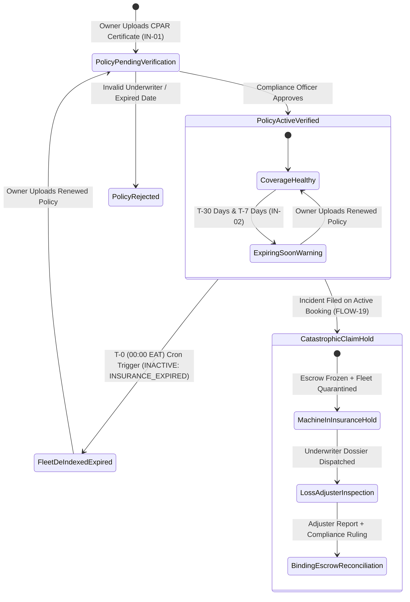

# 02 — Structured Insurance Policy Vault & Catastrophic Claim Filing (`SPEC-MOB-SHR-02`)

| Metadata | Value |
| :--- | :--- |
| **Document ID** | `SPEC-MOB-SHR-02` |
| **Subsystem** | `docs/mobile/shared-features/` |
| **Target Framework** | Flutter 3.x (`flutter_bloc`, `camera`, `isar`, `dio`) |
| **SRS Traceability** | `REQ-05-13` (`IN-01` to `IN-03`), `REQ-05-02` (`FL-04`), `REQ-05-07` (`RC-04`), `REQ-05-18` (`ER-03`) |
| **Architecture / Flows** | `FLOW-19` (`FLOW-INSURANCE-CLAIM`), `FLOW-02`, `ADR-010` (ClamAV `:3310` & Offline Cache) |
| **Design System** | `DS-DINK-CORE-V7.0` (§4.1 Industrial Actuators, §4.3 Precision Viewfinder Reticles) |
| **Status** | Normative — Phase 0 Specification |

---

## 1. Purpose & Requirement Traceability

Heavy earthmoving and lifting machinery (excavators, crawler cranes, wheel loaders valued at `ETB 8M–45M`) cannot legally operate on public infrastructure projects without verified **Comprehensive Plant All-Risks (`CPAR`)** or **Commercial Comprehensive** insurance. This specification governs the **Structured Insurance Policy Vault (`InsurancePolicyVaultScreen`)**, the **Renter-Facing Verified Coverage Trust Shield (`InsuranceTrustModal`)**, and the **Catastrophic Loss & CPAR Insurance Claim Filing Workflow (`CatastrophicClaimFilingScreen`, `FLOW-19`)**:

| Requirement ID | Normative Obligation | Mobile Implementation Mechanism |
| :--- | :--- | :--- |
| **`IN-01` (Structured Policy Ingestion & Accredited Underwriters)** | Equipment Owners MUST attach a structured insurance policy record per machine (`POST /api/v1/fleets/{id}/insurance`) specifying Accredited Underwriter, Policy Number, Coverage Tier (`CPAR`, `COMMERCIAL_COMPREHENSIVE`, `THIRD_PARTY_LIABILITY`), Sum Insured & Deductible in minor units, Effective/Expiry Dates, and scanned certificate. | `InsurancePolicyFormScreen` with jurisdiction underwriter picker (`ET`: EIC, Awash, Nyala, NICE, United, Africa Insurance; `KE`: Jubilee, Britam, CIC, Kenyan Alliance, APA), `Space Mono` minor-unit inputs, and ClamAV-scanned certificate upload. |
| **`IN-02` (Automated Expiry Watchdog & T-0 De-Indexing)** | Policies receive automated renewal warnings at `T-30 days` and `T-7 days`. At `T-0 (00:00 EAT)`, expired machinery is automatically transitioned to `INACTIVE: INSURANCE_EXPIRED` and hidden from marketplace discovery while allowing active bookings to finish safely. | `InsuranceExpiryBanner` on Owner Fleet Dashboard displaying live countdown days (`T-30d` Amber, `T-7d` Crimson, `T-0` De-Indexed Quarantine) with 1-tap `[Upload Renewed Certificate]` recovery. |
| **`IN-03` (Public Renter Trust Shield & Deductible Disclosure)** | Renters browsing machinery MUST see the verified Coverage Tier badge, Underwriter name, and exact Deductible Excess liability (`ETB`/`KES` minor units) without exposing the Owner's confidential premium payment receipt. | `InsuranceTrustShieldCard` on Equipment Detail & Checkout screens opening a read-only coverage breakdown modal (`sumInsuredMinor`, `deductibleMinor`, `underwriterName`, `expiryDate`). |
| **`FLOW-19` (Catastrophic Loss CPAR Claim Filing & Quarantine)** | In the event of rollover, fire, total theft, or third-party casualty exceeding routine wear/damage (`RC-04`), either party can file a formal **Catastrophic Insurance Claim** (`POST /api/v1/bookings/{id}/insurance-claim`), immediately placing the machine in `INSURANCE_HOLD` and freezing escrow settlement pending Independent Loss Adjuster adjudication. | `CatastrophicClaimFilingScreen` capturing incident timestamp, GPS coordinates, Traffic/Federal Police Abstract PDF/photo, >=4 live reticle incident photos, and `64dp` Slide-to-Confirm statutory attestation. |

---

## 2. Domain Context & Non-Negotiable Invariants

1. **Minor-Unit Monetary Precision Invariant (`AGENTS.md` §2):** `sumInsuredMinor`, `deductibleExcessMinor`, and `estimatedLossAmountMinor` are transmitted strictly as 64-bit integers (`int` in Dart, representing cents/santims) paired with `currency: "ETB" | "KES"`. Floating-point representations are forbidden.
2. **Confidentiality of Owner Premium (`IN-03`):** While the Owner's full policy certificate is stored in the encrypted S3/MinIO Compliance Vault for Compliance Officer and Loss Adjuster inspection, the Renter API projection (`GET /api/v1/fleets/{id}/insurance-summary`) strips the raw PDF URL and premium rate, exposing only the verified underwriter, policy number mask, coverage tier, sum insured, and deductible excess.
3. **Immediate `INSURANCE_HOLD` Fleet Quarantine (`FLOW-19`):** Submitting a Catastrophic Insurance Claim atomically transitions the equipment status to `INSURANCE_HOLD` (blocking all future bookings) and locks the booking's escrow balance in `EscrowLiabilityAccount` until the Independent Loss Adjuster uploads the signed Survey Report and Compliance Officer (`Yohannes Bekele`) executes the settlement split.

---

## 3. Bespoke ASCII Wireframes

### 3.1 Owner Policy Ingestion & Expiry Watchdog (`InsurancePolicyVaultScreen`)
```text
+-----------------------------------------------------------------------+
|  [<-]  EQUIPMENT INSURANCE VAULT (CAT 320DEXC)      [🛡️ IN-01..03]    |
+-----------------------------------------------------------------------+
|  +-----------------------------------------------------------------+  |
|  | ⚠️ RENEWAL ALERT: POLICY EXPIRES IN 6 DAYS (05 NOV 2026)        |  |
|  | Machine will be automatically de-indexed from search at 00:00   |  |
|  | EAT on 05 Nov 2026 unless a renewed certificate is verified.    |  |
|  +-----------------------------------------------------------------+  |
|                                                                       |
|  ACCREDITED UNDERWRITER & COVERAGE TIER (ETHIOPIA - ET)               |
|  +-----------------------------------------------------------------+  |
|  | UNDERWRITER: [ Awash Insurance Company S.C.                 v ] |  |
|  | POLICY NO.:  AIC/AA/CPAR/2025/0094821                           |  |
|  | TIER:        [◉ CPAR (Comprehensive Plant All-Risks)          ] |  |
|  +-----------------------------------------------------------------+  |
|                                                                       |
|  SUM INSURED & RENTER DEDUCTIBLE EXCESS (MINOR UNITS — ETB)           |
|  +-------------------------------+ +-------------------------------+  |
|  | SUM INSURED (ASSET VALUE) *   | | DEDUCTIBLE EXCESS PER CLAIM * |  |
|  | ETB  14,500,000.00            | | ETB  75,000.00                |  |
|  | (1450000000 minor units)      | | (7500000 minor units)         |  |
|  +-------------------------------+ +-------------------------------+  |
|                                                                       |
|  POLICY EFFECTIVE WINDOW & CERTIFICATE SCAN (CLAMAV :3310)            |
|  +-------------------------------+ +-------------------------------+  |
|  | EFFECTIVE: 06 Nov 2025 GC     | | EXPIRY:    05 Nov 2026 GC     |  |
|  +-------------------------------+ +-------------------------------+  |
|  | 📄 awash_cpar_policy_2026.pdf (412 KB)             [🟢 VERIFIED] |  |
|  | [ 📷 CAPTURE RENEWED POLICY ]      [ 📎 UPLOAD RENEWED PDF ]    |  |
|  +-----------------------------------------------------------------+  |
+-----------------------------------------------------------------------+
```

### 3.2 Catastrophic Loss CPAR Claim Filing (`CatastrophicClaimFilingScreen` — `FLOW-19`)
```text
+-----------------------------------------------------------------------+
|  [<-]  FILE CATASTROPHIC INSURANCE CLAIM (#BK-8941)  [🚨 FLOW-19]     |
+-----------------------------------------------------------------------+
|  INCIDENT CLASSIFICATION & GPS TELEMETRY                              |
|  +-------------------+ +-------------------+ +---------------------+  |
|  | [◉] ROLLOVER/TIP  | | [ ] FIRE / FLOOD  | | [ ] THEFT / 3RD PTY |  |
|  +-------------------+ +-------------------+ +---------------------+  |
|  | 📍 GPS: 8.9806° N, 38.7578° E (Bole Lemi Industrial Zone)       |  |
|  | 🕒 Incident Time: 30 Oct 2026, 14:20 EAT (20 Tikimt 2019 E.C.)  |  |
|  +-----------------------------------------------------------------+  |
|                                                                       |
|  MANDATORY EVIDENCE DOSSIER (LIVE RETICLE + POLICE ABSTRACT)          |
|  +-----------------------------------------------------------------+  |
|  | 1. Wide-Angle Scene & Machine Posture (4/4 Photos) [✓ CAPTURED] |  |
|  | 2. Chassis Serial Plate Verification Photo         [✓ CAPTURED] |  |
|  | 3. Federal / Traffic Police Incident Report        [✓ ATTACHED] |  |
|  |    📄 police_abstract_bole_subcity_948.webp (108 KB)            |  |
|  +-----------------------------------------------------------------+  |
|                                                                       |
|  ⚠️ STATUTORY QUARANTINE NOTICE: Filing this CPAR claim immediately   |
|     places CAT 320D in INSURANCE_HOLD, freezes booking escrow, and    |
|     dispatches an Independent Loss Adjuster dossier to Awash Ins.     |
|                                                                       |
|  +-----------------------------------------------------------------+  |
|  | [  >>>  ]  SLIDE TO FILE CPAR CLAIM & FREEZE ESCROW (64dp)      |  |
|  +-----------------------------------------------------------------+  |
+-----------------------------------------------------------------------+
```

---

## 4. W3C DTCG Design Token Mapping

| UI Element / Component | Token Path (`design-tokens.json`) | Resolved Value (`dark` / `outdoorHighContrast`) |
| :--- | :--- | :--- |
| **Verified CPAR Trust Shield Badge** | `{color.feedback.emerald.500}` | `#10B981` (`[🛡️ CPAR INSURED — AWASH INSURANCE]`) |
| **T-30d Renewal Warning Banner** | `{color.brand.amber.500}` | `#F59E0B` border & icon |
| **T-7d / Expired Quarantine Banner** | `{color.feedback.crimson.500}` | `#EF4444` border + `#2A0A10` alert background |
| **Sum Insured / Deductible Figures** | `{typography.fontFamily.mono}` | `Space Mono`, `16sp`, `fontWeight: 700` |
| **Slide-to-Confirm Claim Actuator** | `{component.actuator.slider.height}` | `{dimension.space.64}` (`64dp` track, `>= 92%` threshold) |

---

## 5. Screen-Specific State Machine (`FLOW-19` Catastrophic Claim & Policy Lifecycle)



---

## 6. Concrete Flutter Implementation Blueprint

### 6.1 BLoC Events & Freezed State (`insurance_claim_bloc.dart`)
```dart
import 'package:bloc/bloc.dart';
import 'package:freezed_annotation/freezed_annotation.dart';

part 'insurance_claim_bloc.freezed.dart';

enum CoverageTier { cparComprehensivePlant, commercialComprehensive, thirdPartyLiability }
enum CatastrophicIncidentType { rolloverOrTip, fireOrExplosion, floodOrLandslide, theftOrVandalism, thirdPartyCollision }

@freezed
sealed class InsuranceClaimEvent with _$InsuranceClaimEvent {
  const factory InsuranceClaimEvent.policySubmitted({
    required String fleetId,
    required String underwriterCode,
    required String policyNumber,
    required CoverageTier coverageTier,
    required int sumInsuredMinor,
    required int deductibleExcessMinor,
    required String currency,
    required DateTime effectiveDate,
    required DateTime expiryDate,
    required String certificateFilePath,
    required String idempotencyKey,
  }) = _PolicySubmitted;

  const factory InsuranceClaimEvent.catastrophicClaimFiled({
    required String bookingId,
    required CatastrophicIncidentType incidentType,
    required DateTime incidentOccurredAtUtc,
    required double gpsLatitude,
    required double gpsLongitude,
    required String narrativeDescription,
    required List<String> sceneWebpPaths,
    required String policeAbstractFilePath,
    required String idempotencyKey,
  }) = _CatastrophicClaimFiled;
}

@freezed
abstract class InsuranceClaimState with _$InsuranceClaimState {
  const factory InsuranceClaimState({
    @Default(false) bool isSubmitting,
    String? activePolicyStatus, // VERIFIED | EXPIRING_SOON | EXPIRED_DEINDEXED
    int? daysUntilExpiry,
    String? filedClaimId,
    String? fleetQuarantineStatus, // INSURANCE_HOLD
    String? rfc9457ErrorCode,
    String? rfc9457ErrorDetail,
  }) = _InsuranceClaimState;
}
```

---

## 7. OpenAPI 3.1.0 Contract & RFC 9457 Error Matrix

### 7.1 Endpoints
1. `POST /api/v1/fleets/{id}/insurance` (`Idempotency-Key` required, multipart certificate + minor-unit JSON metadata).
2. `GET /api/v1/fleets/{id}/insurance-summary` (Public Renter projection `IN-03` — omits confidential owner premium receipt).
3. `POST /api/v1/bookings/{id}/insurance-claim` (`Idempotency-Key` required, `FLOW-19` catastrophic claim submission).

### 7.2 RFC 9457 Error Recovery Matrix

| HTTP Status | `error.code` | Trigger Condition | Deterministic Mobile UI Recovery |
| :--- | :--- | :--- | :--- |
| **`400`** | `INSURANCE_EXPIRY_TOO_SOON` | Policy `expiryDate` is `< 30 days` from upload timestamp. | Highlight expiry date picker in `#EF4444` and require a current-term policy certificate. |
| **`409`** | `BOOKING_INVALID_STATE_TRANSITION` | Attempting to file a catastrophic claim on a booking that is `CANCELLED` or already `SETTLED`. | Display error modal and redirect to Booking History Detail. |
| **`422`** | `INSURANCE_DEDUCTIBLE_EXCEEDS_CAP` | Declared `deductibleExcessMinor` exceeds `15%` of `sumInsuredMinor`. | Highlight deductible input field and display statutory cap rule. |
| **`422`** | `INSPECT_MEDIA_SCAN_FAILED` | Police report PDF or incident photo failed ClamAV `:3310` scan. | Prompt user to re-capture the affected evidence file via live camera reticle. |

---

## 8. Verification & Acceptance Criteria

1. **`bloc_test` — Minor-Unit Integrity & T-0 Expiry Quarantine:**
   - Verify `sumInsuredMinor` (`1450000000` for `ETB 14,500,000.00`) and `deductibleExcessMinor` (`7500000` for `ETB 75,000.00`) serialize as exact integers.
   - Verify that filing `CatastrophicClaimFiled` requires `>= 4` scene photos and a non-empty `policeAbstractFilePath` before enabling the `64dp` Slide-to-Confirm actuator.
2. **Renter Privacy Projection Test (`IN-03`):**
   - Assert that `InsuranceTrustShieldCard` renders `underwriterName`, `coverageTier`, `sumInsuredMinor`, and `deductibleExcessMinor` while never requesting or rendering the owner's private premium invoice URL.
3. **Golden & Accessibility Verification (`WCAG 2.2 AAA`):**
   - Render `InsurancePolicyVaultScreen` and `CatastrophicClaimFilingScreen` under `outdoorHighContrast` (`#000000` background) and `am_ET` at `200%` text scaling.
