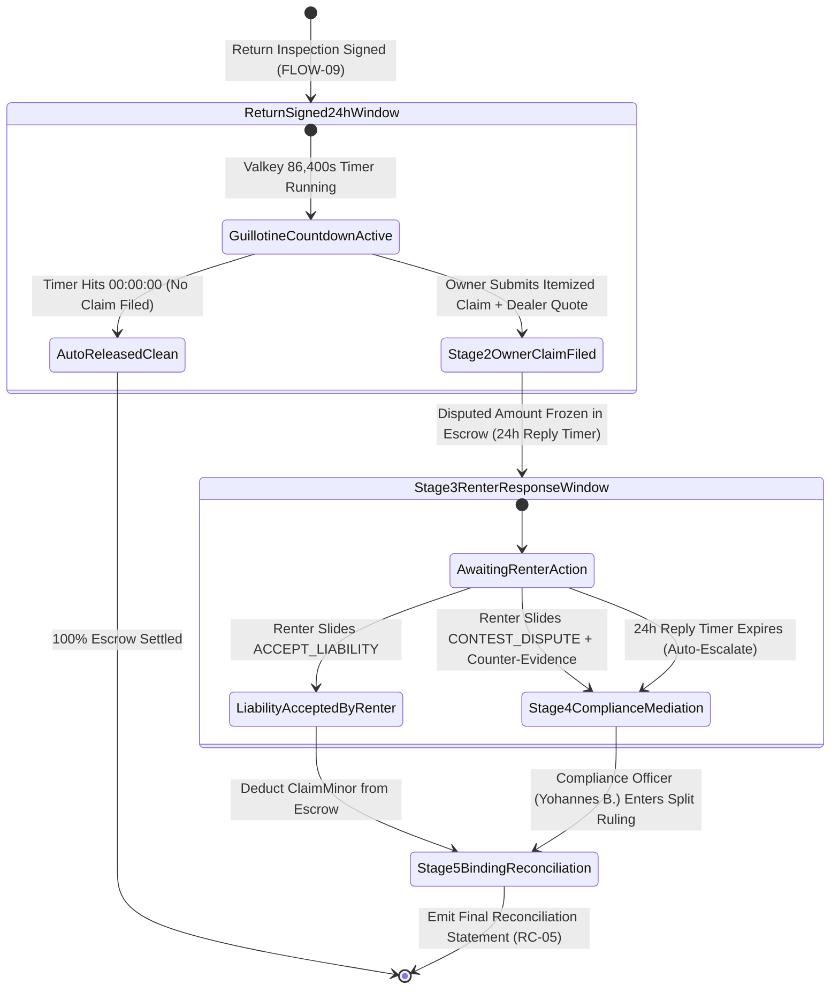

# 03 — 24-Hour Damage Claim Guillotine & Dispute Arbitration Tracker (`SPEC-MOB-SHR-03`)

| Metadata | Value |
| :--- | :--- |
| **Document ID** | `SPEC-MOB-SHR-03` |
| **Subsystem** | `docs/mobile/shared-features/` |
| **Target Framework** | Flutter 3.x (`flutter_bloc`, `interactive_viewer`, `camera`, `isar`) |
| **SRS Traceability** | `REQ-05-07` (`RC-04` 24-Hour Damage Claim Window & Arbitration), `REQ-05-18` (`ER-03`) |
| **Architecture / Flows** | `FLOW-09` (Return Inspection & 24h Window), `FLOW-10` (Damage Claim & Arbitration), `FLOW-13` (Compliance Ruling) |
| **Design System** | `DS-DINK-CORE-V7.0` (§4.1 Slide-to-Confirm, §4.4 Countdown Timers, §4.5 Comparison Lightbox) |
| **Status** | Normative — Phase 0 Specification |

---

## 1. Purpose & Requirement Traceability

Post-return damage disputes are the single highest-friction moment in heavy equipment rental. Contractors must be protected against predatory claims for normal quarry wear-and-tear (bucket tooth abrasion, paint scratches), while Equipment Owners must be protected against concealed structural or hydraulic damage. This specification implements the **Statutory 24-Hour Damage Audit Guillotine (`RC-04`)**, the **Synchronized Pre-Rental vs. Return Comparison Lightbox**, and the **5-Stage Dispute Arbitration Tracker (`DisputeArbitrationScreen`)**:

| Requirement ID | Normative Obligation | Mobile Implementation Mechanism |
| :--- | :--- | :--- |
| **`RC-04a` (24-Hour Damage Claim Guillotine Window)** | Following Return Inspection sign-off (`FLOW-09`), the Equipment Owner has a strict **24-hour (`86,400s`) Valkey countdown window** to file an itemized structural damage claim. At `00:00:00`, the claim button locks permanently and escrow releases automatically. | `DamageAuditGuillotineBanner` rendering a live `Space Mono` countdown (`HH:MM:SS`) synced to server `claimWindowExpiresAtUtc`. |
| **`RC-04b` (Compensable Structural Damage vs. Wear-and-Tear Taxonomy)** | Claims for ordinary wear-and-tear (tire tread wear `<15%`, bucket teeth abrasion, minor cab dust, surface paint scuffs) are prohibited. Every claim item MUST map to a compensable structural/mechanical component and attach an authorized dealer repair quote + macro reticle photos. | `DamageClaimItemBuilder` restricts component selection to compensable categories (`HYDRAULIC_CYLINDER`, `BOOM_STICK_STRUCTURAL`, `POWERTRAIN_ENGINE`, `CAB_GLASS_INSTRUMENTATION`, `UNDERCARRIAGE_TRACK_FRAME`) with mandatory dealer PDF/photo quote. |
| **`RC-04c` (Synchronized Pre- vs. Post-Rental Comparison Lightbox)** | Both Renter and Compliance Officer (`Yohannes Bekele`) MUST be able to inspect the baseline Pre-Delivery Handover photo (`FLOW-07`) side-by-side against the Return Inspection photo (`FLOW-09`) with synchronized pan and pinch-zoom (`1x`–`5x`). | `SynchronizedEvidenceLightbox` (`{component.lightbox.*}`) linking two `TransformationController` instances so zooming to `4.0x` on a hydraulic boom seal pans both the `BEFORE` and `AFTER` frames identically. |
| **`RC-04d` (Renter Response & Binding Compliance Arbitration)** | The Renter has **24 hours** to either `ACCEPT_LIABILITY` (authorizing immediate minor-unit escrow deduction) or `CONTEST_DISPUTE` (uploading counter-evidence and escalating to Compliance Officer mediation for a binding final reconciliation split). | Dual-path `RenterClaimResponseSheet` protected by a `64dp` Slide-to-Confirm gate (`POST /api/v1/bookings/{id}/damage-claims/{claimId}/respond`) + 5-stage `ArbitrationTimelineStepper`. |

---

## 2. Domain Context & Non-Negotiable Invariants

1. **Server-Authoritative 86,400s Valkey Guillotine (`AGENTS.md` §1 Time Freezing):** The mobile client never relies on local device wall-clock offsets to enforce the 24-hour window. It computes `remainingDuration = claimWindowExpiresAtUtc.difference(injectedClock.nowUtc())`. Even if a user manipulates their phone clock, `POST /api/v1/bookings/{id}/damage-claims` after the Valkey TTL expires returns `409 CLAIM_WINDOW_EXPIRED_GUILLOTINE`.
2. **Synchronized Matrix4 Transformation Invariant:** In `SynchronizedEvidenceLightbox`, listener callbacks on `beforeController` copy the `Matrix4` translation and scale vectors directly to `afterController` (with a circular guard flag `_isSyncingMatrix`) at `60fps` (`<16.6ms` frame budget).
3. **Zero-Sum Escrow Hold Partitioning (`AGENTS.md` §1 Ledger Invariants):** When an Owner files a claim for `ETB 42,500.00` (`4250000` minor units) against a booking with an undisputed remainder, only the disputed damage reserve is frozen in `DisputedEscrowHoldAccount` while undisputed base rental tranches settle according to contract terms.

---

## 3. Bespoke ASCII Wireframes

### 3.1 Synchronized Before/After Evidence Lightbox & Renter Response (`DisputeArbitrationScreen`)
```text
+-----------------------------------------------------------------------+
|  [<-]  DAMAGE CLAIM & ARBITRATION (#CLM-2026-409)    [⚖️ STAGE 3 OF 5] |
+-----------------------------------------------------------------------+
|  +-----------------------------------------------------------------+  |
|  | ⏱️ RENTER RESPONSE DEADLINE:   1 8 : 4 2 : 0 9   (HH:MM:SS)     |  |
|  | Disputed Amount Held in Escrow:  ETB 42,500.00 (4250000 minor)  |  |
|  +-----------------------------------------------------------------+  |
|                                                                       |
|  5-STAGE ARBITRATION PROGRESS STEPPER:                                |
|  [✓ 1.Return]──[✓ 2.Owner Claim]──[◉ 3.Renter Reply]──[4.Mediation]──[5.Ruling]
|                                                                       |
|  SYNCHRONIZED PAN & ZOOM EVIDENCE LIGHTBOX (🔗 SYNC LOCK: ON • 3.2x)  |
|  +-------------------------------+ +-------------------------------+  |
|  | 🟢 PRE-RENTAL HANDOVER        | | 🔴 RETURN INSPECTION          |  |
|  | 📅 20 Oct 2026 • 1,420.5 HRS  | | 📅 30 Oct 2026 • 1,508.2 HRS  |  |
|  | +---------------------------+ | | +---------------------------+ |  |
|  | |   /// BOOM CYLINDER ///   | | | |   /// BOOM CYLINDER ///   | |  |
|  | |   Chrome rod intact,      | | | |   Deep 14cm gouge on      | |  |
|  | |   zero hydraulic weep.    | | | |   piston rod + oil leak.  | |  |
|  | +---------------------------+ | | +---------------------------+ |  |
|  | 🔒 SHA256: 8f9a...21c4        | | 🔒 SHA256: 3d7e...90b1        |  |
|  +-------------------------------+ +-------------------------------+  |
|                                                                       |
|  ITEMIZED CLAIM BREAKDOWN & DEALER REPAIR QUOTE:                      |
|  +-----------------------------------------------------------------+  |
|  | • Component:   HYDRAULIC_CYLINDER (Stick Rod Scoring & Seal)    |  |
|  | • Claimed Cost: ETB 42,500.00   📄 Quote: ries_engineering.pdf  |  |
|  +-----------------------------------------------------------------+  |
|                                                                       |
|  CONTRACTOR RESPONSE ACTIONS:                                         |
|  +-------------------------------+ +-------------------------------+  |
|  | [ ⚖️ CONTEST & UPLOAD PROOF ] | | [ ✓ ACCEPT LIABILITY ]        |  |
|  +-------------------------------+ +-------------------------------+  |
|  | [  >>>  ]  SLIDE TO CONFIRM SELECTED RESPONSE (64dp)            |  |
|  +-----------------------------------------------------------------+  |
+-----------------------------------------------------------------------+
```

---

## 4. W3C DTCG Design Token Mapping

| UI Element / Component | Token Path (`design-tokens.json`) | Resolved Value (`dark` / `outdoorHighContrast`) |
| :--- | :--- | :--- |
| **24h Guillotine Countdown Digits** | `{component.countdown.timerText}` + `{typography.fontFamily.mono}` | `Space Mono`, `24sp`, `fontWeight: 700`, `#EF4444` when `< 4h` |
| **Lightbox Viewport Background** | `{component.lightbox.backdrop}` | `#020617` (`#000000` in `outdoorHighContrast`) |
| **Pre-Rental Baseline Frame Border** | `{color.feedback.emerald.500}` | `#10B981` (`2dp` solid frame) |
| **Post-Rental Damage Frame Border** | `{color.feedback.crimson.500}` | `#EF4444` (`2dp` solid frame) |
| **Disputed Escrow Minor-Unit Amount** | `{typography.fontFamily.mono}` | `Space Mono`, `18sp`, `fontWeight: 700`, `#FBBF24` |
| **Slide-to-Confirm Decision Gate** | `{component.actuator.slider.height}` | `{dimension.space.64}` (`64dp`) |

---

## 5. Screen-Specific State Machine (`RC-04` 24-Hour Guillotine & 5-Stage Arbitration)



---

## 6. Concrete Flutter Implementation Blueprint

### 6.1 Synchronized Dual-Viewport Controller (`synchronized_evidence_lightbox.dart`)
```dart
import 'package:flutter/material.dart';

class SynchronizedLightboxController extends ChangeNotifier {
  final TransformationController beforeController = TransformationController();
  final TransformationController afterController = TransformationController();
  bool _isSyncLocked = true;
  bool _isInternalUpdate = false;

  SynchronizedLightboxController() {
    beforeController.addListener(_onBeforeChanged);
    afterController.addListener(_onAfterChanged);
  }

  bool get isSyncLocked => _isSyncLocked;

  void toggleSyncLock() {
    _isSyncLocked = !_isSyncLocked;
    if (_isSyncLocked) {
      afterController.value = Matrix4.copy(beforeController.value);
    }
    notifyListeners();
  }

  void _onBeforeChanged() {
    if (!_isSyncLocked || _isInternalUpdate) return;
    _isInternalUpdate = true;
    afterController.value = Matrix4.copy(beforeController.value);
    _isInternalUpdate = false;
  }

  void _onAfterChanged() {
    if (!_isSyncLocked || _isInternalUpdate) return;
    _isInternalUpdate = true;
    beforeController.value = Matrix4.copy(afterController.value);
    _isInternalUpdate = false;
  }

  @override
  void dispose() {
    beforeController.dispose();
    afterController.dispose();
    super.dispose();
  }
}
```

### 6.2 BLoC Events & Freezed State (`dispute_arbitration_bloc.dart`)
```dart
import 'package:bloc/bloc.dart';
import 'package:freezed_annotation/freezed_annotation.dart';

part 'dispute_arbitration_bloc.freezed.dart';

enum CompensableComponentCategory {
  hydraulicCylinderAndHoses,
  boomStickStructuralWeld,
  powertrainEngineTransmission,
  cabGlassAndInstrumentation,
  undercarriageTrackFrame,
}

enum RenterDisputeDecision { acceptLiability, contestWithCounterEvidence }

@freezed
sealed class DisputeArbitrationEvent with _$DisputeArbitrationEvent {
  const factory DisputeArbitrationEvent.guillotineTicked(DateTime currentUtc) = _GuillotineTicked;
  const factory DisputeArbitrationEvent.ownerClaimSubmitted({
    required String bookingId,
    required CompensableComponentCategory componentCategory,
    required int claimedAmountMinor,
    required String currency,
    required String dealerQuoteFilePath,
    required List<String> damagePhotoPaths,
    required String narrative,
    required String idempotencyKey,
  }) = _OwnerClaimSubmitted;
  const factory DisputeArbitrationEvent.renterResponseSubmitted({
    required String bookingId,
    required String claimId,
    required RenterDisputeDecision decision,
    String? counterNarrative,
    @Default(<String>[]) List<String> counterEvidencePaths,
    required String idempotencyKey,
  }) = _RenterResponseSubmitted;
}

@freezed
abstract class DisputeArbitrationState with _$DisputeArbitrationState {
  const factory DisputeArbitrationState({
    @Default(1) int currentArbitrationStage, // 1..5
    @Default(Duration.zero) Duration guillotineRemaining,
    @Default(false) bool isClaimWindowClosed,
    @Default(0) int disputedEscrowHoldMinor,
    @Default('ETB') String currency,
    @Default(false) bool isSubmitting,
    String? rfc9457ErrorCode,
    String? rfc9457ErrorDetail,
  }) = _DisputeArbitrationState;
}
```

---

## 7. OpenAPI 3.1.0 Contract & RFC 9457 Error Matrix

### 7.1 Endpoints
1. `POST /api/v1/bookings/{id}/damage-claims` (`Idempotency-Key` required, multipart dealer quote + macro photos + minor-unit JSON).
2. `POST /api/v1/bookings/{id}/damage-claims/{claimId}/respond` (`Idempotency-Key` required, `decision: "ACCEPT_LIABILITY" | "CONTEST_DISPUTE"`).
3. `GET /api/v1/bookings/{id}/damage-claims/{claimId}` (Includes pre/post signed media URLs, SHA-256 hashes, and Compliance Officer ruling).

### 7.2 RFC 9457 Error Recovery Matrix

| HTTP Status | `error.code` | Trigger Condition | Deterministic Mobile UI Recovery |
| :--- | :--- | :--- | :--- |
| **`409`** | `CLAIM_WINDOW_EXPIRED_GUILLOTINE` | Owner attempted to submit a damage claim after the `86,400s` (24-hour) post-return window expired (`RC-04`). | Lock claim form permanently, display `[⏱️ 24-Hour Statutory Audit Window Closed — Escrow Released]`, and refresh booking state. |
| **`422`** | `CLAIM_WEAR_AND_TEAR_EXCLUDED` | Claimed item or amount falls below the statutory minor wear-and-tear floor or lacks a dealer repair quote. | Highlight missing dealer quote slot or rejected component category in `#EF4444`. |
| **`422`** | `INSPECT_MEDIA_SCAN_FAILED` | Uploaded dealer quote PDF or macro damage photo failed ClamAV `:3310` scan. | Prompt user to re-capture clean evidence via live camera reticle. |

---

## 8. Verification & Acceptance Criteria

1. **`bloc_test` — Injected Clock 24-Hour Guillotine Enforcement (`AGENTS.md` §1):**
   - Using a mocked `Clock`, advance time from `T + 86,399s` (`isClaimWindowClosed: false`) to `T + 86,401s` and assert that `state.isClaimWindowClosed` transitions deterministically to `true` and disables the claim CTA.
2. **Synchronized Lightbox Matrix4 Test:**
   - Widget test asserting that zooming `beforeController` to scale `3.5x` with translation `Offset(-120, -80)` immediately updates `afterController.value` to the identical `Matrix4` when `isSyncLocked == true`.
3. **Golden & Accessibility Verification (`WCAG 2.2 AAA`):**
   - Render `DisputeArbitrationScreen` in `outdoorHighContrast` and `am_ET`, confirming `64dp` Slide-to-Confirm response gate and `Space Mono` minor-unit financial clarity.
