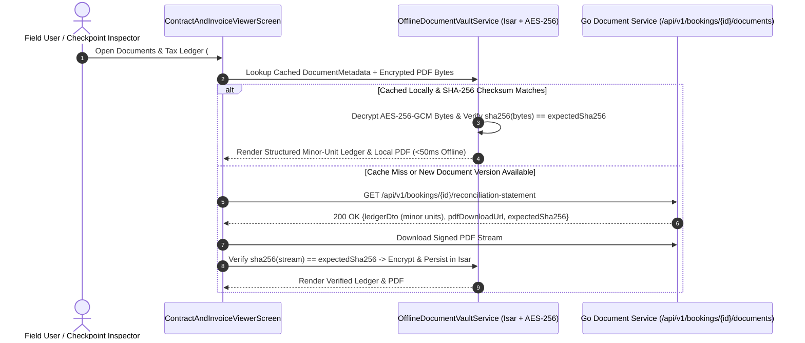

# 04 — Tri-Party Lease Contract & Statutory Tax Invoice PDF Viewer (`SPEC-MOB-SHR-04`)

| Metadata | Value |
| :--- | :--- |
| **Document ID** | `SPEC-MOB-SHR-04` |
| **Subsystem** | `docs/mobile/shared-features/` |
| **Target Framework** | Flutter 3.x (`flutter_bloc`, `pdfrx` / `pdfx`, `qr_flutter`, `share_plus`, `isar`) |
| **SRS Traceability** | `REQ-05-05` (Digital Lease Contract), `REQ-05-07` (`RC-05` Final Reconciliation Statement), `REQ-05-20` (`POL-03`), `REQ-05-17` (`OFF-01`) |
| **Architecture / Flows** | `FLOW-06` (Contract Generation), `FLOW-08` (Tax Invoice), `FLOW-09` (`RC-05` Final Settlement), `ADR-010` |
| **Design System** | `DS-DINK-CORE-V7.0` (§3.2 Monospace Tabular Ledger, §4.6 Glass Signature Pad) |
| **Status** | Normative — Phase 0 Specification |

---

## 1. Purpose & Requirement Traceability

Construction enterprises, auditors, and highway checkpoint inspectors require tamper-evident legal and fiscal documentation on site—often where cellular coverage is non-existent. This specification defines the **Offline-Capable PDF & Structured Financial Ledger Viewer (`ContractAndInvoiceViewerScreen`)** covering three canonical documents:
1. **Tri-Party Heavy Machinery Lease Agreement (`FLOW-06`):** Binding the Renter (Contractor), Equipment Owner, and Dink Escrow Platform, complete with vector glass signatures (`>= 20` Bézier nodes), baseline hour-meter reading, and SHA-256 QR verification seal.
2. **Statutory Tax Invoice (`FLOW-08`):** Compliant with **Ethiopian Ministry of Revenues (MOR)** (`15% VAT`, `2% Withholding Tax` deduction where applicable, 10-digit Supplier & Buyer TINs) and **Kenya Revenue Authority (KRA TIMS/eTIMS)** (`16% VAT`, 11-char KRA PINs).
3. **Final Reconciliation Statement (`RC-05`, `FLOW-09`):** Post-rental settlement ledger showing Base Shift Quota vs. Actual Engine Hour-Meter Delta, Overtime Surcharges, Fuel Deficit Adjustment, Damage Claim Deductions (`RC-04`), Platform Commission, and Net Payout/Refund in minor units.

| Requirement ID | Normative Obligation | Mobile Implementation Mechanism |
| :--- | :--- | :--- |
| **`RC-05` (Itemized Final Reconciliation Statement)** | Upon rental completion and dispute resolution, the system MUST generate a line-by-line reconciliation statement reconciling initial escrow deposit against actual hours, overtime, fuel, damage deductions, and taxes. | Dual-mode viewer: **Interactive Tabular Ledger View** (`Space Mono` minor-unit breakdown for outdoor legibility) + **Official Signed PDF View** (`pdfrx` hardware-accelerated canvas). |
| **`POL-03` (Tamper-Evident SHA-256 Seal & QR Verification)** | Every generated contract and tax invoice MUST embed its cryptographic `documentSha256` digest and a scannable QR verification payload (`dink://verify-doc/{docId}?sha256=...`) so checkpoint police or auditors can verify authenticity offline. | Sticky `CryptographicVerificationHeader` displaying the truncated SHA-256 fingerprint, signer timestamps, and expandable high-contrast QR modal. |
| **`OFF-01` (Encrypted Offline Vault Persistence — `ADR-010`)** | Active booking contracts, dispatch permits, and tax invoices MUST be automatically prefetched and cached on-device for zero-signal checkpoint inspection. | `OfflineDocumentVaultService` downloads and verifies the SHA-256 checksum of every active booking PDF, storing it in AES-256-GCM encrypted application storage indexed by Isar. |

---

## 2. Domain Context & Non-Negotiable Invariants

1. **Zero Floating-Point Fiscal Math Invariant (`AGENTS.md` §2):** Every line item in the Interactive Tabular Ledger (`baseRentalMinor`, `overtimeSurchargeMinor`, `fuelAdjustmentMinor`, `damageDeductionMinor`, `vatAmountMinor`, `withholdingTaxMinor`, `netSettlementMinor`) is stored and rendered from integer minor units (`ETB` santims / `KES` cents) paired with explicit ISO 4217 currency codes.
2. **Jurisdiction Tax Rules (`ET` vs. `KE`):**
   - **Ethiopia (`ET` — MOR):** Standard VAT is `15%` (`1500 bps`). When the Renter is a registered Ethiopian Withholding Agent (`SPEC-MOB-AUTH-05` `KYC-08`) and the pre-tax base exceeds the statutory threshold (`ETB 10,000.00`), a `2%` (`200 bps`) Withholding Tax line is itemized alongside the mandatory MOR Withholding Receipt attachment slot.
   - **Kenya (`KE` — KRA):** Standard VAT is `16%` (`1600 bps`) with KRA PIN and eTIMS Control Unit Invoice Number displayed in `Space Mono`.
3. **SHA-256 Checksum Integrity Check Before Render:** Before rendering any cached PDF from local disk, `OfflineDocumentVaultService` recomputes `sha256.convert(fileBytes)` and asserts equality with the server-signed `expectedSha256`. Any mismatch purges the local file and triggers a fresh authenticated download.

---

## 3. Bespoke ASCII Wireframes

### 3.1 Dual-Mode Final Reconciliation & Tax Invoice Viewer (`ContractAndInvoiceViewerScreen`)
```text
+-----------------------------------------------------------------------+
|  [<-]  DOCUMENTS & TAX LEDGER (#BK-8941)            [🟢 OFFLINE READY]|
|        [📤 SHARE PDF]   [🖨️ PRINT]   [🔍 QR SEAL]                     |
+-----------------------------------------------------------------------+
|  DOCUMENT SELECTOR TABS (56dp GLOVE HEIGHT)                           |
|  +----------------------+ +--------------------+ +-----------------+  |
|  | [ ] LEASE CONTRACT   | | [ ] MOR TAX INVOICE| | [◉] RC-05 FINAL |  |
|  +----------------------+ +--------------------+ +-----------------+  |
|  VIEW MODE:   [◉ STRUCTURED LEDGER (OUTDOOR)]    [ ] OFFICIAL PDF     |
+-----------------------------------------------------------------------+
|  🔒 CRYPTOGRAPHIC SEAL: SHA-256 9f86d081...4a2b  •  MOR TIN VERIFIED  |
|  Supplier TIN: 0048291037 (Abay PLC)  •  Buyer TIN: 0019283746        |
+-----------------------------------------------------------------------+
|  ITEMIZED FINAL RECONCILIATION LEDGER (RC-05 • CURRENCY: ETB)         |
|  +-----------------------------------------------------------------+  |
|  | 1. USAGE & ENGINE HOUR-METER RECONCILIATION                     |  |
|  |    Baseline Handover Meter:                   1,420.5 HRS       |  |
|  |    Return Inspection Meter:                   1,508.2 HRS       |  |
|  |    Total Logged Engine Hours:                    87.7 HRS       |  |
|  |    Contracted Quota (10 Days × 8.0h):            80.0 HRS       |  |
|  |    Billable Overtime Delta:                      +7.7 HRS       |  |
|  +-----------------------------------------------------------------+  |
|  | 2. FINANCIAL SETTLEMENT BREAKDOWN (MINOR-UNIT EXACT)            |  |
|  |    Base Rental (10 Days @ 18,000.00):    ETB   180,000.00       |  |
|  |    Overtime Surcharge (7.7h @ 2,500.00): ETB   +19,250.00       |  |
|  |    Fuel Deficit (35L Diesel @ 110.00):   ETB    +3,850.00       |  |
|  |    Damage Claim Ruling (#CLM-409):       ETB   +15,000.00       |  |
|  |    -----------------------------------------------------------  |  |
|  |    Taxable Subtotal:                     ETB   218,100.00       |  |
|  |    Ethiopia VAT (15.0% MOR):             ETB   +32,715.00       |  |
|  |    Less 2% Withholding Tax (WHT Cert):   ETB    -4,362.00       |  |
|  |    ===========================================================  |  |
|  |    FINAL GROSS OBLIGATION:               ETB   246,453.00       |  |
|  |    Initial Escrow Deposit Held:          ETB   260,000.00       |  |
|  |    🟢 NET ESCROW REFUND TO RENTER:       ETB    13,547.00       |  |
|  +-----------------------------------------------------------------+  |
|  | ✍️ DIGITAL SIGNATURES: Renter (Dawit M.) • Owner (Abay PLC)     |  |
+-----------------------------------------------------------------------+
```

### 3.2 Checkpoint Inspector QR Verification Modal (`CryptographicSealModal`)
```text
+-----------------------------------------------------------------------+
|  HIGHWAY CHECKPOINT & AUDITOR VERIFICATION SEAL            [✕ CLOSE]  |
+-----------------------------------------------------------------------+
|                     +---------------------------+                     |
|                     | ▄▄▄▄▄▄▄ ▄   ▄ ▄▄▄ ▄▄▄▄▄▄▄ |                     |
|                     | █ ▄▄▄ █ ██▀▄█ █▀█ █ ▄▄▄ █ |                     |
|                     | █ ███ █ ▄▀█▀▀ ▀▄▀ █ ███ █ |                     |
|                     | █▄▄▄▄▄█ █ ▄ █ ▀ █ █▄▄▄▄▄█ |                     |
|                     | ▄▄ ▄  ▄▄▀▄▀ ▀▄█ ▀ ▄▄ ▄ ▄▄ |                     |
|                     | █ ▄▄▄ █ ▄█▀▄▀ ▄▀▀ ▀▄█▄▄▀█ |                     |
|                     | █▄▄▄▄▄█ ██▄▄▀ ▀ ▀ ▀ ▄▄▄▀█ |                     |
|                     +---------------------------+                     |
|                                                                       |
|  Document ID:   DOC-RC05-2026-008941                                  |
|  Machine Plate: ET-OR-EX-4821 (CAT 320D Excavator)                    |
|  SHA-256 Hash:  9f86d081884c7d659a2feaa0c55ad015a3bf4f1b2b0b822cd15d  |
|  Status:        [🟢 CRYPTOGRAPHICALLY VALID & SIGNED]                 |
+-----------------------------------------------------------------------+
```

---

## 4. W3C DTCG Design Token Mapping

| UI Element / Component | Token Path (`design-tokens.json`) | Resolved Value (`dark` / `outdoorHighContrast`) |
| :--- | :--- | :--- |
| **Tabular Ledger Numbers & Hashes** | `{typography.fontFamily.mono}` | `Space Mono`, `15sp` (`18sp` for totals), `fontWeight: 700` |
| **Ledger Section Divider Rules** | `{semantic.dark.border.subtle}` / `{semantic.outdoorHighContrast.border.strong}` | `#334155` (`1dp`) / `#FFFFFF` (`2dp`) |
| **QR Code Quiet Zone Container** | `{color.brand.slate.50}` | `#FFFFFF` pure white pad (`16dp` quiet margin) for optical scanner reliability |
| **Net Refund / Payout Highlight** | `{color.feedback.emerald.500}` | `#10B981` |
| **Surcharge / Deduction Line Item** | `{color.brand.amber.400}` | `#FBBF24` |
| **Document Switcher Pill Height** | `{dimension.space.56}` | `56dp` |

---

## 5. Screen-Specific Sequence & Offline Verification Flow



---

## 6. Concrete Flutter Implementation Blueprint

### 6.1 Freezed Ledger DTO & BLoC State (`reconciliation_ledger_bloc.dart`)
```dart
import 'package:freezed_annotation/freezed_annotation.dart';
import 'package:crypto/crypto.dart';

part 'reconciliation_ledger_bloc.freezed.dart';

enum LegalDocumentKind { leaseContract, statutoryTaxInvoice, finalReconciliationRc05 }

@freezed
abstract class FinalReconciliationLedgerDto with _$FinalReconciliationLedgerDto {
  const factory FinalReconciliationLedgerDto({
    required String documentId,
    required String bookingId,
    required String currency, // ETB | KES
    required String supplierTinOrPin,
    required String buyerTinOrPin,
    required double baselineHours,
    required double returnHours,
    required double contractedQuotaHours,
    required double billableOvertimeHours,
    required int baseRentalMinor,
    required int overtimeSurchargeMinor,
    required int fuelAdjustmentMinor,
    required int damageDeductionMinor,
    required int taxableSubtotalMinor,
    required int vatRateBps, // 1500 (ET 15%) or 1600 (KE 16%)
    required int vatAmountMinor,
    required int withholdingTaxMinor, // 200 bps (ET 2%) if applicable
    required int finalGrossObligationMinor,
    required int initialEscrowDepositMinor,
    required int netRenterRefundMinor,
    required int netOwnerPayoutMinor,
    required String documentSha256,
    required String pdfSignedUrl,
  }) = _FinalReconciliationLedgerDto;
}

/// Verifies cryptographic integrity of downloaded PDF bytes before caching or rendering (POL-03)
bool verifyPdfSha256Integrity(List<int> pdfBytes, String expectedHexSha256) {
  final computedHex = sha256.convert(pdfBytes).toString().toLowerCase();
  return computedHex == expectedHexSha256.trim().toLowerCase();
}
```

### 6.2 Minor-Unit Currency Formatter & Zero-Sum Reconciliation Validator (`minor_unit_ledger_math.dart`)
```dart
class MinorUnitLedgerMath {
  /// Formats integer minor units (e.g., 18425000) into fixed-point string ("ETB 184,250.00")
  /// without ever converting through IEEE 754 floating-point numbers (AGENTS.md §2).
  static String formatMinorUnits({required int amountMinor, required String currency}) {
    final isNegative = amountMinor < 0;
    final absMinor = amountMinor.abs();
    final majorUnits = absMinor ~/ 100;
    final minorRemainder = (absMinor % 100).toString().padLeft(2, '0');

    final majorStr = majorUnits.toString().replaceAllMapped(
          RegExp(r'(\d{1,3})(?=(\d{3})+(?!\d))'),
          (Match m) => '${m[1]},',
        );
    final signPrefix = isNegative ? '-' : '';
    return '$currency $signPrefix$majorStr.$minorRemainder';
  }

  /// Verifies zero-sum ledger invariant on FinalReconciliationLedgerDto (AGENTS.md §1)
  static bool verifyReconciliationZeroSum(FinalReconciliationLedgerDto dto) {
    final expectedSubtotal = dto.baseRentalMinor +
        dto.overtimeSurchargeMinor +
        dto.fuelAdjustmentMinor +
        dto.damageDeductionMinor;
    if (dto.taxableSubtotalMinor != expectedSubtotal) return false;

    final expectedGross = dto.taxableSubtotalMinor + dto.vatAmountMinor - dto.withholdingTaxMinor;
    return dto.finalGrossObligationMinor == expectedGross;
  }
}
```

---

## 7. OpenAPI 3.1.0 Contract & RFC 9457 Error Matrix

### 7.1 Endpoints
1. `GET /api/v1/bookings/{id}/contract` → Returns Tri-Party Lease Contract metadata, signature vectors, `documentSha256`, and signed PDF URL.
2. `GET /api/v1/bookings/{id}/tax-invoice` → Returns MOR (`ET`) or KRA (`KE`) statutory tax invoice breakdown in minor units.
3. `GET /api/v1/bookings/{id}/reconciliation-statement` → Returns `RC-05` Final Reconciliation Statement (`FinalReconciliationLedgerDto`).

### 7.2 RFC 9457 Error Recovery Matrix

| HTTP Status | `error.code` | Trigger Condition | Deterministic Mobile UI Recovery |
| :--- | :--- | :--- | :--- |
| **`404`** | `DOC_RECONCILIATION_NOT_READY` | User requested `RC-05` Final Reconciliation while booking is still `ACTIVE` or in `DISPUTE_MEDIATION`. | Display informational state card showing which prerequisite step (`Return Inspection` or `Dispute Ruling`) is pending. |
| **`409`** | `DOC_WITHHOLDING_CERT_REQUIRED` | Ethiopian B2B Renter claimed `2%` WHT deduction (`KYC-08`) but has not yet uploaded the official MOR Withholding Receipt. | Display `[📎 Upload MOR 2% Withholding Tax Receipt]` action banner to unlock final net refund release. |
| **`422`** | `DOC_SHA256_INTEGRITY_MISMATCH` | Local or transit-corrupted PDF bytes failed `verifyPdfSha256Integrity`. | Purge corrupted file from local Isar vault, log non-PII security telemetry event, and retry download over TLS 1.3. |

---

## 8. Verification & Acceptance Criteria

1. **Zero-Sum Reconciliation Invariant Unit Test (`AGENTS.md` §1):**
   - Assert across property-based test inputs that `taxableSubtotalMinor == baseRentalMinor + overtimeSurchargeMinor + fuelAdjustmentMinor + damageDeductionMinor`, and `finalGrossObligationMinor == taxableSubtotalMinor + vatAmountMinor - withholdingTaxMinor`.
2. **Offline Checkpoint Inspection Test (`OFF-01`):**
   - Prefetch `leaseContract` and `finalReconciliationRc05`, enable Airplane Mode, open `ContractAndInvoiceViewerScreen`, and verify both the Structured Ledger View, Official PDF View, and QR Verification Seal render with zero network errors.
3. **Golden & Accessibility Verification (`WCAG 2.2 AAA`):**
   - Render `ContractAndInvoiceViewerScreen` in `outdoorHighContrast` (`#000000` canvas, `#FFFFFF` text) and `am_ET`, confirming right-aligned `Space Mono` minor-unit columns never wrap or clip at `200%` text scale.
