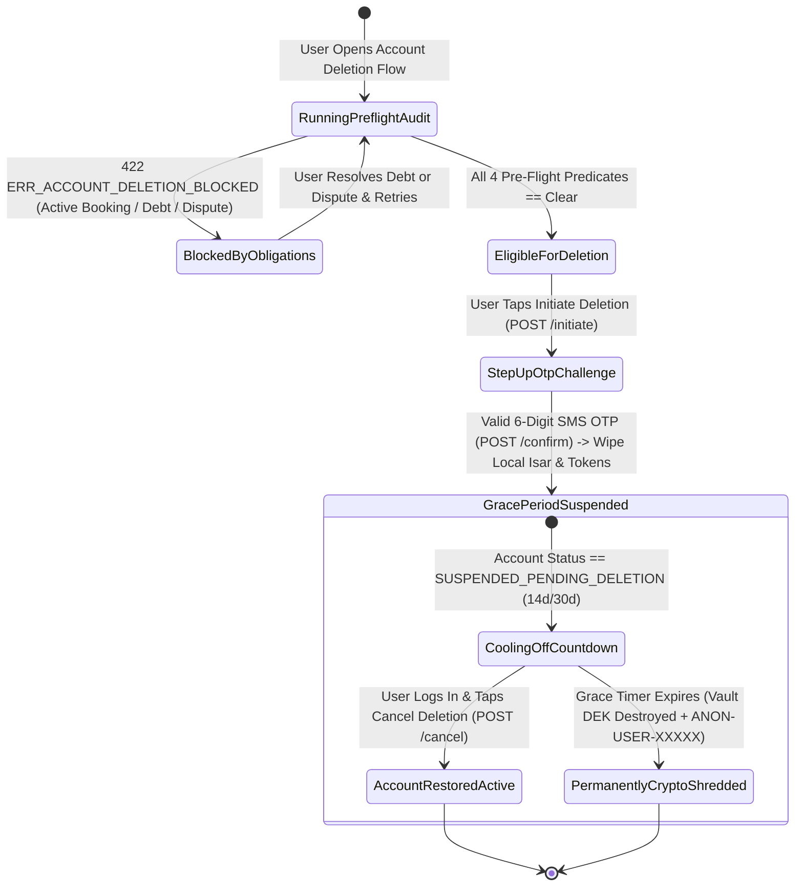

# 05 — User Profile, Biometric Security & Self-Service Account Deletion (`SPEC-MOB-SHR-05`)

| Metadata | Value |
| :--- | :--- |
| **Document ID** | `SPEC-MOB-SHR-05` |
| **Subsystem** | `docs/mobile/shared-features/` |
| **Target Framework** | Flutter 3.x (`flutter_bloc`, `local_auth`, `flutter_secure_storage`, `isar`) |
| **SRS Traceability** | `REQ-05-01` (`AUT-08`..`AUT-11`), `REQ-05-19` (`DEL-01` to `DEL-04`), `REQ-05-22`, `REQ-05-18` (`ER-03`) |
| **Architecture / Flows** | `FLOW-01`, `FLOW-15` (Global Session Revocation), `FLOW-APPENDIX-B` (Account Deletion), `ADR-008`, `ADR-010` |
| **Design System** | `DS-DINK-CORE-V7.0` (§4.1 Industrial Actuators, §5.2 Outdoor High-Contrast) |
| **Status** | Normative — Phase 0 Specification |

---

## 1. Purpose & Requirement Traceability

This specification governs the **User Profile & Emergency Contact Hub**, **Hardware Biometric Enclave & Active Device Session Manager (`FLOW-15`)**, and the **Statutory Self-Service Account Deletion Lifecycle (`REQ-05-19`)** required by Apple App Store Guideline 5.1.1(v), Google Play Data Safety Policy, Ethiopian Personal Data Protection Proclamation No. 1321/2024, and the Kenya Data Protection Act (2019):

| Requirement ID | Normative Obligation | Mobile Implementation Mechanism |
| :--- | :--- | :--- |
| **`AUT-11` / `FLOW-15` (Active Sessions & Global Kill-Switch)** | Users MUST be able to inspect all active device sessions (Device Model, OS, IP City, Last Active) and execute a 1-tap **Revoke All Other Devices** kill-switch (`users.token_version++`). | `ActiveDeviceSessionsCard` inside `ProfileAndSecurityScreen` calling `GET /api/v1/auth/sessions` and `POST /api/v1/auth/sessions/revoke-others`. |
| **`DEL-01` (Pre-Flight Deletion Eligibility Barrier)** | Account deletion MUST be blocked (`422 ERR_ACCOUNT_DELETION_BLOCKED`) if the user has active/upcoming machinery bookings, unresolved damage/insurance disputes, pending escrow payouts, or a negative `OwnerWallet` cash commission debt. | `DeletionPreflightSheet` calls `GET /api/v1/user/account-deletion/preflight` and renders actionable deep-links to clear each blocking condition (e.g., `[Settle ETB 4,200 Commission Debt]`). |
| **`DEL-02` (Step-Up OTP Confirmation & Cooling-Off Grace Window)** | Eligible deletion requests MUST require step-up 6-digit SMS OTP confirmation (`POST /api/v1/user/account-deletion/confirm`) and enter a mandatory **14-day (or 30-day statutory) cooling-off grace period (`SUSPENDED_PENDING_DELETION`)**. | Step-up OTP challenge modal + `PendingDeletionGraceScreen` displaying the exact `permanentShreddingAtUtc` timestamp and a 1-tap `[Cancel Deletion & Restore Account]` actuator (`/cancel`). |
| **`DEL-03` (Vault DEK Crypto-Shredding & Local Isar Wipeout)** | Upon confirmation, the mobile client MUST immediately purge local Isar collections, encrypted KYC cache files, and `FlutterSecureStorage` tokens. At grace expiry (`T+14d/30d`), the backend destroys the user's Vault Data Encryption Key (`DEK`) to cryptographically shred PII across backups. | `LocalStorageWipeService.executeCompletePurge()` zeroes Isar databases, deletes cached PDFs/WebPs, and revokes FCM push tokens. |
| **`DEL-04` (10-Year Statutory Financial Ledger Retention)** | While PII (name, phone, Fayda ID, biometric selfie) is shredded, double-entry financial ledger records, tax invoices (`RC-05`), and audit logs MUST be retained for **10 years** under NBE/MOR (`ET`) and CBK/KRA (`KE`) law under a pseudonymized token (`ANON-USER-XXXXX`). | Mandatory pre-deletion statutory disclosure banner explaining what is permanently erased vs. what fiscal records are pseudonymized for 10-year tax compliance. |

---

## 2. Domain Context & Non-Negotiable Invariants

1. **Zero Negative-Balance Escape Invariant (`DEL-01`):** A Fleet Owner who collected cash/offline commission liabilities (`OwnerWallet.balanceMinor < 0`) or a Renter with an open damage claim (`RC-04`) can never use account deletion to evade financial obligations. The pre-flight check evaluates 4 atomic SQL predicates (`active_bookings == 0`, `open_disputes == 0`, `pending_escrow_tranches == 0`, `wallet_balance_minor == 0`) before unlocking the OTP confirmation button.
2. **Hardware Enclave Biometric Gate (`local_auth`):** Sensitive actions inside `ProfileAndSecurityScreen` (toggling biometric passkey login, revoking all sessions, or initiating account deletion) invoke `LocalAuthentication().authenticate(biometricOnly: false)` when hardware biometrics (FaceID / TouchID / Android Keystore Fingerprint) are enrolled.

---

## 3. Bespoke ASCII Wireframes

### 3.1 Security, Biometric Passkey & Active Sessions (`ProfileAndSecurityScreen`)
```text
+-----------------------------------------------------------------------+
|  [<-]  PROFILE, SECURITY & DATA PRIVACY             [🛡️ VERIFIED KYC] |
+-----------------------------------------------------------------------+
|  VERIFIED IDENTITY & EMERGENCY SITE CONTACT                           |
|  +-----------------------------------------------------------------+  |
|  | 👤 DAWIT MEKONNEN TESFAYE                   [🇪🇹 +251 91 123 4567]|  |
|  | 🪪 Fayda FIN: ****-****-5921 (Verified)   •  TIN: 0048291037     |  |
|  | 🚨 Site Emergency Contact: +251 91 199 8877 (Site Eng. Solomon) |  |
|  +-----------------------------------------------------------------+  |
|                                                                       |
|  BIOMETRIC ENCLAVE & LANGUAGE SETTINGS                                |
|  +-----------------------------------------------------------------+  |
|  | 🫆 Hardware Biometric Unlock (Fingerprint/Face)  [  ◉ ENABLED ]  |  |
|  | 🌐 App Interface Language      [ አማርኛ (Amharic) / English   v ] |  |
|  | ☀️ Outdoor High-Contrast Mode  [ Auto (>80,000 lux Sensor)  v ] |  |
|  +-----------------------------------------------------------------+  |
|                                                                       |
|  ACTIVE DEVICE SESSIONS (FLOW-15)                                     |
|  +-----------------------------------------------------------------+  |
|  | 📱 Samsung Galaxy A54 5G (This Device)         🟢 Active Now     |  |
|  |    Addis Ababa, ET • App v2.4.0                                 |  |
|  | 📱 Tecno Spark 10 Pro                          🕒 2 days ago     |  |
|  |    Adama, Oromia, ET • App v2.3.8                               |  |
|  | +-------------------------------------------------------------+ |  |
|  | |    🔒 REVOKE ALL OTHER DEVICE SESSIONS (56dp KILL-SWITCH)   | |  |
|  | +-------------------------------------------------------------+ |  |
|  +-----------------------------------------------------------------+  |
|                                                                       |
|  DATA PRIVACY & STATUTORY ACCOUNT DELETION (REQ-05-19)                |
|  +-----------------------------------------------------------------+  |
|  | [ 🗑️ REQUEST PERMANENT ACCOUNT & PII DELETION (56dp)       -> ] |  |
|  +-----------------------------------------------------------------+  |
+-----------------------------------------------------------------------+
```

### 3.2 Account Deletion Pre-Flight Barrier & Statutory Disclosure (`AccountDeletionSheet`)
```text
+-----------------------------------------------------------------------+
|  [<-]  PERMANENT ACCOUNT DELETION CHECK (REQ-05-19)                   |
+-----------------------------------------------------------------------+
|  PRE-FLIGHT ELIGIBILITY AUDIT (GET /account-deletion/preflight)       |
|  +-----------------------------------------------------------------+  |
|  | [🟢 PASSED]  Zero Active or Upcoming Machinery Bookings         |  |
|  | [🟢 PASSED]  Zero Open Damage Claims or Arbitration Disputes    |  |
|  | [🔴 BLOCKED] Negative OwnerWallet Commission Balance            |  |
|  |              Outstanding Platform Fee: ETB -4,250.00            |  |
|  |              [ 💳 SETTLE WALLET BALANCE NOW (56dp) -> ]         |  |
|  +-----------------------------------------------------------------+  |
|                                                                       |
|  📜 STATUTORY DATA RETENTION & CRYPTO-SHREDDING DISCLOSURE (DEL-04)   |
|  +-----------------------------------------------------------------+  |
|  | • ERASED AFTER 14-DAY COOLING-OFF GRACE PERIOD:                 |  |
|  |   Your name, phone number, Fayda ID scans, biometric selfie,    |  |
|  |   and Vault encryption key (DEK) are permanently destroyed.     |  |
|  | • RETAINED FOR 10 YEARS (NBE / MOR / KRA TAX LAW):              |  |
|  |   Historical tax invoices (RC-05) and escrow ledger entries     |  |
|  |   are retained under anonymized ID [ANON-USER-94821].           |  |
|  +-----------------------------------------------------------------+  |
|                                                                       |
|  +-----------------------------------------------------------------+  |
|  |    🔒 SEND STEP-UP OTP TO CONFIRM DELETION (LOCKED: CLEAR DEBT)  |  |
|  +-----------------------------------------------------------------+  |
+-----------------------------------------------------------------------+
```

---

## 4. W3C DTCG Design Token Mapping

| UI Element / Component | Token Path (`design-tokens.json`) | Resolved Value (`dark` / `outdoorHighContrast`) |
| :--- | :--- | :--- |
| **Passed Pre-Flight Check Badge** | `{color.feedback.emerald.500}` | `#10B981` (`[🟢 PASSED]`) |
| **Blocked Pre-Flight Barrier Card** | `{color.feedback.crimson.500}` | `#EF4444` border (`2dp`) + `#2A0A10` surface |
| **Destructive Deletion CTA** | `{color.feedback.crimson.600}` | `#DC2626` background with `#FFFFFF` bold label |
| **Debt / Wallet Balance Typography** | `{typography.fontFamily.mono}` | `Space Mono`, `16sp`, `fontWeight: 700` |
| **Session Kill-Switch & Action Buttons** | `{dimension.space.56}` / `{dimension.space.64}` | `56dp` secondary / `64dp` primary confirmation |

---

## 5. Screen-Specific State Machine (`REQ-05-19` Account Deletion Lifecycle)



---

## 6. Concrete Flutter Implementation Blueprint

### 6.1 BLoC Events & Freezed State (`account_deletion_bloc.dart`)
```dart
import 'package:bloc/bloc.dart';
import 'package:freezed_annotation/freezed_annotation.dart';

part 'account_deletion_bloc.freezed.dart';

@freezed
abstract class DeletionBlockingReason with _$DeletionBlockingReason {
  const factory DeletionBlockingReason({
    required String reasonCode, // ACTIVE_BOOKINGS | OPEN_DISPUTES | NEGATIVE_WALLET_BALANCE | PENDING_ESCROW
    required String description,
    required int amountMinorIfApplicable,
    required String resolutionDeepLink,
  }) = _DeletionBlockingReason;
}

@freezed
sealed class AccountDeletionEvent with _$AccountDeletionEvent {
  const factory AccountDeletionEvent.preflightRequested() = _PreflightRequested;
  const factory AccountDeletionEvent.deletionInitiated({required String idempotencyKey}) = _DeletionInitiated;
  const factory AccountDeletionEvent.stepUpOtpConfirmed({
    required String otpCode,
    required String deletionReasonCategory,
    required String idempotencyKey,
  }) = _StepUpOtpConfirmed;
  const factory AccountDeletionEvent.gracePeriodRestorationRequested({
    required String idempotencyKey,
  }) = _GracePeriodRestorationRequested;
}

@freezed
abstract class AccountDeletionState with _$AccountDeletionState {
  const factory AccountDeletionState({
    @Default(false) bool isLoading,
    @Default(false) bool isEligibleForDeletion,
    @Default(<DeletionBlockingReason>[]) List<DeletionBlockingReason> blockingReasons,
    @Default(false) bool isAwaitingStepUpOtp,
    @Default(false) bool isSuspendedPendingDeletion,
    DateTime? permanentShreddingAtUtc,
    String? rfc9457ErrorCode,
    String? rfc9457ErrorDetail,
  }) = _AccountDeletionState;
}
```

### 6.2 Local Isar & Secure Storage Purge (`local_storage_wipe_service.dart`)
```dart
import 'package:flutter_secure_storage/flutter_secure_storage.dart';
import 'package:isar/isar.dart';

class LocalStorageWipeService {
  final Isar isar;
  final FlutterSecureStorage secureStorage;

  const LocalStorageWipeService({required this.isar, required this.secureStorage});

  /// Executed immediately upon 202 Accepted from POST /account-deletion/confirm (DEL-03)
  Future<void> executeCompletePurge() async {
    await isar.writeTxn(() async {
      await isar.clear();
    });
    await secureStorage.deleteAll();
  }
}
```

---

## 7. OpenAPI 3.1.0 Contract & RFC 9457 Error Matrix

### 7.1 Endpoints
1. `GET /api/v1/user/account-deletion/preflight` → Returns `{isEligible, blockingReasons[]}`.
2. `POST /api/v1/user/account-deletion/initiate` (`Idempotency-Key` required) → Dispatches step-up 6-digit SMS OTP.
3. `POST /api/v1/user/account-deletion/confirm` (`Idempotency-Key` required) → Transitions account to `SUSPENDED_PENDING_DELETION`, revokes all device tokens (`users.token_version++`), schedules Vault DEK destruction job.
4. `POST /api/v1/user/account-deletion/cancel` (`Idempotency-Key` required) → Restores account during the cooling-off grace window.

### 7.2 RFC 9457 Error Recovery Matrix

| HTTP Status | `error.code` | Trigger Condition | Deterministic Mobile UI Recovery |
| :--- | :--- | :--- | :--- |
| **`400`** | `AUTH_OTP_INVALID_CODE` | Step-up deletion confirmation OTP is invalid or expired. | Shake OTP input, display remaining attempts, allow OTP resend after `60s`. |
| **`422`** | `ERR_ACCOUNT_DELETION_BLOCKED` | User has active bookings, open disputes, or negative `OwnerWallet` balance (`DEL-01`). | Render itemized `DeletionBlockingReason` cards with direct deep-links to resolve each blocker. |
| **`423`** | `WALLET_LOCKED_PENDING_AUDIT` | Account is under active Compliance Officer fraud/AML investigation. | Lock deletion workflow and display Compliance Support contact card (`8190`). |

---

## 8. Verification & Acceptance Criteria

1. **`bloc_test` — Pre-Flight Barrier & Local Wipeout (`DEL-01`, `DEL-03`):**
   - Verify that when `GET /preflight` returns `blockingReasons: [NEGATIVE_WALLET_BALANCE]`, `state.isEligibleForDeletion` is `false` and `DeletionInitiated` cannot be dispatched.
   - Verify that upon `StepUpOtpConfirmed` succeeding, `LocalStorageWipeService.executeCompletePurge()` is called exactly once, leaving `isar` and `secureStorage` empty.
2. **Voluntary Grace-Period Restoration Test (`DEL-02`):**
   - Verify that logging in during the `SUSPENDED_PENDING_DELETION` window intercepts navigation to show `PendingDeletionGraceScreen`, and tapping `[Cancel Deletion & Restore Account]` restores full marketplace access.
3. **Golden & Accessibility Verification (`WCAG 2.2 AAA`):**
   - Render `ProfileAndSecurityScreen` and `AccountDeletionSheet` in `outdoorHighContrast` and `am_ET` at `200%` font scale.
