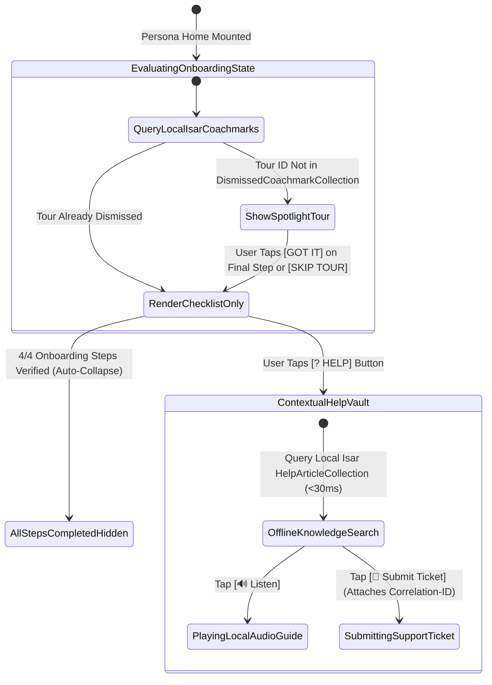

# 06 — Interactive Onboarding Coachmarks, Gamified Checklist & Offline Help Center (`SPEC-MOB-SHR-06`)

| Metadata | Value |
| :--- | :--- |
| **Document ID** | `SPEC-MOB-SHR-06` |
| **Subsystem** | `docs/mobile/shared-features/` |
| **Target Framework** | Flutter 3.x (`flutter_bloc`, `isar`, `url_launcher`, `just_audio`) |
| **SRS Traceability** | `REQ-05-14` (`ON-01` to `ON-07` / `ONB-01`..`ONB-04`, `HLP-01`..`HLP-04`), `REQ-05-16` (`AC-06`), `REQ-05-17` (`OFF-01`) |
| **Architecture / Flows** | `FLOW-01` (First-Time User Onboarding), `ADR-010` (Offline Isar Knowledge Base), `ADR-013` |
| **Design System** | `DS-DINK-CORE-V7.0` (§4.1 Industrial Actuators, §5.2 Outdoor High-Contrast) |
| **Status** | Normative — Phase 0 Specification |

---

## 1. Purpose & Requirement Traceability

Heavy machinery operators, rural quarry owners, and site foremen frequently use Dink Machinery under high cognitive and environmental load without desktop training manuals. This specification defines the **Persona-Specific Interactive Coachmark Spotlight System (`HLP-01`, `HLP-02`)**, the **Gamified Collapsible Onboarding Progress Card (`ONB-01`..`ONB-04`)**, the **Offline-Cached Multilingual Field Manual & Reticle Walkthrough Vault (`HLP-03`)**, and the **First-Level Diagnostic Support Escalation Hub (`HLP-04`)**:

| Requirement ID | Normative Obligation | Mobile Implementation Mechanism |
| :--- | :--- | :--- |
| **`ONB-01`..`ONB-04` (Gamified Persona Onboarding Checklist)** | Newly registered users MUST see a collapsible onboarding progress checklist tailored to their active persona (`RENTER`, `OWNER`, `OPERATOR`, `TRANSPORTER`) tracking completion of KYC, payout bank binding, first fleet listing, or shift check-in walkthrough. | `GamifiedOnboardingCard` at the top of each persona home dashboard backed by `GET /api/v1/onboarding/config` and `POST /api/v1/onboarding/complete-step`. |
| **`HLP-01` / `HLP-02` (Interactive Spotlight Coachmarks)** | First-time visits to critical field screens (Precision Camera Reticle, Slide-to-Confirm Handover, Hour-Meter OCR, Role Switcher) MUST display non-blocking spotlight coachmarks with `56dp × 56dp` glove-friendly `[Got It / Next]` dismissal persisted locally and synced to the server. | `IndustrialCoachmarkOverlay` reading/writing `DismissedCoachmarkCollection` in Isar so dismissed tours never re-trigger across app restarts or offline sessions. |
| **`HLP-03` (Offline Multilingual Knowledge Base & Audio Guides)** | The Help Center (`GET /api/v1/help/topics`)—including illustrated inspection reticle guides, escrow rules, and compressed Amharic/Oromoo/Swahili audio voiceovers (`AC-06`)—MUST be cached in Isar (`ADR-010`) for zero-connectivity quarry access. | `OfflineHelpVaultScreen` with instant full-text search across `en`, `am`, `om`, and `sw` articles plus embedded offline Opus audio playback (`16kbps` voiceover). |
| **`HLP-04` (Contextual Support Escalation & Telemetry Attachment)** | Users encountering a field blocker MUST have 1-tap access to the **Toll-Free Dispatch Hotline (`tel:8190`)**, **Verified WhatsApp Support**, and an **In-App Support Ticket Form (`POST /api/v1/support/tickets`)** that automatically attaches the active `bookingId`, `X-Correlation-ID`, and offline outbox diagnostics. | `ContextualSupportEscalationSheet` accessible from the persistent top-right `[?]` action icon on every operational screen. |

---

## 2. Domain Context & Non-Negotiable Invariants

1. **Glove-Friendly Non-Trapping Coachmarks (`HLP-02`):** Spotlight overlays must never trap a field operator who is actively trying to log an urgent shift or SOS event. Every coachmark step includes both a `56dp × 56dp` `[NEXT ->]` primary button and a `56dp × 56dp` `[SKIP TOUR ✕]` actuator that immediately marks the tour (`tour_renter_core`, `tour_owner_core`, `tour_operator_core`, `tour_reticle_inspection`) as dismissed in Isar.
2. **Low-Literacy Audio Assist Integration (`AC-06`):** Every coachmark card and Help Center article includes a `56dp` `[🔊 LISTEN IN AMHARIC / OROMOO]` speaker button that plays pre-cached compressed Opus voice guidance for operators who prefer spoken instructions over dense text.
3. **Zero-PII Diagnostic Snapshot on Support Tickets (`HLP-04`, `AGENTS.md` §1):** When submitting an in-app support ticket (`POST /api/v1/support/tickets`), the diagnostic attachment includes `appVersion`, `osBuild`, `activePersona`, `activeBookingId`, `pendingOutboxCount`, and the last 5 RFC 9457 `requestId` / `error.code` pairs—strictly excluding raw tokens, phone numbers, or national ID numbers.

---

## 3. Bespoke ASCII Wireframes

### 3.1 Gamified Persona Onboarding Checklist & Spotlight Coachmark Overlay
```text
+-----------------------------------------------------------------------+
|  🚜 OWNER DASHBOARD                         [🔊] [☀️] [? HELP] [🔔 2] |
+-----------------------------------------------------------------------+
|  GAMIFIED ONBOARDING PROGRESS CARD (ONB-01..04 • 75% COMPLETE)        |
|  +-----------------------------------------------------------------+  |
|  | 🚀 GET YOUR FLEET READY FOR DISPATCH (3 OF 4 COMPLETED)   [▲]   |  |
|  | [▓▓▓▓▓▓▓▓▓▓▓▓▓▓▓▓▓▓▓▓▓▓▓▓▓▓▓▓▓▓▓▓▓▓▓▓▓▓░░░░░░░░░░░░░]  75%      |  |
|  |                                                                 |  |
|  | [✓] 1. Verify Mobile Phone & Select Owner Persona               |  |
|  | [✓] 2. Upload MoTRI Trade License & 10-Digit MOR TIN            |  |
|  | [✓] 3. Bind Commercial Escrow Settlement Bank Account (CBE)     |  |
|  | [◉] 4. Publish Your First Heavy Machine & CPAR Insurance        |  |
|  |     +---------------------------------------------------------+ |  |
|  |     |       ➕ ADD FIRST MACHINE TO FLEET (56dp)        [ -> ] | |  |
|  |     +---------------------------------------------------------+ |  |
|  +-----------------------------------------------------------------+  |
|                                                                       |
|  ░░░░░░░░░░░░░░░ SPOTLIGHT SCRIM OVERLAY (#D9020617) ░░░░░░░░░░░░░░░  |
|  ░                                                                 ░  |
|  ░  +-----------------------------------------------------------+  ░  |
|  ░  | 💡 TIP 2 OF 3: INSTANT PERSONA SWITCHER        [🔊 AUDIO] |  ░  |
|  ░  | Need to rent a crane from another owner while managing    |  ░  |
|  ░  | your own excavators? Tap the Role Switcher pill anytime   |  ░  |
|  ░  | without logging out.                                      |  ░  |
|  ░  |                                                           |  ░  |
|  ░  | [ ✕ SKIP TOUR (56dp) ]          [ GOT IT / NEXT (56dp) ->]|  ░  |
|  ░  +-----------------------------------------------------------+  ░  |
|  ░                              │                                  ░  |
|  ░                              ▼                                  ░  |
|  ░         ┏━━━━━━━━━━━━━━━━━━━━━━━━━━━━━━━━━━━━━━━━━┓             ░  |
|  ░         ┃  [🔄 ACTIVE ROLE: FLEET OWNER       v]  ┃             ░  |
|  ░         ┗━━━━━━━━━━━━━━━━━━━━━━━━━━━━━━━━━━━━━━━━━┛             ░  |
+-----------------------------------------------------------------------+
```

### 3.2 Offline Multilingual Field Manual & Support Escalation Hub (`OfflineHelpVaultScreen`)
```text
+-----------------------------------------------------------------------+
|  [<-]  FIELD HELP & SUPPORT ESCALATION             [🟢 AVAILABLE OFFLINE]
+-----------------------------------------------------------------------+
|  🔍 [ Search inspection guides, escrow rules, hour meter...        ]  |
+-----------------------------------------------------------------------+
|  🚨 IMMEDIATE FIELD DISPATCH & ESCROW SUPPORT (HLP-04)                |
|  +-------------------------------+ +-------------------------------+  |
|  |   📞 CALL TOLL-FREE 8190      | |   💬 WHATSAPP DISPATCH DESK   |  |
|  |   (24/7 Amharic/Oromoo/Sw/En) | |   (Auto-Attaches #BK-8941)    |  |
|  +-------------------------------+ +-------------------------------+  |
|  | [ 🎫 SUBMIT IN-APP TICKET WITH DIAGNOSTIC LOGS (56dp)      -> ] |  |
|  +-----------------------------------------------------------------+  |
|                                                                       |
|  📚 OFFLINE-CACHED FIELD GUIDES & AUDIO WALKTHROUGHS (HLP-03)         |
|  +-----------------------------------------------------------------+  |
|  | 1. How to Capture Glare-Free Hour Meter & Chassis Plates        |  |
|  |    [🔊 Listen 0:45 (Amharic)]  •  [📖 Read Illustrated Guide]   |  |
|  +-----------------------------------------------------------------+  |
|  | 2. How the 24-Hour Damage Claim Guillotine Protects You (RC-04) |  |
|  |    [🔊 Listen 1:10 (Amharic)]  •  [📖 Read Illustrated Guide]   |  |
|  +-----------------------------------------------------------------+  |
|  | 3. Logging Shifts & GPS Check-In in Zero-Network Quarries       |  |
|  |    [🔊 Listen 0:55 (Afaan Oromoo)] • [📖 Read Guide]            |  |
|  +-----------------------------------------------------------------+  |
+-----------------------------------------------------------------------+
```

---

## 4. W3C DTCG Design Token Mapping

| UI Element / Component | Token Path (`design-tokens.json`) | Resolved Value (`dark` / `outdoorHighContrast`) |
| :--- | :--- | :--- |
| **Spotlight Scrim Backdrop** | `{component.reticle.viewfinder.scrimColor}` | `#020617` at `85%` opacity |
| **Spotlight Highlight Cutout Ring** | `{color.brand.amber.400}` | `#FBBF24` (`3dp` pulsing border around highlighted widget) |
| **Onboarding Progress Bar Fill** | `{color.feedback.emerald.500}` | `#10B981` |
| **Coachmark Dismiss / Next Buttons** | `{dimension.space.56}` | `56dp × 56dp` minimum glove-friendly touch target |
| **Toll-Free `8190` Hotline Action Card** | `{color.brand.amber.500}` | `#F59E0B` (`64dp` height with `#020617` bold icon/text) |

---

## 5. Screen-Specific State Machine (Coachmarks, Onboarding & Support Flow)



---

## 6. Concrete Flutter Implementation Blueprint

### 6.1 Isar Offline Schema for Coachmarks & Help Articles (`onboarding_help_isar.dart`)
```dart
import 'package:isar/isar.dart';

part 'onboarding_help_isar.g.dart';

@collection
class DismissedCoachmarkEntity {
  Id isarId = Isar.autoIncrement;

  @Index(unique: true, replace: true)
  late String tourOrStepId; // e.g., tour_owner_core, coach_reticle_glare

  late DateTime dismissedAtUtc;
  late bool syncedToServer;
}

@collection
class HelpArticleEntity {
  Id isarId = Isar.autoIncrement;

  @Index(unique: true, replace: true)
  late String articleId;

  @Index()
  late String localeCode; // en | am | om | sw

  @Index()
  late String personaScope; // ALL | RENTER | OWNER | OPERATOR | TRANSPORTER

  late String title;
  late String markdownBody;
  String? localAudioOpusPath;
  late DateTime updatedAtUtc;
}
```

### 6.2 BLoC Events & Freezed State (`onboarding_help_bloc.dart`)
```dart
import 'package:bloc/bloc.dart';
import 'package:freezed_annotation/freezed_annotation.dart';

part 'onboarding_help_bloc.freezed.dart';

@freezed
sealed class OnboardingHelpEvent with _$OnboardingHelpEvent {
  const factory OnboardingHelpEvent.personaHomeEntered({required String persona}) = _PersonaHomeEntered;
  const factory OnboardingHelpEvent.coachmarkDismissed({required String tourId}) = _CoachmarkDismissed;
  const factory OnboardingHelpEvent.helpSearchQueryChanged(String query) = _HelpSearchQueryChanged;
  const factory OnboardingHelpEvent.supportTicketSubmitted({
    required String category,
    required String message,
    String? activeBookingId,
    required String lastCorrelationId,
    required String idempotencyKey,
  }) = _SupportTicketSubmitted;
}

@freezed
abstract class OnboardingHelpState with _$OnboardingHelpState {
  const factory OnboardingHelpState({
    @Default(0) int completedStepsCount,
    @Default(4) int totalStepsCount,
    String? activeSpotlightTourId,
    @Default(0) int activeSpotlightStepIndex,
    @Default('') String searchQuery,
    @Default(false) bool isSubmittingTicket,
    String? createdTicketReference,
    String? rfc9457ErrorCode,
  }) = _OnboardingHelpState;
}
```

---

## 7. OpenAPI 3.1.0 Contract & RFC 9457 Error Matrix

### 7.1 Endpoints
1. `GET /api/v1/onboarding/config` & `POST /api/v1/onboarding/complete-step` (`Idempotency-Key` required).
2. `GET /api/v1/help/topics?locale=am&since=<iso-timestamp>` (Delta-synced into Isar `HelpArticleEntity`).
3. `POST /api/v1/support/tickets` (`Idempotency-Key` required, attaches non-PII diagnostic telemetry + `X-Correlation-ID`).

### 7.2 RFC 9457 Error Recovery Matrix

| HTTP Status | `error.code` | Trigger Condition | Deterministic Mobile UI Recovery |
| :--- | :--- | :--- | :--- |
| **`429`** | `SYS_RATE_LIMIT_EXCEEDED` | More than 5 support tickets submitted within 15 minutes. | Display cooldown timer and highlight direct `[📞 Call Toll-Free 8190]` button for urgent dispatch issues. |
| **`503`** | `SYS_SERVICE_UNAVAILABLE` | User submits a support ticket or completes a coachmark while offline in a rural site. | Queue support ticket or coachmark completion in Isar Outbox (`ADR-010`) and display `[💾 Queued for Sync — Or Call 8190 via Cellular Voice]`. |

---

## 8. Verification & Acceptance Criteria

1. **`bloc_test` — Persistent Coachmark Dismissal (`HLP-01`):**
   - Verify that once `CoachmarkDismissed(tourId: 'tour_owner_core')` is processed, subsequent `PersonaHomeEntered(persona: 'OWNER')` events emit `activeSpotlightTourId: null` even when offline.
2. **Offline Help Search & Audio Assist Test (`HLP-03`, `AC-06`):**
   - Seed `HelpArticleEntity` in Isar, enable Airplane Mode, search `"ሰዓት ቆጣሪ"` (Hour Meter in Amharic), and assert `< 30ms` search results and functional local audio playback trigger.
3. **Golden & Accessibility Verification (`WCAG 2.2 AAA`):**
   - Render `GamifiedOnboardingCard`, `IndustrialCoachmarkOverlay`, and `OfflineHelpVaultScreen` under `outdoorHighContrast` and `am_ET`, confirming `56dp` buttons and zero text truncation at `200%` font scale.
