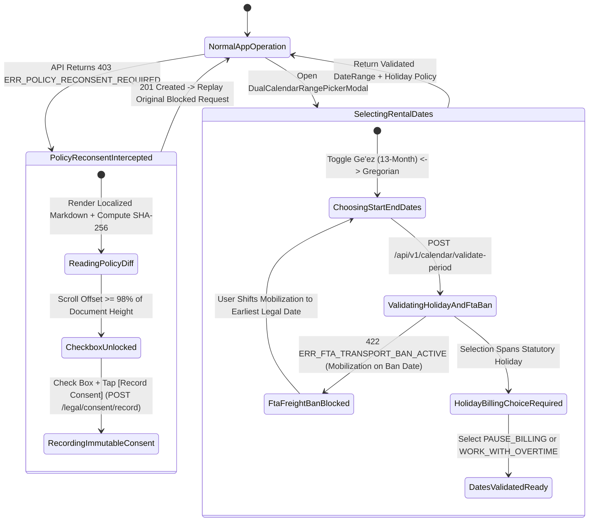

# 07 — Versioned Legal Policy Re-Consent Shield & Ethiopian Ge'ez 13-Month Calendar Picker (`SPEC-MOB-SHR-07`)

| Metadata | Value |
| :--- | :--- |
| **Document ID** | `SPEC-MOB-SHR-07` |
| **Subsystem** | `docs/mobile/shared-features/` |
| **Target Framework** | Flutter 3.x (`flutter_bloc`, `isar`, `crypto`) |
| **SRS Traceability** | `REQ-05-20` (`PT-01`..`PT-05` / `POL-01`..`POL-04`), `REQ-05-23` (`HC-01`..`HC-05` / `HOL-01`..`HOL-03`), `REQ-05-16` (`LOC-01-BE`) |
| **Architecture / Flows** | `FLOW-ENTRY` (Mandatory Policy Gate), `FLOW-06` (Booking Date & Holiday Validation), `ADR-010`, `ADR-013` |
| **Design System** | `DS-DINK-CORE-V7.0` (§3.1 Multilingual Typography, §4.1 Industrial Actuators) |
| **Status** | Normative — Phase 0 Specification |

---

## 1. Purpose & Requirement Traceability

This specification unifies two cross-cutting statutory compliance components used across onboarding, booking checkout, and contract execution:
- **Part A — Versioned Legal Policy & Mandatory Re-Consent Interception Shield (`REQ-05-20`):** Intercepts `HTTP 403 ERR_POLICY_RECONSENT_REQUIRED` whenever a major Semantic Version bump (`1.4.0` → `2.0.0`) occurs on the Terms of Service, Escrow Agreement, or Privacy Policy, enforcing an immutable click-wrap audit trail (`UserConsentLog`) with cryptographic `contentSha256` verification.
- **Part B — Dual Gregorian & Ethiopian Ge'ez 13-Month Calendar Picker & Holiday Freight Interlock (`REQ-05-23`):** Provides lossless bidirectional conversion between the Gregorian calendar and the **Ethiopian Ge'ez 13-Month Calendar** (`12 × 30-day months` + `Pagumē` `5` or `6` days), highlights Ethiopian & Kenyan statutory public holidays, calculates holiday shift surcharge/exclusion rules (`HOL-01`/`HOL-02`), and enforces **Federal Transport Authority (FTA) Lowboy Highway Freight Bans (`422 ERR_FTA_TRANSPORT_BAN_ACTIVE`, `HOL-03`)**.

| Requirement ID | Normative Obligation | Mobile Implementation Mechanism |
| :--- | :--- | :--- |
| **`POL-01` / `POL-02` (SemVer Policy Gate & `403` Interception)** | Major SemVer bumps (`X.0.0`) on statutory policies MUST block mutating API calls with `403 ERR_POLICY_RECONSENT_REQUIRED` and present a non-dismissible localized diff summary (`en`, `am`, `om`, `sw`) until explicit re-consent is recorded. | Dio global interceptor catches `ERR_POLICY_RECONSENT_REQUIRED` and presents `MandatoryPolicyReconsentModal` with scroll-to-bottom gate + `56dp` click-wrap checkbox. |
| **`POL-03` / `POL-04` (Cryptographic `contentSha256` Consent Receipt)** | Recording consent (`POST /api/v1/legal/consent/record`) MUST transmit the exact `policyId`, `semver`, `locale`, and `contentSha256` hash of the text rendered to the user. | Client computes `sha256` of the rendered Markdown string and commits an immutable `UserConsentLog` receipt before replaying the paused mutation. |
| **`HOL-01` / `HOL-02` (13-Month Ethiopian Calendar & Holiday Shift Rules)** | Date pickers across Ethiopia (`ET`) MUST toggle seamlessly between Gregorian and **Ethiopian Ge'ez (`ዓ.ም.`)** calendars (including 5/6-day 13th month *Pagumē*), mark National Holidays (*Enkutatash*, *Meskel*, *Genna*, *Timket*, *Adwa*, *Fasika*, *Eid*), and let contractors choose `EXCLUDE_HOLIDAY_BILLING` vs. `OPERATE_WITH_HOLIDAY_OVERTIME`. | `DualCalendarRangePickerModal` with Julian Day Number (`JDN`) conversion engine, holiday badge overlays (`GET /api/v1/calendar/holidays`), and shift billing mode selector. |
| **`HOL-03` (FTA Heavy Lowboy Highway Transport Ban Interlock)** | Lowboy flatbed dispatch dates falling on restricted Ethiopian Federal Transport Authority (FTA) or Kenyan KeNHA holiday freight ban windows MUST be blocked with `422 ERR_FTA_TRANSPORT_BAN_ACTIVE`. | Real-time validation call (`POST /api/v1/calendar/validate-period`) highlighting restricted mobilization dates in crimson and suggesting the earliest legal dispatch window. |

---

## 2. Domain Context & Non-Negotiable Invariants

1. **Exact Julian Day Number (`JDN`) Ethiopian Calendar Math (`REQ-05-23`):**
   - The Ethiopian calendar has 12 months of exactly 30 days (*Meskerem*, *Tikimt*, *Hidar*, *Tahsas*, *Tir*, *Yekatit*, *Megabit*, *Miazia*, *Ginbot*, *Sene*, *Hamle*, *Nehase*) plus a 13th month (*Pagumē*, ጳጉሜን) of **5 days** in a common year and **6 days** in an Ethiopian leap year (`(ethiopianYear + 1) % 4 == 0`).
   - Conversion between Gregorian `(Y, M, D)` and Ethiopian `(EY, EM, ED)` uses deterministic integer Julian Day Number (`JDN`, epoch offset `1723856`) arithmetic—never approximate day-offset heuristics that break across leap-year boundaries between September 11/12 and February 29.
2. **Ethiopian 12-Hour Diurnal Clock Convention (`LOC-01-BE`):** When the user's locale is `am_ET` or `om_ET`, shift handover times display both standard 24-hour/EAT time and traditional Ethiopian 6-hour offset diurnal time (e.g., `08:00 EAT` = `2:00 ጥዋት [Morning]`, `14:00 EAT` = `8:00 ከሰዓት በኋላ [Afternoon]`).

---

## 3. Bespoke ASCII Wireframes

### 3.1 Part A: Mandatory Policy Re-Consent Interception Shield (`MandatoryPolicyReconsentModal`)
```text
+-----------------------------------------------------------------------+
|  ⚖️ UPDATED PLATFORM ESCROW & LEASE TERMS (v2.0.0)   [🌐 አማርኛ / EN]  |
+-----------------------------------------------------------------------+
|  ⚠️ MANDATORY UPDATE: Please review and accept the updated Escrow     |
|     & Damage Arbitration Terms (v2.0.0) to continue using Dink.       |
|                                                                       |
|  KEY CHANGES FROM v1.4.0 -> v2.0.0 (SUMMARY):                         |
|  +-----------------------------------------------------------------+  |
|  | • Section 4.2: Statutory 24-Hour Damage Claim Guillotine (RC-04)|  |
|  |   clarifies that claims without a dealer quote auto-expire.     |  |
|  | • Section 7.1: Ethiopian MOR 2% Withholding Tax receipt upload  |  |
|  |   timeline standardized to 5 business days prior to payout.     |  |
|  +-----------------------------------------------------------------+  |
|                                                                       |
|  FULL STATUTORY POLICY TEXT (SCROLL TO BOTTOM TO UNLOCK)              |
|  +-----------------------------------------------------------------+  |
|  | Article 1: Definitions and Escrow Custodianship...              |  |
|  | [▓▓▓▓▓▓▓▓▓▓▓▓▓▓▓▓▓▓▓▓▓▓▓▓▓▓▓▓▓▓▓▓▓▓▓▓▓▓▓▓▓▓▓▓▓▓▓▓▓▓] 100% Read  |  |
|  | 🔒 Content SHA-256: e3b0c44298fc1c149afbf4c8996fb92427ae41e464  |  |
|  +-----------------------------------------------------------------+  |
|                                                                       |
|  +-----------------------------------------------------------------+  |
|  | [✓] I have read and agree to the Dink Machinery Escrow & Lease  |  |
|  |     Terms v2.0.0 (56dp Click-Wrap Target).                      |  |
|  +-----------------------------------------------------------------+  |
|  |         RECORD CONSENT & CONTINUE (64dp ACTUATOR)        [ -> ] |  |
|  +-----------------------------------------------------------------+  |
+-----------------------------------------------------------------------+
```

### 3.2 Part B: Dual Ethiopian Ge'ez 13-Month & Gregorian Calendar Picker (`DualCalendarRangePickerModal`)
```text
+-----------------------------------------------------------------------+
|  [<-]  SELECT RENTAL & DISPATCH DATES               [📅 CALENDAR MODE]|
|        [◉ 🇪🇹 ETHIOPIAN GE'EZ (2019 ዓ.ም.)]   [ ] 🌍 GREGORIAN (2026)   |
+-----------------------------------------------------------------------+
|  [<]          መስከረም (MESKEREM) 2019 ዓ.ም. (SEP/OCT 2026)          [>]  |
|  (Note: 13th Month ጳጉሜን Pagumē 2018 had 5 Days: Pagumē 1 - Pagumē 5)  |
+-----------------------------------------------------------------------+
|   ሰኞ (M)  ማክ (T)  ረቡ (W)  ሐሙ (T)  ዓር (F)  ቅዳ (S)  እሑ (S)             |
|   ---------------------------------------------------------------     |
|                      1🎉     2       3       4       5               |
|                     (11Sep) (12Sep) (13Sep) (14Sep) (15Sep)           |
|    6       7       8       9      10      11      12                  |
|   13      14      15   [🚚16🚫] [▓▓17🌟] [▓▓18▓▓] [▓▓19▓▓]             |
|                        (26Sep) (27Sep) (28Sep) (29Sep)                |
+-----------------------------------------------------------------------+
|  🚨 STATUTORY HOLIDAY & FTA LOWBOY BAN DETECTED IN SELECTION:         |
|  +-----------------------------------------------------------------+  |
|  | 🌟 Meskerem 17 (27 Sep): MESKEL (Finding of the True Cross)     |  |
|  | 🚫 Meskerem 16–17: FTA HEAVY LOWBOY HIGHWAY FREIGHT BAN ACTIVE  |  |
|  |    Lowboy trailers > 20 tons cannot mobilize on federal         |  |
|  |    highways during Meskel Eve & Meskel Day (HOL-03).            |  |
|  |    👉 Earliest Legal Mobilization: Meskerem 18 (28 Sep, 06:00)  |  |
|  +-----------------------------------------------------------------+  |
|                                                                       |
|  HOLIDAY SHIFT BILLING RULE (FOR MESKEREM 17 — HOL-01 / HOL-02):      |
|  +-----------------------------------------------------------------+  |
|  | [◉] PAUSE BILLING ON HOLIDAY (0.0h Quota • Machine Locked Idle) |  |
|  | [ ] WORK ON HOLIDAY (+150% Operator Overtime Surcharge Applies) |  |
|  +-----------------------------------------------------------------+  |
|  |        APPLY VALIDATED RENTAL DATES (Meskerem 18 - 28)   [ -> ] |  |
|  +-----------------------------------------------------------------+  |
+-----------------------------------------------------------------------+
```

---

## 4. W3C DTCG Design Token Mapping

| UI Element / Component | Token Path (`design-tokens.json`) | Resolved Value (`dark` / `outdoorHighContrast`) |
| :--- | :--- | :--- |
| **Ge'ez Month & Holiday Typography** | `{typography.fontFamily.ethiopic}` + `{typography.lineHeightFactor.ethiopicGolden}` | `Noto Sans Ethiopic`, `16sp`, `1.38x` line-height |
| **Selected Rental Date Range Pill** | `{color.brand.amber.500}` | `#F59E0B` (`#FBBF24` outdoor) with `#020617` numerals |
| **Statutory Public Holiday Cell Badge** | `{color.feedback.purple.500}` | `#A855F7` star indicator + `2dp` border |
| **FTA Highway Transport Ban Cell** | `{color.feedback.crimson.500}` | `#EF4444` diagonal hatch + `[🚫 FTA BAN]` badge |
| **Dual Calendar Sub-Label Numerals** | `{typography.fontFamily.mono}` | `Space Mono`, `11sp` (Gregorian date beneath Ge'ez date) |
| **Click-Wrap Consent Checkbox Row** | `{dimension.space.56}` | `56dp` minimum touch height |

---

## 5. Screen-Specific State Machine (Policy Interception & Holiday/FTA Validation)



---

## 6. Concrete Flutter Implementation Blueprint

### 6.1 Exact Julian Day Number (`JDN`) Ethiopian Ge'ez 13-Month Converter (`ethiopian_calendar_math.dart`)
```dart
class EthiopianDate {
  final int year;  // e.g., 2019 E.C.
  final int month; // 1..13 (1 = Meskerem .. 12 = Nehase, 13 = Pagumē)
  final int day;   // 1..30 (or 1..5 / 1..6 for Pagumē)

  const EthiopianDate(this.year, this.month, this.day);

  static const int _jdnEpochOffset = 1723856;

  /// Returns true if the Ethiopian year has a 6-day Pagumē (preceding Gregorian leap year)
  static bool isEthiopianLeapYear(int ethiopianYear) => (ethiopianYear + 1) % 4 == 0;

  /// Returns the number of days in the given Ethiopian month (30 for 1..12, 5 or 6 for 13)
  static int daysInMonth(int ethiopianYear, int month) {
    if (month < 1 || month > 13) throw ArgumentError('Invalid Ethiopian month: $month');
    if (month <= 12) return 30;
    return isEthiopianLeapYear(ethiopianYear) ? 6 : 5;
  }

  /// Lossless conversion from Gregorian DateTime to EthiopianDate via Julian Day Number (JDN)
  factory EthiopianDate.fromGregorian(DateTime gregorian) {
    final int a = (14 - gregorian.month) ~/ 12;
    final int y = gregorian.year + 4800 - a;
    final int m = gregorian.month + 12 * a - 3;
    final int jdn = gregorian.day +
        ((153 * m + 2) ~/ 5) +
        365 * y +
        (y ~/ 4) -
        (y ~/ 100) +
        (y ~/ 400) -
        32045;

    final int r = (jdn - _jdnEpochOffset) % 1461;
    final int n = (r % 365) + 365 * (r ~/ 1460);
    final int ethYear = 4 * ((jdn - _jdnEpochOffset) ~/ 1461) + (r ~/ 365) - (r ~/ 1460);
    final int ethMonth = (n ~/ 30) + 1;
    final int ethDay = (n % 30) + 1;
    return EthiopianDate(ethYear, ethMonth, ethDay);
  }
}
```

### 6.2 BLoC Events & Freezed State (`policy_and_calendar_bloc.dart`)
```dart
import 'package:bloc/bloc.dart';
import 'package:freezed_annotation/freezed_annotation.dart';

part 'policy_and_calendar_bloc.freezed.dart';

enum HolidayShiftRule { pauseBillingIdle, operateWithOvertimeSurcharge }

@freezed
sealed class PolicyAndCalendarEvent with _$PolicyAndCalendarEvent {
  const factory PolicyAndCalendarEvent.policyReconsentIntercepted({
    required String policyId,
    required String requiredSemver,
    required String markdownContent,
    required String expectedSha256,
  }) = _PolicyReconsentIntercepted;

  const factory PolicyAndCalendarEvent.policyConsentSubmitted({
    required String policyId,
    required String semver,
    required String computedSha256,
    required String locale,
    required String idempotencyKey,
  }) = _PolicyConsentSubmitted;

  const factory PolicyAndCalendarEvent.rentalPeriodValidated({
    required DateTime startUtc,
    required DateTime endUtc,
    required bool requiresLowboyHighwayTransport,
    required HolidayShiftRule holidayRule,
  }) = _RentalPeriodValidated;
}

@freezed
abstract class PolicyAndCalendarState with _$PolicyAndCalendarState {
  const factory PolicyAndCalendarState({
    @Default(false) bool isPolicyModalBlocking,
    String? pendingPolicyId,
    String? pendingPolicySemver,
    String? pendingPolicySha256,
    @Default(true) bool isEthiopianCalendarMode,
    @Default(false) bool hasFtaTransportBanConflict,
    DateTime? earliestLegalMobilizationUtc,
    @Default(<String>[]) List<String> intersectedHolidayNames,
    @Default(HolidayShiftRule.pauseBillingIdle) HolidayShiftRule selectedHolidayRule,
    String? rfc9457ErrorCode,
  }) = _PolicyAndCalendarState;
}
```

---

## 7. OpenAPI 3.1.0 Contract & RFC 9457 Error Matrix

### 7.1 Endpoints
1. `GET /api/v1/legal/policies/active?locale=am` → Returns active policy SemVer, localized Markdown, diff summary, and `contentSha256`.
2. `POST /api/v1/legal/consent/record` (`Idempotency-Key` required) → Commits immutable `UserConsentLog` with `{policyId, semver, contentSha256, locale}`.
3. `GET /api/v1/calendar/holidays?country=ET&year=2026` → Cached in Isar for offline date picking.
4. `POST /api/v1/calendar/validate-period` → Validates `[startDate, endDate]`, returning intersected holidays, chargeable shift quota hours, and FTA Lowboy highway ban status.

### 7.2 RFC 9457 Error Recovery Matrix

| HTTP Status | `error.code` | Trigger Condition | Deterministic Mobile UI Recovery |
| :--- | :--- | :--- | :--- |
| **`403`** | `ERR_POLICY_RECONSENT_REQUIRED` | User attempted a mutation after a major SemVer policy update (`POL-02`). | Intercept globally in Dio, present `MandatoryPolicyReconsentModal`, record consent, and transparently retry the original request. |
| **`422`** | `ERR_FTA_TRANSPORT_BAN_ACTIVE` | Mobilization date requires Lowboy highway freight on a restricted FTA/KeNHA holiday window (`HOL-03`). | Highlight restricted date in crimson, lock checkout button, and offer 1-tap `[Shift Mobilization to Earliest Legal Date]`. |
| **`422`** | `POL_SHA256_MISMATCH` | Submitted `contentSha256` does not match the active server policy version. | Re-fetch `/api/v1/legal/policies/active` and refresh the policy text before re-enabling the consent checkbox. |

---

## 8. Verification & Acceptance Criteria

1. **Unit Test — Ethiopian Ge'ez Leap Year & Pagumē Boundary Math:**
   - Assert `EthiopianDate.fromGregorian(DateTime(2026, 9, 11))` equals `EthiopianDate(2019, 1, 1)` (*1 Meskerem 2019 E.C.*).
   - Assert `EthiopianDate.daysInMonth(2019, 13)` equals `6` (2019 E.C. precedes 2028 leap cycle offset) and `daysInMonth(2018, 13)` equals `5`.
2. **`bloc_test` — `403 ERR_POLICY_RECONSENT_REQUIRED` & `422 ERR_FTA_TRANSPORT_BAN_ACTIVE`:**
   - Verify that `ERR_FTA_TRANSPORT_BAN_ACTIVE` sets `hasFtaTransportBanConflict: true` and populates `earliestLegalMobilizationUtc`.
3. **Golden & Accessibility Verification (`WCAG 2.2 AAA`):**
   - Render `MandatoryPolicyReconsentModal` and `DualCalendarRangePickerModal` in `outdoorHighContrast` and `am_ET` (`Noto Sans Ethiopic` `1.38x` line-height) at `200%` text scaling.
