# 08 — Marketplace Integrity, Anti-Circumvention Q&A Shield & Fraud Guards (`SPEC-MOB-SHR-08`)

| Metadata | Value |
| :--- | :--- |
| **Document ID** | `SPEC-MOB-SHR-08` |
| **Subsystem** | `docs/mobile/shared-features/` |
| **Target Framework** | Flutter 3.x (`flutter_bloc`, `url_launcher`, `image`, `crypto`) |
| **SRS Traceability** | `REQ-05-24` (`MI-01`..`MI-07` / `INT-01` to `INT-04`), `REQ-05-18` (`ER-03`) |
| **Architecture / Flows** | `FLOW-06` (Pre-Booking Q&A & Escrow), `FLOW-07`, `FLOW-08` (Slip Verification), `ADR-008`, `ADR-010` |
| **Design System** | `DS-DINK-CORE-V7.0` (§4.1 Industrial Actuators, §5.2 Outdoor High-Contrast) |
| **Status** | Normative — Phase 0 Specification |

---

## 1. Purpose & Requirement Traceability

In heavy equipment marketplaces, platform leakage (owners and renters exchanging phone numbers in pre-booking Q&A to bypass escrow commissions), recycled bank transfer receipts, and fabricated operator shift logs threaten marketplace solvency. This specification defines the mobile client architecture for **Marketplace Integrity & Anti-Circumvention Controls (`REQ-05-24`)**:

| Requirement ID | Normative Obligation | Mobile Implementation Mechanism |
| :--- | :--- | :--- |
| **`INT-01a` (Pre-Booking Contact Redaction & Obfuscation Shield)** | All pre-confirmation Equipment Q&A comments and negotiation messages (`POST /api/v1/integrity/messages/filter`) MUST redact phone numbers (`+251`, `09...`, `07...`, `+254`), emails, Telegram handles, bank accounts, and spelled-out numerals across English, Amharic (`ዜሮ ዘጠኝ...`), Oromoo, and Swahili (`sifuri saba...`), replacing them with `[CONTACT INFORMATION REDACTED - USE IN-APP VOICE PROXY]`. | Dual-layer client preview sanitizer + authoritative server regex/NLP filter with live **3-Strike Anti-Circumvention Warning Banner** and liquidated commission penalty disclosure. |
| **`INT-01b` (Masked Ephemeral Voice Proxy Telephony)** | Once a booking transitions to `CONFIRMED` or `ACTIVE`, Renter, Owner, and Operator coordinate via a **Masked Ephemeral PBX Proxy Number** (`+251 11 819 0001 ext. XXXX`) that automatically expires upon rental completion without exposing personal MSISDNs. | `MaskedVoiceProxyCallButton` (`56dp`) invoking `tel:+251118190001,<pin>#` during active dispatch windows. |
| **`INT-02` (Perceptual Hash `dHash` Bank Wire Slip Anti-Recycling Guard)** | Uploaded manual bank transfer / RTGS deposit slips (`CBE`, `Awash`, `KCB`) MUST be fingerprinted via a **64-bit difference hash (`dHash`)** and OCR reference extraction, rejecting recycled or slightly cropped duplicate slips (`Hamming distance <= 4`) with `409 ERR_PAYMENT_SLIP_RECYCLED`. | On-device `64-bit dHash` pre-computation + server perceptual hash index check surfacing a high-contrast fraud warning modal if a slip was already submitted on another booking. |
| **`INT-03` (Statistical Shift Velocity Anomaly Interlock)** | Operator daily shift logs exceeding **`> 18.0 engine hours / 24h day`** MUST require mandatory Site Supervisor co-sign attestation and live hour-meter photo proof; logs exceeding **`> 24.0 hours / calendar day`** are hard-blocked (`422 ERR_SHIFT_VELOCITY_IMPOSSIBLE`). | `ShiftVelocityAnomalyShield` inside Operator Shift Logging locking submission above `18.0h` until Supervisor Co-Sign PIN/QR and macro hour-meter reticle photo are attached. |

---

## 2. Domain Context & Non-Negotiable Invariants

1. **Multilingual Spelled-Number Normalization (`INT-01a`):** Evasive users attempt to bypass simple digit regexes by writing `"zero nine one one..."`, `"ዜሮ ዘጠኝ አንድ አንድ..."` (Amharic), `"zeeroo sagal..."` (Oromoo), or `"sifuri saba..."` (Swahili), or inserting zero-width spaces (`\u200B`) and dots (`0.9.1.1`). Both the client-side real-time composer warning and the server filter strip zero-width/punctuation characters and map spelled number tokens in all 4 languages to canonical digits before running sequence length checks (`>= 7` contiguous digits).
2. **Perceptual `64-Bit dHash` Hamming Distance (`INT-02`):** Cryptographic `SHA-256` hashes only catch byte-identical files; re-saving a CBE bank slip via WhatsApp or cropping 2 pixels changes its `SHA-256`. By resizing the grayscale image to `9×8` pixels in a Dart `Isolate` and comparing adjacent horizontal intensities to produce a `64-bit` integer `dHash`, the platform detects visually identical receipts whenever `popcount(hashA ^ hashB) <= 4`.

---

## 3. Bespoke ASCII Wireframes

### 3.1 Pre-Booking Q&A Anti-Circumvention Shield & Masked Proxy Bridge (`EquipmentQaIntegrityScreen`)
```text
+-----------------------------------------------------------------------+
|  [<-]  EQUIPMENT Q&A & NEGOTIATION (#FL-CAT320D)   [🛡️ ESCROW PROTECTED]
+-----------------------------------------------------------------------+
|  +-----------------------------------------------------------------+  |
|  | 🔒 MARKETPLACE PROTECTION ACTIVE (REQ-05-24)                    |  |
|  | Direct phone numbers, Telegram handles, and bank accounts are   |  |
|  | hidden before booking confirmation. Once confirmed, use the     |  |
|  | Encrypted Voice Proxy button to coordinate site delivery.       |  |
|  +-----------------------------------------------------------------+  |
|                                                                       |
|  THREAD MESSAGES:                                                     |
|  +-----------------------------------------------------------------+  |
|  | 👤 Contractor Dawit M. • 10:14 EAT                              |  |
|  | "Does this CAT 320D include a hydraulic rock breaker attachment |  |
|  |  for basalt excavation in Dukem?"                               |  |
|  +-----------------------------------------------------------------+  |
|  | 🚜 Owner Abay PLC • 10:18 EAT                                   |  |
|  | "Yes, 140mm chisel breaker is included. Call me at              |  |
|  |  [CONTACT INFORMATION REDACTED - USE IN-APP VOICE PROXY] to     |  |
|  |  discuss direct cash payment."                                  |  |
|  +-----------------------------------------------------------------+  |
|                                                                       |
|  ⚠️ STRIKE 1 OF 3 ANTI-CIRCUMVENTION WARNING:                         |
|  +-----------------------------------------------------------------+  |
|  | Your draft contains a disguised phone number ("ዜሮ ዘጠኝ አስራ አንድ").|  |
|  | Off-platform circumvention violates Section 9.2 of the Lease    |  |
|  | Agreement and triggers account suspension after 3 strikes.      |  |
|  +-----------------------------------------------------------------+  |
|  | 💬 [ Call me zero nine one one...                            ]  |  |
|  | [ 🧹 AUTO-CLEAN & SEND MESSAGE (56dp)                        ]  |  |
+-----------------------------------------------------------------------+
```

### 3.2 Recycled Bank Slip (`INT-02`) & Shift Velocity Anomaly Shield (`INT-03`)
```text
+-----------------------------------------------------------------------+
|  🚨 INTEGRITY & ANOMALY INTERLOCKS (INT-02 / INT-03)                  |
+-----------------------------------------------------------------------+
|  CASE A: DUPLICATE / RECYCLED BANK WIRE SLIP REJECTED (409 INT-02)    |
|  +-----------------------------------------------------------------+  |
|  | 🔴 ERR_PAYMENT_SLIP_RECYCLED (64-Bit dHash Match: Distance = 1) |  |
|  | This CBE RTGS Advice slip (FT2629104821) was already submitted  |  |
|  | on Booking #BK-8102 on 12 Oct 2026.                             |  |
|  |                                                                 |  |
|  | [ 📷 CAPTURE NEW ORIGINAL BANK SLIP VIA RETICLE (56dp)       ]  |  |
|  +-----------------------------------------------------------------+  |
|                                                                       |
|  CASE B: SHIFT VELOCITY ANOMALY (>18.0 HRS/DAY — INT-03)              |
|  +-----------------------------------------------------------------+  |
|  | ⚠️ HIGH SHIFT VELOCITY DETECTED: 19.5 ENGINE HOURS LOGGED       |  |
|  | Shifts between 18.1 and 24.0 hours/day require Dual-Shift       |  |
|  | Site Supervisor Co-Sign + Live Hour-Meter Reticle Photo.        |  |
|  | (Note: > 24.0 hours/day is physically impossible and blocked.)  |  |
|  |                                                                 |  |
|  | [✓] 1. Live Hour-Meter Photo Attached (1,527.7 HRS)             |  |
|  | [◉] 2. Site Supervisor Co-Sign Signature / 6-Digit PIN Required |  |
|  | +-------------------------------------------------------------+ |  |
|  | |   ✍️ CAPTURE SITE SUPERVISOR GLASS SIGNATURE (64dp)         | |  |
|  | +-------------------------------------------------------------+ |  |
|  +-----------------------------------------------------------------+  |
+-----------------------------------------------------------------------+
```

---

## 4. W3C DTCG Design Token Mapping

| UI Element / Component | Token Path (`design-tokens.json`) | Resolved Value (`dark` / `outdoorHighContrast`) |
| :--- | :--- | :--- |
| **Redacted Contact Placeholder Pill** | `{color.feedback.crimson.500}` + `{typography.fontFamily.mono}` | `#2A0A10` fill, `#EF4444` border, `Space Mono` `13sp` |
| **3-Strike Circumvention Warning Card** | `{color.feedback.orange.500}` | `#FF5722` `2dp` border + `#FFFBEB` high-contrast text |
| **Masked Voice Proxy Call Button** | `{color.feedback.emerald.500}` + `{dimension.space.56}` | `#10B981`, `56dp` height |
| **Shift Velocity / dHash Telemetry** | `{typography.fontFamily.mono}` | `Space Mono`, `15sp`, `fontWeight: 700` |
| **Supervisor Co-Sign Actuator** | `{dimension.space.64}` | `64dp` primary button |

---

## 5. Screen-Specific Sequence & Integrity Filter Diagram

```mermaid
sequenceDiagram
    autonumber
    actor User as Renter / Owner / Operator
    participant UI as IntegrityShieldBloc (Flutter)
    participant API as Go Integrity Service (/api/v1/integrity)
    participant DB as Perceptual dHash & Strike Store

    rect rgb(30, 41, 59)
    Note over User,DB: Flow 1: Pre-Booking Q&A Anti-Circumvention Filter (INT-01)
    User->>UI: Type Q&A Message ("Call me ዜሮ ዘጠኝ 11 23 45 67")
    UI->>UI: Client Normalizer Detects Disguised MSISDN -> Show Strike Warning Preview
    User->>UI: Tap Send Message
    UI->>API: POST /api/v1/integrity/messages/filter {threadId, rawBody}
    API->>DB: Redact Pattern + Increment User Circumvention Strike Counter (Strike 1/3)
    API-->>UI: 200 OK {sanitizedBody: "...[CONTACT INFORMATION REDACTED]...", strikeCount: 1}
    end

    rect rgb(42, 10, 16)
    Note over User,DB: Flow 2: Bank Slip 64-Bit Perceptual dHash Guard (INT-02)
    User->>UI: Capture Bank Deposit Slip via Camera Reticle
    UI->>UI: Compute 64-Bit Grayscale 9x8 dHash in Dart Isolate
    UI->>API: POST /api/v1/bookings/{id}/payment-slip (Multipart + clientDHashHex)
    API->>DB: Query Hamming Distance (popcount(dHash ^ existingDHash) <= 4)
    DB-->>API: Match Found on Booking #BK-8102 (Hamming Distance = 1)
    API-->>UI: 409 Conflict (ERR_PAYMENT_SLIP_RECYCLED)
    end
```



---

## 6. Concrete Flutter Implementation Blueprint

### 6.1 Multilingual Contact Obfuscation Detector & 64-Bit `dHash` Computer (`integrity_guards.dart`)
```dart
class MarketplaceIntegrityGuards {
  static const Map<String, String> _spelledDigitTokens = {
    // English
    'zero': '0', 'oh': '0', 'one': '1', 'two': '2', 'three': '3', 'four': '4',
    'five': '5', 'six': '6', 'seven': '7', 'eight': '8', 'nine': '9',
    // Amharic (Ethiopic & transliterated)
    'ዜሮ': '0', 'አንድ': '1', 'ሁለት': '2', 'ሶስት': '3', 'ሦስት': '3', 'አራት': '4',
    'አምስት': '5', 'ስድስት': '6', 'ሰባት': '7', 'ስምንት': '8', 'ዘጠኝ': '9',
    // Swahili
    'sifuri': '0', 'moja': '1', 'mbili': '2', 'tatu': '3', 'nne': '4',
    'tano': '5', 'sita': '6', 'saba': '7', 'nane': '8', 'tisa': '9',
    // Afaan Oromoo
    'zeeroo': '0', 'tokko': '1', 'lama': '2', 'sadii': '3', 'afur': '4',
    'shan': '5', 'jaha': '6', 'torba': '7', 'saddet': '8', 'sagal': '9',
  };

  /// Detects direct or obfuscated phone numbers, emails, or handles before booking confirmation (INT-01)
  static bool containsProhibitedContactInfo(String rawText) {
    var normalized = rawText.toLowerCase().replaceAll(RegExp(r'[\u200B-\u200D\uFEFF]'), '');
    _spelledDigitTokens.forEach((word, digit) {
      normalized = normalized.replaceAll(word, digit);
    });
    final collapsedDigits = normalized.replaceAll(RegExp(r'[\s\.\-\(\)_]'), '');
    final hasPhonePattern = RegExp(r'(\+?251|254|09|07)\d{7,9}|\d{8,13}').hasMatch(collapsedDigits);
    final hasEmailOrTelegram = RegExp(r'[a-z0-9._%+-]+@[a-z0-9.-]+\.[a-z]{2,}|@[a-z0-9_]{4,}|t\.me/').hasMatch(normalized);
    return hasPhonePattern || hasEmailOrTelegram;
  }

  /// Computes Hamming distance between two 64-bit perceptual difference hashes (INT-02)
  static int computeDHashHammingDistance(BigInt hashA, BigInt hashB) {
    BigInt xorVal = (hashA ^ hashB) & BigInt.parse('FFFFFFFFFFFFFFFF', radix: 16);
    int distance = 0;
    while (xorVal > BigInt.zero) {
      xorVal &= (xorVal - BigInt.one);
      distance++;
    }
    return distance;
  }
}
```

### 6.2 BLoC Events & Freezed State (`integrity_shield_bloc.dart`)
```dart
import 'package:bloc/bloc.dart';
import 'package:freezed_annotation/freezed_annotation.dart';

part 'integrity_shield_bloc.freezed.dart';

@freezed
sealed class IntegrityShieldEvent with _$IntegrityShieldEvent {
  const factory IntegrityShieldEvent.draftMessageChanged(String draft) = _DraftMessageChanged;
  const factory IntegrityShieldEvent.messageSubmitted({
    required String threadId,
    required String rawMessage,
    required String idempotencyKey,
  }) = _MessageSubmitted;
  const factory IntegrityShieldEvent.shiftHoursValidated({
    required double loggedEngineHoursDelta,
    String? supervisorCoSignToken,
  }) = _ShiftHoursValidated;
}

@freezed
abstract class IntegrityShieldState with _$IntegrityShieldState {
  const factory IntegrityShieldState({
    @Default('') String currentDraft,
    @Default(false) bool isClientObfuscationWarningVisible,
    @Default(0) int userStrikeCount, // 0..3
    @Default(false) bool isSupervisorCoSignRequired,
    @Default(false) bool isShiftVelocityHardBlocked,
    String? rfc9457ErrorCode,
    String? rfc9457ErrorDetail,
  }) = _IntegrityShieldState;
}
```

---

## 7. OpenAPI 3.1.0 Contract & RFC 9457 Error Matrix

### 7.1 Endpoints
1. `POST /api/v1/integrity/messages/filter` (`Idempotency-Key` required) → Sanitizes Q&A/chat message and returns `{sanitizedBody, redactionApplied, currentStrikeCount}`.
2. `POST /api/v1/bookings/{id}/voice-proxy-session` → Allocates ephemeral masked PBX extension (`+251 11 819 0001 ext. XXXX`) for `CONFIRMED`/`ACTIVE` bookings.
3. `POST /api/v1/bookings/{id}/payment-slip` → Verifies `64-bit dHash` (`Hamming distance <= 4`) and OCR reference number uniqueness.

### 7.2 RFC 9457 Error Recovery Matrix

| HTTP Status | `error.code` | Trigger Condition | Deterministic Mobile UI Recovery |
| :--- | :--- | :--- | :--- |
| **`403`** | `ERR_CIRCUMVENTION_STRIKE_LOCKOUT` | User accumulated `3/3` off-platform circumvention strikes (`INT-01`). | Lock Q&A composer, display statutory suspension notice, and provide Compliance Appeal link. |
| **`409`** | `ERR_PAYMENT_SLIP_RECYCLED` | Uploaded bank transfer slip matches an existing slip (`dHash Hamming distance <= 4` or duplicate FT reference, `INT-02`). | Display crimson `DuplicatePaymentSlipModal` identifying the conflicting booking date and requiring a fresh live camera capture. |
| **`422`** | `ERR_SHIFT_VELOCITY_IMPOSSIBLE` | Operator attempted to log `> 24.0 engine hours` within a single 24-hour calendar day (`INT-03`). | Hard-block submission, highlight hour-meter input in `#EF4444`, and prompt operator to re-scan the hour meter via OCR reticle. |

---

## 8. Verification & Acceptance Criteria

1. **Unit Test — Multilingual Spelled-Numeral Obfuscation & `dHash` Distance:**
   - Assert `MarketplaceIntegrityGuards.containsProhibitedContactInfo("ደውልልኝ ዜሮ ዘጠኝ አንድ አንድ ሁለት ሶስት አራት አምስት ስድስት ሰባት")` returns `true`.
   - Assert `containsProhibitedContactInfo("nipigie sifuri saba moja mbili tatu nne tano sita saba nane")` returns `true`.
   - Assert `computeDHashHammingDistance` returns `<= 4` when two 64-bit hashes differ by up to 4 bits.
2. **`bloc_test` — Shift Velocity Thresholds (`18.0h` vs `24.0h`, `INT-03`):**
   - Verify `loggedEngineHoursDelta: 19.5` sets `isSupervisorCoSignRequired: true` and `isShiftVelocityHardBlocked: false`.
   - Verify `loggedEngineHoursDelta: 24.5` sets `isShiftVelocityHardBlocked: true`.
3. **Golden & Accessibility Verification (`WCAG 2.2 AAA`):**
   - Render `EquipmentQaIntegrityScreen` and the `INT-02`/`INT-03` anomaly shields in `outdoorHighContrast` and `am_ET` at `200%` text scaling.
