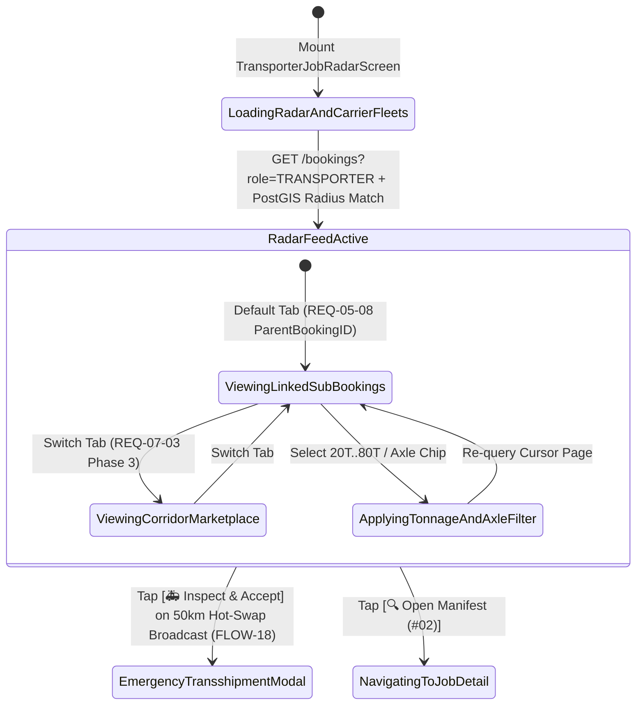
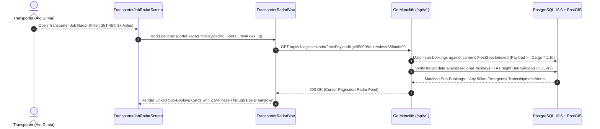

# Lowboy Transporter Job Radar, Sub-Booking Requests & Corridor Haulage Marketplace
## Mobile Subsystem Specification — `docs/mobile/transporter-experience/01-transporter-job-radar.md`

**Document Identifier:** `SPEC-MOB-TRN-01`  
**Classification:** Canonical Subsystem UI/UX & Technical Behavior Specification  
**Governing Documents:** `Dink_Machinery_UI_UX_Design_Brief.md`, `SRS-DINK-CORE-V7.0` (§5.8, §7.3, `LG-01`..`LG-04`, `FL-28`..`FL-31`, `HOL-03`), `docs/shared/design/design-tokens.json`, `docs/ERROR_CATALOG.md`, `contracts/openapi.yaml`  
**Target Subsystem:** Flutter 3.47.8 / Dart 3.9 Mobile Client (iOS & Android)  
**Primary Persona / Actor:** Heavy Haulage Lowboy Transporter & Carrier Manager (*Ato Girma Wolde* / *Samuel Odhiambo*)  
**Associated Requirements:** `REQ-05-08` (`LG-01`..`LG-04` Linked Transport Sub-Bookings `ParentBookingID`, Dimensional Matching & 2.5% Pass-Through Commission), `REQ-07-03` (Phase 3 Full Standalone Corridor Haulage Job Radar & Bid Engine), `REQ-05-23` (`HOL-03` Federal Transport Authority Holiday Freight Ban Interlock)  
**Associated Interaction Flows:** `FLOW-11` (Lowboy Transport Matching & Sub-Booking), `FLOW-18` (Emergency Roadside Transshipment & Reverse Cascades)  
**Associated ADRs:** `ADR-001` (Modular Monolith), `ADR-002` (2.5% Freight Pass-Through Fee `250 bps`), `ADR-008` (Multi-Country Corridor Rules), `ADR-010` (Offline-First Isar Job Radar Cache)  
**Status:** Approved Technical Design Baseline

---

## 1. Domain Context, Business Rules & Architectural Invariants

Steel-tracked crawler excavators, bulldozers, vibratory compactors, and asphalt pavers cannot legally or mechanically self-drive across national highway networks (`self_move_capable = false`). They require specialized multi-axle lowboy trailers, step-decks, or hydraulic gooseneck transporters.

The **Transporter Job Radar & Sub-Booking Console** (`SPEC-MOB-TRN-01`) serves as the primary operational command screen for Heavy Haulage Carriers (*Ato Girma Wolde*), operating across two architectural phases:
1. **Phase 1 — Linked Equipment Mobilization Sub-Bookings (`REQ-05-08`, `LG-01`..`LG-04`, `FL-31`):**
   - When an Equipment Fleet Owner (*W/ro Almaz Tesfaye*) confirms a rental for an immovable machine (`ParentBookingID`), the platform's dimensional heuristic engine (`FL-29`, `FleetSpecIndexed`) queries `LOGISTICS` fleets whose certified payload and deck dimensions satisfy:
     $$\text{Trailer Payload Capacity} \ge \left(\text{Machine Weight} + \sum \text{Attachment Weight}\right) \times 1.10$$
     $$\text{Trailer Deck Length} \ge \text{Machine Transport Length} \quad \land \quad \text{Combined Height} \le 4,500\text{ mm}$$
   - The Fleet Owner contracts directly with the Transporter via a child **Sub-Booking (`bookings.parent_booking_id IS NOT NULL`)**, isolating the Civil Contractor from multi-vendor freight disputes (`FL-30` "Owner Pays Principle").
   - **Pass-Through Freight Commission Discount (`CW-01` / `SRS 05.08 §4.4`):** Platform commission on linked transport sub-bookings is discounted to **$2.50\%$ (`250 bps`)** instead of the standard $10.0\%$ machinery rate, preventing double-taxation on equipment mobilization.
2. **Phase 3 — Standalone Corridor Haulage Job Radar & Bidding (`REQ-07-03`):**
   - Enabled via remote feature flag (`feature_flag.logistics_corridor_marketplace_enabled`), allowing civil contractors, mines, and importers to post standalone heavy haulage loads (e.g., *Djibouti Port / Modjo Dry Port $\rightarrow$ Addis Ababa*, *Mombasa $\rightarrow$ Nairobi SGR Corridor*) filtered by payload tonnage class (**20T, 30T, 40T, 60T, 80T+**) and axle configuration (**2-Axle Rigid, 3-Axle Lowboy, 4-Axle Heavy Lowbed, Modular Multi-Axle**).
3. **Emergency Roadside Transshipment Priority Broadcast (`FLOW-18`):**
   - If another carrier suffers an in-transit breakdown (`TRANSSHIPMENT_REQUIRED`), carriers within a $50\text{ km}$ PostGIS radius receive a high-priority **60-Minute Emergency Hot-Swap Broadcast** at the top of their radar.

---

## 2. Screen Anatomy, Layout & Bespoke ASCII Wireframe

### 2.1 Transporter Job Radar, Tonnage Filter & Sub-Booking Feed Wireframe
```text
+-----------------------------------------------------------------------+
| [🚛] GIRMA HEAVY HAULAGE PLC         [🌐 አማ/EN] [☀️ Outdoor] [💼 -450]|
|      3 Active Lowboys (25T, 45T, 60T) • Wallet: -450.00 ETB (OK ✓)    |
+-----------------------------------------------------------------------+
| 🚨 EMERGENCY HOT-SWAP BROADCAST (WITHIN 50 KM • SLA: ⏱️ 44m 12s)      |
|    Stranded Dozer (CAT D8R • 38.5T) at Modjo Km 18 needs 40T+ Lowboy! |
|    Premium Rescue Tariff: 32,000.00 ETB -> [ 🚑 INSPECT & ACCEPT ]    |
+-----------------------------------------------------------------------+
| 📡 JOB RADAR MODE & PAYLOAD TONNAGE / AXLE FILTERS (LG-01 / REQ-07-03)|
| [● 🔗 Linked Sub-Bookings (3)]   [○ 🛣️ Corridor Haulage Radar (5)]    |
| Tonnage: [All] [20T-25T] [● 35T-45T] [60T-80T+] | Axles: [● 3+ Axles] |
+-----------------------------------------------------------------------+
| +-------------------------------------------------------------------+ |
| | [🔵 LINKED SUB-BOOKING REQUEST]   Sub #SBK-9012 (Parent #BK-8812) | |
| | Matched Trailer: SINOTRUK HOWO 45T Tri-Axle Lowboy (ET-3-44109)   | |
| | Requesting Owner: Tesfaye Heavy Plant PLC (★ 4.94 • Verified ✓)   | |
| |-------------------------------------------------------------------| |
| | 📦 PAYLOAD & EAV DIMENSIONAL MATCH (FleetSpecIndexed ✓):          | |
| | • Cargo: CAT 320D Excavator (21,500 kg) + Soosan Breaker (1,850kg)| |
| | • Total Payload: 23,350 kg (+10% Margin = 25.68T <= 45.0T Cap ✓)  | |
| | • L × W × H: 9,530 × 3,400 × 3,150 mm  [⚠️ WIDE LOAD >3,000mm]   | |
| |-------------------------------------------------------------------| |
| | 🗺️ ROUTE CORRIDOR & SCHEDULE:                                     | |
| | • Origin Depot:  Kality Ring Rd Yard, Addis (8.8954°N, 38.7612°E) | |
| | • Destination:   Mojo-Meki Highway Site B   (8.5412°N, 39.2718°E) | |
| | • Distance:      74.2 km (Addis-Adama Expwy) • Pickup: 04 Nov 06:00| |
| | • FTA Holiday Check: [🟢 Clear — No Holiday Freight Ban (HOL-03)] | |
| |-------------------------------------------------------------------| |
| | 💰 FREIGHT TARIFF & 2.5% PASS-THROUGH COMMISSION:                 | |
| | • Gross Haulage Fee (74.2 km @ 450 ETB/km):        33,390.00 ETB  | |
| | • Platform Freight Commission (2.5% / 250 bps):      -834.75 ETB  | |
| | • Net Carrier Receivable (Direct Wire from Owner): 32,555.25 ETB  | |
| |-------------------------------------------------------------------| |
| | [ 🔍 OPEN MANIFEST & ACCEPT / REQUEST ESCORT FEE (#02) → ]        | |
| +-------------------------------------------------------------------+ |
+-----------------------------------------------------------------------+
| [📡 Job Radar]  [🚛 My Trailers (#03)]  [🛣️ Active Runs]  [💼 Wallet] |
+-----------------------------------------------------------------------+
```

---

## 3. W3C DTCG Design Token Mapping Table

| UI Component / Element | W3C Token Path (`design-tokens.json`) | Resolved Value (Light / Dark / Outdoor) | Behavioral & Accessibility Invariant |
|---|---|---|---|
| **Emergency Transshipment Banner** | `color.feedback.crimson.100` + `color.feedback.crimson.700` | Bg `#FEE2E2`, Border `#EF4444` (`3dp`), Text `#B91C1C` | Pinned when an in-transit breakdown (`FLOW-18`) occurs within $50\text{ km}$. |
| **Tonnage & Axle Filter Chips** | `dimension.space.48` + `color.brand.amber.500` | Height `48dp`, Active Fill `#F59E0B`, Text `#020617` | Filters radar by payload brackets (`20T`, `40T`, `60T`, `80T+`) and axle count. |
| **Dimensional & Tariff Figures** | `typography.fontFamily.mono` + `semantic.{mode}.text.numericLedger` | `Space Mono` `14sp` / `16sp` | Displays exact `kg`, `mm`, `km`, and `2.5%` (`250 bps`) commission math. |
| **Abnormal Wide-Load Badge** | `color.feedback.orange.500` + `color.brand.amber.50` | Text/Border `#FF5722`, Bg `#FFFBEB` | Triggered automatically when cargo `transport_width_mm > 3000`. |
| **Primary Inspect Manifest CTA** | `component.actuator.button.heightField` + `semantic.{mode}.action.primary.bg` | Height `64dp`, Fill `#F59E0B` (`#FBBF24` Outdoor), Lip `3dp` | Launches `SPEC-MOB-TRN-02` for manifest inspection and acceptance. |

---

## 4. Interactive State Machine & Sequence Flows

### 4.1 Transporter Job Radar & Dimensional Filter State Machine


### 4.2 Dimensional Matching, FTA Holiday Ban Check & Radar Hydration Sequence


---

## 5. Concrete Flutter Implementation Blueprint

### 5.1 BLoC Events & Immutable Freezed States
```dart
// lib/features/transporter_radar/presentation/bloc/transporter_radar_bloc.dart
import 'package:freezed_annotation/freezed_annotation.dart';
import 'package:flutter_bloc/flutter_bloc.dart';

part 'transporter_radar_bloc.freezed.dart';

@freezed
sealed class TransporterRadarEvent with _$TransporterRadarEvent {
  const factory TransporterRadarEvent.started() = _Started;
  const factory TransporterRadarEvent.modeTabChanged(String mode) = _ModeTabChanged; // 'LINKED_SUB_BOOKINGS' | 'CORRIDOR_MARKETPLACE'
  const factory TransporterRadarEvent.tonnageAndAxleFilterChanged({
    int? minPayloadTonnes,
    int? maxPayloadTonnes,
    int? minAxleCount,
  }) = _TonnageAndAxleFilterChanged;
  const factory TransporterRadarEvent.loadNextPage(String cursor) = _LoadNextPage;
}

@freezed
class TransportRadarJobCardDto with _$TransportRadarJobCardDto {
  const factory TransportRadarJobCardDto({
    required String subBookingId,
    String? parentBookingId, // Non-null for Phase 1 Linked Sub-Bookings (FL-31)
    required bool isEmergencyTransshipment, // true for FLOW-18 roadside hot-swap
    required String matchedCarrierFleetId,
    required String matchedTrailerMakeModel,
    required String cargoDescription, // e.g., "CAT 320D + Soosan SB-81 Breaker"
    required double totalCargoWeightKg,
    required double requiredPayloadWithMarginKg, // totalCargoWeightKg * 1.10
    required double cargoLengthMm,
    required double cargoWidthMm,
    required double cargoHeightMm,
    required bool requiresWideLoadEscort, // cargoWidthMm > 3000
    required String originDepotAddress,
    required double originLat,
    required double originLng,
    required String destinationSiteAddress,
    required double destinationLat,
    required double destinationLng,
    required double routeDistanceKm,
    required DateTime scheduledPickupAt,
    required bool isFtaHolidayBanClear, // HOL-03
    required String currency,
    required int grossFreightFeeMinor,
    required int platformCommission250BpsMinor, // 2.5% pass-through fee
    required int netCarrierReceivableMinor,
  }) = _TransportRadarJobCardDto;
}

@freezed
sealed class TransporterRadarState with _$TransporterRadarState {
  const factory TransporterRadarState.loading() = _Loading;
  const factory TransporterRadarState.loaded({
    required String activeModeTab,
    int? selectedMinTonnes,
    int? selectedMaxTonnes,
    int? selectedMinAxles,
    required List<TransportRadarJobCardDto> emergencyTransshipmentAlerts,
    required List<TransportRadarJobCardDto> radarJobs,
    String? nextCursor,
    required bool hasMore,
    required bool isOfflineCached,
    ProblemDetails? error,
  }) = _Loaded;
}
```

### 5.2 Isar Local Persistence for Offline Radar Browsing
```dart
// lib/features/transporter_radar/data/local/isar_transporter_radar_cache.dart
import 'package:isar/isar.dart';

part 'isar_transporter_radar_cache.g.dart';

@collection
class IsarTransporterRadarCache {
  Id id = Isar.autoIncrement;

  @Index(unique: true, replace: true)
  late String subBookingId;

  String? parentBookingId;
  late bool isEmergencyTransshipment;
  late double totalCargoWeightKg;
  late double cargoWidthMm;
  late String originDepotAddress;
  late String destinationSiteAddress;
  late double routeDistanceKm;
  late int grossFreightFeeMinor;
  late int netCarrierReceivableMinor;
  late String serializedCardJson;
  late DateTime cachedAt;
}
```

### 5.3 Widget Tree Hierarchy
```text
TransporterJobRadarScreen (Scaffold)
 ├── TransporterTopAppBar (Company Name, Active Lowboy Count, Pre-Funded Wallet Pill)
 ├── EmergencyTransshipmentAlertBanner (Conditional 50km Roadside Hot-Swap Broadcast Card - FLOW-18)
 ├── RadarModeAndTonnageFilterHeader (Linked Sub-Bookings vs Corridor Radar + 20T-80T & Axle Chips)
 └── Expanded -> RefreshIndicator
      └── ListView.builder (Cursor-Paginated TransportRadarJobCardDto items)
           └── TransportJobRadarCard
                ├── SubBookingAndParentBadgeRow
                ├── EavDimensionalComplianceBox (Cargo Weight + 10% Margin, L×W×H mm, Wide-Load Badge)
                ├── CorridorRouteAndFtaHolidayBox (Origin -> Destination, Distance km, HOL-03 Clear Pill)
                ├── FreightTariffAnd250BpsCommissionRow (Gross, -2.5% Fee, Net Receivable in Space Mono)
                └── OpenManifest64dpActuator ([🔍 Open Manifest & Accept / Request Escort Fee (#02) →])
```

---

## 6. OpenAPI 3.1.0 Routes & RFC 9457 Error Matrix

### 6.1 Bound API Endpoints
| Operation | HTTP Method & URI | Headers Required | Purpose & Contract Binding |
|---|---|---|---|
| **Query Logistics Job Radar** | `GET /api/v1/bookings?cursor={c}&limit=20` (and `/bookings/{id}/logistics/match`) | `Authorization: Bearer <JWT>`, `X-Country-Code: ET\|KE` | Returns cursor-paginated linked transport sub-bookings (`LG-01`..`LG-04`), emergency transshipment alerts (`FLOW-18`), and Phase 3 corridor loads (`REQ-07-03`). |

### 6.2 RFC 9457 Problem Details Error Matrix
| Error Code (`error.code`) | HTTP Status | Type URI | Trigger Condition | Mobile UI Recovery Behavior |
|---|---|---|---|---|
| `WALLET_LOCKED_PENDING_AUDIT` | `423` | `/errors/wallet-locked-pending-audit` | Carrier's `OwnerWallet` is `DELINQUENT_LOCKED` (>30 days overdue on 2.5% freight commissions `CW-04`). | Render crimson lockout banner and prompt top-up (`SPEC-MOB-OWN-09`) to re-enable accepting haulage runs. |
| `GEO_RADIUS_OUT_OF_BOUNDS` | `400` | `/errors/geo-radius-out-of-bounds` | Corridor search radius parameter outside `1..500 km`. | Clamp radius filter to `500 km` max. |
| `ERR_FTA_TRANSPORT_BAN_ACTIVE` | `422` | `/errors/fta-holiday-transport-ban` | Scheduled transit date intersects an Ethiopian Federal Transport Authority holiday heavy freight ban (`HOL-03`). | Display purple FTA Holiday Ban badge and prompt +/- 24h pickup rescheduling. |

---

## 7. Verification & Acceptance Criteria

- [ ] **10% Dynamic Lashing Safety Margin (`FL-29`):** A cargo consisting of a $21,500\text{ kg}$ excavator + $1,850\text{ kg}$ breaker ($23,350\text{ kg}$ total) requires a minimum certified trailer payload of $23,350 \times 1.10 = 25,685\text{ kg}$, automatically filtering out 25T trailers and matching 35T–45T+ lowboys.
- [ ] **2.5% Pass-Through Freight Commission (`CW-01`, `SRS 05.08 §4.4`):** Every linked sub-booking card computes platform commission at exactly $2.50\%$ (`250 bps`), not $10.0\%$.
- [ ] **Abnormal Wide-Load Flagging:** Cargo with `cargoWidthMm > 3000` (e.g., `3,400 mm` track width) displays the `[⚠️ WIDE LOAD >3,000mm]` warning badge.
