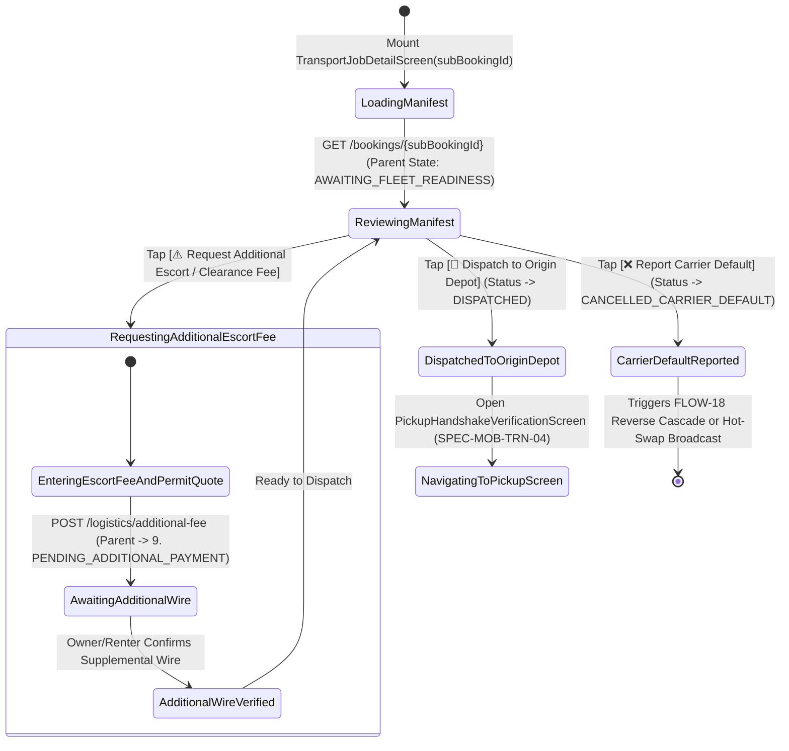
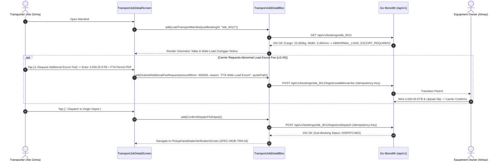

# Transport Sub-Booking Manifest, EAV Dimensions & Additional Escort Fee Request
## Mobile Subsystem Specification — `docs/mobile/transporter-experience/02-transport-job-detail.md`

**Document Identifier:** `SPEC-MOB-TRN-02`  
**Classification:** Canonical Subsystem UI/UX & Technical Behavior Specification  
**Governing Documents:** `Dink_Machinery_UI_UX_Design_Brief.md`, `SRS-DINK-CORE-V7.0` (§5.8.2–§5.8.4, `LG-03`..`LG-05`, `FL-29`..`FL-31`), `docs/shared/design/design-tokens.json`, `docs/ERROR_CATALOG.md`, `contracts/openapi.yaml`  
**Target Subsystem:** Flutter 3.44 / Dart 3.9 Mobile Client (iOS & Android)  
**Primary Persona / Actor:** Heavy Haulage Lowboy Transporter & Carrier Manager (*Ato Girma Wolde* / *Samuel Odhiambo*)  
**Associated Requirements:** `REQ-05-08` (`LG-03`..`LG-05` Sub-Booking Manifest, EAV Dimensional & Bridge Clearance Check, `8. AWAITING_FLEET_READINESS` & `9. PENDING_ADDITIONAL_PAYMENT` Abnormal Load Escort / Toll Fee Workflow)  
**Associated Interaction Flows:** `FLOW-11` (Lowboy Sub-Booking Execution), `FLOW-18` (Awaiting Fleet Readiness & Transshipment)  
**Associated ADRs:** `ADR-002` (Integer Minor-Unit Accounting & 2.5% Freight Fee), `ADR-004` (Parent-Child State Synchronization), `ADR-010` (Offline Manifest Caching)  
**Status:** Approved Technical Design Baseline

---

## 1. Domain Context, Business Rules & Architectural Invariants

Before dispatching a prime mover and multi-axle lowboy trailer to an equipment depot, the Transporter must inspect the complete **Transport Sub-Booking Manifest** (`SPEC-MOB-TRN-02`). Misjudging a machine's overall transport height, crawler track width, or gross weight can result in bridge strikes ($4,500\text{ mm}$ East African corridor clearance limit), KeNHA / Ethiopian Federal Transport Authority (FTA) weighbridge impoundment, or lowboy deck collapse.

### 1.1 Core Business Rules & Operational Invariants
1. **Parent-Child Sub-Booking Isolation (`FL-30`, `FL-31`, `LG-03`):**
   - The manifest displays the child sub-booking ID (`#SBK-9012`) linked to the parent machinery booking (`ParentBookingID: #BK-8812`).
   - Under the **Owner Pays Principle (`FL-30`)**, the contracting counterparty on the transport sub-booking is the **Equipment Fleet Owner** (*W/ro Almaz Tesfaye*), who wires the freight prepayment directly to the Transporter's commercial bank account (`FLOW-08`).
2. **Denormalized `FleetSpecIndexed` Volumetric & Clearance Audit (`LG-04`, `FL-29`):**
   - Displays a side-by-side comparison between the **Cargo Machine + Bundled Attachments** and the Carrier's **Assigned Lowboy Trailer**:
     - **Total Combined Weight vs. Certified Payload:** e.g., $23,350\text{ kg}$ cargo ($25,685\text{ kg}$ with $10\%$ dynamic lashing margin) vs. $45,000\text{ kg}$ trailer rating.
     - **Deck Well Length vs. Machine Transport Length:** e.g., $9,530\text{ mm}$ machine vs. $11,500\text{ mm}$ lowboy well deck.
     - **Track Width vs. Deck Width + Outriggers:** e.g., $3,400\text{ mm}$ crawler width vs. $3,000\text{ mm}$ deck + $500\text{ mm}$ swing-out outrigger brackets ($3,500\text{ mm}$ total).
     - **TotalLoadedHeight vs. $4,500\text{ mm}$ Corridor Bridge Limit:**
       $$\text{TotalLoadedHeight} = \text{trailer.deck\_height\_ground\_mm } (950\text{ mm}) + \text{machine.transport\_height\_mm } (3,150\text{ mm}) = 4,100\text{ mm} \le 4,500\text{ mm}$$
3. **Abnormal Load Escort / Route Clearance Fee Request (`8. AWAITING_FLEET_READINESS` $\rightarrow$ `9. PENDING_ADDITIONAL_PAYMENT`, `LG-05`):**
   - If the cargo exceeds $3,000\text{ mm}$ width (`ABNORMAL_LOAD_ESCORT_REQUIRED`), requires a special highway bridge permit, or encounters an unexpected detour/toll, the Transporter can tap `[⚠️ Request Additional Escort / Permit Fee]`.
   - Submitting an itemized supplementary fee request (with supporting permit/escort quote) transitions the parent booking from `8. AWAITING_FLEET_READINESS` to `9. PENDING_ADDITIONAL_PAYMENT` (`SRS 05.05 §2.2`, `SRS 05.08 §2.2`), pausing mobilization until the supplemental wire is confirmed.
4. **Freight Wire Verification & Dispatch Mobilization (`CONFIRMED` $\rightarrow$ `DISPATCHED`):**
   - Once the Fleet Owner's freight prepayment wire is confirmed (automatically debiting the $2.5\%$ pass-through commission from the Transporter's `OwnerWallet`), the Transporter taps `[🚛 Dispatch Lowboy to Origin Depot]` to begin pickup (`SPEC-MOB-TRN-04`).

---

## 2. Screen Anatomy, Layout & Bespoke ASCII Wireframe

### 2.1 Transport Sub-Booking Manifest, Clearance Audit & Escort Fee Drawer Wireframe
```text
+-----------------------------------------------------------------------+
| [← Back to Radar]     TRANSPORT SUB-BOOKING MANIFEST   #SBK-9012      |
| Parent Booking: #BK-8812 • Parent State: [🟡 8. AWAITING_READINESS]   |
+-----------------------------------------------------------------------+
| 🏢 CONTRACTING COUNTERPARTY (EQUIPMENT OWNER - FL-30)                 |
| +-------------------------------------------------------------------+ |
| | Tesfaye Heavy Plant & Transport PLC (W/ro Almaz Tesfaye)          | |
| | [✓ Freight Wire Verified: 33,390.00 ETB]   [📞 Call Yard Manager] | |
| +-------------------------------------------------------------------+ |
|                                                                       |
| 📐 VOLUMETRIC, TONNAGE & BRIDGE CLEARANCE AUDIT (FleetSpecIndexed)    |
| +-------------------------------------------------------------------+ |
| | PARAMETER              | CARGO (CAT 320D+SB81)| YOUR 45T LOWBOY   | |
| |------------------------+----------------------+-------------------| |
| | Gross Weight (+10% Dyn)| 23,350 kg (25,685kg) | 45,000 kg [🟢 OK] | |
| | Transport Length       | 9,530 mm             | 11,500 mm [🟢 OK] | |
| | Transport Width        | 3,400 mm (Wide Load) | 3,500 mm* [🟡 OUT]| |
| | Loaded Height (4.5m Mx)| 3,150 + 950 = 4,100mm| <=4,500mm [🟢 OK] | |
| |-------------------------------------------------------------------| |
| | *Note: Requires deploying +250mm side outrigger brackets and      | |
| |  daylight-only transit (06:00–18:00) with amber strobe escort.    | |
| +-------------------------------------------------------------------+ |
|                                                                       |
| 🗺️ ORIGIN DEPOT -> DESTINATION SITE CORRIDOR (74.2 KM)                |
| +-------------------------------------------------------------------+ |
| | 🟢 PICKUP ORIGIN:  Kality Industrial Ring Rd Yard, Addis Ababa    | |
| |    Coords:         8.8954° N, 38.7612° E • Gate Contact: Ato Taye | |
| |    Scheduled Load: 04 Nov 2026 @ 06:00 EAT                        | |
| |    |                                                              | |
| |    |  74.2 km via Addis–Adama Expressway -> Modjo Exit            | |
| |    ▼                                                              | |
| | 🔴 DELIVERY SITE:  Mojo-Meki Highway Expansion — Lot 2 Cut Site B | |
| |    Coords:         8.5412° N, 39.2718° E • Site Sup: Eng. Dawit   | |
| |    [ 🗺️ LAUNCH TURN-BY-TURN HEAVY TRUCK NAVIGATION ]               | |
| +-------------------------------------------------------------------+ |
|                                                                       |
| 💲 SUPPLEMENTARY ESCORT / PERMIT FEE (9. PENDING_ADDITIONAL_PAYMENT)  |
| +-------------------------------------------------------------------+ |
| | Need Lead/Chase Escort Vehicle or FTA Wide-Load Permit Fee?       | |
| | [ ⚠️ REQUEST ADDITIONAL ESCORT / CLEARANCE FEE (LG-05) ]          | |
| +-------------------------------------------------------------------+ |
+-----------------------------------------------------------------------+
| [ ❌ REPORT CARRIER DEFAULT ]  [ 🚛 DISPATCH TO ORIGIN DEPOT (#04) → ]|
+-----------------------------------------------------------------------+
```

---

## 3. W3C DTCG Design Token Mapping Table

| UI Component / Element | W3C Token Path (`design-tokens.json`) | Resolved Value (Light / Dark / Outdoor) | Behavioral & Accessibility Invariant |
|---|---|---|---|
| **Dimensional Comparison Table** | `component.table.headerHeight` + `rowHeightDense` | Header `48dp`, Row `40dp`, Border `1dp` | Compares cargo vs. trailer specs in fixed-pitch `Space Mono`. |
| **Clearance Pass / Outrigger Pill** | `color.feedback.emerald.100` / `color.brand.amber.100` | Pass `#D1FAE5` (`#047857`), Outrigger `#FEF3C7` (`#92400E`) | Clearly warns driver to extend side outriggers when width $>3,000\text{ mm}$. |
| **Escort Fee Request Button** | `dimension.space.56` + `color.brand.amber.500` | Height `56dp`, Border `#D97706` (`2dp`), Text `#78350F` | Opens supplementary fee modal (`PENDING_ADDITIONAL_PAYMENT`). |
| **Primary Dispatch Actuator** | `component.actuator.button.heightField` + `semantic.{mode}.action.primary.bg` | Height `64dp`, Fill `#F59E0B` (`#FBBF24` Outdoor), Lip `3dp` | Transitions sub-booking to `DISPATCHED` and launches Pickup Checklist (`#04`). |

---

## 4. Interactive State Machine & Sequence Flows

### 4.1 Transport Sub-Booking Manifest & Mobilization State Machine


### 4.2 Abnormal Load Escort Fee Request & Dispatch Mobilization Sequence (`LG-03`..`LG-05`)


---

## 5. Concrete Flutter Implementation Blueprint

### 5.1 BLoC Events & Immutable Freezed States
```dart
// lib/features/transporter_manifest/presentation/bloc/transport_job_detail_bloc.dart
import 'package:freezed_annotation/freezed_annotation.dart';
import 'package:flutter_bloc/flutter_bloc.dart';

part 'transport_job_detail_bloc.freezed.dart';

@freezed
sealed class TransportJobDetailEvent with _$TransportJobDetailEvent {
  const factory TransportJobDetailEvent.started(String subBookingId) = _Started;
  const factory TransportJobDetailEvent.additionalEscortFeeRequested({
    required int additionalFeeMinor,
    required String feeCategory, // 'WIDE_LOAD_ESCORT' | 'BRIDGE_PERMIT_TOLL' | 'DETOUR_SURCHARGE'
    required String justificationNote,
    required String permitQuoteFilePath,
  }) = _AdditionalEscortFeeRequested;
  const factory TransportJobDetailEvent.dispatchToOriginDepotConfirmed() = _DispatchToOriginDepotConfirmed;
  const factory TransportJobDetailEvent.carrierDefaultReported(String reason) = _CarrierDefaultReported;
}

@freezed
class DimensionalClearanceAuditDto with _$DimensionalClearanceAuditDto {
  const factory DimensionalClearanceAuditDto({
    required double cargoGrossWeightKg,
    required double cargoWeightWith10PctMarginKg,
    required double trailerCertifiedPayloadKg,
    required double cargoLengthMm,
    required double trailerDeckWellLengthMm,
    required double cargoWidthMm,
    required double trailerDeckWidthMm,
    required double trailerOutriggerExtensionMm,
    required double cargoHeightMm,
    required double trailerDeckGroundHeightMm,
    required double totalCombinedHeightMm, // Must be <= 4500mm
    required bool requiresOutriggersDeployed,
    required bool requiresWideLoadDaylightEscort,
  }) = _DimensionalClearanceAuditDto;
}

@freezed
sealed class TransportJobDetailState with _$TransportJobDetailState {
  const factory TransportJobDetailState.loading() = _Loading;
  const factory TransportJobDetailState.loaded({
    required String subBookingId,
    required String parentBookingId,
    required String subBookingStatus, // 'CONFIRMED' | 'DISPATCHED' | 'LOADING_INSPECTION' | 'IN_TRANSIT'
    required String parentBookingStatus, // 'CONFIRMED' | 'AWAITING_FLEET_READINESS' | 'PENDING_ADDITIONAL_PAYMENT'
    required String equipmentOwnerCompany,
    required String equipmentOwnerPhone,
    required DimensionalClearanceAuditDto clearanceAudit,
    required String originDepotAddress,
    required double originLat,
    required double originLng,
    required String destinationSiteAddress,
    required double destinationLat,
    required double destinationLng,
    required double routeDistanceKm,
    required int grossFreightMinor,
    required int netReceivableMinor,
    @Default(false) bool isMutating,
    ProblemDetails? error,
  }) = _Loaded;
}
```

### 5.2 Isar Local Persistence for Offline Corridor Transit
```dart
// lib/features/transporter_manifest/data/local/isar_transport_manifest.dart
import 'package:isar/isar.dart';

part 'isar_transport_manifest.g.dart';

@collection
class IsarTransportManifest {
  Id id = Isar.autoIncrement;

  @Index(unique: true, replace: true)
  late String subBookingId;

  late String parentBookingId;
  late String subBookingStatus;
  late String parentBookingStatus;
  late double originLat;
  late double originLng;
  late double destinationLat;
  late double destinationLng;
  late String serializedClearanceAuditJson;
  late String offlineDepotReleaseHmacSecret;
  late DateTime cachedAt;
}
```

### 5.3 Widget Tree Hierarchy
```text
TransportJobDetailScreen (Scaffold)
 ├── ManifestAppBar (Sub-Booking ID, Parent Booking Status Pill)
 └── SingleChildScrollView
      ├── ContractingEquipmentOwnerCard (Owner Company, Freight Wire Verified Badge, [📞 Call Yard Manager])
      ├── VolumetricAndBridgeClearanceTableCard (Cargo vs Trailer Weight/Length/Width/4.5m Height Audit)
      ├── OriginToDestinationCorridorCard (Origin Depot -> Destination Site Coords + [🗺️ Heavy Truck Navigation])
      ├── AdditionalEscortFeeRequestCard (LG-05 Trigger for 9. PENDING_ADDITIONAL_PAYMENT)
      └── StickyManifestFooter ([❌ Report Carrier Default] + [🚛 Dispatch to Origin Depot (#04) →])
```

---

## 6. OpenAPI 3.1.0 Routes & RFC 9457 Error Matrix

### 6.1 Bound API Endpoints
| Operation | HTTP Method & URI | Headers Required | Purpose & Contract Binding |
|---|---|---|---|
| **Get Sub-Booking Manifest** | `GET /api/v1/bookings/{id}` | `Authorization: Bearer <JWT>`, `X-Country-Code: ET\|KE` | Fetches complete sub-booking manifest, parent booking state, and `FleetSpecIndexed` dimensions. |
| **Request Additional Escort Fee** | `POST /api/v1/bookings/{id}/logistics/additional-fee` | `Authorization: Bearer <JWT>`, `Idempotency-Key: <UUIDv4>` | Transitions parent booking from `8. AWAITING_FLEET_READINESS` to `9. PENDING_ADDITIONAL_PAYMENT` (`LG-05`). |
| **Dispatch to Origin Depot** | `POST /api/v1/bookings/{id}/logistics/dispatch` | `Authorization: Bearer <JWT>`, `Idempotency-Key: <UUIDv4>` | Transitions sub-booking to `DISPATCHED` and notifies depot yard manager of carrier ETA. |

### 6.2 RFC 9457 Problem Details Error Matrix
| Error Code (`error.code`) | HTTP Status | Type URI | Trigger Condition | Mobile UI Recovery Behavior |
|---|---|---|---|---|
| `BOOKING_INVALID_STATE_TRANSITION` | `409` | `/errors/booking-invalid-state` | Attempted to dispatch while `PENDING_ADDITIONAL_PAYMENT` wire is still unsettled. | Display banner reminding carrier to wait for supplemental escort wire verification. |
| `INSPECT_MEDIA_SCAN_FAILED` | `422` | `/errors/inspect-media-scan-failed` | Attached FTA wide-load permit or escort quote failed ClamAV scan (`:3310`). | Prompt clean re-upload of permit document. |
| `BOOKING_CONCURRENCY_CONFLICT` | `409` | `/errors/booking-concurrency-conflict` | Parent booking was cancelled prior to dispatch. | Refresh manifest and alert carrier of cancellation status. |

---

## 7. Verification & Acceptance Criteria

- [ ] **Bridge Clearance Safety Guard (`SRS 05.08 §3.3`):** The volumetric table computes `totalCombinedHeightMm = trailerDeckGroundHeightMm + cargoHeightMm` and highlights any combination $>4,500\text{ mm}$ as a critical corridor bridge hazard.
- [ ] **Outrigger Deployment Alert:** When `cargoWidthMm > trailerDeckWidthMm` but `<= trailerDeckWidthMm + trailerOutriggerExtensionMm`, the UI displays an amber `[🟡 DEPLOY SIDE OUTRIGGERS]` operational checklist requirement.
- [ ] **Additional Escort Fee State Transition (`LG-05`):** Submitting an abnormal load escort fee request transitions the parent booking status indicator to `9. PENDING_ADDITIONAL_PAYMENT`.
