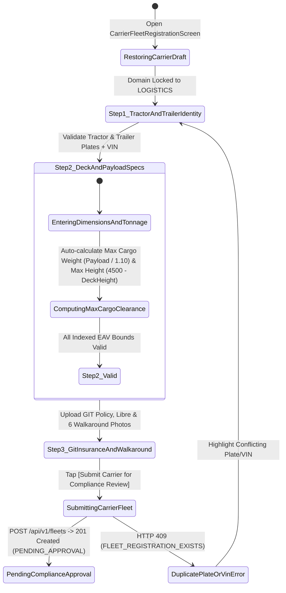
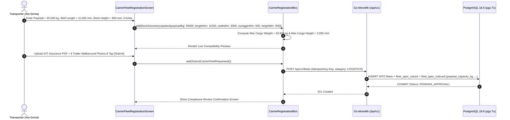

# Logistics Carrier Fleet Registration (Lowboy, Step-Deck, Flatbed & Crane Truck)
## Mobile Subsystem Specification — `docs/mobile/transporter-experience/03-carrier-fleet-registration.md`

**Document Identifier:** `SPEC-MOB-TRN-03`  
**Classification:** Canonical Subsystem UI/UX & Technical Behavior Specification  
**Governing Documents:** `Dink_Machinery_UI_UX_Design_Brief.md`, `SRS-DINK-CORE-V7.0` (§5.2, §5.8.1, §5.8.3, `FL-01`..`FL-14`, `LG-01`, `LG-02`), `docs/shared/design/design-tokens.json`, `docs/ERROR_CATALOG.md`, `contracts/openapi.yaml`  
**Target Subsystem:** Flutter 3.47.9 / Dart 3.9 Mobile Client (iOS & Android)  
**Primary Persona / Actor:** Heavy Haulage Lowboy Transporter & Carrier Manager (*Ato Girma Wolde* / *Samuel Odhiambo*)  
**Associated Requirements:** `REQ-05-02` (`FL-01`..`FL-14` First-Class `LOGISTICS` Category Registration & `FleetSpecIndexed` Synchronization), `REQ-05-08` (`LG-01`, `LG-02` Trailer Payload, Deck Geometry, Axle Count & Ramp Configuration), `REQ-05-13` (Goods-in-Transit Insurance & Commercial Truck `Libre`)  
**Associated Interaction Flows:** `FLOW-03` (Fleet Onboarding & Compliance Approval), `FLOW-11` (Volumetric & Tonnage Matching)  
**Associated ADRs:** `ADR-001` (Unified `fleets` Table for Machinery & Logistics), `ADR-005` (ClamAV Document & Walkaround Verification), `ADR-008` (Ethiopian FTA & Kenyan KeNHA Axle Load Compliance)  
**Status:** Approved Technical Design Baseline

---

## 1. Domain Context, Business Rules & Architectural Invariants

In the Dink Machinery architecture (`SRS 05.08 §1.2`), heavy haulage transport carriers are **not** modeled as an external side-table; they are ingested, verified, and indexed as first-class assets inside the universal `fleets` table under `DomainRoot = LOGISTICS`.

The **Logistics Carrier Fleet Registration Stepper** (`SPEC-MOB-TRN-03`) specializes the fleet onboarding flow for **Multi-Axle Lowboy Trailers**, **Detachable Gooseneck (RGN) Transporters**, **Step-Deck / Tilt-Tray Carriers**, **Flatbed Trucks**, and **Self-Loading Crane Trucks (Hiab)**, ensuring their exact deck geometry and payload ratings are denormalized into `fleet_spec_indexed` (`FL-14`) for instant sub-booking matching.

### 1.1 Core Business Rules & Operational Invariants
1. **Logistics Subcategory Taxonomy & Prime Mover + Trailer Pairing (`FL-01`, `LG-02`):**
   - Under `Category = LOGISTICS`, the carrier selects the exact trailer classification (`FL-29`):
     - `CAT_LOG_RIGID_TILT_TRAY` ($<12\text{T}$ Payload, 2-Axle Rigid Step-Deck)
     - `CAT_LOG_LOWBOY_2AXLE` ($12\text{T}–25\text{T}$ Payload, 2-Axle Heavy Lowbed)
     - `CAT_LOG_LOWBOY_3AXLE` ($25\text{T}–45\text{T}$ Payload, Tri-Axle Drop-Deck Lowboy)
     - `CAT_LOG_LOWBOY_4AXLE_MODULAR` ($45\text{T}–80\text{T}+$ Payload, 4+ Axle Hydraulic Gooseneck)
     - `CAT_LOG_CRANE_TRUCK_HIAB` (Flatbed with Mounted Telescopic Loader Crane)
   - Records both the **Prime Mover Tractor Unit** (Make, Model, Horsepower, Tractor Plate e.g., `ET-3-44109`) and the **Semi-Trailer Unit** (Trailer Plate e.g., `ET-3-TR-19204` & Chassis VIN).
2. **Mandatory `FleetSpecIndexed` Dimensional & Tonnage Parameters (`FL-14`, `LG-02`):**
   - To participate in automated machinery matching (`SRS 05.08 §3.3`), every logistics unit must provide:
     - **`payload_capacity_kg`:** Maximum certified payload in kilograms (e.g., `45000 kg` / `45 Tonnes`).
     - **`deck_well_length_mm`:** Usable flat loading well length in millimeters (e.g., `11500 mm`).
     - **`deck_width_mm` + `outriggers_extension_mm`:** Base deck width (e.g., `3000 mm`) plus side swing-out outrigger extension (e.g., `+500 mm` for wide crawler tracks).
     - **`deck_height_ground_mm`:** Unladen/laden deck height above ground (e.g., `950 mm`), critical for computing the $4,500\text{ mm}$ national highway bridge clearance invariant.
     - **`axle_count` & `loading_ramp_type`:** Number of trailer axles (`2..8`) and ramp mechanism (`HYDRAULIC_FOLDING`, `SPRING_ASSISTED_REAR`, `DETACHABLE_GOOSENECK_RGN`, `HEAVY_WINCH_50T`).
3. **Goods-in-Transit (`GIT`) Insurance & Commercial Authority Permit (`REQ-05-13`):**
   - Requires ClamAV-verified upload of:
     1. Prime Mover & Trailer Ownership Booklets (`Libre`).
     2. **Goods-in-Transit (`GIT`) / Carrier Liability Insurance Policy** covering high-value plant machinery cargo ($\ge 5,000,000\text{ ETB}$ / $15,000,000\text{ KES}$ coverage).
     3. Ethiopian Federal Transport Authority (FTA) Heavy Freight Commercial Road Worthiness Certificate or KeNHA Axle Load Compliance Certificate.

---

## 2. Screen Anatomy, Layout & Bespoke ASCII Wireframe

### 2.1 Carrier Fleet Registration Stepper (Lowboy & Heavy Haulage Specs) Wireframe
```text
+-----------------------------------------------------------------------+
| [← Exit & Save Draft]   REGISTER LOGISTICS CARRIER      [Draft Saved ✓]|
| Domain: LOGISTICS (Category = Heavy Haulage & Lowboy Transporters)    |
+-----------------------------------------------------------------------+
| [● 1. Tractor & Trailer]──[● 2. Deck & Payload]──[○ 3. GIT Docs & 360]|
+-----------------------------------------------------------------------+
| 1. TRAILER CLASSIFICATION & PRIME MOVER PAIRING (FL-02 / LG-02)       |
| +-------------------------------------------------------------------+ |
| | Trailer Class *: [ Tri-Axle Heavy Lowboy (25T – 45T Payload)   ▼ ]| |
| | Tractor Make *:  [ SINOTRUK HOWO ▼ ]   Model *: [ A7 420HP 6x4  ] | |
| | Tractor Plate *: [ ET-3-44109      ]   Trailer Plate *: [TR-19204]| |
| | Chassis VIN *:   [ LZZ5ELNB6GN109482           ]  Year *: [2023 ▼]| |
| | Baseline Odometer (km) *: [ 64,210.0 ] km  [✓ Odo Photo Verified] | |
| +-------------------------------------------------------------------+ |
|                                                                       |
| 2. DECK GEOMETRY, PAYLOAD & RAMP SPECS (SYNCED TO FleetSpecIndexed)   |
| +-------------------------------------------------------------------+ |
| | Max Certified Payload Capacity *           [🚛 Indexed Match Key] | |
| | +---------------------------------------------------+-----------+ | |
| | | 45000                                             |    kg     | | |
| | +---------------------------------------------------+-----------+ | |
| | (Matches machinery up to 40,909 kg w/ 10% dynamic lashing margin) | |
| |                                                                   | |
| | Usable Loading Well Length *               [🚛 Indexed Match Key] | |
| | +---------------------------------------------------+-----------+ | |
| | | 11500                                             |    mm     | | |
| | +---------------------------------------------------+-----------+ | |
| |                                                                   | |
| | Base Deck Width *: [ 3000  | mm ]  Outrigger Ext *: [ 500  | mm ] | |
| | Laden Deck Height Above Ground *           [🌉 4.5m Bridge Check] | |
| | +---------------------------------------------------+-----------+ | |
| | | 950                                               |    mm     | | |
| | +---------------------------------------------------+-----------+ | |
| | (Allows machinery up to 3,550 mm tall under 4,500 mm bridge limit)| |
| |                                                                   | |
| | Trailer Axle Count *: [○ 2 Axles] [● 3 Axles] [○ 4 Axles] [○ 5+]  | |
| | Loading Ramp Type *:  [● Hydraulic Rear Ramps] [○ Detachable RGN] | |
| | Heavy Recovery Winch Installed?: [ ON 🟢 (50-Ton Hydraulic Winch)]| |
| +-------------------------------------------------------------------+ |
|                                                                       |
| 3. GOODS-IN-TRANSIT (GIT) INSURANCE & CORRIDOR TARIFFS                |
| +-------------------------------------------------------------------+ |
| | 🛡️ Goods-in-Transit (GIT) Policy *: [✓ awash_git_5m_2026.pdf OK]  | |
| | 📜 Tractor & Trailer Libre Deeds *: [✓ libre_44109_tr19204.pdf OK]| |
| | Base Mobilization Fee: [ 8,500.00 ] ETB | Per-Km Rate: [ 450 ] ETB| |
| +-------------------------------------------------------------------+ |
+-----------------------------------------------------------------------+
| [ 💾 SAVE DRAFT ]            [ SUBMIT CARRIER FOR COMPLIANCE REVIEW ] |
+-----------------------------------------------------------------------+
```

---

## 3. W3C DTCG Design Token Mapping Table

| UI Component / Element | W3C Token Path (`design-tokens.json`) | Resolved Value (Light / Dark / Outdoor) | Behavioral & Accessibility Invariant |
|---|---|---|---|
| **Spec Input & Unit Box** | `dimension.space.56` + `typography.fontFamily.mono` | Height `56dp`, `Space Mono` `16sp`, Suffix `kg` / `mm` / `km` | Prevents unit errors between tons/kg and meters/millimeters. |
| **Indexed Match Key Badge** | `color.feedback.blue.100` + `color.feedback.blue.900` | Bg `#DBEAFE`, Text `#1E3A8A`, `12sp` | Indicates parameters persisted directly to `fleet_spec_indexed` (`FL-14`). |
| **Bridge Limit Calculator Hint** | `color.brand.amber.50` + `color.brand.amber.900` | Bg `#FFFBEB`, Text `#78350F` | Dynamically shows `4500 - deckHeightGroundMm` as max allowable cargo height. |
| **Axle & Ramp Segmented Chips** | `dimension.space.48` + `semantic.{mode}.action.primary.bg` | Height `48dp`, Selected `#F59E0B` | Glove-friendly selection of axle count and hydraulic ramp type. |
| **Submit Carrier CTA** | `component.actuator.button.heightField` + `semantic.{mode}.action.primary.bg` | Height `64dp`, Fill `#F59E0B`, Text `#020617`, Lip `3dp` | Commits carrier dossier to `POST /api/v1/fleets` (`PENDING_APPROVAL`). |

---

## 4. Interactive State Machine & Sequence Flows

### 4.1 Carrier Fleet Registration State Machine


### 4.2 Carrier Registration & `FleetSpecIndexed` Synchronization Sequence


---

## 5. Concrete Flutter Implementation Blueprint

### 5.1 BLoC Events & Immutable Freezed States
```dart
// lib/features/transporter_fleet/presentation/bloc/carrier_registration_bloc.dart
import 'package:freezed_annotation/freezed_annotation.dart';
import 'package:flutter_bloc/flutter_bloc.dart';

part 'carrier_registration_bloc.freezed.dart';

@freezed
sealed class CarrierRegistrationEvent with _$CarrierRegistrationEvent {
  const factory CarrierRegistrationEvent.initialized({String? draftId}) = _Initialized;
  const factory CarrierRegistrationEvent.tractorTrailerIdentityUpdated({
    required String subcategoryId,
    required String tractorMake,
    required String tractorModel,
    required int manufactureYear,
    required String tractorPlate,
    required String trailerPlate,
    required String chassisVin,
    required double baselineOdometerKm,
  }) = _TractorTrailerIdentityUpdated;
  const factory CarrierRegistrationEvent.deckGeometryUpdated({
    required double payloadCapacityKg,
    required double deckWellLengthMm,
    required double deckWidthMm,
    required double outriggerExtensionMm,
    required double deckHeightGroundMm,
    required int axleCount,
    required String rampType, // 'HYDRAULIC_FOLDING' | 'SPRING_ASSISTED_REAR' | 'DETACHABLE_GOOSENECK_RGN'
    required bool hasHeavyWinch,
  }) = _DeckGeometryUpdated;
  const factory CarrierRegistrationEvent.gitInsuranceAndTariffUpdated({
    required String gitInsurancePolicyUri,
    required String libreDeedUri,
    required int baseMobilizationFeeMinor,
    required int perKmRateMinor,
  }) = _GitInsuranceAndTariffUpdated;
  const factory CarrierRegistrationEvent.submitRequested() = _SubmitRequested;
}

@freezed
sealed class CarrierRegistrationState with _$CarrierRegistrationState {
  const factory CarrierRegistrationState({
    required String draftUuid,
    required String subcategoryId,
    @Default('') String tractorMake,
    @Default('') String tractorModel,
    @Default(2023) int manufactureYear,
    @Default('') String tractorPlate,
    @Default('') String trailerPlate,
    @Default('') String chassisVin,
    @Default(0.0) double baselineOdometerKm,
    @Default(45000.0) double payloadCapacityKg,
    @Default(11500.0) double deckWellLengthMm,
    @Default(3000.0) double deckWidthMm,
    @Default(500.0) double outriggerExtensionMm,
    @Default(950.0) double deckHeightGroundMm,
    @Default(3) int axleCount,
    @Default('HYDRAULIC_FOLDING') String rampType,
    @Default(true) bool hasHeavyWinch,
    String? gitInsurancePolicyUri,
    String? libreDeedUri,
    @Default(850000) int baseMobilizationFeeMinor,
    @Default(45000) int perKmRateMinor,
    required double computedMaxMachineWeightKg, // payloadCapacityKg / 1.10
    required double computedMaxMachineHeightMm, // 4500.0 - deckHeightGroundMm
    @Default(false) bool isSubmitting,
    ProblemDetails? error,
  }) = _CarrierRegistrationState;
}
```

### 5.2 Isar Draft Persistence
Persists into `IsarFleetRegistrationDraft` (`domainRoot = 'LOGISTICS'`) so incomplete trailer registrations survive app restarts in carrier yards.

### 5.3 Widget Tree Hierarchy
```text
CarrierFleetRegistrationScreen (Scaffold)
 ├── CarrierRegistrationAppBar (Title, Draft Saved Pill)
 └── SingleChildScrollView
      ├── TractorAndTrailerIdentityCard (Subcategory Picker, Make/Model, Tractor & Trailer Plates, VIN, Odometer)
      ├── DeckGeometryAndPayloadIndexedCard (Payload kg, Well Length mm, Width + Outriggers mm, Deck Height mm, Axles, Ramp Type, Winch Toggle)
      ├── LiveMachineryCompatibilityPreviewBanner (Displays Max Matchable Excavator Tonnage & Height under 4.5m Bridge Limit)
      ├── GitInsuranceAndCorridorTariffCard (Goods-in-Transit Policy Uploader, Libre Uploader, Base + Per-Km Minor-Unit Inputs)
      └── StickyCarrierSubmitFooter ([💾 Save Draft] + [Submit Carrier for Compliance Review])
```

---

## 6. OpenAPI 3.1.0 Routes & RFC 9457 Error Matrix

### 6.1 Bound API Endpoints
| Operation | HTTP Method & URI | Headers Required | Purpose & Contract Binding |
|---|---|---|---|
| **Register Logistics Carrier** | `POST /api/v1/fleets` | `Authorization: Bearer <JWT>`, `Idempotency-Key: <UUIDv4>`, `X-Country-Code: ET\|KE` | Creates `fleets` record under `LOGISTICS` taxonomy and populates `fleet_spec_indexed` (`FL-14`). |

### 6.2 RFC 9457 Problem Details Error Matrix
| Error Code (`error.code`) | HTTP Status | Type URI | Trigger Condition | Mobile UI Recovery Behavior |
|---|---|---|---|---|
| `FLEET_REGISTRATION_EXISTS` | `409` | `/errors/fleet-registration-exists` | Tractor plate, trailer plate, or chassis VIN already exists in active inventory. | Highlight conflicting plate/VIN field in crimson. |
| `FLEET_DAILY_RATE_INVALID` | `422` | `/errors/fleet-daily-rate-invalid` | `perKmRateMinor <= 0` or `baseMobilizationFeeMinor < 0`. | Highlight tariff field in crimson and focus input. |
| `INSPECT_MEDIA_SCAN_FAILED` | `422` | `/errors/inspect-media-scan-failed` | Uploaded Goods-in-Transit (`GIT`) policy PDF or trailer photo failed ClamAV scan (`:3310`). | Purge local file and prompt clean re-upload. |

---

## 7. Verification & Acceptance Criteria

- [ ] **Automated Max Cargo Weight & Height Preview (`FL-29`, `SRS 05.08 §3.3`):** Entering `payloadCapacityKg = 45000` and `deckHeightGroundMm = 950` dynamically calculates and displays `computedMaxMachineWeightKg = 40,909 kg` (accounting for the $10\%$ lashing margin) and `computedMaxMachineHeightMm = 3,550 mm` (under the $4,500\text{ mm}$ corridor bridge ceiling).
- [ ] **Goods-in-Transit (`GIT`) Insurance Gate (`REQ-05-13`):** Submission is blocked until both the `Libre` ownership deed and the `GIT` cargo liability insurance policy are uploaded and verified clean by ClamAV.
