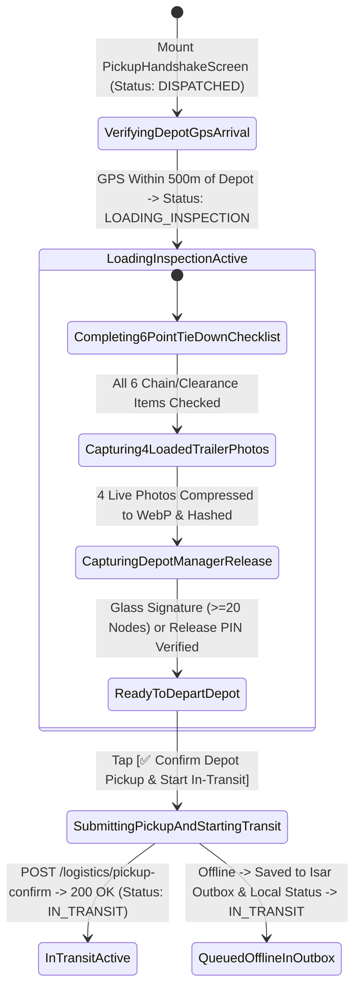
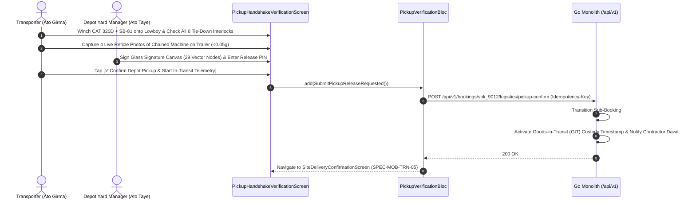

# Depot Machinery Loading, Tie-Down Chain Verification & Pickup Release Handshake
## Mobile Subsystem Specification — `docs/mobile/transporter-experience/04-pickup-handshake-verification.md`

**Document Identifier:** `SPEC-MOB-TRN-04`  
**Classification:** Canonical Subsystem UI/UX & Technical Behavior Specification  
**Governing Documents:** `Dink_Machinery_UI_UX_Design_Brief.md`, `SRS-DINK-CORE-V7.0` (§5.8.5, `LG-06`, `ADR-010`), `docs/shared/design/design-tokens.json`, `docs/ERROR_CATALOG.md`, `contracts/openapi.yaml`  
**Target Subsystem:** Flutter 3.47.8 / Dart 3.9 Mobile Client (iOS & Android)  
**Primary Persona / Actor:** Heavy Haulage Lowboy Transporter (*Ato Girma Wolde*) & Equipment Depot Yard Manager (*W/ro Almaz Tesfaye*)  
**Associated Requirements:** `REQ-05-08` (`LG-06` Depot Machinery Loading, Winching & Tie-Down Verification Checklist, 4-Angle Loaded Trailer Reticle Capture, Depot Release Attestation), `REQ-05-17` (Offline Outbox Sync)  
**Associated Interaction Flows:** `FLOW-11` (Lowboy Loading & Transit Initiation), `FLOW-18` (In-Transit Telemetry & Transshipment Readiness)  
**Associated ADRs:** `ADR-005` (ClamAV Streaming Photo Scan), `ADR-010` (Offline P2P QR / Glass Signature Release)  
**Status:** Approved Technical Design Baseline

---

## 1. Domain Context, Business Rules & Architectural Invariants

Winching a $21.5\text{-tonne}$ crawler excavator onto a steel lowboy deck and securing it for highway transit across steep rift-valley gradients is a high-hazard mechanical operation. Improper chain lashing, unlocked excavator swing brakes, or unlowered hydraulic booms cause catastrophic rollovers or bridge collisions in transit.

The **Depot Machinery Loading & Pickup Handshake Verification** screen (`SPEC-MOB-TRN-04`) implements `LG-06` (`SRS 05.08 §5.1`), governing the transition of the transport sub-booking from `DISPATCHED` $\rightarrow$ `LOADING_INSPECTION` $\rightarrow$ `IN_TRANSIT` (and synchronizing the parent machinery booking into `IN_TRANSIT`).

### 1.1 Core Business Rules & Operational Invariants
1. **Depot Arrival PostGIS Proximity Check (`LG-06`):**
   - Verifies that the carrier's GPS coordinates are within $500\text{ meters}$ of the equipment owner's home depot yard (`originLat`, `originLng`) before unlocking the loading inspection (`LOADING_INSPECTION`).
2. **Mandatory 6-Point Heavy Haulage Tie-Down & Safety Checklist (`LG-06`):**
   - All six mechanical safety interlocks (`56dp` touch targets) must be explicitly verified and checked before transit can begin:
     1. **4-Corner Grade-70/80 Steel Lashing Chains & Ratchet Load Binders Tensioned** ($\ge 4$ independent tie-down points anchored to chassis D-rings).
     2. **Hydraulic Boom Lowered Fully into Well & Stick/Bucket Tucked** (Total height verified $\le 4,500\text{ mm}$).
     3. **Upper Structure House Swing Lock Pin & Parking Brake Engaged.**
     4. **Wheel Chocks / Steel Track Wedges Welded or Bolted Against Deck.**
     5. **Hydraulic Loading Ramps Raised & Safety Latch Pins Secured** (or Gooseneck Re-Coupled & Locked).
     6. **Wide-Load Red/White Warning Flags & Roof Amber Strobe Beacons Active** (Mandatory when width $>3,000\text{ mm}$).
3. **4-Angle Loaded Trailer Reticle Photo Capture (Gallery Disabled):**
   - Captures 4 live accelerometer-stabilized ($<0.05g$ drift) photos of the **loaded machine on the lowboy trailer**:
     - **Angle 1 (`FRONT_GOOSENECK_BINDERS`):** Front tie-down chains, gooseneck lock, and swing pin.
     - **Angle 2 (`REAR_RAMPS_AND_FLAGS`):** Raised loading ramps, rear chains, trailer plate, and warning flags.
     - **Angle 3 (`LEFT_DECK_LASHING`):** Left track placement on deck/outriggers and chain binders.
     - **Angle 4 (`RIGHT_DECK_BOOM_HEIGHT`):** Right side profile showing boom tucked low for bridge clearance.
4. **Depot Release Co-Sign Handshake (`LG-06`, `ADR-010`):**
   - Requires joint attestation by the Depot Yard Manager (via Glass Digital Signature `SPEC-MOB-OPR-07` $\ge 20$ vector nodes or Offline P2P HMAC QR / 6-Digit PIN `SPEC-MOB-OPR-04`), formally transferring transit custody to the Carrier under their Goods-in-Transit (`GIT`) insurance policy and transitioning both child and parent bookings to `IN_TRANSIT`.

---

## 2. Screen Anatomy, Layout & Bespoke ASCII Wireframe

### 2.1 Depot Loading, Tie-Down Checklist & 4-Angle Loaded Trailer Wireframe
```text
+-----------------------------------------------------------------------+
| [← Back]          DEPOT LOADING & TIE-DOWN CHECK        #SBK-9012     |
| Status: [🟡 LOADING_INSPECTION] • Depot: Kality Yard (GPS Verified ✓) |
+-----------------------------------------------------------------------+
| ⛓️ 1. MANDATORY HEAVY HAULAGE TIE-DOWN & CLEARANCE CHECKLIST (LG-06)  |
| +-------------------------------------------------------------------+ |
| | [☑] 1. 4-Point Grade-80 Steel Chains & Ratchet Binders Tensioned  | |
| | [☑] 2. Boom Lowered Fully into Deck Well (Height: 4,100 <= 4,500) | |
| | [☑] 3. Excavator Swing Lock Pin & Track Parking Brake Engaged     | |
| | [☑] 4. Steel Track Wedges & Bundled Breaker (SB-81) Chained Down  | |
| | [☑] 5. Hydraulic Rear Loading Ramps Raised & Safety Pins Locked   | |
| | [☑] 6. Side Outriggers (+250mm), Wide-Load Flags & Beacon Active  | |
| +-------------------------------------------------------------------+ |
|                                                                       |
| 📷 2. 4-ANGLE LOADED TRAILER RETICLE PHOTOS (GALLERY DISABLED 🔒)     |
| +---------------------------------+ +-------------------------------+ |
| | [🖼️ 1. FRONT GOOSENECK & CHAINS]| | [🖼️ 2. REAR RAMPS & FLAGS]    | |
| | 🟢 Captured Live • 0.02g Steady | | 🟢 Captured Live • 0.01g      | |
| | WebP 245 KB • SHA-256 Verified  | | WebP 260 KB • SHA-256 Verified| |
| +---------------------------------+ +-------------------------------+ |
| +---------------------------------+ +-------------------------------+ |
| | [🖼️ 3. LEFT DECK & OUTRIGGERS]  | | [🖼️ 4. RIGHT BOOM CLEARANCE]  | |
| | 🟢 Captured Live • 0.02g Steady | | 🟢 Captured Live • 0.03g      | |
| | WebP 272 KB • SHA-256 Verified  | | WebP 255 KB • SHA-256 Verified| |
| +---------------------------------+ +-------------------------------+ |
|                                                                       |
| ✍️ 3. DEPOT YARD MANAGER RELEASE ATTESTATION (CUSTODY -> GIT POLICY)  |
| +-------------------------------------------------------------------+ |
| | Released By *: [ Ato Taye Desta (Kality Depot Yard Supervisor)  ] | |
| | Machine Hour Meter at Loading: 1,450.50 hrs (Matches Baseline ✓)  | |
| | +---------------------------------------------------------------+ | |
| | | [🟢 Glass Signature Captured: 29 Vector Nodes (>=20 Min) ✓]   | | |
| | | OR [📲 Verified via Depot Release 6-Digit PIN: 441-908 ✓]     | | |
| | +---------------------------------------------------------------+ | |
| +-------------------------------------------------------------------+ |
+-----------------------------------------------------------------------+
| [ ✅ CONFIRM DEPOT PICKUP & START IN-TRANSIT TELEMETRY (#05) → ]      |
+-----------------------------------------------------------------------+
```

---

## 3. W3C DTCG Design Token Mapping Table

| UI Component / Element | W3C Token Path (`design-tokens.json`) | Resolved Value (Light / Dark / Outdoor) | Behavioral & Accessibility Invariant |
|---|---|---|---|
| **Tie-Down Safety Checkbox Row** | `dimension.space.56` + `stroke.border.heavy` | Height `56dp`, Checkbox `3dp` border, Emerald `#10B981` when checked | Operable with heavy work gloves while walking around the lowboy deck. |
| **Loaded Trailer Photo Slot** | `semantic.{mode}.surface.card` + `color.feedback.emerald.500` | `#FFFFFF` / `#1E293B` / `#000000`, `2dp` `#10B981` border | Requires live camera capture with $<0.05g$ accelerometer drift. |
| **Depot Release Signature Box** | `component.signature.canvasMinHeight` + `minNodes` | `180dp` height, `3dp` stroke, `>=20` vector nodes | Embeds or launches `SPEC-MOB-OPR-07` for depot yard release attestation. |
| **Start In-Transit CTA** | `component.actuator.button.heightField` + `semantic.{mode}.action.primary.bg` | Height `64dp`, Fill `#F59E0B` (`#FBBF24` Outdoor), Lip `3dp` | Unlocks only when all 6 tie-down checks + 4 photos + depot signature are valid. |

---

## 4. Interactive State Machine & Sequence Flows

### 4.1 Depot Loading, Tie-Down & Pickup Release State Machine


### 4.2 Depot Loading Verification & `IN_TRANSIT` State Synchronization Sequence (`LG-06`)


---

## 5. Concrete Flutter Implementation Blueprint

### 5.1 BLoC Events & Immutable Freezed States
```dart
// lib/features/transporter_execution/presentation/bloc/pickup_verification_bloc.dart
import 'package:freezed_annotation/freezed_annotation.dart';
import 'package:flutter_bloc/flutter_bloc.dart';

part 'pickup_verification_bloc.freezed.dart';

@freezed
sealed class PickupVerificationEvent with _$PickupVerificationEvent {
  const factory PickupVerificationEvent.started(String subBookingId) = _Started;
  const factory PickupVerificationEvent.tieDownCheckToggled({
    required int checkIndex, // 0..5
    required bool isChecked,
  }) = _TieDownCheckToggled;
  const factory PickupVerificationEvent.loadedTrailerPhotoCaptured({
    required String angleKey, // 'FRONT_BINDERS' | 'REAR_RAMPS' | 'LEFT_LASHING' | 'RIGHT_CLEARANCE'
    required String rawFilePath,
    required double accelerometerDriftG,
  }) = _LoadedTrailerPhotoCaptured;
  const factory PickupVerificationEvent.depotReleaseSigned({
    required String yardManagerName,
    required String signatureSvg,
    required int vectorNodeCount,
    String? releasePinCode,
  }) = _DepotReleaseSigned;
  const factory PickupVerificationEvent.confirmPickupAndStartTransit() = _ConfirmPickupAndStartTransit;
}

@freezed
sealed class PickupVerificationState with _$PickupVerificationState {
  const factory PickupVerificationState({
    required String subBookingId,
    required String parentBookingId,
    required List<bool> sixPointTieDownChecks, // Length 6, all must be true
    required Map<String, WalkaroundPhotoEntry> loadedTrailerPhotos, // 4 required angles
    @Default('') String yardManagerName,
    String? depotReleaseSignatureSvg,
    @Default(0) int signatureNodeCount,
    String? verifiedReleasePin,
    required bool isAllRequirementsMet,
    @Default(false) bool isSubmitting,
    ProblemDetails? error,
  }) = _PickupVerificationState;
}
```

### 5.2 Isar Local Persistence for Offline Depot Release
```dart
// lib/features/transporter_execution/data/local/isar_logistics_handover_outbox.dart
import 'package:isar/isar.dart';

part 'isar_logistics_handover_outbox.g.dart';

@collection
class IsarLogisticsHandoverOutbox {
  Id id = Isar.autoIncrement;

  @Index(unique: true, replace: true)
  late String subBookingAndStageKey; // e.g., "sbk_9012_PICKUP" or "sbk_9012_DELIVERY"

  late String subBookingId;
  late String parentBookingId;
  late String stage; // 'PICKUP' | 'DELIVERY'
  late List<bool> checklistStates;
  late String serializedPhotosJson;
  late String signeeName;
  late String signatureSvg;
  late int vectorNodeCount;
  late double gpsLat;
  late double gpsLng;
  late String idempotencyKey;
  late String syncStatus; // 'QUEUED_OUTBOX' | 'SYNCED'
  late DateTime recordedAt;
}
```

### 5.3 Widget Tree Hierarchy
```text
PickupHandshakeVerificationScreen (Scaffold)
 ├── PickupVerificationAppBar (Sub-Booking ID, Depot GPS Proximity Badge)
 └── SingleChildScrollView
      ├── SixPointTieDownSafetyChecklistCard (6 Mandatory 56dp Checkbox Rows for Chains, Boom Height, Swing Pin, Chocks, Ramps, Flags)
      ├── LoadedTrailer4AngleGridCard (2x2 Grid: Front Gooseneck, Rear Ramps, Left Lashing, Right Clearance — Live Camera Only)
      ├── DepotYardManagerReleaseCard (Manager Name + Glass Signature Pad Launcher >=20 Nodes / 6-Digit PIN)
      └── StickyPickupConfirmFooter ([✅ Confirm Depot Pickup & Start In-Transit Telemetry (#05) →])
```

---

## 6. OpenAPI 3.1.0 Routes & RFC 9457 Error Matrix

### 6.1 Bound API Endpoints
| Operation | HTTP Method & URI | Headers Required | Purpose & Contract Binding |
|---|---|---|---|
| **Confirm Depot Pickup** | `POST /api/v1/bookings/{id}/logistics/pickup-confirm` | `Authorization: Bearer <JWT>`, `Idempotency-Key: <UUIDv4>` | Commits the 6-point tie-down attestation, 4 loaded trailer photos, and depot release signature (`LG-06`), transitioning sub-booking and parent booking to `IN_TRANSIT`. |

### 6.2 RFC 9457 Problem Details Error Matrix
| Error Code (`error.code`) | HTTP Status | Type URI | Trigger Condition | Mobile UI Recovery Behavior |
|---|---|---|---|---|
| `BOOKING_INSPECTION_REQUIRED` | `422` | `/errors/booking-inspection-required` | Any of the 6 tie-down checks is `false`, fewer than 4 loaded trailer photos attached, or signature has `<20` vector nodes. | Highlight incomplete checklist items or missing photo slots in crimson. |
| `INSPECT_MEDIA_SCAN_FAILED` | `422` | `/errors/inspect-media-scan-failed` | Loaded trailer photo failed ClamAV (`:3310`) scan. | Prompt live camera re-capture of the affected angle. |
| `GEO_INVALID_COORDINATES` | `400` | `/errors/geo-invalid-coordinates` | Carrier GPS fix is $>500\text{ m}$ outside the origin depot yard boundary. | Prompt carrier to refresh high-accuracy GPS at the depot gate. |

---

## 7. Verification & Acceptance Criteria

- [ ] **6-Point Tie-Down Interlock (`LG-06`):** Leaving any of the 6 lashing/clearance checkboxes unchecked keeps `[✅ Confirm Depot Pickup & Start In-Transit]` disabled.
- [ ] **4-Angle Loaded Trailer Reticle Gate:** All 4 loaded trailer angles (`FRONT_BINDERS`, `REAR_RAMPS`, `LEFT_LASHING`, `RIGHT_CLEARANCE`) must be captured live with $<0.05g$ accelerometer stability and compressed to WebP in a background isolate.
- [ ] **Custody Transfer Attestation:** Depot release requires either a valid Glass Signature ($\ge 20$ vector nodes, `SPEC-MOB-OPR-07`) or a verified 6-digit Depot Release PIN before transitioning to `IN_TRANSIT`.
