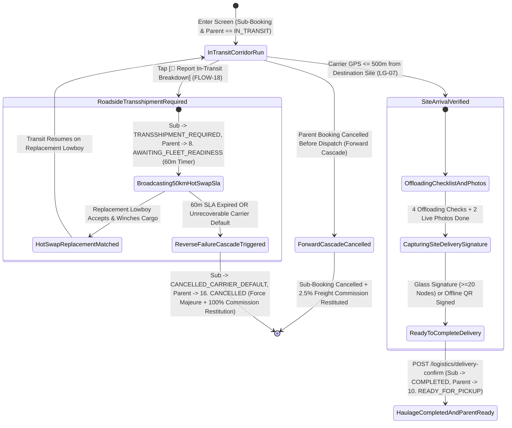

# Job Site Offloading Confirmation, Delivery Receipt & Bidirectional Cancellation Cascade Handler
## Mobile Subsystem Specification — `docs/mobile/transporter-experience/05-site-delivery-confirmation.md`

**Document Identifier:** `SPEC-MOB-TRN-05`  
**Classification:** Canonical Subsystem UI/UX & Technical Behavior Specification  
**Governing Documents:** `Dink_Machinery_UI_UX_Design_Brief.md`, `SRS-DINK-CORE-V7.0` (§5.8.5, §5.8.6, §5.9.7, `LG-07`, `LG-08`, `FLOW-18`), `docs/shared/design/design-tokens.json`, `docs/ERROR_CATALOG.md`, `contracts/openapi.yaml`  
**Target Subsystem:** Flutter 3.47.9 / Dart 3.9 Mobile Client (iOS & Android)  
**Primary Persona / Actor:** Heavy Haulage Lowboy Transporter (*Ato Girma Wolde*), Contractor Site Supervisor (*Dawit Haile-Mariam*), Equipment Fleet Owner (*W/ro Almaz Tesfaye*)  
**Associated Requirements:** `REQ-05-08` (`LG-07` Job Site Arrival GPS Check, Offloading Inspection & Contractor Delivery Sign-Off, `LG-08` Roadside Transshipment & Bidirectional / Reverse Cancellation Cascade Engine), `REQ-05-09` (§7.1 Commission Restitution on Force Majeure Cascade)  
**Associated Interaction Flows:** `FLOW-11` (Site Offloading & Transition to `10. READY_FOR_PICKUP`), `FLOW-18` (Roadside Transshipment, Carrier Default & Reverse Failure Cascade)  
**Associated ADRs:** `ADR-002` (Atomic Commission Restitution `COMMISSION_RESTITUTION`), `ADR-004` (Parent-Child Cascade State Machine), `ADR-010` (Offline Site Delivery Outbox)  
**Status:** Approved Technical Design Baseline

---

## 1. Domain Context, Business Rules & Architectural Invariants

The **Job Site Offloading Confirmation & Bidirectional Cancellation Cascade Handler** (`SPEC-MOB-TRN-05`) governs the final leg of heavy equipment mobilization (`IN_TRANSIT` $\rightarrow$ `COMPLETED` on the child sub-booking, simultaneously advancing the parent machinery booking from `IN_TRANSIT` $\rightarrow$ `10. READY_FOR_PICKUP`) as well as the emergency exception workflows (`FLOW-18` Roadside Breakdown Transshipment and Bidirectional Cancellation Cascades).

### 1.1 Core Business Rules & Operational Invariants
1. **Job Site Arrival PostGIS Geofence Check & Offloading Checklist (`LG-07`):**
   - Verifies that the lowboy carrier's GPS coordinates are within the destination project site boundary (`destinationLat`, `destinationLng`, $\le 500\text{ m}$ tolerance).
   - Before unchaining and walking the excavator down the hydraulic ramps, the carrier completes the **4-Point Site Offloading Safety Checklist**:
     1. Firm, level offloading ground verified (zero trench edge collapse hazard).
     2. Hydraulic rear ramps lowered (or gooseneck detached) and timber cribbing placed under ramp knuckle.
     3. All 4 corner tie-down chains, binders, and track wedges removed safely.
     4. Machine driven off lowboy deck intact with zero transit collision damage; 2 post-offloading photos captured (`OFFLOADED_MACHINE_ON_SITE`, `EMPTY_TRAILER_DECK`).
2. **Contractor Site Receipt Sign-Off & Parent State Promotion (`LG-07`):**
   - The Contractor Site Supervisor (*Eng. Dawit*) or assigned Certified Operator (*Mulugeta*) signs the **Delivery Receipt** via the Glass Digital Signature Canvas ($\ge 20$ vector nodes, `SPEC-MOB-OPR-07`) or Offline P2P HMAC QR (`SPEC-MOB-OPR-04`).
   - Submitting `POST /api/v1/bookings/{subBookingId}/logistics/delivery-confirm`:
     - Marks the transport sub-booking `14. COMPLETED` (unlocking final freight settlement and mutual rating).
     - Atomically promotes the **Parent Machinery Booking (`#BK-8812`)** to `10. READY_FOR_PICKUP`, unlocking the Operator's Pre-Rental Handover Check-In (`SPEC-MOB-OPR-02`).
3. **In-Transit Roadside Breakdown & 60-Minute Emergency Transshipment SLA (`LG-08`, `FLOW-18`):**
   - If the lowboy prime mover or trailer suffers a severe mechanical breakdown en route (e.g., blown turbocharger or snapped axle on the Addis–Adama Expressway), tapping `[🚨 Report In-Transit Breakdown — Request Transshipment]` transitions:
     - Child Sub-Booking $\rightarrow$ `TRANSSHIPMENT_REQUIRED`
     - Parent Machinery Booking $\rightarrow$ `8. AWAITING_FLEET_READINESS` (freezing rental billing so the contractor is not charged for delayed mobilization).
   - Starts a **60-minute Emergency Hot-Swap SLA timer**, broadcasting the stranded cargo coordinates (`lat`, `lng`) to all compatible lowboy carriers within a $50\text{ km}$ PostGIS radius (`SPEC-MOB-TRN-01`).
4. **Bidirectional Cancellation Cascade & Force Majeure Commission Restitution (`LG-08`, `FLOW-18`, `SRS 05.08 §6.3–6.4`, `SRS 05.09 §7.1`):**
   - Parent and child bookings enforce a strict **Bidirectional Cancellation Cascade**:
     - **Direction A — Reverse Failure Cascade (Child Carrier Default $\rightarrow$ Parent Force Majeure Exoneration):** If the carrier defaults (`CANCELLED_CARRIER_DEFAULT`) or the 60-minute roadside transshipment SLA expires with zero replacement lowboy found (`POST /api/v1/bookings/{id}/logistics/reverse-cascade`), the backend atomically transitions the Parent Machinery Booking to `16. CANCELLED (Force Majeure)`:
       1. **Zero Bilateral Penalties:** Neither the Civil Contractor nor the Equipment Fleet Owner is charged a cancellation penalty.
       2. **100% Contractor Prepayment Refund Obligation:** The Equipment Fleet Owner is instructed to wire back 100% of the contractor's advance prepayment.
       3. **Automatic `OwnerWallet` Commission Restitution (`COMMISSION_RESTITUTION`):** The Go backend atomically credits back 100% of the previously debited $10.0\%$ machinery commission (`+21,350.00 ETB`) to the Equipment Fleet Owner's `OwnerWallet` inside `pgx.Tx`.
     - **Direction B — Forward Cancellation Cascade (Parent Machinery Cancelled $\rightarrow$ Child Sub-Booking Aborted):** If the Parent Machinery Booking (`#BK-8812`) is cancelled by the contractor or owner *prior* to lowboy dispatch (`DISPATCHED`), the system automatically cancels the linked child sub-booking (`#SBK-9012`), releases the carrier's calendar, and credits `COMMISSION_RESTITUTION` for the $2.5\%$ freight fee to the carrier's `OwnerWallet`.

---

## 2. Screen Anatomy, Layout & Bespoke ASCII Wireframe

### 2.1 Site Offloading Confirmation & Emergency Transshipment / Cascade Wireframe
```text
+-----------------------------------------------------------------------+
| [← Back]          IN-TRANSIT & SITE OFFLOADING          #SBK-9012     |
| Sub-Booking: [🟢 IN_TRANSIT] • Parent #BK-8812: [🟢 IN_TRANSIT]       |
+-----------------------------------------------------------------------+
| 📍 1. DESTINATION SITE ARRIVAL & GEOFENCE VERIFICATION (LG-07)        |
| +-------------------------------------------------------------------+ |
| | Target Site: Mojo-Meki Highway Expansion — Lot 2 Cut Corridor     | |
| | Current GPS: 8.54118° N, 39.27180° E [🟢 ARRIVED WITHIN 45m ✓]    | |
| | Transit Distance Logged: 74.4 km • Transit Time: 02h 18m          | |
| +-------------------------------------------------------------------+ |
|                                                                       |
| 🚜 2. SAFE OFFLOADING CHECKLIST & POST-DELIVERY PHOTOS (LG-07)        |
| +-------------------------------------------------------------------+ |
| | [☑] 1. Level, compacted offloading ground verified with Site Sup  | |
| | [☑] 2. Hydraulic ramps lowered & timber cribbing blocks seated    | |
| | [☑] 3. All 4 corner Grade-80 chains, binders & chocks unfastened  | |
| | [☑] 4. CAT 320D + SB-81 driven off deck with zero transit damage  | |
| |-------------------------------------------------------------------| |
| | +-------------------------------+ +-----------------------------+ | |
| | | [🖼️ 1. OFFLOADED MACHINE]     | | [🖼️ 2. EMPTY LOWBOY DECK]   | | |
| | | 🟢 Live Capture • 0.02g Steady| | 🟢 Live Capture • 0.01g     | | |
| | +-------------------------------+ +-----------------------------+ | |
| +-------------------------------------------------------------------+ |
|                                                                       |
| ✍️ 3. SITE DELIVERY RECEIPT ATTESTATION (UNLOCKS PARENT #BK-8812)     |
| +-------------------------------------------------------------------+ |
| | Received On Site By *: [ Eng. Dawit Haile-Mariam (Contractor)   ] | |
| | [🟢 Glass Signature Verified: 31 Vector Nodes (>=20 Min) ✓]       | |
| | ℹ️ Confirming delivery completes #SBK-9012 and transitions Parent | |
| |    Booking #BK-8812 to 10. READY_FOR_PICKUP for Operator Check-In.| |
| +-------------------------------------------------------------------+ |
| [ ✅ CONFIRM SITE OFFLOADING & COMPLETE HAULAGE RUN ]                 |
+-----------------------------------------------------------------------+
| 🚨 IN-TRANSIT EMERGENCY & CANCELLATION CASCADE CONTROLS (FLOW-18)     |
| +-------------------------------------------------------------------+ |
| | Stranded on highway or unable to complete corridor delivery?      | |
| | [ 🔧 REPORT IN-TRANSIT BREAKDOWN (60m HOT-SWAP SLA • FLOW-18) ]   | |
| |-------------------------------------------------------------------| |
| | (If 60m Hot-Swap SLA Expires or Carrier Defaults -> Triggers      | |
| |  FLOW-18 Reverse Cascade: Parent #BK-8812 Cancelled Force Majeure,| |
| |  0% Penalty to Renter/Owner, +100% Commission Restitution!)       | |
| +-------------------------------------------------------------------+ |
```

---

## 3. W3C DTCG Design Token Mapping Table

| UI Component / Element | W3C Token Path (`design-tokens.json`) | Resolved Value (Light / Dark / Outdoor) | Behavioral & Accessibility Invariant |
|---|---|---|---|
| **Site Arrival Geofence Banner** | `color.feedback.emerald.100` + `color.feedback.emerald.700` | Bg `#D1FAE5`, Text `#047857`, Icon `🟢` | Unlocks offloading checklist when carrier GPS is within $500\text{ m}$ of site pin. |
| **Offloading Checklist Rows** | `dimension.space.56` + `stroke.border.medium` | Height `56dp`, `2dp` checkbox border | Prevents unchaining on sloped/unstable shoulders without cribbing check. |
| **Complete Haulage Run CTA** | `component.actuator.button.heightField` + `color.feedback.emerald.600` | Height `64dp`, Fill `#059669`, Text `#FFFFFF`, Lip `3dp` | Atomically completes sub-booking and shifts parent to `10. READY_FOR_PICKUP`. |
| **Roadside Breakdown / Cascade Box** | `color.feedback.crimson.50` + `color.feedback.crimson.600` | Bg `#FEF2F2`, Border `#DC2626` (`2dp`), Text `#B91C1C` | Provides emergency access to `FLOW-18` transshipment and reverse cascade. |

---

## 4. Interactive State Machine & Sequence Flows

### 4.1 In-Transit Delivery, Roadside Transshipment & Bidirectional Cascade State Machine


### 4.2 Site Delivery Completion vs. `FLOW-18` Reverse Failure Cascade Sequence
```mermaid
sequenceDiagram
    autonumber
    actor Carrier as Transporter (Ato Girma)
    actor Supervisor as Contractor Supervisor (Eng. Dawit)
    participant UI as SiteDeliveryConfirmationScreen
    participant Bloc as SiteDeliveryBloc
    participant API as Go Monolith (/api/v1)
    participant DB as PostgreSQL 18.6 (pgx.Tx)

    alt Smooth Transit & Site Offloading (LG-07)
        Carrier->>UI: Arrive at Mojo Site B (GPS <= 45m), Lower Ramps & Offload CAT 320D
        Carrier->>UI: Complete 4 Offloading Checks + Capture 2 Live Photos (<0.05g)
        Supervisor->>UI: Sign Glass Signature Canvas (31 Vector Nodes)
        Carrier->>UI: Tap [✅ Confirm Site Offloading & Complete Haulage Run]
        UI->>Bloc: add(ConfirmSiteDeliverySubmitted())
        Bloc->>API: POST /api/v1/bookings/sbk_9012/logistics/delivery-confirm (Idempotency-Key)
        API->>DB: BEGIN pgx.Tx -> Sub #SBK-9012 = COMPLETED; Parent #BK-8812 = 10. READY_FOR_PICKUP
        DB-->>API: COMMIT
        API-->>Bloc: 200 OK (Operator Mulugeta Unlocked for AR-01 Check-In!)
    else In-Transit Breakdown & Unresolvable Reverse Cascade (LG-08 / FLOW-18)
        Carrier->>UI: Tap [🔧 Report In-Transit Breakdown] at Km 18
        UI->>Bloc: add(ReportRoadsideTransshipmentAlert(lat, lng, faultNote))
        Bloc->>API: POST /api/v1/bookings/sbk_9012/logistics/transshipment-alert
        API->>DB: Sub -> TRANSSHIPMENT_REQUIRED; Parent #BK-8812 -> 8. AWAITING_FLEET_READINESS (60m SLA)
        Note over API,DB: 60-Minute Hot-Swap Timer Expires with Zero Replacement Lowboy
        API->>DB: POST /api/v1/bookings/sbk_9012/logistics/reverse-cascade (pgx.Tx)
        DB->>DB: 1. Sub #SBK-9012 -> CANCELLED_CARRIER_DEFAULT
        DB->>DB: 2. Parent #BK-8812 -> 16. CANCELLED (Force Majeure Exemption — 0% Penalty)
        DB->>DB: 3. INSERT owner_wallet_transactions: COMMISSION_RESTITUTION (+2,135,000 Santims to Owner Almaz)
        DB-->>API: COMMIT & Notify Contractor, Owner & Carrier
    end
```

---

## 5. Concrete Flutter Implementation Blueprint

### 5.1 BLoC Events & Immutable Freezed States
```dart
// lib/features/transporter_execution/presentation/bloc/site_delivery_bloc.dart
import 'package:freezed_annotation/freezed_annotation.dart';
import 'package:flutter_bloc/flutter_bloc.dart';

part 'site_delivery_bloc.freezed.dart';

@freezed
sealed class SiteDeliveryEvent with _$SiteDeliveryEvent {
  const factory SiteDeliveryEvent.started(String subBookingId) = _Started;
  const factory SiteDeliveryEvent.offloadingCheckToggled({
    required int index, // 0..3
    required bool isChecked,
  }) = _OffloadingCheckToggled;
  const factory SiteDeliveryEvent.offloadingPhotoCaptured({
    required String slotKey, // 'OFFLOADED_MACHINE' | 'EMPTY_DECK'
    required String rawFilePath,
    required double accelerometerDriftG,
  }) = _OffloadingPhotoCaptured;
  const factory SiteDeliveryEvent.siteReceiptSigned({
    required String recipientName,
    required String recipientRole,
    required String signatureSvg,
    required int vectorNodeCount,
  }) = _SiteReceiptSigned;
  const factory SiteDeliveryEvent.confirmSiteDeliverySubmitted() = _ConfirmSiteDeliverySubmitted;
  const factory SiteDeliveryEvent.roadsideTransshipmentAlertTriggered({
    required String mechanicalFaultDescription,
    required double breakdownLat,
    required double breakdownLng,
    required String faultPhotoPath,
  }) = _RoadsideTransshipmentAlertTriggered;
  const factory SiteDeliveryEvent.reverseCascadeTriggered(String unrecoverableReason) = _ReverseCascadeTriggered;
}

@freezed
sealed class SiteDeliveryState with _$SiteDeliveryState {
  const factory SiteDeliveryState.inTransit({
    required String subBookingId,
    required String parentBookingId,
    required String subBookingStatus, // 'IN_TRANSIT' | 'TRANSSHIPMENT_REQUIRED'
    required String parentBookingStatus, // 'IN_TRANSIT' | 'AWAITING_FLEET_READINESS'
    required bool isWithinSiteGeofence500m,
    required double distanceToSiteMeters,
    required List<bool> fourPointOffloadingChecks,
    required Map<String, WalkaroundPhotoEntry> offloadingPhotos,
    String? recipientName,
    String? deliverySignatureSvg,
    @Default(0) int signatureNodeCount,
    DateTime? transshipmentSlaExpiresAt, // 60m SLA when TRANSSHIPMENT_REQUIRED
    @Default(false) bool isSubmitting,
    ProblemDetails? error,
  }) = _InTransit;

  const factory SiteDeliveryState.deliveryCompleted({
    required String subBookingId,
    required String parentBookingId,
    required String updatedParentStatus, // 'READY_FOR_PICKUP'
  }) = _DeliveryCompleted;

  const factory SiteDeliveryState.cascadeCancelled({
    required String subBookingId,
    required String parentBookingId,
    required String cascadeDirection, // 'REVERSE_CARRIER_FAILURE' | 'FORWARD_PARENT_CANCELLED'
    required int restitutedOwnerCommissionMinor,
  }) = _CascadeCancelled;
}
```

### 5.2 Isar Persistence Integration
Reuses `IsarLogisticsHandoverOutbox` (`stage = 'DELIVERY'`) from `SPEC-MOB-TRN-04` so offloading confirmations signed at remote highway cuts with zero cellular bars queue deterministically and sync upon return to highway coverage.

### 5.3 Widget Tree Hierarchy
```text
SiteDeliveryConfirmationScreen (Scaffold)
 ├── SiteDeliveryAppBar (Sub-Booking ID, Parent Booking Sync Badge)
 ├── Conditional TransshipmentSlaBanner (Shown when status == TRANSSHIPMENT_REQUIRED with 60m Hot-Swap Countdown)
 └── SingleChildScrollView
      ├── DestinationSiteGeofenceArrivalCard (WGS 84 Distance to Site Pin + Arrival Badge)
      ├── FourPointSafeOffloadingChecklistCard (Level Ground, Cribbing, Unchaining, Zero Transit Damage + 2 Live Photos)
      ├── SiteDeliveryReceiptSignatureCard (Contractor Supervisor Name + Glass Signature >=20 Nodes / P2P QR)
      ├── ConfirmSiteOffloading64dpButton (Transitions Sub -> COMPLETED & Parent -> 10. READY_FOR_PICKUP)
      └── EmergencyTransshipmentAndCascadeCard (FLOW-18 Trigger for Roadside Breakdown & Reverse Cascade Notice)
```

---

## 6. OpenAPI 3.1.0 Routes & RFC 9457 Error Matrix

### 6.1 Bound API Endpoints
| Operation | HTTP Method & URI | Headers Required | Purpose & Contract Binding |
|---|---|---|---|
| **Confirm Site Offloading** | `POST /api/v1/bookings/{id}/logistics/delivery-confirm` | `Authorization: Bearer <JWT>`, `Idempotency-Key: <UUIDv4>` | Completes child sub-booking (`COMPLETED`) and atomically advances parent machinery booking to `10. READY_FOR_PICKUP` (`LG-07`). |
| **Trigger Roadside Transshipment** | `POST /api/v1/bookings/{id}/logistics/transshipment-alert` | `Authorization: Bearer <JWT>`, `Idempotency-Key: <UUIDv4>` | Transitions child to `TRANSSHIPMENT_REQUIRED`, freezes parent in `8. AWAITING_FLEET_READINESS`, and broadcasts 50km hot-swap alert (`FLOW-18`). |
| **Execute Reverse Failure Cascade** | `POST /api/v1/bookings/{id}/logistics/reverse-cascade` | `Authorization: Bearer <JWT>`, `Idempotency-Key: <UUIDv4>` | Executes `FLOW-18` reverse cascade: cancels parent under Force Majeure (`0%` penalty) and credits `COMMISSION_RESTITUTION` to the equipment owner's wallet (`SRS 05.08 §6.3`). |

### 6.2 RFC 9457 Problem Details Error Matrix
| Error Code (`error.code`) | HTTP Status | Type URI | Trigger Condition | Mobile UI Recovery Behavior |
|---|---|---|---|---|
| `BOOKING_INSPECTION_REQUIRED` | `422` | `/errors/booking-inspection-required` | Offloading checklist incomplete, fewer than 2 offloading photos captured, or recipient signature has `<20` vector nodes. | Highlight missing offloading requirement in crimson. |
| `GEO_INVALID_COORDINATES` | `400` | `/errors/geo-invalid-coordinates` | Attempted to confirm site delivery while $>500\text{ m}$ away from destination site coordinates (without supervisor override PIN). | Display distance discrepancy and allow Contractor Supervisor 6-digit PIN override if site gate moved. |
| `BOOKING_INVALID_STATE_TRANSITION` | `409` | `/errors/booking-invalid-state` | Parent booking was already cancelled via Forward Cascade or Reverse Cascade. | Transition UI to `CascadeCancelled` summary view. |
| `LEDGER_DOUBLE_ENTRY_IMBALANCE` | `500` | `/errors/ledger-imbalance` | Internal ledger failure during `COMMISSION_RESTITUTION` journal entry on reverse cascade. | Safe retry with identical `Idempotency-Key`. |

---

## 7. Verification & Acceptance Criteria

- [ ] **Atomic Parent Promotion on Delivery (`LG-07`):** Completing `POST /api/v1/bookings/{id}/logistics/delivery-confirm` transitions the child sub-booking to `14. COMPLETED` and simultaneously transitions `ParentBookingID` from `IN_TRANSIT` to `10. READY_FOR_PICKUP`.
- [ ] **Roadside Breakdown Freeze (`FLOW-18`):** Triggering `transshipment-alert` transitions the parent machinery booking to `8. AWAITING_FLEET_READINESS`, ensuring the contractor's rental clock cannot start while the machine is stranded on a highway lowboy.
- [ ] **Bidirectional Cancellation Cascade & Restitution (`LG-08`, `FLOW-18`, `SRS 05.09 §7.1`):** Executing `reverse-cascade` transitions the child sub-booking to `CANCELLED_CARRIER_DEFAULT`, transitions the parent booking to `16. CANCELLED (Force Majeure)` with zero contractor/owner penalty, and credits `COMMISSION_RESTITUTION` (`+100%` of debited commission) back to the equipment owner's `OwnerWallet`.
