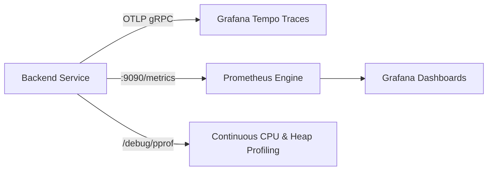

# Performance Quality Assurance (Performance QA) Specification & Benchmark Protocol — Dink Machinery

**System:** Heavy Machinery & Logistics Rental Marketplace  
**Subsystems:** Go 1.27.3 Backend Modular Monolith, Flutter 3.44 Mobile Client, Next.js 16 Admin Web Console, PostgreSQL 18.4 + PostGIS 3.4, Valkey 8.0-alpine  
**Compliance Standards:** ISO/IEC 25010 (Software Product Quality), Google Core Web Vitals, RED Metrics (Rate, Errors, Duration), USE Method (Utilization, Saturation, Errors)  
**Operating Context:** East African cellular infrastructure (intermittent 3G/4G connectivity, high packet latency, regional CDN limits, low-tier Android hardware).

---

## 1. Executive Summary & Performance Invariants

In **Dink Machinery**, system performance directly governs operational reliability and safety. Fleet discovery occurs in field conditions with constrained cellular reception; booking reservations trigger distributed locks and atomic ledger writes; and site inspections process high-resolution hardware images through antivirus pipelines.

Performance is treated as an architectural invariant verified via automated load tests, telemetry budgets, and CI regression ratchets.

### Core Performance Invariants
1. **Sub-100ms Geospatial Discovery:** PostGIS spatial radius queries (`ST_DWithin` with GiST indexing) must execute within $80\text{ ms}$ at P95 and $150\text{ ms}$ at P99 under a concurrency load of 1,000 active searchers.
2. **Deterministic Transaction Atomicity:** End-to-end booking state transitions and double-entry ledger writes (`BK-17-BE`) must commit within $120\text{ ms}$ at P95 and $250\text{ ms}$ at P99 inside an isolated `pgx.Tx` transaction block.
3. **Zero N+1 Query Invariant:** Handlers and interactors must execute all reads through compiled `sqlc` bulk queries or explicit SQL joins. Dynamic looping queries inside application code trigger immediate static review failure.
4. **Stable 60 FPS Mobile Interaction:** The Flutter mobile client must render frames within a $16.6\text{ ms}$ window during continuous catalog fling scrolling and map panning on mid-tier hardware (e.g., 3GB/4GB RAM Android devices).
5. **Bounded Memory Footprints:** The Go modular monolith backend must allocate $\le 256\text{ MB}$ RSS baseline heap under steady-state load; the Flutter mobile client must remain below $120\text{ MB}$ RAM on active listing views.
6. **Zero Layout Shift on Web:** The Next.js 16 administrative console must achieve a Cumulative Layout Shift (CLS) of $\le 0.05$ and render data tables with $10,000+$ rows smoothly using virtual windowing.

---

## 2. Latency, Throughput & Resource Budgets (SLOs / SLAs)

```
                            Service Level Latency Funnel
                                          │
       ┌──────────────────────────────────┼──────────────────────────────────┐
       ▼                                  ▼                                  ▼
[Tier 1: Read Operations]          [Tier 2: Stateful Mutations]       [Tier 3: Ingress & Storage]
 - Geo Radius Search: < 80ms P95    - Hold Acquisition: < 120ms P95   - ClamAV Scan: < 800ms P95
 - Fleet Detail View: < 40ms P95    - Payment Confirm: < 150ms P95    - S3 Media Upload: < 1500ms P95
 - Config Lookup: < 10ms P95        - Dispute Open: < 100ms P95       - PDF Generation: < 1200ms P95
```

### 2.1. Backend API Endpoint Latency & Throughput Budgets

| Endpoint Route / Action | Method | Target RPS | P50 Latency | P95 Latency | P99 Latency | Max Error Rate |
|---|---|---|---|---|---|---|
| `/api/v1/geo/fleets/radius-search` | `GET` | 500 | $\le 30\text{ ms}$ | $\le 80\text{ ms}$ | $\le 150\text{ ms}$ | $< 0.1\%$ |
| `/api/v1/fleets/{id}` | `GET` | 1,000 | $\le 15\text{ ms}$ | $\le 40\text{ ms}$ | $\le 80\text{ ms}$ | $< 0.01\%$ |
| `/api/v1/bookings` (Acquire Hold) | `POST` | 200 | $\le 50\text{ ms}$ | $\le 120\text{ ms}$ | $\le 250\text{ ms}$ | $< 0.1\%$ |
| `/api/v1/bookings/{id}:confirm-payment` | `POST` | 150 | $\le 60\text{ ms}$ | $\le 150\text{ ms}$ | $\le 300\text{ ms}$ | $< 0.01\%$ |
| `/api/v1/bookings/{id}/inspections` | `POST` | 50 | $\le 200\text{ ms}$ | $\le 600\text{ ms}$ | $\le 1,200\text{ ms}$ | $< 0.5\%$ |
| `/api/v1/admin/ui-config` | `GET` | 100 | $\le 5\text{ ms}$ | $\le 15\text{ ms}$ | $\le 30\text{ ms}$ | $< 0.01\%$ |
| `/api/v1/auth/otp/verify` | `POST` | 100 | $\le 35\text{ ms}$ | $\le 90\text{ ms}$ | $\le 180\text{ ms}$ | $< 0.1\%$ |

### 2.2. Mobile Client Performance Budgets (Flutter 3.44)

| Metric | Target Threshold | Degradation Warning | Critical SLA Violation |
|---|---|---|---|
| **Cold App Launch Time** | $\le 1,200\text{ ms}$ | $> 1,500\text{ ms}$ | $> 2,500\text{ ms}$ |
| **Warm App Launch Time** | $\le 400\text{ ms}$ | $> 600\text{ ms}$ | $> 1,000\text{ ms}$ |
| **Frame Rendering Budget** | $16.6\text{ ms}$ (60 FPS) | $16.6 - 33.3\text{ ms}$ (30-60 FPS) | $> 33.3\text{ ms}$ (Jank / Frame Drops) |
| **Peak Heap Memory (Android)** | $\le 110\text{ MB}$ | $> 130\text{ MB}$ | $> 180\text{ MB}$ (OOM Risk) |
| **Peak Heap Memory (iOS)** | $\le 95\text{ MB}$ | $> 115\text{ MB}$ | $> 160\text{ MB}$ |
| **Isar Local DB Read (100 items)**| $\le 6\text{ ms}$ | $> 12\text{ ms}$ | $> 25\text{ ms}$ |
| **Offline Cache Synced Startup** | $\le 250\text{ ms}$ | $> 400\text{ ms}$ | $> 800\text{ ms}$ |

### 2.3. Admin Web Console Budgets (Next.js 16 / Core Web Vitals)

| Metric | Target Threshold | Metric Description |
|---|---|---|
| **Largest Contentful Paint (LCP)** | $\le 1.8\text{ s}$ | Main operational grid or dashboard hero rendered. |
| **Interaction to Next Paint (INP)** | $\le 120\text{ ms}$ | UI responsiveness on sort, filter, or row selection. |
| **Cumulative Layout Shift (CLS)** | $\le 0.05$ | Zero visual jumps during dynamic config loading. |
| **First Contentful Paint (FCP)** | $\le 800\text{ ms}$ | Initial server-rendered HTML delivery. |
| **Time to Interactive (TTI)** | $\le 2.0\text{ s}$ | Hydrated React server action triggers active. |

---

## 3. Database & Spatial Profiling (PostgreSQL 18.4 + PostGIS 3.4)

Spatial search and double-entry ledger queries represent the primary persistent workload. Queries must be profiled and optimized against synthetic 1,000,000-row fleet catalogs.

### 3.1. Spatial Radius Query Optimization
All spatial radius discovery queries use PostGIS Generalized Search Trees (`GiST`) over `GEOMETRY(Point, 4326)`.

```sql
-- Production Spatial Radius Query Compiled by sqlc
-- name: SearchFleetsWithinRadius :many
SELECT 
    f.id,
    f.owner_id,
    f.category_id,
    f.make,
    f.model,
    f.manufacturing_year,
    f.daily_rate_amount_minor,
    f.daily_rate_currency,
    f.status,
    ST_Distance(f.location_point::geography, ST_SetSRID(ST_MakePoint($1, $2), 4326)::geography) AS distance_meters,
    f.version
FROM fleets f
WHERE f.deleted_at IS NULL
  AND f.status = 'AVAILABLE'
  AND ST_DWithin(
      f.location_point::geography,
      ST_SetSRID(ST_MakePoint($1, $2), 4326)::geography,
      $3
  )
ORDER BY distance_meters ASC
LIMIT $4;
```

#### Query Execution Plan Invariants
Profiling via `EXPLAIN (ANALYZE, BUFFERS)` must assert:
1. **Index Scan Enforced:** Must execute via `Bitmap Index Scan` or `Index Scan` on `idx_fleets_location_point` using GiST. `Seq Scan` on `fleets` is strictly forbidden.
2. **Buffer Read Budget:** Shared hit buffers must account for $\ge 98\%$ of read pages; physical disk read reads must be $0$ for cached spatial envelopes.
3. **Execution Time Threshold:** Total query execution time must remain $< 15\text{ ms}$ on a dataset of $1,000,000$ simulated equipment locations.

```text
Bitmap Heap Scan on fleets f (cost=12.45..185.32 rows=45 width=128) (actual time=0.812..4.215 rows=20 loops=1)
  Recheck Cond: (deleted_at IS NULL AND (status = 'AVAILABLE'::text) AND (location_point && ST_Expand(...)))
  Filter: ST_DWithin(location_point::geography, ...)
  Buffers: shared hit=42 read=0
  -> Bitmap Index Scan on spat_idx_fleets_location (cost=0.00..12.44 rows=45 width=0) (actual time=0.785..0.785 rows=22 loops=1)
Planning Time: 0.245 ms
Execution Time: 4.310 ms
```

### 3.2. Database Connection Pool Architecture (`pgxpool`)
To avoid thread starvation, memory exhaustion, and connection churn under high concurrency, backend instances tune connection pools strictly according to available container hardware.

$$\text{MaxConns} = (\text{CPU Cores} \times 2) + \text{Spindle/SSD Factor}$$

#### Pinned Pool Configuration (`backend/internal/platform/database/pool.go`)
```go
package database

import (
	"context"
	"time"

	"[github.com/jackc/pgx/v5/pgxpool](https://github.com/jackc/pgx/v5/pgxpool)"
)

func NewPool(ctx context.Context, databaseURL string) (*pgxpool.Pool, error) {
	cfg, err := pgxpool.ParseConfig(databaseURL)
	if err != nil {
		return nil, err
	}

	// Connection Pool Invariants
	cfg.MaxConns = 30
	cfg.MinConns = 5
	cfg.MaxConnLifetime = 30 * time.Minute
	cfg.MaxConnIdleTime = 5 * time.Minute
	cfg.HealthCheckPeriod = 15 * time.Second

	// Binary Parameter Formatting Enforced
	cfg.ConnConfig.DefaultQueryExecMode = 0 // ExecModeCacheStatement

	return pgxpool.NewWithConfig(ctx, cfg)
}
```

---

## 4. Ephemeral Caching & Distributed Locking Performance (Valkey 8.0)

Valkey 8.0 acts as the high-throughput cache, rate-limiting store, and distributed lock engine. Valkey calls must not introduce latency regressions into request critical paths.

### 4.1. Distributed Lock Budget (`SET ... NX EX`)
Acquiring short-lived mutual exclusion locks (e.g., booking hold generation, payment webhook ingestion) must execute within a strict latency ceiling:
- **Lock Acquisition Budget:** $\le 3\text{ ms}$ round-trip latency.
- **Lock TTL:** Strict 30-second ceiling with automatic lease expiration.
- **Thundering Herd Defense:** High-frequency read queries implement **Probabilistic Early Expiration (XFetch)** or cache stamps with random TTL jitter ($+ \text{rand}(0, 60)\text{s}$) to avoid synchronized cache misses.

```go
// Example Valkey Hold Lock Pattern with strict latency budget
func (s *BookingService) AcquireHoldLock(ctx context.Context, fleetID string) (bool, error) {
	ctxTimeout, cancel := context.WithTimeout(ctx, 50*time.Millisecond)
	defer cancel()

	key := fmt.Sprintf("lock:hold:fleet:%s", fleetID)
	// Atomic SET key value NX EX 30
	success, err := s.valkeyClient.SetNX(ctxTimeout, key, "1", 30*time.Second).Result()
	if err != nil {
		return false, fmt.Errorf("valkey lock acquisition failed: %w", err)
	}
	return success, nil
}
```

---

## 5. Mobile Subsystem Optimization & Network Economy (Flutter 3.44)

In low-bandwidth, high-latency edge environments (e.g., Moyale border zone, Afar construction sectors), client performance depends on bandwidth minimization and thread decoupling.

### 5.1. Threading & Heavy Computation Isolation
- **UI Thread Hygiene:** The Dart main UI isolate must remain unencumbered by JSON parsing, cryptographic signing, or image encoding.
- **Background Worker Isolates:** Operations exceeding $8\text{ ms}$ computation time must run inside background isolates via `compute()`:
  - Inspection photo resizing and EXIF metadata stripping.
  - Asymmetric cryptographic key generation for peer-to-peer site inspection signatures (`OQ-002`).
  - Large JSON collection deserialization ($> 100$ items).

```dart
// Compliant Background Isolate Image Preparation
Future<Uint8List> prepareInspectionImageForUpload(File rawFile) async {
  return await compute(_compressAndStripExif, rawFile.path);
}

Uint8List _compressAndStripExif(String filePath) {
  // Executes on background thread, keeping UI at stable 60 FPS
  final bytes = File(filePath).readAsBytesSync();
  final image = img.decodeImage(bytes);
  final resized = img.copyResize(image!, width: 1600);
  return Uint8List.fromList(img.encodeJpg(resized, quality: 82));
}
```

### 5.2. Network Economy & Asset Compression
- **Adaptive Image Transcoding:** Mobile clients request WebP/AVIF asset derivatives from SeaweedFS S3 with width descriptors:
  `GET /media/fleets/caterpillar-320d.webp?w=720&q=80`
- **Dynamic Font Loading (ADR-013):** Font subsets for non-Latin typography (`Noto Sans Ethiopic`, `Noto Sans Arabic`) are fetched OTA on demand, verified via SHA-256 hash, and cached indefinitely in local application support storage.

---

## 6. Admin Console Optimization (Next.js 16)

The administrative web console must render complex operational data tables smoothly without causing memory leaks or UI freezing during active incident triage.

### 6.1. Virtualized Grid Rendering (`@tanstack/react-virtual`)
Operational tables displaying bookings, fleets, or ledger transactions must not mount thousands of unvirtualized DOM nodes. Grids must utilize virtual windowing, mounting only the DOM nodes visible within the current viewport ($+ 5$ row buffer).

```tsx
import { useVirtualizer } from '@tanstack/react-virtual';
import { useRef } from 'react';

export function VirtualizedLedgerTable({ rows }: { rows: LedgerEntry[] }) {
  const parentRef = useRef<HTMLDivElement>(null);

  const rowVirtualizer = useVirtualizer({
    count: rows.length,
    getScrollElement: () => parentRef.current,
    estimateSize: () => 48,
    overscan: 5,
  });

  return (
    <div ref={parentRef} className="h-[600px] overflow-auto border rounded-md">
      <div
        className="w-full relative"
        style={{ height: `${rowVirtualizer.getTotalSize()}px` }}
      >
        {rowVirtualizer.getVirtualItems().map((virtualRow) => {
          const entry = rows[virtualRow.index];
          return (
            <div
              key={entry.id}
              className="absolute top-0 left-0 w-full flex items-center px-4 border-b h-12"
              style={{
                transform: `translateY(${virtualRow.start}px)`,
              }}
            >
              <span className="w-1/4 font-mono text-sm">{entry.id}</span>
              <span className="w-1/4 text-sm">{entry.accountType}</span>
              <span className="w-1/4 text-sm font-semibold">
                {entry.amountMinor} {entry.currency}
              </span>
              <span className="w-1/4 text-xs text-muted-foreground">
                {entry.createdAt}
              </span>
            </div>
          );
        })}
      </div>
    </div>
  );
}
```

---

## 7. Automated Load Testing Battery (k6 Protocol)

Performance benchmarks are codified in automated **k6** load testing scripts executed against staging environments.

### 7.1. Benchmark Scenarios Matrix

| Scenario Name | Concurrent VUs | Ramp Duration | Steady Duration | Critical Assertions |
|---|---|---|---|---|
| **Peak Spatial Search Burst** | 500 VUs | 2 Minutes | 5 Minutes | P95 latency $< 80\text{ ms}$; Error rate $< 0.1\%$ |
| **Concurrent Booking Hold Spike** | 100 VUs | 30 Seconds | 3 Minutes | Zero duplicate holds; OCC conflicts handle gracefully ($409$) |
| **Media Inspection Ingress** | 50 VUs | 1 Minute | 4 Minutes | ClamAV scan throughput $> 20\text{ files/sec}$; Zero timeout ($504$) |
| **Endurance & Leak Soak Test** | 200 VUs | 5 Minutes | 60 Minutes | Backend RSS heap grows $\le 10\%$; Connection pool stable |

### 7.2. Canonical k6 Spatial Load Test Script (`tests/load/k6_geo_search.js`)
```javascript
import http from 'k6/http';
import { check, sleep } from 'k6';

export const options = {
  stages: [
    { duration: '1m', target: 200 }, // Ramp-up
    { duration: '3m', target: 500 }, // Peak load
    { duration: '1m', target: 0 },   // Ramp-down
  ],
  thresholds: {
    http_req_duration: ['p(95)<80', 'p(99)<150'], // Invariant latency limits
    http_req_failed: ['rate<0.001'],               // Error rate < 0.1%
  },
};

const BASE_URL = __ENV.API_BASE_URL || 'http://localhost:8080/api/v1';

// Centered on Addis Ababa Industrial Corridor
const LAT = 9.0300;
const LNG = 38.7400;

export default function () {
  const url = `${BASE_URL}/geo/fleets/radius-search?latitude=${LAT}&longitude=${LNG}&radiusKm=25&limit=20`;

  const params = {
    headers: {
      'Content-Type': 'application/json',
      'X-Country-Code': 'ET',
      'Accept-Encoding': 'gzip, br',
    },
    tags: { name: 'GeoRadiusSearch' },
  };

  const res = http.get(url, params);

  check(res, {
    'status is 200': (r) => r.status === 200,
    'envelope success is true': (r) => JSON.parse(r.body).success === true,
    'has search results': (r) => JSON.parse(r.body).data.length > 0,
    'contains valid meta timestamp': (r) => JSON.parse(r.body).meta.timestamp !== null,
  });

  sleep(0.5);
}
```

---

## 8. Continuous Telemetry & Profiling (OpenTelemetry + Prometheus + pprof)

The system continuously exposes operational telemetry to track RED metrics and profile performance bottlenecks in production.



### 8.1. Telemetry Invariants & Spans
Every HTTP request trace must encapsulate structured OpenTelemetry spans capturing:
- `http.route`: The parameterized route template (e.g., `/api/v1/fleets/{id}`).
- `db.query`: The sqlc query identifier (e.g., `GetFleetByID`).
- `valkey.command`: Execution time of distributed cache or lock acquisition.
- `clamav.scan_duration`: Synchronous inspection time of media uploads.

### 8.2. Continuous Profiling & Heap Invariants (pprof)
Backend instances expose authenticated `net/http/pprof` endpoints accessible exclusively within internal cluster networks.
- **CPU Profiling:** Routine CPU samples must not show excessive time spent in runtime garbage collection reflection (`runtime.gcDrain`, `reflect.Value`).
- **Memory Profiling:** In-use heap space must return to baseline upon transaction completion. Long-lived goroutine leaks are detected by asserting that `runtime.NumGoroutine()` remains proportional to active connections.

---

## 9. Performance Quality Gate & PR Review Checklist

Before any PR introducing database migrations, query updates, networking adapters, or major layout structures can merge:

### Database & Persistence
- [ ] New database queries have been reviewed via `EXPLAIN (ANALYZE, BUFFERS)`; zero `Seq Scan` on operational tables.
- [ ] PostGIS queries assert active GiST spatial indices (`Bitmap Index Scan`).
- [ ] No N+1 query loops exist; all batch entities fetch via SQL joins or parameter arrays (`WHERE id = ANY($1)`).
- [ ] Database migrations add composite or partial indices matching soft-delete query predicates (`WHERE deleted_at IS NULL`).

### Backend Core & Concurrency
- [ ] Hot paths avoid unnecessary heap allocations; structs reused or passed by pointer where safe.
- [ ] Mutating transactions acquire Valkey distributed locks within $\le 5\text{ ms}$.
- [ ] Goroutines execute inside managed worker pools with context cancellation (`ctx.Done()`) propagation.
- [ ] Backend test suites pass with race detection enabled (`go test -race`).

### Mobile Subsystem (Flutter)
- [ ] Heavy computations (image compression, crypto signing, large JSON serialization) offloaded to background isolates.
- [ ] ListView and GridView builders use dynamic recycling (`ListView.builder`); no flat un-indexed children lists.
- [ ] Profiling shows stable 60 FPS ($< 16.6\text{ ms}$ frame build time) on target device emulators.
- [ ] Total mobile application heap stays below $120\text{ MB}$ RAM on Android.

### Web Subsystem (Next.js)
- [ ] Data tables utilize `@tanstack/react-virtual` for datasets $> 50$ rows.
- [ ] React Server Components stream initial payloads via `Suspense` boundaries.
- [ ] Lighthouse Performance audit score $\ge 90$ on desktop and mobile configurations.
- [ ] Core Web Vitals satisfy thresholds (LCP $\le 1.8\text{ s}$, INP $\le 120\text{ ms}$, CLS $\le 0.05$).

### Automated Benchmarking
- [ ] k6 regression tests run against staging environment; P95 and P99 latency thresholds affirmed.
- [ ] Test coverage ratchet maintained ($\ge 80\%$ general, $\ge 95\%$ financial/auth).