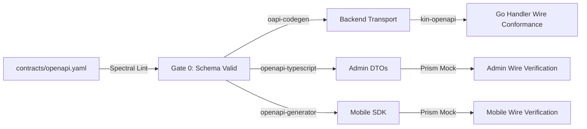
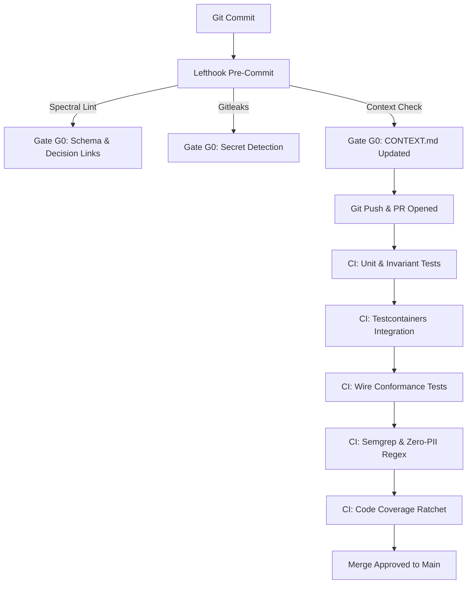

# Master Quality Assurance & Testing Strategy (QA Strategy) — Dink Machinery

**System:** Heavy Machinery & Logistics Rental Marketplace  
**Specification:** Unified Verification, Validation & Test Governance Framework  
**Compliance Standard:** ISO/IEC/IEEE 29119 (Software Testing), OWASP ASVS 4.0.3 Level 3, W3C WCAG 2.1/2.2 AA, ISO/IEC 25010  
**Subsystems Covered:** Go 1.27.3 Backend Modular Monolith, Flutter 3.47.9 Cross-Platform Mobile Client, Next.js 16.x Admin Web Console (latest CVE security patch), PostgreSQL 18.6 + PostGIS 3.6.4, Valkey 9.1.3-alpine  
**Governing Documents:** `AGENTS.md`, `TECH_STACK.md`, `CODE_STANDARDS.md`, `API_CONVENTIONS.md`, `ERROR_CATALOG.md`, `DEFINITION_OF_DONE.md`

---

## 1. Executive Summary & Quality Vision

In **Dink Machinery**, software quality is not an inspection phase tacked onto the end of a sprint; it is an active architectural invariant built into every commit, automated gate, and pull request. Because the platform coordinates the rental, dispatch, and physical handoff of high-value industrial machinery (excavators, mobile cranes, bulldozers) across multi-country jurisdictions (Ethiopia, Kenya) and processes irrevocable financial escrow settlements (Telebirr, CBEBirr, MPESA), software failures risk physical safety, legal sanctions, and irrecoverable financial loss.

### Core Quality Tenets
1. **Contract-First Precedence:** The canonical specification `contracts/openapi.yaml` dictates wire behavior. Providers and consumers are tested continuously against this specification to eliminate runtime integration drift.
2. **Absolute Mathematical Determinism:** Financial transactions, fee distributions, withholding taxes, and deposit holds execute strictly with 64-bit signed integers in currency minor units. Floating-point calculations are banned and rejected at compile and test time.
3. **In-Transaction Ledger Atomicity (`BK-17-BE`):** State transitions and double-entry ledger balancing must execute inside a single database transaction (`pgx.Tx`). Asynchronous or eventually consistent ledger updates are prohibited.
4. **Zero-PII & OWASP ASVS Level 3:** Automated static checks, dynamic tests, and logging assertions ensure personal identifiable information is never logged in plaintext or leaked in client error envelopes.
5. **Continuous Quality Ratchet:** Code coverage, latency budgets, accessibility compliance, and linting rules are strictly monotonic: tests must not regress, and code coverage can never decrease across pull requests.

---

## 2. Test Classification Pyramid & Governance

Dink Machinery organizes testing into a strict five-tier pyramid adhering to ISO/IEC/IEEE 29119. Higher tiers build upon the verified guarantees of the lower tiers.

```
                                  [Level 5: E2E Journeys]
                             Multi-Persona Cross-Subsystem
                            Patrol (Mobile) & Playwright (Admin)
                                         │
                             [Level 4: Non-Functional QA]
                         Security (ASVS L3), A11y (WCAG 2.1 AA),
                         Performance & Load Benchmarking (k6)
                                         │
                             [Level 3: Contract & Wire]
                         Kin-OpenAPI Provider Wire Conformance,
                         Prism Dynamic Mocking, Dio Interceptors
                                         │
                             [Level 2: Integration Tests]
                        Real PostgreSQL 18.6 + PostGIS & Valkey
                        via Testcontainers; Isar Local DB Tests
                                         │
                             [Level 1: Unit & Static Tests]
                        Pure Domain Invariants, BLoC State Machines,
                        Spectral OpenAPI Linting, Static Security SAST
```

### Detailed Testing Tier Matrix

| Test Level | Scope & Objective | Subsystems | Tooling & Frameworks | Execution Trigger | SLA / Target Threshold |
|---|---|---|---|---|---|
| **Level 1: Static & Linters** | Schema syntax, AST rules, secrets, formatting | All Subsystems | Spectral, `golangci-lint`, `fvm flutter analyze`, ESLint, Gitleaks | Pre-commit (`lefthook`), PR CI | 100% pass; 0 errors, 0 warnings |
| **Level 1: Pure Unit** | Domain entities, state machines, currency math | Backend, Mobile, Admin | Go `testing`, Dart `test`, Vitest | Local dev, PR CI | $\ge 80\%$ line overall; $\ge 95\%$ on financial/auth |
| **Level 2: Integration** | Repositories, DB transactions, cache locks | Backend, Mobile DB | `testcontainers-go`, `jackc/pgx/v5`, `isar` | Backend/Mobile CI | 100% pass; real Postgres + PostGIS & Valkey |
| **Level 3: Contract Wire** | Schema conformance, RFC 9457 errors | Backend, Mobile, Admin | `kin-openapi`, Prism CLI, Dio interceptor | PR CI, Staging Gate | 100% route wire conformance; 0 drift |
| **Level 4: Non-Functional** | Security, A11y, latency budgets, stress | All Subsystems | Semgrep, Axe-core, k6, Trivy | Nightly CI, Staging Release | ASVS L3 verified; P95 $< 80\text{ ms}$; WCAG AA |
| **Level 5: E2E Journeys** | Full user workflows (Rent $\rightarrow$ Inspect $\rightarrow$ Pay) | Mobile, Admin, Backend | Patrol (Flutter), Playwright (Next.js) | Staging Deployment Gate | 100% critical path pass; zero flakiness |

---

## 3. Subsystem Testing Standards

### 3.1. Go 1.27.3 Backend Modular Monolith

The backend enforces Clean Architecture with strict separation between domain, application interactors, and transport/infrastructure adapters.

```
backend/
├── internal/
│   ├── modules/<module>/
│   │   ├── domain/           # Unit tested in isolation (zero external imports, mock-free)
│   │   ├── application/      # Interactor unit tests with mocked interfaces/ports
│   │   └── infrastructure/   # Integration tested with Testcontainers (real PostgreSQL + PostGIS)
│   └── transport/http/       # Wire tested against openapi.yaml using kin-openapi
```

#### A. Domain Invariant Testing
Domain tests must verify pure business invariants without database dependencies, network calls, or third-party frameworks.
- Currency math operations must test integer boundary conditions (e.g., overflow prevention, basis point division floor rounding).
- State transitions must assert all 20 booking lifecycle states, verifying that invalid transitions return typed domain errors (e.g., `ErrInvalidStateTransition`).
- Clock determinism: Time-dependent rules (e.g., payment hold expiration) must inject the abstracted `Clock` interface.

```go
func TestBooking_ConfirmPayment_Transition(t *testing.T) {
	clock := testutils.NewFixedClock(time.Date(2026, 11, 1, 10, 0, 0, 0, time.UTC))
	booking, err := domain.NewBooking(domain.BookingParams{
		ID:        uuid.New(),
		FleetID:   uuid.New(),
		RenterID:  uuid.New(),
		DailyRate: domain.NewMoney(2500000, "ETB"), // 25,000.00 ETB
		CreatedAt: clock.Now(),
	})
	require.NoError(t, err)

	// Invariant: Cannot confirm payment on an expired hold
	clock.Advance(61 * time.Minute)
	err = booking.ConfirmPayment(clock.Now(), "txn_12345678")
	require.ErrorIs(t, err, domain.ErrBookingHoldExpired)
}
```

#### B. Integration Testing via Testcontainers (`testcontainers-go`)
Integration suites must execute against real, containerized PostgreSQL 18.6 + PostGIS 3.6.4 and Valkey 9.1.3 instances. Mocks for database drivers are prohibited.
- Migrations are applied sequentially to the testcontainer instance from `migrations/`.
- Repositories compiled by `sqlc` are exercised against the schema.
- Spatial radius queries assert accurate Euclidean/spheroidal distance filtering via PostGIS.
- Financial transactions assert the `BK-17-BE` invariant: booking confirmation and double-entry ledger writes succeed or fail together inside a single `pgx.Tx`.

```go
func TestLedger_DoubleEntry_Atomicity(t *testing.T) {
	ctx := context.Background()
	pgContainer := testutils.SetupPostgresContainer(t) // Starts Postgres 18.6 + PostGIS
	defer pgContainer.Terminate(ctx)

	pool := testutils.NewTestPool(t, pgContainer.ConnectionString())
	txManager := database.NewTxManager(pool)
	ledgerRepo := infrastructure.NewLedgerRepository(pool)

	// Assert double-entry balance check: Total credits must equal total debits
	err := txManager.Execute(ctx, func(txQueries *db.Queries) error {
		return ledgerRepo.RecordDoubleEntry(ctx, txQueries, domain.LedgerEntryPair{
			DebitAccount:  "HOLD_ESCROW_ACCOUNT",
			CreditAccount: "OWNER_WALLET_AVAILABLE",
			Amount:        domain.NewMoney(150000, "ETB"), // 1,500.00 ETB
		})
	})
	require.NoError(t, err)

	// Assert ledger immutability: Updates and deletes are rejected
	_, err = pool.Exec(ctx, "DELETE FROM financial_ledger_entries")
	require.Error(t, err, "Direct ledger deletion must trigger trigger violation")
}
```

---

### 3.2. Flutter 3.47.9 Mobile Subsystem

The mobile application tests Renter, Fleet Owner, and Field Operator user journeys using BLoC state management and local Isar persistence.

#### A. BLoC Unit & State Transition Testing (`bloc_test`)
Every BLoC must have comprehensive tests exercising all incoming Events and verifying resulting immutable State emissions.
- Network exceptions must verify that RFC 9457 Problem Details are properly mapped into localized user failure states.
- Optimistic UI updates must verify rollback when the backend returns HTTP 409 (`BOOKING_CONCURRENCY_CONFLICT`).

```dart
blocTest<BookingBloc, BookingState>(
  'emits [BookingLoading, BookingConfirmed] when PaymentConfirmedEvent succeeds',
  build: () {
    when(() => mockBookingRepository.confirmPayment(any()))
        .thenAnswer((_) async => Right(tBookingConfirmed));
    return BookingBloc(repository: mockBookingRepository);
  },
  act: (bloc) => bloc.add(const BookingEvent.confirmPayment(bookingId: 'book-123')),
  expect: () => [
    const BookingState.loading(),
    BookingState.confirmed(booking: tBookingConfirmed),
  ],
);
```

#### B. Golden UI & Accessibility Widget Tests
- **Golden Widget Tests:** Critical views (Machinery Catalog Card, Inspection Submission Form, Booking Timeline) are compared against verified pixel baselines across different screen densities.
- **Accessibility Guidelines:** Every interactive widget test enforces `androidTapTargetGuideline` ($\ge 48 \times 48\text{ dp}$), `iOSTapTargetGuideline`, and `textContrastGuideline` (`ACCESSIBILITY_QA.md`).
- **Dynamic Font Scaling:** Tests assert that layouts do not overflow when `MediaQuery.textScalerOf(context)` is set to $2.0\times$.

---

### 3.3. Next.js 16 Admin Web Console

The administrative console tests back-office operations, dispute management, dynamic table grids, and RBAC security gates.

#### A. Component & Server Action Testing (Vitest + React Testing Library)
- **Server-Driven Tables (`AD-06-BE`):** Verify that data grids render dynamic columns returned from `/api/v1/admin/ui-config`.
- **Form Schema Binding:** Validate that forms reject input locally via Zod before network dispatch, and map RFC 9457 `invalidParams` into form field errors upon backend rejection.
- **Keyboard Trapping:** Verify that modal sheets trap focus and dismiss cleanly when pressing `Escape`.

#### B. End-to-End Administrative Testing (Playwright)
Playwright executes automated browser journeys against local or staging environments:
- Super-admin logs in with multi-factor authentication (MFA).
- Operator verification queue: Admin reviews uploaded heavy equipment operator certifications and approves/rejects credentials.
- Financial dispute triage: Admin inspects contested check-out fuel readings and executes an escrow deposit release.

---

## 4. Contract, Wire & Schema Conformance Verification

To guarantee zero drift between documentation and runtime execution, API contract verification operates across every stage of the lifecycle per `API_CONTRACT_TESTING.md`.



### 4.1. Static Linting & Semantic Diffing
1. **Spectral CLI:** Validates that all endpoints define camelCase `operationId`, universal envelopes (`SuccessEnvelope` or `ErrorEnvelope`), and integer minor-unit money schemas.
2. **`oasdiff` Breaking Change Detection:** Analyzes pull requests against `origin/main` to block unapproved breaking changes (e.g., removing a property, changing an integer to a float, making an optional parameter required).

### 4.2. Runtime Provider Wire Tests (`kin-openapi`)
Backend integration tests intercept live HTTP responses emitted by Go Chi handlers and validate them against `contracts/openapi.yaml`. Tests fail if:
- An undocumented HTTP status code is returned.
- A required property in `meta` or `data` is missing.
- A floating-point number is emitted in a currency field.
- An error response deviates from the RFC 9457 specification.

---

## 5. Non-Functional Testing (Security, Performance & Accessibility)

Non-functional quality criteria are treated with the same engineering rigor as functional requirements.

### 5.1. Security Verification (OWASP ASVS Level 3)
Per `05-security-review.md`, security testing is enforced through automated static analysis and dynamic penetration checks:
- **Zero-PII Static Audit:** Automated regex scans assert that phone numbers, National IDs, TINs, and bank accounts are never printed in structured logs.
- **IDOR Access Control Tests:** Handlers verify tenant resource ownership in queries (`WHERE id = $1 AND (renter_id = $2 OR owner_id = $2)`). Integration tests verify that authenticated principals cannot access assets belonging to rival accounts.
- **Antivirus Ingress Tests:** Synthetic EICAR test strings verify that ClamAV correctly flags malicious file uploads, returning HTTP 422 (`INSPECT_MEDIA_SCAN_FAILED`).

### 5.2. Performance & Scalability Benchmarking (k6)
Per `PERFORMANCE_QA.md`, automated load tests execute against staging environments before any major version release:
- **Spatial Discovery:** 500 concurrent virtual users execute radius queries centered on high-density industrial corridors; P95 latency must remain $< 80\text{ ms}$.
- **Booking Hold Spike:** 100 concurrent requests compete for the same fleet asset; optimistic locking must cleanly allocate the hold to exactly one requester while returning HTTP 409 to competing requests without deadlocking.
- **Memory & Goroutine Leaks:** Endurance soak tests run for 60 minutes; Go heap RSS must remain stable ($\le 10\%$ drift).

### 5.3. Accessibility QA (WCAG 2.1/2.2 Level AA)
Per `ACCESSIBILITY_QA.md`:
- Mobile interfaces enforce minimum $48 \times 48\text{ dp}$ touch targets and verify screen reader semantic announcements for dynamic state transitions.
- Web admin console executes `@axe-core/playwright` audits across all routes, asserting 0 automated accessibility violations.

---

## 6. Test Data Management & Environment Strategy

### 6.1. Multi-Tier Environment Isolation

| Environment | Purpose | Persistence & Data Strategy | Ingress Gateway |
|---|---|---|---|
| **Local Dev** | Rapid iteration, unit & local integration | Local Docker Compose (Postgres, Valkey, SeaweedFS, ClamAV) | Traefik (`localhost`) |
| **CI Runner** | Deterministic automated PR verification | Ephemeral containers via `testcontainers-go` (zero shared state) | Direct loopback |
| **Staging** | End-to-end integration, performance k6 load tests | Dedicated RDS/PostgreSQL instance; seeded with 10,000 synthetic fleets | Cloud Traefik / TLS 1.3 |
| **Production** | Live operational marketplace | Multi-AZ PostgreSQL with streaming replication; encrypted backups | Edge CDN + Ingress Gateway |

### 6.2. Synthetic Test Data & Seed Invariants
1. **Zero Real PII:** Production data dumps are strictly prohibited in local, CI, or staging environments. All test data must be synthesized via deterministic seed scripts.
2. **Deterministic Geography:** Synthetic fleets and job sites are clustered around realistic geographic corridors:
   - *Corridor 1 (Addis Ababa - Adama Expressway):* Centered at $(9.0300, 38.7400)$.
   - *Corridor 2 (Nairobi - Mombasa Industrial Belt):* Centered at $(-1.2863, 36.8172)$.
3. **Multi-Country Parameter Verification:** Test datasets must seed both Ethiopia (`ET`) and Kenya (`KE`) configurations to ensure the system dynamically handles varying currencies (`ETB`, `KES`), dialing prefixes (`+251`, `+254`), and tax rates (15% vs. 16% VAT).

---

## 7. Defect Management & Severity Triage SLAs

Any defect discovered during automated testing or manual QA is tracked with a severity rating and remediation SLA.

| Severity Tier | Definition & System Impact | Example Scenarios | Remediation SLA | Release Gate Action |
|---|---|---|---|---|
| **P0: Blocker** | System-wide outage, data loss, security compromise, or financial imbalance. | Double-entry ledger does not balance; booking double-allocated; PII leaked in logs. | **Immediate (< 24h)** | Blocks all deployments; immediate hotfix. |
| **P1: Critical** | Core business workflow blocked with no workaround. | Renter cannot confirm payment; inspection photo upload fails ClamAV falsely; touch target $< 30\text{ dp}$. | **$\le 3$ Business Days** | Blocks feature partition merge. |
| **P2: Major** | Feature partially impaired, but viable workaround exists. | Search radius pagination cursor sorting glitch; minor layout shift on admin table. | **$\le 10$ Business Days** | Does not block partition; tracked in sprint. |
| **P3: Minor** | Cosmetic defect, non-blocking UI anomaly, or minor copy issue. | Misaligned table icon; minor wording improvement in screen reader announcement. | **Next release cycle** | Backlog hygiene. |

---

## 8. Continuous Integration Quality Gates (The Ratchet)

Automated quality gates are enforced on every pull request via GitHub Actions and local `lefthook` Git hooks. A failure at any gate halts the pipeline.



### Quality Gate Pass Criteria Summary
- **Gate G0 (Local Pre-Commit):** Spectral lint clean; `validate-decision-template.sh` passes; `validate-decision-links.sh` passes; `CONTEXT.md` staged.
- **Gate G1 (Unit & Integration):** 100% test pass rate with `-race`; zero database deadlocks; optimistic concurrency control validated.
- **Gate G2 (Contract & Wire):** 0 breaking API changes reported by `oasdiff`; `kin-openapi` validates 100% of tested HTTP routes.
- **Gate G3 (Security & Static QA):** Gitleaks detects 0 secrets; static regex confirms 0 unmasked PII log calls; Semgrep SAST returns 0 high/critical issues.
- **Gate G4 (Coverage Ratchet):** Overall application line coverage $\ge 80\%$; financial, payment, and authentication domain coverage $\ge 95\%$; coverage delta $\ge 0.0\%$.

---

## 9. QA Sign-Off Checklist for Release Candidates

Before any feature partition or milestone release candidate is promoted to production:

### Contract & Architecture Compliance
- [ ] Canonical `contracts/openapi.yaml` passes Spectral lint with 0 errors and 0 warnings.
- [ ] `oasdiff breaking` reports zero unapproved breaking alterations against `origin/main`.
- [ ] Code generation scripts have synchronized models across Go, Flutter, and Next.js with zero git drift.
- [ ] All architectural decisions satisfy the 5-point test and are validated via `scripts/validate-decision-links.sh`.

### Functional & Domain Verification
- [ ] Domain state machine transitions verified across all 20 booking lifecycle states.
- [ ] Double-entry ledger atomicity (`BK-17-BE`) verified in single transactions; debits and credits sum to zero minor units.
- [ ] Optimistic locking verified: concurrent mutations assert and increment `version` column.
- [ ] Soft-delete compliance (`SD-01-BE`): domain queries filter `deleted_at IS NULL`.
- [ ] Multi-country parameterization (`LOC-01-BE`): dynamic tax rates, currencies, and timeouts verified for Ethiopia and Kenya.

### Non-Functional & Operational Gates
- [ ] Zero unmasked PII logged in structured logs or leaked in RFC 9457 error details.
- [ ] Automated security scans (Gitleaks, Semgrep, Govulncheck, Trivy) pass with 0 critical/high issues.
- [ ] Performance benchmarks (k6) affirm spatial radius search latency $< 80\text{ ms}$ at P95 under 500 VUs.
- [ ] Mobile accessibility verified: $\ge 48\times 48\text{ dp}$ touch targets and layout stability at $200\%$ font scaling.
- [ ] Web accessibility verified: `@axe-core/playwright` reports 0 WCAG 2.1 AA violations.
- [ ] Operational tracking synchronized: `CONTEXT.md` committed atomically with release artifacts.