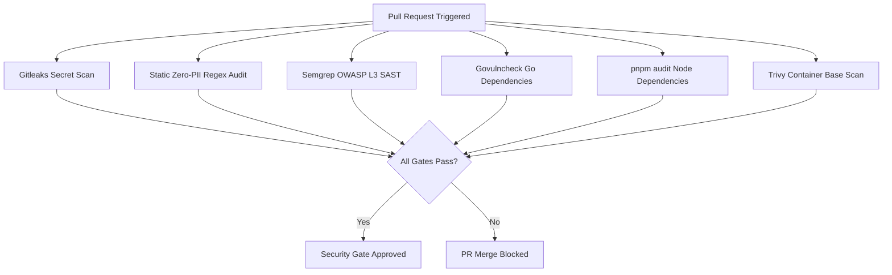

# Security Quality Assurance (Security QA) & ASVS Level 3 Audit Specification — Dink Machinery

**System:** Heavy Machinery & Logistics Rental Marketplace  
**Specification:** Security Verification, Threat Modeling, Cryptographic Controls & Vulnerability Governance  
**Compliance Standard:** OWASP Application Security Verification Standard (ASVS) 4.0.3 Level 3 (High-Assurance / Critical Infrastructure)  
**Target Subsystems:** Go 1.27.3 Backend Modular Monolith, Flutter 3.47.9 Mobile Client, Next.js 16.x Admin Web Console (latest CVE security patch), PostgreSQL 18.6 + PostGIS 3.6.4, Valkey 9.1.3-alpine, SeaweedFS S3, ClamAV Antivirus  
**Governing Documents:** `AGENTS.md`, `TECH_STACK.md`, `CODE_STANDARDS.md`, `API_CONVENTIONS.md`, `ERROR_CATALOG.md`, `DEFINITION_OF_DONE.md`, `docs/AI_TASKS/05-security-review.md`

---

## 1. Executive Summary & Security Assurance Invariants

In **Dink Machinery**, security is an inviolable architectural property directly tied to operational safety and financial integrity. The platform brokers contracts for high-tonnage industrial assets (excavators, mobile cranes, concrete pumpers), manages remote operator dispatches across multi-country corridors (Ethiopia, Kenya), and executes automated escrow disbursements across national payment rails (Telebirr, CBEBirr, MPESA).

Because compromised access can lead to equipment theft, fraudulent escrow drainage, or physical industrial harm, the entire architecture enforces **OWASP ASVS 4.0.3 Level 3**.

### Core Security Assurance Invariants
1. **Zero-Trust Identity & Session Boundaries:** Every incoming HTTP interaction requires cryptographically verified identity, short-lived JWTs (900-second maximum lifespan), single-use rotating refresh tokens stored in Valkey, and strict RBAC authorization assertions.
2. **Zero PII Exposure (Storage & Wire):** Personally Identifiable Information (customer telephone numbers, National IDs / Kebele cards, Tax Identification Numbers, bank account tokens) must be encrypted at rest using AES-256-GCM, masked in all logging layers, and omitted from error responses.
3. **Double-Entry Financial Immutability (`BK-17-BE`):** Escrow holds, fees, commissions, and disbursements must balance to zero minor units inside an isolated database transaction (`pgx.Tx`). Asynchronous or single-legged financial writes are strictly rejected.
4. **Idempotency Replay Immunity:** Mutating endpoints require unique `Idempotency-Key` headers. Cached cryptographic hashes in Valkey prevent network race conditions, duplicate charges, or double-allocations.
5. **Synchronous Antivirus Media Ingress:** Machinery inspection photographs, operator certifications, and title deeds stream through an isolated ClamAV daemon (`tcp://clamav:3310`) prior to permanent S3 persistence. Any infected or malformed stream is rejected immediately with HTTP 422.

---

## 2. Threat Modeling & STRIDE Attack Surface Analysis

The system threat model analyzes threats across the physical-digital boundary, including equipment hijacking, payment rail spoofing, and inspection tampering.

```
                              Dink Machinery Threat Landscape
                                             │
      ┌──────────────────────┬───────────────┴───────────────┬──────────────────────┐
      ▼                      ▼                               ▼                      ▼
[Spoofing & Identity]   [Tampering & State]             [Information Leakage]   [Elevation & Escrow]
 - SIM-Swap / OTP Race   - GPS Coordinates Manipulation  - PII in Application    - IDOR across Fleet
 - Replayed Webhooks     - Meter Hours Rollback            Logs or Telemetry       Tenant Boundaries
 - Fake Operator Certs   - Direct SQL Param Hijacking    - Stack Traces in RFC   - Double-Spend Escrow
                                                           9457 Error Details      Drain via Race Cond.
```

### STRIDE Assessment Matrix

| Threat Category | Attack Vector & Target | Vulnerability & System Impact | Enforced Architectural Countermeasure |
|---|---|---|---|
| **Spoofing** | Telebirr / CBEBirr / MPESA payment notification webhooks. | Attacker replays fake payment confirmations to force-confirm bookings without funds transfer. | HMAC-SHA256 signature verification over raw request payload; replay window check ($\Delta t \le 300\text{s}$); provider IP allowlisting. |
| **Spoofing** | Equipment operator identity impersonation. | Uncertified operator uses borrowed credentials to operate high-tonnage mobile cranes. | Hardware-bound WebAuthn / FIDO2 authentication; photo match verification against certified registry. |
| **Tampering** | Check-out equipment inspection meter rollback. | Renter rolls back operating hours meter to evade excess engine hour surcharges. | Cryptographic hash chaining on sequential meter logs; regression checks (`INSPECT_METER_REGRESSION`); EXIF geolocation validation. |
| **Tampering** | Concurrent booking hold race condition. | Competing users issue concurrent booking requests to double-book an excavator. | Valkey distributed lock (`SET resource NX EX 30`) coupled with PostgreSQL row versioning (`OCC: version = version + 1`). |
| **Repudiation** | Equipment owner denies receiving rental disbursement. | Owner claims funds were diverted or never authorized by platform. | Immutable double-entry financial ledger records in `financial_ledger_entries` with cryptographic audit trails. |
| **Information Disclosure** | Application logs and error payloads exposing customer PII. | Server crashes expose phone numbers, National IDs, or internal SQL schema details. | Centralized zap log-masking interceptor; RFC 9457 error abstraction emitting only generic `SYS_INTERNAL_ERROR` externally. |
| **Denial of Service** | Geospatial radius search query saturation. | Attacker bombards coordinate bounding boxes with massive radii, consuming database CPU. | Hard-capped radius boundary ($1\text{ km} \le r \le 500\text{ km}$); Redis rate-limiting (100 req/min per IP/token); PostGIS GiST index. |
| **Elevation of Privilege** | Insecure Direct Object Reference (IDOR) on rental contracts. | Malicious renter alters another tenant's booking or downloads private fleet inspections. | Tenant ownership verification enforced directly within SQL statements (`WHERE id = $1 AND (renter_id = $2 OR owner_id = $2)`). |

---

## 3. OWASP ASVS Level 3 Detailed Control Specifications

---

### V2: Authentication & Credential Management
- **V2.1 OTP Verification Hardening:**
  - One-Time Passwords (OTP) are cryptographically generated 6-digit numeric tokens using `crypto/rand`.
  - Challenge lifespan: strictly 120 seconds.
  - Attempt throttle: Maximum 5 attempts per challenge. Exceeding 5 attempts immediately destroys the challenge session and applies a 15-minute cool-down (`AUTH_OTP_MAX_ATTEMPTS`).
- **V2.2 Asymmetric Token Lifecycle:**
  - **Access Tokens:** Signed via ECDSA with curve P-256 and SHA-256 (ES256) or HMAC-SHA256 with cryptographically generated 256-bit secrets. Maximum TTL: 900 seconds (15 minutes).
  - **Refresh Tokens:** Opaque, high-entropy 256-bit tokens stored in Valkey with single-use rotation semantics. Attempted replay of an already-used refresh token revokes the entire token family immediately.
- **V2.3 Hardware & Storage Isolation:**
  - Mobile: Refresh tokens reside exclusively in `flutter_secure_storage` (iOS Keychain / Android EncryptedSharedPreferences).
  - Admin Web: Tokens are stored exclusively in `HttpOnly`, `Secure`, `SameSite=Strict` cookies. Tokens are never accessible to client-side JavaScript or written to `localStorage`.

---

### V4: Access Control & Anti-IDOR Engineering
- **V4.1 Row-Level Tenant Isolation:**
  - Handlers must never perform state updates or detail fetches based solely on URI primary keys. The authenticated principal ID must be bound directly into the query predicates:
    ```sql
    -- VULNERABLE TO IDOR:
    -- UPDATE bookings SET status = $1 WHERE id = $2;

    -- ASVS L3 COMPLIANT:
    UPDATE bookings 
    SET status = $1, version = version + 1, updated_at = NOW()
    WHERE id = $2 
      AND (renter_id = $3 OR fleet_owner_id = $3)
      AND version = $4;
    ```
- **V4.2 Role-Based Access Control (RBAC):**
  - Roles (`RENTER`, `OWNER`, `OPERATOR`, `DISPUTE_ADMIN`, `SUPER_ADMIN`) are evaluated at the transport router level via Chi middleware.
  - Administrative routes under `/api/v1/admin/*` require verified claims:
    ```go
    func RequireAdminClaim(requiredRole string) func(http.Handler) http.Handler {
        return func(next http.Handler) http.Handler {
            return http.HandlerFunc(func(w http.ResponseWriter, r *http.Request) {
                claims := auth.ExtractClaims(r.Context())
                if !claims.HasRole(requiredRole) {
                    renderProblem(w, r, domain.ErrUnauthorizedOverride)
                    return
                }
                next.ServeHTTP(w, r)
            })
        }
    }
    ```

---

### V5: Validation, Sanitization & Input Boundaries
- **V5.1 Strict Compile-Time Schema Validation:**
  - All incoming HTTP request payloads are decoded into strict structs generated via `oapi-codegen` and validated against field-level constraints using `go-playground/validator/v10`.
  - Disallowed or unknown JSON attributes in request bodies are rejected by the decoder (`DisallowUnknownFields()`).
- **V5.2 Parameterized SQL Execution:**
  - Dynamic SQL assembly, string interpolation, and unescaped concatenation are prohibited.
  - All queries are compiled to type-safe Go structs via `sqlc` with native PostgreSQL binary parameters (`$1, $2`).
- **V5.3 Antivirus & Media Streaming Pipeline:**
  - Permitted file upload MIME types: `image/jpeg`, `image/png`, `image/webp`, `application/pdf`.
  - File size ceiling: 15 MB per upload.
  - Files are streamed through ClamAV (`clamd`) daemon before writing to SeaweedFS S3:
    ```text
    Client HTTP Stream ---> Backend Buffer ---> ClamAV Daemon (TCP 3310)
                                                    │
                                   ┌────────────────┴────────────────┐
                                   ▼ Clean                           ▼ Infected
                            SeaweedFS S3 Upload             Immediate File Deletion
                           (AES-256 Encrypted)             Emit HTTP 422 Error
    ```

---

### V6: Cryptography at Rest & In Transit
- **V6.1 Transport Layer Security (TLS):**
  - External ingress terminated via Traefik 3.x using TLS 1.3 exclusively. TLS 1.0, 1.1, and 1.2 legacy cipher suites are disabled.
  - HSTS header enforced: `Strict-Transport-Security: max-age=63072000; includeSubDomains; preload`.
- **V6.2 Envelope Encryption for Sensitive PII:**
  - Sensitive columns (National ID / Kebele card number, TIN, bank routing credentials) are encrypted before insertion using AES-256-GCM.
  - Nonce generation: Each encryption operation uses a cryptographically secure, unique 12-byte initialization vector (`crypto/rand`). Static or reused nonces are prohibited.

---

### V8: Data Protection & Zero-PII Invariant
- **V8.1 Zero-PII Structured Logging:**
  - Structured logs produced via `go.uber.org/zap` utilize a custom Core masking interceptor.
  - Field patterns containing names such as `phone`, `telephone`, `tin`, `national_id`, `kebele_id`, `account_number`, or `password` are automatically redacted before stream output:
    ```text
    +251911223344   ===>   +251911****44
    0012345678      ===>   TIN: *****5678
    1000123456789   ===>   ACC: *******6789
    ```
- **V8.2 Client Error Sanitization:**
  - The API layer maps internal system errors to canonical RFC 9457 error envelopes defined in `ERROR_CATALOG.md`.
  - Database error messages (`pq: duplicate key value violates unique constraint`), table names, internal IP addresses, and runtime panics must never be exposed to clients.

---

## 4. Automated Security Tooling Matrix

Every commit and pull request must clear the automated security gate suite. A failure in any tool halts the CI/CD pipeline immediately.



| Security Scanner | Inspection Target | Execution Trigger | Gate Failure Criteria |
|---|---|---|---|
| **Gitleaks** | Repository commit history & staged diffs | Pre-commit (`lefthook`), PR CI | $\ge 1$ leaked secret, private key, or credential. |
| **Static Zero-PII Audit** | Application code (`backend/`, `mobile/`, `admin/`) | Pre-commit (`lefthook`), PR CI | $\ge 1$ unmasked logging statement targeting sensitive attributes. |
| **Semgrep SAST** | Go & TypeScript source code | PR CI, Nightly | $\ge 1$ finding matching OWASP Top 10 or Go security rulesets. |
| **Govulncheck** | Go module dependency call-tree | PR CI, Nightly | Known CVEs with reachable call-paths in platform binaries. |
| **pnpm audit** | Admin console dependency tree | PR CI, Nightly | $\ge 1$ vulnerability with severity High or Critical. |
| **Trivy** | Container images (`dink-backend`, `dink-admin`) | Staging build, CD pipeline | $\ge 1$ Critical OS-level package vulnerability. |
| **Spectral CLI** | `contracts/openapi.yaml` | Pre-commit (`lefthook`), PR CI | Any violation of RFC 9457 schemas or floating-point currency fields. |

---

## 5. Security Integration Tests (Executable Suites)

The following automated test suites are executed in CI using real containerized infrastructure (`testcontainers-go`).

### 5.1. Tenant Isolation & IDOR Access Control Test (`backend/internal/modules/booking/infrastructure/idor_security_test.go`)
```go
package infrastructure_test

import (
	"context"
	"testing"
	"time"

	"[github.com/google/uuid](https://github.com/google/uuid)"
	"[github.com/stretchr/testify/require](https://github.com/stretchr/testify/require)"
	"[github.com/dinkmachinery/dink-core/internal/modules/booking/domain](https://github.com/dinkmachinery/dink-core/internal/modules/booking/domain)"
	"[github.com/dinkmachinery/dink-core/internal/platform/database](https://github.com/dinkmachinery/dink-core/internal/platform/database)"
	"[github.com/dinkmachinery/dink-core/internal/testutils](https://github.com/dinkmachinery/dink-core/internal/testutils)"
)

func TestBookingRepository_PreventIDOR_CrossTenantAccess(t *testing.T) {
	ctx := context.Background()
	pgContainer := testutils.SetupPostgresContainer(t)
	defer pgContainer.Terminate(ctx)

	pool := testutils.NewTestPool(t, pgContainer.ConnectionString())
	repo := testutils.NewBookingRepository(pool)

	legitimateRenterID := uuid.New()
	attackerRenterID := uuid.New()
	fleetOwnerID := uuid.New()

	// 1. Establish existing booking owned by legitimateRenterID
	bookingID := uuid.New()
	err := repo.CreateBooking(ctx, domain.Booking{
		ID:           bookingID,
		RenterID:     legitimateRenterID,
		FleetOwnerID: fleetOwnerID,
		Status:       domain.BookingStatusPaymentPending,
		Version:      1,
		CreatedAt:    time.Now().UTC(),
	})
	require.NoError(t, err)

	// 2. Attacker attempts to update booking status
	err = repo.UpdateBookingStatus(ctx, bookingID, attackerRenterID, domain.BookingStatusCancelled, 1)
	
	// 3. Must fail with domain.ErrBookingNotFound to avoid leaking resource existence
	require.ErrorIs(t, err, domain.ErrBookingNotFound, "Attacker must not be able to mutate another tenant's booking")

	// 4. Verify in DB that status remains untouched
	savedBooking, err := repo.GetBookingByID(ctx, bookingID, legitimateRenterID)
	require.NoError(t, err)
	require.Equal(t, domain.BookingStatusPaymentPending, savedBooking.Status)
	require.Equal(t, 1, savedBooking.Version)
}
```

### 5.2. Escrow Double-Spend & Concurrency Race Test (`backend/internal/modules/payment/infrastructure/escrow_race_test.go`)
```go
package infrastructure_test

import (
	"context"
	"sync"
	"testing"

	"[github.com/google/uuid](https://github.com/google/uuid)"
	"[github.com/stretchr/testify/require](https://github.com/stretchr/testify/require)"
	"[github.com/dinkmachinery/dink-core/internal/modules/payment/domain](https://github.com/dinkmachinery/dink-core/internal/modules/payment/domain)"
	"[github.com/dinkmachinery/dink-core/internal/testutils](https://github.com/dinkmachinery/dink-core/internal/testutils)"
)

func TestEscrowService_PreventConcurrentDoubleSpend(t *testing.T) {
	ctx := context.Background()
	pgContainer := testutils.SetupPostgresContainer(t)
	defer pgContainer.Terminate(ctx)

	pool := testutils.NewTestPool(t, pgContainer.ConnectionString())
	escrowService := testutils.NewEscrowService(pool)

	ownerID := uuid.New()
	initialDeposit := domain.NewMoney(500000, "ETB") // 5,000.00 ETB deposit hold

	err := escrowService.InitializeEscrowHold(ctx, ownerID, initialDeposit)
	require.NoError(t, err)

	// Attempt 10 simultaneous release transactions of the same escrow hold
	concurrencyLimit := 10
	var wg sync.WaitGroup
	successCount := 0
	conflictCount := 0
	var mu sync.Mutex

	for i := 0; i < concurrencyLimit; i++ {
		wg.Add(1)
		go func() {
			defer wg.Done()
			err := escrowService.ReleaseEscrowDeposit(ctx, ownerID, initialDeposit)
			mu.Lock()
			defer mu.Unlock()
			if err == nil {
				successCount++
			} else {
				conflictCount++
			}
		}()
	}

	wg.Wait()

	// Invariant: Exactly one release transaction must succeed; all others must abort
	require.Equal(t, 1, successCount, "Exactly one release transaction must succeed")
	require.Equal(t, concurrencyLimit-1, conflictCount, "All other concurrent attempts must fail")

	// Assert ledger balance remains exactly zero sum
	imbalance, err := escrowService.AuditLedgerImbalance(ctx, ownerID)
	require.NoError(t, err)
	require.Equal(t, int64(0), imbalance, "Financial ledger must balance to exactly zero")
}
```

### 5.3. Antivirus ClamAV Malicious Upload Rejection Test (`backend/internal/transport/http/media_scan_test.go`)
```go
package http_test

import (
	"bytes"
	"mime/multipart"
	"net/http"
	"net/http/httptest"
	"testing"

	"[github.com/stretchr/testify/require](https://github.com/stretchr/testify/require)"
	"[github.com/dinkmachinery/dink-core/internal/testutils](https://github.com/dinkmachinery/dink-core/internal/testutils)"
)

func TestInspectionMediaUpload_RejectMalwarePayload(t *testing.T) {
	// Standard EICAR Standard Anti-Virus Test File
	eicarPayload := []byte(`X5O!P%@AP[4\PZX54(P^)7CC)7}$EICAR-STANDARD-ANTIVIRUS-TEST-FILE!$H+H*`)

	body := &bytes.Buffer{}
	writer := multipart.NewWriter(body)
	part, err := writer.CreateFormFile("file", "inspection_damage_photo.jpg")
	require.NoError(t, err)
	_, err = part.Write(eicarPayload)
	require.NoError(t, err)
	require.NoError(t, writer.Close())

	req := httptest.NewRequest(http.MethodPost, "/api/v1/inspections/media/upload", body)
	req.Header.Set("Content-Type", writer.FormDataContentType())
	req.Header.Set("Authorization", "Bearer valid_operator_jwt")

	w := httptest.NewRecorder()
	handler := testutils.SetupMediaUploadHandler(t) // Configured with ClamAV test daemon
	handler.ServeHTTP(w, req)

	// Invariant: Must reject file with 422 Unprocessable Entity
	require.Equal(t, http.StatusUnprocessableEntity, w.Code)
	require.Contains(t, w.Body.String(), "INSPECT_MEDIA_SCAN_FAILED")
}
```

---

## 6. Vulnerability Severity Triage, CVSS Scoring & Remediation SLAs

Identified security defects are prioritized under the Common Vulnerability Scoring System (CVSS v3.1). Remediation timeframes are strictly enforced; unresolved vulnerabilities reaching the SLA limit trigger an automatic deployment freeze.

| Severity Tier | CVSS v3.1 Score | Operational Examples | Remediation SLA | Deployment & Escalation Procedure |
|---|---|---|---|---|
| **Critical** | `9.0 - 10.0` | Double-spend escrow exploit; unauthenticated remote code execution; SQL injection in public routes; hardcoded production private keys. | **$< 24\text{ Hours}$** | Emergency P0 hotfix; immediate deployment bypassing sprint cadence; daily executive updates. |
| **High** | `7.0 - 8.9` | Tenant-to-tenant IDOR accessing competitor fleets; unmasked customer telephone numbers in server logs; OTP bypass via race condition. | **$\le 7\text{ Calendar Days}$** | Fast-tracked PR; mandatory verification drill by Security Lead before merge. |
| **Medium** | `4.0 - 6.9` | Ingress rate-limit bypass; minor information disclosure (e.g., verbose server banner); missing HSTS preload tag. | **$\le 30\text{ Calendar Days}$** | Scheduled into active sprint backlog; verified in standard QA cycle. |
| **Low** | `0.1 - 3.9` | Non-exploitable stack trace in internal administrative debug route; minor TLS configuration advisory. | **$\le 90\text{ Calendar Days}$** | Backlog hygiene and routine dependency maintenance. |

---

## 7. Penetration Testing & Adversarial Red Team Drills

Automated testing is supplemented with bi-annual external penetration testing and internal red-team simulations focusing on high-risk domain threats.

### 7.1. Penetration Testing Scope
1. **Financial Rail Boundaries:** Webhook forgery against Telebirr, CBEBirr, and MPESA; simulated network latency injections during escrow holds.
2. **Geospatial & GPS Deception:** Spoofed client location headers; falsified site check-in coordinates aimed at bypassing geofenced machinery locks.
3. **Physical-Digital Inspection Handover:** Injection of manipulated EXIF metadata on inspection media; bypass attempts against the ClamAV scanning daemon.
4. **Tenant Isolation:** Cross-tenant access attempts simulating malicious contractors attempting to view pricing tiers and contracts of competitors.

---

## 8. Security Quality Gate Checklist & Attestation

Before any feature partition or milestone release candidate receives production clearance, the following security checklist must be satisfied:

### Identity, Authentication & Sessions
- [ ] No hardcoded passwords, private keys, API secrets, or credentials exist in the codebase or Git history (`gitleaks detect` clean).
- [ ] OTP challenges enforce 120-second timeout, 5-attempt limit, and 15-minute lockout upon failure.
- [ ] Access tokens use short-lived TTL ($\le 900\text{ s}$); refresh tokens implement single-use rotation in Valkey.
- [ ] Refresh tokens reside in `flutter_secure_storage` (mobile) or `HttpOnly; Secure; SameSite=Strict` cookies (admin).

### Authorization & State Integrity
- [ ] All database queries bind user/tenant IDs to eliminate Insecure Direct Object References (IDOR).
- [ ] All state mutations enforce Optimistic Concurrency Control (`WHERE id = $1 AND version = $2`).
- [ ] Double-entry ledger updates (`financial_ledger_entries`) execute within atomic `pgx.Tx` blocks and balance to zero minor units (`BK-17-BE`).
- [ ] Mutating endpoints require, validate, and cache `Idempotency-Key` headers.

### Data Protection & Cryptography
- [ ] Customer PII attributes (National ID, TIN, bank accounts) are encrypted at rest with AES-256-GCM.
- [ ] Zero-PII logging verified: structured logs pass through zap masking interceptors; regex audit reports 0 unmasked occurrences.
- [ ] External network traffic is terminated with TLS 1.3 exclusively with HSTS preloading enabled.
- [ ] Client error responses strictly adhere to RFC 9457 Problem Details; zero stack traces, SQL syntax, or internal driver states are exposed.

### Media & Ingress Sanitization
- [ ] File uploads stream through ClamAV antivirus inspection prior to permanent S3 storage.
- [ ] File size ceiling is enforced ($15\text{ MB}$ max); MIME types are restricted to approved formats.
- [ ] All SQL queries are compiled with `sqlc` using native binary parameter binding ($1, $2); zero dynamic string concatenation.

### Automated Tooling & Audit Clearance
- [ ] `semgrep` SAST reports 0 high or critical security violations.
- [ ] `govulncheck` reports 0 reachable vulnerabilities in Go binaries.
- [ ] `pnpm audit --audit-level=high` reports 0 vulnerabilities in the administrative console.
- [ ] `trivy` container scanning reports 0 unfixed high or critical vulnerabilities in base images.