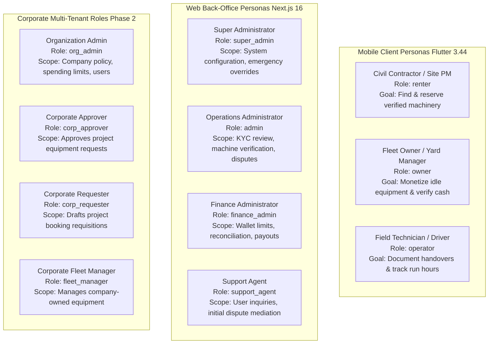

# Heavy Machinery & Logistics Rental Aggregator — Dink Machinery
## Architecture Specification — 01. Introduction (`docs/shared/architecture/01-introduction.md`)

**Document Identifier:** `ARCH-INTRO-DINK-CORE-V7.0`  
**Classification:** Canonical Architecture Specification & Engineering Reference (Single Source of Truth)  
**Governing Documents:** `SRS-DINK-CORE-V7.0` (Parts 1–5), `FLOW-DINK-CORE-V7.0`, `UIUX-DINK-CORE-V7.0`, `contracts/openapi.yaml`  
**Target Runtimes:** Go 1.27.3 Modular Monolith, Flutter 3.44 Cross-Platform Mobile Client, Next.js 16 Admin Web Console, PostgreSQL 18.4 + PostGIS 3.4, Valkey 8.0-alpine, SeaweedFS S3, ClamAV Daemon  
**Target Markets:** Ethiopia (`ET`) & Kenya (`KE`) — Dynamic Multi-Country Parameterization (`LOC-01-BE`)  
**Compliance Standards:** OWASP ASVS 4.0.3 Level 3, RFC 9457 (Problem Details), W3C WCAG 2.2 AA / AAA (Outdoor Mode), ISO/IEC/IEEE 42010, ISO 4217, ISO 3166-1 alpha-2  
**Status:** Approved Engineering Baseline

---

## 1. Executive Summary & Platform Purpose

The Dink Machinery software ecosystem operates as an enterprise-grade digital marketplace and logistics aggregation platform engineered specifically for the heavy civil engineering, infrastructure, and agricultural equipment sectors in East Africa (Ethiopia and Kenya).

In developing African markets, heavy equipment utilization remains inefficient due to fragmented asset ownership, offline brokerage monopolies, opaque pricing structures, high logistical transport costs, and reliance on unverified physical paper receipts. Dink Machinery eliminates these friction points by providing:
* **Spheroidal Geospatial Discovery:** Bounded radius and corridor searches over PostGIS 3.4 indexes that locate certified equipment within defined project vicinities.
* **Dynamic Technical Specification Taxonomy:** Category-driven Entity-Attribute-Value (EAV) schemas handling mechanical parameters (operating weight, hydraulic flow, boom reach, cabin safety certifications) without requiring database schema redeployments.
* **The Canonical 20-State Booking Machine:** A deterministic finite state machine backed by distributed 60-minute mutual exclusion holds in Valkey and optimistic concurrency control (OCC) in PostgreSQL.
* **Direct Transfer Settlement Rail (`MANUAL_TRANSFER`):** Direct peer-to-peer commercial bank wire transfers paired with cryptographic image verification and an owner-funded wallet commission model (`OwnerWallet`).
* **Field-Ready Equipment Inspection Workflows:** Camera-enforced, tamper-evident pre-rental and post-rental inspection steppers enforcing non-regression of monotonic engine hour meters, digital condition checklists, and glass touch attestations.
* **Integrated Heavy Logistics Transport:** Treating heavy lowboy trailers, flatbeds, and crane trucks as first-class catalog entities and linked sub-bookings with automated bidirectional cancellation cascades.
* **High-Density Server-Driven Admin Console:** Next.js 16 back-office interface compiling dynamic data tables, visual photo diff lightboxes, and role-based action controls directly from backend metadata.

---

## 2. Business Goals & Strategic Market Context

### 2.1 Core Value Proposition

| Stakeholder Persona | Strategic Business Value | Measurable Operational Outcome |
|---|---|---|
| **Civil Contractors (Renters)** | Single pane of glass to discover, compare, and reserve verified heavy machinery with guaranteed physical site staging. | Reduces equipment sourcing lead time from an average of 5–7 days down to under 2 hours. |
| **Fleet Owners & Yards** | Monetizes idle capital machinery across regional corridors, automates operator assignment, and provides transparent billing proof. | Increases fleet utilization rates from ~35% up to ~75% across active construction seasons. |
| **Field Operators** | Verifies machine operating condition before mobilization, tracks job site hours transparently, and reduces liability disputes. | Eliminates undocumented handover condition claims through immutable pre/post inspection records. |
| **Platform Enterprise** | Scalable, asset-light marketplace collecting automated commission basis points on confirmed rental volume. | Generates recurring revenue with zero capital depreciation or physical asset maintenance overhead. |

### 2.2 Regional Market Fit (Ethiopia & Kenya)

1. **Banking & Settlement Dynamics:** While digital mobile money (Telebirr, CBE Birr, M-Pesa) is growing rapidly, high-value commercial construction rentals ($50,000\text{–}1,000,000+\text{ ETB}$) settle predominantly via direct interbank transfers (Commercial Bank of Ethiopia, Awash Bank, Dashen Bank). The architecture makes the manual direct settlement flow (`MANUAL_TRANSFER`) a first-class, permanent citizen, pairing it with pluggable online payment adapters (`GATEWAY`).
2. **Logistics Bottlenecks:** Heavy tracked machinery (e.g., 30-ton crawler excavators, bulldozers) cannot legally or mechanically transit paved roads. Every heavy rental requires heavy mobilization. Dink Machinery treats logistics carriers as synchronized sub-bookings linked directly to host machine reservations.
3. **Environmental & Telecommunications Constraints:** Construction corridors, quarry pits, and rural road networks frequently lack stable LTE/4G connectivity and experience direct ambient sunlight exceeding $80,000\text{ lux}$. The client applications implement offline-first NoSQL outboxes (Isar), background photo compression isolates, and an outdoor high-contrast theme meeting WCAG 2.2 AAA.
4. **Linguistic Diversity & Script Ergonomics:** The platform serves multi-script populations. All user-facing strings are dynamically translated via ICU MessageFormat, supporting English, Amharic (`am`), Afaan Oromoo (`om`), Tigrinya (`ti`), Somali (`so`), and Swahili (`sw`). Non-Latin Ethiopic typography is delivered over-the-air (OTA) to prevent application bundle inflation.

---

## 3. Scope & Phasing Roadmap

```text
+-----------------------------------------------------------------------------------+
|  PHASE 1: MVP FOUNDATION (Active Implementation Baseline)                          |
|  - Individual Renter, Owner, and Field Operator Accounts                          |
|  - Passwordless Phone OTP Challenges via Localized Telco SMS Gateways             |
|  - Pluggable Identity Adapter Framework (Fayda National ID Reference Client)     |
|  - Dynamic Category EAV Specification Engine with GIN Indexing                    |
|  - PostGIS 3.4 Spheroidal Radius Discovery & Keyset Cursor Pagination             |
|  - 20-State Rental Booking State Machine with 60-Minute Valkey Mutex Holds        |
|  - Direct Commercial Transfer Settlement (MANUAL_TRANSFER) + Evidence Verification|
|  - Pre-Funded OwnerWallet Commission Debit Architecture (BK-17-BE)                |
|  - Joint Handover Inspection Stepper (Monotonic Hour Meters & ClamAV Scan)        |
|  - Logistics Sub-Booking Allocation with Bidirectional Cascade Cancellation       |
|  - Tri-Party Dispute Arbitration Center with 3-Business-Day SLA Escalation Cron   |
|  - Dynamic Server-Driven Next.js 16 Admin Console (/api/v1/admin/ui-config)       |
|  - Multilingual Dynamic OTA Typography Engine (ADR-013)                           |
+-----------------------------------------------------------------------------------+
                                          |
                                          v
+-----------------------------------------------------------------------------------+
|  PHASE 2: CORPORATE & MULTI-TENANT ACCOUNTS                                       |
|  - Organizational Accounts with Master Tax Identification Numbers (TIN)           |
|  - Multi-Member Corporate Hierarchies (Org Admin, Requester, Approver, Manager)   |
|  - Dynamic Spending Limits & Multi-Stage Quorum Approvals (Unanimous, Majority)   |
|  - Negotiated Corporate Discount Agreements & Contract Day Rates                  |
|  - Corporate Credit Accounts with Configurable Utilization Bounds (Net 30/60)     |
|  - Purchase Order (PO) Balance Ledgering & Document Ingestion                     |
+-----------------------------------------------------------------------------------+
                                          |
                                          v
+-----------------------------------------------------------------------------------+
|  PHASE 3: ADVANCED MARKET EXTENSIONS & IOT TELEMATICS                             |
|  - Automated In-App Payment Gateway Splits (PLATFORM_HELD Custody Model)          |
|  - Direct CAN-bus / MQTT IoT Hardware Telematics Ingestion                        |
|  - AI-Driven Regional Demand Surge Pricing Recommendations                        |
|  - Independent Operator Marketplace & Freelance Driver Scheduling                 |
|  - Developer Public API Gateway with Cryptographic API Keys & Deprecation Sunsets |
|  - Multi-Region Active-Active Relational Replication                              |
+-----------------------------------------------------------------------------------+
```

---

## 4. Stakeholder Roles & Persona Directory



### Detailed Persona Profiles

* **Equipment Renter (`renter`):** Civil contractors, site project managers, and individual builders seeking to lease earthmoving, lifting, hauling, or compaction machinery. Interacts via mobile to filter equipment by technical parameters, acquire 60-minute reservation holds, transfer funds directly to owner bank accounts, and counter-sign handover attestations.
* **Fleet Owner (`owner`):** Independent equipment owners, construction firms with idle inventory, and commercial rental yards. Operates mobile dashboards to list machines, define pricing, configure cancellation rules, assign certified operators, verify bank receipts, and top up pre-funded `OwnerWallet` balances.
* **Field Operator (`operator`):** Certified heavy equipment drivers assigned to machinery. Uses mobile devices on job sites to complete mandatory pre-rental and post-rental inspection forms, input physical hour meters, capture condition photographs, and stream 30-second GPS telematics during operations.
* **Super Administrator (`super_admin`):** Platform governance officers holding complete administrative authority. Manages RBAC permission matrices, edits dynamic category specifications, publishes over-the-air translation catalogs, and exercises forced state overrides (`bookings:override`) during deadlock conditions.
* **Operations Administrator (`admin`):** Back-office compliance and operations staff reviewing new owner KYC trade documents, verifying machinery specifications, monitoring active rental incidents, and issuing binding dispute resolutions.
* **Finance Administrator (`finance_admin`):** Accounting officers overseeing manual wallet top-up approvals, managing credit limits, executing daily bank statement reconciliations, and auditing platform commission earnings.
* **Support Agent (`support_agent`):** Front-line operational staff managing incoming user inquiries and triaging tri-party dispute communication channels.

---

## 5. Non-Negotiable System Invariants

Every technical implementation across the Go backend, Flutter client, Next.js web console, and PostgreSQL persistence layer must strictly adhere to nine core architectural invariants:

### Invariant 1: Contract Supremacy
The wire format, endpoints, HTTP status codes, and error schemas are governed exclusively by `contracts/openapi.yaml`. Manual DTO modifications on client or server that diverge from the canonical specification are blocked by automated CI contract linters (`kin-openapi`).

### Invariant 2: Strict Integer Minor-Unit Currency Representation
Floating-point arithmetic for currency is strictly prohibited. All monetary values across API models, Go structs, and database tables are represented as 64-bit signed integers (`int64` / `BIGINT`) denominated in minor currency units (Santims for `ETB`, Cents for `KES` and `USD`) paired with an ISO 4217 currency code.

### Invariant 3: Atomic In-Transaction Ledger Posting (`BK-17-BE`)
Every financial state transition mutating balances must write double-entry balanced journal entries into `financial_ledger_entries` inside the same database transaction (`pgx.Tx`) that mutates the operational domain entity. The algebraic sum of debits and credits within any transaction must balance to zero minor units.

### Invariant 4: Optimistic Concurrency Control (OCC)
All mutable stateful entities (`bookings`, `fleets`, `owner_wallets`, `booking_inspections`) maintain a `version INT NOT NULL DEFAULT 1` column. Every SQL update must assert the existing version:
```sql
UPDATE bookings 
SET status = $1, version = version + 1 
WHERE id = $2 AND version = $3;
```
If zero rows are updated, the operation aborts immediately and returns HTTP 409 Conflict (`CONCURRENT_MODIFICATION`).

### Invariant 5: Universal Soft-Delete Standard (`SD-01-BE`)
Operational database tables declare a `deleted_at TIMESTAMPTZ NULL` column. Hard `DELETE` operations are prohibited in production runtimes. All queries automatically append `WHERE deleted_at IS NULL`. Administrative restore (`POST /admin/restore/{entity}/{id}`) is supported across all entities.

### Invariant 6: Multi-Country Parameterization (`LOC-01-BE`)
Regulatory, tax, and regional rules must never be hardcoded into Go domain code. Tax rates (15% VAT in Ethiopia, 16% in Kenya), national phone formats (`+251` vs `+254`), dispute SLA windows, and currency definitions resolve dynamically at runtime from `country_configs`.

### Invariant 7: OWASP ASVS Level 3 Zero-PII Security
Customer PII (National ID numbers, telephone numbers, Tax Identification Numbers, bank coordinates) must be encrypted at rest at the database column level using AES-256-GCM. Structured application logs automatically scrub sensitive fields via a Zap masking core. Internal exceptions or traces are stripped from client envelopes.

### Invariant 8: Universal RFC 9457 Error Envelopes
Every HTTP error (4xx and 5xx) returns a standardized payload adhering to RFC 9457 Problem Details (`application/problem+json`):
```json
{
  "type": "[https://api.dinkmachinery.com/errors/BOOKING_ALREADY_RESERVED](https://api.dinkmachinery.com/errors/BOOKING_ALREADY_RESERVED)",
  "title": "Conflict",
  "status": 409,
  "detail": "This equipment was just reserved by another contractor for the selected dates.",
  "code": "BOOKING_ALREADY_RESERVED",
  "invalidParams": []
}
```

### Invariant 9: Single Modular Monolith Deployment
The backend compiles into a single static Go binary. Microservice network serialization overhead, distributed tracing latency, and dual-phase commit coordination are eliminated. Bounded contexts operate within strict internal package boundaries, communicating in-process via typed interfaces and an in-memory event bus.

---

## 6. Regulatory Baseline & Compliance Framework

The Dink Machinery software architecture is built to conform to the following statutory and standards baselines:

```text
+------------------------------------------------------------------------------------+
|                       REGULATORY & COMPLIANCE FRAMEWORK                            |
+------------------------------------------------------------------------------------+
|  1. Ethiopian Personal Data Protection Proclamation No. 1321/2024                 |
|     - Mandatory data minimization, lawful processing registries, and opt-in consent|
|     - Explicit consent logs for GPS tracking (OperatorConsentLog) & NID checks    |
|     - 30-day monotonic pruning for high-precision GPS telematics breadcrumbs       |
|     - 72-hour confirmed breach reporting to national data authorities             |
|                                                                                    |
|  2. National Bank of Ethiopia (NBE) Payment Framework                              |
|     - Commercial direct settlement adherence (platform takes no customer custody) |
|     - Strict anti-escrow non-custodial manual wire model (MANUAL_TRANSFER)         |
|     - Licensing gate: PLATFORM_HELD digital gateways require formal regulatory sign|
|                                                                                    |
|  3. Ethiopian Ministry of Revenue (MOR) Fiscal Standards                           |
|     - 15% Standard VAT calculation on equipment rental base and attachments        |
|     - Gap-free monotonic sequential invoice numbering (InvoiceSequence)            |
|     - 7-year immutable retention of all financial invoices and ledger entries     |
|     - Separation of Owner TIN (rental supply) and Platform TIN (commission supply) |
|                                                                                    |
|  4. International Security & Accessibility Standards                               |
|     - OWASP ASVS 4.0.3 Level 3 (Application Security Verification Standard)        |
|     - W3C WCAG 2.2 Level AA Standard / Level AAA Outdoor High-Contrast Mode        |
|     - ISO 4217 (Currency Codes) & ISO 3166-1 alpha-2 (Country Codes)               |
+------------------------------------------------------------------------------------+
```

---

## 7. Architecture Documentation Roadmap

This introductory document forms Part 1 of the Dink Machinery modular architecture specification suite. The subsequent chapters detail specific operational tiers:

* **`02-system-context.md`:** C4 Level 1 context diagrams, boundary definitions, and external API gateway topologies.
* **`03-container-architecture.md`:** C4 Level 2 container topologies, runtime allocations, network port mappings, and infrastructure configurations.
* **`04-modular-monolith.md`:** C4 Level 3 internal component packaging (`internal/modules/*`), domain event bus mechanics, and transaction boundaries.
* **`05-mobile-architecture.md`:** Flutter 3.44 feature-first structure, BLoC state lifecycles, Isar offline outbox sync, and OTA dynamic typography.
* **`06-admin-console.md`:** Next.js 16 App Router architecture, dynamic table compilation, Server Actions, and fine-grained RBAC.
* **`07-data-architecture.md`:** PostgreSQL 18.4 schema catalog, PostGIS spatial queries, GIN JSONB indexing, and immutable double-entry ledger design.
* **`08-security-architecture.md`:** ASVS Level 3 verification, ES256 JWT lifecycle, WebAuthn ceremonies, AES-256-GCM column encryption, and zero-PII logging.
* **`09-cross-cutting-workflows.md`:** The 20-state booking machine, direct settlement vs. gateway custody, pluggable Fayda adapters, and telematics geofencing.
* **`10-infrastructure-observability.md`:** Production Docker deployment topology, RPO/RTO disaster recovery configurations, and RED metrics.
* **`11-architectural-decision-records.md`:** The canonical ADR log (ADR-001 through ADR-014) documenting all fundamental design decisions.