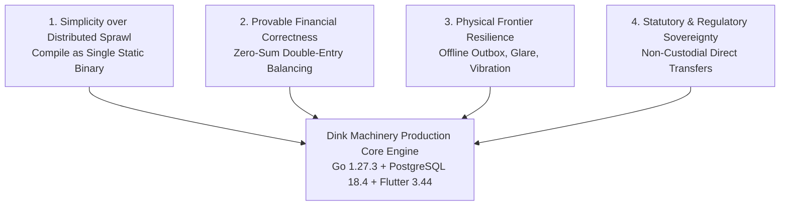
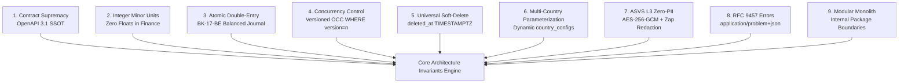
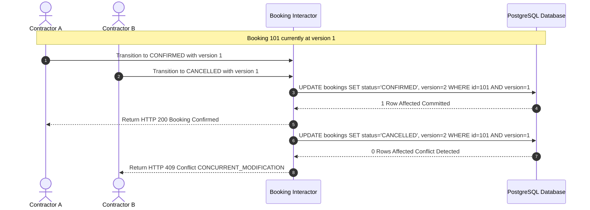
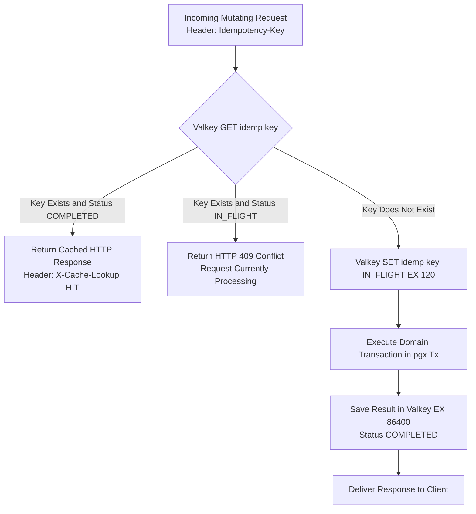
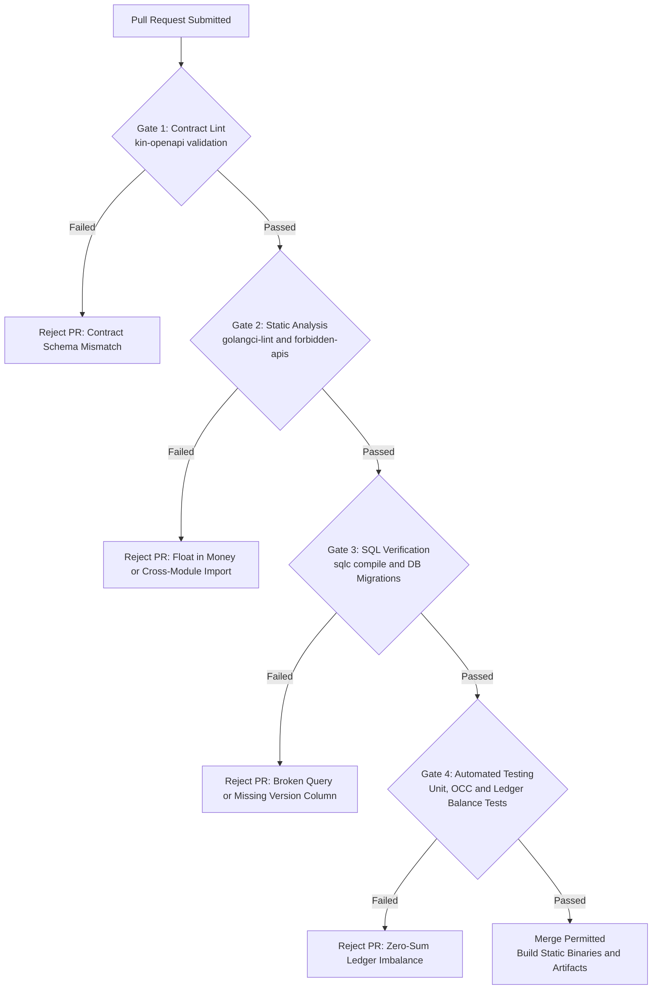

# Heavy Machinery & Logistics Rental Aggregator — Dink Machinery
## Architecture Specification — 02. Architecture Principles (`docs/shared/architecture/02-architecture-principles.md`)

**Document Identifier:** `ARCH-PRIN-DINK-CORE-V7.0`  
**Classification:** Canonical Architecture Specification & Engineering Reference (Single Source of Truth)  
**Governing Documents:** `SRS-DINK-CORE-V7.0` (Parts 1–5), `ARCH-INTRO-DINK-CORE-V7.0`, `contracts/openapi.yaml`, `ADR-001` through `ADR-014`  
**Target Runtimes:** Go 1.27.3 Modular Monolith, Flutter 3.44 Cross-Platform Mobile Client, Next.js 16 Admin Web Console, PostgreSQL 18.4 + PostGIS 3.4, Valkey 8.0-alpine, SeaweedFS S3, ClamAV Daemon  
**Target Markets:** Ethiopia (`ET`) & Kenya (`KE`) — Dynamic Multi-Country Parameterization (`LOC-01-BE`)  
**Compliance Standards:** OWASP ASVS 4.0.3 Level 3, RFC 9457 (Problem Details), W3C WCAG 2.2 AA / AAA (Outdoor Mode), ISO/IEC/IEEE 42010, ISO 4217, ISO 3166-1 alpha-2  
**Status:** Approved Engineering Baseline

---

## Table of Contents

- 1. [Architectural Philosophy & Guiding Tenets](#1-architectural-philosophy--guiding-tenets)
- 2. [The Nine Non-Negotiable System Invariants](#2-the-nine-non-negotiable-system-invariants)
  - 2.1 [Principle 1: Contract Supremacy (`contracts/openapi.yaml`)](#21-principle-1-contract-supremacy-contractsopenapiyaml)
  - 2.2 [Principle 2: Integer Minor-Unit Financial Integrity (`MoneyAmount`)](#22-principle-2-integer-minor-unit-financial-integrity-moneyamount)
  - 2.3 [Principle 3: Atomic In-Transaction Ledger Posting (`BK-17-BE`)](#23-principle-3-atomic-in-transaction-ledger-posting-bk-17-be)
  - 2.4 [Principle 4: Optimistic Concurrency Control (OCC)](#24-principle-4-optimistic-concurrency-control-occ)
  - 2.5 [Principle 5: Universal Soft-Delete & Data Lifecycle Governance (`SD-01-BE`)](#25-principle-5-universal-soft-delete--data-lifecycle-governance-sd-01-be)
  - 2.6 [Principle 6: Dynamic Multi-Country Parameterization (`LOC-01-BE`)](#26-principle-6-dynamic-multi-country-parameterization-loc-01-be)
  - 2.7 [Principle 7: OWASP ASVS Level 3 Zero-PII Security Governance](#27-principle-7-owasp-asvs-level-3-zero-pii-security-governance)
  - 2.8 [Principle 8: Universal RFC 9457 Problem Details Envelopes](#28-principle-8-universal-rfc-9457-problem-details-envelopes)
  - 2.9 [Principle 9: Modular Monolith Domain Encapsulation](#29-principle-9-modular-monolith-domain-encapsulation)
- 3. [Cross-Cutting Design Principles](#3-cross-cutting-design-principles)
  - 3.1 [Idempotency by Design](#31-idempotency-by-design)
  - 3.2 [Offline-First Edge Execution & Eventual Consistency](#32-offline-first-edge-execution--eventual-consistency)
  - 3.3 [Server-Driven Dynamic UI Engine](#33-server-driven-dynamic-ui-engine)
  - 3.4 [Multi-Script Linguistic & Typographic Ergonomics (`ADR-013`)](#34-multi-script-linguistic--typographic-ergonomics-adr-013)
- 4. [Architecture Trade-Off Matrix](#4-architecture-trade-off-matrix)
- 5. [Governance, Quality Gates & CI/CD Enforcement](#5-governance-quality-gates--cicd-enforcement)

---

## 1. Architectural Philosophy & Guiding Tenets

The Dink Machinery platform is built to solve heavy civil equipment mobilization, operational verification, and rental settlement in demanding frontier markets. The design balances simplicity, mechanical resilience, and regulatory compliance.



### The Four Foundational Tenets

1. **Simplicity over Distributed Complexity:** Avoid microservice sprawl. Microservices introduce network serialization latency, partial failure modes, and distributed transaction complexity. Dink Machinery compiles into a single Go 1.27.3 modular monolith with strict internal package boundaries, zero-allocation routing, and compile-time interface verification.
2. **Provable Financial Correctness:** Software handling multi-million Birr machinery cannot tolerate floating-point rounding errors or un-audited state mutations. Every monetary value is a 64-bit integer minor unit. Every ledger entry is immutable, balanced to zero, and committed within the exact database transaction that alters domain state.
3. **Physical Frontier Resilience:** Construction corridors, quarry pits, and rural infrastructure corridors in East Africa face high ambient glare ($> 80,000\text{ lux}$), vibration, and frequent cellular drops. The user interface prioritizes high-contrast modes (WCAG 2.2 AAA), large touch envelopes ($56 \times 56\text{ dp}$), and local offline stores (Isar NoSQL) with asynchronous background sync daemons.
4. **Statutory & Regulatory Sovereignty:** The platform complies with regional banking laws (National Bank of Ethiopia Directives) and data privacy acts (Ethiopian Data Protection Proclamation No. 1321/2024). The architecture operates an anti-escrow non-custodial direct transfer settlement rail (`MANUAL_TRANSFER`), keeping customer capital off the platform balance sheet while collecting marketplace revenue via pre-funded owner wallet debits (`OwnerWallet`).

---

## 2. The Nine Non-Negotiable System Invariants

The following nine architectural invariants are binding across all codebases, automated test suites, pull requests, and production deployments.



---

### 2.1 Principle 1: Contract Supremacy (`contracts/openapi.yaml`)

**Rule:** `contracts/openapi.yaml` is the sole source of truth for all API wire contracts, parameters, request/response envelopes, authentication scopes, and error schemas.

* **Code-Generation & CI Gates:** Backend request/response DTOs and Flutter API clients must either be generated or validated against the OpenAPI specification via automated CI jobs (`kin-openapi` linter).
* **Zero Wire Drift:** No engineer may add, alter, or remove an API field in Go or Dart code without first modifying `contracts/openapi.yaml` and passing the schema validation suite.
* **Semantic Versioning:** Breaking schema modifications (removing fields, altering types, adding mandatory query params) require a formal major contract version increment.

```yaml
# Example: OpenAPI Contract Rule Enforcement Snippet
components:
  schemas:
    MoneyAmount:
      type: object
      required:
        - amountMinor
        - currency
      properties:
        amountMinor:
          type: integer
          format: int64
          description: "Monetary amount represented in smallest integer minor currency units."
          example: 35000000
        currency:
          type: string
          pattern: "^[A-Z]{3}$"
          description: "ISO 4217 three-letter currency code."
          example: "ETB"
```

---

### 2.2 Principle 2: Integer Minor-Unit Financial Integrity (`MoneyAmount`)

**Rule:** Floating-point data types (`float32`, `float64`, `DOUBLE PRECISION`, `REAL`) are strictly banned from representing monetary values anywhere in the codebase, database, or API layer.

* **Minor Currency Units:** All monetary values are 64-bit signed integers (`int64` in Go, `BIGINT` in PostgreSQL, `int` in Dart) representing the smallest currency denomination:
  - Ethiopian Birr (`ETB`): Santims ($1\text{ ETB} = 100\text{ Santims}$).
  - Kenyan Shilling (`KES`): Cents ($1\text{ KES} = 100\text{ Cents}$).
  - US Dollar (`USD`): Cents ($1\text{ USD} = 100\text{ Cents}$).
* **Value Object Standard:** Financial values must pass through a strict `MoneyAmount` domain object containing the integer minor unit and an ISO 4217 currency identifier.
* **Basis Points for Rates:** Percentages and commission rates are calculated in integer basis points ($1\text{ bps} = 0.01\%$, $1000\text{ bps} = 10\%$).

```go
// Package money provides safe integer-based minor unit operations
package money

import (
    "errors"
    "fmt"
)

type Money struct {
    amountMinor int64
    currency    string
}

func New(amountMinor int64, currency string) (Money, error) {
    if len(currency) != 3 {
        return Money{}, errors.New("currency must be 3-letter ISO 4217 code")
    }
    return Money{amountMinor: amountMinor, currency: currency}, nil
}

func (m Money) AmountMinor() int64 { return m.amountMinor }
func (m Money) Currency() string    { return m.currency }

// MultiplyBps calculates commission using integer basis points math
func (m Money) MultiplyBps(bps int64) Money {
    // Round-half-up integer division: (A * B + 5000) / 10000
    calculated := (m.amountMinor*bps + 5000) / 10000
    return Money{amountMinor: calculated, currency: m.currency}
}
```

---

### 2.3 Principle 3: Atomic In-Transaction Ledger Posting (`BK-17-BE`)

**Rule:** Mutating financial events must write double-entry, balanced journal entries into `financial_ledger_entries` within the exact database transaction (`pgx.Tx`) mutating the domain state.

* **Immutability:** The `financial_ledger_entries` table is strictly append-only. `UPDATE` and `DELETE` SQL commands are blocked by a PostgreSQL database trigger.
* **Zero-Sum Ledger Invariant:** Every financial transaction must consist of at least two balanced legs (Debits and Credits) whose algebraic sum equals exactly zero:
  $$\sum \text{Amount}_{\text{Debit}} + \sum \text{Amount}_{\text{Credit}} = 0$$
* **Reversal Accounting:** Financial corrections or dispute adjustments cannot modify past rows. They must post new compensating journal entries referencing the original transaction ID.

```sql
-- PostgreSQL Append-Only Enforcement Trigger
CREATE OR REPLACE FUNCTION enforce_ledger_immutability()
RETURNS TRIGGER AS $$ BEGIN RAISE EXCEPTION 'financial_ledger_entries is append-only. UPDATE and DELETE are prohibited.'; END; $$ LANGUAGE plpgsql;

CREATE TRIGGER trg_protect_financial_ledger
BEFORE UPDATE OR DELETE ON financial_ledger_entries
FOR EACH ROW EXECUTE FUNCTION enforce_ledger_immutability();
```

---

### 2.4 Principle 4: Optimistic Concurrency Control (OCC)

**Rule:** Every mutable stateful database table (`bookings`, `fleets`, `owner_wallets`, `booking_inspections`, `disputes`) must include a `version INT NOT NULL DEFAULT 1` column.

* **Update Assertion:** All updating queries must explicitly check the version in the `WHERE` clause and increment it in the `SET` clause:
  ```sql
  UPDATE bookings
  SET status = $1, version = version + 1, updated_at = NOW()
  WHERE id = $2 AND version = $3;
  ```
* **Conflict Handling:** If the affected row count is zero, the transaction rolls back immediately and raises an RFC 9457 error with HTTP 409 Conflict (`CONCURRENT_MODIFICATION`).
* **Pessimistic Locking Scoping:** Row-level pessimistic locks (`SELECT ... FOR UPDATE`) are restricted exclusively to short, high-throughput wallet balance adjustments to prevent deadlocks.



---

### 2.5 Principle 5: Universal Soft-Delete & Data Lifecycle Governance (`SD-01-BE`)

**Rule:** Operational entities must never be physically removed via SQL `DELETE` in production environments.

* **Soft-Delete Column:** All operational tables maintain a nullable `deleted_at TIMESTAMPTZ NULL DEFAULT NULL` column.
* **Default Scoping:** Application queries automatically append `WHERE deleted_at IS NULL` (enforced via `sqlc` query templates).
* **Administrative Restoration:** Any soft-deleted asset, booking, or user can be restored via an administrative audit endpoint (`POST /api/v1/admin/restore/{entity}/{id}`).
* **Statutory Retention Rules:**
  - **Fiscal Invoices & Ledgers:** Retained for 7 years to comply with Ethiopian Ministry of Revenue mandates.
  - **User PII:** Anonymized 5 years post-account termination.
  - **GPS Telematics Breadcrumbs:** Raw 30-second coordinate breadcrumbs are permanently pruned after 30 days to honor Ethiopian Data Protection Proclamation No. 1321/2024.

---

### 2.6 Principle 6: Dynamic Multi-Country Parameterization (`LOC-01-BE`)

**Rule:** Regulatory rules, currency symbols, tax rates, telephone dialing codes, and dispute SLA windows must never be hardcoded into Go source files.

* **Configuration Entity:** All localization and regulatory constants resolve dynamically at runtime from the `country_configs` table keyed by ISO 3166-1 alpha-2 codes (`ET`, `KE`).
* **Request Context Resolution:** The active country context is resolved via the client's authenticated profile or the inbound `X-Country-Code` header, verified by middleware, and injected into the Go `context.Context`.

```sql
-- Dynamic Multi-Country Parameterization Table
CREATE TABLE country_configs (
    country_code VARCHAR(2) PRIMARY KEY, -- 'ET', 'KE'
    currency_code VARCHAR(3) NOT NULL,   -- 'ETB', 'KES'
    currency_minor_units INT NOT NULL,  -- 100, 100
    vat_rate_bps INT NOT NULL,          -- 1500 (15%), 1600 (16%)
    dialing_prefix VARCHAR(5) NOT NULL, -- '+251', '+254'
    phone_regex VARCHAR(100) NOT NULL,
    dispute_sla_hours INT NOT NULL,     -- 72, 48
    hold_duration_seconds INT NOT NULL, -- 3600
    is_active BOOLEAN NOT NULL DEFAULT TRUE,
    created_at TIMESTAMPTZ NOT NULL DEFAULT NOW()
);
```

---

### 2.7 Principle 7: OWASP ASVS Level 3 Zero-PII Security Governance

**Rule:** Sensitive personal and corporate data must be protected through application-layer encryption, strict key separation, and structured log sanitization.

* **Field-Level Encryption (AES-256-GCM):** Highly sensitive columns (TIN, National ID FIN, Bank Account Numbers, Personal Phone Numbers) are encrypted in Go before database persistence using AES-256-GCM. The primary key of the record is passed as Additional Authenticated Data (AAD) to prevent ciphertext swapping attacks across rows.
* **Zero-PII Structured Logging:** Application logs use Uber Zap. A custom core filter applies regular expressions to detect and redact phone numbers, access tokens, bank accounts, and national identity numbers, replacing them with `[REDACTED]`.
* **Zero Secret Leakage:** Database credentials, JWT signing keys, and encryption secrets are injected strictly via environment variables backed by OpenBao; they are never committed to version control.

---

### 2.8 Principle 8: Universal RFC 9457 Problem Details Envelopes

**Rule:** All non-2xx HTTP responses must return standard RFC 9457 Problem Details (`Content-Type: application/problem+json`).

* **Uniform Structure:** Error responses must provide `type`, `title`, `status`, `detail`, and an application-specific `code`.
* **Input Validation Details:** Field-level validation errors must populate an `invalidParams` array specifying the offending field, input value, and localized validation reason.
* **Information Disclosure Prevention:** Stack traces, internal file paths, and database driver errors are prohibited from error responses.

```json
{
  "type": "[https://api.dinkmachinery.com/errors/INSPECT_METER_REGRESSION](https://api.dinkmachinery.com/errors/INSPECT_METER_REGRESSION)",
  "title": "Unprocessable Entity",
  "status": 422,
  "detail": "Return meter reading (1420.00 hrs) cannot be less than pre-rental baseline (1450.50 hrs).",
  "code": "INSPECT_METER_REGRESSION",
  "invalidParams": [
    {
      "name": "meterReading",
      "reason": "Monotonic regression detected against baseline reading of 1450.50"
    }
  ]
}
```

---

### 2.9 Principle 9: Modular Monolith Domain Encapsulation

**Rule:** Dink Machinery is packaged as a single deployable binary with strict, compiler-enforced package isolation.

* **Internal Package Boundaries:** Modules live under `internal/modules/{domain}` (`auth`, `catalog`, `booking`, `finance`, `inspection`, `logistics`). Go prevents circular dependencies; modules may only import shared kernel libraries (`internal/platform/*`) or consume public interfaces exposed by other modules.
* **Database Isolation:** Modules must not execute cross-domain SQL joins or modify tables owned by another module. Cross-module data fetching occurs via domain use cases or domain event subscribers.
* **Asynchronous Decoupling:** Decoupled background side-effects (e.g., dispatching SMS, triggering ClamAV scans, evicting search caches) communicate via an in-memory, typed domain event bus.

---

## 3. Cross-Cutting Design Principles

### 3.1 Idempotency by Design

Network connections in remote job sites drop frequently, causing clients to retry requests. Every state-mutating HTTP endpoint (`POST`, `PUT`, `DELETE`) enforces strict idempotency:
* **The `Idempotency-Key` Header:** Clients generate a UUIDv4 header for mutating requests.
* **Distributed Hold Check:** Before execution, the Go middleware evaluates `idemp:{key}` in Valkey:
  - If the key exists with `status: IN_FLIGHT`, the request returns HTTP 409 Conflict.
  - If the key exists with `status: COMPLETED`, the cached response payload is returned immediately without re-executing business logic.
  - If the key is new, it is saved with a 24-hour expiration window.



---

### 3.2 Offline-First Edge Execution & Eventual Consistency

Field equipment inspections cannot fail due to dead zones in deep quarries or rural road projects:
1. **Local NoSQL Store (Isar):** When the mobile device lacks network connectivity, inspection checklists, photos, and signatures write to the local Isar database marked with `syncStatus: QUEUED`.
2. **Local Isolate Processing:** High-resolution photos taken on the phone camera compress in a background Dart worker isolate (`compute`), converting raw 12MB JPEGs into $\le 800\text{KB}$ WebP files ($1600\text{ px}$ max edge, $82\%$ quality).
3. **Outbox Synchronization Daemon:** A network listener monitors connection recovery. Upon detecting 3G/LTE, an outbox queue streams files through ClamAV and submits data to `/api/v1/inspections/sync` using the stored idempotency key.

---

### 3.3 Server-Driven Dynamic UI Engine

Heavy equipment categories (excavators, lowboys, mobile cranes) contain distinct, evolving technical attributes. The platform avoids hardcoding specification fields into the client binaries:
* **Dynamic EAV Schemas:** Specifications are stored as JSON Schema templates in `spec_field_definitions` per machinery category.
* **Dynamic Form Compilation:** Mobile and web clients fetch `/api/v1/categories/{id}/spec-templates` and compile accordion input forms dynamically, enforcing validation rules (min/max weight, boom reach, hydraulic flow) without requiring app store updates.
* **Server-Driven Admin Console:** The Next.js 16 console queries `/api/v1/admin/ui-config` on load to dynamically render sidebar navigation, TanStack table columns, filters, and permission-gated action buttons.

---

### 3.4 Multi-Script Linguistic & Typographic Ergonomics (`ADR-013`)

The platform supports Latin, Ge'ez (Ethiopic), and Arabic scripts across Ethiopia and Kenya:
* **Multi-Script Metrics:** Ge'ez characters have tall ascenders and deep descenders. Typographic tokens enforce a minimum line-height multiplier of $1.38\times$ to prevent clipping.
* **Over-the-Air (OTA) Font Loading:** To minimize initial application download size, non-Latin typography (Noto Sans Ethiopic) is omitted from the base app bundle. When an Ethiopic locale (`am`, `om`, `ti`) is selected, the font file downloads from SeaweedFS S3, passes a SHA-256 integrity check, and loads into Flutter's `FontLoader` in memory.

---

## 4. Architecture Trade-Off Matrix

The architectural decisions in Dink Machinery reflect deliberate trade-offs evaluated against alternative approaches:

| Decision | Chosen Architecture | Alternative Evaluated | Trade-Off Rationale & Mitigation |
|---|---|---|---|
| **System Packaging** | **Modular Monolith (Go 1.27.3)** | Microservices Architecture | **Pros:** Zero network hops between modules, atomic transactions (`pgx.Tx`), simple single-binary deployment.<br>**Cons:** Shared runtime resources.<br>**Mitigation:** Strict internal package barriers and CI linter checks. |
| **Financial Settlement** | **Manual Direct Transfer Model (`MANUAL_TRANSFER`)** | Platform-Held Escrow Model | **Pros:** Complies with National Bank of Ethiopia rules, platform takes zero customer fund custody, low barrier for large B2B wires.<br>**Cons:** Requires manual payment receipt review.<br>**Mitigation:** 60-min Valkey hold, OCR receipt analysis, and pre-funded owner wallet commission debits. |
| **Database Engine** | **PostgreSQL 18.4 + PostGIS 3.4** | MongoDB / Elasticsearch + MySQL | **Pros:** PostGIS provides spheroidal geospatial queries, JSONB handles dynamic EAV specs, ACID protects ledger integrity.<br>**Cons:** Requires careful index tuning.<br>**Mitigation:** GiST spatial indexes and GIN path-ops indexes on JSONB fields. |
| **Concurrency Control** | **Optimistic Concurrency Control (OCC)** | Distributed Locking / Pessimistic Locking | **Pros:** Prevents database connection pool exhaustion and deadlocks under high search loads.<br>**Cons:** Concurrent updates fail and require client retries.<br>**Mitigation:** Clients receive clear RFC 9457 error details with automated retry strategies. |
| **Blob Persistence** | **SeaweedFS S3 Storage** | AWS S3 / Cloudian | **Pros:** Self-hosted S3-compatible storage with low latency for small and medium images, zero vendor lock-in.<br>**Cons:** Self-managed operational overhead.<br>**Mitigation:** Deployed with automated volume replication and daily offsite backups. |
| **Mobile Architecture** | **Flutter 3.44 + BLoC + Isar** | React Native / Kotlin + Swift Native | **Pros:** Single codebase for Android and iOS, high-performance rendering (60fps), built-in offline NoSQL storage.<br>**Cons:** Larger initial app bundle.<br>**Mitigation:** OTA dynamic font loading (`ADR-013`) and ProGuard tree-shaking. |

---

## 5. Governance, Quality Gates & CI/CD Enforcement

To ensure architectural invariants are respected across the development lifecycle, the CI/CD pipeline enforces the following automated quality gates:



### Automated CI Gate Checks

1. **Contract Integrity Gate:** Validates that Go request/response structs, parameters, and error types match `contracts/openapi.yaml` without deviations.
2. **Forbidden API & Float Check:** A custom static analysis rule scans Go source files outside test files to ensure `float32` and `float64` are never used for pricing or financial computations.
3. **Database Migration Verification:** Migrations are checked to ensure every new operational table contains `version INT NOT NULL DEFAULT 1` and `deleted_at TIMESTAMPTZ NULL`.
4. **Zero-Sum Ledger Verification:** Automated unit and integration tests assert that every financial transaction balance checks to zero Santims / Cents:
   $$\sum \text{Amount}_{\text{Debit}} + \sum \text{Amount}_{\text{Credit}} = 0$$
5. **ASVS Level 3 Static Security Scan:** Automated Semgrep and Trivy scans run against all code commits to detect unencrypted PII, hardcoded secrets, or insecure cipher suites.

---

*This document defines the architectural principles and non-negotiable invariants for Dink Machinery Version 7.0. All downstream component implementations, database schema designs, and pull requests must comply with these specifications.*