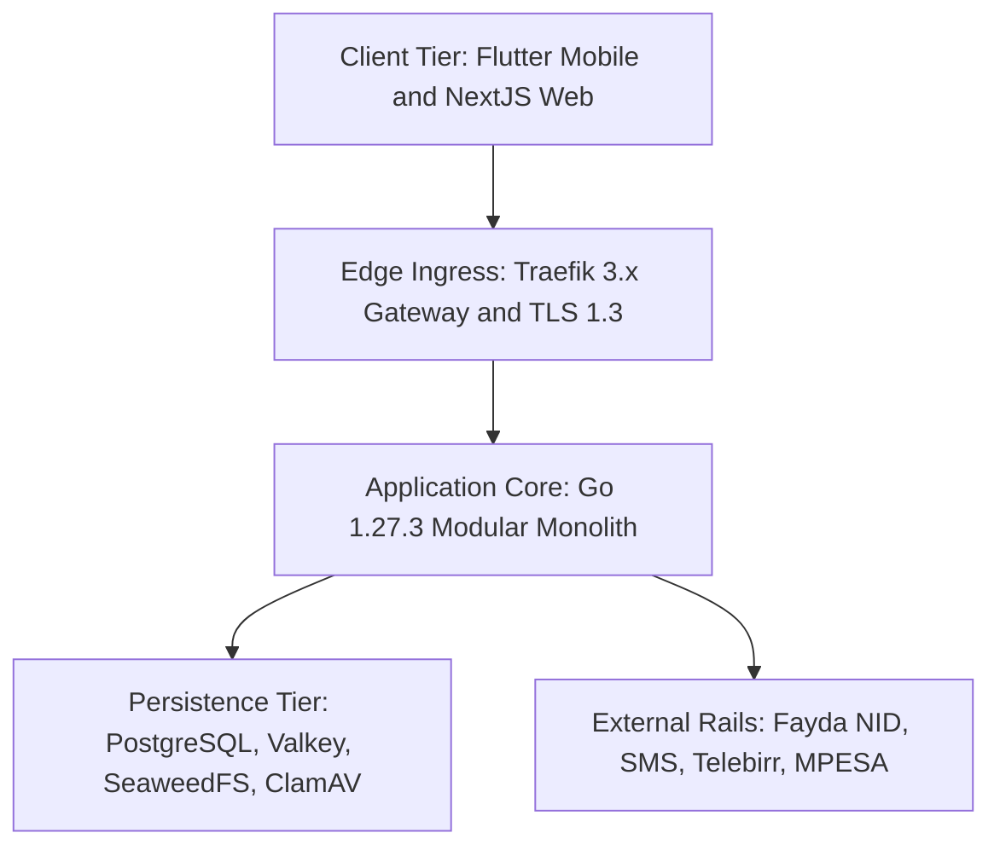
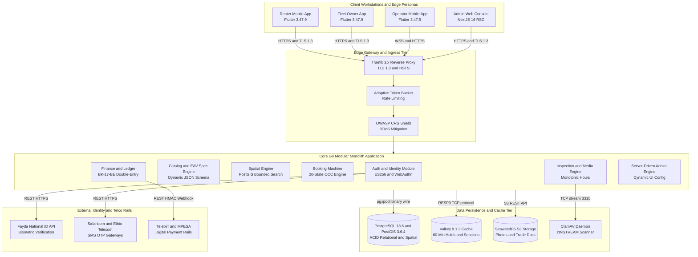
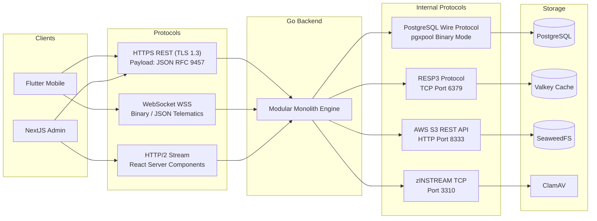
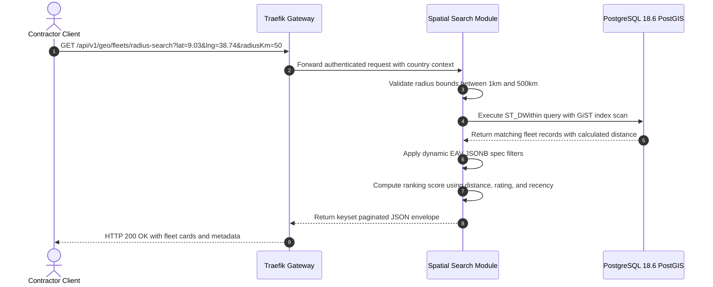
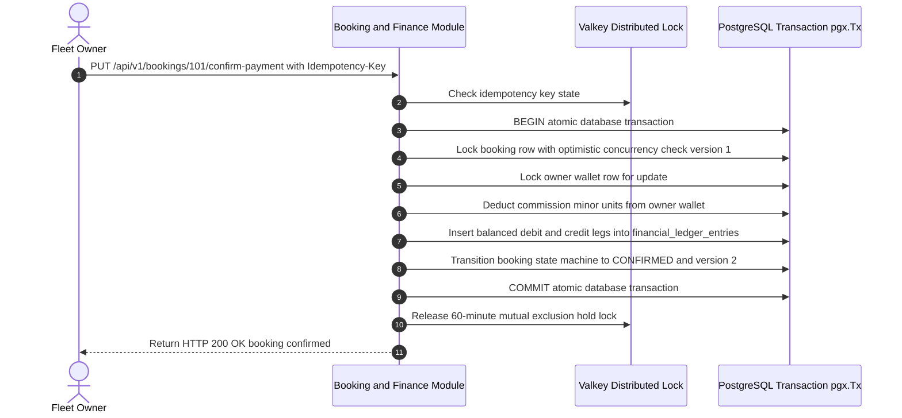
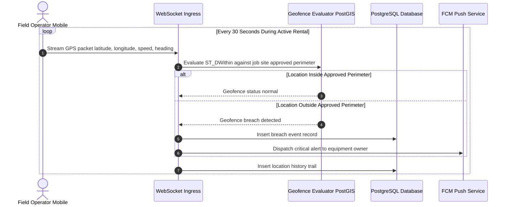
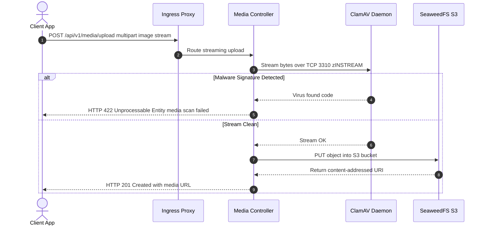
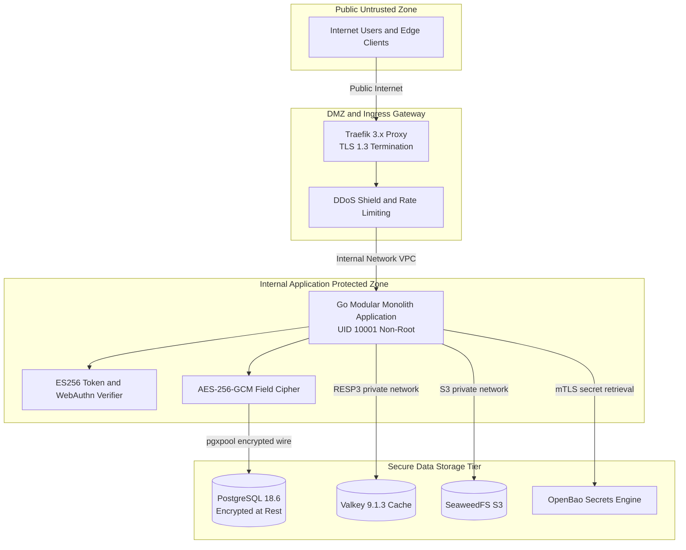
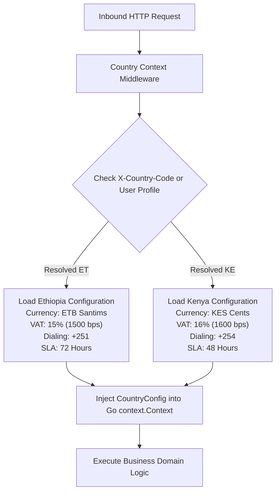
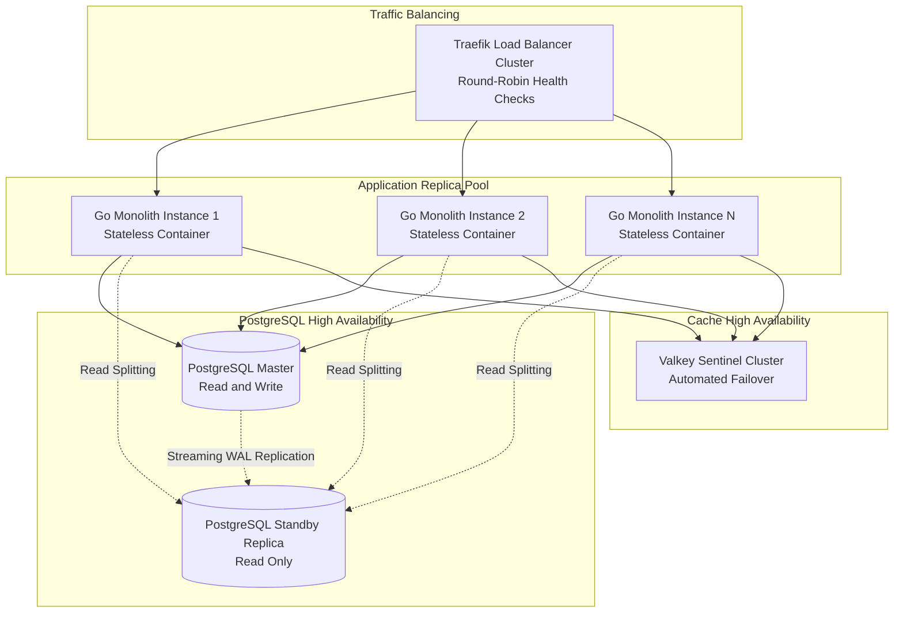

# Heavy Machinery & Logistics Rental Aggregator — Dink Machinery
## Architecture Specification — 03. System Architecture Overview (`docs/shared/architecture/03-system-architecture-overview.md`)

**Document Identifier:** `ARCH-OVERVIEW-DINK-CORE-V7.0`  
**Classification:** Canonical Architecture Specification & Engineering Reference (Single Source of Truth)  
**Governing Documents:** `SRS-DINK-CORE-V7.0` (Parts 1–5), `ARCH-INTRO-DINK-CORE-V7.0`, `ARCH-PRIN-DINK-CORE-V7.0`, `FLOW-DINK-CORE-V7.0`, `contracts/openapi.yaml`, `ADR-001` through `ADR-014`  
**Target Runtimes:** Go 1.27.3 Modular Monolith, Flutter 3.47.9 Cross-Platform Mobile Client, Next.js 16.x Admin Web Console (latest CVE security patch), PostgreSQL 18.6 + PostGIS 3.6.4, Valkey 9.1.3-alpine, SeaweedFS S3, ClamAV Daemon  
**Target Markets:** Ethiopia (`ET`) & Kenya (`KE`) — Dynamic Multi-Country Parameterization (`LOC-01-BE`)  
**Compliance Standards:** OWASP ASVS 4.0.3 Level 3, RFC 9457 (Problem Details), W3C WCAG 2.2 AA / AAA (Outdoor Mode), ISO/IEC/IEEE 42010, ISO 4217, ISO 3166-1 alpha-2  
**Status:** Approved Engineering Baseline

---

## Table of Contents

- 1. [System Architecture Overview & Macro Topography](#1-system-architecture-overview--macro-topography)
- 2. [End-to-End System Topography](#2-end-to-end-system-topography)
  - 2.1 [Edge Gateway & Ingress Tier](#21-edge-gateway--ingress-tier)
  - 2.2 [Application Workload Tier (Modular Monolith)](#22-application-workload-tier-modular-monolith)
  - 2.3 [Persistence & Cache Tier](#23-persistence--cache-tier)
  - 2.4 [Client Tier (Mobile & Web)](#24-client-tier-mobile--web)
  - 2.5 [External Integration & Telco Rail Tier](#25-external-integration--telco-rail-tier)
- 3. [Macro Structural Layers & Responsibility Mapping](#3-macro-structural-layers--responsibility-mapping)
- 4. [Communication Protocols & Wire Contracts](#4-communication-protocols--wire-contracts)
  - 4.1 [Edge-to-Client Ingress (HTTPS & WSS)](#41-edge-to-client-ingress-https--wss)
  - 4.2 [Internal In-Process Module Bus](#42-internal-in-process-module-bus)
  - 4.3 [Persistence & Cache Wire Protocols](#43-persistence--cache-wire-protocols)
- 5. [Core Dataflow Archetypes](#5-core-dataflow-archetypes)
  - 5.1 [Synchronous Spatial Search Dataflow](#51-synchronous-spatial-search-dataflow)
  - 5.2 [Mutating Rental Reservation & Ledger Posting Dataflow](#52-mutating-rental-reservation--ledger-posting-dataflow)
  - 5.3 [Streaming Operator Telematics & Geofencing Dataflow](#53-streaming-operator-telematics--geofencing-dataflow)
  - 5.4 [Media Ingestion & Antivirus Quarantine Dataflow](#54-media-ingestion--antivirus-quarantine-dataflow)
- 6. [Security & Trust Boundaries (ASVS Level 3)](#6-security--trust-boundaries-asvs-level-3)
  - 6.1 [Perimeter Demarcation & DMZ](#61-perimeter-demarcation--dmz)
  - 6.2 [Cryptographic Boundaries](#62-cryptographic-boundaries)
  - 6.3 [Default-Deny Role-Based Access Control](#63-default-deny-role-based-access-control)
- 7. [Multi-Country Runtime Parameterization Topology (`LOC-01-BE`)](#7-multi-country-runtime-parameterization-topology-loc-01-be)
- 8. [High Availability, Fault Tolerance & Scalability Strategy](#8-high-availability-fault-tolerance--scalability-strategy)
- 9. [Traceability Matrix to Governing Specifications](#9-traceability-matrix-to-governing-specifications)

---

## 1. System Architecture Overview & Macro Topography

The Dink Machinery software ecosystem operates as an integrated, multi-persona digital marketplace and logistics management engine engineered specifically for frontier construction markets in East Africa. The system balances operational resilience, mathematical financial correctness, and strict statutory compliance.

The macro architecture combines:
1. **Edge-Hardened Single Ingress:** All public HTTP, WebSocket, and media streams terminate at Traefik 3.x, enforcing TLS 1.3, rate-limiting, and DDoS shielding.
2. **Compiled Go Modular Monolith:** A single stateless static binary (`net/http`, Chi router) organizing business domains into clean internal packages (`internal/modules/*`) with zero network hops between bounded contexts.
3. **Multi-Model Data Persistence:** PostgreSQL 18.6 manages relational state, PostGIS 3.6.4 spatial indexes, GIN-indexed JSONB dynamic specs, and immutable double-entry ledgers. Valkey 9.1.3 manages distributed holds, session states, and rate-limiting. SeaweedFS S3 provides high-throughput object storage, guarded by synchronous ClamAV stream inspection.
4. **Resilient Edge Clients:** Cross-platform Flutter 3.47.9 mobile applications for Renters, Owners, and Field Operators featuring local NoSQL (Isar) outboxes for remote site operations, alongside a Next.js 16 server-driven admin web console.



---

## 2. End-to-End System Topography



### 2.1 Edge Gateway & Ingress Tier
* **Traefik 3.x:** Deployed as an active-active cluster terminating TLS 1.3 using ECDHE with P-256 and X25519 elliptic curves. Enforces HTTP Strict Transport Security (`max-age=63072000; includeSubDomains; preload`).
* **Rate Limiting:** IP-based and authenticated-user token buckets protect authentication challenges (max 5 requests per minute per phone number) and public radius searches (max 100 requests per minute per IP).
* **WAF Layer:** Inspects payload boundaries, blocks path traversal, drops malicious HTTP request headers, and buffers streaming uploads for size verification.

### 2.2 Application Workload Tier (Modular Monolith)
* **Go 1.27.3:** Compiled statically (`CGO_ENABLED=0`) into a single container image ($< 35\text{MB}$) running as an unprivileged user (`UID 10001`).
* **Zero-Allocation Routing:** High-performance request multiplexing via Chi (`v5.0.12`).
* **Bounded Context Isolation:** Domain modules (`auth`, `catalog`, `booking`, `finance`, `inspection`, `logistics`, `telematics`) interact solely through exported Go interfaces and in-process typed events.

### 2.3 Persistence & Cache Tier
* **PostgreSQL 18.6 + PostGIS 3.6.4:** Primary relational source of truth operating on NVMe storage. Connection pooling is orchestrated via `jackc/pgx/v5/pgxpool` with health checks, prepared statement caches, and query timeouts.
* **Valkey 9.1.3-alpine:** Open-source high-throughput in-memory datastore running RESP3. Manages 60-minute mutual exclusion locks (`lock:hold:fleet:{id}`), session revoking lists, and sliding window rate limits.
* **SeaweedFS S3:** Horizontally scalable object storage with distributed volume servers. Replaces proprietary cloud blob stores with local S3-compliant storage.
* **ClamAV Daemon:** Synchronous streaming antivirus scanner listening on `tcp://clamav:3310`. Scans file payloads before they are committed to SeaweedFS.

### 2.4 Client Tier (Mobile & Web)
* **Mobile Client (Flutter 3.47.9 / Dart 3.9):** Universal binary targeting Android (API 26+) and iOS (15+). Implements Feature-First Clean Architecture, BLoC state management, Isar NoSQL local cache, and over-the-air font loading (`ADR-013`).
* **Admin Web Console (Next.js 16.x (latest CVE security patch) / React 19):** High-density back-office interface using React Server Components, Server Actions, TanStack Table, and dynamic metadata loading (`/api/v1/admin/ui-config`).

### 2.5 External Integration & Telco Rail Tier
* **National ID Registries:** Connects to the Ethiopian Fayda ID verification API (`REG-IDP-01-BE`) with fallbacks for manual review queues.
* **Telco SMS Gateways:** Low-latency SMS dispatch via Ethio Telecom and Safaricom Kenya shortcodes for OTP challenges.
* **Telco Payment Gateways:** Telebirr and M-Pesa digital wallet rails using cryptographic HMAC-SHA256 signature verification.

---

## 3. Macro Structural Layers & Responsibility Mapping

The architecture implements a layered Clean Architecture structure with strict inward dependency rules:

```
+---------------------------------------------------------------------------------------+
|  1. INGRESS & SECURITY LAYER                                                          |
|  - TLS 1.3 Termination, HSTS, CORS Pre-flight Engine                                  |
|  - Global Rate Limiter, IP Token Buckets, WAF Rules                                   |
|  - Inbound Multipart Buffer & ClamAV Antivirus Stream Scanner                         |
+---------------------------------------------------------------------------------------+
                                           |
                                           v
+---------------------------------------------------------------------------------------+
|  2. PRESENTATION & TRANSPORT LAYER                                                    |
|  - HTTP Middleware: Auth (ES256), Tenant / Country Context, RFC 9457 Error Formatter   |
|  - REST Controllers: DTO Validation (JSON Schema), Idempotency Key Validator          |
|  - WebSocket Handlers: Telematics WSS Ingress, Operator Connection Heartbeats         |
+---------------------------------------------------------------------------------------+
                                           |
                                           v
+---------------------------------------------------------------------------------------+
|  3. APPLICATION (USE CASE) LAYER                                                      |
|  - Transactional Interactors: Coordinate multi-entity workflows                      |
|  - Unit of Work Coordinator: Encapsulates atomic pgx.Tx database transactions         |
|  - In-Process Domain Event Bus: Publishes domain events to registered internal listeners|
+---------------------------------------------------------------------------------------+
                                           |
                                           v
+---------------------------------------------------------------------------------------+
|  4. DOMAIN ENTITY LAYER (Pure Go)                                                     |
|  - State Machines: The Canonical 20-State Rental Booking Engine                       |
|  - Value Objects: MoneyAmount (int64 minor units), Geospatial Coordinates             |
|  - Invariant Assertions: Monotonic Hour Meters, Double-Entry Zero-Sum Ledger Rules    |
+---------------------------------------------------------------------------------------+
                                           |
                                           v
+---------------------------------------------------------------------------------------+
|  5. INFRASTRUCTURE & DATA ACCESS LAYER                                                |
|  - sqlc Compiled Repositories: Type-safe SQL queries over pgxpool                     |
|  - Valkey Client: Mutex locks, TTL keys, sliding-window rate limit counters           |
|  - S3 Storage Adapter: SeaweedFS multipart uploader                                   |
|  - Outbound HTTP Clients: Telco SMS, Fayda NID, Payment Webhooks                      |
+---------------------------------------------------------------------------------------+
```

---

## 4. Communication Protocols & Wire Contracts



### 4.1 Edge-to-Client Ingress (HTTPS & WSS)
* **REST APIs:** All external client requests conform to REST principles over HTTPS (TLS 1.3). Request bodies are serialized as UTF-8 JSON. Every response envelope strictly adheres to RFC 9457 Problem Details for errors (`application/problem+json`) or standard envelope wrappers for successful payloads (`SuccessEnvelope<T>`).
* **Telematics WebSocket (WSS):** High-frequency operator telemetry streams over secure WebSockets (`/ws/v1/bookings/{id}/tracking`) authenticated via ephemeral query-string ticket tokens verified against Valkey.

### 4.2 Internal In-Process Module Bus
* **Typed Domain Events:** Subsystems communicate within the single Go binary using an asynchronous in-process event bus.
* **Go Channels & Worker Pools:** Events are published to buffered Go channels and dispatched to registered module subscribers using worker pools, preventing long-running tasks (e.g. SMS dispatch) from blocking database transactions.

### 4.3 Persistence & Cache Wire Protocols
* **Database Driver (`pgx/v5`):** Uses the native PostgreSQL extended query protocol (binary mode), eliminating text parsing overhead and protecting against SQL injection.
* **Valkey RESP3:** Communicates over raw TCP sockets using the RESP3 protocol, taking advantage of pipelining for multi-key hold evaluations.
* **ClamAV Protocol:** Uses the streaming protocol `zINSTREAM` over TCP port 3310, piping multipart file chunks directly without buffering full files to disk.

---

## 5. Core Dataflow Archetypes

### 5.1 Synchronous Spatial Search Dataflow



1. **Client Query:** The contractor specifies coordinates (`lat`, `lng`), radius in kilometers, equipment category, and technical spec criteria.
2. **Bounds Enforcement:** The spatial engine verifies that requested radius falls between $1\text{ km}$ and $500\text{ km}$.
3. **PostGIS Index Scan:** Executes `ST_DWithin(location_point::geography, ST_SetSRID(ST_MakePoint(lng, lat), 4326)::geography, radiusMeters)`.
4. **Ranking & Pagination:** Blends physical distance ($35\%$), rating ($25\%$), profile recency ($20\%$), and listing completeness ($20\%$). Results return using keyset cursor pagination (`(id, score)`).

---

### 5.2 Mutating Rental Reservation & Ledger Posting Dataflow



1. **Hold Verification:** The system confirms the presence of an active 60-minute Valkey lock (`lock:hold:fleet:{id}`).
2. **Atomic Transaction Scope (`pgx.Tx`):**
   - Asserts optimistic concurrency version: `WHERE id = $1 AND version = $2`.
   - Acquires row-level lock on `owner_wallets` (`SELECT ... FOR UPDATE`).
   - Debits platform commission basis points from the owner's pre-funded balance.
   - Posts balanced, zero-sum journal entries into `financial_ledger_entries`.
   - Advances the state machine to `CONFIRMED`.
3. **Lock Release:** Drops the Valkey hold lock and notifies parties via push notification.

---

### 5.3 Streaming Operator Telematics & Geofencing Dataflow



1. **Ingress:** Field devices capture GPS coordinates every 30 seconds and transmit a JSON packet across an authenticated WebSocket.
2. **Perimeter Verification:** The backend runs a PostGIS `ST_DWithin` query comparing current machine position against the designated job site center and approved radius.
3. **Breach Handling:** If the machine travels outside the approved boundary ($> 1,000\text{m}$), an alert event is logged, and an emergency FCM push notification dispatches to the fleet owner.
4. **Data Lifecycle:** Raw location tracks are permanently deleted after 30 days to meet statutory data minimization requirements.

---

### 5.4 Media Ingestion & Antivirus Quarantine Dataflow



1. **Streaming Input:** Image files (inspection photos, payment slips, trade licenses) stream to the API as multipart payloads.
2. **In-Flight Antivirus Inspection:** Bytes stream directly through ClamAV via `zINSTREAM`. Uploads containing malware signatures terminate immediately, returning an RFC 9457 error (`INSPECT_MEDIA_SCAN_FAILED`).
3. **S3 Commitment:** Clean files are compressed to WebP ($1600\text{ px}$ max edge, $82\%$ quality) and persisted to SeaweedFS S3 storage.

---

## 6. Security & Trust Boundaries (ASVS Level 3)



### 6.1 Perimeter Demarcation & DMZ
* **Public Edge:** External traffic enters exclusively over port `443` through the Traefik ingress gateway. Direct public internet access to the application monolith, database, cache, or object storage is strictly blocked by network security group rules.
* **Internal Protected Network:** Monolith nodes and persistence services communicate within a private, isolated VPC network.

### 6.2 Cryptographic Boundaries
* **Transport Encryption:** TLS 1.3 is enforced across all external connections. Internal traffic between application containers and persistence backends uses SSL/TLS wire encryption.
* **Authentication Tokens:** Access tokens are short-lived (15 minutes), digitally signed with an **ECDSA P-256 (ES256)** private key.
* **Field-Level Data Encryption:** Sensitive columns (TIN, National ID numbers, bank coordinates) are encrypted at the application layer using **AES-256-GCM** before database storage, incorporating record primary keys into the Additional Authenticated Data (AAD) block.
* **Master Key Management:** Data encryption keys and JWT signing secrets are stored in OpenBao and mounted securely via environment variables during container bootstrap.

### 6.3 Default-Deny Role-Based Access Control
Every API endpoint requires explicit permission keys. If an incoming caller's authenticated claims do not contain the target action scope (e.g., `fleets:verify`), the request terminates with an HTTP 403 Forbidden response.

---

## 7. Multi-Country Runtime Parameterization Topology (`LOC-01-BE`)

To support cross-border operations across East Africa without divergent codebases or multi-tenant database complexity, the platform dynamically parameterizes regulatory and fiscal variables:



### Dynamic Configuration Schema Attributes

| Configuration Parameter | Ethiopia (`ET`) Parameter Value | Kenya (`KE`) Parameter Value | Architectural Scope |
|---|---|---|---|
| **Primary ISO Currency** | `ETB` (Ethiopian Birr) | `KES` (Kenyan Shilling) | Financial ledger, payment DTOs, invoice generation. |
| **Minor Currency Units** | $100$ ($1\text{ ETB} = 100\text{ Santims}$) | $100$ ($1\text{ KES} = 100\text{ Cents}$) | Integer currency arithmetic (`MoneyAmount`). |
| **Standard VAT Rate** | $1500\text{ bps}$ ($15.0\%$) | $1600\text{ bps}$ ($16.0\%$) | Automated booking pricing engine and tax invoicing. |
| **Telephone Country Code** | `+251` (9 digits after prefix) | `+254` (9 digits after prefix) | E.164 phone validation and SMS routing. |
| **Dispute Arbitration SLA**| $72\text{ hours}$ (3 business days) | $48\text{ hours}$ (2 business days) | Background cron escalation and dispute timers. |
| **National ID Reference** | Fayda National ID System | National Registration Bureau (NRB) | Pluggable identity verification adapter. |
| **Manual Transfer Banks** | CBE, Awash, Dashen, Telebirr | Equity Bank, KCB, M-Pesa | Bank coordinate templates and payment evidence. |

---

## 8. High Availability, Fault Tolerance & Scalability Strategy

The platform maintains reliable operational performance during peak construction mobilization seasons through stateless services and resilient persistence layers:



* **Stateless Application Nodes:** The Go monolith maintains zero in-memory user session state. Any container replica can service any incoming request.
* **Database High Availability:** PostgreSQL runs an active primary instance with streaming WAL replication to a standby replica, supporting automated failover and read-query offloading.
* **Distributed Mutex Reliability:** Valkey runs with Sentinel monitoring, ensuring automated failover for reservation hold locks and active rate-limiting counters.
* **Storage Redundancy:** SeaweedFS volume servers operate with replication configurations ($2\times$), ensuring file uploads remain accessible if a volume disk fails.

---

## 9. Traceability Matrix to Governing Specifications

| System Overview Architectural Component | Governing SRS v7.0 Requirement | Supporting ADD / Architecture Ref | Implementation Deliverables |
|---|---|---|---|
| **Edge Ingress & TLS Termination** | `SEC-01-BE`, `SEC-02-BE` | `ADD-DINK-CORE-V7.0` §10.1 | Traefik configuration, TLS 1.3 cipher profiles. |
| **ES256 JWT & Rotating Refresh Tokens** | `AUTH-01-BE`, `AUTH-02-BE` | `ADD-DINK-CORE-V7.0` §8.1 | `internal/modules/auth`, Valkey session token families. |
| **Pluggable Identity Adapters (Fayda)** | `REG-IDP-01-BE`, `REG-IDP-02-BE` | `FLOW-DINK-CORE-V7.0` §2.2 | `internal/modules/auth/adapters/fayda`. |
| **PostGIS Spatial Search Engine** | `SRCH-01-BE` to `SRCH-05-BE` | `FLOW-DINK-CORE-V7.0` §4 | `internal/modules/search`, GiST spatial database indexes. |
| **Dynamic Category EAV Specs** | `FL-07-BE`, `FL-09-BE` | `ADD-DINK-CORE-V7.0` §7.2 | `internal/modules/catalog`, GIN-indexed JSONB tables. |
| **20-State Rental Booking Engine** | `BK-01-BE` to `BK-20-BE` | `FLOW-DINK-CORE-V7.0` §6 | `internal/modules/booking`, OCC versioned queries. |
| **60-Minute Mutual Exclusion Hold** | `BK-06-BE`, `BK-06-MOB` | `FLOW-DINK-CORE-V7.0` §5.1 | Valkey `SET NX EX 3600` mutex lock implementation. |
| **Double-Entry Financial Ledger** | `BK-17-BE` | `FLOW-DINK-CORE-V7.0` §10 | `internal/modules/finance`, `financial_ledger_entries`. |
| **OwnerWallet Pre-Funded Commission** | `CW-01-BE` to `CW-04-BE` | `ADD-DINK-CORE-V7.0` §7.3 | `owner_wallets`, pessimistic row locks. |
| **Handover Inspection & Monotonic Meters**| `AR-01-BE` to `AR-08-BE` | `FLOW-DINK-CORE-V7.0` §7 | `internal/modules/inspection`, regression assertions. |
| **Logistics Sub-Bookings & Cascades** | `LOG-01-BE` to `LOG-06-BE` | `FLOW-DINK-CORE-V7.0` §9 | `internal/modules/logistics`, linked sub-bookings. |
| **Server-Driven Admin UI Engine** | `AD-06-WEB`, `AD-09-WEB` | `FLOW-DINK-CORE-V7.0` §12 | `internal/modules/adminui`, `/api/v1/admin/ui-config`. |
| **Over-the-Air Typography Engine** | `ADR-013`, `UIUX-02-MOB` | `UIUX-DINK-CORE-V7.0` §3.2 | Flutter `FontLoader` dynamic pipeline, S3 assets. |

---

*This document defines the system architecture overview and macro topography for Dink Machinery Version 7.0. All downstream service implementations, infrastructure configurations, and interface wirings must strictly conform to these architectural patterns.*