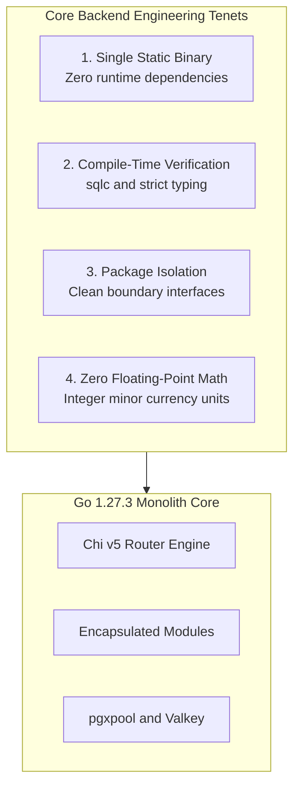
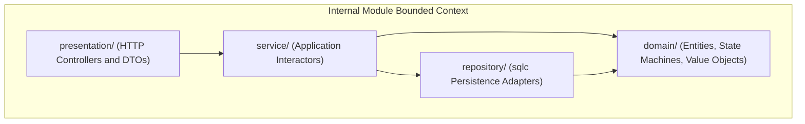
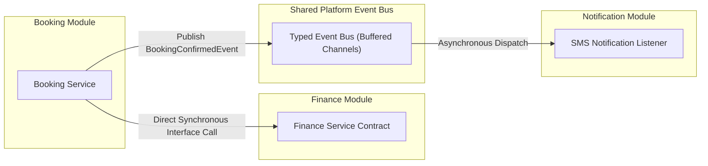
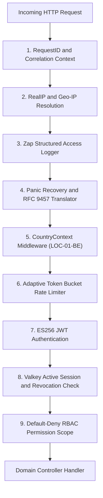
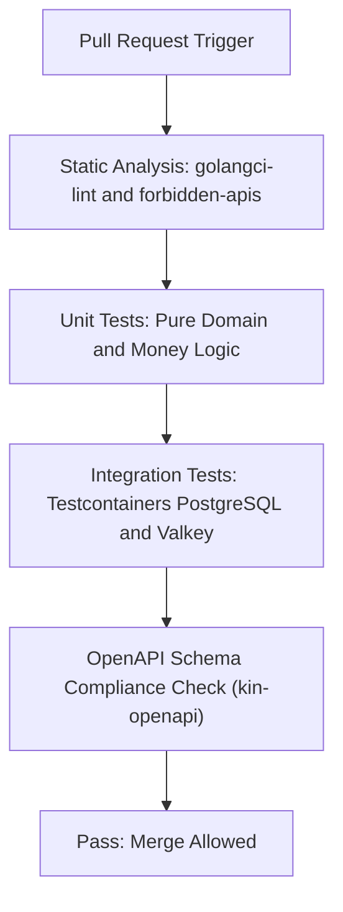

# Heavy Machinery & Logistics Rental Aggregator — Dink Machinery
## Architecture Specification — 04. Backend Architecture (Go Modular Monolith) (`docs/shared/architecture/04-backend-architecture-go.md`)

**Document Identifier:** `ARCH-BACKEND-GO-DINK-CORE-V7.0`  
**Classification:** Canonical Architecture Specification & Engineering Reference (Single Source of Truth)  
**Governing Documents:** `SRS-DINK-CORE-V7.0` (Parts 1–5), `ARCH-INTRO-DINK-CORE-V7.0`, `ARCH-PRIN-DINK-CORE-V7.0`, `ARCH-OVERVIEW-DINK-CORE-V7.0`, `contracts/openapi.yaml`, `ADR-001` through `ADR-014`  
**Target Runtimes:** Go 1.27.3 Modular Monolith, PostgreSQL 18.4 + PostGIS 3.4, Valkey 8.0-alpine, SeaweedFS S3, ClamAV Daemon  
**Target Markets:** Ethiopia (`ET`) & Kenya (`KE`) — Dynamic Multi-Country Parameterization (`LOC-01-BE`)  
**Compliance Standards:** OWASP ASVS 4.0.3 Level 3, RFC 9457 (Problem Details), ISO/IEC/IEEE 42010, ISO 4217, ISO 3166-1 alpha-2  
**Status:** Approved Engineering Baseline

---

## Table of Contents

- 1. [Executive Summary & Design Tenets](#1-executive-summary--design-tenets)
- 2. [Directory Structure & Package Topography](#2-directory-structure--package-topography)
  - 2.1 [Repository Layout Topography](#21-repository-layout-topography)
  - 2.2 [Package Encapsulation & Boundary Enforcement](#22-package-encapsulation--boundary-enforcement)
- 3. [Modular Monolith Architecture & Inter-Module Communication](#3-modular-monolith-architecture--inter-module-communication)
  - 3.1 [Module Interface Contracts](#31-module-interface-contracts)
  - 3.2 [In-Process Domain Event Bus](#32-in-process-domain-event-bus)
- 4. [Application Bootstrap & Dependency Injection](#4-application-bootstrap--dependency-injection)
  - 4.1 [Composition Root (`cmd/server/main.go`)](#41-composition-root-cmdservermaingo)
  - 4.2 [Graceful Shutdown Lifecycle & Resource Draining](#42-graceful-shutdown-lifecycle--resource-draining)
- 5. [Ingress, Routing & Middleware Pipeline](#5-ingress-routing--middleware-pipeline)
  - 5.1 [Chi Router Multiplexing](#51-chi-router-multiplexing)
  - 5.2 [Middleware Execution Pipeline](#52-middleware-execution-pipeline)
  - 5.3 [RFC 9457 Universal Problem Details Engine](#53-rfc-9457-universal-problem-details-engine)
- 6. [Persistence Protocol, `pgx/v5` & Unit of Work](#6-persistence-protocol-pgxv5--unit-of-work)
  - 6.1 [Connection Pool Configuration (`pgxpool`)](#61-connection-pool-configuration-pgxpool)
  - 6.2 [Type-Safe SQL Compilation (`sqlc`)](#62-type-safe-sql-compilation-sqlc)
  - 6.3 [Atomic Unit of Work Pattern (`UnitOfWork`)](#63-atomic-unit-of-work-pattern-unitofwork)
- 7. [Domain Entity Modeling & State Machine Implementation](#7-domain-entity-modeling--state-machine-implementation)
  - 7.1 [The 20-State Canonical Booking Engine](#71-the-20-state-canonical-booking-engine)
  - 7.2 [Optimistic Concurrency Control (OCC) Handling](#72-optimistic-concurrency-control-occ-handling)
  - 7.3 [Integer Minor-Unit Financial Arithmetic (`MoneyAmount`)](#73-integer-minor-unit-financial-arithmetic-moneyamount)
- 8. [Financial Ledger & Commission Engine (`BK-17-BE`)](#8-financial-ledger--commission-engine-bk-17-be)
  - 8.1 [Double-Entry Ledger Journaling](#81-double-entry-ledger-journaling)
  - 8.2 [Owner Wallet Pre-Funded Commission Debits](#82-owner-wallet-pre-funded-commission-debits)
- 9. [Distributed Caching, Mutex Locking & Valkey Client](#9-distributed-caching-mutex-locking--valkey-client)
  - 9.1 [60-Minute Reservation Hold Mutex](#91-60-minute-reservation-hold-mutex)
  - 9.2 [Sliding-Window Rate Limiting Engine](#92-sliding-window-rate-limiting-engine)
- 10. [Media Ingress & Antivirus Stream Inspection](#10-media-ingress--antivirus-stream-inspection)
  - 10.1 [ClamAV `zINSTREAM` Scanner Client](#101-clamav-zinstream-scanner-client)
  - 10.2 [SeaweedFS S3 Multipart Storage Adapter](#102-seaweedfs-s3-multipart-storage-adapter)
- 11. [Security Architecture & ASVS Level 3 Hardening](#11-security-architecture--asvs-level-3-hardening)
  - 11.1 [ES256 JWT Token Management & Validation](#111-es256-jwt-token-management--validation)
  - 11.2 [Field-Level Encryption (AES-256-GCM) with AAD](#112-field-level-encryption-aes-256-gcm-with-aad)
  - 11.3 [Structured Logging & PII Masking (Uber Zap)](#113-structured-logging--pii-masking-uber-zap)
- 12. [Testing Architecture & Automated Quality Gates](#12-testing-architecture--automated-quality-gates)

---

## 1. Executive Summary & Design Tenets

The Dink Machinery backend is engineered as a single, statically compiled Go 1.27.3 modular monolith. It coordinates heavy equipment discovery, logistics transport scheduling, 20-state lease management, and double-entry financial ledger accounting for the Ethiopian (`ET`) and Kenyan (`KE`) markets.



### The Five Backend Engineering Tenets

1. **Single Static Binary Compilation:** The entire backend compiles with `CGO_ENABLED=0` into an immutable Linux ELF binary ($< 35\text{MB}$), deployed inside a `distroless/static-debian12` container running as non-root (`UID 10001`).
2. **Compile-Time Safety over Runtime Reflection:** All SQL operations compile via `sqlc` into typed Go code. Dynamic reflection is strictly prohibited in performance-critical paths (routing, serialization, database mapping).
3. **Internal Package Encapsulation:** Bounded contexts live inside isolated packages under `internal/modules/*`. Direct cross-package database querying is forbidden; inter-module operations must execute through exported Go interfaces or asynchronous domain events.
4. **Deterministic Concurrency & Lock Scoping:** Database transactions (`pgx.Tx`) must be short-lived. Pessimistic locks (`SELECT ... FOR UPDATE`) are restricted to wallet balance decrements, while all operational workflows utilize Optimistic Concurrency Control (OCC) with explicit version assertions.
5. **Zero Float Financial Arithmetic:** Currency math executes strictly using signed 64-bit integers (`int64`) representing minor units (Santims for `ETB`, Cents for `KES`).

---

## 2. Directory Structure & Package Topography

The repository layout follows standard Go enterprise architecture conventions, separating the composition root, shared platform utilities, and bounded domain contexts.

### 2.1 Repository Layout Topography

```text
dink-machinery-backend/
├── cmd/
│   ├── server/
│   │   └── main.go                 # Production HTTP and WebSocket daemon composition root
│   └── migrate/
│       └── main.go                 # CLI tool for executing Goose SQL migrations
├── internal/
│   ├── platform/                   # Shared technical infrastructure (Domain-Agnostic)
│   │   ├── config/                 # Dynamic environment and country configs loader
│   │   ├── crypto/                 # AES-256-GCM cipher and key management
│   │   ├── database/               # pgxpool connection pool lifecycle
│   │   ├── errors/                 # RFC 9457 Problem Details error types
│   │   ├── eventbus/               # In-process typed domain event bus
│   │   ├── logger/                 # Zap structured logger with PII masking core
│   │   ├── middleware/             # Chi HTTP middleware stack
│   │   ├── money/                  # Integer minor-unit arithmetic value objects
│   │   ├── storage/                # SeaweedFS S3 adapter and ClamAV client
│   │   └── valkey/                 # Valkey cache client and distributed mutex
│   └── modules/                    # Bounded domain contexts (Clean Architecture)
│       ├── auth/                   # Identity, phone OTP, WebAuthn, Fayda adapter
│       ├── catalog/                # Fleet asset registry, dynamic EAV taxonomy
│       ├── search/                 # PostGIS spatial queries, radius discovery
│       ├── booking/                # 20-State machine, hold locks, contract engine
│       ├── inspection/             # Handover stepper, monotonic hour meters
│       ├── dispute/                # Arbitration, 3-day SLA cron, photo diffs
│       ├── finance/                # Double-entry ledger, OwnerWallet, commission
│       ├── logistics/              # Transport sub-bookings, cascade cancels
│       ├── notification/           # Multi-channel routing (SMS, FCM push)
│       ├── telematics/             # WebSocket telematics, geofence evaluator
│       └── adminui/                # Server-driven UI config engine (/admin/ui-config)
├── db/
│   ├── migrations/                 # Sequential SQL migrations (Goose)
│   └── queries/                    # Raw SQL query templates for sqlc
├── contracts/
│   └── openapi.yaml                # Single Source of Truth API specification
├── sqlc.yaml                       # sqlc code generation configuration
├── Dockerfile                      # Multi-stage distroless production container build
├── go.mod                          # Go module dependencies (Go 1.27.3)
└── go.sum                          # Checksums of direct and transitive dependencies
```

### 2.2 Package Encapsulation & Boundary Enforcement

Every domain module under `internal/modules/{domain}` implements a strict three-tier internal package boundary:



* **`domain/` (Core Layer):** Pure Go domain entities, value objects, and state transition machine definitions. Has zero external imports (no database drivers, no HTTP libraries).
* **`service/` (Application Layer):** Transactional use case interactors. Orchestrates domain logic, coordinates database transactions via `UnitOfWork`, and publishes domain events.
* **`repository/` (Infrastructure Layer):** Implements domain persistence interfaces using compiled `sqlc` queries over `pgx.Tx` or `pgxpool.Pool`.
* **`presentation/` (Transport Layer):** HTTP handlers parsing incoming JSON payloads, validating input against OpenAPI requirements, and serializing RFC 9457 errors or success envelopes.

---

## 3. Modular Monolith Architecture & Inter-Module Communication

To maintain high architectural cohesion without creating distributed microservice operational overhead, modules communicate strictly via **exported Go interfaces** or **asynchronous in-process domain events**. Direct cross-module database table joins or mutations are forbidden.



### 3.1 Module Interface Contracts

When a synchronous transactional dependency exists between modules (e.g., booking confirmation requiring immediate commission calculation and wallet verification), the consumer defines an explicit Go interface satisfied by the provider module.

```go
package service

import (
    "context"
    "[github.com/google/uuid](https://github.com/google/uuid)"
    "dink/internal/platform/money"
)

// FinanceModuleContract defines the synchronous operations required by Booking
type FinanceModuleContract interface {
    DebitOwnerWallet(ctx context.Context, ownerID uuid.UUID, amount money.Money) error
    PostBookingLedgerEntry(ctx context.Context, bookingID uuid.UUID, rentalBase, commission money.Money) error
}

type BookingService struct {
    finance   FinanceModuleContract
    eventBus  eventbus.Bus
}

func NewBookingService(f FinanceModuleContract, bus eventbus.Bus) *BookingService {
    return &BookingService{finance: f, eventBus: bus}
}
```

### 3.2 In-Process Domain Event Bus

Asynchronous side effects (sending telco SMS alerts, triggering ClamAV scans, evicting search cache keys) are decoupled using an in-memory, non-blocking domain event bus backed by buffered Go channels and managed worker pools.

```go
package eventbus

import (
    "context"
    "sync"
    "time"
)

type Event interface {
    EventID() string
    EventType() string
    OccurredAt() time.Time
}

type EventHandler func(ctx context.Context, event Event) error

type Bus interface {
    Publish(ctx context.Context, event Event)
    Subscribe(eventType string, handler EventHandler)
}

type InProcessBus struct {
    mu       sync.RWMutex
    handlers map[string][]EventHandler
    queue    chan Event
}

func NewInProcessBus(bufferSize int, workers int) *InProcessBus {
    bus := &InProcessBus{
        handlers: make(map[string][]EventHandler),
        queue:    make(chan Event, bufferSize),
    }
    for i := 0; i < workers; i++ {
        go bus.workerLoop()
    }
    return bus
}

func (b *InProcessBus) Publish(ctx context.Context, event Event) {
    select {
    case b.queue <- event:
    default:
        // Log buffer full event or route to fallback dead-letter handler
    }
}

func (b *InProcessBus) Subscribe(eventType string, handler EventHandler) {
    b.mu.Lock()
    defer b.mu.Unlock()
    b.handlers[eventType] = append(b.handlers[eventType], handler)
}

func (b *InProcessBus) workerLoop() {
    for event := range b.queue {
        b.mu.RLock()
        subscribers := b.handlers[event.EventType()]
        b.mu.RUnlock()

        ctx, cancel := context.WithTimeout(context.Background(), 10*time.Second)
        for _, handler := range subscribers {
            _ = handler(ctx, event)
        }
        cancel()
    }
}
```

---

## 4. Application Bootstrap & Dependency Injection

The platform avoids global variables and dynamic reflection-based runtime dependency injection containers. All subsystems are constructed, injected, and bound explicitly within the application composition root.

### 4.1 Composition Root (`cmd/server/main.go`)

```go
package main

import (
    "context"
    "net/http"
    "os"
    "os/signal"
    "syscall"
    "time"

    "dink/internal/platform/config"
    "dink/internal/platform/database"
    "dink/internal/platform/eventbus"
    "dink/internal/platform/logger"
    "dink/internal/platform/valkey"
    "dink/internal/modules/auth"
    "dink/internal/modules/booking"
    "dink/internal/modules/finance"
)

func main() {
    log := logger.NewProductionLogger()
    defer log.Sync()

    cfg := config.LoadFromEnv()

    // 1. Initialize Persistence Infrastructure
    ctx := context.Background()
    pool := database.NewPgxPool(ctx, cfg.DatabaseURL, log)
    defer pool.Close()

    valkeyClient := valkey.NewClient(cfg.ValkeyAddr, cfg.ValkeyPassword)
    defer valkeyClient.Close()

    eventBus := eventbus.NewInProcessBus(1000, 10)

    // 2. Wire Domain Subsystems (Clean Architecture)
    financeModule := finance.InitializeModule(pool, log)
    bookingModule := booking.InitializeModule(pool, valkeyClient, financeModule, eventBus, log)
    authModule := auth.InitializeModule(pool, valkeyClient, cfg, log)

    // 3. Assemble Chi HTTP Router & Ingress Stack
    router := buildRouter(log, cfg, valkeyClient, authModule, bookingModule, financeModule)

    server := &http.Server{
        Addr:         ":" + cfg.Port,
        Handler:      router,
        ReadTimeout:  15 * time.Second,
        WriteTimeout: 15 * time.Second,
        IdleTimeout:  60 * time.Second,
    }

    // 4. Execution & Graceful Shutdown
    go func() {
        log.Info("Dink Machinery Core Daemon listening on port " + cfg.Port)
        if err := server.ListenAndServe(); err != nil && err != http.ErrServerClosed {
            log.Fatal("Fatal server termination", logger.Error(err))
        }
    }()

    gracefulShutdown(server, log)
}
```

### 4.2 Graceful Shutdown Lifecycle & Resource Draining

When a `SIGTERM` or `SIGINT` signal is received from Kubernetes or Docker, the process executes an orderly resource shutdown:

```go
func gracefulShutdown(server *http.Server, log logger.Logger) {
    stop := make(chan os.Signal, 1)
    signal.Notify(stop, os.Interrupt, syscall.SIGTERM)
    <-stop

    log.Info("Shutdown signal received. Commencing graceful resource drain...")

    shutdownCtx, cancel := context.WithTimeout(context.Background(), 30*time.Second)
    defer cancel()

    if err := server.Shutdown(shutdownCtx); err != nil {
        log.Error("HTTP server forced shutdown with error", logger.Error(err))
    }

    log.Info("All HTTP listeners closed, connections drained. Process exiting.")
}
```

---

## 5. Ingress, Routing & Middleware Pipeline

Traffic routing is powered by Chi (`v5.0.12`), which operates as a lightweight, 100% `net/http`-compatible router with zero heap allocations during route evaluation.

### 5.1 Chi Router Multiplexing

The router organizes public endpoints, authenticated persona scopes, and internal administrative tools into modular sub-routers:

```go
func buildRouter(
    log logger.Logger,
    cfg *config.Config,
    vk *valkey.Client,
    authMod *auth.Module,
    bookingMod *booking.Module,
    financeMod *finance.Module,
) http.Handler {
    r := chi.NewRouter()

    // Global Base Middleware Pipeline
    r.Use(middleware.RequestID)
    r.Use(middleware.RealIP)
    r.Use(middleware.StructuredLogger(log))
    r.Use(middleware.Recoverer)
    r.Use(middleware.CountryContextResolver(cfg))

    // Public Ingress
    r.Route("/api/v1/auth", func(public chi.Router) {
        public.Use(middleware.RateLimitByIP(vk, 20, time.Minute))
        public.Post("/otp/challenge", authMod.HandleOTPChallenge)
        public.Post("/otp/verify", authMod.HandleOTPVerify)
        public.Post("/token/refresh", authMod.HandleTokenRefresh)
    })

    // Authenticated API Space (Requires ES256 Bearer Token)
    r.Route("/api/v1", func(api chi.Router) {
        api.Use(middleware.AuthenticateJWT(cfg.JWTPublicKey))
        api.Use(middleware.EnforceActiveSession(vk))

        // Booking Domain
        api.Route("/bookings", func(b chi.Router) {
            b.Post("/", bookingMod.HandleCreateReservationHold)
            b.Put("/{id}/confirm-payment", bookingMod.HandleConfirmPayment)
            b.Post("/{id}/payment-proof", bookingMod.HandleUploadPaymentProof)
        })
    })

    return r
}
```

### 5.2 Middleware Execution Pipeline

Incoming requests traverse an ordered, deterministic pipeline:



### 5.3 RFC 9457 Universal Problem Details Engine

To prevent information leaks and maintain strict adherence to Invariant 8, error handling maps Go domain errors into standard RFC 9457 payloads:

```go
package errors

import (
    "encoding/json"
    "net/http"
)

type InvalidParam struct {
    Name   string `json:"name"`
    Reason string `json:"reason"`
}

type ProblemDetails struct {
    Type          string         `json:"type"`
    Title         string         `json:"title"`
    Status        int            `json:"status"`
    Detail        string         `json:"detail"`
    Code          string         `json:"code"`
    Instance      string         `json:"instance,omitempty"`
    InvalidParams []InvalidParam `json:"invalidParams,omitempty"`
}

func RenderProblem(w http.ResponseWriter, r *http.Request, status int, code, title, detail string, params []InvalidParam) {
    w.Header().Set("Content-Type", "application/problem+json; charset=utf-8")
    w.WriteHeader(status)

    problem := ProblemDetails{
        Type:          "[https://api.dinkmachinery.com/errors/](https://api.dinkmachinery.com/errors/)" + code,
        Title:         title,
        Status:        status,
        Detail:        detail,
        Code:          code,
        Instance:      r.URL.Path,
        InvalidParams: params,
    }

    _ = json.NewEncoder(w).Encode(problem)
}
```

---

## 6. Persistence Protocol, `pgx/v5` & Unit of Work

### 6.1 Connection Pool Configuration (`pgxpool`)

Database connections are managed using `jackc/pgx/v5/pgxpool`, configured for production high-concurrency environments:

```go
package database

import (
    "context"
    "time"
    "[github.com/jackc/pgx/v5/pgxpool](https://github.com/jackc/pgx/v5/pgxpool)"
    "dink/internal/platform/logger"
)

func NewPgxPool(ctx context.Context, connString string, log logger.Logger) *pgxpool.Pool {
    config, err := pgxpool.ParseConfig(connString)
    if err != nil {
        log.Fatal("Invalid PostgreSQL connection string", logger.Error(err))
    }

    config.MaxConns = 100
    config.MinConns = 10
    config.MaxConnLifetime = 30 * time.Minute
    config.MaxConnIdleTime = 5 * time.Minute
    config.HealthCheckPeriod = 1 * time.Minute

    pool, err := pgxpool.NewWithConfig(ctx, config)
    if err != nil {
        log.Fatal("Unable to establish PostgreSQL pool", logger.Error(err))
    }

    if err := pool.Ping(ctx); err != nil {
        log.Fatal("PostgreSQL ping failed during bootstrap", logger.Error(err))
    }

    return pool
}
```

### 6.2 Type-Safe SQL Compilation (`sqlc`)

SQL interactions avoid ORMs and reflection-heavy abstractions. Raw SQL queries are compiled by `sqlc` into type-safe, performant Go code:

```sql
-- db/queries/bookings.sql
-- name: GetBookingForUpdate :one
SELECT id, fleet_id, renter_id, status, total_amount_minor, 
       currency, version, created_at, updated_at
FROM bookings
WHERE id = $1 AND deleted_at IS NULL
FOR UPDATE;

-- name: UpdateBookingStatusOCC :execrows
UPDATE bookings
SET status = $1, version = version + 1, updated_at = NOW()
WHERE id = $2 AND version = $3 AND deleted_at IS NULL;
```

### 6.3 Atomic Unit of Work Pattern (`UnitOfWork`)

Mutations crossing multiple repository boundaries execute inside an atomic unit of work:

```go
package database

import (
    "context"
    "fmt"
    "[github.com/jackc/pgx/v5](https://github.com/jackc/pgx/v5)"
    "[github.com/jackc/pgx/v5/pgxpool](https://github.com/jackc/pgx/v5/pgxpool)"
)

type UnitOfWork interface {
    Execute(ctx context.Context, fn func(tx pgx.Tx) error) error
}

type PgxUnitOfWork struct {
    pool *pgxpool.Pool
}

func NewUnitOfWork(p *pgxpool.Pool) *PgxUnitOfWork {
    return &PgxUnitOfWork{pool: p}
}

func (u *PgxUnitOfWork) Execute(ctx context.Context, fn func(tx pgx.Tx) error) error {
    tx, err := u.pool.BeginTx(ctx, pgx.TxOptions{IsoLevel: pgx.ReadCommitted})
    if err != nil {
        return fmt.Errorf("failed to begin transaction: %w", err)
    }

    defer func() {
        if p := recover(); p != nil {
            _ = tx.Rollback(ctx)
            panic(p)
        }
    }()

    if err := fn(tx); err != nil {
        _ = tx.Rollback(ctx)
        return err
    }

    if err := tx.Commit(ctx); err != nil {
        return fmt.Errorf("failed to commit transaction: %w", err)
    }

    return nil
}
```

---

## 7. Domain Entity Modeling & State Machine Implementation

### 7.1 The 20-State Canonical Booking Engine

The rental lifecycle enforces the 20 discrete states defined in `SRS-DINK-CORE-V7.0`. Transitions are validated by an immutable state transition map.

```go
package domain

import (
    "errors"
    "fmt"
)

type BookingState string

const (
    StateDraft                     BookingState = "DRAFT"
    StateHoldPending               BookingState = "HOLD_PENDING"
    StateHoldExpired               BookingState = "HOLD_EXPIRED"
    StateCancelledByRenter         BookingState = "CANCELLED_BY_RENTER"
    StatePaymentEvidenceUploaded   BookingState = "PAYMENT_EVIDENCE_UPLOADED"
    StatePaymentProcessing         BookingState = "PAYMENT_PROCESSING"
    StatePaymentFailed             BookingState = "PAYMENT_FAILED"
    StatePaymentDeclined           BookingState = "PAYMENT_DECLINED"
    StateDisputeOpened             BookingState = "DISPUTE_OPENED"
    StateConfirmed                 BookingState = "CONFIRMED"
    StateAwaitingFleetReadiness    BookingState = "AWAITING_FLEET_READINESS"
    StateReadyForPickup            BookingState = "READY_FOR_PICKUP"
    StateActive                    BookingState = "ACTIVE"
    StateDisputedHourMeter         BookingState = "DISPUTED_HOUR_METER"
    StateExtensionRequested        BookingState = "EXTENSION_REQUESTED"
    StateReturnInitiated           BookingState = "RETURN_INITIATED"
    StateDamagePartialResolved     BookingState = "DAMAGE_PARTIAL_RESOLVED"
    StatePendingFinalPayment       BookingState = "PENDING_FINAL_PAYMENT"
    StateCompleted                 BookingState = "COMPLETED"
    StateRated                     BookingState = "RATED"
    StateClosed                    BookingState = "CLOSED"
    StateCancelled                 BookingState = "CANCELLED"
)

var validTransitions = map[BookingState][]BookingState{
    StateDraft:                   {StateHoldPending},
    StateHoldPending:             {StateHoldExpired, StateCancelledByRenter, StatePaymentEvidenceUploaded, StatePaymentProcessing},
    StatePaymentProcessing:       {StateConfirmed, StatePaymentFailed},
    StatePaymentFailed:           {StateHoldPending, StateHoldExpired},
    StatePaymentEvidenceUploaded: {StateConfirmed, StatePaymentDeclined},
    StatePaymentDeclined:         {StatePaymentEvidenceUploaded, StateCancelled, StateDisputeOpened},
    StateDisputeOpened:           {StateConfirmed, StateCancelled},
    StateConfirmed:               {StateAwaitingFleetReadiness, StateReadyForPickup, StateCancelled},
    StateAwaitingFleetReadiness:  {StateReadyForPickup, StateCancelled},
    StateReadyForPickup:          {StateActive, StateDisputedHourMeter, StateCancelled},
    StateDisputedHourMeter:       {StateReadyForPickup, StatePendingFinalPayment, StateCompleted},
    StateActive:                  {StateExtensionRequested, StateReturnInitiated},
    StateExtensionRequested:      {StateActive, StateReturnInitiated},
    StateReturnInitiated:         {StateDisputedHourMeter, StateDamagePartialResolved, StatePendingFinalPayment, StateCompleted},
    StateDamagePartialResolved:   {StatePendingFinalPayment},
    StatePendingFinalPayment:     {StateCompleted},
    StateCompleted:               {StateRated, StateClosed},
    StateRated:                   {StateClosed},
}

type Booking struct {
    ID      string
    Status  BookingState
    Version int
}

func (b *Booking) TransitionTo(target BookingState) error {
    allowedTargets, exists := validTransitions[b.Status]
    if !exists {
        return fmt.Errorf("state %s has no valid outbound transitions", b.Status)
    }

    for _, allowed := range allowedTargets {
        if allowed == target {
            b.Status = target
            return nil
        }
    }

    return fmt.Errorf("invalid state transition from %s to %s", b.Status, target)
}
```

### 7.2 Optimistic Concurrency Control (OCC) Handling

When updating operational records, Go services inspect the SQL result. If zero rows were updated due to a concurrent version increment, the service returns a structured concurrency conflict:

```go
func (s *BookingService) ConfirmPayment(ctx context.Context, bookingID uuid.UUID, expectedVersion int) error {
    return s.uow.Execute(ctx, func(tx pgx.Tx) error {
        rowsAffected, err := s.repo.UpdateBookingStatusOCC(ctx, tx, domain.StateConfirmed, bookingID, expectedVersion)
        if err != nil {
            return err
        }
        if rowsAffected == 0 {
            return errors.NewConcurrencyConflictError("Booking was modified concurrently by another process")
        }
        return nil
    })
}
```

### 7.3 Integer Minor-Unit Financial Arithmetic (`MoneyAmount`)

To satisfy Invariant 2, all monetary calculations are handled through the `money.Money` value object:

```go
package money

import "fmt"

type Money struct {
    amountMinor int64
    currency    string
}

func New(amount int64, cur string) Money {
    return Money{amountMinor: amount, currency: cur}
}

func (m Money) AmountMinor() int64 { return m.amountMinor }
func (m Money) Currency() string    { return m.currency }

// MultiplyBps calculates commission basis points: (Amount * Bps + 5000) / 10000
func (m Money) MultiplyBps(bps int64) Money {
    rounded := (m.amountMinor*bps + 5000) / 10000
    return Money{amountMinor: rounded, currency: m.currency}
}

func (m Money) Add(other Money) (Money, error) {
    if m.currency != other.currency {
        return Money{}, fmt.Errorf("currency mismatch: cannot add %s to %s", m.currency, other.currency)
    }
    return Money{amountMinor: m.amountMinor + other.amountMinor, currency: m.currency}, nil
}
```

---

## 8. Financial Ledger & Commission Engine (`BK-17-BE`)

### 8.1 Double-Entry Ledger Journaling

Under requirement `BK-17-BE`, mutating financial transactions write balanced, immutable debit and credit legs to the ledger:

```go
package finance

import (
    "context"
    "fmt"
    "[github.com/google/uuid](https://github.com/google/uuid)"
    "[github.com/jackc/pgx/v5](https://github.com/jackc/pgx/v5)"
    "dink/internal/platform/money"
)

type LedgerEntry struct {
    AccountCode string
    Direction   string // DEBIT or CREDIT
    AmountMinor int64
    Currency    string
}

func (s *FinanceService) PostBalancedJournal(ctx context.Context, tx pgx.Tx, bookingID uuid.UUID, entries []LedgerEntry) error {
    var netSum int64
    for _, e := range entries {
        if e.Direction == "DEBIT" {
            netSum += e.AmountMinor
        } else if e.Direction == "CREDIT" {
            netSum -= e.AmountMinor
        } else {
            return fmt.Errorf("invalid direction %s", e.Direction)
        }
    }

    // Invariant 3: Zero-sum validation
    if netSum != 0 {
        return fmt.Errorf("ledger imbalance: net sum must be 0 minor units, got %d", netSum)
    }

    for _, e := range entries {
        err := s.repo.InsertLedgerEntry(ctx, tx, bookingID, e.AccountCode, e.Direction, e.AmountMinor, e.Currency)
        if err != nil {
            return fmt.Errorf("failed to append ledger entry: %w", err)
        }
    }

    return nil
}
```

### 8.2 Owner Wallet Pre-Funded Commission Debits

In the direct transfer settlement model (`MANUAL_TRANSFER`), commission is collected by debiting the owner's pre-funded `OwnerWallet` balance within the confirmation transaction:

```go
func (s *FinanceService) DebitOwnerCommission(ctx context.Context, tx pgx.Tx, ownerID uuid.UUID, commission money.Money) error {
    wallet, err := s.repo.GetOwnerWalletForUpdate(ctx, tx, ownerID)
    if err != nil {
        return fmt.Errorf("failed to lock owner wallet: %w", err)
    }

    if wallet.BalanceMinor < commission.AmountMinor() {
        return errors.NewInsufficientWalletBalanceError("Insufficient wallet funds for marketplace commission")
    }

    err = s.repo.DecrementWalletBalance(ctx, tx, ownerID, commission.AmountMinor())
    if err != nil {
        return fmt.Errorf("failed to decrement wallet balance: %w", err)
    }

    return nil
}
```

---

## 9. Distributed Caching, Mutex Locking & Valkey Client

### 9.1 60-Minute Reservation Hold Mutex

To prevent concurrent reservation attempts on the same machinery, Valkey manages distributed mutual exclusion holds:

```go
package valkey

import (
    "context"
    "fmt"
    "time"
    "[github.com/google/uuid](https://github.com/google/uuid)"
)

func (c *Client) AcquireBookingHold(ctx context.Context, fleetID, renterID uuid.UUID, holdTTL time.Duration) (bool, error) {
    key := fmt.Sprintf("lock:hold:fleet:%s", fleetID.String())
    
    // SET lock:hold:fleet:{id} {renterId} NX EX 3600
    acquired, err := c.rdb.SetNX(ctx, key, renterID.String(), holdTTL).Result()
    if err != nil {
        return false, fmt.Errorf("failed to query Valkey lock: %w", err)
    }

    return acquired, nil
}

func (c *Client) ReleaseBookingHold(ctx context.Context, fleetID uuid.UUID) error {
    key := fmt.Sprintf("lock:hold:fleet:%s", fleetID.String())
    return c.rdb.Del(ctx, key).Err()
}
```

### 9.2 Sliding-Window Rate Limiting Engine

```go
func (c *Client) AssertRateLimit(ctx context.Context, key string, limit int64, window time.Duration) (bool, error) {
    now := time.Now().UnixNano()
    clearBefore := now - window.Nanoseconds()

    pipe := c.rdb.Pipeline()
    pipe.ZRemRangeByScore(ctx, key, "0", fmt.Sprintf("%d", clearBefore))
    pipe.ZAdd(ctx, key, valkey.Z{Score: float64(now), Member: fmt.Sprintf("%d", now)})
    countCmd := pipe.ZCard(ctx, key)
    pipe.Expire(ctx, key, window)

    _, err := pipe.Exec(ctx)
    if err != nil {
        return false, err
    }

    return countCmd.Val() <= limit, nil
}
```

---

## 10. Media Ingress & Antivirus Stream Inspection

### 10.1 ClamAV `zINSTREAM` Scanner Client

All uploaded media streams directly through ClamAV via TCP socket before S3 storage:

```go
package storage

import (
    "bufio"
    "bytes"
    "encoding/binary"
    "errors"
    "fmt"
    "io"
    "net"
)

type ClamAVScanner struct {
    daemonAddr string
}

func NewClamAVScanner(addr string) *ClamAVScanner {
    return &ClamAVScanner{daemonAddr: addr}
}

func (c *ClamAVScanner) ScanStream(r io.Reader) error {
    conn, err := net.Dial("tcp", c.daemonAddr)
    if err != nil {
        return fmt.Errorf("clamav daemon unreachable: %w", err)
    }
    defer conn.Close()

    // zINSTREAM command format
    if _, err := conn.Write([]byte("zINSTREAM\x00")); err != nil {
        return err
    }

    buf := make([]byte, 32*1024)
    for {
        n, readErr := r.Read(buf)
        if n > 0 {
            lengthBuf := make([]byte, 4)
            binary.BigEndian.PutUint32(lengthBuf, uint32(n))
            if _, err := conn.Write(lengthBuf); err != nil {
                return err
            }
            if _, err := conn.Write(buf[:n]); err != nil {
                return err
            }
        }
        if readErr == io.EOF {
            break
        }
        if readErr != nil {
            return readErr
        }
    }

    // Zero-length chunk signals end of stream
    if _, err := conn.Write([]byte{0, 0, 0, 0}); err != nil {
        return err
    }

    resp, err := bufio.NewReader(conn).ReadString('\x00')
    if err != nil && !errors.Is(err, io.EOF) {
        return err
    }

    if bytes.Contains([]byte(resp), []byte("FOUND")) {
        return errors.New("malware signature detected in uploaded file")
    }

    return nil
}
```

### 10.2 SeaweedFS S3 Multipart Storage Adapter

```go
type SeaweedStorage struct {
    s3Client *s3.Client
    bucket   string
}

func (s *SeaweedStorage) PutObject(ctx context.Context, objectKey string, reader io.Reader, size int64, contentType string) (string, error) {
    _, err := s.s3Client.PutObject(ctx, &s3.PutObjectInput{
        Bucket:        aws.String(s.bucket),
        Key:           aws.String(objectKey),
        Body:          reader,
        ContentLength: aws.Int64(size),
        ContentType:   aws.String(contentType),
    })
    if err != nil {
        return "", fmt.Errorf("failed to persist object to SeaweedFS S3: %w", err)
    }

    return fmt.Sprintf("[https://s3.dinkmachinery.com/%s/%s](https://s3.dinkmachinery.com/%s/%s)", s.bucket, objectKey), nil
}
```

---

## 11. Security Architecture & ASVS Level 3 Hardening

### 11.1 ES256 JWT Token Management & Validation

Authentication tokens are signed using ECDSA P-256 (`ES256`):

```go
package security

import (
    "crypto/ecdsa"
    "fmt"
    "time"
    "[github.com/golang-jwt/jwt/v5](https://github.com/golang-jwt/jwt/v5)"
    "[github.com/google/uuid](https://github.com/google/uuid)"
)

type CustomClaims struct {
    UserID      uuid.UUID `json:"sub"`
    Role        string    `json:"role"`
    CountryCode string    `json:"country"`
    jwt.RegisteredClaims
}

func VerifyES256Token(tokenString string, pubKey *ecdsa.PublicKey) (*CustomClaims, error) {
    token, err := jwt.ParseWithClaims(tokenString, &CustomClaims{}, func(t *jwt.Token) (interface{}, error) {
        if _, ok := t.Method.(*jwt.SigningMethodECDSA); !ok {
            return nil, fmt.Errorf("unexpected signing algorithm: %v", t.Header["alg"])
        }
        return pubKey, nil
    })

    if err != nil || !token.Valid {
        return nil, fmt.Errorf("invalid authentication token: %w", err)
    }

    claims, ok := token.Claims.(*CustomClaims)
    if !ok {
        return nil, fmt.Errorf("malformed token claims structure")
    }

    return claims, nil
}
```

### 11.2 Field-Level Encryption (AES-256-GCM) with AAD

Sensitive personal data is encrypted before database persistence using AES-256-GCM, binding the entity's primary key into the Additional Authenticated Data (AAD) block:

```go
package crypto

import (
    "crypto/aes"
    "crypto/cipher"
    "crypto/rand"
    "fmt"
    "io"
)

type FieldCipher struct {
    key []byte
}

func NewFieldCipher(key []byte) (*FieldCipher, error) {
    if len(key) != 32 {
        return nil, fmt.Errorf("invalid key length: must be 32 bytes for AES-256")
    }
    return &FieldCipher{key: key}, nil
}

func (c *FieldCipher) Encrypt(plaintext, aad []byte) ([]byte, error) {
    block, err := aes.NewCipher(c.key)
    if err != nil {
        return nil, err
    }

    gcm, err := cipher.NewGCM(block)
    if err != nil {
        return nil, err
    }

    nonce := make([]byte, gcm.NonceSize())
    if _, err := io.ReadFull(rand.Reader, nonce); err != nil {
        return nil, err
    }

    ciphertext := gcm.Seal(nonce, nonce, plaintext, aad)
    return ciphertext, nil
}

func (c *FieldCipher) Decrypt(ciphertext, aad []byte) ([]byte, error) {
    block, err := aes.NewCipher(c.key)
    if err != nil {
        return nil, err
    }

    gcm, err := cipher.NewGCM(block)
    if err != nil {
        return nil, err
    }

    nonceSize := gcm.NonceSize()
    if len(ciphertext) < nonceSize {
        return nil, fmt.Errorf("ciphertext too short")
    }

    nonce, actualCiphertext := ciphertext[:nonceSize], ciphertext[nonceSize:]
    plaintext, err := gcm.Open(nil, nonce, actualCiphertext, aad)
    if err != nil {
        return nil, fmt.Errorf("decryption failed or AAD mismatch: %w", err)
    }

    return plaintext, nil
}
```

### 11.3 Structured Logging & PII Masking (Uber Zap)

Logs output in JSON format with sensitive personal data automatically redacted:

```go
package logger

import (
    "regexp"
    "go.uber.org/zap"
    "go.uber.org/zap/zapcore"
)

var (
    phoneRegex = regexp.MustCompile(`(\+?25[14]\d{2})\d{4}(\d{3})`)
    tokenRegex = regexp.MustCompile(`(eyJ[a-zA-Z0-9_-]+)\.[a-zA-Z0-9_-]+\.[a-zA-Z0-9_-]+`)
)

type RedactingCore struct {
    zapcore.Core
}

func (r *RedactingCore) Write(entry zapcore.Entry, fields []zapcore.Field) error {
    for i := range fields {
        if fields[i].Type == zapcore.StringType {
            fields[i].String = redactPII(fields[i].String)
        }
    }
    return r.Core.Write(entry, fields)
}

func redactPII(input string) string {
    s := phoneRegex.ReplaceAllString(input, "$1****$2")
    return tokenRegex.ReplaceAllString(s, "$1.[REDACTED]")
}
```

---

## 12. Testing Architecture & Automated Quality Gates

The backend includes a comprehensive automated testing suite:



1. **Unit Testing:** Pure domain entities, the 20-state machine transitions, and money basis-point math are tested with zero external dependencies.
2. **Integration Testing with Testcontainers:** Integrations are validated against isolated Docker instances of **PostgreSQL 18.4 + PostGIS** and **Valkey 8.0**, testing real SQL queries, GiST spatial calculations, and OCC rollbacks.
3. **Ledger Balance Verification Tests:** Automated test suites verify that every financial action posts ledger entries summing to zero minor units.
4. **Contract Verification:** Automated tests assert that JSON payloads generated by Go controllers conform strictly to `contracts/openapi.yaml`.

---

*This document defines the canonical backend architecture specification for Dink Machinery Version 7.0. All downstream backend implementations, database access patterns, and API controllers must adhere to these standards.*
```