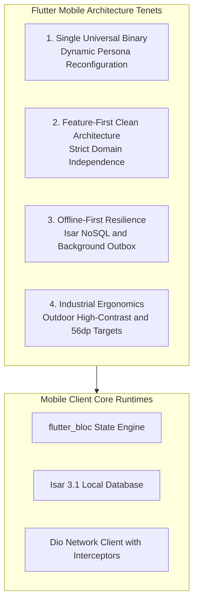
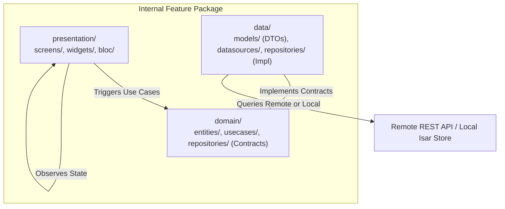
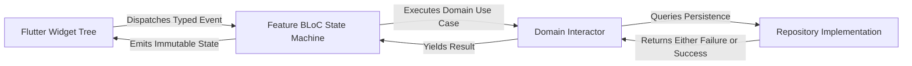
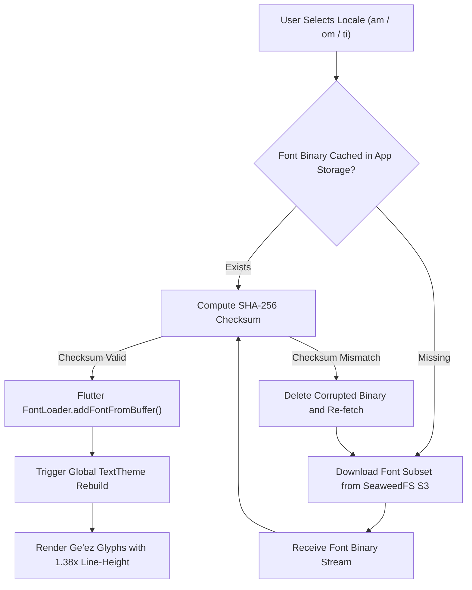
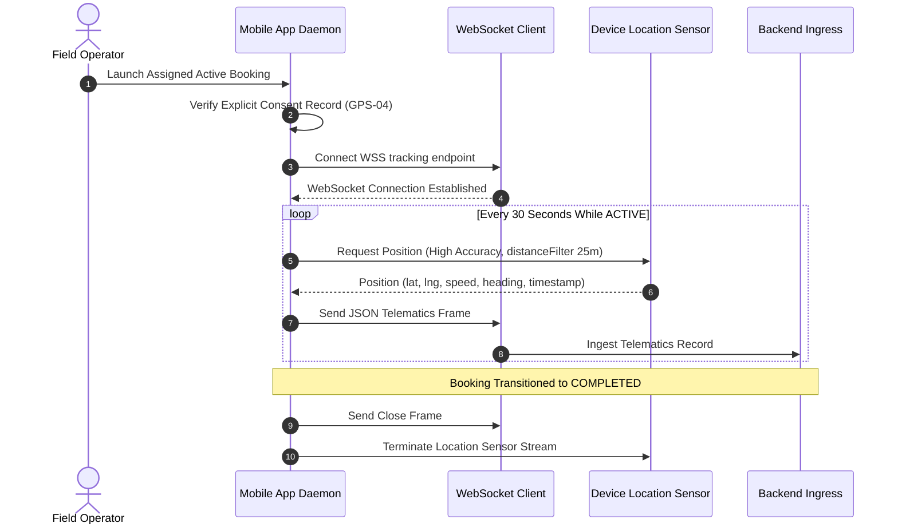
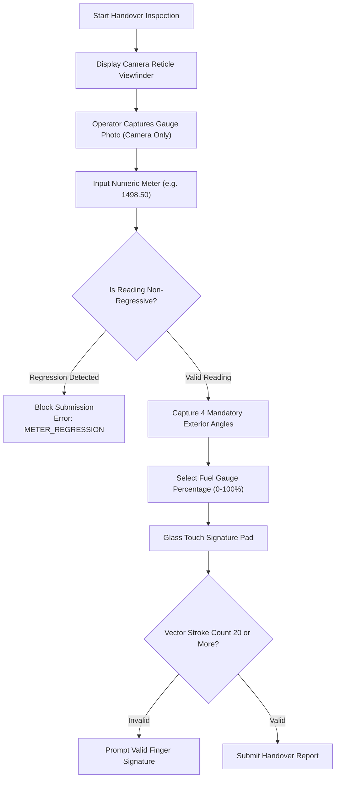
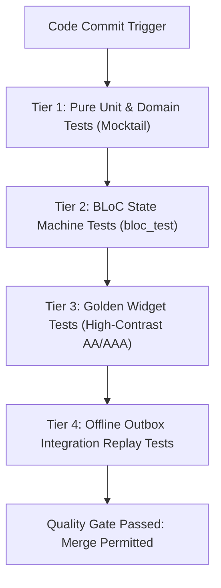

# Heavy Machinery & Logistics Rental Aggregator — Dink Machinery
## Architecture Specification — 05. Flutter Mobile Client Architecture (`docs/shared/architecture/05-flutter-mobile-app-architecture.md`)

**Document Identifier:** `ARCH-FLUTTER-DINK-CORE-V7.0`  
**Classification:** Canonical Architecture Specification & Engineering Reference (Single Source of Truth)  
**Governing Documents:** `SRS-DINK-CORE-V7.0` (Parts 1–5), `ARCH-INTRO-DINK-CORE-V7.0`, `ARCH-PRIN-DINK-CORE-V7.0`, `ARCH-OVERVIEW-DINK-CORE-V7.0`, `ARCH-BACKEND-GO-DINK-CORE-V7.0`, `UIUX-DINK-CORE-V7.0`, `contracts/openapi.yaml`, `ADR-001` through `ADR-014`  
**Target Runtimes:** Flutter 3.47.8 / Dart 3.9 (Android API 26+, iOS 15+), Isar 3.1 NoSQL Local Store, Go 1.27.3 Backend Monolith  
**Target Markets:** Ethiopia (`ET`) & Kenya (`KE`) — Dynamic Multi-Country Parameterization (`LOC-01-BE`)  
**Compliance Standards:** OWASP ASVS 4.0.3 Level 3 (Mobile Verification), RFC 9457 (Problem Details), W3C WCAG 2.2 AA / AAA (Outdoor Mode), ISO 4217, ISO 3166-1 alpha-2  
**Status:** Approved Engineering Baseline

---

## Table of Contents

- 1. [Executive Summary & Design Tenets](#1-executive-summary--design-tenets)
- 2. [Directory Layout & Feature-First Packaging](#2-directory-layout--feature-first-packaging)
  - 2.1 [Codebase Topography](#21-codebase-topography)
  - 2.2 [Internal Feature Encapsulation (Clean Architecture)](#22-internal-feature-encapsulation-clean-architecture)
- 3. [BLoC State Management Engine & Lifecycle](#3-bloc-state-management-engine--lifecycle)
  - 3.1 [Event-Driven Finite State Machines](#31-event-driven-finite-state-machines)
  - 3.2 [Concurrency Transformers & Debouncing](#32-concurrency-transformers--debouncing)
  - 3.3 [Global BLoC Observer & State Audit Log](#33-global-bloc-observer--state-audit-log)
- 4. [Offline-First Outbox Synchronization Daemon](#4-offline-first-outbox-synchronization-daemon)
  - 4.1 [Local Isar NoSQL Storage Schema](#41-local-isar-nosql-storage-schema)
  - 4.2 [Background Worker Isolates for Image Compression](#42-background-worker-isolates-for-image-compression)
  - 4.3 [Idempotent Outbox Replay Engine](#43-idempotent-outbox-replay-engine)
- 5. [Dynamic Multilingual Typography & OTA Font Pipeline (`ADR-013`)](#5-dynamic-multilingual-typography--ota-font-pipeline-adr-013)
  - 5.1 [OTA Font Download & Memory Injection](#51-ota-font-download--memory-injection)
  - 5.2 [SHA-256 Checksum Integrity Gate](#52-sha-256-checksum-integrity-gate)
  - 5.3 [Multi-Script Baseline & Line-Height Multipliers](#53-multi-script-baseline--line-height-multipliers)
- 6. [Industrial Ergonomics & Adaptive Display Modes](#6-industrial-ergonomics--adaptive-display-modes)
  - 6.1 [Outdoor High-Contrast Engine (Lux Sensor Triggered)](#61-outdoor-high-contrast-engine-lux-sensor-triggered)
  - 6.2 [Vibration-Proof Touch Targets & Spacing Tokens](#62-vibration-proof-touch-targets--spacing-tokens)
  - 6.3 [Audio-Haptic Multimodal Feedback Loop](#63-audio-haptic-multimodal-feedback-loop)
- 7. [Live Telematics, GPS Streaming & Geofence Sensor Loop](#7-live-telematics-gps-streaming--geofence-sensor-loop)
  - 7.1 [Background Location Tracking Daemon](#71-background-location-tracking-daemon)
  - 7.2 [WebSocket Ingress Pipeline (`/ws/v1/bookings/:id/tracking`)](#72-websocket-ingress-pipeline-wsv1bookingsidtracking)
  - 7.3 [Operator Consent Logging & Privacy Gate (`GPS-04`)](#73-operator-consent-logging--privacy-gate-gps-04)
- 8. [Camera-Enforced Field Inspection & Monotonic Hour Meters](#8-camera-enforced-field-inspection--monotonic-hour-meters)
  - 8.1 [Reticle Viewfinder & Sensor Overlay](#81-reticle-viewfinder--sensor-overlay)
  - 8.2 [Monotonic Meter Non-Regression Assertion](#82-monotonic-meter-non-regression-assertion)
  - 8.3 [Vector Signature Canvas & Touch OTP Verification](#83-vector-signature-canvas--touch-otp-verification)
- 9. [Reservation Hold Timer & Direct Payment Upload](#9-reservation-hold-timer--direct-payment-upload)
  - 9.1 [Valkey-Synchronized 60-Minute Countdown](#91-valkey-synchronized-60-minute-countdown)
  - 9.2 [Bank Transfer Coordinate Clipboard & Slip Ingress](#92-bank-transfer-coordinate-clipboard--slip-ingress)
- 10. [Security Hardening, Key Storage & RFC 9457 Handling](#10-security-hardening-key-storage--rfc-9457-handling)
  - 10.1 [Hardware-Backed Keystore / Keychain Integration](#101-hardware-backed-keystore--keychain-integration)
  - 10.2 [Dynamic Dio Interceptor Pipeline & Token Rotation](#102-dynamic-dio-interceptor-pipeline--token-rotation)
  - 10.3 [RFC 9457 Universal Error Presentation & Scrubbing](#103-rfc-9457-universal-error-presentation--scrubbing)
- 11. [Testing Architecture & Automated Quality Gates](#11-testing-architecture--automated-quality-gates)

---

## 1. Executive Summary & Design Tenets

The Dink Machinery mobile client is engineered as a single, universal cross-platform application on Flutter 3.47.8 (Dart 3.9). A single compiled binary dynamically reconfigures its navigation, permissions, and operational capabilities to serve three distinct operational personas across East Africa:
1. **Equipment Renters (Civil Contractors & Project Engineers):** Search heavy machinery using PostGIS distance sliders, lock 60-minute reservation holds, submit bank transfer evidence, and sign digital delivery attestations.
2. **Fleet Owners (Asset Investors & Equipment Yard Managers):** Manage fleet inventory, configure dynamic EAV specifications, verify bank transfer receipts, monitor operator dispatches, and manage pre-funded `OwnerWallet` commission balances.
3. **Field Operators (Certified Machine Drivers & Mechanics):** Perform camera-enforced pre/post-rental inspections, log monotonic physical hour meter readings, record fuel levels, counter-sign handover checklists, and stream 30-second live GPS telematics.



### The Four Non-Negotiable Mobile Architecture Tenets

1. **Single Universal Binary with Persona Polymorphism:** One codebase produces both Android APK/AAB and iOS IPA bundles. User claims embedded in the cryptographic ES256 session token dynamically mount the appropriate persona navigation shell (Renter, Owner, or Operator) without requiring distinct app distributions.
2. **Feature-First Clean Architecture:** Features are isolated self-contained vertical packages. Inner domain entities and use cases contain zero Flutter framework dependencies. Business logic is strictly tested without rendering widget trees.
3. **Offline-First Resilience with Idempotent Outbox:** Field equipment inspections, photograph captures, and condition attestations must succeed even when working in deep quarry cuts or remote infrastructure corridors without cellular coverage. Data is saved locally in Isar NoSQL and replayed by an outbox sync worker using client-generated UUIDv4 idempotency keys.
4. **Industrial Frontier Ergonomics:** Designed for extreme field environments: high ambient glare ($> 80,000\text{ lux}$), engine vibration, dirty screens, and operators wearing work gloves. Enforces minimum $48\times 48\text{ dp}$ touch envelopes (target $56\times 56\text{ dp}$), haptic confirmation feedback, high-contrast monochrome modes (WCAG 2.2 AAA), and over-the-air multi-script font delivery (`ADR-013`).

---

## 2. Directory Layout & Feature-First Packaging

The application structure organizes features vertically, grouping the presentation, domain, and data tiers together within each business capability.

### 2.1 Codebase Topography

```text
dink_machinery_mobile/
├── android/                        # Android native wrapper and ProGuard configs
├── ios/                            # iOS native wrapper and Xcode workspace
├── assets/                         # Pre-bundled assets (Latin fonts, icons, branding)
│   ├── icons/
│   ├── images/
│   └── fonts/                      # Roboto and SpaceMono pre-bundled
├── lib/
│   ├── app.dart                    # Root MaterialApp, dynamic theme, localization
│   ├── bootstrap.dart              # Global error zones, logging, BLoC observer
│   ├── main.dart                   # Entry point invoking bootstrap()
│   ├── core/                       # Shared platform utilities and design tokens
│   │   ├── config/                 # Country configurations and environment constants
│   │   ├── constants/              # App tokens, storage keys, route paths
│   │   ├── errors/                 # RFC 9457 Problem Details parsing & exceptions
│   │   ├── network/                # Dio HTTP client, interceptors, connectivity
│   │   ├── storage/                # flutter_secure_storage and Isar database instance
│   │   ├── synchronization/        # Background outbox sync engine and daemon
│   │   ├── telemetry/              # GPS sensor manager and WebSocket client
│   │   ├── theme/                  # Design tokens, high-glare outdoor theme, typography
│   │   └── widgets/                # Primitives (AppButton, AppTextField, Reticle)
│   └── features/                   # Bounded feature packages (Vertical Slices)
│       ├── auth/                   # Phone OTP, WebAuthn Passkeys, Fayda adapter UI
│       ├── catalog/                # Fleet asset detail, dynamic EAV accordion
│       ├── search/                 # PostGIS spatial map, radius slider, filters
│       ├── booking/                # 20-State booking flow, 60-min hold timer
│       ├── inspection/             # Camera-enforced check-in/out, meter verify
│       ├── payment/                # Direct bank slip upload, copy coordinates
│       ├── wallet/                 # OwnerWallet dashboard, commission ledger
│       ├── dispute/                # Arbitration lightbox, tri-party evidence chat
│       └── logistics/              # Transport carrier matching and sub-bookings
├── test/                           # Unit, BLoC, and Widget tests
└── pubspec.yaml                    # Flutter dependencies and asset manifest
```

### 2.2 Internal Feature Encapsulation (Clean Architecture)

Each feature directory under `lib/features/{feature}/` enforces three distinct architectural layers:



1. **`domain/`:** The pure Dart core of the feature. Contains domain entities, value objects (e.g., `MoneyAmount`), use cases, and repository interfaces. Contains zero imports from `package:flutter`, `dio`, or `isar`.
2. **`data/`:** Responsible for data retrieval and persistence. Contains DTO models with `fromJson`/`toJson` mappers conforming to `contracts/openapi.yaml`, remote API data sources, and concrete repository implementations.
3. **`presentation/`:** Flutter UI layer. Contains reusable feature widgets, full screens, and `bloc/` (Events, States, and BLoC classes). Widgets dispatch events to the BLoC and rebuild in response to emitted states.

---

## 3. BLoC State Management Engine & Lifecycle

State management is strictly implemented using `flutter_bloc` (v8.1+). BLoCs act as deterministic, event-driven state machines, decoupling business logic from UI rendering.



### 3.1 Event-Driven Finite State Machines

Every BLoC operates on immutable events and emits strongly typed, immutable states using `freezed` or `equatable`.

```dart
// features/booking/presentation/bloc/booking_state.dart
import 'package:equatable/equatable.dart';
import 'package:dink/features/booking/domain/entities/booking.dart';
import 'package:dink/core/errors/problem_details.dart';

abstract class BookingState extends Equatable {
  const BookingState();
  @override
  List<Object?> get props => [];
}

class BookingInitial extends BookingState {}

class BookingLoading extends BookingState {}

class BookingHoldActive extends BookingState {
  final Booking booking;
  final int remainingSeconds;

  const BookingHoldActive({
    required this.booking,
    required this.remainingSeconds,
  });

  @override
  List<Object?> get props => [booking.id, remainingSeconds, booking.version];
}

class BookingFailure extends BookingState {
  final ProblemDetails problem;
  const BookingFailure(this.problem);

  @override
  List<Object?> get props => [problem.code, problem.status];
}
```

### 3.2 Concurrency Transformers & Debouncing

To prevent duplicate API mutations from double-tapping or unstable connection bursts, BLoC event handlers utilize concurrency transformers from `bloc_concurrency`:
* **`droppable()`:** Discards incoming events if the current event is still executing (applied to all mutating operations: "Book Now", "Confirm Payment", "Submit Inspection").
* **`restartable()`:** Cancels running tasks in favor of new events (applied to search typeaheads and PostGIS radius slider adjustments).

```dart
// features/booking/presentation/bloc/booking_bloc.dart
import 'package:bloc/bloc.dart';
import 'package:bloc_concurrency/bloc_concurrency.dart';
import 'package:dink/features/booking/presentation/bloc/booking_event.dart';
import 'package:dink/features/booking/presentation/bloc/booking_state.dart';
import 'package:dink/features/booking/domain/usecases/create_hold_usecase.dart';

class BookingBloc extends Bloc<BookingEvent, BookingState> {
  final CreateHoldUseCase _createHold;

  BookingBloc(this._createHold) : super(BookingInitial()) {
    // Enforce droppable transformer to prevent duplicate reservation calls
    on<CreateBookingHoldRequested>(
      _onCreateBookingHold,
      transformer: droppable(),
    );
  }

  Future<void> _onCreateBookingHold(
    CreateBookingHoldRequested event,
    Emitter<BookingState> emit,
  ) async {
    emit(BookingLoading());
    final result = await _createHold(event.params);

    result.fold(
      (failure) => emit(BookingFailure(failure)),
      (booking) => emit(BookingHoldActive(
        booking: booking,
        remainingSeconds: 3600,
      )),
    );
  }
}
```

### 3.3 Global BLoC Observer & State Audit Log

A global `AppBlocObserver` intercepts every state transition, logging events for debugging while scrubbing sensitive PII fields:

```dart
// core/telemetry/app_bloc_observer.dart
import 'package:bloc/bloc.dart';
import 'package:dink/core/telemetry/app_logger.dart';

class AppBlocObserver extends BlocObserver {
  final AppLogger _logger;
  AppBlocObserver(this._logger);

  @override
  void onTransition(Bloc bloc, Transition transition) {
    super.onTransition(bloc, transition);
    _logger.debug(
      'BLoC Transition: ${bloc.runtimeType} | '
      'Event: ${transition.event.runtimeType} -> '
      'NextState: ${transition.nextState.runtimeType}',
    );
  }

  @override
  void onError(BlocBase bloc, Object error, StackTrace stackTrace) {
    _logger.error('BLoC Error in ${bloc.runtimeType}', error, stackTrace);
    super.onError(bloc, error, stackTrace);
  }
}
```

---

## 4. Offline-First Outbox Synchronization Daemon

Field operators frequently conduct equipment handovers and damage inspections in remote construction sites without cellular connectivity. The client implements an **Outbox Pattern** backed by an embedded Isar NoSQL database.

```mermaid
flowchart TD
    subgraph OfflineCapture [Offline Device Capture]
        UIForm["Inspection Form Completed"] --> SaveLocal["Write Draft to Local Isar DB<br/>Status: QUEUED"]
        SaveLocal --> IsolateCompress["Background Dart Isolate<br/>Compress Photos to WebP 1600px"]
        IsolateCompress --> CacheDisk["Save WebP Blobs in App Sandbox Cache"]
    end

    subgraph SyncDaemon [Background Outbox Daemon]
        ConnListener["connectivity_plus Listener"] --> NetworkRestored["Network Interface Online"]
        NetworkRestored --> ProcessQueue["OutboxSyncDaemon.process()"]
        ProcessQueue --> ReadQueued["Read Oldest Queued Record"]
        ReadQueued --> StreamUpload["Stream Images to ClamAV and S3"]
        StreamUpload --> SyncRPC["POST /api/v1/inspections/sync<br/>Header: Idempotency-Key"]
        SyncRPC --> ServerAck{"Server Response"}
        ServerAck -->|201 Success| MarkSynced["Update Isar: Status SYNCED<br/>Purge Temporary Image Blobs"]
        ServerAck -->|409 Conflict| MarkFailed["Update Isar: Status CONFLICT<br/>Prompt Manual Reconciliation"]
    end
```



### 4.1 Local Isar NoSQL Storage Schema

```dart
// core/storage/schemas/offline_inspection_outbox.dart
import 'package:isar/isar.dart';

part 'offline_inspection_outbox.g.dart';

@collection
class OfflineInspectionOutbox {
  Id id = Isar.autoIncrement;

  @Index(unique: true, replace: true)
  late String localDraftId; // UUIDv4 idempotency key

  late String bookingId;
  late String inspectionType; // PRE_RENTAL or POST_RENTAL
  late double hourMeterReading;
  late int fuelPercentage;
  late List<String> localImagePaths;
  late String signaturePointsJson;
  late DateTime capturedAt;

  @Enumerated(EnumType.name)
  late SyncStatus syncStatus; // queued, inProgress, synced, failed

  String? failureReason;
  int retryAttempts = 0;
}

enum SyncStatus { queued, inProgress, synced, failed }
```

### 4.2 Background Worker Isolates for Image Compression

Raw photographs from modern smartphone cameras range from $8\text{MB}$ to $15\text{MB}$. Compressing these on the main UI thread causes frame drops and UI stutter. The compression logic is offloaded to a background Dart isolate using `compute()`:

```dart
// core/storage/image_compressor.dart
import 'dart:io';
import 'package:flutter/foundation.dart';
import 'package:image/image.dart' as img;

class ImageCompressionParams {
  final String sourcePath;
  final String targetPath;
  final int maxDimension;
  final int quality;

  ImageCompressionParams(this.sourcePath, this.targetPath, {
    this.maxDimension = 1600,
    this.quality = 82,
  });
}

Future<File> compressInspectionPhoto(String sourcePath, String targetPath) async {
  final params = ImageCompressionParams(sourcePath, targetPath);
  return await compute(_compressImageWorker, params);
}

File _compressImageWorker(ImageCompressionParams params) {
  final rawBytes = File(params.sourcePath).readAsBytesSync();
  final decoded = img.decodeImage(rawBytes);

  if (decoded == null) {
    throw Exception('Failed to decode camera image for compression');
  }

  // Calculate proportional downscale
  img.Image resized;
  if (decoded.width > params.maxDimension || decoded.height > params.maxDimension) {
    if (decoded.width > decoded.height) {
      resized = img.copyResize(decoded, width: params.maxDimension);
    } else {
      resized = img.copyResize(decoded, height: params.maxDimension);
    }
  } else {
    resized = decoded;
  }

  final compressedBytes = img.encodeJpg(resized, quality: params.quality);
  final targetFile = File(params.targetPath);
  targetFile.writeAsBytesSync(compressedBytes, flush: true);

  return targetFile;
}
```

### 4.3 Idempotent Outbox Replay Engine

When connectivity is restored, the `OutboxSyncDaemon` runs sequentially:

```dart
// core/synchronization/outbox_sync_daemon.dart
import 'dart:async';
import 'package:dio/dio.dart';
import 'package:isar/isar.dart';
import 'package:connectivity_plus/connectivity_plus.dart';
import 'package:dink/core/storage/schemas/offline_inspection_outbox.dart';

class OutboxSyncDaemon {
  final Isar _isar;
  final Dio _dio;
  StreamSubscription? _connectivitySub;
  bool _isProcessing = false;

  OutboxSyncDaemon(this._isar, this._dio);

  void startListening() {
    _connectivitySub = Connectivity().onConnectivityChanged.listen((status) {
      if (status != ConnectivityResult.none) {
        processQueue();
      }
    });
  }

  Future<void> processQueue() async {
    if (_isProcessing) return;
    _isProcessing = true;

    try {
      final queued = await _isar.offlineInspectionOutboxs
          .filter()
          .syncStatusEqualTo(SyncStatus.queued)
          .sortByCapturedAt()
          .findAll();

      for (final item in queued) {
        item.syncStatus = SyncStatus.inProgress;
        await _isar.writeTxn(() => _isar.offlineInspectionOutboxs.put(item));

        try {
          // Replay using client-generated UUID as Idempotency-Key
          final response = await _dio.post(
            '/api/v1/inspections/sync',
            data: {
              'localDraftId': item.localDraftId,
              'bookingId': item.bookingId,
              'meterReading': item.hourMeterReading,
              'fuelPercent': item.fuelPercentage,
              'type': item.inspectionType,
              'capturedAt': item.capturedAt.toIso8601String(),
            },
            options: Options(headers: {
              'Idempotency-Key': item.localDraftId,
            }),
          );

          if (response.statusCode == 200 || response.statusCode == 201) {
            item.syncStatus = SyncStatus.synced;
            await _isar.writeTxn(() => _isar.offlineInspectionOutboxs.put(item));
          }
        } on DioException catch (e) {
          item.syncStatus = SyncStatus.failed;
          item.failureReason = e.message;
          item.retryAttempts += 1;
          await _isar.writeTxn(() => _isar.offlineInspectionOutboxs.put(item));
          break; // Stop replay on connection failures
        }
      }
    } finally {
      _isProcessing = false;
    }
  }

  void dispose() {
    _connectivitySub?.cancel();
  }
}
```

---

## 5. Dynamic Multilingual Typography & OTA Font Pipeline (`ADR-013`)

To prevent multi-script typography from inflating the base application download size, non-Latin typography is excluded from the pre-bundled asset package and delivered Over-The-Air (OTA).



### 5.1 OTA Font Download & Memory Injection

```dart
// core/theme/ota_font_loader.dart
import 'dart:io';
import 'dart:typed_data';
import 'package:crypto/crypto.dart';
import 'package:flutter/services.dart';
import 'package:path_provider/path_provider.dart';
import 'package:dio/dio.dart';

class OTAFontLoader {
  static const String _ethioFontFamily = 'NotoSansEthiopic';
  static const String _expectedSha256 = '8a7b9c4d2e1f0a3b5c6d7e8f9a0b1c2d3e4f5a6b7c8d9e0f1a2b3c4d5e6f7a8b';
  static const String _cdnUrl = '[https://s3.dinkmachinery.com/fonts/NotoSansEthiopic-Regular.ttf](https://s3.dinkmachinery.com/fonts/NotoSansEthiopic-Regular.ttf)';

  static Future<bool> ensureFontLoaded() async {
    try {
      final dir = await getApplicationSupportDirectory();
      final fontFile = File('${dir.path}/$_ethioFontFamily.ttf');

      Uint8List fontBytes;

      if (await fontFile.exists()) {
        fontBytes = await fontFile.readAsBytes();
        if (!_verifyChecksum(fontBytes, _expectedSha256)) {
          await fontFile.delete();
          fontBytes = await _downloadFont(fontFile);
        }
      } else {
        fontBytes = await _downloadFont(fontFile);
      }

      // Dynamically load binary font into Flutter's FontLoader
      final fontLoader = FontLoader(_ethioFontFamily);
      fontLoader.addFont(Future.value(ByteData.view(fontBytes.buffer)));
      await fontLoader.load();
      return true;
    } catch (e) {
      // Fallback cleanly to system standard fonts on download error
      return false;
    }
  }

  static bool _verifyChecksum(Uint8List bytes, String expectedHash) {
    final actualHash = sha256.convert(bytes).toString();
    return actualHash == expectedHash;
  }

  static Future<Uint8List> _downloadFont(File destination) async {
    final response = await Dio().get<List<int>>(
      _cdnUrl,
      options: Options(responseType: ResponseType.bytes),
    );
    final bytes = Uint8List.fromList(response.data!);
    await destination.writeAsBytes(bytes, flush: true);
    return bytes;
  }
}
```

### 5.2 SHA-256 Checksum Integrity Gate
Font binaries are verified against pre-baked SHA-256 hashes defined in the application configuration. Corrupted or partially downloaded font files are deleted automatically before fallback font chains are engaged.

### 5.3 Multi-Script Baseline & Line-Height Multipliers
Ethiopic scripts include upper and lower diacritical markers (ascenders/descenders). To prevent glyph clipping in card layouts and lists, typography styles enforce minimum line-height multipliers:
* Standard Latin (`Roboto`): `height: 1.25`
* Ethiopic Ge'ez (`NotoSansEthiopic`): `height: 1.38` minimum

---

## 6. Industrial Ergonomics & Adaptive Display Modes

Construction corridors, open-pit mines, and civil infrastructure jobsites experience ambient daylight exceeding $80,000\text{ lux}$, heavy physical vibration, and dust accumulation on screens.

```text
+-----------------------------------+
|  System Status Bar (Read-Only)    |  <- Signal, Battery, Sync Status Pill
+-----------------------------------+
|  Top App Bar: Quick High-Glare    |  <- [!] High-Contrast Toggle Button
+-----------------------------------+
|                                   |
|  Content Viewing Region           |  <- Machine Specs, Map Viewports,
|  (Natural Scanning Eye Level)     |     Inspection Photos
|                                   |
+-----------------------------------+
|  Thumb Action Reach Zone          |  <- Primary Handover Buttons, Camera
|  (Target 56 x 56 dp Touch Target) |     Shutter, Glass Signature Canvas
+-----------------------------------+
```

### 6.1 Outdoor High-Contrast Engine (Lux Sensor Triggered)

The mobile client monitors the device's hardware ambient light sensor via `environment_sensors`. When measured ambient illuminance exceeds $25,000\text{ lux}$, the app automatically prompts or activates **Outdoor High-Contrast Mode**.

```dart
// core/theme/adaptive_theme_manager.dart
import 'dart:async';
import 'package:flutter/material.dart';
import 'package:environment_sensors/environment_sensors.dart';

class AdaptiveThemeManager extends ChangeNotifier {
  final EnvironmentSensors _sensors = EnvironmentSensors();
  StreamSubscription? _luxSubscription;
  bool _isHighContrastMode = false;
  static const double _luxThreshold = 25000.0;

  bool get isHighContrastMode => _isHighContrastMode;

  void startAmbientMonitoring() {
    _luxSubscription = _sensors.light.listen((lux) {
      if (lux > _luxThreshold && !_isHighContrastMode) {
        _isHighContrastMode = true;
        notifyListeners();
      } else if (lux < (_luxThreshold - 5000) && _isHighContrastMode) {
        _isHighContrastMode = false;
        notifyListeners();
      }
    });
  }

  void toggleManualHighContrast() {
    _isHighContrastMode = !_isHighContrastMode;
    notifyListeners();
  }

  ThemeData get activeTheme => _isHighContrastMode ? _outdoorHighContrastTheme : _standardLightTheme;

  static final ThemeData _outdoorHighContrastTheme = ThemeData(
    brightness: Brightness.light,
    scaffoldBackgroundColor: const Color(0xFFFFFFFF),
    primaryColor: const Color(0xFF000000),
    colorScheme: const ColorScheme.light(
      primary: Color(0xFF000000),
      secondary: Color(0xFFFFE600), // Safety Yellow
      surface: Color(0xFFFFFFFF),
      error: Color(0xFFB91C1C),
    ),
    // Enforce 10:1 high-contrast ratios for outdoor readability
    cardTheme: const CardTheme(
      color: Color(0xFFFFFFFF),
      shape: RoundedRectangleBorder(
        side: BorderSide(color: Color(0xFF000000), width: 2.5),
      ),
    ),
  );

  static final ThemeData _standardLightTheme = ThemeData(
    brightness: Brightness.light,
    scaffoldBackgroundColor: const Color(0xFFF8FAFC),
    primaryColor: const Color(0xFFF59E0B),
  );
}
```

### 6.2 Vibration-Proof Touch Targets & Spacing Tokens
Operators working near running excavators experience severe hand vibration and frequently wear protective work gloves.
* **Target Size:** Every interactive element enforces a minimum touch envelope of $48\times 48\text{ dp}$ via `BoxConstraints(minWidth: 48, minHeight: 48)`.
* **Primary Field Actions:** High-consequence buttons (Camera Shutter, "Confirm Handover", "Lock Hold") use a larger $56\times 56\text{ dp}$ touch target.
* **Separation Buffer:** A minimum of $8\text{ dp}$ spacing between interactive elements prevents accidental adjacent taps.

### 6.3 Audio-Haptic Multimodal Feedback Loop
Every state mutation, checklist tap, and camera shutter actuation triggers haptic feedback:
* **Haptic Confirmation:** `HapticFeedback.heavyImpact()` for key actions (handover sign-off, hold reservation).
* **Audio Cues:** Field inspection completions emit an optional high-frequency chime ($85\text{ dB}$, $1200\text{ Hz}$) confirming successful local file saves under high-glare conditions where the screen may not be clearly visible.

---

## 7. Live Telematics, GPS Streaming & Geofence Sensor Loop

Operating under requirements `GPS-01` through `GPS-04`, the mobile client streams live GPS telemetry during active leases.



### 7.1 Background Location Tracking Daemon

```dart
// core/telemetry/telematics_daemon.dart
import 'dart:async';
import 'dart:convert';
import 'package:geolocator/geolocator.dart';
import 'package:web_socket_channel/web_socket_channel.dart';
import 'package:dink/core/telemetry/app_logger.dart';

class TelematicsDaemon {
  final String bookingId;
  final String authToken;
  final AppLogger _logger;
  WebSocketChannel? _channel;
  StreamSubscription<Position>? _positionSub;
  Timer? _heartbeatTimer;

  TelematicsDaemon({
    required this.bookingId,
    required this.authToken,
    required AppLogger logger,
  }) : _logger = logger;

  Future<void> startTracking() async {
    final hasPermission = await _assertLocationPermission();
    if (!hasPermission) {
      _logger.warn('Location permission denied for telematics stream');
      return;
    }

    final wsUrl = Uri.parse('wss://[api.dinkmachinery.com/ws/v1/bookings/$bookingId/tracking?token=$authToken](https://api.dinkmachinery.com/ws/v1/bookings/$bookingId/tracking?token=$authToken)');
    _channel = WebSocketChannel.connect(wsUrl);

    // Stream position updates using 25-meter distance filter
    const locationSettings = LocationSettings(
      accuracy: LocationAccuracy.high,
      distanceFilter: 25,
    );

    _positionSub = Geolocator.getPositionStream(locationSettings: locationSettings).listen(
      (Position pos) {
        _dispatchTelemetryFrame(pos);
      },
      onError: (err) {
        _logger.error('Geolocator stream error', err);
      },
    );
  }

  void _dispatchTelemetryFrame(Position pos) {
    if (_channel == null) return;

    final frame = {
      'bookingId': bookingId,
      'latitude': pos.latitude,
      'longitude': pos.longitude,
      'speedKnots': (pos.speed * 1.94384), // Convert m/s to knots
      'heading': pos.heading,
      'accuracyMeters': pos.accuracy,
      'recordedAt': DateTime.now().toUtc().toIso8601String(),
    };

    _channel!.sink.add(jsonEncode(frame));
  }

  Future<bool> _assertLocationPermission() async {
    LocationPermission permission = await Geolocator.checkPermission();
    if (permission == LocationPermission.denied) {
      permission = await Geolocator.requestPermission();
    }
    return permission == LocationPermission.always || permission == LocationPermission.whileInUse;
  }

  void stopTracking() {
    _positionSub?.cancel();
    _heartbeatTimer?.cancel();
    _channel?.sink.close();
    _logger.info('Telematics daemon stopped for booking $bookingId');
  }
}
```

### 7.2 WebSocket Ingress Pipeline (`/ws/v1/bookings/:id/tracking`)
* **Transport:** Secure WebSockets (TLS 1.3) with client-initiated pings every 20 seconds.
* **Reconnection Engine:** Uses an exponential backoff reconnect strategy ($1\text{s}, 2\text{s}, 4\text{s}, \dots, 30\text{s}$) to resume streaming after temporary cellular drops.

### 7.3 Operator Consent Logging & Privacy Gate (`GPS-04`)
Before activating the location daemon, the app displays a modal consent prompt explaining data usage and retention rules. Tapping "Agree" logs a tamper-evident record (`OperatorConsentLog`) containing user ID, timestamp, and terms version before tracking commences.

---

## 8. Camera-Enforced Field Inspection & Monotonic Hour Meters

Under requirements `AR-01-MOB` through `AR-08-MOB`, machine handovers require joint digital inspections enforcing non-regression of monotonic hour meter readings.



### 8.1 Reticle Viewfinder & Sensor Overlay
The inspection camera uses `camera: ^0.11.0` with gallery uploads disabled. A custom reticle overlay guides the operator to align the physical hour meter gauge within a centered $4:3$ bounding box.

```dart
// features/inspection/presentation/widgets/camera_reticle_overlay.dart
import 'package:flutter/material.dart';

class CameraReticleOverlay extends StatelessWidget {
  final String helperText;
  const CameraReticleOverlay({super.key, required this.helperText});

  @override
  Widget build(BuildContext context) {
    final size = MediaQuery.of(context).size;
    final reticleWidth = size.width * 0.85;
    final reticleHeight = reticleWidth * 0.75; // 4:3 reticle ratio

    return Stack(
      children: [
        // Semi-transparent darkened background mask
        ColorFiltered(
          colorFilter: ColorFilter.mode(
            Colors.black.withOpacity(0.65),
            BlendMode.srcOut,
          ),
          child: Stack(
            children: [
              Container(
                decoration: const BoxDecoration(
                  color: Colors.transparent,
                ),
              ),
              Align(
                alignment: Alignment.center,
                child: Container(
                  width: reticleWidth,
                  height: reticleHeight,
                  decoration: BoxDecoration(
                    color: Colors.black,
                    borderRadius: BorderRadius.circular(12),
                  ),
                ),
              ),
            ],
          ),
        ),
        // Reticle alignment borders
        Align(
          alignment: Alignment.center,
          child: Container(
            width: reticleWidth,
            height: reticleHeight,
            decoration: BoxDecoration(
              border: Border.all(color: const Color(0xFFFFE600), width: 3),
              borderRadius: BorderRadius.circular(12),
            ),
          ),
        ),
        Align(
          alignment: const Alignment(0, 0.65),
          child: Container(
            padding: const EdgeInsets.symmetric(horizontal: 16, vertical: 8),
            color: Colors.black87,
            child: Text(
              helperText,
              style: const TextStyle(color: Colors.white, fontWeight: FontWeight.bold),
            ),
          ),
        ),
      ],
    );
  }
}
```

### 8.2 Monotonic Meter Non-Regression Assertion
During post-rental check-out inspections, the client validates the entered reading against the pre-rental baseline:

```dart
// features/inspection/domain/usecases/validate_meter_usecase.dart
class ValidateMeterUseCase {
  bool call({
    required double preRentalBaseline,
    required double postRentalReading,
  }) {
    // Return reading cannot regress below baseline
    return postRentalReading >= preRentalBaseline;
  }
}
```

### 8.3 Vector Signature Canvas & Touch OTP Verification
* **Vector Path Validation:** Handover attestations capture finger signatures via a vector stroke canvas. Submissions require a minimum of 20 vector points, preventing accidental taps from submitting blank signatures.
* **Touch OTP Fallback:** If the physical touch glass is cracked or wet, the user can verify handover via SMS OTP.

---

## 9. Reservation Hold Timer & Direct Payment Upload

### 9.1 Valkey-Synchronized 60-Minute Countdown

Under requirements `BK-06-BE` and `BK-06-MOB`, renters have 60 minutes to complete their bank transfer and upload receipt proof before the reservation lock expires.

```dart
// features/booking/presentation/widgets/hold_countdown_timer.dart
import 'dart:async';
import 'package:flutter/material.dart';

class HoldCountdownTimer extends StatefulWidget {
  final DateTime expiresAt;
  final VoidCallback onExpired;

  const HoldCountdownTimer({
    super.key,
    required this.expiresAt,
    required this.onExpired,
  });

  @override
  State<HoldCountdownTimer> createState() => _HoldCountdownTimerState();
}

class _HoldCountdownTimerState extends State<HoldCountdownTimer> {
  late Timer _timer;
  late Duration _remaining;

  @override
  void initState() {
    super.initState();
    _calculateRemaining();
    _timer = Timer.periodic(const Duration(seconds: 1), (_) => _calculateRemaining());
  }

  void _calculateRemaining() {
    final now = DateTime.now().toUtc();
    final diff = widget.expiresAt.difference(now);
    if (diff.isNegative) {
      _timer.cancel();
      widget.onExpired();
    } else {
      setState(() => _remaining = diff);
    }
  }

  @override
  Widget build(BuildContext context) {
    final minutes = _remaining.inMinutes.remainder(60).toString().padLeft(2, '0');
    final seconds = _remaining.inSeconds.remainder(60).toString().padLeft(2, '0');

    // Color transition: Emerald (>20m) -> Amber (5-20m) -> Crimson (<5m)
    Color timerColor = const Color(0xFF10B981);
    if (_remaining.inMinutes < 5) {
      timerColor = const Color(0xFFEF4444);
    } else if (_remaining.inMinutes < 20) {
      timerColor = const Color(0xFFF59E0B);
    }

    return Container(
      padding: const EdgeInsets.symmetric(horizontal: 16, vertical: 12),
      decoration: BoxDecoration(
        color: timerColor.withOpacity(0.15),
        border: Border.all(color: timerColor, width: 2),
        borderRadius: BorderRadius.circular(8),
      ),
      child: Row(
        mainAxisSize: MainAxisSize.min,
        children: [
          Icon(Icons.timer_outlined, color: timerColor),
          const SizedBox(width: 8),
          Text(
            '$minutes:$seconds',
            style: TextStyle(
              fontSize: 22,
              fontWeight: FontWeight.bold,
              color: timerColor,
              fontFamily: 'SpaceMono',
            ),
          ),
        ],
      ),
    );
  }

  @override
  void dispose() {
    _timer.cancel();
    super.dispose();
  }
}
```

### 9.2 Bank Transfer Coordinate Clipboard & Slip Ingress
* **Clipboard Interaction:** Tapping account numbers copies coordinates to the system clipboard, triggers haptic confirmation, and displays a temporary `"COPIED!"` pill badge for 2.5 seconds.
* **Slip Upload Ingress:** The payment slip upload card restricts file selection to PNG, JPEG, or WebP formats, automatically downsampling files before multipart upload.

---

## 10. Security Hardening, Key Storage & RFC 9457 Handling

### 10.1 Hardware-Backed Keystore / Keychain Integration

Session tokens are stored using `flutter_secure_storage`, backed by hardware-level encryption:
* **Android:** Hardware Keystore (AES-256-GCM wrapped RSA keys).
* **iOS:** Keychain Services (`kSecAttrAccessibleAfterFirstUnlockThisDeviceOnly`).

```dart
// core/storage/secure_token_storage.dart
import 'package:flutter_secure_storage/flutter_secure_storage.dart';

class SecureTokenStorage {
  final FlutterSecureStorage _storage;
  static const _keyAccessToken = 'dink_jwt_access';
  static const _keyRefreshToken = 'dink_jwt_refresh';

  SecureTokenStorage()
      : _storage = const FlutterSecureStorage(
          aOptions: AndroidOptions(encryptedSharedPreferences: true),
          iOptions: IOSOptions(accessibility: KeychainAccessibility.first_unlock_this_device),
        );

  Future<void> saveTokens({required String access, required String refresh}) async {
    await _storage.write(key: _keyAccessToken, value: access);
    await _storage.write(key: _keyRefreshToken, value: refresh);
  }

  Future<String?> getAccessToken() => _storage.read(key: _keyAccessToken);
  Future<String?> getRefreshToken() => _storage.read(key: _keyRefreshToken);

  Future<void> clearAll() => _storage.deleteAll();
}
```

### 10.2 Dynamic Dio Interceptor Pipeline & Token Rotation

```dart
// core/network/auth_interceptor.dart
import 'package:dio/dio.dart';
import 'package:dink/core/storage/secure_token_storage.dart';

class AuthInterceptor extends QueuedInterceptor {
  final SecureTokenStorage _tokenStorage;
  final Dio _dio;

  AuthInterceptor(this._tokenStorage, this._dio);

  @override
  Future<void> onRequest(RequestOptions options, RequestInterceptorHandler handler) async {
    final token = await _tokenStorage.getAccessToken();
    if (token != null) {
      options.headers['Authorization'] = 'Bearer $token';
    }
    return handler.next(options);
  }

  @override
  Future<void> onError(DioException err, ErrorInterceptorHandler handler) async {
    if (err.response?.statusCode == 401) {
      // 401 Unauthorized: Attempt refresh token rotation
      final refreshToken = await _tokenStorage.getRefreshToken();
      if (refreshToken != null) {
        try {
          final refreshResponse = await _dio.post(
            '/api/v1/auth/token/refresh',
            data: {'refreshToken': refreshToken},
          );

          final newAccess = refreshResponse.data['accessToken'];
          final newRefresh = refreshResponse.data['refreshToken'];

          await _tokenStorage.saveTokens(access: newAccess, refresh: newRefresh);

          // Retry failed request with new access token
          final retryOptions = err.requestOptions;
          retryOptions.headers['Authorization'] = 'Bearer $newAccess';
          final response = await _dio.fetch(retryOptions);
          return handler.resolve(response);
        } catch (_) {
          await _tokenStorage.clearAll();
        }
      }
    }
    return handler.next(err);
  }
}
```

### 10.3 RFC 9457 Universal Error Presentation & Scrubbing

Errors returned by backend endpoints map to `ProblemDetails` models:

```dart
// core/errors/problem_details.dart
class ProblemDetails {
  final String type;
  final String title;
  final int status;
  final String detail;
  final String code;
  final List<InvalidParam> invalidParams;

  ProblemDetails({
    required this.type,
    required this.title,
    required this.status,
    required this.detail,
    required this.code,
    this.invalidParams = const [],
  });

  factory ProblemDetails.fromJson(Map<String, dynamic> json) {
    return ProblemDetails(
      type: json['type'] as String? ?? 'about:blank',
      title: json['title'] as String? ?? 'Error',
      status: json['status'] as int? ?? 500,
      detail: json['detail'] as String? ?? 'An unexpected error occurred.',
      code: json['code'] as String? ?? 'INTERNAL_ERROR',
      invalidParams: (json['invalidParams'] as List<dynamic>?)
              ?.map((p) => InvalidParam.fromJson(p as Map<String, dynamic>))
              .toList() ?? [],
    );
  }
}

class InvalidParam {
  final String name;
  final String reason;

  InvalidParam({required this.name, required this.reason});

  factory InvalidParam.fromJson(Map<String, dynamic> json) {
    return InvalidParam(
      name: json['name'] as String? ?? '',
      reason: json['reason'] as String? ?? '',
    );
  }
}
```

---

## 11. Testing Architecture & Automated Quality Gates

The mobile application utilizes a comprehensive four-tier testing pipeline:



1. **Unit & Domain Tests:** Pure Dart tests validating business rules, money math, and state machine transitions with zero external dependencies.
2. **BLoC Tests (`bloc_test`):** Event-by-event validation of BLoC state transitions, confirming concurrency transformer behavior.
3. **Golden Widget Tests:** Screenshot regression tests verifying layout rendering across standard light, standard dark, and high-glare outdoor modes.
4. **Integration Replay Tests:** Tests the offline outbox lifecycle using an in-memory Isar database to confirm failed network attempts are retried without data loss.

---

*This document defines the canonical architecture specification for the Dink Machinery Flutter mobile client Version 7.0. All downstream widget development, offline database structures, and BLoC implementations must adhere to these standards.*