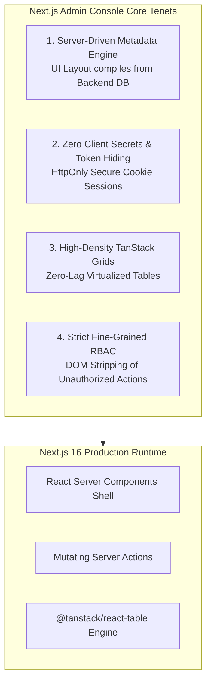
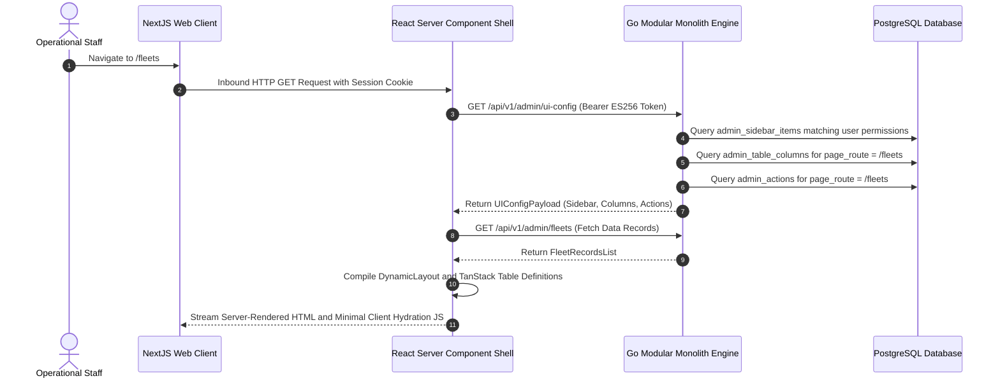
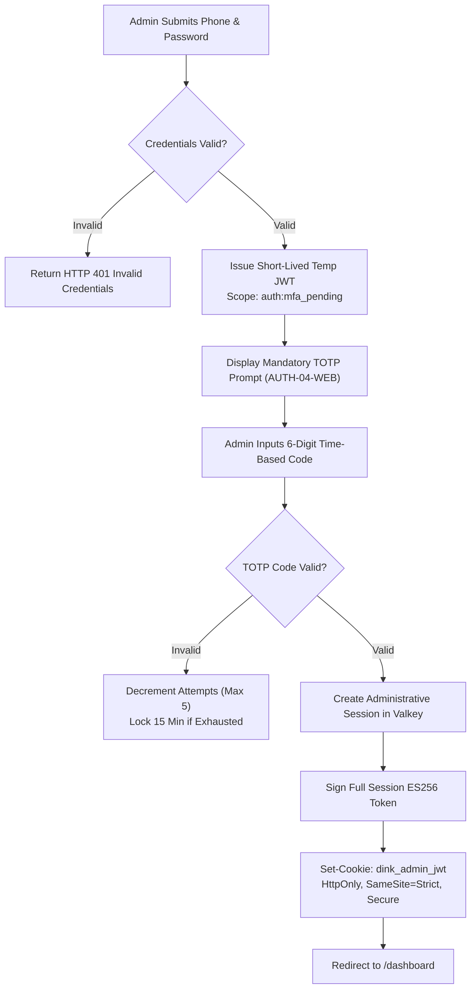
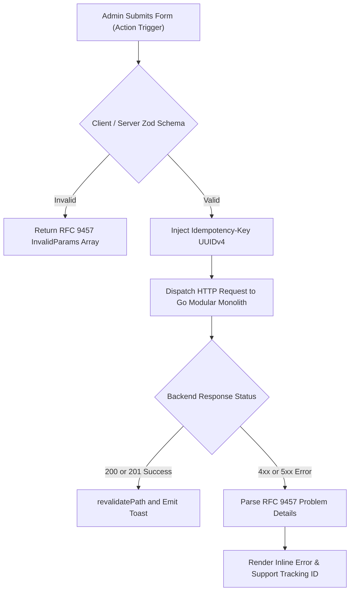
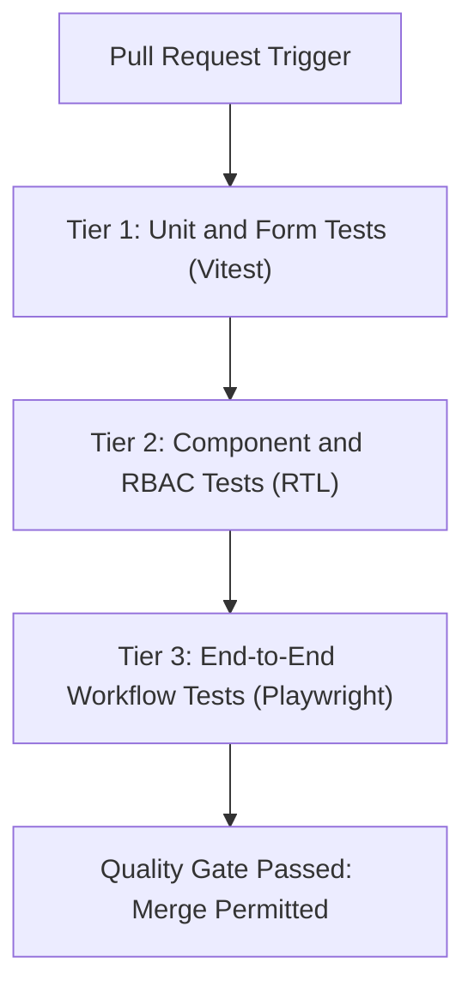

# Heavy Machinery & Logistics Rental Aggregator — Dink Machinery
## Architecture Specification — 06. Next.js Admin Web Console Architecture (`docs/shared/architecture/06-nextjs-admin-panel-architecture.md`)

**Document Identifier:** `ARCH-ADMIN-NEXT-DINK-CORE-V7.0`  
**Classification:** Canonical Architecture Specification & Engineering Reference (Single Source of Truth)  
**Governing Documents:** `SRS-DINK-CORE-V7.0` (Parts 1–5), `ARCH-INTRO-DINK-CORE-V7.0`, `ARCH-PRIN-DINK-CORE-V7.0`, `ARCH-OVERVIEW-DINK-CORE-V7.0`, `ARCH-BACKEND-GO-DINK-CORE-V7.0`, `FLOW-DINK-CORE-V7.0`, `contracts/openapi.yaml`, `ADR-001` through `ADR-014`  
**Target Runtimes:** Next.js 16.x (latest CVE security patch, App Router), React 19, TypeScript 5.8+, Node.js 26.13.0 / Edge Runtime, `@tanstack/react-table` v8, Tailwind CSS v4, Go 1.27.3 Backend Monolith  
**Target Markets:** Ethiopia (`ET`) & Kenya (`KE`) — Dynamic Multi-Country Parameterization (`LOC-01-BE`)  
**Compliance Standards:** OWASP ASVS 4.0.3 Level 3 (Web Applications), RFC 9457 (Problem Details), W3C WCAG 2.2 Level AA, ISO 4217, ISO 3166-1 alpha-2  
**Status:** Approved Engineering Baseline

---

## Table of Contents

- 1. [Executive Summary & Design Tenets](#1-executive-summary--design-tenets)
- 2. [Directory Layout & App Router Topography](#2-directory-layout--app-router-topography)
  - 2.1 [Repository Layout Topography](#21-repository-layout-topography)
  - 2.2 [Server vs. Client Component Boundaries](#22-server-vs-client-component-boundaries)
- 3. [Server-Driven Dynamic Admin UI Engine (`/api/v1/admin/ui-config`)](#3-server-driven-dynamic-admin-ui-engine-apiv1adminui-config)
  - 3.1 [Metadata Schema & Layout Contract](#31-metadata-schema--layout-contract)
  - 3.2 [Dynamic Menu Compilation & Sidebar Generator](#32-dynamic-menu-compilation--sidebar-generator)
  - 3.3 [Dynamic TanStack Table Compilation](#33-dynamic-tanstack-table-compilation)
  - 3.4 [Dynamic Action Button & Permission Filter Engine](#34-dynamic-action-button--permission-filter-engine)
- 4. [Authentication, Session Governance & Hardware MFA](#4-authentication-session-governance--hardware-mfa)
  - 4.1 [HttpOnly Session Cookie Management & Edge Middleware](#41-httponly-session-cookie-management--edge-middleware)
  - 4.2 [Mandatory Administrative TOTP Ceremony (`AUTH-04-WEB`)](#42-mandatory-administrative-totp-ceremony-auth-04-web)
  - 4.3 [Automated Session Draining & Sliding Inactivity Lockout](#43-automated-session-draining--sliding-inactivity-lockout)
- 5. [Fine-Grained Role-Based Access Control (RBAC)](#5-fine-grained-role-based-access-control-rbac)
  - 5.1 [Permission Matrix & Evaluation Hook](#51-permission-matrix--evaluation-hook)
  - 5.2 [Server-Action Guard Decorators](#52-server-action-guard-decorators)
- 6. [Core Administrative Workbenches & Workflows](#6-core-administrative-workbenches--workflows)
  - 6.1 [Owner KYC & Fleet Approval Queue (`AD-13-BE`, `FL-09-BE`)](#61-owner-kyc--fleet-approval-queue-ad-13-be-fl-09-be)
  - 6.2 [Manual Bank Transfer Verification Drawer (`AD-08-WEB`)](#62-manual-bank-transfer-verification-drawer-ad-08-web)
  - 6.3 [Split-Screen Dispute Arbitration Lightbox (`AD-04-WEB`)](#63-split-screen-dispute-arbitration-lightbox-ad-04-web)
  - 6.4 [OwnerWallet & Double-Entry Ledger Desk (`CW-02-MOB`, `BK-17-BE`)](#64-ownerwallet--double-entry-ledger-desk-cw-02-mob-bk-17-be)
  - 6.5 [Dynamic Category & Spec Template Manager](#65-dynamic-category--spec-template-manager)
  - 6.6 [Audit Diff Viewer (`AD-09-WEB`)](#66-audit-diff-viewer-ad-09-web)
- 7. [Mutation Handling & Server Actions Pipeline](#7-mutation-handling--server-actions-pipeline)
  - 7.1 [Idempotency Key Injection](#71-idempotency-key-injection)
  - 7.2 [RFC 9457 Error Boundary & Toast Presentation](#72-rfc-9457-error-boundary--toast-presentation)
- 8. [Data Formatting, Minor-Unit Currencies & Internationalization](#8-data-formatting-minor-unit-currencies--internationalization)
  - 8.1 [Integer Minor-Unit Currency Formatter (`MoneyAmount`)](#81-integer-minor-unit-currency-formatter-moneyamount)
  - 8.2 [Multi-Script & Calendar Localization](#82-multi-script--calendar-localization)
- 9. [Security Hardening & ASVS Level 3 Controls](#9-security-hardening--asvs-level-3-controls)
  - 9.1 [Content Security Policy (CSP) & Header Baseline](#91-content-security-policy-csp--header-baseline)
  - 9.2 [Zero-PII Client-Side Masking Filter](#92-zero-pii-client-side-masking-filter)
- 10. [Testing Architecture & Automated Quality Gates](#10-testing-architecture--automated-quality-gates)

---

## 1. Executive Summary & Design Tenets

The Dink Machinery Admin Web Console is an operations and compliance workstation engineered for desk-based personnel (Super Admins, Operations Officers, Finance Controllers, and Dispute Arbitrators). Operating on **Next.js 16 (App Router)** and **React 19**, it provides high-density data tables, photographic diff inspection lightboxes, and financial audit reconciliation tools.



### The Four Non-Negotiable Web Architecture Tenets

1. **Server-Driven Dynamic Metadata (`AD-06-WEB`):** The console avoids hardcoding operational pages, data table columns, search filters, and action triggers in the frontend bundle. Navigation trees and data grids compile dynamically on the server runtime from `/api/v1/admin/ui-config`. Backend database migrations can add equipment categories, operational columns, and approval actions without triggering frontend redeployments.
2. **Server-First Security & Zero Secret Exposure:** Application state fetching executes via **React Server Components (RSC)** on the Node.js / Edge server tier. Client browsers never receive backend service URLs, API bearer tokens, or sensitive unredacted JSON payloads. Session JWTs are locked behind `HttpOnly`, `SameSite=Strict`, `Secure` cookies.
3. **High-Density Data Grid Ergonomics:** Operations staff manage thousands of pending bookings, machinery listings, and bank transfers daily. Layouts use compact typography, strict 8dp spatial grids, keyboard shortcuts, and virtualized `@tanstack/react-table` instances capable of rendering 10,000+ rows at 60fps.
4. **Mandatory Multi-Factor Authentication & Audit Logging:** In compliance with OWASP ASVS Level 3 (`AUTH-04-WEB`), administrative accounts require hardware-backed WebAuthn or TOTP verification before accessing back-office routes. Every administrative action (approval, rejection, dispute ruling, credit adjustment) generates an immutable, signed audit log entry capturing operator ID, client IP, before/after state diffs, and justification notes.

---

## 2. Directory Layout & App Router Topography

The application structure enforces feature isolation, segregating public authentication routes from protected administrative workstations using Next.js 16 route groups.

### 2.1 Repository Layout Topography

```text
dink-machinery-admin/
├── app/
│   ├── (auth)/                         # Unauthenticated Authentication Route Group
│   │   ├── login/
│   │   │   └── page.tsx                # Phone OTP / Password Ingress
│   │   ├── mfa/
│   │   │   └── page.tsx                # Mandatory TOTP Challenge (AUTH-04-WEB)
│   │   └── layout.tsx                  # Public Centered Auth Shell
│   ├── (dashboard)/                    # Authenticated Protected Administrative Route Group
│   │   ├── layout.tsx                  # Dynamic Shell: Header, Dynamic Sidebar, User Context
│   │   ├── page.tsx                    # Executive KPI Dashboard Widgets
│   │   ├── fleets/
│   │   │   ├── page.tsx                # Dynamic Fleet Catalog & Approval Queue
│   │   │   └── [id]/page.tsx           # Fleet Detail, EAV Spec Inspector, History
│   │   ├── bookings/
│   │   │   ├── page.tsx                # 20-State Booking Tracker & Table Grid
│   │   │   └── [id]/page.tsx           # Booking Dossier, Slip Verification Drawer
│   │   ├── disputes/
│   │   │   ├── page.tsx                # Dispute Escalation Queue (3-Day SLA Monitor)
│   │   │   └── [id]/page.tsx           # Split-Screen Synchronized Lightbox (AD-04-WEB)
│   │   ├── finance/
│   │   │   ├── ledger/page.tsx         # Double-Entry Ledger Explorer (BK-17-BE)
│   │   │   ├── wallets/page.tsx        # OwnerWallet Balance & Top-Up Approvals
│   │   │   └── payouts/page.tsx        # Bank Wire Transfer Settlement Desk
│   │   ├── kyc/
│   │   │   └── page.tsx                # Owner & Operator Identity Review (Fayda NID)
│   │   ├── settings/
│   │   │   ├── categories/page.tsx     # Dynamic Category & Spec Schema Manager
│   │   │   └── rbac/page.tsx           # Role & Permission Matrix Editor
│   │   └── audit-logs/
│   │       └── page.tsx                # Append-Only System Audit Log & Diff Viewer
│   ├── api/
│   │   └── auth/callback/route.ts      # Auth Token Exchange & Cookie Marshaller
│   ├── globals.css                     # Tailwind CSS Base, High-Density Spacing Tokens
│   └── layout.tsx                      # Root HTML, Font Injection, Theme Provider
├── actions/                            # Mutating Next.js Server Actions (Zod-Validated)
│   ├── auth-actions.ts                 # Login, TOTP verify, Logout
│   ├── fleet-actions.ts                # Approve, Reject, Inactivate Fleet
│   ├── booking-actions.ts              # Confirm Payment Slip, State Overrides
│   ├── dispute-actions.ts              # Post Ruling, Escalate, Split Settlement
│   ├── finance-actions.ts              # Adjust Credit Limit, Approve Top-Up
│   └── spec-actions.ts                 # Create Category, Update JSON Schema Specs
├── components/                         # Reusable Presentation Components
│   ├── ui/                             # Primitive Atoms (Shadcn UI / Radix Primitives)
│   │   ├── button.tsx
│   │   ├── dialog.tsx
│   │   ├── input.tsx
│   │   └── table.tsx
│   ├── dynamic-table/                  # Dynamic TanStack Data Grid Engine
│   │   ├── data-table.tsx
│   │   ├── data-table-toolbar.tsx
│   │   ├── data-table-pagination.tsx
│   │   └── column-definitions.tsx
│   ├── dispute/                        # Split-Screen Arbitration Lightbox
│   │   ├── split-view-lightbox.tsx
│   │   └── synchronized-viewport.tsx
│   ├── layout/                         # Dynamic Shell Components
│   │   ├── dynamic-sidebar.tsx
│   │   └── admin-header.tsx
│   └── audit/                          # JSON State Diff Inspector
│       └── json-diff-viewer.tsx
├── lib/                                # Shared Client & Server Utilities
│   ├── api-client.ts                   # Type-Safe Fetch Wrapper (Go Monolith REST)
│   ├── auth-session.ts                 # Server-Side Session & Cookie Helpers
│   ├── rbac.ts                         # Client & Server Permission Evaluators
│   ├── currency.ts                     # Minor-Unit Integer Formatters (Santims/Cents)
│   └── problem-details.ts              # RFC 9457 Parser & Error Mapping
├── middleware.ts                       # Edge Session Verification & Route Guard
├── tsconfig.json                       # Strict TypeScript Configuration
└── package.json                        # Dependencies Manifest
```

### 2.2 Server vs. Client Component Boundaries

The codebase enforces a strict separation between React Server Components (RSC) and Client Components (`'use client'`) to maximize performance and security:

| Component Category | Execution Environment | Permitted Responsibilities | Prohibited Actions |
|---|---|---|---|
| **Page Shells (`page.tsx`)** | Server (Node.js runtime) | Fetch data directly from Go Monolith, query cookies, evaluate RBAC, stream HTML. | Use hooks (`useState`, `useEffect`), attach event handlers (`onClick`). |
| **Data Grids (`data-table.tsx`)** | Client (`'use client'`) | Virtualize row rendering, manage column sorting, handle pagination state, trigger row selection. | Directly read backend secrets or environment variables. |
| **Action Modals & Drawers** | Client (`'use client'`) | Manage form inputs, validate local fields, invoke mutating Server Actions. | Directly execute database mutations or make unauthenticated API calls. |
| **Synchronized Lightbox** | Client (`'use client'`) | Track synchronized pan/zoom coordinates, calculate zoom ratios, handle mouse drag events. | Perform heavy data transforms on the client thread. |

---

## 3. Server-Driven Dynamic Admin UI Engine (`/api/v1/admin/ui-config`)

The back-office interface does not hardcode table columns, navigation links, or action buttons. Upon layout bootstrap, the Next.js server requests `/api/v1/admin/ui-config` from the Go modular monolith, passing the administrator's authenticated session credentials.



### 3.1 Metadata Schema & Layout Contract

The contract returned by `/api/v1/admin/ui-config` matches the following TypeScript interface:

```typescript
// lib/types/ui-config.ts
export interface UIConfigPayload {
  user: {
    id: string;
    fullName: string;
    role: string;
    permissions: string[];
  };
  navigation: SidebarItemConfig[];
  pages: Record<string, PageLayoutConfig>;
}

export interface SidebarItemConfig {
  id: string;
  label: string;
  path: string;
  iconName: string;
  badgeKey?: string;
  requiredPermission?: string;
  children?: SidebarItemConfig[];
}

export interface PageLayoutConfig {
  title: string;
  description: string;
  tableConfig?: TableConfig;
  actions: ActionButtonConfig[];
}

export interface TableConfig {
  defaultSortColumn: string;
  defaultSortDirection: 'asc' | 'desc';
  pageSize: number;
  columns: TableColumnConfig[];
}

export interface TableColumnConfig {
  key: string;
  header: string;
  cellType: 'text' | 'currency' | 'badge' | 'datetime' | 'avatar' | 'actions';
  sortable: boolean;
  filterable: boolean;
  currencyCodeKey?: string; // e.g. "currency" attribute in row object
  badgeVariants?: Record<string, 'success' | 'warning' | 'danger' | 'info' | 'default'>;
}

export interface ActionButtonConfig {
  id: string;
  label: string;
  actionId: string;
  variant: 'primary' | 'destructive' | 'outline' | 'secondary';
  requiredPermission: string;
  confirmationDialog?: {
    title: string;
    description: string;
    requireReason: boolean;
  };
}
```

### 3.2 Dynamic Menu Compilation & Sidebar Generator

The sidebar layout parses `navigation` metadata, evaluating whether the authenticated user possesses the `requiredPermission`. Unauthorized menu links are excluded before DOM generation:

```tsx
// components/layout/dynamic-sidebar.tsx
import Link from 'next/link';
import { SidebarItemConfig } from '@/lib/types/ui-config';
import { hasPermission } from '@/lib/rbac';
import { DynamicIcon } from '@/components/ui/dynamic-icon';

interface DynamicSidebarProps {
  items: SidebarItemConfig[];
  userPermissions: string[];
  currentPath: string;
}

export function DynamicSidebar({ items, userPermissions, currentPath }: DynamicSidebarProps) {
  // Filter out unauthorized links
  const permittedItems = items.filter(
    (item) => !item.requiredPermission || hasPermission(userPermissions, item.requiredPermission)
  );

  return (
    <aside className="w-64 border-r border-slate-200 bg-slate-900 text-white min-h-screen p-4 flex flex-col gap-2">
      <div className="font-extrabold text-amber-500 text-xl tracking-tight px-3 py-4">
        DINK ADMIN <span className="text-xs text-slate-400 font-normal">v7.0</span>
      </div>
      <nav className="flex flex-col gap-1 flex-1">
        {permittedItems.map((item) => {
          const isActive = currentPath.startsWith(item.path);
          return (
            <Link ${ 'bg-amber-600 'text-slate-300 : ? className="{`flex" font-medium font-semibold' gap-3 hover:bg-slate-800 hover:text-white' href="{item.path}" isActive items-center key="{item.id}" px-3 py-2 rounded-md text-sm text-white transition-colors }`}>
              <DynamicIcon className="w-4 h-4" name="{item.iconName}"/>
              <span>{item.label}</span>
            </Link>
          );
        })}
      </nav>
    </aside>
  );
}
```

### 3.3 Dynamic TanStack Table Compilation

The `@tanstack/react-table` engine transforms JSON column metadata into typed column definitions with formatting pipelines:

```tsx
// components/dynamic-table/column-generator.tsx
import { ColumnDef } from '@tanstack/react-table';
import { TableColumnConfig } from '@/lib/types/ui-config';
import { formatMinorUnitMoney } from '@/lib/currency';
import { StatusBadge } from '@/components/ui/status-badge';

export function generateColumns<TData Record<string, any extends>>(
  columnConfigs: TableColumnConfig[]
): ColumnDef<TData>[] {
  return columnConfigs.map((col) => {
    return {
      accessorKey: col.key,
      header: col.header,
      enableSorting: col.sortable,
      cell: ({ row }) => {
        const value = row.getValue(col.key);

        switch (col.cellType) {
          case 'currency': {
            const currencyCode = col.currencyCodeKey ? row.original[col.currencyCodeKey] : 'ETB';
            return (
              <span className="font-mono font-medium text-slate-900">
                {formatMinorUnitMoney(value as number, currencyCode)}
              </span>
            );
          }
          case 'badge': {
            const variant = col.badgeVariants?.[value as string] || 'default';
            return <StatusBadge status="{String(value)}" variant="{variant}"/>;
          }
          case 'datetime': {
            if (!value) return <span className="text-slate-400">—</span>;
            return (
              <span className="text-slate-600 text-xs">
                {new Date(value as string).toLocaleString('en-US', {
                  timeZone: 'Africa/Addis_Ababa',
                  dateStyle: 'medium',
                  timeStyle: 'short',
                })}
              </span>
            );
          }
          default:
            return <span className="text-slate-800">{String(value ?? '—')}</span>;
        }
      },
    };
  });
}
```

### 3.4 Dynamic Action Button & Permission Filter Engine

Action controls (e.g. "Approve Listing", "Decline Payment", "Rule Dispute") evaluate user permissions. If permission is lacking, the action is omitted from the DOM entirely:

```tsx
// components/dynamic-table/action-bar.tsx
import { ActionButtonConfig } from '@/lib/types/ui-config';
import { hasPermission } from '@/lib/rbac';
import { Button } from '@/components/ui/button';

interface ActionBarProps {
  actions: ActionButtonConfig[];
  userPermissions: string[];
  selectedIds: string[];
  onTriggerAction: (actionId: string, ids: string[]) => void;
}

export function ActionBar({ actions, userPermissions, selectedIds, onTriggerAction }: ActionBarProps) {
  // Only mount actions where the user holds explicit permission
  const authorizedActions = actions.filter((action) =>
    hasPermission(userPermissions, action.requiredPermission)
  );

  if (authorizedActions.length === 0 || selectedIds.length === 0) {
    return null;
  }

  return (
    <div className="flex items-center gap-2 bg-amber-50 border border-amber-200 px-4 py-2 rounded-lg">
      <span className="text-xs font-semibold text-amber-900">
        {selectedIds.length} item(s) selected:
      </span>
      {authorizedActions.map((action) => (
        <Button key="{action.id}" onClick="{()" size="sm" variant="{action.variant}"> onTriggerAction(action.actionId, selectedIds)}
        >
          {action.label}
        </Button>
      ))}
    </div>
  );
}
```

---

## 4. Authentication, Session Governance & Hardware MFA

Administrative authentication requires strict credential isolation, hardware-backed multi-factor verification, and sliding inactivity timeouts.



### 4.1 HttpOnly Session Cookie Management & Edge Middleware

Authentication tokens are never stored in `localStorage` or `sessionStorage`. They are stored in an encrypted, browser-inaccessible cookie managed by edge middleware:

```typescript
// middleware.ts
import { NextResponse } from 'next/server';
import type { NextRequest } from 'next/server';

export async function middleware(request: NextRequest) {
  const { pathname } = request.nextUrl;
  const isAuthRoute = pathname.startsWith('/login') || pathname.startsWith('/mfa');
  const sessionToken = request.cookies.get('dink_admin_jwt')?.value;

  // 1. Unauthenticated redirect to login
  if (!sessionToken && !isAuthRoute) {
    const loginUrl = new URL('/login', request.url);
    loginUrl.searchParams.set('redirect', pathname);
    return NextResponse.redirect(loginUrl);
  }

  // 2. Validate token claims if accessing protected dashboard
  if (sessionToken && !isAuthRoute) {
    const isMfaPending = request.cookies.get('dink_mfa_pending')?.value;
    if (isMfaPending && !pathname.startsWith('/mfa')) {
      return NextResponse.redirect(new URL('/mfa', request.url));
    }
  }

  // 3. Prevent authenticated users from returning to login
  if (sessionToken && isAuthRoute) {
    return NextResponse.redirect(new URL('/dashboard', request.url));
  }

  return NextResponse.next();
}

export const config = {
  matcher: ['/((?!api|_next/static|_next/image|favicon.ico).*)'],
};
```

### 4.2 Mandatory Administrative TOTP Ceremony (`AUTH-04-WEB`)

In compliance with requirement `AUTH-04-WEB`, administrative staff must register and verify an RFC 6238 TOTP authenticator (Google Authenticator, 1Password) before receiving administrative authorization:

```typescript
// actions/auth-actions.ts
'use server';

import { cookies } from 'next/headers';
import { redirect } from 'next/navigation';
import { z } from 'zod';

const totpSchema = z.object({
  code: z.string().length(6, 'TOTP code must be exactly 6 digits'),
});

export async function verifyTOTPAction(prevState: any, formData: FormData) {
  const parsed = totpSchema.safeParse({ code: formData.get('code') });
  if (!parsed.success) {
    return { error: 'Please enter a valid 6-digit verification code.' };
  }

  const cookieStore = await cookies();
  const tempToken = cookieStore.get('dink_mfa_temp')?.value;

  const res = await fetch('[https://api.dinkmachinery.com/api/v1/auth/mfa/totp/verify](https://api.dinkmachinery.com/api/v1/auth/mfa/totp/verify)', {
    method: 'POST',
    headers: {
      'Content-Type': 'application/json',
      Authorization: `Bearer ${tempToken}`,
    },
    body: JSON.stringify({ code: parsed.data.code }),
  });

  if (!res.ok) {
    return { error: 'Invalid or expired TOTP code. Please try again.' };
  }

  const { accessToken } = await res.json();

  // Set secure HttpOnly session cookie
  cookieStore.set('dink_admin_jwt', accessToken, {
    httpOnly: true,
    secure: process.env.NODE_ENV === 'production',
    sameSite: 'strict',
    path: '/',
    maxAge: 60 * 60 * 8, // 8-hour administrative shift limit
  });

  cookieStore.delete('dink_mfa_temp');
  cookieStore.delete('dink_mfa_pending');

  redirect('/dashboard');
}
```

### 4.3 Automated Session Draining & Sliding Inactivity Lockout
* **Absolute Lifetime:** Administrative sessions terminate after 8 hours.
* **Sliding Inactivity:** If no authenticated requests occur for 30 consecutive minutes, the edge middleware invalidates the session cookie and prompts re-authentication.

---

## 5. Fine-Grained Role-Based Access Control (RBAC)

The administrative system operates under a **Default-Deny** security posture. Actions and pages are forbidden unless the user's role explicitly includes the targeted permission key.

```text
+-----------------------------------------------------------------------------------+
|                           ADMINISTRATIVE ROLE MATRIX                              |
+-----------------------------------------------------------------------------------+
|  Role             | Permitted Action Scopes                                       |
+-------------------+---------------------------------------------------------------+
|  super_admin      | Full access, system configs, emergency state overrides        |
|  admin            | fleets:verify, users:manage, kyc:review, disputes:arbitrate    |
|  finance_admin    | ledger:audit, wallets:adjust_limit, payouts:execute           |
|  support_agent    | tickets:read, tickets:respond, disputes:read_messages         |
+-----------------------------------------------------------------------------------+
```

### 5.1 Permission Matrix & Evaluation Hook

```typescript
// lib/rbac.ts
export function hasPermission(userPermissions: string[], required: string): boolean {
  if (userPermissions.includes('*') || userPermissions.includes('super_admin')) {
    return true;
  }
  return userPermissions.includes(required);
}

export function hasAnyPermission(userPermissions: string[], required: string[]): boolean {
  return required.some((perm) => hasPermission(userPermissions, perm));
}
```

### 5.2 Server-Action Guard Decorators

To prevent client tampering or direct URL invocation, Server Actions enforce server-side permission assertions:

```typescript
// actions/fleet-actions.ts
'use server';

import { getAuthenticatedSession } from '@/lib/auth-session';
import { hasPermission } from '@/lib/rbac';

export async function approveFleetAction(fleetId: string) {
  const session = await getAuthenticatedSession();

  // Enforce server-side permission check
  if (!hasPermission(session.permissions, 'fleets:verify')) {
    throw new Error('FORBIDDEN: Insufficient administrative privileges.');
  }

  const response = await fetch(`[https://api.dinkmachinery.com/api/v1/admin/fleets/$](https://api.dinkmachinery.com/api/v1/admin/fleets/$){fleetId}/approve`, {
    method: 'POST',
    headers: {
      Authorization: `Bearer ${session.accessToken}`,
      'Content-Type': 'application/json',
      'Idempotency-Key': crypto.randomUUID(),
    },
  });

  if (!response.ok) {
    const errorPayload = await response.json();
    throw new Error(errorPayload.detail || 'Failed to approve machinery asset.');
  }

  return { success: true };
}
```

---

## 6. Core Administrative Workbenches & Workflows

### 6.1 Owner KYC & Fleet Approval Queue (`AD-13-BE`, `FL-09-BE`)

The approval queue (`/fleets`) displays pending machinery listings. Clicking a row opens a split drawer displaying:
* **Dynamic EAV Attributes:** Engine model, gross power, operating tonnage, hydraulic flow rates, and boom dimensions loaded from `spec_field_definitions`.
* **Mandatory Angle Photo Gallery:** 5 required exterior perspective shots plus the engine hour meter gauge photo, with zoom inspection controls.
* **Trade License & Insurance Badges:** Policy number, insurer name, and expiry date.

```text
+-------------------------------------------------------------------+
|  FLEET APPROVAL: CATERPILLAR 320D EXCAVATOR (ID: fl-8091)        |
+---------------------------------+---------------------------------+
|  VERIFIED SPECIFICATIONS        |  UPLOADED MACHINE PHOTOGRAPHS   |
|                                 |                                 |
|  Category: Crawler Excavator    |  [ Front ]    [ Rear ]          |
|  Operating Weight: 21,800 kg    |  [ Left ]     [ Right ]         |
|  Gross Power: 148 hp            |  [ Hour Meter Gauge Photo ]     |
|  Bucket Capacity: 1.2 m3        |  Recorded Meter: 1,450.50 Hrs   |
|  Max Digging Depth: 6.72 m      |                                 |
+---------------------------------+---------------------------------+
|  Reason for Rejection (Optional):                                 |
|  [                                                           ]    |
|  [ APPROVE & ACTIVATE LISTING ]          [ REJECT LISTING ]       |
+-------------------------------------------------------------------+
```

### 6.2 Manual Bank Transfer Verification Drawer (`AD-08-WEB`)

When renters pay via direct bank wire under `MANUAL_TRANSFER`, the payment review drawer enables finance officers to audit receipts:
* **Duplicate Transaction Alert (`BK-07B`):** Flags duplicate transaction reference numbers or matching image perceptual hashes across past bookings.
* **Bank Coordinates Matching:** Displays owner's registered bank details beside the renter's uploaded transfer slip.
* **Confirm / Decline Triggers:** Confirms payment receipt or marks evidence invalid, triggering notification workflows.

### 6.3 Split-Screen Dispute Arbitration Lightbox (`AD-04-WEB`)

When damage claims arise, the lightbox renders check-in condition photos beside check-out condition photos with synchronized zoom and pan:

```text
+-------------------------------------------------------------------+
|  DISPUTE #DSP-9042: CRAWLER EXCAVATOR (BOOM CYLINDER CRACK)       |
+---------------------------------+---------------------------------+
|  PRE-RENTAL CHECK-IN            |  POST-RENTAL RETURN             |
|  Date: 2026-10-12 09:14 UTC     |  Date: 2026-10-18 16:30 UTC     |
|                                 |                                 |
|       [ Viewport A ]            |       [ Viewport B ]            |
|   (Hydraulic Cylinder Clean)    |   (Hydraulic Cylinder Crack)    |
|                                 |                                 |
|  Meter: 1,450.50 Hours          |  Meter: 1,498.50 Hours          |
+---------------------------------+---------------------------------+
|  Synchronized Controls: [ 100% | 200% | 400% ]   [ Pan Synchronized]|
|                                                                   |
|  Claimed Amount: 45,000.00 ETB                                    |
|  [ RULE FOR RENTER ]    [ PARTIAL SPLIT (50/50) ]  [ RULE FOR OWNER]|
+-------------------------------------------------------------------+
```

#### Synchronized Viewport Implementation

```tsx
// components/dispute/synchronized-viewport.tsx
'use client';

import { useState } from 'react';
import Image from 'next/image';

interface SynchronizedViewportProps {
  checkInUrl: string;
  checkOutUrl: string;
}

export function SynchronizedViewport({ checkInUrl, checkOutUrl }: SynchronizedViewportProps) {
  const [zoom, setZoom] = useState(1);
  const [pan, setPan] = useState({ x: 0, y: 0 });
  const [isDragging, setIsDragging] = useState(false);

  const handleMouseMove = (e: React.MouseEvent) => {
    if (!isDragging) return;
    setPan((prev) => ({ x: prev.x + e.movementX, y: prev.y + e.movementY }));
  };

  return (
    <div className="flex flex-col gap-4">
      <div className="flex gap-2">
        <button onClick={() => setZoom(1)} className="px-2 py-1 text-xs border rounded">100%</button>
        <button onClick={() => setZoom(2)} className="px-2 py-1 text-xs border rounded">200%</button>
        <button onClick={() => setZoom(4)} className="px-2 py-1 text-xs border rounded">400%</button>
      </div>

      <div
        className="grid grid-cols-2 gap-4 h-[450px] overflow-hidden cursor-grab active:cursor-grabbing border rounded-lg bg-black"
        onMouseDown={() => setIsDragging(true)}
        onMouseUp={() => setIsDragging(false)}
        onMouseLeave={() => setIsDragging(false)}
        onMouseMove={handleMouseMove}
      >
        {/* Pre-Rental Image */}
        <div className="relative w-full h-full overflow-hidden">
          <div
            style={{
              transform: `scale(${zoom}) translate(${pan.x}px, ${pan.y}px)`,
              transition: isDragging ? 'none' : 'transform 0.1s ease-out',
            }}
            className="w-full h-full relative"
          >
            <Image alt="Pre-Rental Condition" className="object-contain" fill src="{checkInUrl}"/>
          </div>
          <span className="absolute bottom-2 left-2 bg-black/70 text-white text-xs px-2 py-1 rounded">
            Check-In Baseline
          </span>
        </div>

        {/* Post-Rental Image */}
        <div className="relative w-full h-full overflow-hidden border-l border-slate-700">
          <div
            style={{
              transform: `scale(${zoom}) translate(${pan.x}px, ${pan.y}px)`,
              transition: isDragging ? 'none' : 'transform 0.1s ease-out',
            }}
            className="w-full h-full relative"
          >
            <Image alt="Post-Rental Return" className="object-contain" fill src="{checkOutUrl}"/>
          </div>
          <span className="absolute bottom-2 left-2 bg-black/70 text-white text-xs px-2 py-1 rounded">
            Return Inspection
          </span>
        </div>
      </div>
    </div>
  );
}
```

### 6.4 OwnerWallet & Double-Entry Ledger Desk (`CW-02-MOB`, `BK-17-BE`)

Enables finance controllers to monitor platform commission accounting:
* **Double-Entry Journal View:** Displays balanced debit and credit entries for selected transactions, asserting zero-sum balance:
  $$\sum \text{Amount}_{\text{Debit}} + \sum \text{Amount}_{\text{Credit}} = 0$$
* **Wallet Top-Up Verification (`CW-04`):** Reviews bank deposit slips uploaded by fleet owners to top up their commission wallet balances.
* **Credit Limit Overrides:** Configures credit limits permitting trusted fleet owners to accept rentals on credit.

### 6.5 Dynamic Category & Spec Template Manager

Administrative interface for managing equipment taxonomy:
* **Category Tree Management:** Create and edit hierarchical categories (e.g., Earthmoving $\rightarrow$ Excavators $\rightarrow$ Crawler Excavators).
* **Spec Field Definitions:** Configure dynamic fields with data types (`number`, `text`, `boolean`, `select`), unit labels (`kg`, `hp`, `m3`), validation bounds, and comparability flags.

### 6.6 Audit Diff Viewer (`AD-09-WEB`)

Audit records display side-by-side JSON diffs highlighting changes in operational records:

```tsx
// components/audit/json-diff-viewer.tsx
import { diffJson } from 'diff';

interface JsonDiffViewerProps {
  beforeState: Record<string, any>;
  afterState: Record<string, any>;
}

export function JsonDiffViewer({ beforeState, afterState }: JsonDiffViewerProps) {
  const diffParts = diffJson(beforeState, afterState);

  return (
    <pre className="p-4 bg-slate-950 text-slate-100 rounded-md font-mono text-xs overflow-x-auto leading-5">
      {diffParts.map((part, index) => {
        const color = part.added ? 'text-emerald-400 bg-emerald-950/40' : part.removed ? 'text-red-400 bg-red-950/40' : 'text-slate-400';
        return (
          <span key={index} className={color}>
            {part.value}
          </span>
        );
      })}
    </pre>
  );
}
```

---

## 7. Mutation Handling & Server Actions Pipeline

Mutations execute via Next.js Server Actions with Zod input validation, automatic idempotency key injection, and RFC 9457 error presentation.



### 7.1 Idempotency Key Injection

Every mutating Server Action generates a client UUIDv4 passed via the `Idempotency-Key` header, preventing duplicate mutations if an administrator double-clicks a submit button.

### 7.2 RFC 9457 Error Boundary & Toast Presentation

When a mutation fails, error handlers parse the RFC 9457 envelope and present localized notifications:

```typescript
// lib/problem-details.ts
export interface RFC9457Problem {
  type: string;
  title: string;
  status: number;
  detail: string;
  code: string;
  instance?: string;
  invalidParams?: Array<{ name: string; reason: string }>;
}

export function handleProblemError(error: unknown): string {
  if (typeof error === 'object' && error !== null && 'detail' in error) {
    const problem = error as RFC9457Problem;
    return `${problem.title}: ${problem.detail} (${problem.code})`;
  }
  return 'An unexpected administrative error occurred. Please contact system engineering.';
}
```

---

## 8. Data Formatting, Minor-Unit Currencies & Internationalization

### 8.1 Integer Minor-Unit Currency Formatter (`MoneyAmount`)

Floating-point currency formatting is prohibited. Monetary values are converted from 64-bit integer minor units into formatted localized strings:

```typescript
// lib/currency.ts
export function formatMinorUnitMoney(
  amountMinor: number,
  currencyCode: string = 'ETB',
  locale: string = 'en-ET'
): string {
  // Minor units: 100 Santims = 1 ETB, 100 Cents = 1 KES
  const majorUnits = amountMinor / 100.0;

  return new Intl.NumberFormat(locale, {
    style: 'currency',
    currency: currencyCode,
    minimumFractionDigits: 2,
    maximumFractionDigits: 2,
  }).format(majorUnits);
}
```

### 8.2 Multi-Script & Calendar Localization
* **Typography Support:** Administrative views default to Inter/Roboto for Latin scripts, with fallback font chains supporting Ethiopic scripts (`Noto Sans Ethiopic`) for Amharic user notes.
* **Dual Calendar Reference:** Displays timestamps in East Africa Time (`UTC+3`) alongside dual Ethiopian Calendar (`Geez`) dates for tax invoice alignment.

---

## 9. Security Hardening & ASVS Level 3 Controls

### 9.1 Content Security Policy (CSP) & Header Baseline

The Next.js configuration enforces strict security headers:

```typescript
// next.config.ts
import type { NextConfig } from 'next';

const nextConfig: NextConfig = {
  async headers() {
    return [
      {
        source: '/(.*)',
        headers: [
          {
            key: 'Content-Security-Policy',
            value: [
              "default-src 'self'",
              "script-src 'self' 'unsafe-eval' 'unsafe-inline'",
              "style-src 'self' 'unsafe-inline'",
              "img-src 'self' [https://s3.dinkmachinery.com](https://s3.dinkmachinery.com) data:",
              "font-src 'self' [https://s3.dinkmachinery.com](https://s3.dinkmachinery.com)",
              "connect-src 'self' [https://api.dinkmachinery.com](https://api.dinkmachinery.com) wss://api.dinkmachinery.com",
              "frame-ancestors 'none'",
            ].join('; '),
          },
          { key: 'X-Frame-Options', value: 'DENY' },
          { key: 'X-Content-Type-Options', value: 'nosniff' },
          { key: 'Referrer-Policy', value: 'strict-origin-when-cross-origin' },
          { key: 'Permissions-Policy', value: 'camera=(), microphone=(), geolocation=()' },
        ],
      },
    ];
  },
};

export default nextConfig;
```

### 9.2 Zero-PII Client-Side Masking Filter
User phone numbers, National ID numbers, and banking details are masked in standard administrative table views (e.g., `+251 91 **** 344`), revealing full values only when explicitly unmasked by authorized compliance personnel.

---

## 10. Testing Architecture & Automated Quality Gates

The admin console test suite verifies UI behavior across three testing tiers:



1. **Unit & Form Tests (Vitest):** Tests Zod validation schemas, currency formatters, and RFC 9457 error parsers in isolation.
2. **Component & RBAC Tests (React Testing Library):** Validates that action buttons and navigation links are stripped from the DOM when simulated user roles lack required permissions.
3. **End-to-End Workflows (Playwright):** Automated browser tests validating complete administrative workflows:
   - Login $\rightarrow$ Mandatory TOTP $\rightarrow$ Dashboard.
   - Dispute review $\rightarrow$ Lightbox inspection $\rightarrow$ Partial split ruling.
   - Bank transfer verification $\rightarrow$ Payment confirmation.

---

*This document defines the canonical architecture specification for the Dink Machinery Next.js Admin Web Console Version 7.0. All downstream web component implementations, table configurations, and Server Actions must adhere to these standards.*