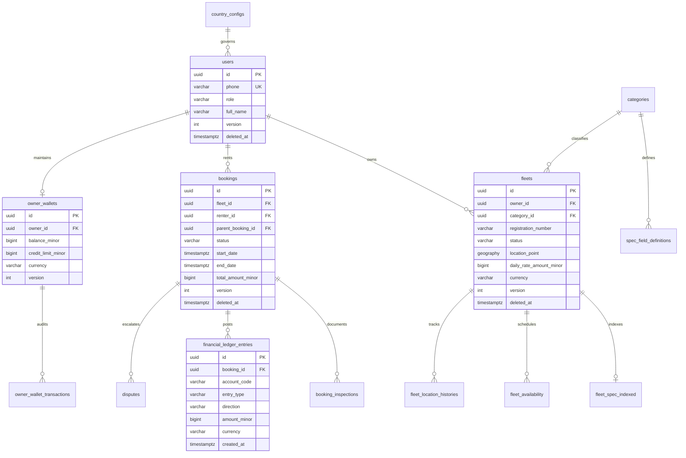
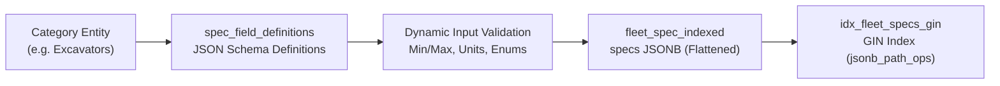
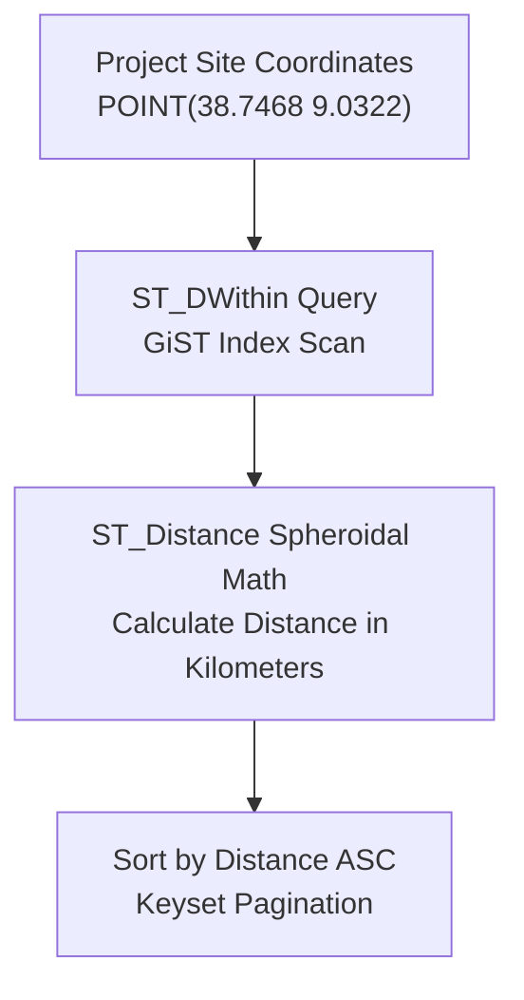
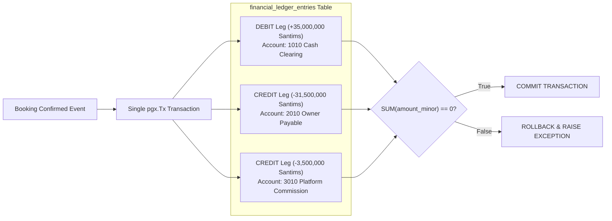
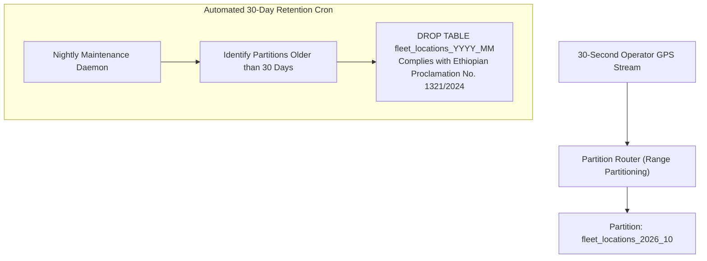
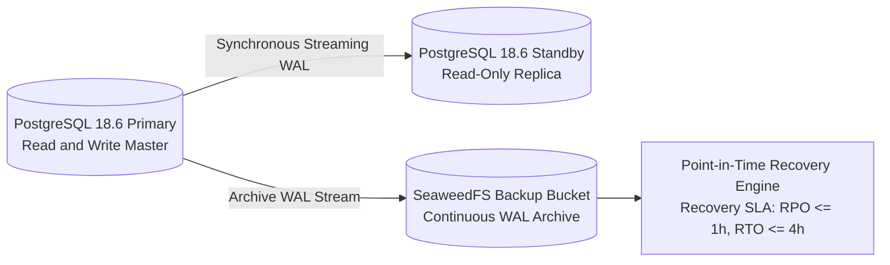

# Heavy Machinery & Logistics Rental Aggregator — Dink Machinery
## Architecture Specification — 07. Database Design & Persistence Architecture (`docs/shared/architecture/07-database-design.md`)

**Document Identifier:** `ARCH-DB-DINK-CORE-V7.0`  
**Classification:** Canonical Architecture Specification & Engineering Reference (Single Source of Truth)  
**Governing Documents:** `SRS-DINK-CORE-V7.0` (Parts 1–5), `ARCH-INTRO-DINK-CORE-V7.0`, `ARCH-PRIN-DINK-CORE-V7.0`, `ARCH-OVERVIEW-DINK-CORE-V7.0`, `ARCH-BACKEND-GO-DINK-CORE-V7.0`, `contracts/openapi.yaml`, `ADR-001` through `ADR-014`  
**Target Runtimes:** PostgreSQL 18.6 + PostGIS 3.6.4, Valkey 9.1.3-alpine, Go 1.27.3 (`jackc/pgx/v5`, `sqlc`), Goose Migration Engine  
**Target Markets:** Ethiopia (`ET`) & Kenya (`KE`) — Dynamic Multi-Country Parameterization (`LOC-01-BE`)  
**Compliance Standards:** OWASP ASVS 4.0.3 Level 3 (Data Protection), RFC 9457 (Problem Details), ISO 4217, ISO 3166-1 alpha-2, Ethiopian Proclamation No. 1321/2024  
**Status:** Approved Engineering Baseline

---

## Table of Contents

- 1. [Executive Summary & Core Persistence Invariants](#1-executive-summary--core-persistence-invariants)
- 2. [Relational Schema Architecture & Entity-Relationship Modeling](#2-relational-schema-architecture--entity-relationship-modeling)
- 3. [Dynamic EAV Taxonomy & JSONB Indexing Engine](#3-dynamic-eav-taxonomy--jsonb-indexing-engine)
  - 3.1 [Schema Definitions: `categories` & `spec_field_definitions`](#31-schema-definitions-categories--spec_field_definitions)
  - 3.2 [Flattened GIN Query Target: `fleet_spec_indexed`](#32-flattened-gin-query-target-fleet_spec_indexed)
  - 3.3 [JSONB Operators & Query Optimization](#33-jsonb-operators--query-optimization)
- 4. [Geospatial Data Architecture (PostGIS 3.6.4)](#4-geospatial-data-architecture-postgis-34)
  - 4.1 [Spatial Column Modeling & Coordinate Precision](#41-spatial-column-modeling--coordinate-precision)
  - 4.2 [Spatial Indexing: GiST over `geography(POINT, 4326)`](#42-spatial-indexing-gist-over-geographypoint-4326)
  - 4.3 [Spheroidal Radius & Corridor Query Execution](#43-spheroidal-radius--corridor-query-execution)
- 5. [Rental Lifecycle & Concurrency Control Data Architecture](#5-rental-lifecycle--concurrency-control-data-architecture)
  - 5.1 [The Core `bookings` Schema](#51-the-core-bookings-schema)
  - 5.2 [Optimistic Concurrency Control (OCC) Column Standard](#52-optimistic-concurrency-control-occ-column-standard)
  - 5.3 [Fleet Calendar Scheduling & Availability Locks](#53-fleet-calendar-scheduling--availability-locks)
- 6. [Immutable Double-Entry Financial Ledger (`BK-17-BE`)](#6-immutable-double-entry-financial-ledger-bk-17-be)
  - 6.1 [Ledger Schema: `financial_ledger_entries`](#61-ledger-schema-financial_ledger_entries)
  - 6.2 [Append-Only Enforcement Triggers](#62-append-only-enforcement-triggers)
  - 6.3 [Zero-Sum Transaction Balance Assertion](#63-zero-sum-transaction-balance-assertion)
- 7. [Pre-Funded Wallet & Commission Settlement](#7-pre-funded-wallet--commission-settlement)
  - 7.1 [Schema Definitions: `owner_wallets` & `owner_wallet_transactions`](#71-schema-definitions-owner_wallets--owner_wallet_transactions)
  - 7.2 [Row-Level Pessimistic Locking Strategy](#72-row-level-pessimistic-locking-strategy)
- 8. [Inspection Records & Monotonic Hours Tracking](#8-inspection-records--monotonic-hours-tracking)
  - 8.1 [Handover Attestations: `booking_inspections`](#81-handover-attestations-booking_inspections)
  - 8.2 [Monotonic Meter Non-Regression Integrity Constraint](#82-monotonic-meter-non-regression-integrity-constraint)
- 9. [Operator Telematics & Automated Pruning Engine](#9-operator-telematics--automated-pruning-engine)
  - 9.1 [Schema Definition: `fleet_location_histories`](#91-schema-definition-fleet_location_histories)
  - 9.2 [Time-Range Table Partitioning Strategy](#92-time-range-table-partitioning-strategy)
  - 9.3 [Automated 30-Day Retention Purge Daemon (`GPS-03-BE`)](#93-automated-30-day-retention-purge-daemon-gps-03-be)
- 10. [Multi-Country Regulatory Localization (`LOC-01-BE`)](#10-multi-country-regulatory-localization-loc-01-be)
- 11. [Security, Column Encryption (AES-256-GCM) & Data Masking](#11-security-column-encryption-aes-256-gcm--data-masking)
- 12. [Complete Indexing Strategy & Performance Tuning](#12-complete-indexing-strategy--performance-tuning)
- 13. [Backup Topology, Point-in-Time Recovery & High Availability](#13-backup-topology-point-in-time-recovery--high-availability)
- 14. [Schema Migration Governance & Goose Guidelines](#14-schema-migration-governance--goose-guidelines)

---

## 1. Executive Summary & Core Persistence Invariants

The Dink Machinery data architecture is engineered around PostgreSQL 18.6 and PostGIS 3.6.4. It serves as the single transactional source of truth for high-value heavy machinery leases, logistics sub-bookings, telematics streaming, and multi-party financial settlement across Ethiopia and Kenya.

### The Six Persistence Invariants

1. **Integer Minor-Unit Currency (`MoneyAmount`):** The relational schema strictly bans floating-point types (`float`, `real`, `numeric` without explicit scale). All financial columns use `BIGINT` representing minor currency units (Santims for `ETB`, Cents for `KES` and `USD`) paired with an immutable ISO 4217 currency code.
2. **Universal Optimistic Concurrency Control (OCC):** Every mutable stateful table (`bookings`, `fleets`, `owner_wallets`, `booking_inspections`, `disputes`) declares a `version INT NOT NULL DEFAULT 1` column. Mutations require `WHERE id = $1 AND version = $2` clauses.
3. **Immutable Append-Only Double-Entry Accounting (`BK-17-BE`):** Mutating financial actions post balanced debit and credit entries to `financial_ledger_entries`. Database triggers block `UPDATE` and `DELETE` queries on this table.
4. **Universal Soft-Delete Policy (`SD-01-BE`):** Operational tables implement `deleted_at TIMESTAMPTZ NULL DEFAULT NULL`. Physical SQL deletes are blocked in production environments.
5. **Spatial Calculation Precision:** Geospatial data is stored using PostGIS `geography(POINT, 4326)` to ensure spheroidal distance math (`ST_DWithin`, `ST_Distance`) accounts for the Earth's curvature across regional corridors.
6. **Regulatory Data Minimization & Partition Pruning:** High-precision GPS telematics tracks are partitioned by day/month and automatically dropped after 30 days to comply with Ethiopian Data Protection Proclamation No. 1321/2024.

---

## 2. Relational Schema Architecture & Entity-Relationship Modeling

The data model isolates bounded contexts: Identity & Auth, Dynamic Catalog Taxonomy, Geospatial Discovery, 20-State Booking Machine, Double-Entry Financial Ledger, Field Inspections, and Telematics Tracking.



---

## 3. Dynamic EAV Taxonomy & JSONB Indexing Engine

Heavy equipment categories (e.g., Crawler Excavators, Mobile Cranes, Lowboy Trailers, Articulated Dump Trucks) possess distinct mechanical parameters. Hardcoding these into relational columns leads to sparse tables, schema churn, and deployment overhead. Dink Machinery models technical specifications using dynamic JSON schemas paired with a GIN-indexed target table.



### 3.1 Schema Definitions: `categories` & `spec_field_definitions`

```sql
-- Core Category Hierarchy Table
CREATE TABLE categories (
    id UUID PRIMARY KEY DEFAULT gen_random_uuid(),
    parent_id UUID REFERENCES categories(id) ON DELETE RESTRICT,
    code VARCHAR(64) NOT NULL UNIQUE,
    name VARCHAR(128) NOT NULL,
    description TEXT,
    is_active BOOLEAN NOT NULL DEFAULT TRUE,
    display_order INT NOT NULL DEFAULT 0,
    created_at TIMESTAMPTZ NOT NULL DEFAULT NOW(),
    updated_at TIMESTAMPTZ NOT NULL DEFAULT NOW(),
    deleted_at TIMESTAMPTZ DEFAULT NULL
);

CREATE INDEX idx_categories_parent_id ON categories(parent_id) WHERE deleted_at IS NULL;
CREATE INDEX idx_categories_active ON categories(is_active) WHERE deleted_at IS NULL;

-- Dynamic Technical Specification Schema Definitions per Category
CREATE TABLE spec_field_definitions (
    id UUID PRIMARY KEY DEFAULT gen_random_uuid(),
    category_id UUID NOT NULL REFERENCES categories(id) ON DELETE RESTRICT,
    field_key VARCHAR(64) NOT NULL,
    field_label VARCHAR(128) NOT NULL,
    data_type VARCHAR(32) NOT NULL, -- 'number', 'text', 'boolean', 'select'
    unit_label VARCHAR(32) DEFAULT NULL, -- 'kg', 'hp', 'm3', 'tons', 'mm'
    is_required BOOLEAN NOT NULL DEFAULT FALSE,
    is_comparable BOOLEAN NOT NULL DEFAULT TRUE,
    validation_rules JSONB NOT NULL DEFAULT '{}'::jsonb, -- {"min": 1, "max": 100000, "options": [...]}
    display_order INT NOT NULL DEFAULT 0,
    created_at TIMESTAMPTZ NOT NULL DEFAULT NOW(),
    updated_at TIMESTAMPTZ NOT NULL DEFAULT NOW(),
    deleted_at TIMESTAMPTZ DEFAULT NULL,
    CONSTRAINT uq_category_field_key UNIQUE (category_id, field_key)
);

CREATE INDEX idx_spec_defs_category ON spec_field_definitions(category_id) WHERE deleted_at IS NULL;
```

### 3.2 Flattened GIN Query Target: `fleet_spec_indexed`

To enable high-speed faceted searches without multi-table relational joins over EAV tables, attributes are flattened into `fleet_spec_indexed`:

```sql
CREATE TABLE fleet_spec_indexed (
    fleet_id UUID PRIMARY KEY REFERENCES fleets(id) ON DELETE CASCADE,
    category_id UUID NOT NULL REFERENCES categories(id) ON DELETE RESTRICT,
    specs JSONB NOT NULL DEFAULT '{}'::jsonb,
    searchable_text TSVECTOR GENERATED ALWAYS AS (
        to_tsvector('english', coalesce(specs->>'engine_make', '') || ' ' || 
                               coalesce(specs->>'model_designation', '') || ' ' ||
                               coalesce(specs->>'boom_configuration', ''))
    ) STORED,
    created_at TIMESTAMPTZ NOT NULL DEFAULT NOW(),
    updated_at TIMESTAMPTZ NOT NULL DEFAULT NOW()
);

-- GIN Path-Ops Index for High-Performance JSON Containment Queries
CREATE INDEX idx_fleet_specs_gin ON fleet_spec_indexed USING GIN (specs jsonb_path_ops);
CREATE INDEX idx_fleet_specs_text ON fleet_spec_indexed USING GIN (searchable_text);
```

### 3.3 JSONB Operators & Query Optimization

Faceted search queries execute via the JSON containment operator (`@>`):

```sql
-- Query Example: Find Crawler Excavators with Operating Weight >= 20,000kg and Hydraulic Hammer Line
SELECT f.id, f.make, f.model, f.daily_rate_amount_minor, s.specs
FROM fleets f
JOIN fleet_spec_indexed s ON f.id = s.fleet_id
WHERE f.status = 'ACTIVE'
  AND f.deleted_at IS NULL
  AND s.category_id = '018f6a9e-876b-7341-a189-bc849901d892'
  AND s.specs @> '{"hydraulic_hammer_piping": true}'
  AND (s.specs->>'operating_weight_kg')::numeric >= 20000
ORDER BY f.daily_rate_amount_minor ASC
LIMIT 50;
```

---

## 4. Geospatial Data Architecture (PostGIS 3.6.4)

Machinery discovery is driven by geography. Contractors require equipment located within defined radii of their active sites, while logistics carriers plan transit routes along regional transportation corridors.



### 4.1 Spatial Column Modeling & Coordinate Precision

The `fleets` table stores machine depot or current staging locations using `geography(POINT, 4326)`. Coordinates enforce standard WGS 84 spatial reference bounds (`SRID 4326`).

```sql
CREATE EXTENSION IF NOT EXISTS postgis;

CREATE TABLE fleets (
    id UUID PRIMARY KEY DEFAULT gen_random_uuid(),
    owner_id UUID NOT NULL REFERENCES users(id) ON DELETE RESTRICT,
    category_id UUID NOT NULL REFERENCES categories(id) ON DELETE RESTRICT,
    registration_number VARCHAR(64) NOT NULL,
    vin_chassis_number VARCHAR(64) NOT NULL,
    make VARCHAR(64) NOT NULL,
    model VARCHAR(64) NOT NULL,
    model_year INT NOT NULL CHECK (model_year >= 1970 AND model_year <= 2030),
    daily_rate_amount_minor BIGINT NOT NULL CHECK (daily_rate_amount_minor > 0),
    insurance_policy_number VARCHAR(128) NOT NULL,
    insurance_expiry_date DATE NOT NULL,
    status VARCHAR(32) NOT NULL DEFAULT 'PENDING_APPROVAL',
    location_point GEOGRAPHY(POINT, 4326) NOT NULL,
    location_address_text TEXT NOT NULL,
    country_code VARCHAR(2) NOT NULL DEFAULT 'ET',
    currency VARCHAR(3) NOT NULL DEFAULT 'ETB',
    version INT NOT NULL DEFAULT 1,
    created_at TIMESTAMPTZ NOT NULL DEFAULT NOW(),
    updated_at TIMESTAMPTZ NOT NULL DEFAULT NOW(),
    deleted_at TIMESTAMPTZ DEFAULT NULL,
    CONSTRAINT uq_fleets_vin UNIQUE (vin_chassis_number)
);
```

### 4.2 Spatial Indexing: GiST over `geography(POINT, 4326)`

```sql
-- Spatial GiST Index for Spheroidal Bounding Box and Distance Computations
CREATE INDEX idx_fleets_location_point ON fleets USING GIST (location_point) 
WHERE deleted_at IS NULL AND status = 'ACTIVE';

CREATE INDEX idx_fleets_owner_id ON fleets(owner_id) WHERE deleted_at IS NULL;
CREATE INDEX idx_fleets_status ON fleets(status) WHERE deleted_at IS NULL;
```

### 4.3 Spheroidal Radius & Corridor Query Execution

Radius queries use `ST_DWithin` to ensure spatial evaluations leverage the GiST index rather than computing trigonometric distance formulas over every table row:

```sql
-- Radius Search Implementation: Find active machinery within 50km
SELECT 
    f.id,
    f.make,
    f.model,
    f.daily_rate_amount_minor,
    f.currency,
    ST_Distance(f.location_point, ST_SetSRID(ST_MakePoint($1, $2), 4326)::geography) / 1000.0 AS distance_km
FROM fleets f
WHERE f.status = 'ACTIVE'
  AND f.country_code = $3
  AND f.deleted_at IS NULL
  AND ST_DWithin(f.location_point, ST_SetSRID(ST_MakePoint($1, $2), 4326)::geography, $4 * 1000.0)
ORDER BY distance_km ASC
LIMIT $5 OFFSET $6;
```

---

## 5. Rental Lifecycle & Concurrency Control Data Architecture

### 5.1 The Core `bookings` Schema

The `bookings` table coordinates the canonical 20-state rental engine. It models base rentals, linked transport sub-bookings (`parent_booking_id`), and pricing breakdowns in integer minor units.

```sql
CREATE TABLE bookings (
    id UUID PRIMARY KEY DEFAULT gen_random_uuid(),
    booking_reference VARCHAR(32) NOT NULL UNIQUE,
    fleet_id UUID NOT NULL REFERENCES fleets(id) ON DELETE RESTRICT,
    renter_id UUID NOT NULL REFERENCES users(id) ON DELETE RESTRICT,
    parent_booking_id UUID REFERENCES bookings(id) ON DELETE RESTRICT, -- Links Logistics Sub-Bookings
    operator_id UUID REFERENCES users(id) ON DELETE SET NULL,
    status VARCHAR(32) NOT NULL DEFAULT 'DRAFT',
    payment_method VARCHAR(32) NOT NULL DEFAULT 'MANUAL_TRANSFER',
    settlement_type VARCHAR(32) NOT NULL DEFAULT 'DIRECT_TRANSFER',
    start_date TIMESTAMPTZ NOT NULL,
    end_date TIMESTAMPTZ NOT NULL,
    base_amount_minor BIGINT NOT NULL CHECK (base_amount_minor >= 0),
    vat_amount_minor BIGINT NOT NULL CHECK (vat_amount_minor >= 0),
    prepayment_amount_minor BIGINT NOT NULL CHECK (prepayment_amount_minor >= 0),
    security_deposit_minor BIGINT NOT NULL DEFAULT 0 CHECK (security_deposit_minor >= 0),
    total_amount_minor BIGINT NOT NULL CHECK (total_amount_minor >= 0),
    currency VARCHAR(3) NOT NULL DEFAULT 'ETB',
    hold_expires_at TIMESTAMPTZ DEFAULT NULL,
    cancellation_reason TEXT DEFAULT NULL,
    logistics_failed BOOLEAN NOT NULL DEFAULT FALSE,
    country_code VARCHAR(2) NOT NULL DEFAULT 'ET',
    version INT NOT NULL DEFAULT 1,
    created_at TIMESTAMPTZ NOT NULL DEFAULT NOW(),
    updated_at TIMESTAMPTZ NOT NULL DEFAULT NOW(),
    deleted_at TIMESTAMPTZ DEFAULT NULL,
    CONSTRAINT ck_booking_dates CHECK (end_date > start_date)
);

CREATE INDEX idx_bookings_fleet_id ON bookings(fleet_id) WHERE deleted_at IS NULL;
CREATE INDEX idx_bookings_renter_id ON bookings(renter_id) WHERE deleted_at IS NULL;
CREATE INDEX idx_bookings_parent_id ON bookings(parent_booking_id) WHERE parent_booking_id IS NOT NULL;
CREATE INDEX idx_bookings_status ON bookings(status) WHERE deleted_at IS NULL;
CREATE INDEX idx_bookings_hold_expiry ON bookings(hold_expires_at) WHERE status = 'HOLD_PENDING';
```

### 5.2 Optimistic Concurrency Control (OCC) Column Standard

Every mutating query evaluates the record version:

```sql
-- OCC Update Pattern
UPDATE bookings
SET status = $1,
    version = version + 1,
    updated_at = NOW()
WHERE id = $2 
  AND version = $3 
  AND deleted_at IS NULL;
```

If the updated row count is 0, the transaction rolls back immediately and returns an RFC 9457 concurrency conflict.

### 5.3 Fleet Calendar Scheduling & Availability Locks

To prevent double-booking across overlapping intervals, equipment availability intervals are recorded and evaluated:

```sql
CREATE TABLE fleet_availability (
    id UUID PRIMARY KEY DEFAULT gen_random_uuid(),
    fleet_id UUID NOT NULL REFERENCES fleets(id) ON DELETE CASCADE,
    booking_id UUID REFERENCES bookings(id) ON DELETE SET NULL,
    start_date TIMESTAMPTZ NOT NULL,
    end_date TIMESTAMPTZ NOT NULL,
    state VARCHAR(32) NOT NULL DEFAULT 'AVAILABLE', -- 'AVAILABLE', 'RESERVED', 'MAINTENANCE'
    created_at TIMESTAMPTZ NOT NULL DEFAULT NOW(),
    CONSTRAINT ck_availability_dates CHECK (end_date > start_date)
);

CREATE INDEX idx_fleet_avail_window ON fleet_availability(fleet_id, start_date, end_date);
```

---

## 6. Immutable Double-Entry Financial Ledger (`BK-17-BE`)

To comply with statutory accounting standards and eliminate balance drift, financial mutations post balanced journal entries to `financial_ledger_entries`.



### 6.1 Ledger Schema: `financial_ledger_entries`

```sql
CREATE TABLE financial_ledger_entries (
    id UUID PRIMARY KEY DEFAULT gen_random_uuid(),
    transaction_reference UUID NOT NULL, -- Correlates all legs of a single transaction
    booking_id UUID REFERENCES bookings(id) ON DELETE RESTRICT,
    account_code VARCHAR(32) NOT NULL, -- '1010_CASH_CLEARING', '2010_OWNER_PAYABLE', '3010_COMMISSION_REVENUE'
    entry_type VARCHAR(32) NOT NULL,   -- 'RENTAL_ESCROW', 'COMMISSION_DEBIT', 'DAMAGE_SETTLEMENT'
    direction VARCHAR(8) NOT NULL CHECK (direction IN ('DEBIT', 'CREDIT')),
    amount_minor BIGINT NOT NULL CHECK (amount_minor > 0),
    currency VARCHAR(3) NOT NULL DEFAULT 'ETB',
    narration TEXT NOT NULL,
    created_at TIMESTAMPTZ NOT NULL DEFAULT NOW()
);

CREATE INDEX idx_ledger_booking ON financial_ledger_entries(booking_id);
CREATE INDEX idx_ledger_tx_ref ON financial_ledger_entries(transaction_reference);
CREATE INDEX idx_ledger_account ON financial_ledger_entries(account_code, created_at);
```

### 6.2 Append-Only Enforcement Triggers

```sql
CREATE OR REPLACE FUNCTION enforce_financial_ledger_append_only()
RETURNS TRIGGER AS $$ BEGIN RAISE EXCEPTION 'financial_ledger_entries is append-only. UPDATE and DELETE operations are prohibited.'; END; $$ LANGUAGE plpgsql;

CREATE TRIGGER trg_protect_financial_ledger
BEFORE UPDATE OR DELETE ON financial_ledger_entries
FOR EACH ROW EXECUTE FUNCTION enforce_financial_ledger_append_only();
```

### 6.3 Zero-Sum Transaction Balance Assertion

The balance assertion runs as a deferred constraint trigger evaluated at transaction commit:

```sql
CREATE OR REPLACE FUNCTION verify_ledger_transaction_balance()
RETURNS TRIGGER AS $$ DECLARE net_balance BIGINT; BEGIN SELECT COALESCE(SUM(CASE WHEN direction = 'DEBIT' THEN amount_minor ELSE -amount_minor END), 0) INTO net_balance FROM financial_ledger_entries WHERE transaction_reference = NEW.transaction_reference;      IF net_balance <> 0 THEN RAISE EXCEPTION 'Double-entry transaction \% is out of balance. Net balance is \% minor units (must be 0).', NEW.transaction_reference, net_balance; END IF;      RETURN NEW; END; $$ LANGUAGE plpgsql;

CREATE CONSTRAINT TRIGGER trg_verify_ledger_balance
AFTER INSERT ON financial_ledger_entries
DEFERRABLE INITIALLY DEFERRED
FOR EACH ROW EXECUTE FUNCTION verify_ledger_transaction_balance();
```

---

## 7. Pre-Funded Wallet & Commission Settlement

In the manual direct transfer model (`MANUAL_TRANSFER`), the platform collects marketplace commissions by debiting the owner's pre-funded `OwnerWallet` balance (`CW-02-MOB`).

### 7.1 Schema Definitions: `owner_wallets` & `owner_wallet_transactions`

```sql
CREATE TABLE owner_wallets (
    id UUID PRIMARY KEY DEFAULT gen_random_uuid(),
    owner_id UUID NOT NULL REFERENCES users(id) ON DELETE RESTRICT,
    balance_minor BIGINT NOT NULL DEFAULT 0,
    credit_limit_minor BIGINT NOT NULL DEFAULT 0, -- Overdraft buffer for approved owners
    currency VARCHAR(3) NOT NULL DEFAULT 'ETB',
    country_code VARCHAR(2) NOT NULL DEFAULT 'ET',
    is_locked BOOLEAN NOT NULL DEFAULT FALSE,
    lock_reason TEXT DEFAULT NULL,
    version INT NOT NULL DEFAULT 1,
    created_at TIMESTAMPTZ NOT NULL DEFAULT NOW(),
    updated_at TIMESTAMPTZ NOT NULL DEFAULT NOW(),
    CONSTRAINT uq_owner_wallet UNIQUE (owner_id, currency),
    CONSTRAINT ck_wallet_credit_limit CHECK (balance_minor >= -credit_limit_minor)
);

CREATE TABLE owner_wallet_transactions (
    id UUID PRIMARY KEY DEFAULT gen_random_uuid(),
    wallet_id UUID NOT NULL REFERENCES owner_wallets(id) ON DELETE RESTRICT,
    booking_id UUID REFERENCES bookings(id) ON DELETE RESTRICT,
    transaction_type VARCHAR(32) NOT NULL, -- 'COMMISSION_DEBIT', 'WALLET_TOPUP', 'ADJUSTMENT'
    amount_minor BIGINT NOT NULL,          -- Negative for debits, positive for credits
    balance_after_minor BIGINT NOT NULL,
    reference_number VARCHAR(128) NOT NULL,
    evidence_document_url TEXT DEFAULT NULL,
    created_at TIMESTAMPTZ NOT NULL DEFAULT NOW()
);

CREATE INDEX idx_wallet_tx_wallet_id ON owner_wallet_transactions(wallet_id, created_at DESC);
```

### 7.2 Row-Level Pessimistic Locking Strategy

High-frequency wallet balance updates use `SELECT ... FOR UPDATE` to serialize concurrent commission debits and prevent overdraft races:

```sql
-- Atomic Wallet Debit Routine
BEGIN;

SELECT balance_minor, credit_limit_minor, is_locked
FROM owner_wallets
WHERE owner_id = $1 AND currency = $2
FOR UPDATE;

-- Evaluate business rule: balance - fee >= -credit_limit
UPDATE owner_wallets
SET balance_minor = balance_minor - $3,
    version = version + 1,
    updated_at = NOW()
WHERE owner_id = $1 AND currency = $2;

INSERT INTO owner_wallet_transactions (
    wallet_id, booking_id, transaction_type, amount_minor, 
    balance_after_minor, reference_number
) VALUES ($4, $5, 'COMMISSION_DEBIT', -$3, $6, $7);

COMMIT;
```

---

## 8. Inspection Records & Monotonic Hours Tracking

### 8.1 Handover Attestations: `booking_inspections`

Pre-rental and post-rental inspection reports are captured with non-regression constraints:

```sql
CREATE TABLE booking_inspections (
    id UUID PRIMARY KEY DEFAULT gen_random_uuid(),
    booking_id UUID NOT NULL REFERENCES bookings(id) ON DELETE RESTRICT,
    inspector_id UUID NOT NULL REFERENCES users(id) ON DELETE RESTRICT,
    inspection_type VARCHAR(16) NOT NULL CHECK (inspection_type IN ('PRE_RENTAL', 'POST_RENTAL')),
    meter_reading NUMERIC(10, 2) NOT NULL CHECK (meter_reading >= 0),
    fuel_percentage INT NOT NULL CHECK (fuel_percentage >= 0 AND fuel_percentage <= 100),
    odometer_km NUMERIC(10, 2) DEFAULT NULL,
    cleanliness_grade VARCHAR(16) NOT NULL DEFAULT 'CLEAN',
    has_damage BOOLEAN NOT NULL DEFAULT FALSE,
    damage_notes TEXT DEFAULT NULL,
    media_urls TEXT[] NOT NULL DEFAULT '{}',
    signature_document_url TEXT NOT NULL,
    signer_name VARCHAR(128) NOT NULL,
    signer_role VARCHAR(64) NOT NULL,
    attested_at TIMESTAMPTZ NOT NULL DEFAULT NOW(),
    created_at TIMESTAMPTZ NOT NULL DEFAULT NOW(),
    version INT NOT NULL DEFAULT 1,
    CONSTRAINT uq_booking_inspection_type UNIQUE (booking_id, inspection_type)
);

CREATE INDEX idx_inspections_booking ON booking_inspections(booking_id);
```

### 8.2 Monotonic Meter Non-Regression Integrity Constraint

```sql
CREATE OR REPLACE FUNCTION enforce_monotonic_hour_meter()
RETURNS TRIGGER AS $$ DECLARE baseline_reading NUMERIC(10, 2); BEGIN IF NEW.inspection_type = 'POST_RENTAL' THEN SELECT meter_reading INTO baseline_reading FROM booking_inspections WHERE booking_id = NEW.booking_id AND inspection_type = 'PRE_RENTAL';          IF baseline_reading IS NOT NULL AND NEW.meter_reading < baseline_reading THEN RAISE EXCEPTION 'Monotonic meter regression error: Return reading (\%) cannot be lower than pre-rental baseline (\%).', NEW.meter_reading, baseline_reading; END IF; END IF;      RETURN NEW; END; $$ LANGUAGE plpgsql;

CREATE TRIGGER trg_assert_monotonic_meter
BEFORE INSERT OR UPDATE ON booking_inspections
FOR EACH ROW EXECUTE FUNCTION enforce_monotonic_hour_meter();
```

---

## 9. Operator Telematics & Automated Pruning Engine

Operating under requirements `GPS-01` through `GPS-04`, field devices stream GPS coordinates every 30 seconds during active rentals.



### 9.1 Schema Definition: `fleet_location_histories`

```sql
CREATE TABLE fleet_location_histories (
    id UUID DEFAULT gen_random_uuid(),
    fleet_id UUID NOT NULL,
    booking_id UUID NOT NULL,
    operator_id UUID NOT NULL,
    location_point GEOGRAPHY(POINT, 4326) NOT NULL,
    speed_knots NUMERIC(6, 2) NOT NULL DEFAULT 0.0,
    heading_degrees NUMERIC(5, 2) NOT NULL DEFAULT 0.0,
    altitude_meters NUMERIC(7, 2) DEFAULT NULL,
    recorded_at TIMESTAMPTZ NOT NULL,
    created_at TIMESTAMPTZ NOT NULL DEFAULT NOW(),
    PRIMARY KEY (id, recorded_at)
) PARTITION BY RANGE (recorded_at);
```

### 9.2 Time-Range Table Partitioning Strategy

Partitions are generated on a monthly basis:

```sql
-- Monthly Partitions for High-Throughput Location Breadcrumbs
CREATE TABLE fleet_locations_2026_10 PARTITION OF fleet_location_histories
    FOR VALUES FROM ('2026-10-01 00:00:00+00') TO ('2026-11-01 00:00:00+00');

CREATE TABLE fleet_locations_2026_11 PARTITION OF fleet_location_histories
    FOR VALUES FROM ('2026-11-01 00:00:00+00') TO ('2026-12-01 00:00:00+00');

CREATE INDEX idx_locations_2026_10_spat ON fleet_locations_2026_10 USING GIST (location_point);
CREATE INDEX idx_locations_2026_10_fleet_time ON fleet_locations_2026_10 (fleet_id, recorded_at DESC);
```

### 9.3 Automated 30-Day Retention Purge Daemon (`GPS-03-BE`)

To satisfy statutory privacy mandates, raw location tracks older than 30 days are dropped:

```sql
CREATE OR REPLACE PROCEDURE purge_expired_telematics_partitions()
LANGUAGE plpgsql AS $$ DECLARE partition_record RECORD; drop_statement TEXT; retention_cutoff DATE := CURRENT_DATE - INTERVAL '30 days'; BEGIN FOR partition_record IN SELECT tablename FROM pg_tables WHERE schemaname = 'public' AND tablename LIKE 'fleet_locations_\%' LOOP -- Check partition date boundary against retention cutoff -- Executes DROP TABLE partition_name to reclaim disk space instantly END LOOP; END; $$;
```

---

## 10. Multi-Country Regulatory Localization (`LOC-01-BE`)

The `country_configs` table parameterizes tax rates, currency codes, phone number formats, and dispute resolution SLAs without requiring code changes:

```sql
CREATE TABLE country_configs (
    country_code VARCHAR(2) PRIMARY KEY, -- 'ET', 'KE'
    currency_code VARCHAR(3) NOT NULL,   -- 'ETB', 'KES'
    currency_minor_units INT NOT NULL,  -- 100, 100
    vat_rate_bps INT NOT NULL,          -- 1500 (15%), 1600 (16%)
    dialing_prefix VARCHAR(5) NOT NULL, -- '+251', '+254'
    phone_regex VARCHAR(128) NOT NULL,
    dispute_sla_hours INT NOT NULL,     -- 72, 48
    hold_duration_seconds INT NOT NULL, -- 3600
    tax_authority_name VARCHAR(64) NOT NULL, -- 'Ministry of Revenue', 'KRA'
    is_active BOOLEAN NOT NULL DEFAULT TRUE,
    created_at TIMESTAMPTZ NOT NULL DEFAULT NOW(),
    updated_at TIMESTAMPTZ NOT NULL DEFAULT NOW()
);

INSERT INTO country_configs (
    country_code, currency_code, currency_minor_units, vat_rate_bps,
    dialing_prefix, phone_regex, dispute_sla_hours, hold_duration_seconds,
    tax_authority_name, is_active
) VALUES 
('ET', 'ETB', 100, 1500, '+251', '^\+251[79]\d{8}$', 72, 3600, 'Ethiopian Ministry of Revenues', TRUE),
('KE', 'KES', 100, 1600, '+254', '^\+254[17]\d{8}$', 48, 3600, 'Kenya Revenue Authority', TRUE);
```

---

## 11. Security, Column Encryption (AES-256-GCM) & Data Masking

Sensitive attributes (TIN numbers, national identity identifiers, bank coordinates) are encrypted at the application layer prior to persistence.

```sql
CREATE TABLE user_identities (
    id UUID PRIMARY KEY DEFAULT gen_random_uuid(),
    user_id UUID NOT NULL REFERENCES users(id) ON DELETE CASCADE,
    provider_key VARCHAR(32) NOT NULL, -- 'fayda', 'national_id_ke'
    identity_identifier_encrypted BYTEA NOT NULL, -- AES-256-GCM Ciphertext
    identifier_last_four VARCHAR(4) NOT NULL,    -- Display Mask: '**** 8842'
    verified_attributes_encrypted BYTEA NOT NULL, -- Encrypted JSON: DOB, legal name, gender
    status VARCHAR(32) NOT NULL DEFAULT 'PENDING',
    verified_at TIMESTAMPTZ DEFAULT NULL,
    created_at TIMESTAMPTZ NOT NULL DEFAULT NOW(),
    updated_at TIMESTAMPTZ NOT NULL DEFAULT NOW(),
    CONSTRAINT uq_user_provider UNIQUE (user_id, provider_key)
);
```

### Encryption Specification
* **Cipher:** AES-256-GCM (Authenticated Encryption with Associated Data).
* **Key Source:** OpenBao Key Management System.
* **Associated Data (AAD):** The record's primary key (`id::text`) is bound into the AAD block during cipher operations, preventing ciphertext transplantation across database rows.

---

## 12. Complete Indexing Strategy & Performance Tuning

### Strategic Index Matrix

| Table Name | Index Name | Type / Structure | Optimization Purpose |
|---|---|---|---|
| `fleets` | `idx_fleets_location_point` | `GiST (location_point)` | Spheroidal radius and bounding box queries. |
| `fleet_spec_indexed` | `idx_fleet_specs_gin` | `GIN (specs jsonb_path_ops)` | Faceted JSON specification filtering (`@>`). |
| `fleet_spec_indexed` | `idx_fleet_specs_text` | `GIN (searchable_text)` | Full-text search across makes, models, and boom types. |
| `bookings` | `idx_bookings_fleet_dates` | `B-Tree (fleet_id, start_date, end_date)` | Overlapping booking reservation collision checks. |
| `financial_ledger_entries`| `idx_ledger_tx_ref` | `B-Tree (transaction_reference)` | Double-entry journal balance audits. |
| `owner_wallets` | `uq_owner_wallet` | `Unique (owner_id, currency)` | Single wallet per currency isolation. |

### PostgreSQL Engine Tuning (`postgresql.conf`)

For a dedicated database server ($64\text{GB RAM}$, $16\text{ vCPU}$, NVMe SSD):

```ini
# Memory Configuration
shared_buffers = 16GB
effective_cache_size = 48GB
work_mem = 64MB
maintenance_work_mem = 2GB

# Storage & Checkpoint Tuning
random_page_cost = 1.1            # Tuned for NVMe SSD random access
effective_io_concurrency = 200
checkpoint_completion_target = 0.9
max_wal_size = 16GB
min_wal_size = 2GB

# Spatial & Query Planner Tuning
cpu_tuple_cost = 0.01
cpu_index_tuple_cost = 0.005
cpu_operator_cost = 0.0025
max_parallel_workers_per_gather = 4
max_parallel_maintenance_workers = 4
```

---

## 13. Backup Topology, Point-in-Time Recovery & High Availability



* **High Availability Replication:** Operates an active primary instance with streaming WAL replication to a standby replica, supporting automated failover.
* **Point-in-Time Recovery (PITR):** Write-Ahead Logs (WAL) archive continuously to an isolated object storage bucket using `pgBackRest`. Full database snapshots execute daily at `01:00 UTC` with hourly differential snapshots.
* **Disaster Recovery Targets:**
  - **Recovery Point Objective (RPO):** $\le 1\text{ hour}$ (target $0\text{s}$ via synchronous replication).
  - **Recovery Time Objective (RTO):** $\le 4\text{ hours}$.

---

## 14. Schema Migration Governance & Goose Guidelines

All database DDL modifications are governed by the **Goose** migration engine.

### Migration Operational Rules
1. **Immutable Historical Migrations:** Once a migration has merged to the primary branch, its file is immutable. Never edit existing migration files.
2. **Backward-Compatible DDL:** Structural additions (tables, columns, indexes) must be backward compatible. New columns must be `NULL` or define explicit `DEFAULT` values.
3. **Safe Index Creation:** Indexes on existing tables must use `CREATE INDEX CONCURRENTLY` to avoid table write locks in production environments.
4. **Mandatory Rollback Scripts:** Every migration file must provide balanced `-- +goose Up` and `-- +goose Down` blocks.

```sql
-- Example Goose Migration: 20261027100000_add_fleet_search_indexes.sql
-- +goose Up
-- +goose StatementBegin
CREATE INDEX CONCURRENTLY IF NOT EXISTS idx_fleets_daily_rate 
ON fleets (daily_rate_amount_minor) 
WHERE deleted_at IS NULL AND status = 'ACTIVE';
-- +goose StatementEnd

-- +goose Down
-- +goose StatementBegin
DROP INDEX CONCURRENTLY IF EXISTS idx_fleets_daily_rate;
-- +goose StatementEnd
```

---

*This document defines the canonical database design and persistence specification for Dink Machinery Version 7.0. All downstream database migrations, sqlc query templates, and repository patterns must strictly comply with these schemas and constraints.*