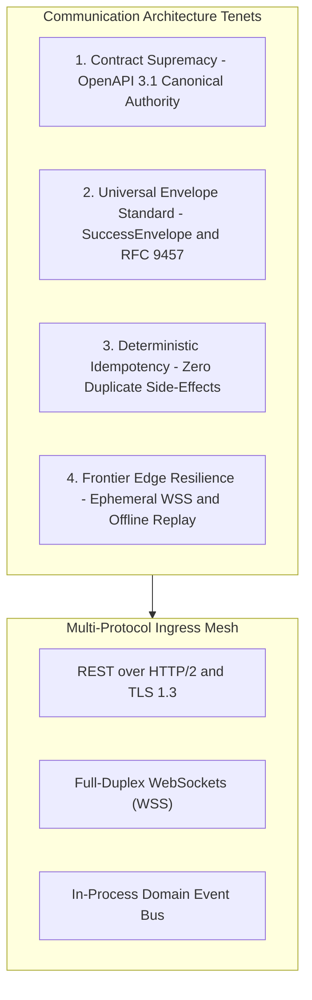
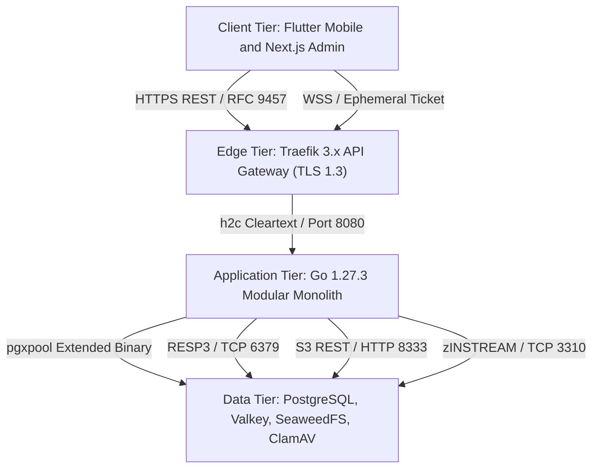
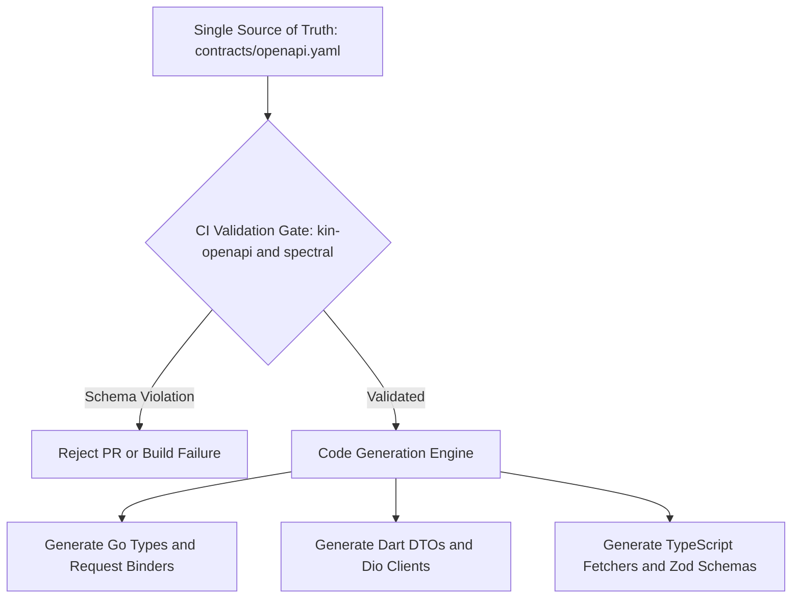
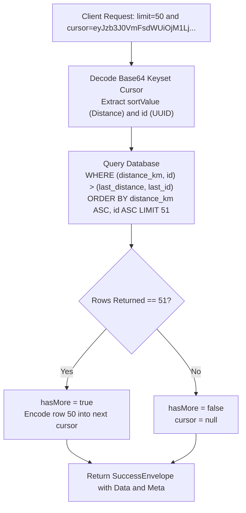
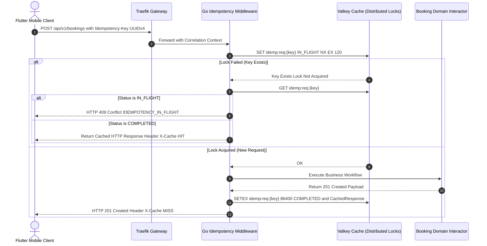
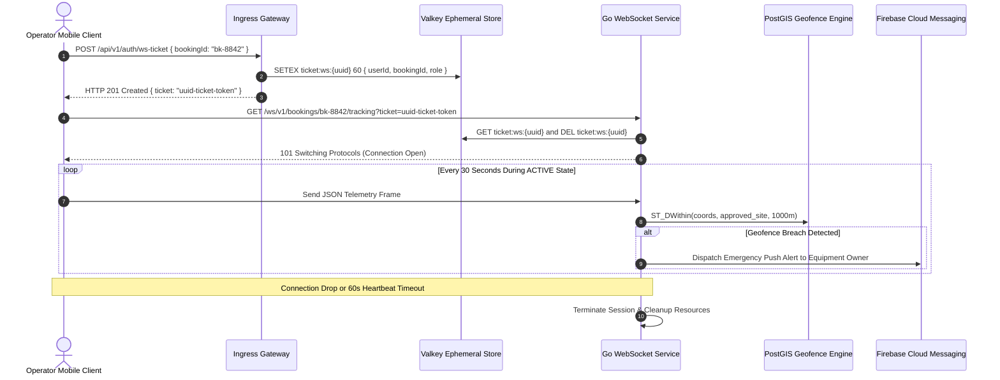
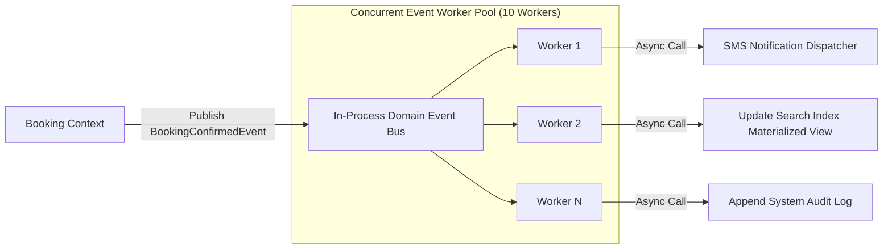
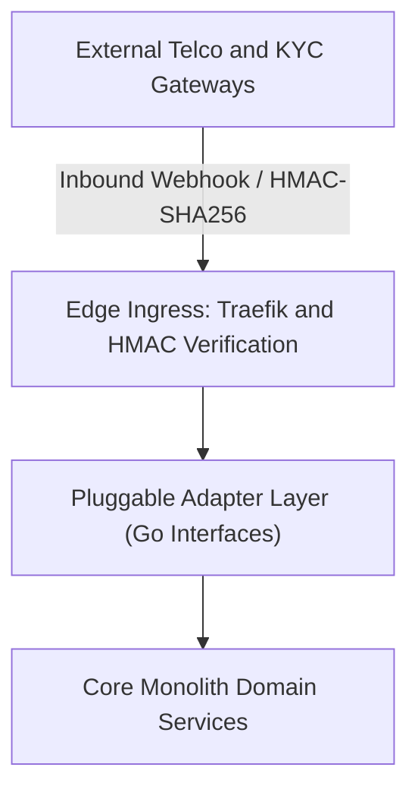
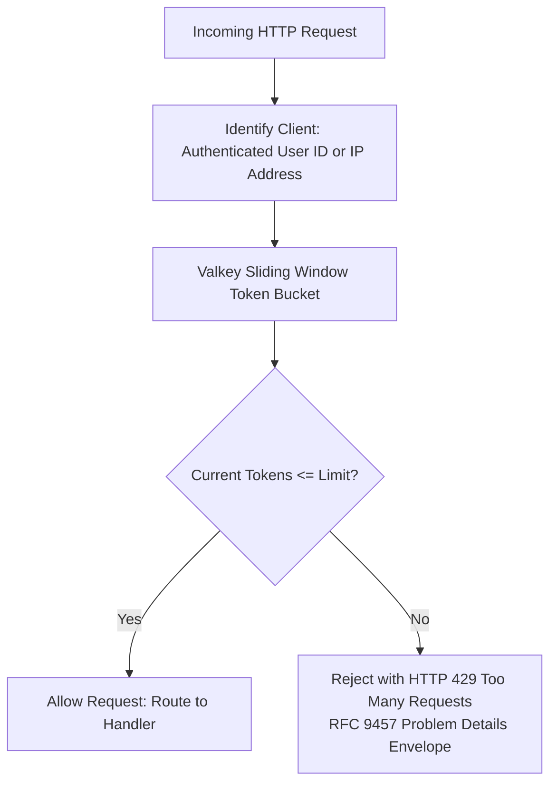
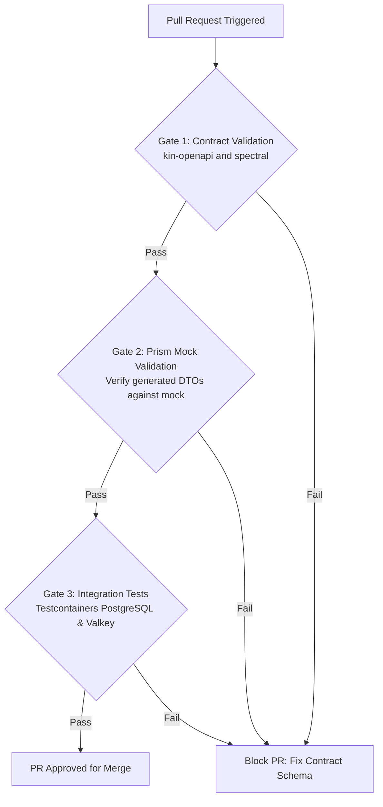

# Heavy Machinery & Logistics Rental Aggregator — Dink Machinery
## Architecture Specification — 08. Communication Patterns & API Design (`docs/shared/architecture/08-communication-patterns-api-design.md`)

**Document Identifier:** `ARCH-COMM-DINK-CORE-V7.0`  
**Classification:** Canonical Architecture Specification & Engineering Reference (Single Source of Truth)  
**Governing Documents:** `SRS-DINK-CORE-V7.0` (Parts 1–5), `ARCH-INTRO-DINK-CORE-V7.0`, `ARCH-PRIN-DINK-CORE-V7.0`, `ARCH-OVERVIEW-DINK-CORE-V7.0`, `ARCH-BACKEND-GO-DINK-CORE-V7.0`, `ARCH-DB-DINK-CORE-V7.0`, `FLOW-DINK-CORE-V7.0`, `contracts/openapi.yaml`, `ADR-001` through `ADR-014`  
**Target Runtimes:** Go 1.27.3 Modular Monolith, Flutter 3.44 Cross-Platform Mobile Client, Next.js 16 Admin Web Console, Valkey 8.0-alpine, Traefik 3.x Gateway  
**Target Markets:** Ethiopia (`ET`) & Kenya (`KE`) — Dynamic Multi-Country Parameterization (`LOC-01-BE`)  
**Compliance Standards:** OWASP ASVS 4.0.3 Level 3 (API Verification), RFC 9457 (Problem Details), RFC 7231, RFC 8446 (TLS 1.3), ISO 4217, ISO 3166-1 alpha-2  
**Status:** Approved Engineering Baseline

---

## Table of Contents

- 1. [Executive Summary & Communication Tenets](#1-executive-summary--communication-tenets)
- 2. [Network Topology & Protocol Matrix](#2-network-topology--protocol-matrix)
  - 2.1 [Communication Protocol Topology](#21-communication-protocol-topology)
  - 2.2 [Transport Protocol Specifications](#22-transport-protocol-specifications)
- 3. [Contract Supremacy & OpenAPI 3.1 Governance](#3-contract-supremacy--openapi-31-governance)
  - 3.1 [OpenAPI 3.1 Single Source of Truth (`contracts/openapi.yaml`)](#31-openapi-31-single-source-of-truth-contractsopenapiyaml)
  - 3.2 [Automated Linting & Schema Verification (`kin-openapi`)](#32-automated-linting--schema-verification-kin-openapi)
  - 3.3 [Client & Server Code Generation Pipeline](#33-client--server-code-generation-pipeline)
- 4. [RESTful API Design & Envelope Standards](#4-restful-api-design--envelope-standards)
  - 4.1 [Universal Success Envelope (`SuccessEnvelope<T>`)](#41-universal-success-envelope-successenvelopet)
  - 4.2 [RFC 9457 Universal Problem Details Envelope (`application/problem+json`)](#42-rfc-9457-universal-problem-details-envelope-applicationproblemjson)
  - 4.3 [Keyset Cursor-Based Pagination Engine](#43-keyset-cursor-based-pagination-engine)
  - 4.4 [HTTP Method Semantics & Status Code Rules](#44-http-method-semantics--status-code-rules)
- 5. [Idempotency Engine & Mutating Request Governance](#5-idempotency-engine--mutating-request-governance)
  - 5.1 [The `Idempotency-Key` Protocol](#51-the-idempotency-key-protocol)
  - 5.2 [Distributed Locking & Response Caching in Valkey](#52-distributed-locking--response-caching-in-valkey)
  - 5.3 [Replay Semantics & Concurrent Flight Rejection](#53-replay-semantics--concurrent-flight-rejection)
- 6. [Real-Time Streaming: WebSockets & Push Notifications](#6-real-time-streaming-websockets--push-notifications)
  - 6.1 [Operator Telematics Ingress (`/ws/v1/bookings/:id/tracking`)](#61-operator-telematics-ingress-wsv1bookingsidtracking)
  - 6.2 [Handshake Ticket Verification & Ephemeral Tokens](#62-handshake-ticket-verification--ephemeral-tokens)
  - 6.3 [WebSocket Connection Lifecycle & Heartbeat Keepalive](#63-websocket-connection-lifecycle--heartbeat-keepalive)
  - 6.4 [FCM Push Fallback Notification Engine](#64-fcm-push-fallback-notification-engine)
- 7. [In-Process Domain Event Bus & Asynchronous Messaging](#7-in-process-domain-event-bus--asynchronous-messaging)
  - 7.1 [Typed Event Dispatch Mechanics](#71-typed-event-dispatch-mechanics)
  - 7.2 [Worker Pool Concurrency & Bounded Buffers](#72-worker-pool-concurrency--bounded-buffers)
  - 7.3 [Dead-Letter Isolation & Panic Recovery](#73-dead-letter-isolation--panic-recovery)
- 8. [External Integration & Webhook Choreography](#8-external-integration--webhook-choreography)
  - 8.1 [Pluggable National ID Verification (Fayda Client Adapter)](#81-pluggable-national-id-verification-fayda-client-adapter)
  - 8.2 [Telco SMS Ingress & Outbound Dispatch (Ethio Telecom / Safaricom)](#82-telco-sms-ingress--outbound-dispatch-ethio-telecom--safaricom)
  - 8.3 [Telco Mobile Money Webhooks (Telebirr & M-Pesa Signature Verification)](#83-telco-mobile-money-webhooks-telebirr--m-pesa-signature-verification)
- 9. [API Versioning, Deprecation & Evolution Governance](#9-api-versioning-deprecation--evolution-governance)
  - 9.1 [URI Path Versioning Standard (`/api/v1/`)](#91-uri-path-versioning-standard-apiv1)
  - 9.2 [Deprecation & Sunset Headers (`RFC 8594`)](#92-deprecation--sunset-headers-rfc-8594)
  - 9.3 [Non-Breaking Schema Evolution Rules](#93-non-breaking-schema-evolution-rules)
- 10. [Traffic Shaping, Rate Limiting & Edge Hardening](#10-traffic-shaping-rate-limiting--edge-hardening)
  - 10.1 [Sliding-Window Token Bucket Algorithm (Valkey)](#101-sliding-window-token-bucket-algorithm-valkey)
  - 10.2 [Tiered Rate-Limiting Policy Matrix](#102-tiered-rate-limiting-policy-matrix)
  - 10.3 [RFC 9457 HTTP 429 Too Many Requests Envelope](#103-rfc-9457-http-429-too-many-requests-envelope)
- 11. [Cross-Cutting Headers & Traceability](#11-cross-cutting-headers--traceability)
  - 11.1 [Distributed Tracing & W3C Trace Context](#111-distributed-tracing--w3c-trace-context)
  - 11.2 [Mandatory Client Headers & Country Resolution](#112-mandatory-client-headers--country-resolution)
- 12. [Automated Quality Gates & Contract Testing](#12-automated-quality-gates--contract-testing)

---

## 1. Executive Summary & Communication Tenets

The Dink Machinery communication architecture coordinates interactions among mobile field operators, contractors, fleet yard controllers, and desktop compliance arbitrators across East Africa. The API and messaging systems are designed to operate reliably across constrained mobile network environments while ensuring mathematically provable financial operations.



### The Four Communication Tenets

1. **Contract Supremacy (`contracts/openapi.yaml`):** The OpenAPI 3.1 specification is the absolute authority for all communication interfaces. Code does not define the API; the contract defines the code. CI/CD pipelines fail immediately if client DTOs, server parameters, or serialization schemas diverge from the specification.
2. **Universal Envelope Standard:** No bare JSON payloads or unstructured arrays are permitted over the wire. Successful API interactions return a standardized `SuccessEnvelope<T>` containing operational data, Keyset cursor pagination metadata, and correlation tracking IDs. All non-2xx failures return strictly typed RFC 9457 Problem Details envelopes (`application/problem+json`).
3. **Deterministic Idempotency by Design:** Every state-mutating request (`POST`, `PUT`, `DELETE`) requires a client-generated UUIDv4 `Idempotency-Key`. Valkey distributed locks guarantee that retried network requests return cached identical responses without re-executing business logic or financial mutations.
4. **Frontier Edge Resilience:** Mobile connections drop frequently in quarries and remote construction zones. The architecture uses ephemeral WebSocket ticketing for real-time telematics, fallback to asynchronous FCM push notifications for operational alerts, and offline outbox queuing for local data captures.

---

## 2. Network Topology & Protocol Matrix

The platform organizes network communications into three distinct tiers: Edge Ingress, In-Process Modular Messaging, and Persistence Protocols.



### 2.1 Communication Protocol Topology

* **Edge Ingress Gateway (Traefik 3.x):** Public internet endpoints terminate at Traefik over TCP port `443`. Traefik enforces TLS 1.3, executes adaptive token bucket rate-limiting, injects W3C trace contexts, and routes requests to the Go monolith.
* **Backend Application Service (Go 1.27.3):** Listens on internal port `:8080`. Serves REST endpoints via Chi multiplexing and upgrades incoming telematics requests to WebSocket connections.
* **Persistence & Cache Tier:** High-throughput internal binary connections via dedicated TCP protocols, isolated from public routing.

### 2.2 Transport Protocol Specifications

| Protocol Archetype | Network Transport | Wire Serialization | Target Use Cases | SLA & Latency Budget |
|---|---|---|---|---|
| **Synchronous REST** | HTTPS (HTTP/2 with HTTP/1.1 fallback) | UTF-8 JSON (`application/json`) | CRUD operations, spatial search, booking mutations, KYC approvals. | P95 $\le 120\text{ ms}$ (Spatial search $\le 80\text{ ms}$). |
| **Error Envelopes** | HTTPS | RFC 9457 JSON (`application/problem+json`) | All 4xx and 5xx client and server error responses. | P95 $\le 10\text{ ms}$ (Edge validation failures). |
| **Telematics Stream** | WebSocket Secure (WSS) | JSON Frames / Binary Buffers | 30-second operator GPS streaming, speed/heading telematics. | Ingestion latency $\le 50\text{ ms}$. |
| **In-Process Bus** | Go Memory (`chan eventbus.Event`) | Native In-Memory Typed Structs | Domain decoupling: SMS dispatch, cache eviction, audit logging. | Dispatch latency $\le 1\text{ ms}$. |
| **Relational Protocol** | PostgreSQL Wire Protocol (v3.0) | Extended Binary Protocol via `pgxpool` | ACID transactions, PostGIS spatial queries, OCC writes. | P95 $\le 15\text{ ms}$ per statement. |
| **Cache & Lock Rail** | TCP / RESP3 | Redis Serialization Protocol | 60-min booking holds (`SET NX EX`), token buckets, sessions. | P95 $\le 2\text{ ms}$. |
| **Object Ingress** | HTTP REST (S3 API) | Multipart Binary Stream | Photo upload, equipment licenses, inspection signatures. | Throughput $\ge 50\text{ MB/s}$. |
| **Antivirus Scan** | Raw TCP Stream (Port 3310) | ClamAV `zINSTREAM` Protocol | Real-time malware scanning on file uploads. | Scan rate $\ge 20\text{ MB/s}$. |

---

## 3. Contract Supremacy & OpenAPI 3.1 Governance

The Dink Machinery software ecosystem operates under the **Contract Supremacy Principle**. The canonical contract file `contracts/openapi.yaml` defines the API specification. Writing ad-hoc controller endpoints or modifying client DTOs without updating the contract is prohibited.



### 3.1 OpenAPI 3.1 Single Source of Truth (`contracts/openapi.yaml`)

The API specification is authored using **OpenAPI 3.1.0**, taking advantage of full JSON Schema 2020-12 alignment, polymorphic discriminator objects, and explicit typing.

```yaml
openapi: 3.1.0
info:
  title: Dink Machinery Core Platform API
  version: 7.0.0
  description: Canonical API contract for Dink Machinery heavy equipment aggregator.
servers:
  - url: [https://api.dinkmachinery.com/api/v1](https://api.dinkmachinery.com/api/v1)
    description: Production Edge Cluster
  - url: [https://staging-api.dinkmachinery.com/api/v1](https://staging-api.dinkmachinery.com/api/v1)
    description: Staging Environment

paths:
  /bookings:
    post:
      summary: Create a 60-Minute Reservation Hold
      operationId: createReservationHold
      security:
        - BearerAuth: []
      parameters:
        - $ref: '#/components/parameters/IdempotencyKey'
        - $ref: '#/components/parameters/CountryHeader'
      requestBody:
        required: true
        content:
          application/json:
            schema:
              $ref: '#/components/schemas/CreateBookingRequest'
      responses:
        '201':
          description: Reservation hold successfully created.
          content:
            application/json:
              schema:
                $ref: '#/components/schemas/BookingSuccessEnvelope'
        '409':
          description: Concurrency conflict or asset already reserved.
          content:
            application/problem+json:
              schema:
                $ref: '#/components/schemas/ProblemDetails'
```

### 3.2 Automated Linting & Schema Verification (`kin-openapi`)

During continuous integration, automated runners execute `kin-openapi` and `spectral` to validate:
* Schema correctness and standard compliance.
* Presence of `$ref: '#/components/parameters/IdempotencyKey'` on all mutating routes (`POST`, `PUT`, `DELETE`).
* Binding of `application/problem+json` to all 4xx/5xx response declarations.
* Structural adherence to `MoneyAmount` integer minor-unit definitions.

### 3.3 Client & Server Code Generation Pipeline

1. **Go Backend:** Uses `oapi-codegen` to produce typed Go request/response structs and Chi handler interfaces under `internal/platform/api/`. Handlers implement these generated interfaces.
2. **Flutter Client:** Uses `openapi-generator-cli` to produce immutable Dart DTO models with `freezed` annotations and Dio API client services.
3. **Admin Web Console:** Generates TypeScript interfaces and Zod validation schemas to enforce runtime parsing in Next.js Server Actions.

---

## 4. RESTful API Design & Envelope Standards

Unstructured JSON root arrays or raw un-enveloped object responses are prohibited. Every API response follows a consistent structural envelope.

### 4.1 Universal Success Envelope (`SuccessEnvelope<T>`)

Every successful (`2xx`) response returns a structured payload:

```json
{
  "data": {
    "id": "018f6a9e-876b-7341-a189-bc849901d892",
    "bookingReference": "BK-202610-8842",
    "status": "HOLD_PENDING",
    "totalAmount": {
      "amountMinor": 35000000,
      "currency": "ETB"
    },
    "holdExpiresAt": "2026-10-27T10:14:22Z",
    "version": 1
  },
  "meta": {
    "correlationId": "req-018f6a9e-99ab-7123",
    "timestamp": "2026-10-27T09:14:22.104Z",
    "country": "ET",
    "pagination": {
      "cursor": "ZXlKaGJHY2lPaUpTVXpVeE1pSXNJ...",
      "hasMore": false,
      "limit": 50
    }
  }
}
```

#### TypeScript Envelope Definition
```typescript
export interface SuccessEnvelope<T> {
  data: T;
  meta: {
    correlationId: string;
    timestamp: string;
    country: string;
    pagination?: KeysetPaginationMeta;
  };
}

export interface KeysetPaginationMeta {
  cursor: string | null;
  hasMore: boolean;
  limit: number;
}
```

### 4.2 RFC 9457 Universal Problem Details Envelope (`application/problem+json`)

All error responses (`4xx` and `5xx`) adhere to the IETF RFC 9457 standard, returning the `application/problem+json` content-type.

```json
{
  "type": "[https://api.dinkmachinery.com/errors/INSPECT_METER_REGRESSION](https://api.dinkmachinery.com/errors/INSPECT_METER_REGRESSION)",
  "title": "Unprocessable Entity",
  "status": 422,
  "detail": "Return meter reading (1420.00 hrs) cannot be lower than pre-rental baseline (1450.50 hrs).",
  "code": "INSPECT_METER_REGRESSION",
  "instance": "/api/v1/bookings/018f6a9e-876b-7341-a189-bc849901d892/inspections/post",
  "invalidParams": [
    {
      "name": "meterReading",
      "reason": "Observed value must be greater than or equal to pre-rental baseline of 1450.50"
    }
  ]
}
```

#### Go Response Engine Implementation
```go
package errors

import (
    "encoding/json"
    "net/http"
)

type InvalidParam struct {
    Name   string `json:"name"`
    Reason string `json:"reason"`
}

type ProblemDetails struct {
    Type          string         `json:"type"`
    Title         string         `json:"title"`
    Status        int            `json:"status"`
    Detail        string         `json:"detail"`
    Code          string         `json:"code"`
    Instance      string         `json:"instance,omitempty"`
    InvalidParams []InvalidParam `json:"invalidParams,omitempty"`
}

func WriteProblem(w http.ResponseWriter, r *http.Request, status int, code, title, detail string, params []InvalidParam) {
    w.Header().Set("Content-Type", "application/problem+json; charset=utf-8")
    w.WriteHeader(status)

    problem := ProblemDetails{
        Type:          "[https://api.dinkmachinery.com/errors/](https://api.dinkmachinery.com/errors/)" + code,
        Title:         title,
        Status:        status,
        Detail:        detail,
        Code:          code,
        Instance:      r.URL.Path,
        InvalidParams: params,
    }

    _ = json.NewEncoder(w).Encode(problem)
}
```

### 4.3 Keyset Cursor-Based Pagination Engine

To prevent page-drift anomalies and query performance degradation associated with large SQL `OFFSET` values, all collection endpoints implement **Keyset Cursor Pagination**.



#### SQL Implementation
```sql
-- Keyset Cursor Pagination Query Pattern
SELECT id, make, model, daily_rate_amount_minor, distance_km
FROM (
    SELECT id, make, model, daily_rate_amount_minor,
           ST_Distance(location_point, ST_SetSRID(ST_MakePoint($1, $2), 4326)::geography) / 1000.0 AS distance_km
    FROM fleets
    WHERE status = 'ACTIVE' AND deleted_at IS NULL
) f
WHERE (f.distance_km, f.id) > ($3, $4) -- Last seen cursor tuple
ORDER BY f.distance_km ASC, f.id ASC
LIMIT $5;
```

### 4.4 HTTP Method Semantics & Status Code Rules

* **`GET`:** Safe and idempotent. Used exclusively for data queries. Never mutates resource state.
* **`POST`:** Non-idempotent by default; made idempotent via mandatory `Idempotency-Key` header. Returns `201 Created` with a `Location` header or `202 Accepted` for asynchronous processing.
* **`PUT`:** Full resource replacement or deterministic state machine transition. Requires `Idempotency-Key` and OCC `version`.
* **`PATCH`:** Partial resource modification. Evaluates OCC `version` to prevent overwriting concurrent updates.
* **`DELETE`:** Universal soft-delete execution. Sets `deleted_at = NOW()`. Returns `200 OK` or `204 No Content`.

---

## 5. Idempotency Engine & Mutating Request Governance

Unstable mobile data networks in East Africa can cause dropped connections during payment slip submissions or reservation requests. Clients automatically retry failed operations. Dink Machinery uses an **Idempotency Engine** to ensure requests are processed exactly once.



### 5.1 The `Idempotency-Key` Protocol

* **Header Requirement:** All mutating operations (`POST`, `PUT`, `DELETE`) require the `Idempotency-Key: <UUIDv4>` header.
* **Missing Header Rejection:** Requests to mutating routes lacking the header are rejected immediately with HTTP 400 Bad Request (`MISSING_IDEMPOTENCY_KEY`).
* **Format Assertion:** The key must be a valid RFC 4122 UUIDv4 string.

### 5.2 Distributed Locking & Response Caching in Valkey

The middleware coordinates idempotency using atomic Valkey operations:

```go
package middleware

import (
    "bytes"
    "context"
    "encoding/json"
    "fmt"
    "net/http"
    "time"

    "dink/internal/platform/errors"
    "dink/internal/platform/valkey"
)

type CachedResponse struct {
    StatusCode int                 `json:"statusCode"`
    Headers    map[string][]string `json:"headers"`
    Body       []byte              `json:"body"`
}

type responseRecorder struct {
    http.ResponseWriter
    statusCode int
    body       *bytes.Buffer
}

func (r *responseRecorder) WriteHeader(code int) {
    r.statusCode = code
    r.ResponseWriter.WriteHeader(code)
}

func (r *responseRecorder) Write(b []byte) (int, error) {
    r.body.Write(b)
    return r.ResponseWriter.Write(b)
}

func IdempotencyMiddleware(vk *valkey.Client) func(http.Handler) http.Handler {
    return func(next http.Handler) http.Handler {
        return http.HandlerFunc(func(w http.ResponseWriter, r *http.Request) {
            // Apply only to mutating operations
            if r.Method == http.MethodGet || r.Method == http.MethodHead {
                next.ServeHTTP(w, r)
                return
            }

            key := r.Header.Get("Idempotency-Key")
            if key == "" {
                errors.WriteProblem(w, r, http.StatusBadRequest, "MISSING_IDEMPOTENCY_KEY",
                    "Missing Idempotency-Key", "A valid UUIDv4 Idempotency-Key header is required for all mutating operations.", nil)
                return
            }

            lockKey := fmt.Sprintf("idemp:req:%s", key)
            ctx := r.Context()

            // 1. Try to acquire execution lock: SET key IN_FLIGHT NX EX 120
            acquired, err := vk.SetNX(ctx, lockKey, "IN_FLIGHT", 120*time.Second)
            if err != nil {
                errors.WriteProblem(w, r, http.StatusInternalServerError, "INTERNAL_ERROR",
                    "Idempotency Failure", "Unable to evaluate idempotency lock.", nil)
                return
            }

            if !acquired {
                // Lock exists: Check state
                cachedVal, err := vk.Get(ctx, lockKey)
                if err == nil && cachedVal == "IN_FLIGHT" {
                    w.Header().Set("Retry-After", "2")
                    errors.WriteProblem(w, r, http.StatusConflict, "IDEMPOTENCY_IN_FLIGHT",
                        "Request In Progress", "A request with this idempotency key is currently processing. Please retry shortly.", nil)
                    return
                }

                if err == nil && cachedVal != "" {
                    var cached CachedResponse
                    if err := json.Unmarshal([]byte(cachedVal), &cached); err == nil {
                        for h, vals := range cached.Headers {
                            for _, v := range vals {
                                w.Header().Add(h, v)
                            }
                        }
                        w.Header().Set("X-Cache-Lookup", "HIT")
                        w.WriteHeader(cached.StatusCode)
                        _, _ = w.Write(cached.Body)
                        return
                    }
                }

                errors.WriteProblem(w, r, http.StatusConflict, "CONCURRENT_MODIFICATION",
                    "Conflict", "Idempotent execution lock acquisition collision.", nil)
                return
            }

            // 2. First-time execution: Intercept and record response
            rec := &responseRecorder{
                ResponseWriter: w,
                statusCode:     http.StatusOK,
                body:           bytes.NewBuffer(nil),
            }

            rec.Header().Set("X-Cache-Lookup", "MISS")
            next.ServeHTTP(rec, r)

            // 3. Cache response if HTTP 2xx or 4xx (non-server-error)
            if rec.statusCode >= 200 && rec.statusCode < 500 {
                cachedObj := CachedResponse{
                    StatusCode: rec.statusCode,
                    Headers:    rec.Header(),
                    Body:       rec.body.Bytes(),
                }
                serialized, _ := json.Marshal(cachedObj)
                _ = vk.SetEX(ctx, lockKey, string(serialized), 24*time.Hour)
            } else {
                // Server failure: release key to allow immediate retry
                _ = vk.Del(ctx, lockKey)
            }
        })
    }
}
```

### 5.3 Replay Semantics & Concurrent Flight Rejection

* If an idempotency key is marked `IN_FLIGHT`, concurrent identical requests receive HTTP 409 Conflict with a `Retry-After: 2` header.
* Completed operations return the exact HTTP status code, headers, and body that were originally produced, accompanied by an `X-Cache-Lookup: HIT` header.

---

## 6. Real-Time Streaming: WebSockets & Push Notifications

Field operator positions and machinery telemetry require real-time, low-overhead streaming without the connection setup overhead of continuous HTTP polling.



### 6.1 Operator Telematics Ingress (`/ws/v1/bookings/:id/tracking`)

Operators stream coordinates via WebSockets every 30 seconds during active rentals.

#### WebSocket Inbound Frame Schema
```json
{
  "bookingId": "018f6a9e-876b-7341-a189-bc849901d892",
  "latitude": 9.032214,
  "longitude": 38.746812,
  "speedKnots": 1.45,
  "heading": 182.5,
  "accuracyMeters": 3.8,
  "recordedAt": "2026-10-27T09:14:30.000Z"
}
```

### 6.2 Handshake Ticket Verification & Ephemeral Tokens

To prevent exposing long-lived ES256 session JWTs in query parameters (which can leak into proxy access logs), WebSockets use single-use ephemeral tickets:
1. Client requests a ticket: `POST /api/v1/auth/ws-ticket`.
2. Monolith stores the ticket in Valkey: `SET ticket:ws:{ticket_id} {claims} EX 60`.
3. Client establishes WebSocket connection: `GET /ws/v1/bookings/:id/tracking?ticket={ticket_id}`.
4. Server retrieves and deletes the ticket atomically (`GET` + `DEL`).

### 6.3 WebSocket Connection Lifecycle & Heartbeat Keepalive

* **Heartbeat Interval:** Server sends a WebSocket `Ping` frame every 20 seconds.
* **Keepalive Timeout:** If a client fails to respond with a `Pong` frame within 10 seconds, the connection is closed.
* **Reconnection Strategy:** Mobile clients apply exponential backoff ($1\text{s}, 2\text{s}, 4\text{s}, \dots, 30\text{s}$) with jitter.

### 6.4 FCM Push Fallback Notification Engine

When mobile clients are in background or offline states, operational events fall back to Firebase Cloud Messaging (FCM). Push payloads contain deep links and localized title/body pairs.

---

## 7. In-Process Domain Event Bus & Asynchronous Messaging

Within the Go modular monolith, inter-module side effects communicate over an asynchronous, in-process domain event bus.



### 7.1 Typed Event Dispatch Mechanics

```go
package eventbus

import (
    "context"
    "time"
)

type Event interface {
    EventID() string
    EventType() string
    OccurredAt() time.Time
}

type BookingConfirmedEvent struct {
    ID           string    `json:"eventId"`
    BookingID    string    `json:"bookingId"`
    OwnerID      string    `json:"ownerId"`
    RenterID     string    `json:"renterId"`
    Timestamp    time.Time `json:"occurredAt"`
}

func (e BookingConfirmedEvent) EventID() string       { return e.ID }
func (e BookingConfirmedEvent) EventType() string     { return "booking.confirmed" }
func (e BookingConfirmedEvent) OccurredAt() time.Time { return e.Timestamp }
```

### 7.2 Worker Pool Concurrency & Bounded Buffers

The bus uses a bounded Go channel (`buffer: 1000`) serviced by a pool of 10 worker goroutines, preventing high-frequency events from exhausting application memory.

### 7.3 Dead-Letter Isolation & Panic Recovery

Every event handler is protected by an internal panic recovery wrapper. Unhandled panics are captured, logged via Zap with stack traces, and routed to an internal dead-letter queue table (`event_dead_letters`) in PostgreSQL without taking down the host process.

---

## 8. External Integration & Webhook Choreography

The platform integrates with external identity providers, national telcos, and payment gateways.



### 8.1 Pluggable National ID Verification (Fayda Client Adapter)

The Fayda National ID adapter connects to the governmental identity registry:

```go
package adapters

import (
    "context"
    "encoding/json"
    "fmt"
    "net/http"
    "time"
)

type FaydaVerifyRequest struct {
    Identifier string `json:"faydaFin"`
    ConsentRef string `json:"consentAuditId"`
}

type FaydaVerifyResponse struct {
    Verified bool   `json:"verified"`
    FullName string `json:"fullName"`
    DOB      string `json:"dateOfBirth"`
    PhotoURL string `json:"photoUrl"`
}

type FaydaClient struct {
    httpClient *http.Client
    endpoint   string
    apiKey     string
}

func (f *FaydaClient) VerifyCitizen(ctx context.Context, identifier, consentRef string) (*FaydaVerifyResponse, error) {
    reqBody, _ := json.Marshal(FaydaVerifyRequest{Identifier: identifier, ConsentRef: consentRef})
    req, err := http.NewRequestWithContext(ctx, http.MethodPost, f.endpoint+"/verify", bytes.NewBuffer(reqBody))
    if err != nil {
        return nil, err
    }

    req.Header.Set("Authorization", "Bearer "+f.apiKey)
    req.Header.Set("Content-Type", "application/json")

    resp, err := f.httpClient.Do(req)
    if err != nil {
        return nil, fmt.Errorf("fayda registry connection error: %w", err)
    }
    defer resp.Body.Close()

    if resp.StatusCode != http.StatusOK {
        return nil, fmt.Errorf("fayda registry rejected verification: status %d", resp.StatusCode)
    }

    var result FaydaVerifyResponse
    if err := json.NewDecoder(resp.Body).Decode(&result); err != nil {
        return nil, err
    }

    return &result, nil
}
```

### 8.2 Telco SMS Ingress & Outbound Dispatch (Ethio Telecom / Safaricom)

SMS dispatches execute with a 5-second timeout and 3-attempt exponential backoff.

### 8.3 Telco Mobile Money Webhooks (Telebirr & M-Pesa Signature Verification)

Inbound payment callbacks require cryptographic HMAC-SHA256 signature verification over raw request payloads:

```go
package webhooks

import (
    "crypto/hmac"
    "crypto/sha256"
    "encoding/hex"
    "errors"
    "net/http"
)

func VerifyWebhookHMAC(r *http.Request, rawBody []byte, secretKey string) error {
    receivedSig := r.Header.Get("X-Signature-SHA256")
    if receivedSig == "" {
        return errors.New("missing webhook signature header")
    }

    mac := hmac.New(sha256.New, []byte(secretKey))
    mac.Write(rawBody)
    expectedSig := hex.EncodeToString(mac.Sum(nil))

    if !hmac.Equal([]byte(receivedSig), []byte(expectedSig)) {
        return errors.New("invalid cryptographic webhook signature")
    }

    return nil
}
```

---

## 9. API Versioning, Deprecation & Evolution Governance

### 9.1 URI Path Versioning Standard (`/api/v1/`)

All public APIs include a major version prefix in the URL path (`/api/v1/`). Sub-minor versions and non-breaking improvements evolve within the active major version path.

### 9.2 Deprecation & Sunset Headers (`RFC 8594`)

When an endpoint is scheduled for retirement, responses include standard IETF deprecation headers:

```http
HTTP/1.1 200 OK
Content-Type: application/json
Deprecation: @1761609600
Sunset: Wed, 28 Oct 2026 00:00:00 GMT
Link: [https://api.dinkmachinery.com/docs/deprecations/v1-fleets](https://api.dinkmachinery.com/docs/deprecations/v1-fleets); rel="deprecation"
```

### 9.3 Non-Breaking Schema Evolution Rules

1. **Additive Changes:** New fields may be added to responses at any time. Clients must configure JSON decoders to ignore unknown fields.
2. **Field Deletion:** Fields cannot be removed or renamed within a major version.
3. **Mandatory Query Parameters:** New mandatory query parameters cannot be introduced into existing endpoints.

---

## 10. Traffic Shaping, Rate Limiting & Edge Hardening

Rate-limiting protects platform availability against credential attacks, denial-of-service attempts, and runaway client polling.



### 10.1 Sliding-Window Token Bucket Algorithm (Valkey)

Rate-limiting executes in Valkey using sliding-window sorted sets (`ZSET`):

```text
// Sliding-Window Rate Limit Evaluation
ZREMRANGEBYSCORE limit:{id} 0 (now - window)
ZADD limit:{id} now now
ZCARD limit:{id}
EXPIRE limit:{id} window
```

### 10.2 Tiered Rate-Limiting Policy Matrix

| Endpoint Tier | Identification Key | Capacity Limit | Sliding Window | Response Action on Exceed |
|---|---|---|---|---|
| **Public Auth Challenge** | IP Address + Phone Number | 5 requests | 60 seconds | HTTP 429 with 15-min IP lock on persistent abuse. |
| **Spatial Radius Search** | Authenticated User ID / IP | 120 requests | 60 seconds | HTTP 429 with RFC 9457 Problem Details. |
| **Mutating Bookings/Hold** | Authenticated User ID | 30 requests | 60 seconds | HTTP 429 (Requires `Idempotency-Key`). |
| **Telematics WebSocket Ingress** | Ephemeral Handshake Token | 2 handshakes | 60 seconds | HTTP 429 Connection Refusal. |
| **Administrative Back-Office** | Authenticated Session Cookie | 300 requests | 60 seconds | HTTP 429 with security audit logging. |

### 10.3 RFC 9457 HTTP 429 Too Many Requests Envelope

```json
{
  "type": "[https://api.dinkmachinery.com/errors/RATE_LIMIT_EXCEEDED](https://api.dinkmachinery.com/errors/RATE_LIMIT_EXCEEDED)",
  "title": "Too Many Requests",
  "status": 429,
  "detail": "Rate limit quota exceeded. Maximum permitted is 5 requests per minute.",
  "code": "RATE_LIMIT_EXCEEDED",
  "instance": "/api/v1/auth/otp/challenge"
}
```

---

## 11. Cross-Cutting Headers & Traceability

### 11.1 Distributed Tracing & W3C Trace Context

Requests propagate standard W3C Trace Context headers across client, edge gateway, and monolith layers:

```http
traceparent: 00-4bf92f3577b34da6a3ce929d0e0e4736-00f067aa0ba902b7-01
tracestate: dink=congo-prod-edge
```

### 11.2 Mandatory Client Headers & Country Resolution

Every client request must provide operational context headers:

| Header Name | Type / Format | Requirement | Purpose |
|---|---|---|---|
| `X-Correlation-ID` | UUIDv4 | Generated by Client / Gateway | Request tracking across client and backend logs. |
| `X-Country-Code` | ISO 3166-1 alpha-2 (`ET` or `KE`) | Mandatory | Resolves tax rates, currencies, and dialing formats (`LOC-01-BE`). |
| `Idempotency-Key` | UUIDv4 | Mandatory for `POST`, `PUT`, `DELETE` | Prevents duplicate operations on retried requests. |
| `Accept-Language` | BCP 47 (`en`, `am`, `om`, `sw`) | Optional (Default `en`) | Localizes human-readable error messages and notifications. |
| `X-Client-Version` | SemVer (e.g. `7.0.0+42`) | Mandatory on Mobile | Enables deprecation warnings for out-of-date apps. |

---

## 12. Automated Quality Gates & Contract Testing

To maintain contract consistency, the CI/CD pipeline enforces three automated quality gates:



1. **Schema Linting:** Validates `contracts/openapi.yaml` against OpenAPI 3.1 rules and project-specific guidelines.
2. **Prism Mock Testing:** Runs Prism against the contract to verify that generated client and server DTOs serialize and deserialize correctly.
3. **Integration Contract Tests:** End-to-end integration tests confirm that all live backend endpoints produce payloads matching OpenAPI schemas.

---

*This document defines the canonical communication patterns and API design specifications for Dink Machinery Version 7.0. All downstream service controllers, client network layers, and integration adapters must strictly adhere to these standards.*