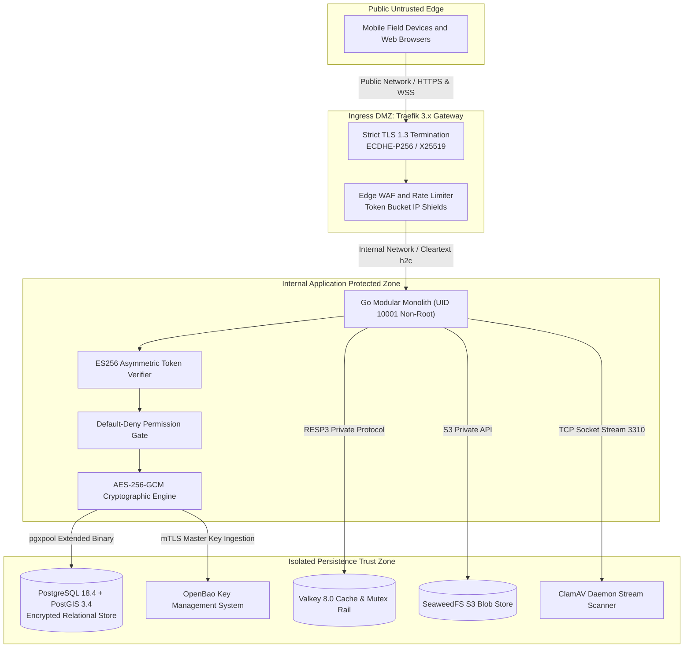
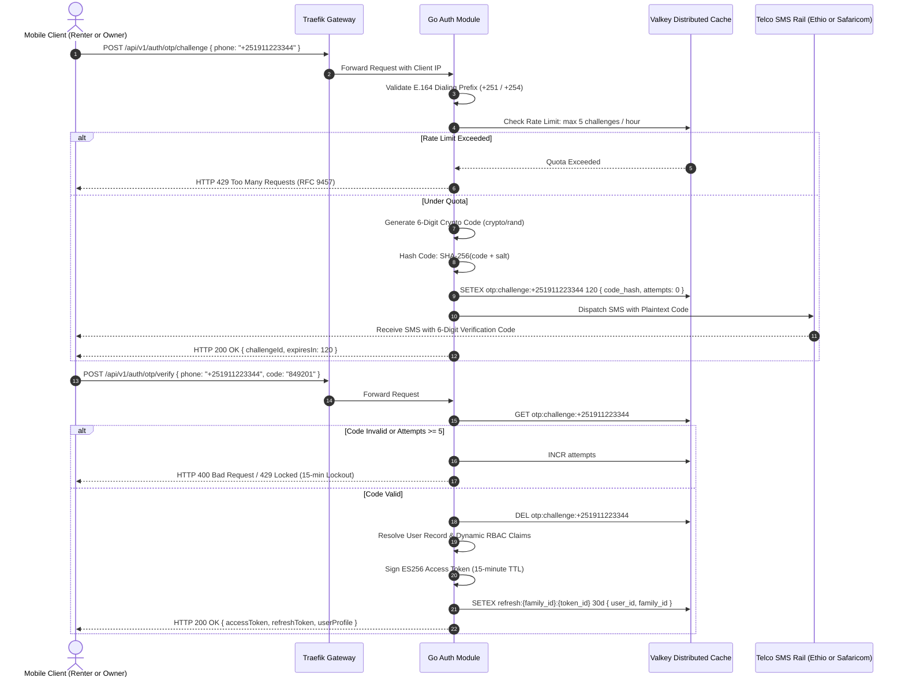
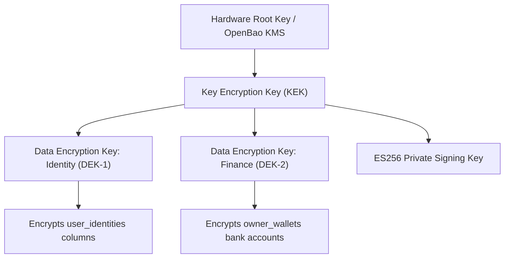
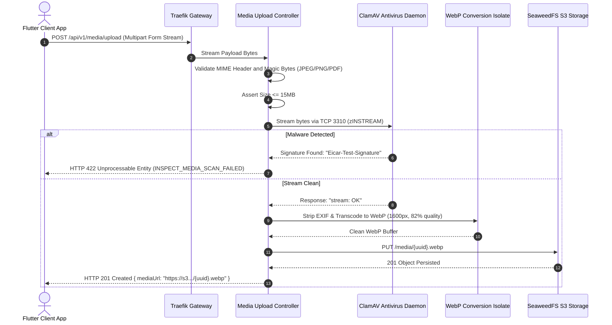
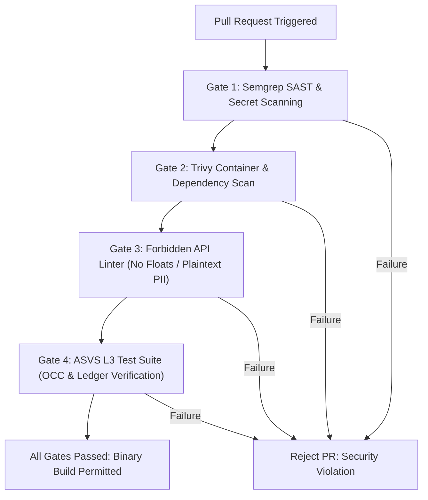

# Heavy Machinery & Logistics Rental Aggregator — Dink Machinery
## Architecture Specification — 09. Security & Compliance Architecture (`docs/shared/architecture/09-security-architecture.md`)

**Document Identifier:** `ARCH-SEC-DINK-CORE-V7.0`  
**Classification:** Canonical Architecture Specification & Engineering Reference (Single Source of Truth)  
**Governing Documents:** `SRS-DINK-CORE-V7.0` (Parts 1–5), `ARCH-INTRO-DINK-CORE-V7.0`, `ARCH-PRIN-DINK-CORE-V7.0`, `ARCH-OVERVIEW-DINK-CORE-V7.0`, `ARCH-BACKEND-GO-DINK-CORE-V7.0`, `ARCH-DB-DINK-CORE-V7.0`, `ARCH-COMM-DINK-CORE-V7.0`, `contracts/openapi.yaml`, `ADR-001` through `ADR-014`  
**Target Runtimes:** Go 1.27.3 Modular Monolith, PostgreSQL 18.4 + PostGIS 3.4, Valkey 8.0-alpine, ClamAV Daemon, OpenBao KMS, Traefik 3.x Gateway  
**Target Markets:** Ethiopia (`ET`) & Kenya (`KE`) — Dynamic Multi-Country Parameterization (`LOC-01-BE`)  
**Compliance Standards:** OWASP ASVS 4.0.3 Level 3 (Enterprise Verification), RFC 9457 (Problem Details), RFC 8446 (TLS 1.3), FIDO2 / WebAuthn, ISO/IEC 27001:2022, Ethiopian Personal Data Protection Proclamation No. 1321/2024, National Bank of Ethiopia (NBE) Directives  
**Status:** Approved Engineering Baseline

---

## Table of Contents

- 1. [Executive Summary & Security Philosophy](#1-executive-summary--security-philosophy)
- 2. [Threat Modeling & Attack Surface Analysis (STRIDE)](#2-threat-modeling--attack-surface-analysis-stride)
  - 2.1 [STRIDE Assessment Matrix](#21-stride-assessment-matrix)
  - 2.2 [Perimeter & Trust Boundary Demarcation](#22-perimeter--trust-boundary-demarcation)
- 3. [Identity, Authentication & Session Governance](#3-identity-authentication--session-governance)
  - 3.1 [Cryptographic Passwordless Phone OTP Pipeline](#31-cryptographic-passwordless-phone-otp-pipeline)
  - 3.2 [Asymmetric ES256 Access Tokens & Rotating Refresh Families](#32-asymmetric-es256-access-tokens--rotating-refresh-families)
  - 3.3 [FIDO2 WebAuthn Passkeys & Clone Counter Assertions](#33-fido2-webauthn-passkeys--clone-counter-assertions)
  - 3.4 [Mandatory Multi-Factor Administrative Governance (`AUTH-04-WEB`)](#34-mandatory-multi-factor-administrative-governance-auth-04-web)
- 4. [Authorization & Access Control Architecture (RBAC)](#4-authorization--access-control-architecture-rbac)
  - 4.1 [Default-Deny Enforcement Middleware](#41-default-deny-enforcement-middleware)
  - 4.2 [Fine-Grained Permission Matrix](#42-fine-grained-permission-matrix)
  - 4.3 [Object-Level Ownership Verification & Contextual Scoping](#43-object-level-ownership-verification--contextual-scoping)
- 5. [Field-Level Cryptography & Data at Rest Protection](#5-field-level-cryptography--data-at-rest-protection)
  - 5.1 [AES-256-GCM Envelope Encryption with AAD Binding](#51-aes-256-gcm-envelope-encryption-with-aad-binding)
  - 5.2 [Key Management Hierarchy & OpenBao Integration](#52-key-management-hierarchy--openbao-integration)
  - 5.3 [Database Volume Encryption & Storage Security](#53-database-volume-encryption--storage-security)
- 6. [Ingress Security, Edge Hardening & Transport Layer Security](#6-ingress-security-edge-hardening--transport-layer-security)
  - 6.1 [TLS 1.3 Strict Profile & Cipher Configuration](#61-tls-13-strict-profile--cipher-configuration)
  - 6.2 [Traefik Edge Armor & HTTP Security Headers](#62-traefik-edge-armor--http-security-headers)
  - 6.3 [Adaptive Rate Limiting & Denial-of-Service Defense](#63-adaptive-rate-limiting--denial-of-service-defense)
- 7. [Zero-PII Structured Logging & Data Sanitization](#7-zero-pii-structured-logging--data-sanitization)
  - 7.1 [Uber Zap PII Redacting Core](#71-uber-zap-pii-redacting-core)
  - 7.2 [Immutable Administrative Audit Trails (`AD-09-WEB`)](#72-immutable-administrative-audit-trails-ad-09-web)
- 8. [File Upload Defense & Synchronous Antivirus Quarantine](#8-file-upload-defense--synchronous-antivirus-quarantine)
  - 8.1 [In-Flight ClamAV `zINSTREAM` Inspection Pipeline](#81-in-flight-clamav-zinstream-inspection-pipeline)
  - 8.2 [Content Disarm & WebP Transcoding Pipeline](#82-content-disarm--webp-transcoding-pipeline)
- 9. [Statutory Privacy & Regulatory Compliance](#9-statutory-privacy--regulatory-compliance)
  - 9.1 [Ethiopian Personal Data Protection Proclamation No. 1321/2024](#91-ethiopian-personal-data-protection-proclamation-no-13212024)
  - 9.2 [NBE Anti-Escrow Commercial Wire Framework](#92-nbe-anti-escrow-commercial-wire-framework)
  - 9.3 [Tax Audit Readiness & 7-Year Ledger Retention](#93-tax-audit-readiness--7-year-ledger-retention)
- 10. [DevSecOps & Automated Security Quality Gates](#10-devsecops--automated-security-quality-gates)
- 11. [Security Incident Response & Forensic Protocol](#11-security-incident-response--forensic-protocol)

---

## 1. Executive Summary & Security Philosophy

Dink Machinery facilitates capital-intensive construction equipment mobilization, high-value interbank wire verifications ($50,000\text{–}1,000,000+\text{ ETB}$), and field operations across East Africa. Compromise of the platform could trigger substantial financial loss, fleet theft, regulatory sanctions, or operational sabotage on infrastructure projects.

The architecture rejects implicit perimeter trust in favor of a **Continuous Zero-Trust Posture** aligned with **OWASP ASVS 4.0.3 Level 3 (Enterprise Verification)**:
1. **Zero Implicit Trust:** Every internal request, whether originating from mobile clients, web consoles, or internal micro-components, must authenticate, prove contextual authorization, and validate parameter schemas.
2. **Cryptographic Provability:** Sensitive identities, payment verifications, and ledger journal lines post with asymmetric signatures and cryptographic audit trails.
3. **Application-Layer Cryptographic Enclaves:** Database compromise must not expose plaintext citizen identities or banking coordinates. Data is encrypted using AES-256-GCM before it touches the persistence wire.
4. **Zero-PII Exposure in Telemetry:** Personal Identifiable Information (PII) is barred from structured application logs, error payloads, metrics, and tracing spans.
5. **Defense in Depth:** Physical isolation, kernel-level container sandboxing (`distroless`, non-root `UID 10001`), streaming antivirus inspections, and distributed rate limiting operate concurrently to eliminate single points of security failure.

---

## 2. Threat Modeling & Attack Surface Analysis (STRIDE)

### 2.1 STRIDE Assessment Matrix

The system undergoes rigorous STRIDE analysis against all bounded context operations:

| Threat Category | Target Vector | High-Impact Threat Scenario | Architectural Mitigation | ASVS L3 Ref |
|---|---|---|---|---|
| **Spoofing** | Operator Telematics | Attacker submits false GPS packets to fake machine staging or hide geofence breach. | Ephemeral WebSocket ticket tokens tied to active booking sessions; monotonic timestamp checks; IP/device binding. | `V2.1`, `V3.1` |
| **Spoofing** | Authentication Ingress | Distributed brute-force attacks against 6-digit phone OTP challenges. | Valkey sliding-window rate limit (max 5 OTP/hr per phone and IP); 15-minute progressive IP lockouts; crypto PRNG OTP generator. | `V2.2`, `V2.3` |
| **Tampering** | Financial Ledger | Malicious actor or rogue insider alters rental commission calculations or journal rows. | Immutable database triggers blocking `UPDATE`/`DELETE` on `financial_ledger_entries`; deferred zero-sum balance triggers. | `V10.1`, `V10.2` |
| **Tampering** | Handover Inspection | Operator enters regressed hour meter reading to conceal unbilled equipment usage. | Database trigger and domain model enforcing monotonic non-regression against pre-rental baseline; camera-only capture reticle. | `V5.1` |
| **Repudiation** | Damage Dispute | Renter denies receiving damaged equipment or disputes inspection findings. | Digital glass touch signatures captured as vector paths; dual-custody pre/post inspection photo records; phone OTP sign-off. | `V10.3` |
| **Information Disclosure** | Database Breach | SQL injection or storage backup exfiltration reveals citizen National IDs and bank accounts. | Field-level AES-256-GCM column encryption using AAD bound to entity primary key; parameterized queries via `sqlc` extended binary protocol. | `V6.2`, `V8.1` |
| **Information Disclosure** | Application Logs | Sensitive session tokens, National IDs, or phone numbers leak into log analysis tools. | Uber Zap custom PII-scrubbing core applying regex replacement to mask tokens and identity identifiers. | `V8.3` |
| **Denial of Service** | Reservation Engine | Malicious contractor locks high-demand excavators across an entire regional corridor. | Valkey 60-minute mutual exclusion holds (`SET NX EX`); mandatory owner-verified bank transfer receipts; credit rating thresholds. | `V11.1` |
| **Elevation of Privilege** | Administrative Web | Support agent executes unauthorized wallet credit limit adjustments or emergency state overrides. | Default-deny RBAC middleware verifying fine-grained permissions; server-action guard decorators; mandatory hardware TOTP MFA. | `V4.1`, `V4.2` |

### 2.2 Perimeter & Trust Boundary Demarcation



---

## 3. Identity, Authentication & Session Governance

### 3.1 Cryptographic Passwordless Phone OTP Pipeline

Phone number authentication operates via cryptographically secure, rate-limited SMS challenges:



#### Cryptographic Random Code Generation (Go)
```go
package security

import (
    "crypto/rand"
    "fmt"
    "math/big"
)

// GenerateSecureOTP creates an unguessable 6-digit numeric verification code
func GenerateSecureOTP() (string, error) {
    max := big.NewInt(1000000)
    n, err := rand.Int(rand.Reader, max)
    if err != nil {
        return "", fmt.Errorf("failed to read entropy from system crypto/rand: %w", err)
    }
    return fmt.Sprintf("%06d", n.Int64()), nil
}
```

### 3.2 Asymmetric ES256 Access Tokens & Rotating Refresh Families

* **Access Tokens:** Short-lived (15 minutes). Asymmetrically signed using an **ECDSA P-256 (ES256)** private key. Microservices and middleware verify token signatures using public keys without querying the database.
* **Refresh Token Rotation & Family Invalidation:** Refresh tokens are single-use cryptographically random 256-bit strings stored in Valkey. Exchanging a refresh token invalidates the used token and generates a new pair. If an invalidated refresh token is presented, the system detects a token reuse attack, revokes the entire token family immediately, and terminates all active sessions for that user.

```go
package security

import (
    "crypto/ecdsa"
    "fmt"
    "time"
    "[github.com/golang-jwt/jwt/v5](https://github.com/golang-jwt/jwt/v5)"
    "[github.com/google/uuid](https://github.com/google/uuid)"
)

type TokenClaims struct {
    UserID      uuid.UUID `json:"sub"`
    Role        string    `json:"role"`
    CountryCode string    `json:"country"`
    Permissions []string  `json:"permissions"`
    FamilyID    uuid.UUID `json:"family_id"`
    jwt.RegisteredClaims
}

func IssueAccessToken(claims TokenClaims, privKey *ecdsa.PrivateKey) (string, error) {
    claims.RegisteredClaims = jwt.RegisteredClaims{
        Issuer:    "[https://api.dinkmachinery.com](https://api.dinkmachinery.com)",
        Subject:   claims.UserID.String(),
        Audience:  jwt.ClaimStrings{"dink-core-api"},
        IssuedAt:  jwt.NewNumericDate(time.Now().UTC()),
        ExpiresAt: jwt.NewNumericDate(time.Now().UTC().Add(15 * time.Minute)),
        ID:        uuid.New().String(),
    }

    token := jwt.NewWithClaims(jwt.SigningMethodES256, claims)
    return token.SignedString(privKey)
}
```

### 3.3 FIDO2 WebAuthn Passkeys & Clone Counter Assertions

For biometric authentication and progressive step-up authorization, the platform supports FIDO2 / WebAuthn passkeys:
* Public keys are stored in `user_webauthn_credentials`.
* The server maintains and asserts a strictly increasing `sign_count`. If a received assertion counter is less than or equal to the stored database counter, the system detects an authenticator cloning attack and locks the credential immediately.

### 3.4 Mandatory Multi-Factor Administrative Governance (`AUTH-04-WEB`)

Administrative and back-office roles (`super_admin`, `admin`, `finance_admin`, `support_agent`) must register a time-based one-time password (TOTP, RFC 6238) authenticator:
* Initial login issues a restricted scope token (`auth:mfa_pending`).
* Access to operational endpoints (`/api/v1/admin/*`) is blocked until a valid 6-digit TOTP code is verified.
* Administrative session cookies enforce `HttpOnly`, `SameSite=Strict`, `Secure`, and an absolute 8-hour shift ceiling with 30-minute sliding inactivity timeouts.

---

## 4. Authorization & Access Control Architecture (RBAC)

### 4.1 Default-Deny Enforcement Middleware

All API routes apply a **Default-Deny** security policy. Unless a user's authenticated token explicitly contains the required permission string, the request terminates with an HTTP 403 Forbidden response.

```go
package middleware

import (
    "net/http"
    "dink/internal/platform/errors"
    "dink/internal/platform/security"
)

func RequirePermission(requiredPermission string) func(http.Handler) http.Handler {
    return func(next http.Handler) http.Handler {
        return http.HandlerFunc(func(w http.ResponseWriter, r *http.Request) {
            claims, ok := r.Context().Value(security.ClaimsContextKey).(*security.TokenClaims)
            if !ok || claims == nil {
                errors.WriteProblem(w, r, http.StatusUnauthorized, "UNAUTHORIZED",
                    "Authentication Required", "Valid session credentials are required.", nil)
                return
            }

            // Super admin bypass
            if claims.Role == "super_admin" {
                next.ServeHTTP(w, r)
                return
            }

            // Evaluate specific permission key
            hasPerm := false
            for _, p := range claims.Permissions {
                if p == requiredPermission || p == "*" {
                    hasPerm = true
                    break
                }
            }

            if !hasPerm {
                errors.WriteProblem(w, r, http.StatusForbidden, "FORBIDDEN_INSUFFICIENT_PRIVILEGES",
                    "Access Denied", "Your account does not possess the required permission scope.", nil)
                return
            }

            next.ServeHTTP(w, r)
        })
    }
}
```

### 4.2 Fine-Grained Permission Matrix

```text
+------------------------------------------------------------------------------------+
|                         FINE-GRAINED PERMISSION MATRIX                             |
+------------------------------------------------------------------------------------+
|  Permission Key          | Description & Scope                                     |
+--------------------------+---------------------------------------------------------+
|  fleets:create           | Register new heavy machinery assets in catalog          |
|  fleets:verify           | Administrative approval and activation of fleet records |
|  fleets:inactivate       | Administrative suspension of uninspected machinery      |
|  bookings:create_hold    | Acquire temporary 60-minute reservation hold            |
|  bookings:confirm_slip   | Owner verification and confirmation of payment slip     |
|  bookings:override       | Super-admin emergency state machine override            |
|  inspections:attest      | Field operator handover check-in and check-out signoff  |
|  disputes:file           | Escalate damaged machinery claims to arbitration        |
|  disputes:arbitrate      | Compliance officer binding dispute resolution ruling    |
|  wallets:adjust_limit    | Finance administrator credit limit modification         |
|  ledger:audit            | Read-only immutable financial ledger exploration        |
+------------------------------------------------------------------------------------+
```

### 4.3 Object-Level Ownership Verification & Contextual Scoping

Possessing a permission key is insufficient for object mutations; the actor must also own the referenced entity:
* Handlers assert that `booking.RenterID == claims.UserID` (for renter mutations) or `fleet.OwnerID == claims.UserID` (for fleet owner actions).
* Multi-tenant corporate queries append `WHERE organization_id = $claims.OrgID` at the database query layer, preventing insecure direct object references (IDOR).

---

## 5. Field-Level Cryptography & Data at Rest Protection

### 5.1 AES-256-GCM Envelope Encryption with AAD Binding

Customer sensitive data (National ID FIN, Tax Identification Number, Bank Account Numbers, Personal Phone Numbers) is encrypted at the application layer prior to relational storage.

* **Cipher:** AES-256-GCM (Authenticated Encryption with Associated Data).
* **Additional Authenticated Data (AAD):** The entity's primary key (`id::text`) and column name are passed as the AAD parameter. This mathematically binds the ciphertext to the specific row and column, preventing ciphertext swapping attacks across database records.

```go
package crypto

import (
    "crypto/aes"
    "crypto/cipher"
    "crypto/rand"
    "fmt"
    "io"
)

type ColumnCipher struct {
    key []byte
}

func NewColumnCipher(key []byte) (*ColumnCipher, error) {
    if len(key) != 32 {
        return nil, fmt.Errorf("invalid key length: must be exactly 32 bytes for AES-256")
    }
    return &ColumnCipher{key: key}, nil
}

func (c *ColumnCipher) Encrypt(plaintext []byte, rowID, columnName string) ([]byte, error) {
    block, err := aes.NewCipher(c.key)
    if err != nil {
        return nil, err
    }

    gcm, err := cipher.NewGCM(block)
    if err != nil {
        return nil, err
    }

    nonce := make([]byte, gcm.NonceSize())
    if _, err := io.ReadFull(rand.Reader, nonce); err != nil {
        return nil, fmt.Errorf("failed to generate random nonce: %w", err)
    }

    // Bind AAD to row primary key and column name
    aad := []byte(fmt.Sprintf("%s:%s", rowID, columnName))
    ciphertext := gcm.Seal(nonce, nonce, plaintext, aad)

    return ciphertext, nil
}

func (c *ColumnCipher) Decrypt(ciphertext []byte, rowID, columnName string) ([]byte, error) {
    block, err := aes.NewCipher(c.key)
    if err != nil {
        return nil, err
    }

    gcm, err := cipher.NewGCM(block)
    if err != nil {
        return nil, err
    }

    nonceSize := gcm.NonceSize()
    if len(ciphertext) < nonceSize {
        return nil, fmt.Errorf("ciphertext too short to contain valid nonce")
    }

    nonce, rawCiphertext := ciphertext[:nonceSize], ciphertext[nonceSize:]
    aad := []byte(fmt.Sprintf("%s:%s", rowID, columnName))

    plaintext, err := gcm.Open(nil, nonce, rawCiphertext, aad)
    if err != nil {
        return nil, fmt.Errorf("integrity authentication failed or AAD mismatch: %w", err)
    }

    return plaintext, nil
}
```

### 5.2 Key Management Hierarchy & OpenBao Integration



* **Key Rotation:** Data Encryption Keys (DEKs) rotate every 90 days. Existing records store a 2-byte key version header prefix, allowing lazy re-encryption upon entity update.
* **Master Secrets Injection:** Secrets are injected directly into container memory via OpenBao at process launch; no cryptographic keys reside in version control or plain text configuration files.

### 5.3 Database Volume Encryption & Storage Security

All PostgreSQL NVMe volumes and SeaweedFS disk blocks utilize LUKS2 full-disk encryption with AES-XTS-PLAIN64 ($512\text{-bit}$ key length).

---

## 6. Ingress Security, Edge Hardening & Transport Layer Security

### 6.1 TLS 1.3 Strict Profile & Cipher Configuration

The Traefik edge reverse proxy mandates **TLS 1.3** as the default protocol, with strict fallback to TLS 1.2 for legacy field devices:
* **Approved Cipher Suites (TLS 1.3):**
  - `TLS_AES_128_GCM_SHA256`
  - `TLS_AES_256_GCM_SHA384`
  - `TLS_CHACHA20_POLY1305_SHA256`
* **Key Exchange Curves:** X25519, SecP256r1.
* **Legacy Disablement:** TLS 1.0, TLS 1.1, RSA key exchange, and CBC ciphers are disabled at the edge gateway.

### 6.2 Traefik Edge Armor & HTTP Security Headers

Every HTTP response emits hardened security headers:

```ini
# Mandatory Edge Security Headers
Strict-Transport-Security: max-age=63072000; includeSubDomains; preload
X-Frame-Options: DENY
X-Content-Type-Options: nosniff
Referrer-Policy: strict-origin-when-cross-origin
Permissions-Policy: camera=(self), geolocation=(self), microphone=(), payment=()
Content-Security-Policy: default-src 'self'; script-src 'self' 'unsafe-inline'; style-src 'self' 'unsafe-inline'; img-src 'self' [https://s3.dinkmachinery.com](https://s3.dinkmachinery.com) data:; connect-src 'self' [https://api.dinkmachinery.com](https://api.dinkmachinery.com) wss://api.dinkmachinery.com; frame-ancestors 'none';
```

### 6.3 Adaptive Rate Limiting & Denial-of-Service Defense

Traefik and Valkey enforce tiered rate-limiting to prevent denial-of-service and brute-force attacks:
* **Global Edge Limit:** Maximum 1,000 requests per minute per IP.
* **Authentication Challenges:** Maximum 5 OTP attempts per hour per phone and IP.
* **Spatial Search:** Maximum 120 queries per minute per authenticated user.
* **Penalties:** Exceeding thresholds yields an RFC 9457 HTTP 429 Too Many Requests response with a `Retry-After` header. Sustained abuse triggers a 15-minute IP firewall block.

---

## 7. Zero-PII Structured Logging & Data Sanitization

### 7.1 Uber Zap PII Redacting Core

Under Invariant 7, customer PII must never leak into log aggregators, Elasticsearch, or console streams. Application logs use Uber Zap wrapped with a custom redacting core.

```go
package logger

import (
    "regexp"
    "go.uber.org/zap"
    "go.uber.org/zap/zapcore"
)

var (
    // Matches Ethiopian and Kenyan phone formats
    phoneRegex = regexp.MustCompile(`(\+?25[14]\d{2})\d{4}(\d{3})`)
    // Matches National ID / Fayda formats
    nationalIDRegex = regexp.MustCompile(`\b([A-Z0-9]{3,4})[A-Z0-9]{4,6}([A-Z0-9]{3})\b`)
    // Matches Bearer JWT tokens
    jwtRegex = regexp.MustCompile(`(eyJ[a-zA-Z0-9_-]+)\.[a-zA-Z0-9_-]+\.[a-zA-Z0-9_-]+`)
)

type RedactingZapCore struct {
    zapcore.Core
}

func NewRedactingZapCore(inner zapcore.Core) zapcore.Core {
    return &RedactingZapCore{Core: inner}
}

func (r *RedactingZapCore) Write(entry zapcore.Entry, fields []zapcore.Field) error {
    sanitizedFields := make([]zapcore.Field, len(fields))
    for i, f := range fields {
        if f.Type == zapcore.StringType {
            sanitizedFields[i] = zap.String(f.Key, maskPII(f.String))
        } else {
            sanitizedFields[i] = f
        }
    }
    entry.Message = maskPII(entry.Message)
    return r.Core.Write(entry, sanitizedFields)
}

func maskPII(input string) string {
    s := phoneRegex.ReplaceAllString(input, "$1****$2")
    s = nationalIDRegex.ReplaceAllString(s, "$1****$2")
    return jwtRegex.ReplaceAllString(s, "$1.[REDACTED]")
}
```

### 7.2 Immutable Administrative Audit Trails (`AD-09-WEB`)

Every administrative action (approving machinery, confirming payment evidence, issuing dispute rulings) generates an immutable audit record in `admin_audit_logs`:
* Records actor ID, IP address, user-agent, action verb, resource ID, and serialized before/after JSON diffs.
* Database triggers block `UPDATE` and `DELETE` queries on the audit table.

---

## 8. File Upload Defense & Synchronous Antivirus Quarantine

Equipment owners and operators upload machinery inspection photos, bank receipts, and trade licenses. Files are inspected in-flight to prevent malware propagation.



### 8.1 In-Flight ClamAV `zINSTREAM` Inspection Pipeline

Files stream directly through the ClamAV daemon via TCP port `3310` using `zINSTREAM`. If an infected chunk is encountered, the connection closes immediately, returning an RFC 9457 error (`INSPECT_MEDIA_SCAN_FAILED`).

### 8.2 Content Disarm & WebP Transcoding Pipeline

1. **MIME Sniffing & Magic Byte Verification:** Verifies image magic numbers (`FF D8 FF` for JPEG, `89 50 4E 47` for PNG). Mismatched extensions are rejected.
2. **Metadata Sanitization:** EXIF geolocation tags and camera serial metadata are stripped to protect operator location privacy.
3. **Transcoding:** Clean images are re-encoded into WebP ($1600\text{ px}$ max edge, $82\%$ quality) before S3 persistence.

---

## 9. Statutory Privacy & Regulatory Compliance

### 9.1 Ethiopian Personal Data Protection Proclamation No. 1321/2024

* **Explicit Consent Records:** Before location tracking activates, the mobile client captures signed digital consent (`OperatorConsentLog`) recording terms version and UTC timestamp (`GPS-04`).
* **30-Day Telematics Retention Limit (`GPS-03-BE`):** Raw 30-second GPS breadcrumbs are stored in monthly database partitions and dropped permanently after 30 days.
* **Right to Erasure:** Deleting an account sets `deleted_at = NOW()`. PII columns are anonymized 5 years post-account closure (matching statutory fiscal review limits).

### 9.2 NBE Anti-Escrow Commercial Wire Framework

National Bank of Ethiopia directives prohibit non-banking platforms from holding customer rental deposits in escrow without specific custodial licensing.
* **Direct Transfer Model (`MANUAL_TRANSFER`):** Renters wire rental fees directly into the fleet owner's commercial bank account.
* **Pre-Funded Wallet Commissions:** Platform revenue is collected by debiting pre-funded owner wallet balances (`OwnerWallet`). The platform holds zero customer rental funds.

### 9.3 Tax Audit Readiness & 7-Year Ledger Retention

* In compliance with Ethiopian Ministry of Revenues (MOR) regulations, all financial invoices, VAT line items (15% in Ethiopia, 16% in Kenya), and `financial_ledger_entries` are retained for a minimum of 7 years.
* Database triggers prevent data destruction on fiscal records.

---

## 10. DevSecOps & Automated Security Quality Gates

The deployment pipeline enforces automated security gates prior to code merge and binary compilation:



1. **Static Analysis & Secret Scanning:** Semgrep and Gitleaks scan code for unredacted PII patterns, hardcoded credentials, or vulnerable dependencies.
2. **Container Security:** Trivy inspects base container layers (`distroless/static-debian12`), blocking builds with High or Critical CVEs.
3. **Forbidden API Verification:** A custom linter blocks the use of floating-point types (`float32`, `float64`) in financial models and confirms that all operational SQL queries include `deleted_at IS NULL`.
4. **ASVS Level 3 Verification:** Automated integration tests verify that concurrent version updates fail with HTTP 409 Conflict and double-entry ledger postings sum to zero minor units.

---

## 11. Security Incident Response & Forensic Protocol

In the event of a confirmed security incident or data breach:

```text
+------------------------------------------------------------------------------------+
|                       SECURITY INCIDENT RESPONSE PROTOCOL                          |
+------------------------------------------------------------------------------------+
|  Phase 1: Detection & Triage                                                       |
|  - Anomaly detection triggers: Alert on > 10 failed MFA attempts or ledger drift.  |
|  - Security Lead convenes Incident Response Team within 15 minutes.                |
|                                                                                    |
|  Phase 2: Isolation & Containment                                                  |
|  - Rotate compromised ES256 signing keys and revoke all active refresh families.  |
|  - Isolate affected container replicas using network security group rules.        |
|  - Engage OpenBao emergency secret revocation.                                     |
|                                                                                    |
|  Phase 3: Forensic Analysis                                                        |
|  - Export append-only admin_audit_logs and Traefik access logs to isolated storage.|
|  - Reconstruct timeline using W3C Trace Context and correlation IDs.               |
|                                                                                    |
|  Phase 4: Statutory Reporting                                                      |
|  - Notify national data protection authorities within 72 hours under Proclamation |
|    No. 1321/2024 if personal citizen data is compromised.                         |
|  - Dispatch transparent disclosure notices to affected contractors and owners.     |
+------------------------------------------------------------------------------------+
```

---

*This document defines the canonical security and compliance architecture for Dink Machinery Version 7.0. All downstream service implementations, edge configurations, and operational workflows must strictly conform to these security controls.*