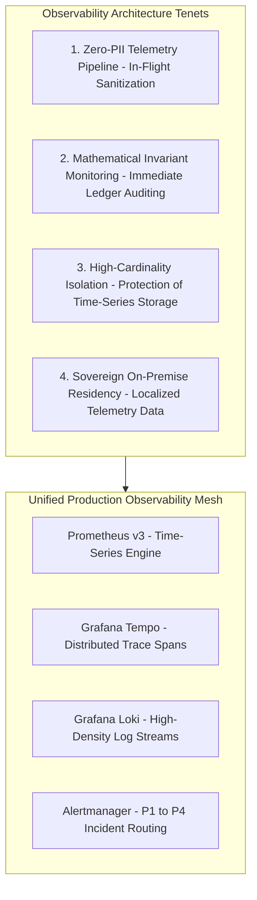
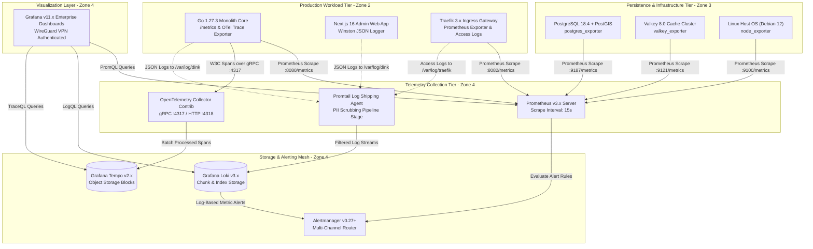
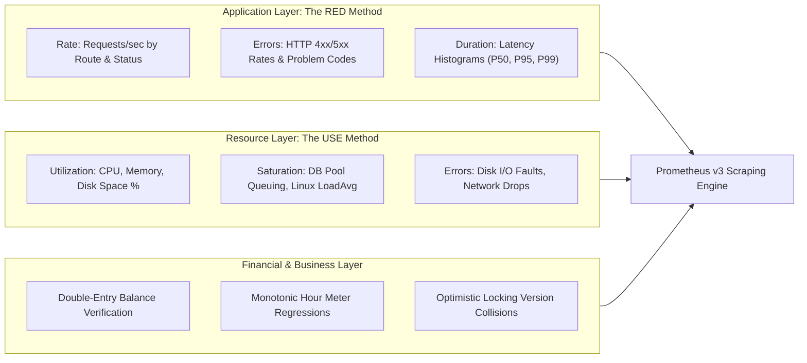
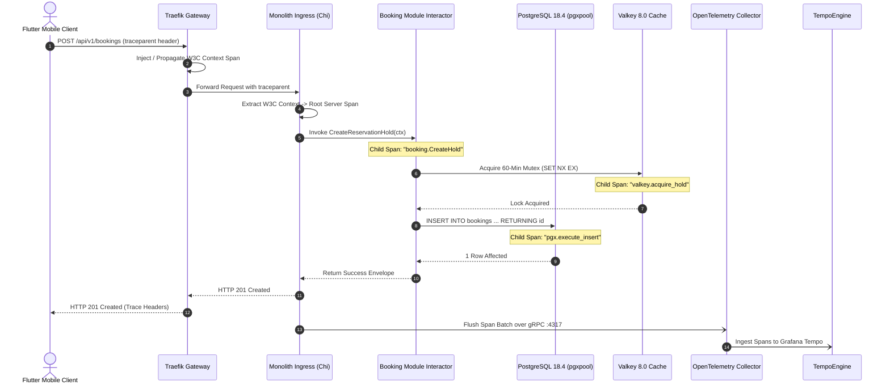
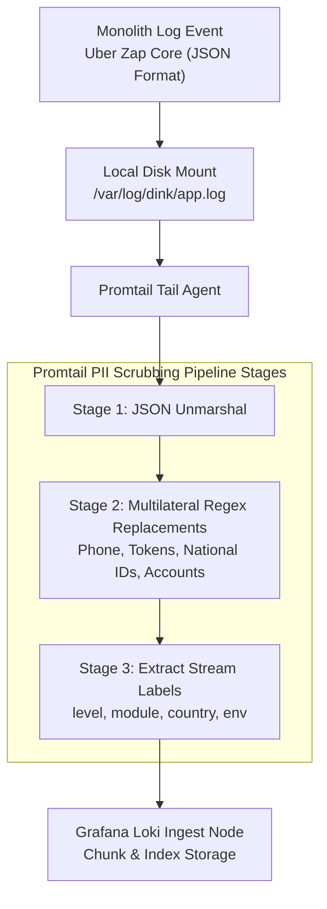
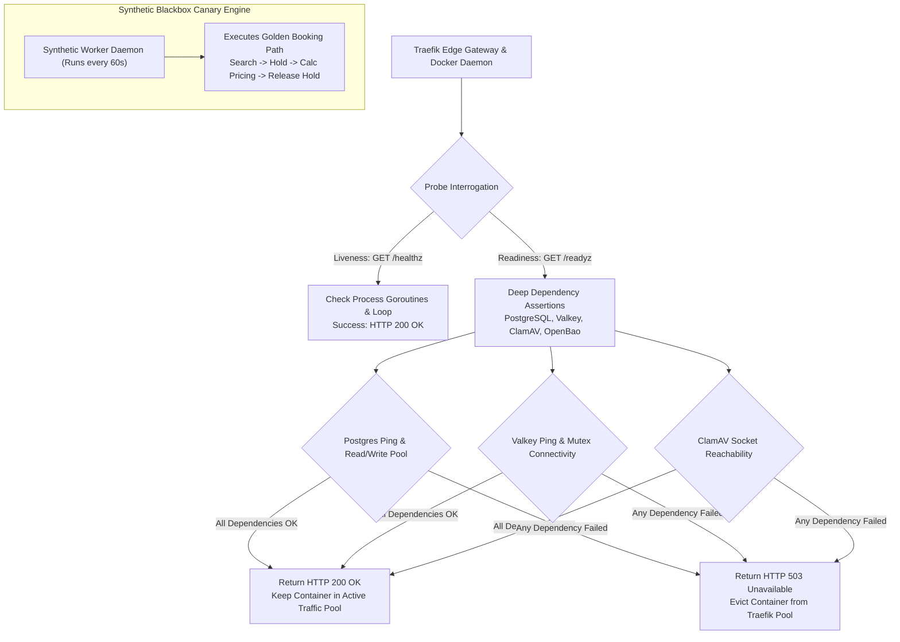
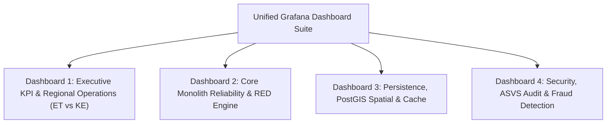
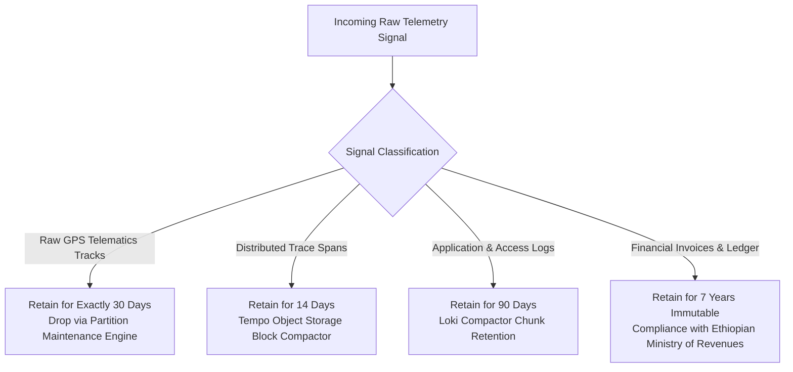
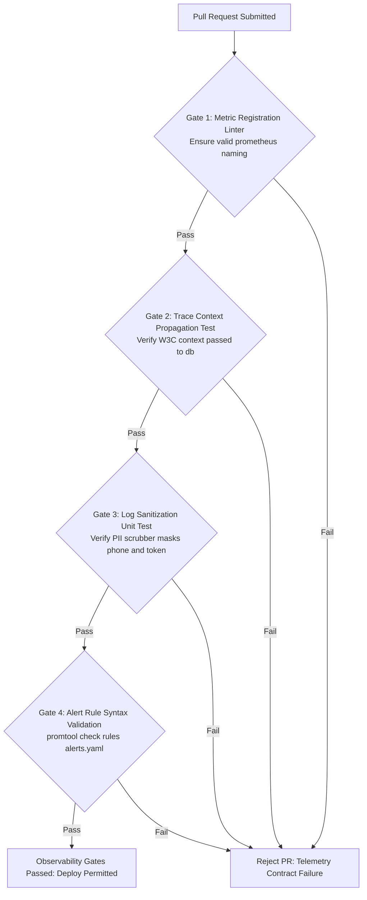

# Heavy Machinery & Logistics Rental Aggregator — Dink Machinery
## Architecture Specification — 11. Observability, Telemetry & Site Reliability Architecture (`docs/shared/architecture/11-observability-monitoring.md`)

**Document Identifier:** `ARCH-OBS-DINK-CORE-V7.0`  
**Classification:** Canonical Architecture Specification & Engineering Reference (Single Source of Truth)  
**Governing Documents:** `SRS-DINK-CORE-V7.0` (Parts 1–5), `ARCH-INTRO-DINK-CORE-V7.0`, `ARCH-PRIN-DINK-CORE-V7.0`, `ARCH-OVERVIEW-DINK-CORE-V7.0`, `ARCH-BACKEND-GO-DINK-CORE-V7.0`, `ARCH-DB-DINK-CORE-V7.0`, `ARCH-COMM-DINK-CORE-V7.0`, `ARCH-SEC-DINK-CORE-V7.0`, `ARCH-DEPLOY-DINK-CORE-V7.0`, `contracts/openapi.yaml`, `ADR-001` through `ADR-014`  
**Target Runtimes:** Go 1.27.3 Modular Monolith, OpenTelemetry SDK / Collector v0.100+, Prometheus v3.x, Grafana Loki v3.x, Grafana Tempo v2.x, Promtail, Grafana v11.x, Alertmanager v0.27+  
**Target Markets:** Ethiopia (`ET`) & Kenya (`KE`) — Dynamic Multi-Country Parameterization (`LOC-01-BE`)  
**Compliance Standards:** OWASP ASVS 4.0.3 Level 3, W3C Trace Context (Level 1 / 2), RFC 9457 (Problem Details), ISO/IEC 27001:2022, Ethiopian Personal Data Protection Proclamation No. 1321/2024, NBE Directives  
**Status:** Approved Engineering Baseline

---

## Table of Contents

- 1. [Executive Summary & Observability Tenets](#1-executive-summary--observability-tenets)
- 2. [Unified Observability Architecture & Telemetry Pipeline](#2-unified-observability-architecture--telemetry-pipeline)
  - 2.1 [Macro Telemetry Ingestion Architecture](#21-macro-telemetry-ingestion-architecture)
  - 2.2 [Data Collection Taxonomy & Protocol Allocation](#22-data-collection-taxonomy--protocol-allocation)
- 3. [Metrics Harvesting Engine (Prometheus & RED/USE Methods)](#3-metrics-harvesting-engine-prometheus--reduse-methods)
  - 3.1 [Ingress & Application Traffic Monitoring (The RED Method)](#31-ingress--application-traffic-monitoring-the-red-method)
  - 3.2 [System Resource & Host Saturation (The USE Method)](#32-system-resource--host-saturation-the-use-method)
  - 3.3 [Domain & Financial Invariant Metrics (`BK-17-BE`, `AR-08-BE`)](#33-domain--financial-invariant-metrics-bk-17-be-ar-08-be)
  - 3.4 [Prometheus Go Native Instrumentation Engine](#34-prometheus-go-native-instrumentation-engine)
- 4. [Distributed Tracing & W3C Trace Context (OpenTelemetry & Tempo)](#4-distributed-tracing--w3c-trace-context-opentelemetry--tempo)
  - 4.1 [W3C Trace Context Propagation Protocols](#41-w3c-trace-context-propagation-protocols)
  - 4.2 [In-Process Context Propagation in Go Modular Monolith](#42-in-process-context-propagation-in-go-modular-monolith)
  - 4.3 [Database & Valkey Span Attributes (Sanitized SQL, Zero PII)](#43-database--valkey-span-attributes-sanitized-sql-zero-pii)
  - 4.4 [Edge Gateway & Client Tracing Integration](#44-edge-gateway--client-tracing-integration)
- 5. [Zero-PII Structured Log Aggregation (Promtail & Grafana Loki)](#5-zero-pii-structured-log-aggregation-promtail--grafana-loki)
  - 5.1 [Structured JSON Schema & Stream Labeling Strategy](#51-structured-json-schema--stream-labeling-strategy)
  - 5.2 [In-Flight Regex PII Scrubbing Rules](#52-in-flight-regex-pii-scrubbing-rules)
  - 5.3 [Operational LogQL Queries & Security Detection Patterns](#53-operational-logql-queries--security-detection-patterns)
- 6. [Synthetic Probing, Health Checks & Readiness Topology](#6-synthetic-probing-health-checks--readiness-topology)
  - 6.1 [Liveness (`/healthz`) vs. Readiness (`/readyz`) Topology](#61-liveness-healthz-vs-readiness-readyz-topology)
  - 6.2 [Deep Readiness Probe Implementation (Go)](#62-deep-readiness-probe-implementation-go)
  - 6.3 [Synthetic End-to-End Renter Booking Journey Probe](#63-synthetic-end-to-end-renter-booking-journey-probe)
- 7. [Alerting Hierarchy, Escalation Matrix & On-Call Playbooks](#7-alerting-hierarchy-escalation-matrix--on-call-playbooks)
  - 7.1 [Severity Tiers & Response SLA Matrix](#71-severity-tiers--response-sla-matrix)
  - 7.2 [Prometheus Alerting Rules Baseline (`alerts.yaml`)](#72-prometheus-alerting-rules-baseline-alertsyaml)
  - 7.3 [Alertmanager Routing & Notification Matrix](#73-alertmanager-routing--notification-matrix)
- 8. [Dashboard Specifications & Grafana Topology](#8-dashboard-specifications--grafana-topology)
  - 8.1 [Dashboard 1: Executive KPI & Regional Operations (ET vs. KE)](#81-dashboard-1-executive-kpi--regional-operations-et-vs-ke)
  - 8.2 [Dashboard 2: Core Monolith Reliability & Latency Engine](#82-dashboard-2-core-monolith-reliability--latency-engine)
  - 8.3 [Dashboard 3: Persistence, Spatial & Cache Infrastructure](#83-dashboard-3-persistence-spatial--cache-infrastructure)
  - 8.4 [Dashboard 4: Security, ASVS Level 3 Audit & Rate Limiting](#84-dashboard-4-security-asvs-level-3-audit--rate-limiting)
- 9. [Retention, Storage Governance & Statutory Compliance](#9-retention-storage-governance--statutory-compliance)
  - 9.1 [Data Retention Tiering & Compliance Matrix](#91-data-retention-tiering--compliance-matrix)
  - 9.2 [Disk Quotas, Compaction & Cold Archival Encryption](#92-disk-quotas-compaction--cold-archival-encryption)
- 10. [Verification Gates & Automated Observability Testing](#10-verification-gates--automated-observability-testing)

---

## 1. Executive Summary & Observability Tenets

The Dink Machinery observability architecture provides continuous real-time insight into the health, performance, security posture, and financial invariants of the platform across East Africa. Monitoring heavy capital machinery rentals and direct commercial transfers demands an observability strategy that detects operational disruptions, software defects, fraud patterns, and ledger imbalances before business operations or statutory obligations are impacted.



### The Four Observability Tenets

1. **Zero-PII Telemetry Guarantee:** In compliance with OWASP ASVS 4.0.3 Level 3 and Ethiopian Personal Data Protection Proclamation No. 1321/2024, telemetry signals (metrics labels, trace spans, and log streams) must never contain plaintext customer PII. Phone numbers, National ID identifiers, bank account coordinates, and raw GPS tracks are redacted at source before passing to collection daemons.
2. **Mathematical Invariant Auditing:** Operational metrics prioritize provable correctness. System telemetry explicitly monitors the core business invariants: zero-sum balance of `financial_ledger_entries` (`BK-17-BE`), monotonic hour meter non-regression (`AR-08-BE`), and optimistic concurrency control (OCC) conflict rates. Any detected ledger imbalance triggers an immediate Severity 1 (P1) page.
3. **High-Cardinality Isolation:** Dynamic customer identifiers (UUIDs, phone numbers, individual booking IDs) are strictly barred from Prometheus metric labels to prevent cardinality explosions and memory exhaustion. High-cardinality values are routed exclusively to Grafana Tempo trace attributes and structured Grafana Loki log payloads.
4. **Sovereign On-Premise Telemetry Residency:** All telemetry pipelines, metric scrapers, log volumes, and trace storage reside within sovereign local datacenter infrastructure (Addis Ababa Tier III DC). No application traces or logs containing operational data are exported to offshore cloud observability providers.

---

## 2. Unified Observability Architecture & Telemetry Pipeline

### 2.1 Macro Telemetry Ingestion Architecture

The observability stack comprises four decoupled tiers: Collectors (Promtail, OpenTelemetry Collector), Storage Engines (Prometheus, Grafana Loki, Grafana Tempo), Incident Routing (Alertmanager), and Presentation (Grafana v11.x).



### 2.2 Data Collection Taxonomy & Protocol Allocation

| Signal Archetype | Ingestion Engine | Wire Transport Protocol | Target Port | Ingestion Cadence / Trigger |
|---|---|---|---|---|
| **System & Host Metrics** | Prometheus Scraper | HTTP/1.1 Pull (`text/plain; version=0.0.4`) | `:9100` | 15-second fixed polling interval. |
| **Monolith Application Metrics**| Prometheus Scraper | HTTP/1.1 Pull (`text/plain; version=0.0.4`) | `:8080/metrics` | 15-second fixed polling interval. |
| **Distributed Trace Spans** | OpenTelemetry Collector | OpenTelemetry Protocol (OTLP / gRPC) | `:4317` | Continuous streaming with 500ms batch buffer. |
| **Application Structured Logs** | Promtail Agent | Push HTTP REST (`POST /loki/api/v1/push`) | `:3100` | Real-time tailing of isolated Linux log files. |
| **Database Engine Metrics** | Prometheus Scraper | HTTP/1.1 Pull (`postgres_exporter`) | `:9187` | 15-second fixed polling interval. |
| **Cache & Lock Rail Metrics** | Prometheus Scraper | HTTP/1.1 Pull (`valkey_exporter`) | `:9121` | 15-second fixed polling interval. |
| **Operational Incident Alerts** | Alertmanager | HTTP Webhook / PagerDuty API | `:9093` | Immediate dispatch upon evaluation rule firing. |

---

## 3. Metrics Harvesting Engine (Prometheus & RED/USE Methods)

The metrics infrastructure isolates infrastructure saturation from user-facing transaction quality using the **RED** and **USE** monitoring models.



### 3.1 Ingress & Application Traffic Monitoring (The RED Method)

Every external REST endpoint and internal module interactor tracks standard RED indicators:
* **Rate ($R$):** Measured in requests per second (`http_requests_total`). Partitioned by HTTP method, route template, and active country code (`ET` vs. `KE`).
* **Errors ($E$):** Measured as a ratio of failed requests to total traffic (`http_requests_total{status=~"5.."}`). Explicit RFC 9457 error code counters isolate validation mistakes from system failures.
* **Duration ($D$):** High-resolution exponential histograms measuring latency in seconds (`http_request_duration_seconds_bucket`). Configured buckets capture both fast sub-millisecond cache lookups and high-tonnage spatial distance queries:
  $$\text{Buckets: } [0.005, 0.01, 0.025, 0.05, 0.1, 0.25, 0.5, 1.0, 2.5, 5.0, 10.0]$$

### 3.2 System Resource & Host Saturation (The USE Method)

Infrastructure components track capacity limits to avoid cascading failures under load:
* **PostgreSQL Connection Pool Saturation:** Monitored via `pgxpool_acquire_duration_seconds` and `pgxpool_active_conns / pgxpool_max_conns`. Alert fires if pool wait queue exceeds 50ms for $> 1\text{ minute}$.
* **Valkey Memory Saturation:** Evaluated via `valkey_memory_used_bytes / valkey_memory_max_bytes`. Warning alert fires at 80% saturation; critical eviction alerts fire at 90%.
* **Linux NVMe Storage Utilization:** Monitored via `node_filesystem_free_bytes / node_filesystem_size_bytes`. Alert fires if free disk space falls below 20% on any host volume.

### 3.3 Domain & Financial Invariant Metrics (`BK-17-BE`, `AR-08-BE`)

The Go modular monolith publishes custom Prometheus metrics reflecting core business invariants:

```text
# Metric Nomenclature Standard: dink_<module>_<metric_name>_<type>
dink_booking_holds_active_count             # Gauge: Current active 60-minute reservation holds in Valkey
dink_booking_state_transitions_total        # Counter: State machine transitions labeled by source and target state
dink_financial_ledger_entries_posted_total   # Counter: Total append-only double-entry lines posted by account code
dink_financial_ledger_imbalance_errors_total # Counter: FATAL non-zero sum ledger transactions (Must strictly be 0)
dink_owner_wallet_balance_santims_total      # Gauge: Aggregated pre-funded owner wallet balances in minor units
dink_inspection_meter_regression_blocks_total # Counter: Blocked post-rental check-outs violating monotonic meters
dink_occ_concurrency_conflicts_total        # Counter: HTTP 409 conflicts caused by version mismatch collisions
dink_clamav_scans_total                     # Counter: Media files evaluated labeled by result (clean, infected)
```

### 3.4 Prometheus Go Native Instrumentation Engine

The monolith configures native instrumentation with zero runtime reflection overhead:

```go
package telemetry

import (
    "net/http"
    "strconv"
    "time"

    "[github.com/prometheus/client_golang/prometheus](https://github.com/prometheus/client_golang/prometheus)"
    "[github.com/prometheus/client_golang/prometheus/promauto](https://github.com/prometheus/client_golang/prometheus/promauto)"
    "[github.com/prometheus/client_golang/prometheus/promhttp](https://github.com/prometheus/client_golang/prometheus/promhttp)"
)

var (
    // RED: Request Rate & Status
    HttpRequestsTotal = promauto.NewCounterVec(
        prometheus.CounterOpts{
            Namespace: "dink",
            Subsystem: "http",
            Name:      "requests_total",
            Help:      "Total HTTP requests partitioned by method, route, status code, and country.",
        },
        []string{"method", "route", "status", "country"},
    )

    // RED: Request Latency Histogram
    HttpRequestDuration = promauto.NewHistogramVec(
        prometheus.HistogramOpts{
            Namespace: "dink",
            Subsystem: "http",
            Name:      "request_duration_seconds",
            Help:      "HTTP request execution latency across exponential second buckets.",
            Buckets:   []float64{0.005, 0.01, 0.025, 0.05, 0.1, 0.25, 0.5, 1.0, 2.5, 5.0},
        },
        []string{"method", "route", "country"},
    )

    // Domain Invariant: Fatal Ledger Imbalance (Must be 0)
    LedgerImbalanceErrors = promauto.NewCounter(
        prometheus.CounterOpts{
            Namespace: "dink",
            Subsystem: "finance",
            Name:      "ledger_imbalance_errors_total",
            Help:      "CRITICAL: Non-zero sum double-entry ledger transactions detected.",
        },
    )

    // Domain Invariant: Monotonic Meter Regression Violations
    MeterRegressionBlocks = promauto.NewCounter(
        prometheus.CounterOpts{
            Namespace: "dink",
            Subsystem: "inspection",
            Name:      "meter_regression_blocks_total",
            Help:      "Total check-out inspection submissions blocked due to non-increasing hour meters.",
        },
    )

    // System: OCC Concurrency Conflicts (HTTP 409)
    OCCConcurrencyConflicts = promauto.NewCounterVec(
        prometheus.CounterOpts{
            Namespace: "dink",
            Subsystem: "persistence",
            Name:      "occ_concurrency_conflicts_total",
            Help:      "Optimistic concurrency control collisions on versioned operational entities.",
        },
        []string{"entity"},
    )
)

// MetricsMiddleware records latency and status codes for Chi router endpoints
func MetricsMiddleware(next http.Handler) http.Handler {
    return http.HandlerFunc(func(w http.ResponseWriter, r *http.Request) {
        start := time.Now()
        ww := &statusResponseWriter{ResponseWriter: w, statusCode: http.StatusOK}

        next.ServeHTTP(ww, r)

        duration := time.Since(start).Seconds()
        route := r.Pattern // Chi v5 matching pattern e.g. /api/v1/bookings/{id}
        if route == "" {
            route = "unmatched"
        }

        country := r.Header.Get("X-Country-Code")
        if country == "" {
            country = "UNKNOWN"
        }

        statusStr := strconv.Itoa(ww.statusCode)

        HttpRequestsTotal.WithLabelValues(r.Method, route, statusStr, country).Inc()
        HttpRequestDuration.WithLabelValues(r.Method, route, country).Observe(duration)
    })
}

type statusResponseWriter struct {
    http.ResponseWriter
    statusCode int
}

func (s *statusResponseWriter) WriteHeader(code int) {
    s.statusCode = code
    s.ResponseWriter.WriteHeader(code)
}
```

---

## 4. Distributed Tracing & W3C Trace Context (OpenTelemetry & Tempo)

A single user transaction (such as reserving an excavator with a linked lowboy transport sub-booking) touches the edge reverse proxy, modular domain logic, PostgreSQL transactions, Valkey mutexes, and asynchronous event workers. Dink Machinery instruments distributed tracing via the **OpenTelemetry Go SDK**, forwarding spans to an on-premise **Grafana Tempo** cluster.



### 4.1 W3C Trace Context Propagation Protocols

The platform enforces the **W3C Trace Context specification**:
* `traceparent`: `00-4bf92f3577b34da6a3ce929d0e0e4736-00f067aa0ba902b7-01`
  - `00`: Supported specification version.
  - `4bf92f3577b34da6a3ce929d0e0e4736`: 16-byte hex-encoded global trace identifier.
  - `00f067aa0ba902b7`: 8-byte hex-encoded parent span identifier.
  - `01`: Trace flags (`01` = recorded/sampled).
* `tracestate`: Propagates vendor metadata: `dink=origin_et,env_prod`.

### 4.2 In-Process Context Propagation in Go Modular Monolith

All inter-module calls and database interactors pass `context.Context` as their first parameter. Spans are created and annotated throughout the execution chain:

```go
package booking

import (
    "context"
    "fmt"
    "go.opentelemetry.io/otel"
    "go.opentelemetry.io/otel/attribute"
    "go.opentelemetry.io/otel/trace"
    "[github.com/google/uuid](https://github.com/google/uuid)"
)

var tracer = otel.Tracer("dink.machinery/module/booking")

func (s *Service) CreateReservationHold(ctx context.Context, fleetID, renterID uuid.UUID, country string) (*Booking, error) {
    ctx, span := tracer.Start(ctx, "booking.CreateReservationHold",
        trace.WithSpanKind(trace.SpanKindInternal),
        trace.WithAttributes(
            attribute.String("dink.fleet.id", fleetID.String()),
            attribute.String("dink.country", country),
            attribute.String("dink.renter.masked_id", renterID.String()[:8]+"-****"),
        ),
    )
    defer span.End()

    // 1. Acquire Valkey Distributed Lock
    acquired, err := s.valkey.AcquireBookingHold(ctx, fleetID, renterID, 3600)
    if err != nil {
        span.RecordError(err)
        return nil, fmt.Errorf("failed to acquire booking hold: %w", err)
    }
    if !acquired {
        span.SetAttributes(attribute.Bool("dink.hold.collision", true))
        return nil, ErrAssetAlreadyHeld
    }

    // 2. Persist Booking Entity within PostgreSQL Transaction
    booking, err := s.repo.InsertBookingHold(ctx, fleetID, renterID, country)
    if err != nil {
        span.RecordError(err)
        _ = s.valkey.ReleaseBookingHold(ctx, fleetID)
        return nil, err
    }

    span.SetAttributes(attribute.String("dink.booking.reference", booking.Reference))
    return booking, nil
}
```

### 4.3 Database & Valkey Span Attributes (Sanitized SQL, Zero PII)

Database query instrumentation uses static query templates rather than raw concatenated SQL. Parameter values containing citizen identity or financial figures are excluded:
* **Approved Span Attributes:** `db.system=postgresql`, `db.name=dink_core_prod`, `db.operation=SELECT`, `db.sql.template="SELECT id, status FROM bookings WHERE id = $1 AND version = $2"`.
* **Prohibited Span Attributes:** Plaintext phone numbers, customer full names, exact monetary values, or cryptographic tokens.

### 4.4 Edge Gateway & Client Tracing Integration

* **Flutter Mobile App:** Network interceptors generate a W3C `traceparent` for user-initiated transactions, enabling end-to-end trace stitching from mobile touch actuation through Traefik down to the database commit.
* **Next.js Admin Console:** Server Actions inherit client trace headers, creating child spans for administrative reviews, dispute resolution decisions, and manual bank slip verifications.

---

## 5. Zero-PII Structured Log Aggregation (Promtail & Grafana Loki)

Application components write structured logs in JSON format directly to local disk mounts. **Promtail** tails these files, runs regex-based PII sanitization stages, and pushes the streams to **Grafana Loki**.



### 5.1 Structured JSON Schema & Stream Labeling Strategy

Loki indexing avoids high-cardinality labels. Stream indexing is restricted to a compact set of operational dimensions:

```yaml
# Promtail Stream Labels (Low Cardinality)
labels:
  environment: "production"
  service: "dink-core-monolith"
  module: "finance"       # auth, catalog, booking, finance, inspection, dispute
  level: "error"          # debug, info, warn, error, fatal
  country: "ET"           # ET, KE
```

#### Standard Log Record JSON Payload
```json
{
  "timestamp": "2026-10-27T09:14:22.842Z",
  "level": "info",
  "logger": "booking.service",
  "message": "Booking reservation hold acquired successfully",
  "traceId": "4bf92f3577b34da6a3ce929d0e0e4736",
  "spanId": "00f067aa0ba902b7",
  "country": "ET",
  "module": "booking",
  "bookingId": "018f6a9e-876b-7341-a189-bc849901d892",
  "actorRole": "renter",
  "actorPhoneMasked": "+25191****344",
  "durationMs": 4.12
}
```

### 5.2 In-Flight Regex PII Scrubbing Rules

Promtail enforces a multi-stage regex scrubbing pipeline. Any log lines that escape application-layer Zap masking are sanitized before network transmission to Loki:

```yaml
# /etc/promtail/promtail.yaml - Production Scraping & Scrubbing Configuration
server:
  http_listen_port: 9080
  grpc_listen_port: 0

positions:
  filename: /var/log/promtail/positions.yaml

clients:
  - url: [http://172.28.40.30:3100/loki/api/v1/push](http://172.28.40.30:3100/loki/api/v1/push)
    tenant_id: dink_prod_mesh

scrape_configs:
  - job_name: dink_monolith_logs
    static_configs:
      - targets:
          - localhost
        labels:
          job: dink-monolith
          __path__: /var/log/dink/*.log

    pipeline_stages:
      - json:
          expressions:
            level: level
            module: module
            country: country
            traceId: traceId
            message: message

      # Stage 1: Scrub Ethiopian and Kenyan E.164 Phone Numbers
      - replace:
          expression: '(\+?25[14]\d{2})\d{4}(\d{3})'
          replace: '$1****$2'

      # Stage 2: Scrub Bearer JWT Tokens & Refresh Tokens
      - replace:
          expression: '(eyJ[a-zA-Z0-9_-]+)\.[a-zA-Z0-9_-]+\.[a-zA-Z0-9_-]+'
          replace: '$1.[REDACTED_TOKEN]'

      # Stage 3: Scrub Ethiopian Fayda National ID Identifiers (12-16 Alphanumeric)
      - replace:
          expression: '(?i)(fayda|nid|national_id)["\s:=]+([A-Z0-9]{3,4})[A-Z0-9]{4,8}([A-Z0-9]{3})'
          replace: '$1:"$2****$3"'

      # Stage 4: Scrub Bank Account Numbers (> 8 contiguous digits)
      - replace:
          expression: '(?i)(account|account_number|acc_no)["\s:=]+(\d{3})\d{4,10}(\d{3})'
          replace: '$1:"$2****$3"'

      # Stage 5: Apply Dynamic Labels for Fast Stream Routing
      - labels:
          level:
          module:
          country:
```

### 5.3 Operational LogQL Queries & Security Detection Patterns

```ini
# 1. Real-Time Detection of Double-Entry Ledger Imbalances (Critical Alert)
{service="dink-core-monolith"} |= "ledger imbalance" |= "CRITICAL"

# 2. Track Rate of Hour Meter Regression Blocks
rate({service="dink-core-monolith", module="inspection"} |= "INSPECT_METER_REGRESSION" [5m])

# 3. Detect Brute-Force Authentication Challenges by IP
sum by (clientIp) (count_over_time({job="traefik-access"} |= "POST /api/v1/auth/otp/verify" |= "status=400" [10m])) > 10

# 4. Filter Slow PostGIS Spatial Queries (> 500ms)
{service="dink-core-monolith", module="search"} | json | durationMs > 500
```

---

## 6. Synthetic Probing, Health Checks & Readiness Topology

The platform differentiates between process liveness, functional dependency readiness, and real customer journey health using a three-tier probing topology.



### 6.1 Liveness (`/healthz`) vs. Readiness (`/readyz`) Topology

1. **Liveness Probe (`/healthz`):** Verifies that the Go binary is running and the HTTP event loop is responsive. It performs no external network I/O. If this probe fails 3 consecutive times over 15 seconds, the container supervisor restarts the instance.
2. **Readiness Probe (`/readyz`):** Verifies that the instance can complete business operations. It interrogates the PostgreSQL connection pool, the Valkey cluster, the local ClamAV daemon, and the OpenBao KMS interface. If any dependency fails, the instance returns `HTTP 503 Service Unavailable`, prompting Traefik to take the instance out of the load-balancer rotation without terminating the process.

### 6.2 Deep Readiness Probe Implementation (Go)

```go
package health

import (
    "context"
    "encoding/json"
    "net"
    "net/http"
    "time"

    "[github.com/jackc/pgx/v5/pgxpool](https://github.com/jackc/pgx/v5/pgxpool)"
    "dink/internal/platform/valkey"
)

type DependencyStatus struct {
    Status  string `json:"status"` // UP or DOWN
    Latency string `json:"latency"`
    Error   string `json:"error,omitempty"`
}

type ReadinessResponse struct {
    OverallStatus string                      `json:"overallStatus"`
    Dependencies  map[string]DependencyStatus `json:"dependencies"`
    Timestamp     time.Time                   `json:"timestamp"`
}

func ReadinessHandler(pool *pgxpool.Pool, vk *valkey.Client, clamAddr string) http.HandlerFunc {
    return func(w http.ResponseWriter, r *http.Request) {
        ctx, cancel := context.WithTimeout(r.Context(), 3*time.Second)
        defer cancel()

        deps := make(map[string]DependencyStatus)
        allUp := true

        // 1. Assert PostgreSQL Pool Connectivity
        pgStart := time.Now()
        if err := pool.Ping(ctx); err != nil {
            deps["postgresql"] = DependencyStatus{Status: "DOWN", Error: err.Error()}
            allUp = false
        } else {
            deps["postgresql"] = DependencyStatus{Status: "UP", Latency: time.Since(pgStart).String()}
        }

        // 2. Assert Valkey Cluster Connectivity
        vkStart := time.Now()
        if err := vk.Ping(ctx); err != nil {
            deps["valkey"] = DependencyStatus{Status: "DOWN", Error: err.Error()}
            allUp = false
        } else {
            deps["valkey"] = DependencyStatus{Status: "UP", Latency: time.Since(vkStart).String()}
        }

        // 3. Assert ClamAV Daemon Socket Connectivity
        clamStart := time.Now()
        conn, err := net.DialTimeout("tcp", clamAddr, 1500*time.Millisecond)
        if err != nil {
            deps["clamav"] = DependencyStatus{Status: "DOWN", Error: err.Error()}
            allUp = false
        } else {
            _ = conn.Close()
            deps["clamav"] = DependencyStatus{Status: "UP", Latency: time.Since(clamStart).String()}
        }

        res := ReadinessResponse{
            OverallStatus: "UP",
            Dependencies:  deps,
            Timestamp:     time.Now().UTC(),
        }

        w.Header().Set("Content-Type", "application/json")
        if !allUp {
            res.OverallStatus = "DOWN"
            w.WriteHeader(http.StatusServiceUnavailable)
        } else {
            w.WriteHeader(http.StatusOK)
        }

        _ = json.NewEncoder(w).Encode(res)
    }
}
```

### 6.3 Synthetic End-to-End Renter Booking Journey Probe

An external blackbox testing daemon runs every 60 seconds from an independent host, validating the core platform workflow:
1. Performs a PostGIS radius search: `GET /api/v1/geo/fleets/radius-search?lat=9.032&lng=38.746&radiusKm=20`.
2. Selects a designated synthetic canary asset and requests a 60-minute reservation hold: `POST /api/v1/bookings` with an `Idempotency-Key`.
3. Verifies that the reservation transitions to `HOLD_PENDING` and a 60-minute Valkey lock is established.
4. Releases the synthetic hold: `DELETE /api/v1/bookings/{id}/hold`.
5. Emits execution timing to Prometheus via the Pushgateway. If the canary sequence fails or takes longer than 1,500ms, a P2 alert fires.

---

## 7. Alerting Hierarchy, Escalation Matrix & On-Call Playbooks

### 7.1 Severity Tiers & Response SLA Matrix

| Alert Tier | Description & Impact | Notification Channels | Initial Triage SLA | Escalation Window |
|---|---|---|---|---|
| **P1 — Critical** | Immediate threat to data integrity, platform unavailability, or double-entry financial imbalance. | PagerDuty (Phone Call) + Dedicated Internal SMS Gateway | **$\le 5\text{ minutes}$** | Escalates to Head of Engineering if unacknowledged at 10 minutes. |
| **P2 — High** | Core user journey degraded; spatial discovery failure; payment slip upload blocked; ClamAV scanner down. | PagerDuty (Push Alert) + Operational Alert Telegram Bot | **$\le 15\text{ minutes}$** | Escalates to Secondary On-Call at 30 minutes. |
| **P3 — Medium** | Non-critical component degraded; single-node database replica lag; elevated OCC conflict rates; rate-limit spikes. | Operational Alert Telegram Bot + Email Distribution | **$\le 2\text{ hours}$** | Reviewed during standard daily operations shift. |
| **P4 — Low** | Informational capacity warning; low disk space ($< 25\%$ remaining); non-urgent batch sync retries. | Internal Daily Digest Email + Jira Ops Ticket | **$\le 24\text{ hours}$** | Evaluated during weekly sprint maintenance. |

### 7.2 Prometheus Alerting Rules Baseline (`alerts.yaml`)

```yaml
# /etc/prometheus/rules/alerts.yaml - Canonical Alert Definitions
groups:
  - name: dink_financial_and_domain_invariants
    rules:
      - alert: ZeroSumLedgerImbalanceDetected
        expr: dink_finance_ledger_imbalance_errors_total > 0
        for: 0m
        labels:
          severity: critical
          tier: P1
        annotations:
          summary: "FATAL: Double-entry financial ledger imbalance detected"
          description: "A transaction in financial_ledger_entries committed without balancing to exactly 0 minor units. Immediate accounting audit required."
          playbook: "[https://ops.dinkmachinery.com/playbooks/ledger-imbalance](https://ops.dinkmachinery.com/playbooks/ledger-imbalance)"

      - alert: MonotonicHourMeterRegressionAnomaly
        expr: rate(dink_inspection_meter_regression_blocks_total[5m]) > 0.1
        for: 2m
        labels:
          severity: high
          tier: P2
        annotations:
          summary: "Abnormal rate of hour meter regression submission rejections"
          description: "Multiple field operators are attempting to submit check-out inspections with meter readings lower than check-in baselines. Possible fraud or sensor defect."
          playbook: "[https://ops.dinkmachinery.com/playbooks/meter-regression](https://ops.dinkmachinery.com/playbooks/meter-regression)"

  - name: dink_system_reliability_red
    rules:
      - alert: CoreAPIHighErrorRate
        expr: sum(rate(dink_http_requests_total{status=~"5.."}[5m])) / sum(rate(dink_http_requests_total[5m])) * 100 > 1.0
        for: 3m
        labels:
          severity: critical
          tier: P1
        annotations:
          summary: "Core HTTP API 5xx error rate exceeds 1.0%"
          description: "High error rates detected on route {{ $labels.route }} in country {{ $labels.country }}."
          playbook: "[https://ops.dinkmachinery.com/playbooks/api-error-spike](https://ops.dinkmachinery.com/playbooks/api-error-spike)"

      - alert: CoreAPILatencyBreachedP95
        expr: histogram_quantile(0.95, sum(rate(dink_http_request_duration_seconds_bucket{route!~"/ws.*"}[5m])) by (le, route)) > 0.500
        for: 5m
        labels:
          severity: high
          tier: P2
        annotations:
          summary: "P95 transaction latency exceeds 500ms SLA"
          description: "Route {{ $labels.route }} is executing slower than the 500ms P95 latency target."
          playbook: "[https://ops.dinkmachinery.com/playbooks/latency-triage](https://ops.dinkmachinery.com/playbooks/latency-triage)"

  - name: dink_infrastructure_saturation_use
    rules:
      - alert: PostgreSQLConnectionPoolSaturated
        expr: pgxpool_active_conns / pgxpool_max_conns > 0.85
        for: 2m
        labels:
          severity: high
          tier: P2
        annotations:
          summary: "PostgreSQL connection pool utilization > 85%"
          description: "Monolith connection pool is near exhaustion. Risk of request queuing and timeouts."
          playbook: "[https://ops.dinkmachinery.com/playbooks/pg-pool-exhaustion](https://ops.dinkmachinery.com/playbooks/pg-pool-exhaustion)"

      - alert: ValkeyMemoryNearSaturation
        expr: valkey_memory_used_bytes / valkey_memory_max_bytes > 0.85
        for: 5m
        labels:
          severity: high
          tier: P2
        annotations:
          summary: "Valkey cache memory capacity exceeds 85%"
          description: "Valkey cache is near its memory limit. Mutual exclusion holds may be evicted."
          playbook: "[https://ops.dinkmachinery.com/playbooks/valkey-memory](https://ops.dinkmachinery.com/playbooks/valkey-memory)"
```

### 7.3 Alertmanager Routing & Notification Matrix

```yaml
# /etc/alertmanager/alertmanager.yaml - Alertmanager Routing Topology
global:
  resolve_timeout: 5m

route:
  group_by: ['alertname', 'module', 'country']
  group_wait: 10s
  group_interval: 30s
  repeat_interval: 4h
  receiver: 'ops-telegram-channel'
  routes:
    - match:
        severity: critical
      receiver: 'pagerduty-critical'
      continue: true

    - match:
        severity: high
      receiver: 'pagerduty-high'

receivers:
  - name: 'pagerduty-critical'
    pagerduty_configs:
      - service_key: 'pd-dink-core-critical-key'
        severity: 'critical'
        client: 'Dink Alertmanager'
        client_url: '[https://grafana.dinkmachinery.com](https://grafana.dinkmachinery.com)'

  - name: 'pagerduty-high'
    pagerduty_configs:
      - service_key: 'pd-dink-core-high-key'
        severity: 'error'

  - name: 'ops-telegram-channel'
    telegram_configs:
      - bot_token: 'SECRET_TELEGRAM_BOT_TOKEN_FROM_OPENBAO'
        chat_id: -100293847581
        send_resolved: true
        parse_mode: 'HTML'
        message: '<b>Alert:</b> {{ .CommonAnnotations.summary }}<br/><b>Severity:</b> {{ .CommonLabels.severity }}<br/><b>Detail:</b> {{ .CommonAnnotations.description }}'
```

---

## 8. Dashboard Specifications & Grafana Topology

Grafana v11.x operates four standardized operational dashboards:



### 8.1 Dashboard 1: Executive KPI & Regional Operations (ET vs. KE)
* **Active 60-Minute Holds:** Real-time gauge of active reservation holds per country (`ET` vs `KE`).
* **Gross Rental Transaction Value:** Dynamic single-stat counter displaying 24-hour confirmed booking volume denominated in Ethiopian Birr (`ETB`) and Kenyan Shillings (`KES`).
* **Direct Transfer Conversion Velocity:** Conversion rate percentage from `HOLD_PENDING` to `PAYMENT_EVIDENCE_UPLOADED` to `CONFIRMED`.
* **Sub-Booking Logistics Attachment Rate:** Ratio of heavy excavator rentals with attached lowboy transport sub-bookings.

### 8.2 Dashboard 2: Core Monolith Reliability & Latency Engine
* **Global Request Rate & Status Distribution:** Stacked graph of `http_requests_total` broken down by HTTP status code (`2xx`, `4xx`, `5xx`).
* **P50, P95, and P99 Latency Curves:** Real-time latency tracking against the 500ms P95 SLA target.
* **OCC Version Conflict Heatmap:** Visualizes concurrency retry hotspots across bookings, fleets, and wallets.
* **Top 10 Slowest Route Endpoints:** Table ranking endpoints by P95 response duration over the selected time window.

### 8.3 Dashboard 3: Persistence, Spatial & Cache Infrastructure
* **PostGIS Spatial Query Execution Duration:** Latency histogram for `ST_DWithin` spatial discovery queries.
* **Database Connection Pool Exhaustion:** Tracks `pgxpool_active_conns` vs. `pgxpool_max_conns` and acquire wait queues.
* **Valkey Command Throughput & Cache Hit Ratio:** Real-time evaluation of `HIT` vs `MISS` ratios and memory usage.
* **SeaweedFS S3 Ingestion Rate:** Multipart upload bandwidth and ClamAV stream scan latencies.

### 8.4 Dashboard 4: Security, ASVS Level 3 Audit & Rate Limiting
* **Authentication Failures & Rate-Limit Violations:** Tracks HTTP 429 rejections on `/api/v1/auth/otp/*`.
* **Infected File Upload Interceptions:** Real-time security counter tracking malware signatures caught by ClamAV.
* **Dispute Escalation Velocity:** Tracks active arbitration volume approaching the 3-day SLA escalation deadline (`DISP-02-BE`).
* **Administrative Audit Log Stream:** Real-time Loki log stream showing sensitive administrative mutations (credit limit changes, manual status overrides).

---

## 9. Retention, Storage Governance & Statutory Compliance

### 9.1 Data Retention Tiering & Compliance Matrix

Telemetry data retention policies balance troubleshooting visibility with legal compliance:



| Signal Classification | Storage Engine | Retention Window | Storage Tier & Action | Compliance & Statutory Reference |
|---|---|---|---|---|
| **Raw GPS Operator Breadcrumbs** | PostgreSQL Partition | **30 Days** | Automated nightly table partition drop. | Ethiopian Personal Data Protection Proclamation No. 1321/2024 (`GPS-03-BE`). |
| **Distributed Trace Spans** | Grafana Tempo | **14 Days** | Compressed block eviction from NVMe. | Operational capacity management. |
| **Operational Application Logs** | Grafana Loki | **90 Days** | Chunk deletion via Loki retention compactor. | ISO/IEC 27001:2022 incident analysis minimums. |
| **Administrative Audit Records** | PostgreSQL Audit Table | **7 Years** | Append-only database partition; triggers block `DELETE`. | Administrative Accountability Standard (`AD-09-WEB`). |
| **Financial Ledgers & Tax Invoices** | PostgreSQL + S3 PDF | **7 Years** | Immutable, air-gapped encrypted cold storage. | Ethiopian Ministry of Revenues (MOR) Fiscal Directives (`BK-17-BE`). |

### 9.2 Disk Quotas, Compaction & Cold Archival Encryption

* **Prometheus Retention:** Configured for 30 days or $50\text{GB}$ maximum storage on local NVMe arrays (`--storage.tsdb.retention.time=30d --storage.tsdb.retention.size=50GB`).
* **Loki Compaction:** Merges chunk segments every 2 hours and deletes expired streams older than 90 days.
* **Cold Storage Encryption:** Archived telemetry traces and logs synced to secondary storage volumes are encrypted using **AES-256-CBC** via keys managed through OpenBao KMS.

---

## 10. Verification Gates & Automated Observability Testing

The CI/CD build pipeline verifies telemetry instrumentation before code is approved for production deployment:



1. **Metric Registration Linter:** Confirms that new metrics conform to the `dink_<module>_<name>_<type>` naming standard and use approved static label names.
2. **Trace Context Propagation Test:** Integration tests verify that HTTP request handlers propagate W3C `traceparent` headers into database queries and cache interactions.
3. **Log Sanitization Unit Test:** Automated test passes test strings containing phone numbers, National IDs, and Bearer tokens through the logging core to verify they are properly masked.
4. **Alert Rule Syntax Validation (`promtool`):** Pre-merge pipeline runs `promtool check rules /etc/prometheus/rules/alerts.yaml` to prevent syntax errors in alerting rules from reaching production.

---

*This document defines the canonical observability, telemetry, and site reliability architecture for Dink Machinery Version 7.0. All downstream infrastructure provisioning, container deployments, and application instrumentation must strictly adhere to these standards.*