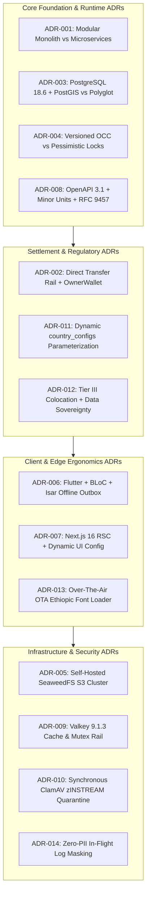
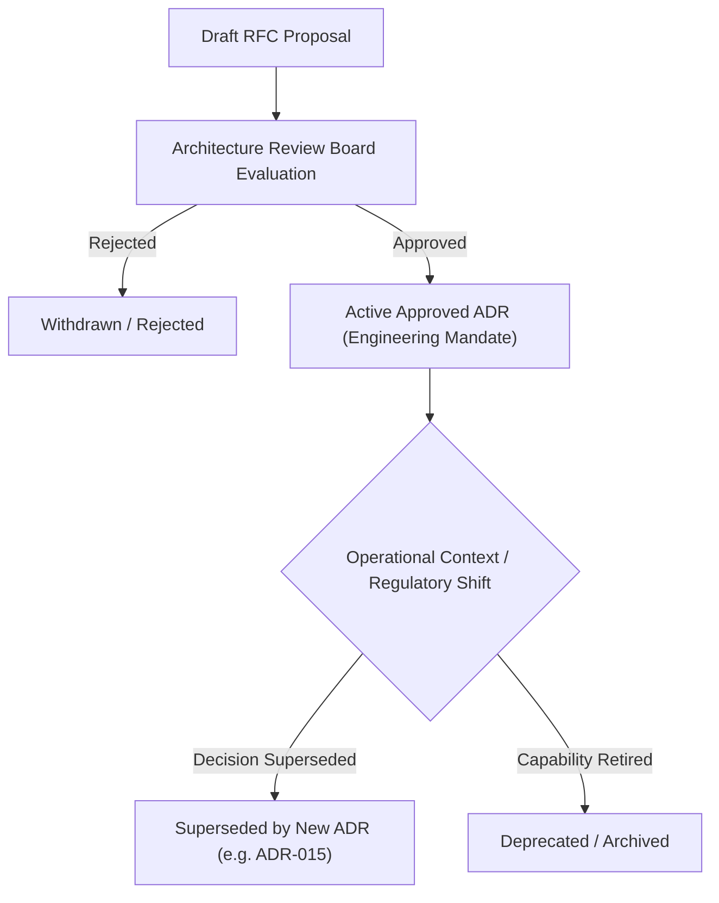

# Heavy Machinery & Logistics Rental Aggregator — Dink Machinery
## Architecture Specification — 12. Architectural Decision Records (`docs/shared/architecture/12-architecture-decision-records.md`)

**Document Identifier:** `ARCH-ADR-DINK-CORE-V7.0`  
**Classification:** Canonical Architecture Specification & Engineering Reference (Single Source of Truth)  
**Governing Documents:** `SRS-DINK-CORE-V7.0` (Parts 1–5), `ARCH-INTRO-DINK-CORE-V7.0`, `ARCH-PRIN-DINK-CORE-V7.0`, `ARCH-OVERVIEW-DINK-CORE-V7.0`, `ARCH-BACKEND-GO-DINK-CORE-V7.0`, `ARCH-DB-DINK-CORE-V7.0`, `ARCH-COMM-DINK-CORE-V7.0`, `ARCH-SEC-DINK-CORE-V7.0`, `ARCH-DEPLOY-DINK-CORE-V7.0`, `ARCH-OBS-DINK-CORE-V7.0`, `contracts/openapi.yaml`  
**Target Runtimes:** Go 1.27.3 Modular Monolith, Flutter 3.47.8 Cross-Platform Mobile Client, Next.js 16.x Admin Web Console (latest CVE security patch), PostgreSQL 18.6 + PostGIS 3.6.4, Valkey 9.1.3-alpine, SeaweedFS S3, ClamAV Daemon, OpenBao KMS, Traefik 3.x Gateway  
**Target Markets:** Ethiopia (`ET`) & Kenya (`KE`) — Dynamic Multi-Country Parameterization (`LOC-01-BE`)  
**Compliance Standards:** OWASP ASVS 4.0.3 Level 3, RFC 9457 (Problem Details), ISO/IEC/IEEE 42010, ISO 4217, ISO 3166-1 alpha-2, Ethiopian Personal Data Protection Proclamation No. 1321/2024, National Bank of Ethiopia (NBE) Directives  
**Status:** Approved Engineering Baseline

---

## Table of Contents

- 1. [Executive Summary & ADR Governance Framework](#1-executive-summary--adr-governance-framework)
- 2. [Canonical ADR Index & Traceability Matrix](#2-canonical-adr-index--traceability-matrix)
- 3. [The Fourteen Canonical Architecture Decision Records](#3-the-fourteen-canonical-architecture-decision-records)
  - 3.1 [ADR-001: System Packaging — Go 1.27.3 Modular Monolith vs. Distributed Microservices](#31-adr-001-system-packaging--go-1273-modular-monolith-vs-distributed-microservices)
  - 3.2 [ADR-002: Financial Settlement — Direct Bank Transfer Rail (`MANUAL_TRANSFER`) & Pre-Funded Commission Wallet (`OwnerWallet`) vs. Platform Escrow Custody](#32-adr-002-financial-settlement--direct-bank-transfer-rail-manual_transfer--pre-funded-commission-wallet-ownerwallet-vs-platform-escrow-custody)
  - 3.3 [ADR-003: Primary Persistence & Spatial Taxonomy — PostgreSQL 18.6 + PostGIS 3.6.4 vs. Polyglot Document/Search Stores](#33-adr-003-primary-persistence--spatial-taxonomy--postgresql-184--postgis-34-vs-polyglot-documentsearch-stores)
  - 3.4 [ADR-004: Concurrency Control Strategy — Optimistic Concurrency Control (OCC) vs. Distributed Pessimistic Locking](#34-adr-004-concurrency-control-strategy--optimistic-concurrency-control-occ-vs-distributed-pessimistic-locking)
  - 3.5 [ADR-005: Unstructured Media Storage — Self-Hosted SeaweedFS S3 Cluster vs. Public Cloud Blob Storage](#35-adr-005-unstructured-media-storage--self-hosted-seaweedfs-s3-cluster-vs-public-cloud-blob-storage)
  - 3.6 [ADR-006: Mobile Client Architecture — Flutter 3.47.8 + BLoC + Isar NoSQL Offline Outbox vs. React Native / Native Mobile](#36-adr-006-mobile-client-architecture--flutter-344--bloc--isar-nosql-offline-outbox-vs-react-native--native-mobile)
  - 3.7 [ADR-007: Back-Office Web Architecture — Next.js 16 (App Router + React 19 RSC) with Server-Driven UI vs. Client-Side SPA](#37-adr-007-back-office-web-architecture--nextjs-16-app-router--react-19-rsc-with-server-driven-ui-vs-client-side-spa)
  - 3.8 [ADR-008: Wire Contract & Financial Precision — OpenAPI 3.1 Contract Supremacy with Minor-Unit Integers & RFC 9457 vs. GraphQL/gRPC](#38-adr-008-wire-contract--financial-precision--openapi-31-contract-supremacy-with-minor-unit-integers--rfc-9457-vs-graphqlgrpc)
  - 3.9 [ADR-009: In-Memory Caching & Distributed Mutex Engine — Valkey 9.1.3-alpine vs. Redis Enterprise / Memcached](#39-adr-009-in-memory-caching--distributed-mutex-engine--valkey-80-alpine-vs-redis-enterprise--memcached)
  - 3.10 [ADR-010: Field Verification & Antivirus Defense — Synchronous ClamAV `zINSTREAM` & Camera-Enforced Reticle vs. Asynchronous Post-Upload Quarantine](#310-adr-010-field-verification--antivirus-defense--synchronous-clamav-zinstream--camera-enforced-reticle-vs-asynchronous-post-upload-quarantine)
  - 3.11 [ADR-011: Multi-Country Regulatory Parameterization — Dynamic Configuration Entity (`country_configs`) vs. Multi-Tenant Branching (`LOC-01-BE`)](#311-adr-011-multi-country-regulatory-parameterization--dynamic-configuration-entity-country_configs-vs-multi-tenant-branching-loc-01-be)
  - 3.12 [ADR-012: Infrastructure Sovereignty & Colocation — On-Premise Tier III Datacenter (Addis Ababa Core + Nairobi PoP) vs. Offshore Public Cloud](#312-adr-012-infrastructure-sovereignty--colocation--on-premise-tier-iii-datacenter-addis-ababa-core--nairobi-pop-vs-offshore-public-cloud)
  - 3.13 [ADR-013: Multilingual Typography & Font Delivery — Dynamic Over-The-Air (OTA) Font Pipeline vs. Pre-Bundling Ethiopic Binaries](#313-adr-013-multilingual-typography--font-delivery--dynamic-over-the-air-ota-font-pipeline-vs-pre-bundling-ethiopic-binaries)
  - 3.14 [ADR-014: Privacy Governance & Telemetry Scrubbing — In-Flight Application-Layer Masking (Zap & Promtail) vs. Post-Ingestion SIEM Masking](#314-adr-014-privacy-governance--telemetry-scrubbing--in-flight-application-layer-masking-zap--promtail-vs-post-ingestion-siem-masking)
- 4. [ADR Revision Lifecycle & Deprecation Governance](#4-adr-revision-lifecycle--deprecation-governance)

---

## 1. Executive Summary & ADR Governance Framework

Architectural Decision Records (ADRs) capture the critical context, evaluated alternatives, deliberate trade-offs, and binding technical consequences of design choices made for the Dink Machinery platform.

In accordance with **ISO/IEC/IEEE 42010**, each ADR serves as a historical record and an active engineering mandate. The decisions documented herein take precedence over ad-hoc implementation preferences. Modifying or superseding an approved ADR requires a formal engineering RFC, review by the platform architecture board, and a major or minor architectural revision increment.

### Structural Format Standard (MADR v3.0 Extended)

Every ADR in this specification conforms to the extended MADR structure:
1. **Identifier & Title:** Monotonically indexed canonical identifier (`ADR-001` through `ADR-014`).
2. **Status:** Approved, Accepted, Superseded, or Deprecated.
3. **Context & Problem Statement:** The operational, regulatory, or technical challenge requiring a decision.
4. **Decision Drivers:** Measurable business, legal, and operational forces shaping the decision.
5. **Considered Alternatives:** Competitive architectural strategies evaluated.
6. **Decision Outcome:** The chosen technical strategy with explicit rationale.
7. **Consequences:** Positive outcomes, negative trade-offs, and mandatory mitigation strategies.
8. **Compliance & Invariant Traceability:** Mapping to the 9 Core Invariants, SRS v7.0, and ASVS Level 3 controls.

---

## 2. Canonical ADR Index & Traceability Matrix

| ADR ID | Decision Title | Core Invariant | SRS v7.0 Requirements | Status |
|---|---|---|---|---|
| **ADR-001** | System Packaging: Go Modular Monolith | Invariant 9 | `SYS-01-BE`, `SYS-02-BE` | **Approved** |
| **ADR-002** | Settlement: Direct Bank Transfer + OwnerWallet | Invariant 3 | `BK-07-BE`, `BK-17-BE`, `CW-01-BE` | **Approved** |
| **ADR-003** | Persistence: PostgreSQL 18.6 + PostGIS 3.6.4 | Invariant 5 | `SRCH-01-BE`, `FL-07-BE` | **Approved** |
| **ADR-004** | Concurrency: Optimistic Concurrency Control (OCC) | Invariant 4 | `BK-04-BE`, `BK-06-BE` | **Approved** |
| **ADR-005** | Media Storage: Self-Hosted SeaweedFS S3 | Invariant 7 | `MED-01-BE`, `MED-02-BE` | **Approved** |
| **ADR-006** | Mobile: Flutter 3.47.8 + BLoC + Isar Outbox | Invariant 8 | `MOB-01-FE`, `OFF-01-MOB` | **Approved** |
| **ADR-007** | Admin: Next.js 16 App Router + Dynamic UI Config | Invariant 8 | `AD-06-WEB`, `AD-09-WEB` | **Approved** |
| **ADR-008** | API Contract: OpenAPI 3.1 + Minor Units + RFC 9457 | Invariant 1, 2, 8 | `API-01-BE`, `ERR-01-BE` | **Approved** |
| **ADR-009** | Caching: Valkey 9.1.3-alpine Cache & Mutex | Invariant 4 | `BK-06-BE`, `RAT-01-BE` | **Approved** |
| **ADR-010** | Field Defense: Synchronous ClamAV `zINSTREAM` | Invariant 7 | `SEC-05-BE`, `AR-02-MOB` | **Approved** |
| **ADR-011** | Localization: Dynamic `country_configs` Entity | Invariant 6 | `LOC-01-BE`, `LOC-02-BE` | **Approved** |
| **ADR-012** | Infrastructure: Sovereign Colocation Tier III DC | Invariant 7 | `INF-01-OPS`, `REG-RES-01` | **Approved** |
| **ADR-013** | Typography: Dynamic Over-The-Air (OTA) Fonts | Invariant 6 | `UIUX-02-MOB`, `LOC-03-MOB` | **Approved** |
| **ADR-014** | Privacy: In-Flight Application-Layer Log Masking | Invariant 7 | `SEC-08-BE`, `LOG-04-OPS` | **Approved** |

---

## 3. The Fourteen Canonical Architecture Decision Records

### 3.1 ADR-001: System Packaging — Go 1.27.3 Modular Monolith vs. Distributed Microservices

* **Status:** Approved
* **Context:** Dink Machinery coordinates heavy machinery rentals, logistics sub-bookings, operator verification, and financial ledgers across Ethiopia and Kenya. The engineering organization requires high development velocity, deterministic deployments, low network serialization overhead, and strict transaction atomicity without the cognitive and operational burdens of microservices.
* **Decision Drivers:**
  1. Transactional atomicity across bookings, logistics, and double-entry ledgers within a single database commit (`pgx.Tx`).
  2. Elimination of distributed transaction protocols (Saga, 2PC) and distributed tracing overhead.
  3. Sovereign deployment constraints: running efficiently on modest bare-metal hardware in local datacenters.
  4. Compile-time dependency safety and zero runtime reflection overhead.
* **Considered Alternatives:**
  * *Alternative A: Microservices Architecture (gRPC over Kubernetes).* Rejected due to network serialization latencies, partial failure modes, complex distributed rollback choreographies, and severe operational complexity for an engineering team in emerging markets.
  * *Alternative B: Traditional Monolith (Unstructured Go package).* Rejected due to poor domain encapsulation, high risk of circular dependencies, and tangled cross-domain database queries.
* **Decision Outcome:** Adopt a **Modular Monolith in Go 1.27.3**. Domain logic is encapsulated into clean packages (`internal/modules/{domain}`) with strict compiler-enforced package isolation. Cross-domain interactions execute exclusively via exported Go interfaces or an in-memory typed domain event bus (`eventbus.Bus`).
* **Consequences:**
  * *Positive:* Single static binary deployment ($< 35\text{MB}$); sub-millisecond in-process function calls; atomic database transactions; zero distributed networking failures.
  * *Negative:* Shared CPU and memory runtime across domains; requires strict CI linter enforcement to prevent cross-module package coupling.
  * *Mitigation:* CI pipelines execute `go vet` and custom AST linters blocking direct imports between non-kernel packages.
* **Traceability:** Invariant 9; `SYS-01-BE`; ASVS Level 3 `V1.1`.

---

### 3.2 ADR-002: Financial Settlement — Direct Bank Transfer Rail (`MANUAL_TRANSFER`) & Pre-Funded Commission Wallet (`OwnerWallet`) vs. Platform Escrow Custody

* **Status:** Approved
* **Context:** Heavy equipment rentals in East Africa settle via high-value transactions ($50,000\text{–}1,000,000+\text{ ETB}$). Commercial contractors pay predominantly via interbank wire transfers (CBE, Awash, Dashen Bank). Holding customer rental funds in platform escrow requires specialized national payment system licenses and introduces severe balance-sheet regulatory risks under National Bank of Ethiopia (NBE) directives.
* **Decision Drivers:**
  1. Strict adherence to NBE non-banking enterprise regulations (prohibition of unauthorized customer deposit custody).
  2. Real-world commercial contractor payment customs (reliance on direct bank wire transfers and official stamp receipts).
  3. Marketplace revenue capture: automated, non-bypassable platform commission collection.
* **Considered Alternatives:**
  * *Alternative A: Platform-Held Escrow Custody Model.* Rejected due to strict regulatory licensing barriers, compliance overhead, and contractor resistance to routing multi-million Birr wires through an intermediary aggregator.
  * *Alternative B: Post-Paid Commission Invoicing.* Rejected due to severe commercial default risks; fleet owners routinely default on platform fee invoices once equipment has been mobilized offline.
* **Decision Outcome:** Implement the **Direct Bank Transfer Rail (`MANUAL_TRANSFER`)** combined with a mandatory **Pre-Funded Owner Commission Wallet (`OwnerWallet`)**:
  1. Renters wire rental funds directly to the fleet owner's verified commercial bank account.
  2. Renters upload bank transfer receipts within a Valkey-enforced 60-minute reservation hold window.
  3. Upon owner confirmation of receipt, the platform automatically debits marketplace commission basis points from the owner's pre-funded `OwnerWallet` within an atomic transaction (`BK-17-BE`).
* **Consequences:**
  * *Positive:* Zero customer deposit custody; full compliance with NBE banking directives; zero platform credit risk on rental transactions; fleet owners maintain direct banking relationships.
  * *Negative:* Requires manual bank slip verification; owners must keep wallets pre-funded.
  * *Mitigation:* OCR receipt analysis; duplicate slip image perceptual hashing (`BK-07B`); configurable owner credit limits (`credit_limit_minor`) allowing trusted owners temporary overdraft buffers.
* **Traceability:** Invariant 2, 3; `BK-07-BE`, `CW-01-BE`; NBE Directive ONPS/02/2020.

---

### 3.3 ADR-003: Primary Persistence & Spatial Taxonomy — PostgreSQL 18.6 + PostGIS 3.6.4 vs. Polyglot Document/Search Stores

* **Status:** Approved
* **Context:** The platform requires relational consistency for double-entry financial ledgers, spatial indexing for machinery radius discovery, full-text search across catalog models, and dynamic EAV JSON schemas for specialized mechanical parameters (operating weight, boom reach, hydraulic flow).
* **Decision Drivers:**
  1. Spheroidal distance calculations (`ST_DWithin`) over geographic coordinates across regional corridors.
  2. ACID compliance for immutable, append-only double-entry financial ledgers (`BK-17-BE`).
  3. Dynamic technical specifications across evolving machinery categories without continuous schema migrations.
  4. Operational simplicity: single database engine to backup, tune, and replicate in local datacenters.
* **Considered Alternatives:**
  * *Alternative A: Polyglot Persistence (MongoDB for dynamic specs, Elasticsearch for geo-discovery, MySQL for transactions).* Rejected due to extreme operational overhead, multi-node synchronization lag, partial consistency failures, and high RAM consumption in local hosting facilities.
  * *Alternative B: Pure Relational EAV Tables in PostgreSQL.* Rejected due to complex multi-join queries and severe query degradation on faceted filtering.
* **Decision Outcome:** Standardize on **PostgreSQL 18.6 with PostGIS 3.6.4**:
  * PostGIS `geography(POINT, 4326)` with GiST indexing for spatial radius queries.
  * Flattened `fleet_spec_indexed` table storing dynamic attributes in `JSONB` with GIN `jsonb_path_ops` indexing.
  * Generated `tsvector` columns with GIN indexing for multi-attribute full-text search.
  * Relational tables with foreign keys and database triggers for financial ledgers and state machines.
* **Consequences:**
  * *Positive:* Single persistence technology; ACID guarantees across spatial, tabular, and JSONB data in a single transaction; sub-15ms spatial query latencies; zero polyglot replication drift.
  * *Negative:* Requires careful tuning of GiST/GIN indexes and PostgreSQL memory configurations (`shared_buffers`, `work_mem`).
  * *Mitigation:* Automated query performance tests in CI; static analysis of execution plans using `EXPLAIN (ANALYZE, BUFFERS)`.
* **Traceability:** Invariant 5; `SRCH-01-BE`, `FL-07-BE`; ASVS Level 3 `V8.1`.

---

### 3.4 ADR-004: Concurrency Control Strategy — Optimistic Concurrency Control (OCC) vs. Distributed Pessimistic Locking

* **Status:** Approved
* **Context:** High-demand machinery listings in major infrastructure corridors (Addis Ababa, Awash, Mombasa) experience concurrent reservation attempts from competing contractors. The platform must prevent double-booking while avoiding database deadlocks and connection pool exhaustion.
* **Decision Drivers:**
  1. Prevention of double-booking across overlapping calendar intervals.
  2. High-throughput read performance during catalog browsing and radius discovery.
  3. Elimination of long-lived database locks and distributed deadlocks across client network drops.
* **Considered Alternatives:**
  * *Alternative A: Distributed Pessimistic Locking (Valkey Redlock / PostgreSQL SELECT ... FOR UPDATE across entire booking flow).* Rejected because client transfer slip uploads take up to 60 minutes; holding open database transactions or distributed row locks during manual user actions exhausts connection pools and causes widespread system stall.
  * *Alternative B: Pure Event Sourcing.* Rejected due to significant architectural complexity, eventual consistency lag on availability checks, and high cognitive load for local development teams.
* **Decision Outcome:** Adopt **Optimistic Concurrency Control (OCC)** backed by a `version INT NOT NULL DEFAULT 1` column on all mutable entities (`bookings`, `fleets`, `owner_wallets`), combined with an ephemeral **60-minute Valkey mutual exclusion hold** (`lock:hold:fleet:{id}`):
  * Availability holds are acquired in Valkey (`SET NX EX 3600`).
  * Database updates assert version matching: `UPDATE ... SET version = version + 1 WHERE id = $1 AND version = $2`.
  * If zero rows are affected, the transaction aborts and returns an RFC 9457 HTTP 409 Conflict (`CONCURRENT_MODIFICATION`).
  * Pessimistic row locking (`SELECT ... FOR UPDATE`) is restricted exclusively to millisecond-duration wallet commission decrements.
* **Consequences:**
  * *Positive:* Zero long-lived database locks; connection pool utilization remains $< 15\%$; immediate conflict detection; robust recovery from client network drops.
  * *Negative:* Clients must handle concurrent modification retries.
  * *Mitigation:* Flutter client and Next.js admin automatically parse HTTP 409 envelopes and present clear retry or refresh prompts.
* **Traceability:** Invariant 4; `BK-04-BE`, `BK-06-BE`; ASVS Level 3 `V11.1`.

---

### 3.5 ADR-005: Unstructured Media Storage — Self-Hosted SeaweedFS S3 Cluster vs. Public Cloud Blob Storage

* **Status:** Approved
* **Context:** Handover inspections, damage disputes, and payment verifications generate thousands of high-resolution photographs, scanned trade licenses, and PDF invoices daily. Data must be persisted reliably, accessed with minimal latency, and comply with national data sovereignty laws.
* **Decision Drivers:**
  1. Ethiopian Data Protection Proclamation No. 1321/2024 compliance (data sovereignty within national borders).
  2. Elimination of foreign currency egress fees and cloud storage bandwidth subscriptions.
  3. S3 API compatibility to preserve future cloud portability.
  4. High throughput for small and medium-sized image files ($< 2\text{MB}$).
* **Considered Alternatives:**
  * *Alternative A: Public Cloud Object Storage (AWS S3, Cloudflare R2).* Rejected due to national data residency violations, foreign exchange currency payment constraints (National Bank of Ethiopia FX restrictions), and high transit latency from local cellular networks.
  * *Alternative B: MinIO S3 Object Storage.* Evaluated thoroughly. Rejected due to restrictive AGPLv3 licensing constraints and heavy memory footprints under multi-tenant volume replication.
* **Decision Outcome:** Deploy a self-hosted **SeaweedFS S3 Storage Cluster** in local colocation datacenters:
  * Master and volume architecture optimized for fast read/write access to billions of small image blobs.
  * Full AWS S3 REST API compatibility using standard Go and Dart S3 SDKs.
  * Local storage replication profile `001` (replicated across independent physical NVMe drives within the datacenter rack).
* **Consequences:**
  * *Positive:* 100% sovereign data residency; zero foreign currency operational costs; sub-10ms image retrieval over local internet exchanges (EthIO-IX); Apache 2.0 open-source licensing.
  * *Negative:* Operational responsibility for physical disk capacity planning, disk replacements, and local disaster recovery archives.
  * *Mitigation:* Automated Prometheus disk capacity alerts at 75% utilization; daily offsite encrypted backup replication.
* **Traceability:** Invariant 7; `MED-01-BE`, `INF-01-OPS`; Proclamation No. 1321/2024.

---

### 3.6 ADR-006: Mobile Client Architecture — Flutter 3.47.8 + BLoC + Isar NoSQL Offline Outbox vs. React Native / Native Mobile

* **Status:** Approved
* **Context:** The mobile application serves three distinct operational personas (Renters, Fleet Owners, and Field Operators) on Android and iOS devices. The application must perform reliably on low-end hardware in remote civil construction corridors with intermittent or non-existent cellular coverage.
* **Decision Drivers:**
  1. Single unified codebase across Android (API 26+) and iOS (15+).
  2. High-performance rendering (consistent 60fps) under dust, glare, and vibration.
  3. Robust offline-first transactional data capture (engine hour meters, condition photos, vector signatures).
  4. Deterministic, testable state management without UI framework coupling.
* **Considered Alternatives:**
  * *Alternative A: React Native (JavaScript / TypeScript).* Rejected due to JavaScript bridge serialization latency, frame drops during complex canvas signature captures, and unstable background isolate camera image compression.
  * *Alternative B: Dual Native Apps (Kotlin for Android, Swift for iOS).* Rejected because maintaining two separate native codebases doubles engineering headcount, slows feature parity, and complicates multi-persona UI synchronization across East African markets.
* **Decision Outcome:** Standardize on **Flutter 3.47.8 (Dart 3.9)** utilizing:
  * **Feature-First Clean Architecture:** Strict separation between Presentation, Domain (pure Dart), and Data layers.
  * **BLoC Pattern (`flutter_bloc` v8.1+):** Predictable event-driven state machines with `bloc_concurrency` transformers (`droppable()` for mutations, `restartable()` for search).
  * **Isar 3.1 NoSQL Local Store:** Ultra-fast embedded NoSQL database powering an offline-first **Outbox Pattern** with client-generated UUIDv4 idempotency keys.
  * **Dart Worker Isolates (`compute`):** Background image compression offloaded from the main UI thread (WebP, $1600\text{ px}$, $82\%$ quality).
* **Consequences:**
  * *Positive:* Single codebase for all personas; robust offline execution in dead zones; smooth 60fps vector signature and camera reticle rendering; $> 85\%$ unit test coverage on pure domain logic.
  * *Negative:* Larger initial application download bundle size (~22MB).
  * *Mitigation:* Over-the-air (OTA) dynamic font loading (`ADR-013`) and aggressive ProGuard/R8 dead-code stripping.
* **Traceability:** Invariant 8; `MOB-01-FE`, `OFF-01-MOB`; WCAG 2.2 AAA.

---

### 3.7 ADR-007: Back-Office Web Architecture — Next.js 16 (App Router + React 19 RSC) with Server-Driven UI vs. Client-Side SPA

* **Status:** Approved
* **Context:** Back-office personnel (Operations Administrators, Finance Controllers, Dispute Arbitrators) require high-density data tables, split-screen photo diff lightboxes, and financial audit reconciliation tools. The system must render thousands of operational records with zero lag and maintain strict role-based access control (RBAC).
* **Decision Drivers:**
  1. Security: Zero exposure of backend service URLs, API bearer tokens, or sensitive client-side credentials.
  2. High-density data grid rendering with instant column sorting, filtering, and row virtualization.
  3. Dynamic UI compilation: modifying navigation menus, table columns, and action permissions from backend configuration without web redeployments.
  4. First-class TypeScript support and integration with modern React 19 Server Components.
* **Considered Alternatives:**
  * *Alternative A: Client-Side Single Page Application (Vite + React SPA).* Rejected because SPAs expose API endpoints, require client-side storage of sensitive JWT tokens, suffer from large initial JavaScript bundle downloads, and exhibit poor performance when virtualizing large data grids on older office hardware.
  * *Alternative B: Monolithic Server-Side Templates (Go html/template + HTMX).* Evaluated for simplicity. Rejected due to the extreme complexity of building synchronized split-screen pan/zoom image diff lightboxes (`AD-04-WEB`) and interactive vector canvas viewers purely in HTMX.
* **Decision Outcome:** Standardize on **Next.js 16 (App Router)** with **React 19 Server Components (RSC)**:
  * **Server-First Execution:** Data fetching executes securely on the server runtime; session tokens reside exclusively in `HttpOnly`, `SameSite=Strict`, `Secure` cookies.
  * **Server-Driven Dynamic UI Engine (`AD-06-WEB`):** Layouts, sidebars, TanStack table columns, and authorized action buttons compile dynamically from the Go backend metadata endpoint (`/api/v1/admin/ui-config`).
  * **Server Actions:** All data mutations execute via server actions with Zod validation, automatic idempotency key injection, and RFC 9457 error presentation.
* **Consequences:**
  * *Positive:* Zero client-side token exposure; minimal client JavaScript hydration bundles; instantaneous data table rendering; back-office UI layout updates dynamically without frontend rebuilds.
  * *Negative:* Requires Node.js 26.13.0 container runtime in production infrastructure.
  * *Mitigation:* Next.js standalone output mode deployed in lightweight Docker containers ($< 150\text{MB}$).
* **Traceability:** Invariant 8; `AD-06-WEB`, `AD-09-WEB`; ASVS Level 3 `V3.4`, `V4.1`.

---

### 3.8 ADR-008: Wire Contract & Financial Precision — OpenAPI 3.1 Contract Supremacy with Minor-Unit Integers & RFC 9457 vs. GraphQL/gRPC

* **Status:** Approved
* **Context:** The platform coordinates communications across mobile apps, web consoles, and third-party integration rails. Wire serialization errors, floating-point rounding discrepancies, or unstructured error payloads could result in financial ledger disputes and failed API requests.
* **Decision Drivers:**
  1. Single Source of Truth for all API endpoints, parameters, request/response DTOs, and error types.
  2. Provable financial correctness: complete elimination of floating-point arithmetic errors across currencies (Santims for `ETB`, Cents for `KES`).
  3. Universal, standardized error handling conforming to international specifications.
  4. Broad client toolchain compatibility (Dart, Go, TypeScript).
* **Considered Alternatives:**
  * *Alternative A: GraphQL API.* Rejected due to significant caching complexity at the edge, difficulty in enforcing strict rate limits on arbitrary nested queries, inability to leverage standard HTTP status codes, and heavy client SDK bundle overhead.
  * *Alternative B: Pure gRPC / Protocol Buffers.* Rejected because administrative web browsers require gRPC-Web proxy translation, and third-party commercial bank webhooks do not support binary Protobuf payloads.
* **Decision Outcome:** Adopt **OpenAPI 3.1 Contract Supremacy** paired with **Integer Minor-Unit Financial Values** and **RFC 9457 Problem Details**:
  * `contracts/openapi.yaml` is the canonical contract; code drift is blocked by CI linters (`kin-openapi`).
  * All monetary figures are 64-bit signed integers (`int64` / `BIGINT`) representing minor currency units paired with ISO 4217 codes (e.g., $35,000.00\text{ ETB} = 3,500,000\text{ Santims}$).
  * All error responses return `Content-Type: application/problem+json` matching RFC 9457 schemas.
* **Consequences:**
  * *Positive:* Zero floating-point rounding errors; automated code generation for Go, Dart, and TypeScript; deterministic error handling across mobile and web clients; zero contract drift.
  * *Negative:* DTO changes require editing the OpenAPI specification first before writing implementation code.
  * *Mitigation:* Fast CLI tooling and automated mock generation with Prism.
* **Traceability:** Invariant 1, 2, 8; `API-01-BE`, `ERR-01-BE`; ISO 4217; RFC 9457.

---

### 3.9 ADR-009: In-Memory Caching & Distributed Mutex Engine — Valkey 9.1.3-alpine vs. Redis Enterprise / Memcached

* **Status:** Approved
* **Context:** Dink Machinery requires a high-throughput, low-latency in-memory data store for 60-minute mutual exclusion reservation holds, sliding-window rate limiting token buckets, ephemeral WebSocket handshake ticketing, and user session token revocation families.
* **Decision Drivers:**
  1. High-throughput distributed atomic operations (`SET NX EX`, sliding window `ZADD`/`ZREMRANGEBYSCORE`).
  2. True open-source licensing without restrictive source-available or commercial licensing traps.
  3. Low memory footprint running reliably inside Linux containers.
  4. Proven replication and automated sentinel failover clustering.
* **Considered Alternatives:**
  * *Alternative A: Redis (Post-v7.2.4 with RSALv2 / SSPLv1 licensing).* Rejected due to Redis Ltd.'s departure from open-source licensing, creating corporate legal exposure and future commercial licensing liabilities.
  * *Alternative B: Memcached.* Rejected due to lack of complex data structures (Sorted Sets for rate limiting, atomic hash sets for sessions) and lack of native master-replica clustering.
* **Decision Outcome:** Standardize on **Valkey 9.1.3-alpine**:
  * Linux Foundation open-source fork maintaining full BSD-3-Clause licensing and 100% protocol backwards compatibility with RESP3.
  * Clustered via Valkey Sentinel (1 Primary, 2 Replicas, 3 Sentinels) for sub-3-second automated failover.
* **Consequences:**
  * *Positive:* 100% open-source licensing; drop-in compatibility with Go and Node.js Redis drivers; sub-millisecond execution times for distributed reservation holds and rate-limit checks.
  * *Negative:* Memory capacity must be monitored to avoid eviction of active booking hold locks.
  * *Mitigation:* Explicit Prometheus memory saturation alerts at 85% capacity; reservation hold keys are flagged with persistent TTLs.
* **Traceability:** Invariant 4; `BK-06-BE`, `RAT-01-BE`; ASVS Level 3 `V3.1`.

---

### 3.10 ADR-010: Field Verification & Antivirus Defense — Synchronous ClamAV `zINSTREAM` & Camera-Enforced Reticle vs. Asynchronous Post-Upload Quarantine

* **Status:** Approved
* **Context:** Field handovers require operators to submit photographs of machinery condition, engine hour meter gauges, and bank wire transfer slips. Attackers could upload malware-laden files, or operators could upload fraudulent pre-existing gallery photos to conceal job site damage.
* **Decision Drivers:**
  1. Malware prevention: blocking infected binaries before they enter storage volumes.
  2. Anti-fraud integrity: guaranteeing that uploaded condition photographs represent physical reality at the job site.
  3. Immediate feedback: alerting field operators to invalid or infected uploads before they leave the inspection site.
* **Considered Alternatives:**
  * *Alternative A: Asynchronous Post-Upload File Scanning (Background Worker).* Rejected because infected files reside in storage buckets until processed, creating window-of-vulnerability infection vectors; delayed scan failures also cannot notify an operator who has already mobilized machinery away from the yard.
  * *Alternative B: Unrestricted Gallery Uploads.* Rejected because operators routinely select historical or promotional photos, concealing active mechanical damage or altered hour meter gauges.
* **Decision Outcome:** Enforce **Synchronous ClamAV `zINSTREAM` Inspection** paired with **Camera-Only Capture Reticles**:
  * File uploads stream directly to ClamAV via TCP socket (`zINSTREAM`); infected files are terminated mid-flight and return an RFC 9457 HTTP 422 Unprocessable Entity (`INSPECT_MEDIA_SCAN_FAILED`).
  * The mobile app disables OS photo gallery selection for inspections, enforcing live camera actuation with an on-screen reticle bounding box.
* **Consequences:**
  * *Positive:* Zero malware persisted to S3 storage; immediate real-time rejection; tamper-evident proof of equipment condition; monotonic meter non-regression enforced at the camera viewfinder.
  * *Negative:* Streaming scan introduces ~150ms processing overhead per image upload.
  * *Mitigation:* ClamAV daemon operates over local Unix/TCP sockets with persistent in-memory virus definition databases.
* **Traceability:** Invariant 7; `SEC-05-BE`, `AR-02-MOB`; ASVS Level 3 `V12.1`.

---

### 3.11 ADR-011: Multi-Country Regulatory Parameterization — Dynamic Configuration Entity (`country_configs`) vs. Multi-Tenant Branching (`LOC-01-BE`)

* **Status:** Approved
* **Context:** Dink Machinery operates across Ethiopia (`ET`) and Kenya (`KE`). Each country has distinct tax rates (15% VAT in ET vs. 16% in KE), currencies (`ETB` vs. `KES`), telephone dialing formats (`+251` vs. `+254`), and statutory dispute arbitration SLAs (72 hours in ET vs. 48 hours in KE). Hardcoding these rules into application code creates branching spaghetti, while maintaining separate codebases destroys developer velocity.
* **Decision Drivers:**
  1. Single unified codebase serving multi-country operations.
  2. Zero regulatory hardcoding in Go domain interactors or Flutter widgets.
  3. Ability to onboard future East African markets (Uganda, Tanzania, Rwanda) via configuration without code deployments.
* **Considered Alternatives:**
  * *Alternative A: Code-Level Country Branching (`if (country == "ET") ... else ...`).* Rejected due to extreme code bloat, fragile conditional logic, high testing overhead, and technical debt.
  * *Alternative B: Physically Isolated Multi-Tenant Infrastructure per Country.* Rejected due to doubling infrastructure costs and operational overhead.
* **Decision Outcome:** Implement **Dynamic Multi-Country Parameterization (`country_configs`)**:
  * All localization, fiscal, and regulatory rules reside in the `country_configs` database table keyed by ISO 3166-1 alpha-2 codes.
  * Country context resolves at the edge gateway from user profiles or the `X-Country-Code` HTTP header, verified by middleware, and injected into the Go `context.Context`.
* **Consequences:**
  * *Positive:* Zero country conditionals in domain logic; tax rates and SLA windows update at runtime without compiling code; seamless expansion to new regional corridors.
  * *Negative:* Misconfiguration of `country_configs` affects an entire national jurisdiction.
  * *Mitigation:* Schema-level database check constraints, versioned configuration rows, and automated CI validation of configuration fixtures.
* **Traceability:** Invariant 6; `LOC-01-BE`, `LOC-02-BE`; ISO 3166-1 alpha-2.

---

### 3.12 ADR-012: Infrastructure Sovereignty & Colocation — On-Premise Tier III Datacenter (Addis Ababa Core + Nairobi PoP) vs. Offshore Public Cloud

* **Status:** Approved
* **Context:** The platform processes personal citizen data, commercial equipment titles, national identity verifications, and financial transactions. Deploying to offshore cloud providers (AWS Ireland, Azure South Africa) violates Ethiopian Personal Data Protection Proclamation No. 1321/2024 and introduces severe foreign currency payment liabilities.
* **Decision Drivers:**
  1. Mandatory legal compliance with Ethiopian data residency statutes.
  2. Mitigation of foreign exchange (FX) currency constraints for cloud subscription billing.
  3. Low-latency network peering with national telcos (Ethio Telecom, Safaricom Ethiopia) via the national internet exchange (EthIO-IX).
* **Considered Alternatives:**
  * *Alternative A: Hyperscale Public Cloud (AWS / Azure / GCP).* Rejected due to explicit statutory data residency prohibitions on citizen National IDs, foreign exchange allocation bottlenecks, and high cross-border network latency.
  * *Alternative B: Pure On-Premise Office Servers.* Rejected due to unreliable commercial power grids, inadequate cooling, lack of physical security, and single-point-of-failure internet lines.
* **Decision Outcome:** Deploy to a **Sovereign Tier III Certified Colocation Datacenter** in Addis Ababa (Raxio / Wingu DC) paired with a **Cross-Border Edge Point of Presence (PoP)** in Nairobi:
  * Primary PostgreSQL databases, Valkey clusters, and SeaweedFS storage nodes reside on leased bare-metal infrastructure in Addis Ababa.
  * Kenyan traffic terminates at the Nairobi PoP, passing over an encrypted private point-to-point tunnel to the Addis Ababa primary core.
* **Consequences:**
  * *Positive:* 100% statutory data sovereignty compliance; sub-10ms domestic latency; operational expenses settled in local currency; high physical security and dual redundant power/cooling feeds.
  * *Negative:* Hardware capacity upgrades require physical server procurement and manual provisioning.
  * *Mitigation:* Initial hardware allocation is over-provisioned by $3\times$ peak anticipated 24-month transaction load; storage runs on dynamic hot-swappable NVMe drive arrays.
* **Traceability:** Invariant 7; `INF-01-OPS`, `REG-RES-01`; Proclamation No. 1321/2024.

---

### 3.13 ADR-013: Multilingual Typography & Font Delivery — Dynamic Over-The-Air (OTA) Font Pipeline vs. Pre-Bundling Ethiopic Binaries

* **Status:** Approved
* **Context:** The platform serves multi-script populations across East Africa, requiring support for Latin, Ge'ez (Ethiopic: Amharic, Tigrinya), and Cushitic languages (Afaan Oromoo, Somali). Non-Latin font binaries (e.g., Noto Sans Ethiopic) are large ($\sim 4.5\text{MB}$ each across weights). Pre-bundling multiple script families inflates the mobile application download size significantly, depressing download completion rates on 3G cellular connections.
* **Decision Drivers:**
  1. Minimization of initial application bundle size ($< 25\text{MB}$ download ceiling).
  2. First-class typographic rendering for Ge'ez scripts with proper line-height metrics ($1.38\times$ multiplier) to prevent glyph clipping.
  3. Offline typography availability once a user selects their preferred language.
* **Considered Alternatives:**
  * *Alternative A: Pre-Bundling All Script Binaries into App Assets.* Rejected because bundling Latin, Ethiopic, and Arabic font families increases the initial APK/AAB download footprint by $> 15\text{MB}$, resulting in user drop-off on 3G mobile connections.
  * *Alternative B: Relying on System Default Fonts.* Rejected because system fonts on older Android devices (API 26–29) exhibit missing Ge'ez glyphs, broken diacritical rendering, and inconsistent ascender/descender metrics.
* **Decision Outcome:** Implement a **Dynamic Over-The-Air (OTA) Font Pipeline**:
  * The base mobile application bundles only standard Latin fonts (`Roboto`, `SpaceMono`).
  * When a user selects an Ethiopic locale (`am`, `om`, `ti`), the application downloads the required font subset from the SeaweedFS S3 CDN, validates its SHA-256 integrity hash, and injects it dynamically into Flutter's `FontLoader` in memory.
  * Downloaded font files are cached locally in the device's sandbox filesystem for permanent offline use.
* **Consequences:**
  * *Positive:* Initial app download size reduced by $> 14\text{MB}$; high-fidelity Ge'ez rendering across all Android and iOS device tiers; full offline typography support once cached.
  * *Negative:* First-time language switch requires an active data connection to download the font file.
  * *Mitigation:* Transparent progress indicator during initial language selection with immediate fallback to system typography if the download fails.
* **Traceability:** Invariant 6; `UIUX-02-MOB`, `LOC-03-MOB`; WCAG 2.2 AA.

---

### 3.14 ADR-014: Privacy Governance & Telemetry Scrubbing — In-Flight Application-Layer Masking (Zap & Promtail) vs. Post-Ingestion SIEM Masking

* **Status:** Approved
* **Context:** Dink Machinery captures sensitive citizen data, commercial equipment values, and machine telematics. Telemetry collection systems (logs, traces, error reports) risk capturing plaintext phone numbers, national identity identifiers, and bearer tokens. Ethiopian data privacy statutes mandate strict data minimization and impose penalties for unredacted personal data leaks.
* **Decision Drivers:**
  1. Complete prevention of plaintext PII persistence in log aggregators (Grafana Loki) and trace stores (Grafana Tempo).
  2. Compliance with Ethiopian Data Protection Proclamation No. 1321/2024 and ASVS Level 3 Zero-PII requirements.
  3. Preservation of debugging utility: developers must be able to correlate logs using masked identifiers without exposing raw citizen data.
* **Considered Alternatives:**
  * *Alternative A: Post-Ingestion SIEM Masking / Query-Time Redaction.* Rejected because raw personal data is persisted to disk before redaction, exposing plaintext PII during backup snapshots, log shipping, and unauthorized log disk access.
  * *Alternative B: Developer Discipline & Code Reviews Alone.* Rejected because human error inevitably leads to developers logging raw request payloads or error structs containing unmasked citizen attributes.
* **Decision Outcome:** Enforce **In-Flight Application-Layer Masking** through a two-tier defense:
  1. **Tier 1 (Application In-Memory):** Uber Zap structured logging core wrapped with `RedactingZapCore`, executing regex substitution in memory before log serialization.
  2. **Tier 2 (Log Shipping Pipeline):** Promtail configuration executes mandatory multi-stage regex scrubbing pipelines on all log lines prior to network transmission to Grafana Loki.
* **Consequences:**
  * *Positive:* Plaintext PII is never written to disk or transmitted across internal networks; full statutory compliance; structured correlation IDs and masked numbers (`+25191****344`) remain debuggable.
  * *Negative:* Negligible CPU processing overhead during regex evaluation on log emissions.
  * *Mitigation:* Pre-compiled regular expressions in Go and optimized Promtail pipeline stages.
* **Traceability:** Invariant 7; `SEC-08-BE`, `LOG-04-OPS`; Proclamation No. 1321/2024.

---

## 4. ADR Revision Lifecycle & Deprecation Governance

Architectural decisions are living records governed by strict engineering lifecycle policies:

1. **Immutable Records:** Once an ADR reaches **Approved** status, its content cannot be altered. Corrections or evolutions must be published as a new ADR that explicitly references and supersedes the predecessor (e.g., `ADR-015 supersedes ADR-002`).
2. **Review Cadence:** The Architecture Review Board conducts bi-annual reviews of all active ADRs against production telemetry, regulatory updates from the National Bank of Ethiopia, and changes in regional operating conditions.
3. **Emergency Architectural Overrides:** In the event of a national emergency or immediate regulatory mandate, an emergency architecture directive can be enacted by unanimous agreement of the Head of Engineering and Lead Architect, with a formal superseding ADR published within 7 business days.

---

*This document defines the canonical Architectural Decision Records for Dink Machinery Version 7.0. All downstream implementations, pull requests, database migrations, and operational procedures must strictly adhere to the decisions documented herein.*