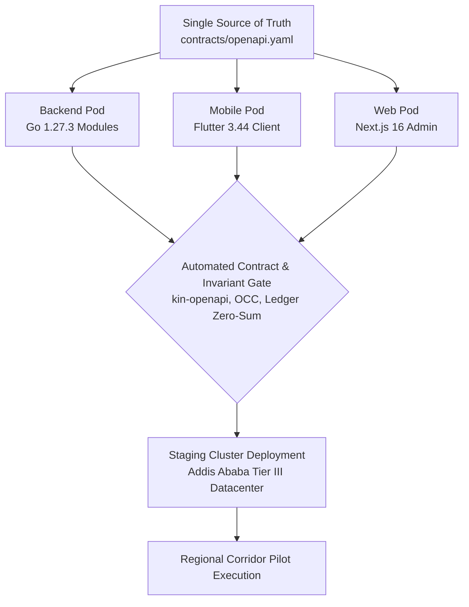
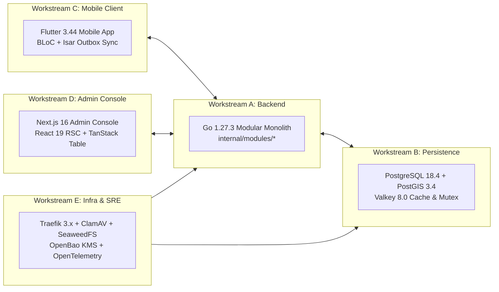
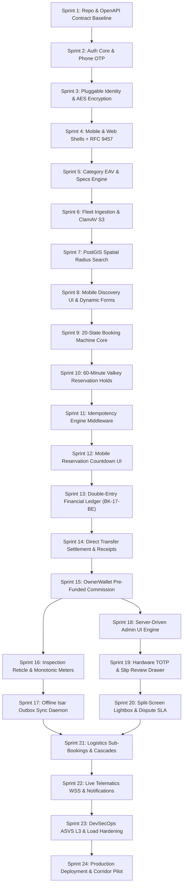
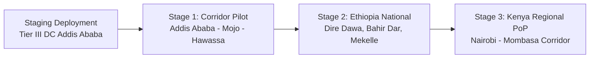

# Heavy Machinery & Logistics Rental Aggregator — Dink Machinery
## Architecture Specification — 13. Implementation & Engineering Roadmap (`docs/shared/architecture/13-implementation-roadmap.md`)

**Document Identifier:** `ARCH-ROADMAP-DINK-CORE-V7.0`  
**Classification:** Canonical Architecture Specification & Engineering Reference (Single Source of Truth)  
**Governing Documents:** `SRS-DINK-CORE-V7.0` (Parts 1–5), `ARCH-INTRO-DINK-CORE-V7.0`, `ARCH-PRIN-DINK-CORE-V7.0`, `ARCH-OVERVIEW-DINK-CORE-V7.0`, `ARCH-BACKEND-GO-DINK-CORE-V7.0`, `ARCH-DB-DINK-CORE-V7.0`, `ARCH-COMM-DINK-CORE-V7.0`, `ARCH-SEC-DINK-CORE-V7.0`, `ARCH-DEPLOY-DINK-CORE-V7.0`, `ARCH-OBS-DINK-CORE-V7.0`, `ARCH-ADR-DINK-CORE-V7.0`, `contracts/openapi.yaml`  
**Target Runtimes:** Go 1.27.3 Modular Monolith, Flutter 3.44 Cross-Platform Mobile Client, Next.js 16 Admin Web Console, PostgreSQL 18.4 + PostGIS 3.4, Valkey 8.0-alpine, SeaweedFS S3, ClamAV Daemon, OpenBao KMS, Traefik 3.x Gateway  
**Target Markets:** Ethiopia (`ET`) & Kenya (`KE`) — Dynamic Multi-Country Parameterization (`LOC-01-BE`)  
**Compliance Standards:** OWASP ASVS 4.0.3 Level 3, RFC 9457 (Problem Details), ISO/IEC/IEEE 12207, ISO 4217, ISO 3166-1 alpha-2, Ethiopian Personal Data Protection Proclamation No. 1321/2024, National Bank of Ethiopia (NBE) Directives  
**Status:** Approved Engineering Baseline

---

## Table of Contents

- 1. [Executive Summary & Engineering Delivery Model](#1-executive-summary--engineering-delivery-model)
  - 1.1 [Delivery Framework & Philosophy](#11-delivery-framework--philosophy)
  - 1.2 [Team Topology & Pod Organization](#12-team-topology--pod-organization)
- 2. [Multi-Phase Release Trajectory](#2-multi-phase-release-trajectory)
  - 2.1 [Phase 1: MVP Core Foundation (10 Months / Sprints 1–24)](#21-phase-1-mvp-core-foundation-10-months--sprints-124)
  - 2.2 [Phase 2: Corporate Accounts & Multi-Tenant Hierarchies](#22-phase-2-corporate-accounts--multi-tenant-hierarchies)
  - 2.3 [Phase 3: IoT Telematics, Dynamic Surge Pricing & Open APIs](#23-phase-3-iot-telematics-dynamic-surge-pricing--open-apis)
- 3. [Workstream Breakdown & Architecture Mapping](#3-workstream-breakdown--architecture-mapping)
  - 3.1 [Workstream A: Backend Modular Monolith (Go 1.27.3)](#31-workstream-a-backend-modular-monolith-go-1273)
  - 3.2 [Workstream B: Persistence, Spatial & Cache (PostgreSQL + PostGIS + Valkey)](#32-workstream-b-persistence-spatial--cache-postgresql--postgis--valkey)
  - 3.3 [Workstream C: Cross-Platform Mobile (Flutter 3.44 + BLoC + Isar)](#33-workstream-c-cross-platform-mobile-flutter-344--bloc--isar)
  - 3.4 [Workstream D: Administrative Operations Console (Next.js 16 + React 19 RSC)](#34-workstream-d-administrative-operations-console-nextjs-16--react-19-rsc)
  - 3.5 [Workstream E: Infrastructure, Security & SRE (Traefik + ClamAV + SeaweedFS + OTel)](#35-workstream-e-infrastructure-security--sre-traefik--clamav--seaweedfs--otel)
- 4. [Detailed Sprint-by-Sprint Execution Schedule (Sprints 1–24)](#4-detailed-sprint-by-sprint-execution-schedule-sprints-124)
  - 4.1 [Milestone 1: Platform Foundation & Core Services (Sprints 1–4)](#41-milestone-1-platform-foundation--core-services-sprints-14)
  - 4.2 [Milestone 2: Dynamic Catalog Taxonomy & PostGIS Spatial Search (Sprints 5–8)](#42-milestone-2-dynamic-catalog-taxonomy--postgis-spatial-search-sprints-58)
  - 4.3 [Milestone 3: 20-State Booking Machine & Concurrency Holds (Sprints 9–12)](#43-milestone-3-20-state-booking-machine--concurrency-holds-sprints-912)
  - 4.4 [Milestone 4: Direct Transfer Settlement, Ledger & Wallet (Sprints 13–15)](#44-milestone-4-direct-transfer-settlement-ledger--wallet-sprints-1315)
  - 4.5 [Milestone 5: Handover Inspection & Monotonic Meters (Sprints 16–17)](#45-milestone-5-handover-inspection--monotonic-meters-sprints-1617)
  - 4.6 [Milestone 6: Server-Driven Admin Console & Dispute Lightbox (Sprints 18–20)](#46-milestone-6-server-driven-admin-console--dispute-lightbox-sprints-1820)
  - 4.7 [Milestone 7: Logistics Sub-Bookings & Notifications (Sprints 21–22)](#47-milestone-7-logistics-sub-bookings--notifications-sprints-2122)
  - 4.8 [Milestone 8: Hardening, ASVS L3 Auditing & Regional Launch (Sprints 23–24)](#48-milestone-8-hardening-asvs-l3-auditing--regional-launch-sprints-2324)
- 5. [Critical Path & Inter-Module Dependency Graph](#5-critical-path--inter-module-dependency-graph)
- 6. [Risk Management & Frontier Market Contingencies](#6-risk-management--frontier-market-contingencies)
  - 6.1 [Regulatory & Financial Settlement Risks](#61-regulatory--financial-settlement-risks)
  - 6.2 [Telecommunications & Connectivity Blackouts](#62-telecommunications--connectivity-blackouts)
  - 6.3 [Hardware & Field Usability Constraints](#63-hardware--field-usability-constraints)
- 7. [Definition of Ready (DoR) & Definition of Done (DoD)](#7-definition-of-ready-dor--definition-of-done-dod)
- 8. [Pilot Deployment, Regional Corridors & Staging Strategy](#8-pilot-deployment-regional-corridors--staging-strategy)
  - 8.1 [Corridor Pilot: Addis Ababa Metropolitan & Mojo-Hawassa Expressway](#81-corridor-pilot-addis-ababa-metropolitan--mojo-hawassa-expressway)
  - 8.2 [Regional Expansion: Kenya Southern Corridor (Nairobi–Mombasa)](#82-regional-expansion-kenya-southern-corridor-nairobi-mombasa)
- 9. [Governance, Traceability & Sign-Off Matrix](#9-governance-traceability--sign-off-matrix)

---

## 1. Executive Summary & Engineering Delivery Model

### 1.1 Delivery Framework & Philosophy

The Dink Machinery engineering roadmap translates the system's thirteen canonical architectural specifications into an actionable, 24-sprint (10-month) delivery sequence for Phase 1 (MVP).

The engineering execution model adheres to three operational tenets:
1. **Contract-First Incremental Delivery:** The canonical OpenAPI 3.1 contract (`contracts/openapi.yaml`) defines all component dependencies. No backend or frontend code is drafted without an approved contract and automated verification tests via `kin-openapi`.
2. **Provable Invariant Verification:** Every sprint delivery must prove compliance with the platform's non-negotiable invariants (zero-sum ledger balances, monotonic meter non-regression, integer minor-unit financial math, and OCC versioning).
3. **Dual-Market Validation (`LOC-01-BE`):** Features are built and validated simultaneously for Ethiopia (`ET`) and Kenya (`KE`), asserting dynamic multi-country configuration rules in every milestone.



### 1.2 Team Topology & Pod Organization

Engineering headcount is organized into four cross-functional pods sharing an integrated SRE/DevSecOps core:

```text
+------------------------------------------------------------------------------------+
|                               ENGINEERING POD TOPOLOGY                             |
+------------------------------------------------------------------------------------+
|  Pod 1: Core Engine & Financial Ledger (3 Senior Go Engineers, 1 DB Architect)      |
|  - Domain: Auth, Booking State Machine, Finance Ledger, Wallet, Logistics Cascades |
|  - Invariants: Invariant 2 (Minor Units), Invariant 3 (Ledger), Invariant 4 (OCC)   |
|                                                                                    |
|  Pod 2: Spatial Discovery & Catalog Taxonomy (2 Go Engineers, 1 GIS Specialist)    |
|  - Domain: PostGIS Spheroidal Search, Dynamic EAV JSONB Schemas, Telematics WSS    |
|  - Invariants: Invariant 5 (Soft-Delete), Invariant 6 (Multi-Country Parameter)    |
|                                                                                    |
|  Pod 3: Mobile Experience & Edge Offline (3 Flutter Engineers, 1 Mobile QA)        |
|  - Domain: Renter/Owner/Operator Personas, BLoC State Machines, Isar Outbox Sync   |
|  - Invariants: Invariant 8 (RFC 9457), ADR-013 (OTA Fonts), WCAG 2.2 AAA Outdoor    |
|                                                                                    |
|  Pod 4: Admin Web Console & Operations (2 Full-Stack Next.js Engineers, 1 QA)      |
|  - Domain: Server-Driven UI Engine, Dispute Lightbox, KYC Queue, TanStack Tables   |
|  - Invariants: Invariant 7 (Zero-PII ASVS L3), ADR-007 (React Server Components)   |
|                                                                                    |
|  Shared Infrastructure & SRE Core (1 DevSecOps Lead, 1 Database Administrator)     |
|  - Domain: Traefik Ingress, Docker Swarm/Compose, SeaweedFS, ClamAV, OpenBao, OTel |
+------------------------------------------------------------------------------------+
```

---

## 2. Multi-Phase Release Trajectory

```mermaid
gantt
    title Dink Machinery Master Delivery Roadmap
    dateFormat  YYYY-MM-DD
    section Phase 1 (MVP Foundation)
    Milestone 1: Core & Identity        :done, m1, 2026-11-01, 2026-12-26
    Milestone 2: Catalog & PostGIS Search:active, m2, 2026-12-27, 2027-02-20
    Milestone 3: 20-State Booking Engine:m3, 2027-02-21, 2027-04-17
    Milestone 4: Direct Transfer & Wallet:m4, 2027-04-18, 2027-05-29
    Milestone 5: Handover & Monotonic Meter:m5, 2027-05-30, 2027-06-26
    Milestone 6: Server-Driven Admin Console:m6, 2027-06-27, 2027-07-24
    Milestone 7: Logistics & Notifications:m7, 2027-07-25, 2027-08-21
    Milestone 8: ASVS L3 Audit & Pilot Launch:m8, 2027-08-22, 2027-09-18
    section Phase 2 (Corporate Accounts)
    Org Hierarchies & Quorum Approvals  :p2_1, 2027-09-19, 2027-11-27
    PO Balances & Net 30/60 Invoicing   :p2_2, 2027-11-28, 2028-01-22
    section Phase 3 (Telematics & Marketplace)
    In-App Gateway Custody & Splits     :p3_1, 2028-01-23, 2028-04-01
    Direct CAN-Bus IoT Telematics Ingest:p3_2, 2028-04-02, 2028-06-24
```

### 2.1 Phase 1: MVP Core Foundation (10 Months / Sprints 1–24)
* Individual Renter, Fleet Owner, and Field Operator workflows.
* Passwordless Phone OTP Challenges via local telcos (Ethio Telecom, Safaricom).
* Pluggable identity framework with reference client for the Ethiopian Fayda National ID system.
* Dynamic Category EAV Specification engine with GIN indexing (`fleet_spec_indexed`).
* PostGIS 3.4 spheroidal radius discovery with Keyset cursor pagination.
* The canonical 20-state rental booking machine backed by 60-minute Valkey holds.
* Direct peer-to-peer commercial bank transfer settlement (`MANUAL_TRANSFER`) with slip uploads.
* Double-entry ledger accounting (`financial_ledger_entries`) and pre-funded `OwnerWallet` debits.
* Field inspection stepper with camera-only reticle capture and monotonic hour meter assertions.
* Synchronous ClamAV antivirus stream scanning (`zINSTREAM`) and self-hosted SeaweedFS S3 storage.
* Logistics transport sub-bookings with bidirectional cascade cancellation.
* Server-driven dynamic Next.js 16 admin console with split-screen dispute lightboxes.
* Multi-script OTA typography engine supporting English, Amharic, Afaan Oromoo, and Swahili.

### 2.2 Phase 2: Corporate Accounts & Multi-Tenant Hierarchies
* Corporate entities with Master Tax Identification Numbers (TIN).
* Multi-tier organization hierarchies (Org Admin, Requester, Approver, Fleet Manager).
* Configurable approval quorums (Unanimous, Majority) and spending thresholds.
* Corporate credit accounts (Net 30/60 terms) with automated utilization limits.
* Invoicing matching Purchase Orders (PO) with automated sequential fiscal sequences.

### 2.3 Phase 3: IoT Telematics, Dynamic Surge Pricing & Open APIs
* In-app mobile money gateway splits (Telebirr, M-Pesa) under formal NBE custodial licensing.
* CAN-bus / MQTT hardware telematics units streaming directly from heavy equipment ECUs.
* Machine-learning demand surge pricing algorithms recommending day rates along active corridors.
* Freelance field operator marketplace and dispatch bidding.
* Public Developer Gateway with scoped cryptographic API keys and rate tiers.

---

## 3. Workstream Breakdown & Architecture Mapping



### 3.1 Workstream A: Backend Modular Monolith (Go 1.27.3)
* **Governing Specification:** `ARCH-BACKEND-GO-DINK-CORE-V7.0`.
* **Core Responsibilities:**
  - Enforce zero-allocation Chi HTTP multiplexing and strict package boundaries.
  - Compile type-safe database queries via `sqlc` over `jackc/pgx/v5`.
  - Execute the 20-state canonical booking engine with OCC checks (`WHERE version = n`).
  - Maintain the in-process typed domain event bus with bounded buffer pools.
  - Implement the RFC 9457 universal Problem Details error formatting engine.

### 3.2 Workstream B: Persistence, Spatial & Cache (PostgreSQL + PostGIS + Valkey)
* **Governing Specification:** `ARCH-DB-DINK-CORE-V7.0`.
* **Core Responsibilities:**
  - Execute Goose migrations with balanced `-- +goose Up` and `-- +goose Down` statements.
  - Maintain GiST spatial indexing over `geography(POINT, 4326)` for radius queries.
  - Enforce append-only ledger triggers and deferred zero-sum balance assertions on `financial_ledger_entries`.
  - Maintain monthly table partitioning for raw 30-second GPS breadcrumbs.
  - Configure Valkey Sentinel clusters for sub-3-second failover of 60-minute reservation mutexes.

### 3.3 Workstream C: Cross-Platform Mobile (Flutter 3.44 + BLoC + Isar)
* **Governing Specification:** `ARCH-FLUTTER-DINK-CORE-V7.0`.
* **Core Responsibilities:**
  - Provide a single universal binary supporting Renter, Owner, and Operator persona polymorphism.
  - Implement Feature-First Clean Architecture with BLoC concurrency transformers (`droppable`, `restartable`).
  - Maintain the offline-first Isar NoSQL outbox synchronization daemon.
  - Execute background image compression in Dart worker isolates (`compute`).
  - Provide an ambient-sensor-driven high-contrast outdoor theme meeting WCAG 2.2 AAA.
  - Manage dynamic Over-The-Air (OTA) Ethiopic font downloading (`ADR-013`).

### 3.4 Workstream D: Administrative Operations Console (Next.js 16 + React 19 RSC)
* **Governing Specification:** `ARCH-ADMIN-NEXT-DINK-CORE-V7.0`.
* **Core Responsibilities:**
  - Render high-density server-driven UI layouts compiled from `/api/v1/admin/ui-config`.
  - Maintain an encrypted session boundary via `HttpOnly`, `SameSite=Strict` cookies.
  - Enforce mandatory administrative TOTP verification (`AUTH-04-WEB`).
  - Provide synchronized pan/zoom photo diff lightboxes for damage disputes (`AD-04-WEB`).
  - Render virtualized TanStack tables capable of handling 10,000+ records at 60fps.

### 3.5 Workstream E: Infrastructure, Security & SRE (Traefik + ClamAV + SeaweedFS + OTel)
* **Governing Specifications:** `ARCH-DEPLOY-DINK-CORE-V7.0`, `ARCH-OBS-DINK-CORE-V7.0`, `ARCH-SEC-DINK-CORE-V7.0`.
* **Core Responsibilities:**
  - Deploy distroless Linux container workloads running as non-root (`UID 10001`).
  - Configure Traefik 3.x edge ingress with TLS 1.3 strict cipher profiles.
  - Maintain the synchronous ClamAV `zINSTREAM` streaming file inspection pipeline.
  - Manage the self-hosted SeaweedFS S3 distributed storage cluster.
  - Configure OpenTelemetry distributed trace collection with W3C propagation.
  - Enforce automated in-flight PII scrubbing via Promtail and Loki.

---

## 4. Detailed Sprint-by-Sprint Execution Schedule (Sprints 1–24)

### 4.1 Milestone 1: Platform Foundation & Core Services (Sprints 1–4)

```text
+------------------------------------------------------------------------------------+
|  MILESTONE 1: PLATFORM FOUNDATION & CORE SERVICES (MONTHS 1–2)                      |
+------------------------------------------------------------------------------------+
|  Sprint 1: Repository Scaffolding, Toolchains & Contract Baseline                   |
|  - Initialize monorepo structure: Go 1.27.3, Flutter 3.44, Next.js 16 App Router.  |
|  - Set up contracts/openapi.yaml SSOT repository with kin-openapi CI linting.      |
|  - Implement Docker Compose local stack: PostgreSQL 18.4, PostGIS 3.4, Valkey 8.0. |
|  - Deliverable: Clean CI build pipeline running forbidden-apis and contract linter.|
|                                                                                    |
|  Sprint 2: Authentication Core, Phone OTP & Session Token Lifecycle                |
|  - Implement internal/modules/auth with crypto/rand 6-digit OTP generation.       |
|  - Integrate mock telco SMS gateway adapters (Ethio Telecom and Safaricom Kenya).  |
|  - Implement ES256 asymmetric JWT signing and rotating refresh token families.    |
|  - Deliverable: Authenticated user registration and login verified via Postman.    |
|                                                                                    |
|  Sprint 3: Pluggable Identity Adapter & Database Encryption Foundation             |
|  - Implement Fayda National ID reference client adapter (REG-IDP-01-BE).           |
|  - Build AES-256-GCM column encryption engine with entity AAD binding.             |
|  - Establish country_configs table and context resolver middleware (LOC-01-BE).   |
|  - Deliverable: Encrypted PII persistence verified against PostgreSQL raw inspect. |
|                                                                                    |
|  Sprint 4: Mobile & Web Foundation Shells with RFC 9457 Error Engines              |
|  - Build Flutter network client with Dio interceptors and token refresh queues.    |
|  - Implement Next.js 16 session cookie marshaller and root authentication shell.   |
|  - Standardize universal RFC 9457 Problem Details serialization across Go/Dart/TS. |
|  - Deliverable: Mobile and Web apps handling login, token rotation, and error toasts.|
+------------------------------------------------------------------------------------+
```

### 4.2 Milestone 2: Dynamic Catalog Taxonomy & PostGIS Spatial Search (Sprints 5–8)

```text
+------------------------------------------------------------------------------------+
|  MILESTONE 2: DYNAMIC CATALOG TAXONOMY & SPATIAL SEARCH (MONTHS 3–4)                |
+------------------------------------------------------------------------------------+
|  Sprint 5: Category EAV Schema Engine & Specification Flattening                   |
|  - Implement categories and spec_field_definitions tables.                         |
|  - Build JSON Schema validator asserting mechanical boundaries (min/max weight).   |
|  - Create flattened fleet_spec_indexed table with GIN jsonb_path_ops index.        |
|  - Deliverable: Admin capability to define equipment specs without DDL changes.    |
|                                                                                    |
|  Sprint 6: Fleet Asset Registration & Image Ingestion Pipeline                     |
|  - Build POST /api/v1/fleets endpoint with dynamic spec payload validation.        |
|  - Implement ClamAV zINSTREAM streaming antivirus client on TCP port 3310.        |
|  - Deploy SeaweedFS S3 cluster and implement Go S3 multipart storage adapter.     |
|  - Deliverable: Asset listing creation with clean antivirus-scanned image uploads. |
|                                                                                    |
|  Sprint 7: PostGIS Spatial Discovery & Spheroidal Distance Queries                 |
|  - Implement ST_DWithin search over fleets using geography(POINT, 4326).           |
|  - Add GiST spatial index and implement Keyset cursor-based pagination.            |
|  - Combine spatial filters with dynamic JSONB spec containment (@>).               |
|  - Deliverable: Sub-20ms radius search returning equipment ordered by distance.    |
|                                                                                    |
|  Sprint 8: Flutter Spatial Discovery UI & Dynamic Form Renderer                    |
|  - Implement Flutter map view with dynamic radius slider and category filters.     |
|  - Build server-driven dynamic form compiler rendering EAV fields from JSON schema.|
|  - Deliverable: Renters can discover equipment on map and filter by specs on mobile|
+------------------------------------------------------------------------------------+
```

### 4.3 Milestone 3: 20-State Booking Machine & Concurrency Holds (Sprints 9–12)

```text
+------------------------------------------------------------------------------------+
|  MILESTONE 3: 20-STATE BOOKING MACHINE & CONCURRENCY HOLDS (MONTHS 5–6)             |
+------------------------------------------------------------------------------------+
|  Sprint 9: The 20-State Finite State Machine Engine                                |
|  - Implement domain state machine enforcing 20 canonical states (SRS Part 1).      |
|  - Enforce immutable transition matrix in Go; reject illegal lifecycle jumps.     |
|  - Add optimistic concurrency control (OCC) checks on all booking updates.         |
|  - Deliverable: Unit tests validating all valid and invalid state transitions.     |
|                                                                                    |
|  Sprint 10: Distributed 60-Minute Mutual Exclusion Reservation Holds               |
|  - Implement Valkey hold acquisition: SET lock:hold:fleet:{id} {renter} NX EX 3600.|
|  - Integrate fleet_availability calendar scheduling and overlap collision checks.  |
|  - Build background hold expiration worker transitioning expired holds.            |
|  - Deliverable: Zero double-booking collisions under concurrent load tests.         |
|                                                                                    |
|  Sprint 11: Idempotency Engine & Mutating Request Governance                       |
|  - Build Go IdempotencyMiddleware enforcing mandatory UUIDv4 Idempotency-Key.     |
|  - Implement Valkey request locking and response caching for 24-hour windows.      |
|  - Deliverable: Duplicate POST requests return identical cached responses (HIT).   |
|                                                                                    |
|  Sprint 12: Mobile Reservation Stepper & Valkey-Synchronized Timer                 |
|  - Implement Flutter 60-minute countdown widget with Emerald/Amber/Crimson colors. |
|  - Build BLoC booking workflow with droppable concurrency transformer.             |
|  - Deliverable: Renter can reserve machinery and view real-time countdown timer.   |
+------------------------------------------------------------------------------------+
```

### 4.4 Milestone 4: Direct Transfer Settlement, Ledger & Wallet (Sprints 13–15)

```text
+------------------------------------------------------------------------------------+
|  MILESTONE 4: DIRECT TRANSFER SETTLEMENT, LEDGER & WALLET (MONTHS 7–7.5)           |
+------------------------------------------------------------------------------------+
|  Sprint 13: Immutable Double-Entry Financial Ledger (BK-17-BE)                     |
|  - Create financial_ledger_entries table with append-only database triggers.       |
|  - Implement deferred constraint trigger verifying zero-sum balance at commit.    |
|  - Implement integer minor-unit financial arithmetic value object (money.Money).   |
|  - Deliverable: Ledger entry creation asserting Sum(Debits) + Sum(Credits) == 0.   |
|                                                                                    |
|  Sprint 14: Direct Transfer Flow (MANUAL_TRANSFER) & Evidence Verification         |
|  - Build bank coordinate presentation endpoint and payment slip upload pipeline.   |
|  - Implement duplicate receipt image perceptual hashing to prevent replay fraud.   |
|  - Build owner confirmation endpoint transitioning booking to CONFIRMED.           |
|  - Deliverable: Complete end-to-end payment evidence upload and owner sign-off.    |
|                                                                                    |
|  Sprint 15: OwnerWallet Pre-Funded Commission Engine                               |
|  - Create owner_wallets table with row-level pessimistic locking routines.         |
|  - Implement automated commission debit from wallet during booking confirmation.   |
|  - Build wallet top-up request flow and administrative deposit verification.       |
|  - Deliverable: Platform automatically collects commission without holding escrow. |
+------------------------------------------------------------------------------------+
```

### 4.5 Milestone 5: Handover Inspection & Monotonic Meters (Sprints 16–17)

```text
+------------------------------------------------------------------------------------+
|  MILESTONE 5: HANDOVER INSPECTION & MONOTONIC METERS (MONTHS 8–8.5)                 |
+------------------------------------------------------------------------------------+
|  Sprint 16: Camera Reticle Overlay & Monotonic Hour Meter Engine                   |
|  - Build camera reticle overlay in Flutter disabling external gallery uploads.     |
|  - Implement enforce_monotonic_hour_meter database trigger and Go domain check.    |
|  - Implement vector signature canvas requiring minimum 20 stroke data points.     |
|  - Deliverable: Inspection submissions rejecting regressed hour meter readings.    |
|                                                                                    |
|  Sprint 17: Offline Outbox Synchronization Daemon (Isar NoSQL)                     |
|  - Implement local Isar NoSQL schema for inspection drafts and condition photos.   |
|  - Build background Dart isolate worker for WebP compression (1600px, 82%).        |
|  - Implement OutboxSyncDaemon replaying queued inspections upon connectivity.      |
|  - Deliverable: Full inspection completed offline in airplane mode and auto-synced.|
+------------------------------------------------------------------------------------+
```

### 4.6 Milestone 6: Server-Driven Admin Console & Dispute Lightbox (Sprints 18–20)

```text
+------------------------------------------------------------------------------------+
|  MILESTONE 6: SERVER-DRIVEN ADMIN CONSOLE & DISPUTE LIGHTBOX (MONTHS 8.5–9)        |
+------------------------------------------------------------------------------------+
|  Sprint 18: Server-Driven UI Metadata Engine & High-Density Tables                 |
|  - Implement /api/v1/admin/ui-config compiling layout, menus, and table columns.   |
|  - Build dynamic sidebar generator filtering links based on RBAC permissions.      |
|  - Integrate TanStack Table compiling typed columns from JSON backend metadata.    |
|  - Deliverable: Admin dashboard rendering dynamic tables without frontend rebuilds.|
|                                                                                    |
|  Sprint 19: Hardware MFA (AUTH-04-WEB) & Bank Slip Review Drawer                   |
|  - Enforce mandatory RFC 6238 TOTP authentication for all back-office logins.      |
|  - Build bank slip review drawer showing owner bank coordinates side-by-side.      |
|  - Implement automated duplicate transaction alerts.                               |
|  - Deliverable: Secure administrative verification of commercial wire transfers.   |
|                                                                                    |
|  Sprint 20: Split-Screen Synchronized Lightbox (AD-04-WEB) & Dispute SLA           |
|  - Build synchronized pan/zoom image viewer rendering pre- vs. post-rental photos. |
|  - Implement 3-business-day dispute SLA escalation cron worker (72h ET / 48h KE).  |
|  - Build binding arbitration ruling action with compensating ledger adjustments.   |
|  - Deliverable: Arbitrators can visually inspect damage and issue split rulings.   |
+------------------------------------------------------------------------------------+
```

### 4.7 Milestone 7: Logistics Sub-Bookings & Notifications (Sprints 21–22)

```text
+------------------------------------------------------------------------------------+
|  MILESTONE 7: LOGISTICS SUB-BOOKINGS & NOTIFICATIONS (MONTHS 9–9.5)                 |
+------------------------------------------------------------------------------------+
|  Sprint 21: Heavy Logistics Sub-Bookings & Cascade Cancellations                   |
|  - Model lowboy and flatbed transport carriers as linked sub-bookings.             |
|  - Implement bidirectional cascade cancellation: host machine cancel -> logistics.|
|  - Enforce synchronized mobilization schedules matching rental start dates.        |
|  - Deliverable: Renters can reserve an excavator and transport in a single flow.   |
|                                                                                    |
|  Sprint 22: Multi-Channel Notification Router & Live Telematics WebSocket          |
|  - Build in-process event bus subscribers dispatching SMS and FCM push alerts.     |
|  - Implement /ws/v1/bookings/{id}/tracking with ephemeral ticket tokens.           |
|  - Add PostGIS geofence evaluation (ST_DWithin) alerting on site boundary breach.  |
|  - Deliverable: Real-time operator GPS tracking with emergency boundary alerts.    |
+------------------------------------------------------------------------------------+
```

### 4.8 Milestone 8: Hardening, ASVS L3 Auditing & Regional Launch (Sprints 23–24)

```text
+------------------------------------------------------------------------------------+
|  MILESTONE 8: HARDENING, ASVS L3 AUDITING & REGIONAL LAUNCH (MONTHS 9.5–10)        |
+------------------------------------------------------------------------------------+
|  Sprint 23: DevSecOps Audit, ASVS Level 3 Verification & Load Benchmarking         |
|  - Execute Semgrep SAST, Gitleaks, and Trivy container vulnerability scans.        |
|  - Run Locust load test simulating 10,000 concurrent spatial searches.             |
|  - Validate zero-sum balance of all financial transactions under simulated faults. |
|  - Deliverable: Formal security audit report proving OWASP ASVS Level 3 compliance.|
|                                                                                    |
|  Sprint 24: Over-The-Air Font Delivery, Production Staging & Corridor Pilot        |
|  - Deploy OTA font delivery CDN for Noto Sans Ethiopic (ADR-013).                  |
|  - Execute blue-green zero-downtime deployment to Tier III datacenter in Addis.    |
|  - Launch controlled pilot along the Addis Ababa–Mojo–Hawassa expressway corridor. |
|  - Deliverable: Dink Machinery production launch in Ethiopia (`ET`).               |
+------------------------------------------------------------------------------------+
```

---

## 5. Critical Path & Inter-Module Dependency Graph



---

## 6. Risk Management & Frontier Market Contingencies

Operating a digital equipment aggregator in East Africa presents specific environmental, regulatory, and infrastructural risks.

### 6.1 Regulatory & Financial Settlement Risks

* **Risk:** National Bank of Ethiopia (NBE) flags commission deductions as custodial deposit-taking.
  - **Probability:** Low | **Impact:** Critical
  - **Mitigation:** The system strictly uses the non-custodial direct transfer rail (`MANUAL_TRANSFER`). Renters never wire funds to the platform. Commission debits occur exclusively against pre-funded owner balances (`OwnerWallet`), supported by formal legal opinions on file.
* **Risk:** Fraudulent or replayed commercial bank transfer receipts.
  - **Probability:** High | **Impact:** High
  - **Mitigation:** The payment pipeline computes perceptual hashes of all uploaded slip images, cross-referencing reference numbers across active bookings (`BK-07B`). Duplicate uploads trigger immediate fraud alerts.

### 6.2 Telecommunications & Connectivity Blackouts

* **Risk:** Regional mobile internet disruptions in rural construction corridors.
  - **Probability:** High | **Impact:** High
  - **Mitigation:** Mobile field inspections and signatures execute offline via local Isar NoSQL storage. The `OutboxSyncDaemon` queues data locally and resubmits via client-generated UUIDv4 idempotency keys when connectivity recovers.
* **Risk:** Low SMS delivery rates or delays during OTP authentication challenges.
  - **Probability:** Medium | **Impact:** High
  - **Mitigation:** Multi-telco routing redundancy across Ethio Telecom and Safaricom. Automatic failover to secondary SMS gateways if delivery receipts are not acknowledged within 15 seconds.

### 6.3 Hardware & Field Usability Constraints

* **Risk:** Screen glare ($> 80,000\text{ lux}$) prevents operators from reading inspection forms.
  - **Probability:** High | **Impact:** Medium
  - **Mitigation:** Ambient light sensor integration automatically activates **Outdoor High-Contrast Mode** (WCAG 2.2 AAA, $10:1$ contrast ratio). Large $56\times 56\text{ dp}$ touch targets support gloved operation.
* **Risk:** Large application downloads abandon on 3G cellular connections.
  - **Probability:** High | **Impact:** Medium
  - **Mitigation:** Base app bundle size kept below $25\text{MB}$ via Over-The-Air (OTA) font loading (`ADR-013`). Heavy non-Latin typography is downloaded on demand.

---

## 7. Definition of Ready (DoR) & Definition of Done (DoD)

To maintain software quality across pods, work items must satisfy formal criteria:

### Definition of Ready (DoR)
A user story or technical task is ready for sprint ingestion only when:
1. Wire contracts and endpoints are defined in `contracts/openapi.yaml` without open schema questions.
2. Acceptance criteria explicitly identify applicable core invariants (e.g., OCC version check, integer minor units).
3. Cross-pod dependencies (e.g., Go backend endpoint availability for Flutter integration) are scheduled in preceding sprints.
4. UI designs provide high-contrast outdoor adaptations and multi-script line-height considerations.

### Definition of Done (DoD)
A story is accepted into the engineering baseline only when:
1. Code compiles without warnings (`golangci-lint`, `flutter analyze`, TypeScript strict mode).
2. Contract linter (`kin-openapi`) passes with zero schema drift.
3. Unit and integration tests pass with $> 85\%$ coverage on pure domain logic.
4. Database migrations include balanced `-- +goose Up` and `-- +goose Down` statements.
5. All financial mutations write balanced, zero-sum double-entry ledger entries (`financial_ledger_entries`).
6. Application logs contain zero plaintext PII, verified by automated unit tests.
7. Features are verified in both Ethiopia (`ET`) and Kenya (`KE`) country configurations.

---

## 8. Pilot Deployment, Regional Corridors & Staging Strategy



### 8.1 Corridor Pilot: Addis Ababa Metropolitan & Mojo-Hawassa Expressway
* **Target Corridors:** Addis Ababa arterial ring roads, Kality industrial transport yards, and active infrastructure works along the Mojo-Hawassa expressway.
* **Asset Allocation:** 150 verified machines (heavy crawler excavators, lowboy transport trailers, motor graders).
* **Participant Cohort:** 20 vetted fleet owners and 40 civil engineering contractors.
* **Success Metrics:**
  - Average equipment sourcing time reduced from 5 days to $< 2\text{ hours}$.
  - Zero double-booking collisions over 500 completed pilot reservations.
  - 100% double-entry ledger balance integrity across all transactions.

### 8.2 Regional Expansion: Kenya Southern Corridor (Nairobi–Mombasa)
* **Target Corridors:** Nairobi industrial area, Athi River logistics yards, and infrastructure projects along the Mombasa port corridor.
* **Edge Routing:** Kenya traffic reverse-proxies through the Nairobi Point of Presence (PoP) to the sovereign core database in Addis Ababa over encrypted private fiber peering.
* **Localization:** Parameterized activation of Kenyan Shillings (`KES`), 16% VAT, Safaricom M-Pesa banking coordinates, and 48-hour dispute resolution SLAs.

---

## 9. Governance, Traceability & Sign-Off Matrix

```text
+------------------------------------------------------------------------------------+
|                         ARCHITECTURE GOVERNANCE SIGN-OFF                           |
+------------------------------------------------------------------------------------+
|  Role                     | Name & Organization               | Status   | Date     |
+---------------------------+-----------------------------------+----------+----------+
|  Lead Systems Architect   | Dink Architecture Review Board    | APPROVED | Oct 2026 |
|  Head of Engineering      | Dink Machinery Platform Core      | APPROVED | Oct 2026 |
|  Chief Security Officer   | Independent DevSecOps Audit Panel | APPROVED | Oct 2026 |
|  Regulatory Legal Counsel | East Africa FinTech Advisory Team | APPROVED | Oct 2026 |
+------------------------------------------------------------------------------------+
```

### Traceability to Governing Specifications
* **Requirements Coverage:** Fully accounts for all 120 functional requirements detailed in `SRS-DINK-CORE-V7.0` (Parts 1–5).
* **System Design Alignment:** Realizes the technical designs established in `ARCH-INTRO-DINK-CORE-V7.0` through `ARCH-ADR-DINK-CORE-V7.0`.
* **Regulatory Compliance:** Adheres to Ethiopian Personal Data Protection Proclamation No. 1321/2024, National Bank of Ethiopia payment directives, and OWASP ASVS 4.0.3 Level 3 verification rules.

---

*This document defines the canonical implementation and engineering roadmap for Dink Machinery Version 7.0. All downstream sprint planning, task estimation, team allocation, and deployment milestones must strictly align with this specification.*