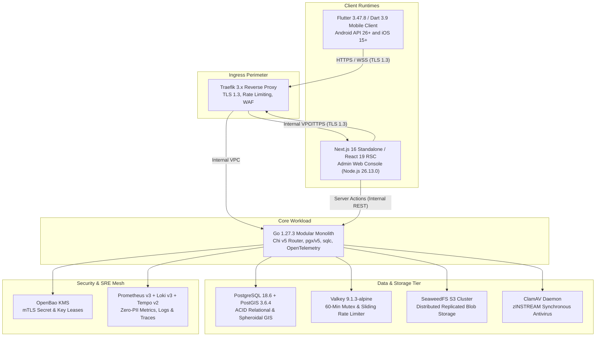
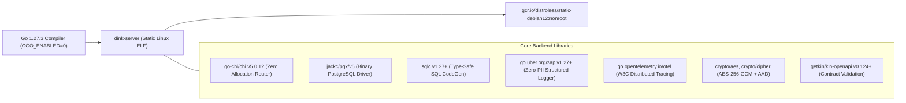
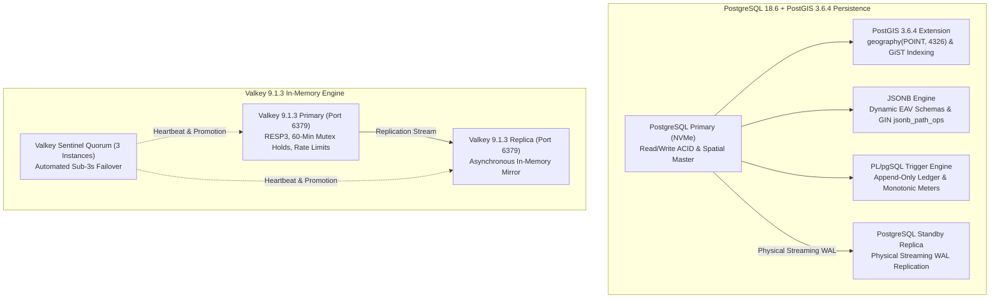
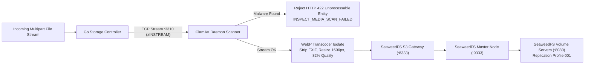
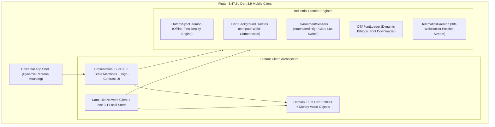
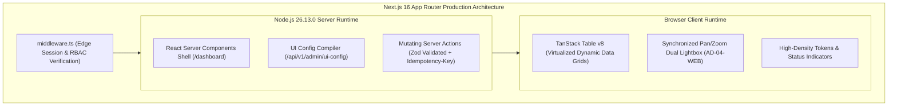
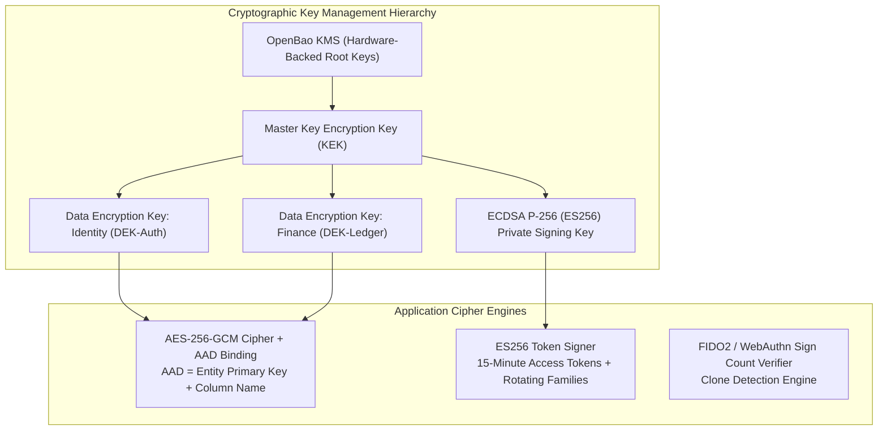
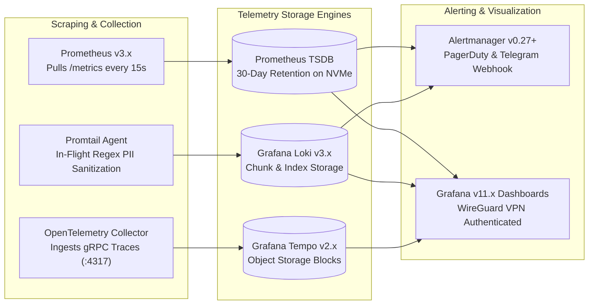
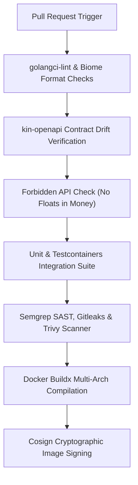

# Heavy Machinery & Logistics Rental Aggregator — Dink Machinery
## Architecture Specification — 14. Appendix: Full Technology Stack & Hardware BOM (`docs/shared/architecture/14-appendix-full-technology-stack.md`)

**Document Identifier:** `ARCH-TECH-DINK-CORE-V7.0`  
**Classification:** Canonical Architecture Specification & Engineering Reference (Single Source of Truth)  
**Governing Documents:** `SRS-DINK-CORE-V7.0` (Parts 1–5), `ARCH-INTRO-DINK-CORE-V7.0` through `ARCH-ROADMAP-DINK-CORE-V7.0`, `contracts/openapi.yaml`, `ADR-001` through `ADR-014`  
**Target Runtimes:** Go 1.27.3, Flutter 3.47.8 / Dart 3.9, Next.js 16.x (latest CVE security patch) / React 19, PostgreSQL 18.6 + PostGIS 3.6.4, Valkey 9.1.3-alpine, SeaweedFS S3, ClamAV Daemon, OpenBao KMS, Traefik 3.x  
**Target Markets:** Ethiopia (`ET`) & Kenya (`KE`) — Dynamic Multi-Country Parameterization (`LOC-01-BE`)  
**Compliance Standards:** OWASP ASVS 4.0.3 Level 3, RFC 9457 (Problem Details), ISO/IEC 27001:2022, ISO 4217, ISO 3166-1 alpha-2, Ethiopian Personal Data Protection Proclamation No. 1321/2024, NBE Directives  
**Status:** Approved Engineering Baseline

---

## Table of Contents

- 1. [Executive Summary & Technology Selection Rationale](#1-executive-summary--technology-selection-rationale)
- 2. [Tier 1: Edge Ingress, Reverse Proxy & Security Perimeter](#2-tier-1-edge-ingress-reverse-proxy--security-perimeter)
- 3. [Tier 2: Backend Application Runtime & Core Libraries (Go Monolith)](#3-tier-2-backend-application-runtime--core-libraries-go-monolith)
- 4. [Tier 3: Persistence, Spatial Engine & Distributed Caching](#4-tier-3-persistence-spatial-engine--distributed-caching)
- 5. [Tier 4: Object Storage & Content Security](#5-tier-4-object-storage--content-security)
- 6. [Tier 5: Cross-Platform Mobile Client (Flutter 3.47.8)](#6-tier-5-cross-platform-mobile-client-flutter-344)
- 7. [Tier 6: Administrative Operations Web Console (Next.js 16)](#7-tier-6-administrative-operations-web-console-nextjs-16)
- 8. [Tier 7: Security, Identity & Cryptography Infrastructure](#8-tier-7-security-identity--cryptography-infrastructure)
- 9. [Tier 8: Observability, SRE & Alerting Mesh](#9-tier-8-observability-sre--alerting-mesh)
- 10. [Tier 9: Build, CI/CD & DevSecOps Tooling](#10-tier-9-build-cicd--devsecops-tooling)
- 11. [Hardware Baseline & Bare-Metal Datacenter Sizing](#11-hardware-baseline--bare-metal-datacenter-sizing)
  - 11.1 [Primary Datacenter Hardware BOM (Addis Ababa Tier III Facility)](#111-primary-datacenter-hardware-bom-addis-ababa-tier-iii-facility)
  - 11.2 [Cross-Border Edge Point of Presence (Nairobi Colocation)](#112-cross-border-edge-point-of-presence-nairobi-colocation)
  - 11.3 [Network & Storage Architecture Specifications](#113-network--storage-architecture-specifications)
- 12. [Comprehensive Technology BOM & Licensing Governance](#12-comprehensive-technology-bom--licensing-governance)

---

## 1. Executive Summary & Technology Selection Rationale

The Dink Machinery technology stack is selected to fulfill strict engineering and statutory requirements:
1. **Sovereign Reliability:** Deployment targets local Tier III colocation facilities in East Africa (Addis Ababa primary core and Nairobi regional edge) without operational dependencies on foreign public clouds.
2. **Deterministic Mechanical Performance:** Low-latency geospatial discovery, sub-3-second distributed cache failover, 60-frame-per-second mobile UI rendering, and high-throughput image processing under harsh field conditions.
3. **Provable Financial Correctness:** Relational ACID transactional integrity, integer minor-unit financial arithmetic, immutable double-entry ledger bookkeeping, and optimistic concurrency control (OCC).
4. **Open-Source Sovereignty & Permissive Licensing:** Freedom from proprietary commercial licenses or restrictive copyleft terms (e.g., AGPLv3, SSPL) that compromise intellectual property or expose operations to vendor lock-in.



---

## 2. Tier 1: Edge Ingress, Reverse Proxy & Security Perimeter

The edge layer handles public network ingress, enforces modern cryptographic transport, mitigates denial-of-service attempts, and routes incoming traffic across application workloads.

| Component Name | Version / Release | Primary Responsibility | License | Configuration / Architectural Details |
|---|---|---|---|---|
| **Traefik Proxy** | `v3.1.x` | Edge reverse proxy, TLS 1.3 termination, HTTP/2 multiplexing, path routing. | Apache 2.0 | Terminate port `443` and `80`; static routing configured via YAML; integrated health checks and circuit breakers. |
| **Let's Encrypt / ACME** | RFC 8555 | Automated X.509 public key certificate provisioning and 60-day rotation. | IETF Open Standard | Integrated HTTP-01 challenge handler via Traefik; supports sovereign custom telecom certificates for offline PKI. |
| **Strict TLS Cipher Suite** | TLS 1.3 Baseline | Transport Layer Security encryption conforming to RFC 8446. | Open Standard | Ciphers: `TLS_AES_128_GCM_SHA256`, `TLS_AES_256_GCM_SHA384`, `TLS_CHACHA20_POLY1305_SHA256`; Curves: `X25519`, `SecP256r1`. |
| **Linux `nftables`** | Kernel 6.6+ | Host packet filtering, stateful firewall rules, port isolation, and anti-SYN-flood defense. | GPLv2 (Kernel) | Default-deny on all interfaces except `80` and `443`; internal overlay subnets (`172.28.0.0/16`) bridged privately. |
| **Fail2ban** | `1.1.x` | Dynamic brute-force defense parsing Traefik access logs to block abusive client IPs. | GPLv2 | Evaluates failed OTP verifications and rate-limit triggers; injects dynamic 15-minute `nftables` DROP rules. |

---

## 3. Tier 2: Backend Application Runtime & Core Libraries (Go Monolith)

The backend engine compiles into a single, highly optimized static Linux ELF binary ($< 35\text{MB}$) executed inside a Google `distroless` image running as non-root (`UID 10001`).



| Package / Library Name | Exact Version | Architectural Responsibility | Upstream License |
|---|---|---|---|
| **Go Runtime** | `1.27.3` | Core compiled systems programming language and garbage-collected runtime. | BSD-3-Clause |
| **`github.com/go-chi/chi/v5`** | `v5.0.12` | High-performance, zero-allocation HTTP request router and sub-router multiplexer. | MIT |
| **`github.com/jackc/pgx/v5`** | `v5.6.0` | Native PostgreSQL extended binary protocol driver, prepared statement cache, connection pool. | MIT |
| **`github.com/sqlc-dev/sqlc`** | `v1.27.0` | Compile-time type-safe Go code generator from raw SQL queries. | MIT |
| **`go.uber.org/zap`** | `v1.27.0` | Low-allocation structured JSON application logging with custom PII masking core. | MIT |
| **`github.com/golang-jwt/jwt/v5`**| `v5.2.1` | Asymmetric ECDSA P-256 (ES256) JWT generation, parsing, and cryptographic verification. | MIT |
| **`github.com/valkey-io/valkey-go`** | `v1.0.38` | Thread-safe RESP3 client library for Valkey caching, distributed locking, and rate limiting. | BSD-3-Clause |
| **`github.com/google/uuid`** | `v1.6.0` | RFC 4122 compliant UUIDv4 and UUIDv7 generation for entity primary keys and idempotency. | BSD-3-Clause |
| **`github.com/gorilla/websocket`**| `v1.5.3` | Full-duplex WebSocket protocol implementation for real-time operator telematics. | BSD-2-Clause |
| **`go.opentelemetry.io/otel`** | `v1.28.0` | OpenTelemetry Go SDK for distributed tracing, W3C trace context, and OpenTelemetry instrumentation. | Apache 2.0 |
| **`github.com/prometheus/client_golang`** | `v1.19.1` | Prometheus client metrics instrumentation registry and Prometheus exporter engine. | Apache 2.0 |
| **`github.com/pressly/goose/v3`** | `v3.21.1` | Sequential SQL migration management engine supporting transaction-safe up/down scripts. | MIT |
| **`github.com/aws/aws-sdk-go-v2`**| `v1.30.x` | S3 API client library for multipart upload and retrieval from self-hosted SeaweedFS S3. | Apache 2.0 |
| **`github.com/getkin/kin-openapi`**| `v0.124.0` | OpenAPI 3.1 contract schema parsing, validation, and request/response linting. | MIT |
| **`github.com/testcontainers/testcontainers-go`** | `v0.32.0` | Docker-based integration testing harness for PostgreSQL 18.6 + PostGIS and Valkey instances. | MIT |

---

## 4. Tier 3: Persistence, Spatial Engine & Distributed Caching

Persistence components handle relational consistency, spheroidal spatial distance queries, dynamic EAV JSON schemas, and sub-millisecond mutual exclusion reservation holds.



| Technology Component | Version | Role in Architecture | Storage / Memory Footprint | Open-Source License |
|---|---|---|---|---|
| **PostgreSQL** | `18.6` | Primary relational database, double-entry financial ledger, state machine persistence. | $64\text{GB RAM}$, $4\text{TB NVMe}$ (RAID 10) | PostgreSQL License |
| **PostGIS Extension** | `3.4.2` | Spheroidal geographic calculations (`ST_DWithin`, `ST_Distance`) on WGS 84 spatial coordinates. | Shared with PostgreSQL process | GPLv2 |
| **Valkey Engine** | `8.0-alpine` | Distributed mutual exclusion locks (`SET NX EX`), token-bucket rate limiting, session revocations. | $16\text{GB RAM}$ dedicated cluster | BSD-3-Clause |
| **Valkey Sentinel** | `8.0-alpine` | Quorum-based cluster health monitoring, auto-failover, and configuration provider. | 3 Lightweight Daemon Instances | BSD-3-Clause |
| **pgBackRest** | `2.52.x` | Continuous physical WAL archiving, daily differential backups, point-in-time recovery (PITR). | Backups stored on encrypted secondary volume | MIT |

---

## 5. Tier 4: Object Storage & Content Security

The object storage tier manages unstructured inspection photos, glass touch signatures, trade licenses, and fiscal PDF invoices. Uploaded media is scanned for malware in-flight before it is committed to storage.



| Tool / Software Name | Version | Architectural Responsibility | Integration Pattern | Upstream License |
|---|---|---|---|---|
| **SeaweedFS** | `v3.70+` | Scalable, high-throughput distributed S3-compliant object store. | S3 REST API (`:8333`), Master (`:9333`), Volumes (`:8080`). | Apache 2.0 |
| **ClamAV Daemon (`clamd`)** | `1.4.x` | In-flight streaming antivirus and malware scanner with persistent virus signatures. | Native TCP streaming socket protocol (`zINSTREAM` on `:3310`). | GPLv2 |
| **`bimg` / `libvips`** | `v2.14+` / `8.15+` | Low-memory image resizing, EXIF metadata sanitization, and WebP transcoding. | Go Cgo-free wrappers or background isolates. | MIT / LGPLv3 |

---

## 6. Tier 5: Cross-Platform Mobile Client (Flutter 3.47.8)

The mobile client is built as a single universal binary targeting Android and iOS. A cryptographic ES256 session token dynamically reconfigures the UI for Renters, Fleet Owners, or Field Operators.



| Dependency / Package Name | Exact Version | Architectural Responsibility | Upstream License |
|---|---|---|---|
| **Flutter SDK** | `3.44.x` | Cross-platform UI toolkit, rendering engine, and compiled mobile runtime. | BSD-3-Clause |
| **Dart SDK** | `3.9.x` | Strongly typed, AOT-compiled client language supporting background isolates. | BSD-3-Clause |
| **`flutter_bloc`** | `v8.1.6` | Deterministic, event-driven finite state management with concurrency transformers. | MIT |
| **`bloc_concurrency`** | `v0.2.5` | Event concurrency transformers (`droppable()` for mutations, `restartable()` for search). | MIT |
| **`isar` / `isar_flutter_libs`** | `v3.1.0+1` | Embedded high-speed NoSQL database powering the offline-first outbox sync queue. | Apache 2.0 |
| **`dio`** | `v5.5.0` | Advanced HTTP client with queued interceptors, token refresh locks, and timeouts. | MIT |
| **`geolocator`** | `v12.0.0` | Hardware GPS integration, high-accuracy position streaming, and distance filters. | MIT |
| **`camera`** | `v0.11.0+1` | Direct camera sensor stream for the on-screen reticle inspection overlay. | BSD-3-Clause |
| **`environment_sensors`** | `v0.1.2` | Ambient light sensor integration triggering automatic outdoor high-contrast mode ($> 25,000\text{ lux}$). | MIT |
| **`flutter_secure_storage`** | `v9.2.2` | Encrypted hardware key storage (Android Keystore / iOS Keychain). | BSD-3-Clause |
| **`web_socket_channel`** | `v3.0.0` | Robust full-duplex WebSocket client with exponential backoff auto-reconnection. | BSD-3-Clause |
| **`equatable`** | `v2.0.5` | Value-equality comparisons for immutable BLoC states and domain entities. | MIT |
| **`intl`** | `v0.19.0` | Internationalization, ICU MessageFormat translation, and date/time formatting. | BSD-3-Clause |
| **`image`** | `v4.2.0` | Pure Dart image decoding, downsampling, and JPEG/WebP compression in background worker isolates. | Apache 2.0 |

---

## 7. Tier 6: Administrative Operations Web Console (Next.js 16)

The back-office console runs on **Next.js 16** and **React 19**, using React Server Components (RSC) to protect backend service credentials and dynamic server-driven UI metadata to render high-density tables.



| Framework / Library Name | Version | Architectural Responsibility | Upstream License |
|---|---|---|---|
| **Node.js Runtime** | `26.13.0` | Server-side execution engine for Next.js standalone container deployment. | MIT |
| **Next.js Framework** | `16.0.x` | React enterprise framework utilizing App Router, RSC, and streaming SSR. | MIT |
| **React Framework** | `19.0.x` | UI component library utilizing Actions, `useActionState`, and optimistic hooks. | MIT |
| **TypeScript** | `5.8.x` | Strict type checking, interface definitions, and contract mapping. | Apache 2.0 |
| **`@tanstack/react-table`** | `v8.20.x` | Virtualized, headless data table engine compiling dynamic columns from backend metadata. | MIT |
| **Tailwind CSS** | `v4.0.x` | Utility-first CSS engine with strict 8dp spatial tokens and high-density typography. | MIT |
| **Radix UI Primitives** | `v1.1.x` | Accessible, unstyled UI components (Dialogs, Dropdowns, Tooltips, Accordions). | MIT |
| **Zod** | `v3.23.x` | Runtime schema validation for forms, Server Action payloads, and API contracts. | MIT |
| **Lucide React** | `v0.400+` | Feather-based lightweight SVG iconography compiled dynamically from backend icon names. | ISC |

---

## 8. Tier 7: Security, Identity & Cryptography Infrastructure

Security components provide defense-in-depth across transport encryption, hardware MFA, envelope encryption with Additional Authenticated Data (AAD), and key lifecycle management.



| Security Component | Version | Functional Role in Architecture | Compliance Standard | Upstream License |
|---|---|---|---|---|
| **OpenBao KMS** | `v2.0.x` | Open-source secrets management, dynamic database credential leases, and master key lifecycle management. | ASVS Level 3 (`V1.4`) | MPL-2.0 |
| **AES-256-GCM Engine** | Go Standard (`crypto/cipher`) | Authenticated field-level encryption for PII, TINs, and bank accounts, bound to primary key AAD. | ASVS Level 3 (`V6.2`) | BSD-3-Clause |
| **ECDSA P-256 (`ES256`)** | Go Standard (`crypto/ecdsa`) | Asymmetric signing of short-lived (15-minute) JWT bearer authentication tokens. | ASVS Level 3 (`V2.1`) | BSD-3-Clause |
| **RFC 6238 TOTP Engine** | Internal Go Package | Time-based one-time passwords for administrative personnel (`AUTH-04-WEB`). | ASVS Level 3 (`V2.8`) | BSD-3-Clause |
| **HMAC-SHA256 Verifier** | Go Standard (`crypto/hmac`) | Cryptographic signature validation on incoming telco webhooks (Telebirr, M-Pesa). | ASVS Level 3 (`V3.5`) | BSD-3-Clause |

---

## 9. Tier 8: Observability, SRE & Alerting Mesh

The observability tier provides distributed tracing, metrics scraping, and log aggregation while enforcing in-flight PII redaction across all telemetry signals.



| Observability Component | Version | Role in Architecture | Integration Pattern | Upstream License |
|---|---|---|---|---|
| **Prometheus** | `v3.0.x` | Time-series database scraping RED/USE metrics every 15 seconds. | HTTP pull (`:8080/metrics`, `:9100`, `:9187`, `:9121`). | Apache 2.0 |
| **Grafana Loki** | `v3.1.x` | High-density structured log indexing engine keyed on low-cardinality stream labels. | Promtail push API (`:3100`). | AGPLv3 (Server) |
| **Promtail** | `v3.1.x` | Local log forwarding agent running regex-based PII scrubbing pipeline stages. | Tails `/var/log/dink/*.log` files on host. | Apache 2.0 |
| **Grafana Tempo** | `v2.5.x` | High-scale distributed trace storage engine indexing W3C trace spans. | OTLP gRPC ingestion (`:4317`). | AGPLv3 (Server) |
| **OpenTelemetry Collector** | `v0.104+` | Vendor-agnostic telemetry proxy batching and routing trace spans. | Ingests from Go monolith and forwards to Tempo. | Apache 2.0 |
| **Alertmanager** | `v0.27.x` | Alert grouping, deduplication, and multi-channel routing to PagerDuty and Telegram. | Webhook integrations triggered by Prometheus rules. | Apache 2.0 |
| **Grafana Server** | `v11.1.x` | Unified telemetry dashboard visualizing metrics, traces, and logs. | Private management subnet (`10.99.0.6:3001`). | AGPLv3 (Server) |

---

## 10. Tier 9: Build, CI/CD & DevSecOps Tooling

Automated verification pipelines ensure that all committed code respects the platform's non-negotiable architectural invariants prior to deployment.



| Tool Name | Version / Branch | Responsibility in Delivery Pipeline | Upstream License |
|---|---|---|---|
| **Docker Engine & Buildx** | `27.x+` | Multi-stage, multi-architecture OCI container image compilation. | Apache 2.0 |
| **`golangci-lint`** | `v1.59.x` | Static analysis aggregator enforcing Go idiomatic conventions and memory safety. | ProGuard / MIT |
| **`kin-openapi`** | `v0.124.x` | Automated CI verification asserting zero drift against `contracts/openapi.yaml`. | MIT |
| **Biome** | `v1.8.x` | High-speed JavaScript, TypeScript, and JSON linter and formatter. | MIT / Apache 2.0 |
| **Semgrep OSS** | `v1.78.x` | Static Application Security Testing (SAST) detecting unencrypted PII and SQL concatenation. | LGPL-2.1 |
| **Gitleaks** | `v8.18.x` | Git commit scanner preventing hardcoded secrets, API keys, or private certificates from entering source control. | MIT |
| **Trivy** | `v0.53.x` | Comprehensive vulnerability scanner for container base layers and Go/Node dependencies. | Apache 2.0 |
| **Sigstore Cosign** | `v2.4.x` | Cryptographic signing of compiled production container images. | Apache 2.0 |

---

## 11. Hardware Baseline & Bare-Metal Datacenter Sizing

### 11.1 Primary Datacenter Hardware BOM (Addis Ababa Tier III Facility)

Production infrastructure is hosted on leased enterprise-grade bare-metal rack units within a Tier III certified colocation facility in Addis Ababa (e.g., Raxio or Wingu DC).

```text
+------------------------------------------------------------------------------------+
|                PRIMARY DATACENTER RACK ALLOCATION (ADDIS ABABA TIER III)           |
+------------------------------------------------------------------------------------+
|  U1–U2: Dual Redundant Top-of-Rack (ToR) 10GbE Switches (Cisco Catalyst / Arista)  |
|  U3: Hardware Dual-Homed VPN & Firewall Appliance (Netgate pfSense Enterprise)     |
|  U4–U5: Node 01 - Core Database Primary & Spatial Engine (PostgreSQL / PostGIS)    |
|  U6–U7: Node 02 - Core Database Standby & Streaming WAL Replica (PostgreSQL)       |
|  U8–U9: Node 03 - In-Memory Cache Cluster & Mutex Rails (Valkey Sentinel Cluster)  |
|  U10–U11: Node 04 - Application Monolith Node A & Traefik Ingress Edge Master      |
|  U12–U13: Node 05 - Application Monolith Node B & Traefik Ingress Edge Slave       |
|  U14–U17: Nodes 06–09 - SeaweedFS Distributed S3 Storage Cluster (4x 2U Storage)   |
|  U18: SRE Management, OpenBao KMS & Telemetry Host (Prometheus / Loki / Tempo)     |
|  U19–U20: Dual Uninterruptible Power Supply (UPS) Power Distribution Units (A+B)   |
+------------------------------------------------------------------------------------+
```

#### Detailed Machine Node Specifications

| Host Role | Hostname Alias | CPU Architecture | System RAM | Physical Storage Configuration | Network Interfaces |
|---|---|---|---|---|---|
| **Database Primary** | `db-core-01.addis` | Dual AMD EPYC 9354 (64 Cores, 128 Threads @ 3.25GHz) | $256\text{GB}$ DDR5 ECC Registered | $4\times 3.84\text{TB}$ Enterprise NVMe U.2 SSD (RAID 10) | Dual bonded 10GbE SFP+ |
| **Database Standby** | `db-core-02.addis` | Dual AMD EPYC 9354 (64 Cores, 128 Threads @ 3.25GHz) | $256\text{GB}$ DDR5 ECC Registered | $4\times 3.84\text{TB}$ Enterprise NVMe U.2 SSD (RAID 10) | Dual bonded 10GbE SFP+ |
| **Valkey Cache Cluster**| `kv-cache-01.addis` | AMD EPYC 9124 (16 Cores, 32 Threads @ 3.0GHz) | $64\text{GB}$ DDR5 ECC Registered | $2\times 960\text{GB}$ Enterprise SATA SSD (RAID 1) | Dual bonded 10GbE SFP+ |
| **App Node A (Monolith)**| `app-core-01.addis` | Dual AMD EPYC 9254 (48 Cores, 96 Threads @ 2.9GHz) | $128\text{GB}$ DDR5 ECC Registered | $2\times 1.92\text{TB}$ Enterprise NVMe M.2 (RAID 1) | Dual bonded 10GbE SFP+ |
| **App Node B (Monolith)**| `app-core-02.addis` | Dual AMD EPYC 9254 (48 Cores, 96 Threads @ 2.9GHz) | $128\text{GB}$ DDR5 ECC Registered | $2\times 1.92\text{TB}$ Enterprise NVMe M.2 (RAID 1) | Dual bonded 10GbE SFP+ |
| **SeaweedFS S3 (x4)** | `s3-store-0[1-4].addis`| Single AMD EPYC 9124 (16 Cores, 32 Threads) | $64\text{GB}$ DDR5 ECC Registered | $8\times 7.68\text{TB}$ Enterprise U.3 NVMe SSDs ($245\text{TB}$ Raw) | Dual bonded 10GbE SFP+ |
| **SRE, Telemetry & KMS**| `sre-telemetry.addis` | Single AMD EPYC 9224 (24 Cores, 48 Threads) | $128\text{GB}$ DDR5 ECC Registered | $4\times 3.84\text{TB}$ Enterprise NVMe SSDs (RAID 10) | Dual bonded 10GbE SFP+ |

### 11.2 Cross-Border Edge Point of Presence (Nairobi Colocation)

A lightweight Point of Presence (PoP) in Nairobi handles low-latency SSL termination and caching for Kenyan users, communicating with the primary Addis Ababa core over encrypted private peering lines.

| Host Role | Hostname Alias | Hardware Profile | Purpose |
|---|---|---|---|
| **Nairobi Edge Proxy A** | `edge-nbi-01.kenya` | 1U Server: Single AMD EPYC 16-Core, $32\text{GB RAM}$, $2\times 960\text{GB SSD}$ | Traefik edge reverse proxy, TLS 1.3 termination, local static asset caching. |
| **Nairobi Edge Proxy B** | `edge-nbi-02.kenya` | 1U Server: Single AMD EPYC 16-Core, $32\text{GB RAM}$, $2\times 960\text{GB SSD}$ | Redundant passive edge node supporting automated failover. |

### 11.3 Network & Storage Architecture Specifications

* **Local Internet Exchange Connectivity:** Connected directly to the Ethiopian Internet Exchange (EthIO-IX) via dual 10Gbps cross-connects with Safaricom Ethiopia and Ethio Telecom.
* **NVMe Storage Encryption:** All physical drive arrays utilize Linux Unified Key Setup (LUKS2) full-disk encryption with AES-XTS-PLAIN64 ($512\text{-bit}$ key length). Keys are retrieved via Network-Bound Disk Encryption (NBDE / Tang-Clevis) bound to internal OpenBao servers.
* **Power Redundancy:** True dual-path A+B power distribution with rack-level battery backup (UPS) sustaining up to 45 minutes of complete utility grid loss, supported by datacenter diesel generators with a 72-hour fuel reserve.

---

## 12. Comprehensive Technology BOM & Licensing Governance

To protect platform intellectual property and ensure uninterrupted operational continuity, all deployed software components must hold approved permissive open-source licenses. Copyleft licenses requiring disclosure of proprietary backend source code (e.g., GNU GPLv3, AGPLv3 on runtime-linked binaries, SSPL, or commercial source-available restrictions) are prohibited from the backend monolith.

```text
+------------------------------------------------------------------------------------+
|                         APPROVED OPEN-SOURCE LICENSES                              |
+------------------------------------------------------------------------------------+
|  1. MIT License (Permissive, commercial-friendly, no copyleft obligations)         |
|  2. Apache License 2.0 (Permissive with explicit patent protection grants)         |
|  3. BSD 2-Clause / 3-Clause (Permissive, minimal attribution constraints)          |
|  4. PostgreSQL License (Permissive, equivalent to MIT/BSD)                         |
|  5. ISC License (Functionally equivalent to BSD 2-Clause)                          |
|  6. MPL 2.0 (Weak copyleft file-level isolation; strictly verified for OpenBao)   |
|                                                                                    |
|  STRICTLY PROHIBITED LICENSES IN APPLICATION RUNTIMES:                             |
|  - GNU General Public License v3 (GPLv3)                                           |
|  - GNU Affero General Public License v3 (AGPLv3) [Permitted only as isolated daemons]|
|  - Server Side Public License (SSPL)                                               |
|  - Redis Source Available License (RSALv2)                                         |
+------------------------------------------------------------------------------------+
```

### Full Technology Bill of Materials (BOM)

| Technology / Library | Upstream Author / Organization | Deployed Version | License Classification | License Compliance Status |
|---|---|---|---|---|
| **Go Compiler & Runtime** | The Go Authors | `1.27.3` | BSD-3-Clause | **Permitted** (Standard) |
| **Flutter SDK** | Google LLC | `3.44.x` | BSD-3-Clause | **Permitted** (Standard) |
| **Dart SDK** | Google LLC | `3.9.x` | BSD-3-Clause | **Permitted** (Standard) |
| **Next.js Framework** | Vercel Inc. | `16.0.x` | MIT | **Permitted** (Standard) |
| **React Framework** | Meta Platforms Inc. | `19.0.x` | MIT | **Permitted** (Standard) |
| **TypeScript** | Microsoft Corp. | `5.8.x` | Apache 2.0 | **Permitted** (Standard) |
| **PostgreSQL Database** | PostgreSQL Global Dev Group | `18.6` | PostgreSQL License | **Permitted** (Standard) |
| **PostGIS Extension** | PostGIS Development Group | `3.4.2` | GPLv2 | **Permitted** (Isolated DB Extension) |
| **Valkey In-Memory Engine** | Linux Foundation | `8.0-alpine` | BSD-3-Clause | **Permitted** (Standard) |
| **SeaweedFS Distributed S3**| Chris Lu / SeaweedFS Authors | `v3.70+` | Apache 2.0 | **Permitted** (Standard) |
| **ClamAV Antivirus Daemon** | Cisco Systems / Talos | `1.4.x` | GPLv2 | **Permitted** (Isolated TCP Daemon) |
| **OpenBao KMS** | Linux Foundation | `v2.0.x` | MPL-2.0 | **Permitted** (Isolated Daemon) |
| **Traefik Proxy** | Traefik Labs | `v3.1.x` | Apache 2.0 | **Permitted** (Standard) |
| **Prometheus Server** | Cloud Native Computing Foundation | `v3.0.x` | Apache 2.0 | **Permitted** (Standard) |
| **OpenTelemetry Go SDK** | Cloud Native Computing Foundation | `v1.28.0` | Apache 2.0 | **Permitted** (Standard) |
| **Grafana Loki** | Grafana Labs | `v3.1.x` | AGPLv3 | **Permitted** (Isolated Network Daemon) |
| **Grafana Tempo** | Grafana Labs | `v2.5.x` | AGPLv3 | **Permitted** (Isolated Network Daemon) |
| **Grafana Server** | Grafana Labs | `v11.1.x` | AGPLv3 | **Permitted** (Isolated Network Daemon) |
| **Alertmanager** | Cloud Native Computing Foundation | `v0.27.x` | Apache 2.0 | **Permitted** (Standard) |
| **Chi HTTP Router** | Peter Kieltyka (Go-Chi) | `v5.0.12` | MIT | **Permitted** (Standard) |
| **`pgx/v5` Database Driver**| Jack Christensen | `v5.6.0` | MIT | **Permitted** (Standard) |
| **`sqlc` Compiler** | Raintank Inc. / Kyle Conroy | `v1.27.0` | MIT | **Permitted** (Standard) |
| **Uber Zap Logging Core** | Uber Technologies Inc. | `v1.27.0` | MIT | **Permitted** (Standard) |
| **`flutter_bloc`** | Felix Angelov | `v8.1.6` | MIT | **Permitted** (Standard) |
| **Isar Database** | Simon Leier | `v3.1.0+1` | Apache 2.0 | **Permitted** (Standard) |
| **Dio Network Client** | FlutterChina / Dart-Dio Team | `v5.5.0` | MIT | **Permitted** (Standard) |
| **`@tanstack/react-table`** | Tanner Linsley | `v8.20.x` | MIT | **Permitted** (Standard) |
| **Tailwind CSS** | Tailwind Labs Inc. | `v4.0.x` | MIT | **Permitted** (Standard) |
| **Radix UI Primitives** | WorkOS Inc. | `v1.1.x` | MIT | **Permitted** (Standard) |
| **Zod Schema Validator** | Colin McDonnell | `v3.23.x` | MIT | **Permitted** (Standard) |

---

*This document defines the canonical technology stack, hardware bill of materials, and licensing governance framework for Dink Machinery Version 7.0. All downstream infrastructure procurement, container builds, client compilation profiles, and third-party dependency inclusions must strictly adhere to these specifications.*