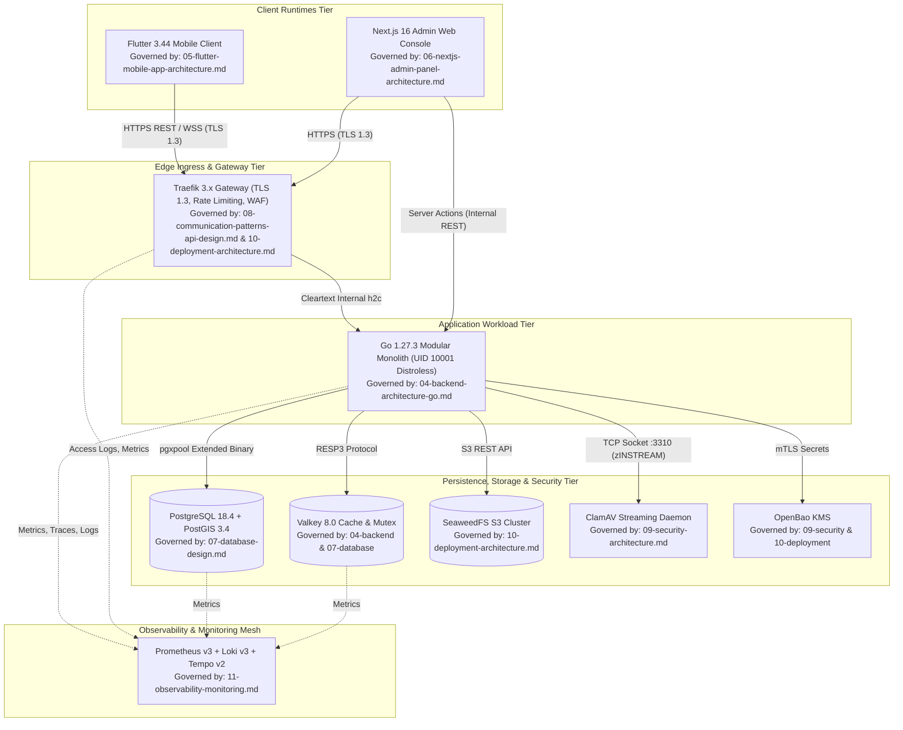
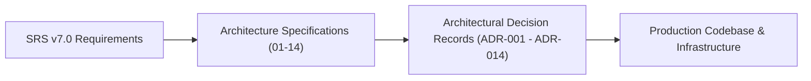
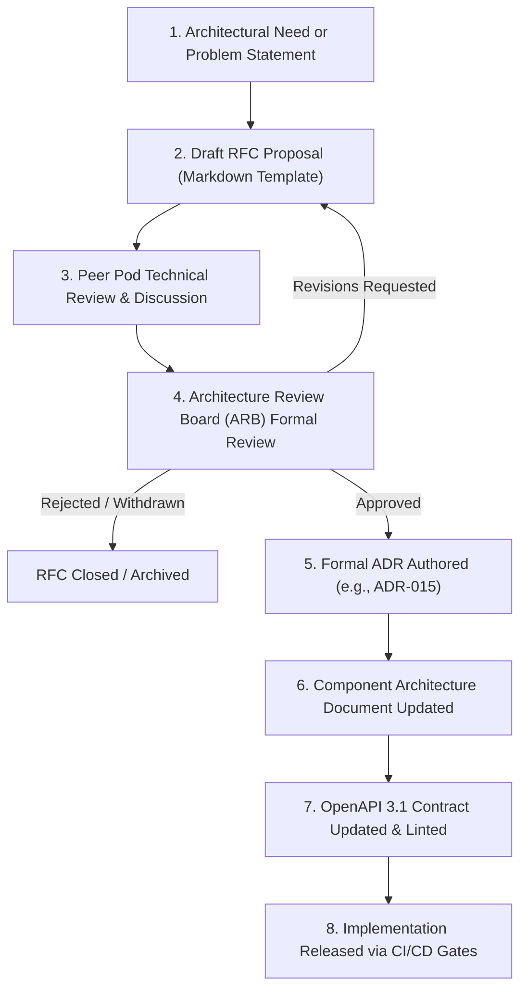

# Heavy Machinery & Logistics Rental Aggregator — Dink Machinery
## Architecture Specification — Master Architecture Index & Navigation Guide (`docs/shared/architecture/INDEX.md`)

**Document Identifier:** `ARCH-INDEX-DINK-CORE-V7.0`  
**Classification:** Canonical Architecture Specification & Engineering Reference (Single Source of Truth)  
**Governing Documents:** `SRS-DINK-CORE-V7.0` (Parts 1–5), `contracts/openapi.yaml`, `ADR-001` through `ADR-014`  
**Target Runtimes:** Go 1.27.3 Modular Monolith, Flutter 3.44 Cross-Platform Mobile Client, Next.js 16 Admin Web Console, PostgreSQL 18.4 + PostGIS 3.4, Valkey 8.0-alpine, SeaweedFS S3, ClamAV Daemon, OpenBao KMS, Traefik 3.x Gateway  
**Target Markets:** Ethiopia (`ET`) & Kenya (`KE`) — Dynamic Multi-Country Parameterization (`LOC-01-BE`)  
**Compliance Standards:** OWASP ASVS 4.0.3 Level 3, RFC 9457 (Problem Details), ISO/IEC/IEEE 42010, ISO 4217, ISO 3166-1 alpha-2, Ethiopian Personal Data Protection Proclamation No. 1321/2024, National Bank of Ethiopia (NBE) Directives  
**Status:** Approved Engineering Baseline

---

## Table of Contents

- 1. [Executive Summary & Architectural Mission](#1-executive-summary--architectural-mission)
- 2. [Canonical Architecture Document Catalog](#2-canonical-architecture-document-catalog)
- 3. [Macro Architecture Topography & Document Interdependence](#3-macro-architecture-topography--document-interdependence)
- 4. [The Nine Non-Negotiable Architectural Invariants](#4-the-nine-non-negotiable-architectural-invariants)
- 5. [Cross-Document Traceability & Requirement Mapping Matrix](#5-cross-document-traceability--requirement-mapping-matrix)
- 6. [System Technology Stack & Tier Allocation Matrix](#6-system-technology-stack--tier-allocation-matrix)
- 7. [Architecture Governance, RFC Lifecycle & Change Control Protocol](#7-architecture-governance-rfc-lifecycle--change-control-protocol)

---

## 1. Executive Summary & Architectural Mission

The **Dink Machinery** architecture specification suite establishes the technical blueprint for an industrial-grade digital rental aggregator and logistics management engine operating in frontier construction corridors across East Africa.

The architecture is specifically engineered to solve the operational realities of heavy infrastructure in emerging markets:
* **Severe Network Volatility & Glare:** Remote quarries, road expansions, and civil project corridors feature intermittent cellular coverage, intense daylight glare ($> 80,000\text{ lux}$), and engine vibration.
* **Complex Financial Regulations:** Inability of non-banking entities to hold customer escrow balances under National Bank of Ethiopia (NBE) directives, requiring direct interbank commercial wires paired with pre-funded platform commission debits.
* **National Data Sovereignty:** Mandatory local data residency under Ethiopian Personal Data Protection Proclamation No. 1321/2024 prohibiting the offshore persistence of citizen national identity records, tax identifiers, and machine GPS breadcrumbs.
* **Mechanical & Operational Integrity:** Prevention of machinery double-booking, enforcement of monotonic physical hour meter non-regression, and mathematical zero-sum balancing of all double-entry journal postings.

This master index serves as the entry point and structural roadmap for all fourteen component architecture specifications comprising the canonical engineering baseline.

---

## 2. Canonical Architecture Document Catalog

```mermaid
flowchart TD
    Index["INDEX.md - Master Architecture Index"]
    
    subgraph FoundationGroup ["1. Foundation & System Topography"]
        Doc01["01-introduction-and-goals.md"]
        Doc02["02-architecture-principles-and-invariants.md"]
        Doc03["03-system-architecture-overview.md"]
    end

    subgraph ImplementationGroup ["2. Workload & Platform Implementations"]
        Doc04["04-backend-architecture-go.md"]
        Doc05["05-flutter-mobile-app-architecture.md"]
        Doc06["06-nextjs-admin-panel-architecture.md"]
        Doc07["07-database-design.md"]
    end

    subgraph IntegrationAndSecurityGroup ["3. Protocols, Security & Operations"]
        Doc08["08-communication-patterns-api-design.md"]
        Doc09["09-security-architecture.md"]
        Doc10["10-deployment-architecture.md"]
        Doc11["11-observability-monitoring.md"]
    end

    subgraph GovernanceGroup ["4. Decision Records, Roadmap & Stack"]
        Doc12["12-architecture-decision-records.md"]
        Doc13["13-implementation-roadmap.md"]
        Doc14["14-appendix-full-technology-stack.md"]
    end

    Index --> Doc01
    Index --> Doc02
    Index --> Doc03
    Index --> Doc04
    Index --> Doc05
    Index --> Doc06
    Index --> Doc07
    Index --> Doc08
    Index --> Doc09
    Index --> Doc10
    Index --> Doc11
    Index --> Doc12
    Index --> Doc13
    Index --> Doc14
```



| Sequence | File Path | Document Identifier | Canonical Title & Scope | Primary Stakeholders |
|---|---|---|---|---|
| **01** | `01-introduction-and-goals.md` | `ARCH-INTRO-DINK-CORE-V7.0` | **Introduction & Architectural Goals:** Business context, stakeholder analysis, high-level quality goals, and market constraints. | Product Leadership, Systems Architects |
| **02** | `02-architecture-principles-and-invariants.md` | `ARCH-PRIN-DINK-CORE-V7.0` | **Architecture Principles & Core Invariants:** The Nine Invariants, Clean Architecture boundaries, and domain isolation rules. | All Engineering Pods, QA Leads |
| **03** | `03-system-architecture-overview.md` | `ARCH-OVERVIEW-DINK-CORE-V7.0` | **System Architecture Overview:** End-to-end macro topography, system boundary definitions, and cross-cutting runtime topologies. | All Engineering Pods, DevSecOps |
| **04** | `04-backend-architecture-go.md` | `ARCH-BACKEND-GO-DINK-CORE-V7.0` | **Backend Architecture (Go Modular Monolith):** Chi routing, domain interactors, Unit of Work, 20-state machine, and `sqlc` persistence. | Backend Engineers, Core Platform Pod |
| **05** | `05-flutter-mobile-app-architecture.md` | `ARCH-FLUTTER-DINK-CORE-V7.0` | **Flutter Mobile Client Architecture:** Persona polymorphism (Renter, Owner, Operator), BLoC FSM, Isar offline outbox, and OTA fonts. | Mobile Engineers, UI/UX Designers |
| **06** | `06-nextjs-admin-panel-architecture.md` | `ARCH-ADMIN-NEXT-DINK-CORE-V7.0` | **Next.js Admin Console Architecture:** Server-driven UI metadata compilation, React Server Components, dispute lightboxes, and RBAC. | Web Frontend Engineers, Operations Leads |
| **07** | `07-database-design.md` | `ARCH-DB-DINK-CORE-V7.0` | **Database Design & Persistence:** PostgreSQL 18.4 schemas, PostGIS spatial GiST, GIN JSONB EAV indexing, and double-entry triggers. | Database Architects, Backend Engineers |
| **08** | `08-communication-patterns-api-design.md` | `ARCH-COMM-DINK-CORE-V7.0` | **Communication Patterns & API Design:** OpenAPI 3.1 supremacy, universal envelopes, RFC 9457 errors, idempotency, and WebSockets. | Backend, Mobile, and Web Engineers |
| **09** | `09-security-architecture.md` | `ARCH-SEC-DINK-CORE-V7.0` | **Security & Compliance Architecture:** OWASP ASVS L3, ES256 JWTs, AES-256-GCM AAD field encryption, ClamAV streaming, and RBAC. | DevSecOps Lead, Security Auditors |
| **10** | `10-deployment-architecture.md` | `ARCH-DEPLOY-DINK-CORE-V7.0` | **Deployment & Infrastructure Architecture:** Sovereign Tier III DC colocation, Docker distroless containers, Traefik edge, and SeaweedFS. | SRE, Infrastructure Pod, SysAdmins |
| **11** | `11-observability-monitoring.md` | `ARCH-OBS-DINK-CORE-V7.0` | **Observability, Telemetry & SRE:** Prometheus RED/USE metrics, OpenTelemetry W3C traces, Loki zero-PII logging, and P1–P4 alerting. | SRE, On-Call Engineers, Operations |
| **12** | `12-architecture-decision-records.md` | `ARCH-ADR-DINK-CORE-V7.0` | **Architectural Decision Records (ADR):** The 14 canonical decisions governing modularity, settlement, database, offline outbox, and sovereignty. | Architecture Review Board, Tech Leads |
| **13** | `13-implementation-roadmap.md` | `ARCH-ROADMAP-DINK-CORE-V7.0` | **Implementation & Engineering Roadmap:** Sprints 1–24 (10 months), pod topology, critical path dependencies, and corridor pilot execution. | Engineering Management, Scrum Masters |
| **14** | `14-appendix-full-technology-stack.md` | `ARCH-TECH-DINK-CORE-V7.0` | **Appendix: Full Technology Stack & Hardware BOM:** Comprehensive BOM, bare-metal rack sizing, memory/storage specs, and license audit. | Procurement, Infrastructure Pod, Legal |

---

## 3. Macro Architecture Topography & Document Interdependence

The system coordinates client runtimes, edge ingress, application monolith modules, persistence clusters, and observability daemons. The following diagram illustrates the structural relationships between runtime tiers and their governing architecture specifications.



---

## 4. The Nine Non-Negotiable Architectural Invariants

Every technical implementation across all pods must strictly satisfy the platform's core invariants. Pull requests violating any invariant are automatically rejected by CI verification gates.

| Invariant ID | Invariant Title | Core Technical Mandate | Enforcement Mechanism | Primary Governing Document |
|---|---|---|---|---|
| **Invariant 1** | **OpenAPI Contract Supremacy** | The OpenAPI 3.1 specification (`contracts/openapi.yaml`) is the single source of truth. Manual modifications to generated code or ad-hoc endpoints are prohibited. | `kin-openapi` and `spectral` CI linters block non-compliant PRs. | `08-communication-patterns-api-design.md` |
| **Invariant 2** | **Integer Minor-Unit Currencies** | Floating-point types (`float32`, `float64`) are prohibited for financial values. All amounts are stored as signed 64-bit integers (`int64` / `BIGINT`) in minor units paired with an ISO 4217 code. | AST grep linter rejects floating-point types in financial packages; PostgreSQL check constraints. | `04-backend-architecture-go.md`, `07-database-design.md` |
| **Invariant 3** | **Immutable Double-Entry Ledger** | Mutating financial operations must write balanced debit and credit entries to `financial_ledger_entries`. `UPDATE` and `DELETE` operations are strictly blocked. | PL/pgSQL database triggers enforce append-only rules; deferred transaction triggers assert zero-sum balance: $\sum \text{Debits} + \sum \text{Credits} = 0$. | `07-database-design.md`, `04-backend-architecture-go.md` |
| **Invariant 4** | **Universal Optimistic Concurrency** | All mutable operational entities (`bookings`, `fleets`, `owner_wallets`) declare a `version INT NOT NULL DEFAULT 1` column. Mutations require version checks: `WHERE id = $1 AND version = $2`. | Database query assertion (`rows_affected == 1`); zero rows affected raises RFC 9457 HTTP 409 Conflict. | `04-backend-architecture-go.md`, `07-database-design.md` |
| **Invariant 5** | **Universal Soft-Delete Policy** | Physical SQL `DELETE` operations are forbidden on operational records. Soft-deletes are recorded via `deleted_at TIMESTAMPTZ NULL DEFAULT NULL`. | Database triggers reject raw `DELETE` statements; all queries enforce `WHERE deleted_at IS NULL`. | `07-database-design.md` |
| **Invariant 6** | **Dynamic Country Parameterization** | Country-specific rules (tax rates, currencies, dialing codes, dispute SLAs) must never be hardcoded. Rules are dynamically loaded from `country_configs`. | Dynamic middleware resolves `X-Country-Code` and injects configuration into Go `context.Context`. | `03-system-architecture-overview.md`, `07-database-design.md` |
| **Invariant 7** | **Zero-PII Telemetry & ASVS Level 3** | Plaintext personal data (phone numbers, National IDs, bank coordinates, raw GPS tracks) must never appear in application logs, trace spans, or error payloads. | Uber Zap redacting core masks fields in memory; Promtail regex pipeline scrubs log streams before Loki ingestion. | `09-security-architecture.md`, `11-observability-monitoring.md` |
| **Invariant 8** | **Standardized Envelopes & RFC 9457** | Bare JSON arrays or unstructured error payloads are prohibited. Successes return `SuccessEnvelope<T>`; errors return `application/problem+json` matching RFC 9457. | Shared response encoders in Go, Dio interceptors in Flutter, and Zod parsers in Next.js enforce envelope schemas. | `08-communication-patterns-api-design.md` |
| **Invariant 9** | **Bounded Context Modular Isolation** | Cross-module database table joins or direct mutations between internal packages are forbidden. Inter-module communication executes via Go interfaces or typed domain events. | Go internal package visibility; CI linters block cross-module internal package imports. | `04-backend-architecture-go.md` |

---

## 5. Cross-Document Traceability & Requirement Mapping Matrix

The architecture accounts for all functional and non-functional requirements defined in `SRS-DINK-CORE-V7.0` (Parts 1–5). The following matrix cross-references business domains with their governing specifications and architectural decisions.



| Business Domain & SRS Scope | Key Functional Requirements | Governing Architecture Specifications | Governing ADRs | Implementation Deliverables |
|---|---|---|---|---|
| **Identity & Authentication** | `AUTH-01` to `AUTH-06`, `REG-IDP-01` to `03` | `04-backend`, `05-flutter`, `06-nextjs`, `09-security` | `ADR-001`, `ADR-006`, `ADR-007` | `internal/modules/auth`, Fayda adapter, WebAuthn Passkeys, TOTP MFA. |
| **Fleet Catalog & Dynamic Specs** | `FL-01` to `FL-15`, `CAT-01` to `CAT-04` | `04-backend`, `05-flutter`, `06-nextjs`, `07-database` | `ADR-003`, `ADR-007` | `categories`, `spec_field_definitions`, `fleet_spec_indexed` (GIN index). |
| **Geospatial Discovery & Search** | `SRCH-01` to `SRCH-06` | `04-backend`, `05-flutter`, `07-database` | `ADR-003`, `ADR-006` | PostGIS `geography(POINT, 4326)`, GiST index, Keyset cursor pagination. |
| **20-State Booking Machine** | `BK-01` to `BK-20` | `04-backend`, `05-flutter`, `07-database`, `08-comm` | `ADR-001`, `ADR-004`, `ADR-008` | Finite State Machine engine, Valkey 60-min hold locks, OCC versioning. |
| **Settlement, Ledger & Wallet** | `BK-07`, `BK-17`, `CW-01` to `CW-04` | `04-backend`, `06-nextjs`, `07-database` | `ADR-002`, `ADR-008` | `financial_ledger_entries`, `owner_wallets`, zero-sum balance triggers. |
| **Field Inspection & Monotonic Meters**| `AR-01` to `AR-08` | `04-backend`, `05-flutter`, `07-database`, `09-security` | `ADR-006`, `ADR-010` | Camera-only reticle overlay, Isar offline outbox, non-regression triggers. |
| **Logistics Sub-Bookings** | `LOG-01` to `LOG-06` | `04-backend`, `05-flutter`, `07-database` | `ADR-001`, `ADR-004` | Linked sub-bookings (`parent_booking_id`), bidirectional cascade cancels. |
| **Dispute Resolution & Lightbox** | `DISP-01` to `DISP-06`, `AD-04` | `04-backend`, `06-nextjs`, `07-database` | `ADR-007`, `ADR-011` | Split-screen pan/zoom viewer, 72h/48h SLA escalation cron, arbitration actions. |
| **Operator Telematics & Geofencing**| `GPS-01` to `GPS-04` | `04-backend`, `05-flutter`, `07-database`, `08-comm` | `ADR-001`, `ADR-006`, `ADR-014` | `/ws/v1/bookings/{id}/tracking`, monthly table partitions, 30-day purge cron. |
| **Server-Driven Admin Engine** | `AD-06`, `AD-09`, `AD-13` | `04-backend`, `06-nextjs` | `ADR-007` | `/api/v1/admin/ui-config`, dynamic sidebar, virtualized TanStack tables. |
| **Security & Antivirus Defense** | `SEC-01` to `SEC-08` | `09-security`, `10-deployment` | `ADR-010`, `ADR-012` | ClamAV `zINSTREAM` pipeline, AES-256-GCM column encryption, OpenBao KMS. |
| **Observability, SRE & Logging** | `MON-01` to `MON-06`, `LOG-01` to `04` | `11-observability`, `10-deployment` | `ADR-009`, `ADR-014` | Prometheus RED/USE metrics, Loki PII scrubbing, Tempo W3C distributed traces. |
| **Infrastructure & Hosting** | `INF-01` to `INF-06`, `REG-RES-01` | `10-deployment`, `14-appendix` | `ADR-005`, `ADR-012` | Addis Ababa Tier III colocation, Nairobi PoP, SeaweedFS S3, Docker Engine. |

---

## 6. System Technology Stack & Tier Allocation Matrix

The platform standardizes on production-proven runtimes with permissive open-source licenses, managed across eight decoupled infrastructure tiers.

```text
+------------------------------------------------------------------------------------+
|                         PRODUCTION RUNTIME TIER ASSIGNMENT                         |
+------------------------------------------------------------------------------------+
|  Tier 1: Edge Ingress        | Traefik 3.1 (TLS 1.3, Rate Limiting, WAF, CORS)     |
|  Tier 2: Backend Application | Go 1.27.3 Static Binary (distroless/static-debian12)|
|  Tier 3: Persistence Core    | PostgreSQL 18.4 + PostGIS 3.4 (NVMe RAID 10)        |
|  Tier 4: Distributed Cache   | Valkey 8.0-alpine (Sentinel Failover Cluster)       |
|  Tier 5: Object Storage      | SeaweedFS S3 Distributed Cluster (Replication 001)  |
|  Tier 6: Mobile Client       | Flutter 3.44 / Dart 3.9 (Android API 26+, iOS 15+)  |
|  Tier 7: Admin Web Console   | Next.js 16 Standalone (React 19 RSC, Node.js 22 LTS)|
|  Tier 8: SRE & Observability | Prometheus v3 + Loki v3 + Tempo v2 + Alertmanager   |
+------------------------------------------------------------------------------------+
```

| Architecture Tier | Technology Name | Version | Primary Purpose | Governing Architecture Document |
|---|---|---|---|---|
| **Edge Ingress** | Traefik Proxy | `v3.1.x` | TLS 1.3 termination, rate-limiting token buckets, WAF security headers. | `10-deployment-architecture.md` |
| **Backend Workload** | Go Modular Monolith | `1.27.3` | Core business logic, 20-state machine, financial ledgers, and API controllers. | `04-backend-architecture-go.md` |
| **Relational Database** | PostgreSQL | `18.4` | ACID relational persistence, double-entry ledgers, and table partitioning. | `07-database-design.md` |
| **Geospatial Engine** | PostGIS Extension | `3.4.2` | Spheroidal geographic calculations (`ST_DWithin`) on WGS 84 coordinates. | `07-database-design.md` |
| **In-Memory Cache** | Valkey Engine | `8.0-alpine` | 60-minute reservation holds (`SET NX EX`), token buckets, session revocations. | `04-backend`, `07-database` |
| **Object Storage** | SeaweedFS Cluster | `v3.70+` | S3-compliant distributed storage for photos, trade licenses, and PDF slips. | `10-deployment-architecture.md` |
| **Antivirus Scanner** | ClamAV Daemon | `1.4.x` | Real-time TCP stream malware inspection (`zINSTREAM` on port `3310`). | `09-security-architecture.md` |
| **Mobile Runtime** | Flutter / Dart | `3.44 / 3.9` | Cross-platform mobile client for Renters, Owners, and Field Operators. | `05-flutter-mobile-app-architecture.md` |
| **Mobile Local DB** | Isar NoSQL | `v3.1.0` | High-speed embedded database powering the offline-first outbox sync queue. | `05-flutter-mobile-app-architecture.md` |
| **Web Console** | Next.js / React | `16.0 / 19.0` | High-density administrative console, server-driven UI, and dispute lightboxes. | `06-nextjs-admin-panel-architecture.md` |
| **Key Management** | OpenBao KMS | `v2.0.x` | Master key lifecycle, dynamic database credentials, and AES master keys. | `09-security-architecture.md` |
| **Metrics Engine** | Prometheus | `v3.0.x` | Time-series scraper collecting RED and USE metrics every 15 seconds. | `11-observability-monitoring.md` |
| **Log Aggregator** | Grafana Loki | `v3.1.x` | High-density structured log storage indexed on low-cardinality stream labels. | `11-observability-monitoring.md` |
| **Trace Storage** | Grafana Tempo | `v2.5.x` | High-scale distributed trace backend indexing W3C trace spans via OTLP. | `11-observability-monitoring.md` |

---

## 7. Architecture Governance, RFC Lifecycle & Change Control Protocol

The Dink Machinery architecture specifications represent the binding baseline for all engineering deliverables. Technical drift or unapproved deviations are strictly prohibited.



### 7.1 The Request for Comments (RFC) Process
1. **Proposal Authoring:** Any engineer proposing an architectural modification, schema redesign, or new third-party dependency must author an RFC document using the canonical MADR template.
2. **Review Period:** RFCs remain open for comments for a minimum of 5 business days, undergoing mandatory review by affected engineering pods.
3. **Quorum Approval:** Approval requires consensus among the Lead Systems Architect, Head of Engineering, and affected Pod Leads.
4. **ADR Formulation:** Upon approval, the decision is formalized as an immutable Architectural Decision Record in `12-architecture-decision-records.md`.

### 7.2 Change Control Sign-Off Authorities

```text
+------------------------------------------------------------------------------------+
|                         ARCHITECTURE CHANGE CONTROL BOARD                          |
+------------------------------------------------------------------------------------+
|  Role                     | Primary Governance Responsibility                      |
+---------------------------+--------------------------------------------------------+
|  Lead Systems Architect   | Cross-cutting system integrity, Invariants 1–9 audits  |
|  Head of Engineering      | Engineering delivery schedule, resource allocation     |
|  Core Platform Lead       | Backend modularity, database schemas, Go dependencies  |
|  Mobile Lead              | Flutter client architecture, offline outbox integrity  |
|  Web Frontend Lead        | Next.js server-driven UI, TanStack table virtualization|
|  DevSecOps & SRE Lead     | ASVS Level 3 security, datacenter topology, telemetry  |
+------------------------------------------------------------------------------------+
```

### 7.3 Canonical Baseline Seal & Version Control
* **Baseline Identifier:** `ARCH-INDEX-DINK-CORE-V7.0`
* **Governing Specification Version:** 7.0.0
* **Effective Date:** October 2026
* **Jurisdiction:** Ethiopia (`ET`) and Kenya (`KE`)

---

*This document defines the canonical master index and governance framework for the Dink Machinery Architecture Specification Suite Version 7.0. All downstream design documentation, engineering implementations, pull requests, and infrastructure deployments must strictly adhere to the standards indexed herein.*
```