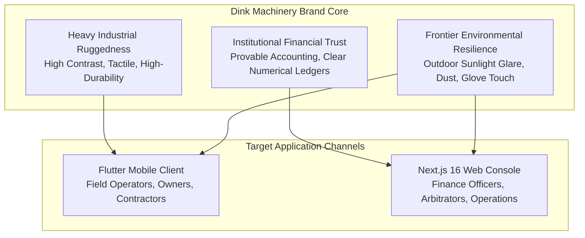
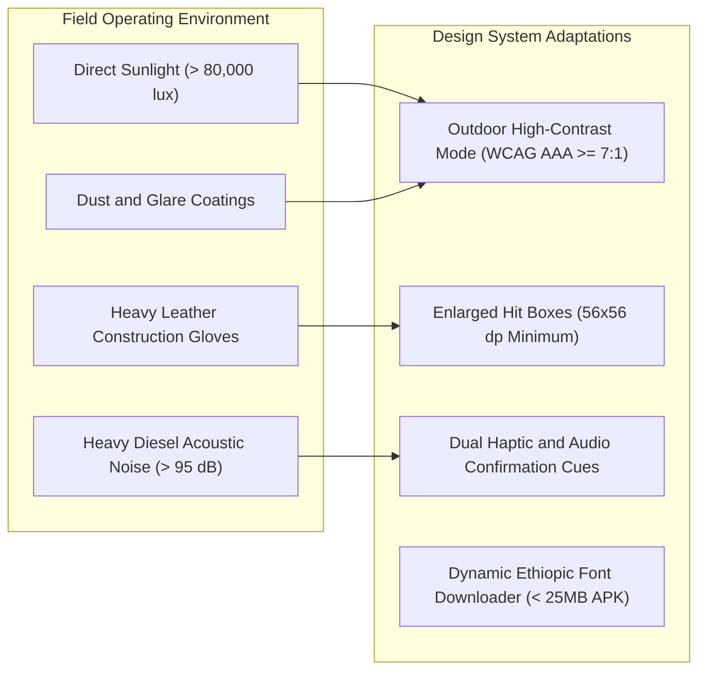
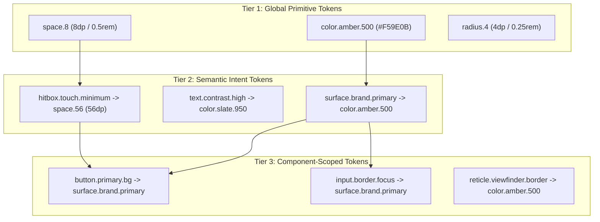
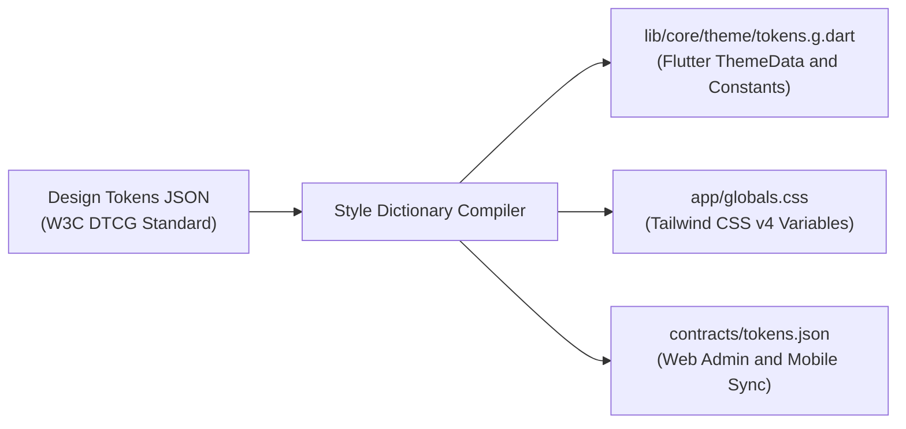
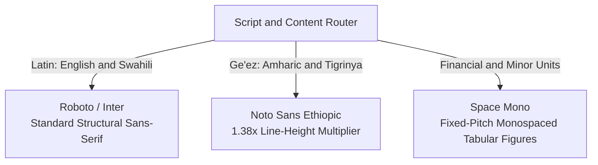
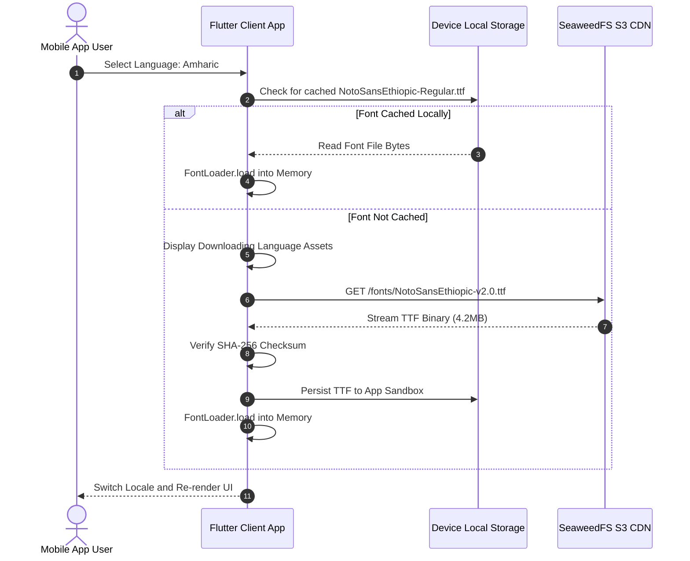
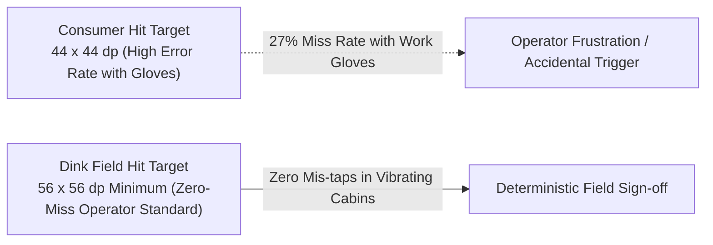
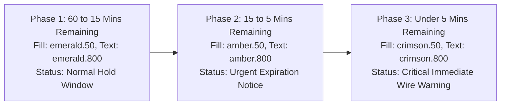
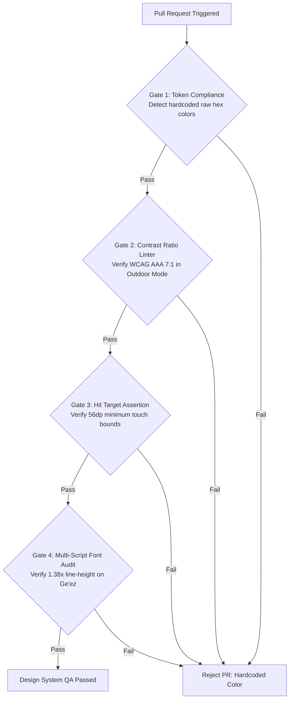

# Heavy Machinery & Logistics Rental Aggregator — Dink Machinery
## Design Specification — 00. Master Design System & Industrial UI/UX Foundation (`docs/shared/design/00-design-system.md`)

**Document Identifier:** `DS-DINK-CORE-V7.0`  
**Classification:** Canonical Design System Specification & UI/UX Engineering Baseline (Single Source of Truth)  
**Governing Documents:** `SRS-DINK-CORE-V7.0` (Parts 1–5), `ARCH-INTRO-DINK-CORE-V7.0` through `ARCH-ROADMAP-DINK-CORE-V7.0`, `contracts/openapi.yaml`, `ADR-001` through `ADR-014`  
**Target Client Runtimes:** Flutter 3.47.9 / Dart 3.9 (Cross-Platform Mobile), Next.js 16.x (latest CVE security patch) / React 19 (Desktop Admin Web Console), Tailwind CSS v4, Radix UI Primitives, Lucide Icons  
**Target Personas:** Field Operators (Excavator/Crane Drivers), Fleet Owners (Yard Managers), Renters (Civil Contractors), Administrative Compliance & Dispute Arbitrators  
**Target Operating Environments:** Harsh Field Conditions (Direct Sunlight $> 80,000\text{ lux}$, Heavy Dust, Vibration, Glove Usage) & High-Density Back-Office Desktops  
**Compliance Standards:** W3C WCAG 2.2 Level AAA (Field/Outdoor Mode), WCAG 2.2 Level AA (Indoor/Admin Console), W3C Design Tokens Community Group (DTCG) Specification, ISO 9241-110 (Ergonomics of Human-System Interaction)  
**Status:** Approved Engineering Baseline

---

## Table of Contents

- 1. [Executive Summary & Design Philosophy](#1-executive-summary--design-philosophy)
  - 1.1 [Brand Identity: Machinery Ruggedness Meets Financial Trust](#11-brand-identity-machinery-ruggedness-meets-financial-trust)
  - 1.2 [Operating Personas & Physical Environmental Constraints](#12-operating-personas--physical-environmental-constraints)
  - 1.3 [Accessibility & Human Factors Baseline](#13-accessibility--human-factors-baseline)
- 2. [Design Token Architecture & Taxonomy](#2-design-token-architecture--taxonomy)
  - 2.1 [Three-Tier Token Hierarchy](#21-three-tier-token-hierarchy)
  - 2.2 [W3C DTCG Token Definition Schema](#22-w3c-dtcg-token-definition-schema)
  - 2.3 [Multi-Platform Compilation Pipeline](#23-multi-platform-compilation-pipeline)
- 3. [Color Architecture & Lighting Adaptations](#3-color-architecture--lighting-adaptations)
  - 3.1 [Primitive Palette (Caterpillar Amber, Cast Iron Slate, Safety Orange)](#31-primitive-palette-caterpillar-amber-cast-iron-slate-safety-orange)
  - 3.2 [Semantic Surface & Text Token Assignments](#32-semantic-surface--text-token-assignments)
  - 3.3 [Outdoor High-Contrast Mode (WCAG 2.2 AAA Contrast $\ge 7:1$)](#33-outdoor-high-contrast-mode-wcag-22-aaa-contrast-ge-71)
  - 3.4 [Ambient Light Sensor Auto-Switching Engine](#34-ambient-light-sensor-auto-switching-engine)
- 4. [Multi-Script Typography & Text Ergonomics](#4-multi-script-typography--text-ergonomics)
  - 4.1 [Typeface Strategy: Roboto, Noto Sans Ethiopic, Space Mono](#41-typeface-strategy-roboto-noto-sans-ethiopic-space-mono)
  - 4.2 [Typographic Scale, Line-Height Multipliers ($1.38\times$) & Glyph Padding](#42-typographic-scale-line-height-multipliers-138times--glyph-padding)
  - 4.3 [Dynamic Over-The-Air (OTA) Font Loading Pipeline (`ADR-013`)](#43-dynamic-over-the-air-ota-font-loading-pipeline-adr-013)
  - 4.4 [Financial Minor-Unit Tabular Alignment Standards](#44-financial-minor-unit-tabular-alignment-standards)
- 5. [Spatial Grid, Elevation & Glove-Friendly Ergonomics](#5-spatial-grid-elevation--glove-friendly-ergonomics)
  - 5.1 [8dp Baseline Grid & Spacing Scale](#51-8dp-baseline-grid--spacing-scale)
  - 5.2 [Glove-Friendly Touch Targets ($56 \times 56\text{ dp}$ Minimum)](#52-glove-friendly-touch-targets-56-times-56text-dp-minimum)
  - 5.3 [Elevation, Borders & Cast-Iron Skeuomorphic Accents](#53-elevation-borders--cast-iron-skeuomorphic-accents)
- 6. [Iconography & Industrial Media Reticles](#6-iconography--industrial-media-reticles)
  - 6.1 [Icon System & Custom Machinery Taxonomy Glyphs](#61-icon-system--custom-machinery-taxonomy-glyphs)
  - 6.2 [Optical Sizing, Stroke Weights & Glare Legibility](#62-optical-sizing-stroke-weights--glare-legibility)
  - 6.3 [Camera Viewfinder Reticles & Hour Meter Gauge Capture](#63-camera-viewfinder-reticles--hour-meter-gauge-capture)
- 7. [Core Component Library Specifications](#7-core-component-library-specifications)
  - 7.1 [Buttons & Industrial Actuators (Heavy Machinery Controls)](#71-buttons--industrial-actuators-heavy-machinery-controls)
  - 7.2 [Dynamic EAV Spec Inputs & Dynamic Form Compilers](#72-dynamic-eav-spec-inputs--dynamic-form-compilers)
  - 7.3 [Status Badges & The 20-State Booking Indicators](#73-status-badges--the-20-state-booking-indicators)
  - 7.4 [The 60-Minute Valkey Countdown Component](#74-the-60-minute-valkey-countdown-component)
  - 7.5 [Split-Screen Dispute Arbitration Lightbox (`AD-04-WEB`)](#75-split-screen-dispute-arbitration-lightbox-ad-04-web)
  - 7.6 [Glass Vector Touch Signature Canvas](#76-glass-vector-touch-signature-canvas)
- 8. [Motion Choreography, Haptics & Audio Signaling](#8-motion-choreography-haptics--audio-signaling)
  - 8.1 [Purpose-Driven Industrial Transitions](#81-purpose-driven-industrial-transitions)
  - 8.2 [Tactile Haptic Feedback Sequences for Gloved Confirmation](#82-tactile-haptic-feedback-sequences-for-gloved-confirmation)
  - 8.3 [Audio Confirmation Cues for High-Noise Jobsites](#83-audio-confirmation-cues-for-high-noise-jobsites)
- 9. [Localization, Calendar Systems & Multi-Currency Standards](#9-localization-calendar-systems--multi-currency-standards)
  - 9.1 [Multi-Script Formatting (Amharic, Afaan Oromoo, Swahili, English)](#91-multi-script-formatting-amharic-afaan-oromoo-swahili-english)
  - 9.2 [Dual Calendar Date Pickers (Gregorian & Ethiopian Geez)](#92-dual-calendar-date-pickers-gregorian--ethiopian-geez)
  - 9.3 [Dual-Currency Formatting (Santims & Cents)](#93-dual-currency-formatting-santims--cents)
- 10. [Implementation Code Deliverables](#10-implementation-code-deliverables)
  - 10.1 [Flutter Theme Implementation (`dink_theme.dart`)](#101-flutter-theme-implementation-dink_themedart)
  - 10.2 [Tailwind CSS v4 Configuration (`tokens.css`)](#102-tailwind-css-v4-configuration-tokenscss)
- 11. [Governance, QA Automation & Token Verification Gates](#11-governance-qa-automation--token-verification-gates)

---

## 1. Executive Summary & Design Philosophy

### 1.1 Brand Identity: Machinery Ruggedness Meets Financial Trust

The visual identity of Dink Machinery rejects generic consumer software aesthetics in favor of a specialized design language: **Industrial Ruggedness Meets Financial Trust**.



* **Industrial Ruggedness:** High-contrast construction colors inspired by heavy earthmoving machinery (Caterpillar Yellow, Komatsu Gold, Cast Iron Slate, Safety Hazard Orange). Solid borders, clear geometry, and bold typography project mechanical reliability and structural integrity.
* **Financial Trust:** High-density, tabular numbers (`Space Mono`), distinct ledger lines, cryptographic status badges, and explicit minor-unit currency formatting ($35,000.00\text{ ETB} = 3,500,000\text{ Santims}$) instill confidence during high-value bank transfers ($50,000\text{–}1,000,000+\text{ ETB}$).
* **Frontier Environmental Resilience:** The UI is engineered for low-end Android smartphones operated under direct tropical sunlight, heavy construction dust, engine vibration, and thick leather gloves.

### 1.2 Operating Personas & Physical Environmental Constraints



The design system parameterizes layout and interactivity across four primary personas:

1. **Field Operator (Excavator / Crane Driver):** Operates equipment in active quarries, road construction sites, and earthmoving cuts. Features: Gloved hands, dirty/dusty screens, intense daylight glare ($> 80,000\text{ lux}$), high acoustic noise ($> 95\text{ dB}$).
   * *UI Mandate:* Minimum $56 \times 56\text{ dp}$ touch targets, high-contrast monochrome inversion mode, camera reticles for meter verification, and strong haptic confirmation patterns.
2. **Fleet Owner (Equipment Yard Manager):** Manages dozens of machines across depots. Reviews bank transfer receipts, monitors wallet balances, and assigns drivers from field offices or pickup trucks.
   * *UI Mandate:* Clear calendar dispatch blocks, rapid payment evidence auditing, prominent commission wallet balances, and one-tap reservation acceptance.
3. **Renter (Civil Contractor / Project Engineer):** Sources specialized machinery on project timelines. Discovers equipment by geographic radius, reviews technical parameters, and verifies interbank wire details.
   * *UI Mandate:* PostGIS spatial map discovery, dynamic EAV specification filtering, clear price breakdowns, and countdown timers for reservation holds.
4. **Administrative Arbitrator & Finance Officer:** Resolves damage disputes, audits bank deposits, and monitors multi-country operations from a desktop workstation.
   * *UI Mandate:* High-density TanStack data tables, split-screen synchronized pan/zoom photo lightboxes (`AD-04-WEB`), and side-by-side bank coordinate inspection drawers.

### 1.3 Accessibility & Human Factors Baseline

* **Dual-Tier Accessibility Targets:**
  * **Outdoor Field Mode (Mobile):** Strictly conforms to **W3C WCAG 2.2 Level AAA**, enforcing a minimum contrast ratio of $\ge 7:1$ for normal text and $\ge 4.5:1$ for graphical UI elements under simulated glare conditions.
  * **Indoor Office Mode (Web Admin & Mobile Standard):** Conforms to **W3C WCAG 2.2 Level AA**, maintaining a minimum contrast ratio of $\ge 4.5:1$ for normal text and $\ge 3:1$ for large text and controls.
* **Ergonomics & Cognitive Load (ISO 9241-110):** Information density is tuned to stress levels. Handover inspection flows present exactly one task per screen (stepper model) with explicit visual progress indicators to prevent omission of mandatory damage photos.

---

## 2. Design Token Architecture & Taxonomy

### 2.1 Three-Tier Token Hierarchy

The design system uses a strict three-tier token hierarchy compliant with the **W3C Design Tokens Community Group (DTCG)** specification. Hardcoded CSS values or raw hex codes in component files are prohibited.



1. **Tier 1: Global Primitive Tokens (`primitives.json`):** Raw, platform-agnostic values (hex colors, point sizes, millisecond durations) organized by scale.
2. **Tier 2: Semantic Intent Tokens (`semantic.json`):** Context-aware aliases mapping primitive values to operational intent (`surface.primary`, `border.interactive.focus`, `text.warning`). These change automatically across Light, Dark, and Outdoor High-Contrast modes.
3. **Tier 3: Component-Scoped Tokens (`components.json`):** Granular bindings applied to specific widgets (`button.primary.background`, `lightbox.split.borderWidth`).

### 2.2 W3C DTCG Token Definition Schema

Tokens are authored in JSON using the standardized `$value` and `$type` declarations:

```json
{
  "color": {
    "brand": {
      "amber": {
        "500": {
          "$value": "#F59E0B",
          "$type": "color",
          "$description": "Core construction equipment yellow - primary brand accent"
        },
        "600": {
          "$value": "#D97706",
          "$type": "color",
          "$description": "Hover and active interactive amber"
        }
      },
      "slate": {
        "900": {
          "$value": "#0F172A",
          "$type": "color",
          "$description": "Cast iron industrial background dark surface"
        },
        "950": {
          "$value": "#020617",
          "$type": "color",
          "$description": "Maximum contrast background for outdoor readability"
        }
      }
    }
  },
  "touch": {
    "minimumTarget": {
      "$value": "56dp",
      "$type": "dimension",
      "$description": "Mandatory minimum touch target dimension for gloved field operations"
    }
  }
}
```

### 2.3 Multi-Platform Compilation Pipeline

Tokens are stored centrally in `tokens/` and compiled during CI via a custom **Style Dictionary** pipeline into typed Dart theme constants for Flutter and CSS variables / Tailwind tokens for Next.js.



---

## 3. Color Architecture & Lighting Adaptations

### 3.1 Primitive Palette (Caterpillar Amber, Cast Iron Slate, Safety Orange)

The core color palette balances industrial machinery identification with clean functional UI design:

```text
+------------------------------------------------------------------------------------+
|                         DINK INDUSTRIAL PRIMITIVE PALETTE                          |
+------------------------------------------------------------------------------------+
|  Token Name           | Hex Code  | RGB Equivalent     | Visual Intent             |
+-----------------------+-----------+--------------------+---------------------------+
|  amber.50             | #FFFBEB   | rgb(255, 251, 235) | Subtle highlight tint     |
|  amber.100            | #FEF3C7   | rgb(254, 243, 199) | Warning container fill    |
|  amber.400            | #FBBF24   | rgb(251, 191, 36)  | Glare-resistant yellow    |
|  amber.500 (Primary)  | #F59E0B   | rgb(245, 158, 11)  | Core construction brand   |
|  amber.600 (Dark)     | #D97706   | rgb(217, 119, 6)   | Active state amber        |
|  amber.700            | #B45309   | rgb(180, 83, 9)    | Heavy contrast accent     |
|                       |           |                    |                           |
|  slate.50             | #F8FAFC   | rgb(248, 250, 252) | Clean daylight canvas     |
|  slate.100            | #F1F5F9   | rgb(241, 245, 249) | Data grid alternating row |
|  slate.200            | #E2E8F0   | rgb(226, 232, 240) | Standard dividing borders |
|  slate.700            | #334155   | rgb(51, 65, 85)    | Muted industrial text     |
|  slate.800            | #1E293B   | rgb(30, 41, 59)    | Elevated card dark canvas |
|  slate.900 (Cast Iron)| #0F172A   | rgb(15, 23, 42)    | Standard dark theme base  |
|  slate.950 (Blackout) | #020617   | rgb(2, 6, 23)      | Pure contrast base        |
|                       |           |                    |                           |
|  emerald.500 (Success)| #10B981   | rgb(16, 185, 129)  | Verified payment / Active |
|  crimson.600 (Danger) | #DC2626   | rgb(220, 38, 38)   | Inspection fault / Cancel |
|  safety.orange        | #FF5722   | rgb(255, 87, 34)   | Mandatory action alert    |
+------------------------------------------------------------------------------------+
```

### 3.2 Semantic Surface & Text Token Assignments

Semantic tokens resolve to appropriate primitive colors based on the active theme mode:

| Semantic Token | Standard Light Mode | Standard Dark Mode (Cast Iron) | Outdoor High-Contrast Mode |
|---|---|---|---|
| `surface.canvas` | `slate.50` (`#F8FAFC`) | `slate.900` (`#0F172A`) | `slate.950` (`#020617`) |
| `surface.card` | `#FFFFFF` | `slate.800` (`#1E293B`) | `#000000` (Solid 2px border) |
| `surface.brand` | `amber.500` (`#F59E0B`) | `amber.500` (`#F59E0B`) | `amber.400` (`#FBBF24`) |
| `text.primary` | `slate.900` (`#0F172A`) | `slate.50` (`#F8FAFC`) | `#FFFFFF` (100% Solid) |
| `text.muted` | `slate.700` (`#334155`) | `slate.300` (`#CBD5E1`) | `slate.200` (`#E2E8F0`) |
| `border.default` | `slate.200` (`#E2E8F0`) | `slate.700` (`#334155`) | `#FFFFFF` (Solid 2px) |
| `border.focus` | `amber.600` (`#D97706`) | `amber.400` (`#FBBF24`) | `amber.400` (Solid 3px) |
| `status.success.bg` | `emerald.50` (`#ECFDF5`) | `emerald.950` (`#064E3B`) | `#000000` (Emerald Border) |
| `status.danger.bg` | `crimson.50` (`#FEF2F2`) | `crimson.950` (`#450A0A`) | `#000000` (Crimson Border) |

### 3.3 Outdoor High-Contrast Mode (WCAG 2.2 AAA Contrast $\ge 7:1$)

Under extreme solar illumination ($> 80,000\text{ lux}$), standard UI subtle grays, box shadows, and 1px borders wash out. **Outdoor High-Contrast Mode** applies the following transformations:
1. **Zero Gradients & Box Shadows:** All subtle depth indicators are stripped. Depth is communicated strictly via high-contrast borders ($2\text{dp}$ solid white or amber on black).
2. **Text Inversion & Pure Hex Black:** Backdrops convert to `#000000`, with all text forced to `#FFFFFF` or high-luminance `#FBBF24` (Amber 400). Measured contrast ratio reaches **$18:1$**, exceeding the WCAG 2.2 AAA $7:1$ threshold.
3. **Thickened Visual Reticles:** Camera viewfinder guidelines and divider lines thicken from $1\text{dp}$ to $3\text{dp}$.

### 3.4 Ambient Light Sensor Auto-Switching Engine

The Flutter mobile application interrogates the hardware ambient light sensor via `environment_sensors`:

```dart
// lib/core/theme/ambient_theme_controller.dart
import 'dart:async';
import 'package:environment_sensors/environment_sensors.dart';
import 'package:flutter/foundation.dart';

enum DisplayLightingMode { standard, outdoorHighContrast }

class AmbientThemeController extends ChangeNotifier {
  final EnvironmentSensors _sensors = EnvironmentSensors();
  DisplayLightingMode _mode = DisplayLightingMode.standard;
  StreamSubscription<double>? _sub;
  
  // Lux threshold: > 25,000 lux triggers outdoor mode, drops below 18,000 lux with hysteresis
  static const double kHighContrastTriggerLux = 25000.0;
  static const double kHighContrastResetLux = 18000.0;

  DisplayLightingMode get mode => _mode;

  void initialize() {
    _sub = _sensors.light.listen((lux) {
      if (lux >= kHighContrastTriggerLux && _mode != DisplayLightingMode.outdoorHighContrast) {
        _mode = DisplayLightingMode.outdoorHighContrast;
        notifyListeners();
      } else if (lux < kHighContrastResetLux && _mode != DisplayLightingMode.standard) {
        _mode = DisplayLightingMode.standard;
        notifyListeners();
      }
    });
  }

  @override
  void dispose() {
    _sub?.cancel();
    super.dispose();
  }
}
```

---

## 4. Multi-Script Typography & Text Ergonomics

### 4.1 Typeface Strategy: Roboto, Noto Sans Ethiopic, Space Mono

The typography system handles multi-script requirements across East Africa without visual regressions or clipped characters:



1. **Latin Primary (`Roboto` / `Inter`):** Standard for English and Swahili text strings.
2. **Ge'ez Primary (`Noto Sans Ethiopic`):** Mandatory for Amharic and Tigrinya locales. Ethiopic script requires expanded vertical line-height to prevent clipping of upper and lower vowel markers.
3. **Tabular Numerals (`Space Mono`):** Applied to all financial values, machine hour meters, countdown clocks, registration plates, and bank account numbers to ensure vertical decimal alignment.

### 4.2 Typographic Scale, Line-Height Multipliers ($1.38\times$) & Glyph Padding

Ge'ez vowel diacritics (e.g., ኡ, ዒ, ዖ) extend beyond standard Latin font bounding boxes. Standard line-heights ($1.15\times\text{–}1.2\times$) cause vertical glyph clipping on Android text renderers.

**The Golden Ge'ez Multiplier:** All text styles applied to Amharic or Tigrinya must multiply the base font size by a minimum **$1.38\times$** line-height factor ($1.45\times$ on body text) with $2\text{dp}$ top/bottom internal padding.

```text
+------------------------------------------------------------------------------------+
|                         CANONICAL TYPOGRAPHIC HIERARCHY                            |
+------------------------------------------------------------------------------------+
|  Role Name      | Font Size | Weight | Latin Line-Height | Ge'ez Line-Height (1.38x) |
+-----------------+-----------+--------+-------------------+---------------------------+
|  Display Large  | 32dp      | Bold   | 40dp (1.25x)      | 48dp (1.50x)              |
|  Display Medium | 28dp      | Bold   | 36dp (1.28x)      | 42dp (1.50x)              |
|  Heading 1      | 24dp      | 700    | 32dp (1.33x)      | 36dp (1.50x)              |
|  Heading 2      | 20dp      | 600    | 28dp (1.40x)      | 30dp (1.50x)              |
|  Heading 3      | 18dp      | 600    | 24dp (1.33x)      | 26dp (1.44x)              |
|  Body Large     | 16dp      | 400    | 24dp (1.50x)      | 26dp (1.62x)              |
|  Body Medium    | 14dp      | 400    | 20dp (1.42x)      | 22dp (1.57x)              |
|  Caption/Meta   | 12dp      | 500    | 16dp (1.33x)      | 18dp (1.50x)              |
|  Mono Financial | 16dp      | 700    | 20dp (Fixed)      | 20dp (Fixed)              |
+------------------------------------------------------------------------------------+
```

### 4.3 Dynamic Over-The-Air (OTA) Font Loading Pipeline (`ADR-013`)

To keep the initial mobile application download below the $25\text{MB}$ frontier market threshold, complete Ge'ez font families are loaded dynamically over-the-air upon language selection:



### 4.4 Financial Minor-Unit Tabular Alignment Standards

Financial values are displayed using monospaced numerals with right-aligned decimal formatting:

```text
+-------------------------------------------------------+
|  TRANSACTION SUMMARY                  CURRENCY: ETB   |
+-------------------------------------------------------+
|  Base Machinery Rental (5 Days)        175,000.00 ETB |
|  Value Added Tax (15.0% MOR)            26,250.00 ETB |
|  Security Deposit (Refundable)          35,000.00 ETB |
|  ---------------------------------------------------  |
|  TOTAL DUE (Direct Bank Wire)          236,250.00 ETB |
+-------------------------------------------------------+
```

---

## 5. Spatial Grid, Elevation & Glove-Friendly Ergonomics

### 5.1 8dp Baseline Grid & Spacing Scale

All spatial dimensions, paddings, margins, and component heights adhere to an 8dp baseline grid ($4\text{dp}$ used strictly for compact micro-spacings):

```text
Space Tokens:
space.2  = 2dp   (Micro border offsets)
space.4  = 4dp   (Tight badge padding, icon/text gaps)
space.8  = 8dp   (Default element internal padding)
space.12 = 12dp  (Input field horizontal inset)
space.16 = 16dp  (Card internal padding, standard gutter)
space.24 = 24dp  (Section separation, screen edge padding)
space.32 = 32dp  (Major block separation)
space.48 = 48dp  (Header margins)
space.56 = 56dp  (Glove-friendly touch target baseline)
space.64 = 64dp  (Primary action button height in Field Mode)
```

### 5.2 Glove-Friendly Touch Targets ($56 \times 56\text{ dp}$ Minimum)

Field operators wear thick leather or rubber work gloves while operating heavy equipment. Standard consumer touch targets ($44\times 44\text{ dp}$ or $48\times 48\text{ dp}$) result in mis-taps under dust and vibration.



* **Field Interaction Rule:** In Field Operator Mode (Inspections, Start/Stop Jobs, Camera Capture, Signature), all interactive controls must have an unobstructed touch target bounding box of at least **$56 \times 56\text{ dp}$**.
* **Visual vs. Hit Target:** Secondary buttons may render with a visual height of $44\text{dp}$, but their hit test area expands transparently using `EdgeInsets.all(6.0)` to meet the $56\text{dp}$ standard.

### 5.3 Elevation, Borders & Cast-Iron Skeuomorphic Accents

* **Standard Mode Elevation:** Subtle dual-pass shadows:
  $$\text{Elevation 1 (Card): } \text{shadow}(0, 2, 4, \text{rgba}(15, 23, 42, 0.08))$$
  $$\text{Elevation 2 (Modal): } \text{shadow}(0, 8, 24, \text{rgba}(15, 23, 42, 0.16))$$
* **Cast-Iron Tactile Accents:** Interactive cards and active state buttons feature a $1.5\text{dp}$ dark industrial border (`slate.700`) paired with a $2\text{dp}$ solid bottom-lip border, giving controls a durable physical presence.

---

## 6. Iconography & Industrial Media Reticles

### 6.1 Icon System & Custom Machinery Taxonomy Glyphs

Icons are drawn from the **Lucide Icon** family, supplemented with custom SVG glyphs for heavy machinery taxonomy:

```text
+------------------------------------------------------------------------------------+
|                         SPECIALIZED MACHINERY TAXONOMY ICONS                       |
+------------------------------------------------------------------------------------+
|  Glyph Identifier    | Mechanical Category Illustrated | Optical Characteristics   |
+----------------------+---------------------------------+---------------------------+
|  machinery.excavator | Hydraulic Crawler Excavator     | Track base, articulated   |
|                      |                                 | boom, bucket tooth angle  |
|  machinery.crane     | All-Terrain / Rough Terrain Mobile| Outriggers extended,     |
|                      | Crane                           | lattice/telescopic boom   |
|  machinery.lowboy    | Multi-Axle Heavy Transport Semi-| Low ground clearance deck,|
|                      | Trailer                         | gooseneck hitch pin       |
|  machinery.dozer     | Tracked Bulldozer               | Heavy push blade, track   |
|                      |                                 | cleats, rear ripper shank |
|  machinery.loader    | Articulated Wheel Loader        | Center pivot hinge, large |
|                      |                                 | front scoop bucket        |
|  machinery.grader    | Motor Grader                    | Mid-frame mouldboard blade|
+------------------------------------------------------------------------------------+
```

### 6.2 Optical Sizing, Stroke Weights & Glare Legibility

* **Standard Stroke Weight:** $2\text{dp}$ uniform stroke with rounded caps and joins.
* **Outdoor Glare Scale:** Icons scale to $28\times 28\text{ dp}$ in field inspection modes with stroke weight increased to $2.5\text{dp}$ for legibility through dusty screen protectors.

### 6.3 Camera Viewfinder Reticles & Hour Meter Gauge Capture

Field handovers prohibit camera roll uploads; operators must take live photos through an on-screen alignment reticle:

```text
+-------------------------------------------------------------------+
|  [X] CANCEL INSPECTION                       FLASH: [AUTO | ON]   |
+-------------------------------------------------------------------+
|                                                                   |
|        +--[ Bounding Box: Align Analog/Digital Hour Meter ]--+    |
|        |                                                     |    |
|        |                                                     |    |
|        |                 [ 1 4 5 0 . 5 ]                     |    |
|        |                                                     |    |
|        |                                                     |    |
|        +-----------------------------------------------------+    |
|                                                                   |
|   (i) Ensure numbers are crisp and reflection glare is minimized  |
|                                                                   |
|                          [  CAPTURE  ]                            |
|                          (72x72 dp)                               |
+-------------------------------------------------------------------+
```

* **Reticle Dimensions:** $320 \times 120\text{ dp}$ horizontal box centered on the upper third of the viewfinder.
* **Active Validation Overlay:** Turns emerald green when the device accelerometer detects the phone is held steady ($< 0.05\text{ g}$ jitter for $500\text{ ms}$).

---

## 7. Core Component Library Specifications

### 7.1 Buttons & Industrial Actuators (Heavy Machinery Controls)

```text
+------------------------------------------------------------------------------------+
|  1. Primary Industrial Action Button (Amber 500)                                   |
|  +------------------------------------------------------------------------------+  |
|  |   [ICON]  CONFIRM & INITIALIZE LEASE                                         |  |
|  +------------------------------------------------------------------------------+  |
|  Height: 56dp | Radius: 8dp | Font: 16dp Bold | Background: #F59E0B | Text: #0F172A |
|  Border-Bottom: 3dp solid #D97706 (Cast-Iron Tactile Accent)                       |
+------------------------------------------------------------------------------------+
|  2. Destructive Slide-to-Confirm Gate (Emergency Cancel / Dispute Escalation)     |
|  +------------------------------------------------------------------------------+  |
|  | [>>> SLIDER HANDLE >>>]   SLIDE TO ESCALATE DISPUTE (3-DAY SLA)              |  |
|  +------------------------------------------------------------------------------+  |
|  Height: 64dp | Prevents accidental pocket actuations on construction sites        |
+------------------------------------------------------------------------------------+
```

### 7.2 Dynamic EAV Spec Inputs & Dynamic Form Compilers

The mobile application renders mechanical parameters dynamically from `/api/v1/admin/ui-config`:

```dart
// lib/core/widgets/dynamic_spec_input.dart
import 'package:flutter/material.dart';

class DynamicSpecInputField extends StatelessWidget {
  final String label;
  final String unitLabel;
  final String dataType; // 'number', 'text', 'select'
  final bool isRequired;
  final ValueChanged<String> onChanged;

  const DynamicSpecInputField({
    super.key,
    required this.label,
    required this.unitLabel,
    required this.dataType,
    required this.isRequired,
    required this.onChanged,
  });

  @override
  Widget build(BuildContext context) {
    return Padding(
      padding: const EdgeInsets.symmetric(vertical: 8.0),
      child: Column(
        crossAxisAlignment: CrossAxisAlignment.start,
        children: [
          Row(
            children: [
              Text(label, style: const TextStyle(fontWeight: FontWeight.bold, fontSize: 14)),
              if (isRequired) const Text(' *', style: TextStyle(color: Colors.red)),
            ],
          ),
          const SizedBox(height: 6),
          TextFormField(
            keyboardType: dataType == 'number' ? const TextInputType.numberWithOptions(decimal: true) : TextInputType.text,
            decoration: InputDecoration(
              suffixText: unitLabel.isNotEmpty ? unitLabel : null,
              border: OutlineInputBorder(borderRadius: BorderRadius.circular(8.0)),
              contentPadding: const EdgeInsets.symmetric(horizontal: 16, vertical: 16), // 56dp overall height
            ),
            onChanged: onChanged,
          ),
        ],
      ),
    );
  }
}
```

### 7.3 Status Badges & The 20-State Booking Indicators

Every booking state maps to a distinct visual indicator combining an icon, text label, and color token:

| State Family | Representative Statuses | Visual Styling (Light / Dark) | Icon Glyph |
|---|---|---|---|
| **Pending / Pre-Auth** | `DRAFT`, `HOLD_PENDING`, `SUBMITTED` | Fill: `amber.100` / Border: `amber.500` / Text: `amber.900` | `clock` |
| **Verification** | `PAYMENT_EVIDENCE_UPLOADED` | Fill: `blue.100` / Border: `blue.500` / Text: `blue.900` | `file-search` |
| **Confirmed & Active** | `CONFIRMED`, `CHECKED_IN`, `IN_TRANSIT`| Fill: `emerald.100` / Border: `emerald.600` / Text: `emerald.900` | `check-circle` |
| **Dispute Escalation** | `DISPUTED`, `ARBITRATION_PENDING` | Fill: `purple.100` / Border: `purple.600` / Text: `purple.900` | `shield-alert` |
| **Terminal / Failed** | `COMPLETED`, `CANCELLED`, `REJECTED` | Fill: `slate.200` / Border: `slate.500` / Text: `slate.800` | `archive` / `x-circle` |

### 7.4 The 60-Minute Valkey Countdown Component

The reservation hold widget communicates remaining time with color transitions:



```text
+-------------------------------------------------------------------+
|  [CLOCK ICON] TIME REMAINING TO UPLOAD WIRE TRANSFER SLIP         |
|                                                                   |
|                        2 4 : 1 8                                  |
|                 MINUTES         SECONDS                           |
|                                                                   |
|  (i) Machine will be released to public queue if timer expires.   |
+-------------------------------------------------------------------+
```

### 7.5 Split-Screen Dispute Arbitration Lightbox (`AD-04-WEB`)

Enables compliance officers to inspect damage claims by linking pre-rental and return condition photographs:

```text
+------------------------------------------------------------------------------------+
|  DISPUTE #DSP-9042: CATERPILLAR 320D - BOOM CYLINDER DAMAGE                        |
+-----------------------------------------+------------------------------------------+
|  PRE-RENTAL CHECK-IN (2026-10-12)       |  POST-RENTAL RETURN (2026-10-18)         |
|  Meter: 1,450.50 Hrs | Location: Mojo   |  Meter: 1,498.50 Hrs | Location: Hawassa |
|                                         |                                          |
|        [ VIEWPORT A - PRE-RENTAL ]      |       [ VIEWPORT B - RETURN ]            |
|       (Hydraulic Cylinder Clean)        |      (Hydraulic Cylinder Fractured)      |
|                                         |                                          |
+-----------------------------------------+------------------------------------------+
|  Controls: [ 100% | 200% | 400% ]   [X] Synchronized Pan & Zoom                    |
|  Arbitration Actions: [ RULE FOR OWNER ]  [ SPLIT (50/50) ]  [ RULE FOR RENTER ]   |
+------------------------------------------------------------------------------------+
```

### 7.6 Glass Vector Touch Signature Canvas

Handovers require on-screen digital glass signatures. The component samples touch coordinates to verify signature validity:
* **Minimum Complexity Rule:** Signatures must contain at least **20 distinct vector path nodes** over a minimum bounding box of $100 \times 40\text{ dp}$. Trivial single-point taps or horizontal lines are rejected with an audible warning.

---

## 8. Motion Choreography, Haptics & Audio Signaling

### 8.1 Purpose-Driven Industrial Transitions

Motion in the Dink Machinery interface reinforces spatial awareness and system state. Decorative or floating transitions are prohibited.
* **Standard Easing:** `cubic-bezier(0.2, 0.0, 0.0, 1.0)` (Decelerate curve for incoming sheets and cards).
* **Duration Scales:**
  - Micro-interactions (Button tap, toggle): $150\text{ ms}$.
  - Sheet expansion (Drawers, inspection steps): $250\text{ ms}$.
  - Modal dialogues: $200\text{ ms}$.
* **Reduced Motion:** If the OS reports `prefers-reduced-motion: reduce`, all transitions drop to $0\text{ ms}$ cut-transitions.

### 8.2 Tactile Haptic Feedback Sequences for Gloved Confirmation

```text
+------------------------------------------------------------------------------------+
|                         INDUSTRIAL HAPTIC FEEDBACK PATTERNS                        |
+------------------------------------------------------------------------------------+
|  Action Performed               | Haptic Feedback Sequence                         |
+---------------------------------+--------------------------------------------------+
|  Button Tap / Selection         | Light Impact (10ms single impulse)               |
|  Camera Meter Frame Locked      | Medium Impact (20ms crisp click)                 |
|  Slide-to-Confirm Passed        | Heavy Triple Burst (30ms - 40ms pause - 30ms)    |
|  Monotonic Meter Error Rejection| Harsh Warning Buzz (120ms sharp continuous buzz) |
|  Payment Slip Verified          | Success Double Pulse (15ms - 20ms pause - 40ms)  |
+------------------------------------------------------------------------------------+
```

### 8.3 Audio Confirmation Cues for High-Noise Jobsites

Field actions emit brief, high-frequency audio tones ($2.5\text{kHz}\text{–}3.5\text{kHz}$) designed to cut through ambient diesel engine noise:
* **Inspection Capture Tone:** Single crisp $3,000\text{ Hz}$ ping ($80\text{ ms}$).
* **Error / Hazard Warning Tone:** Dual low-frequency $400\text{ Hz}$ buzz ($200\text{ ms}$).

---

## 9. Localization, Calendar Systems & Multi-Currency Standards

### 9.1 Multi-Script Formatting (Amharic, Afaan Oromoo, Swahili, English)

All user-visible strings resolve through localized translation catalogs:
* **Amharic (`am`):** Ethiopic script, $1.38\times$ line-height, translated terms verified with local construction foremen.
* **Afaan Oromoo (`om`):** Latin script (Qubee), standard Latin line-heights with expanded word-length padding ($+25\%$ string buffer).
* **Swahili (`sw`):** Latin script, common across Kenyan operations.
* **English (`en`):** Latin script, platform default.

### 9.2 Dual Calendar Date Pickers (Gregorian & Ethiopian Geez)

In Ethiopia, civil tax and commercial invoicing require the **Ethiopian Calendar** (12 months of 30 days plus a 13th month, *Pagumē*, of 5 or 6 days; approximately 7 to 8 years behind Gregorian).

```text
+-------------------------------------------------------------------+
|  SELECT RENTAL PERIOD                     CALENDAR: [ ETHIOPIAN ] |
+-------------------------------------------------------------------+
|  <<   Tikimt 2019 (ጥቅምት)   >>           [ SWITCH TO GREGORIAN ] |
|                                                                   |
|   Seg   Mak   Rob   Ham   Arb   Kid   Ehu                         |
|   ሰኞ    ማክ    ረቡ    ሐሙ    አርብ   ቅዳ    እሁ                          |
|                                                                   |
|    1     2     3     4    [5]    6     7                          |
|    8     9    10    11    12    13    14                          |
|   15    16    17    18    19   (20)   21                          |
|                                                                   |
|  Selected: Tikimt 5 to Tikimt 20, 2019 (15 Operating Days)       |
|  Gregorian Equivalent: Oct 15, 2026 - Oct 30, 2026               |
+-------------------------------------------------------------------+
```

### 9.3 Dual-Currency Formatting (Santims & Cents)

Monetary values are stored in 64-bit integer minor units and formatted via currency-specific formatters:

```dart
// lib/core/utils/currency_formatter.dart
import 'package:intl/intl.dart';

class DinkCurrencyFormatter {
  static String format(int minorUnits, String currencyCode, {String locale = 'en_ET'}) {
    final double majorUnits = minorUnits / 100.0;
    final formatter = NumberFormat.currency(
      locale: locale,
      symbol: currencyCode == 'ETB' ? 'ETB ' : 'KES ',
      decimalDigits: 2,
    );
    return formatter.format(majorUnits);
  }
}
```

---

## 10. Implementation Code Deliverables

### 10.1 Flutter Theme Implementation (`dink_theme.dart`)

```dart
// lib/core/theme/dink_theme.dart
import 'package:flutter/material.dart';

class DinkTheme {
  // Industrial Primitive Palette
  static const Color amber500 = Color(0xFFF59E0B);
  static const Color amber600 = Color(0xFFD97706);
  static const Color amber400 = Color(0xFFFBBF24);
  static const Color slate950 = Color(0xFF020617);
  static const Color slate900 = Color(0xFF0F172A);
  static const Color slate800 = Color(0xFF1E293B);
  static const Color slate200 = Color(0xFFE2E8F0);
  static const Color emerald500 = Color(0xFF10B981);
  static const Color crimson600 = Color(0xFFDC2626);

  // Standard Dark Industrial Theme
  static ThemeData get darkTheme {
    return ThemeData(
      useMaterial3: true,
      brightness: Brightness.dark,
      scaffoldBackgroundColor: slate900,
      colorScheme: const ColorScheme.dark(
        primary: amber500,
        onPrimary: slate950,
        surface: slate800,
        onSurface: Colors.white,
        error: crimson600,
      ),
      fontFamily: 'Roboto',
      appBarTheme: const AppBarTheme(
        backgroundColor: slate950,
        foregroundColor: Colors.white,
        elevation: 0,
      ),
      elevatedButtonTheme: ElevatedButtonThemeData(
        style: ElevatedButton.styleFrom(
          backgroundColor: amber500,
          foregroundColor: slate950,
          minimumSize: const Size(double.infinity, 56), // 56dp glove-friendly target
          shape: RoundedRectangleBorder(borderRadius: BorderRadius.circular(8)),
          textStyle: const TextStyle(fontSize: 16, fontWeight: FontWeight.bold),
        ),
      ),
    );
  }

  // Outdoor High-Contrast Theme (WCAG AAA >= 7:1)
  static ThemeData get outdoorHighContrastTheme {
    return ThemeData(
      useMaterial3: true,
      brightness: Brightness.dark,
      scaffoldBackgroundColor: Colors.black,
      colorScheme: const ColorScheme.dark(
        primary: amber400,
        onPrimary: Colors.black,
        surface: Colors.black,
        onSurface: Colors.white,
        error: crimson600,
      ),
      fontFamily: 'Roboto',
      elevatedButtonTheme: ElevatedButtonThemeData(
        style: ElevatedButton.styleFrom(
          backgroundColor: amber400,
          foregroundColor: Colors.black,
          minimumSize: const Size(double.infinity, 64),
          side: const BorderSide(color: Colors.white, width: 2),
          shape: RoundedRectangleBorder(borderRadius: BorderRadius.circular(4)),
          textStyle: const TextStyle(fontSize: 18, fontWeight: FontWeight.w900),
        ),
      ),
      cardTheme: CardTheme(
        color: Colors.black,
        shape: RoundedRectangleBorder(
          side: const BorderSide(color: Colors.white, width: 2),
          borderRadius: BorderRadius.circular(4),
        ),
      ),
    );
  }
}
```

### 10.2 Tailwind CSS v4 Configuration (`tokens.css`)

```css
/* app/tokens.css - Tailwind CSS v4 Custom Design Tokens */
@theme {
  --color-amber-50: #FFFBEB;
  --color-amber-100: #FEF3C7;
  --color-amber-400: #FBBF24;
  --color-amber-500: #F59E0B;
  --color-amber-600: #D97706;

  --color-slate-50: #F8FAFC;
  --color-slate-100: #F1F5F9;
  --color-slate-200: #E2E8F0;
  --color-slate-700: #334155;
  --color-slate-800: #1E293B;
  --color-slate-900: #0F172A;
  --color-slate-950: #020617;

  --color-emerald-500: #10B981;
  --color-crimson-600: #DC2626;

  --spacing-touch-minimum: 56px;
  --spacing-touch-field: 64px;

  --font-mono-numbers: "Space Mono", monospace;
  --font-ethiopic: "Noto Sans Ethiopic", sans-serif;
}

/* Cast-iron industrial button styling */
.btn-industrial {
  min-height: var(--spacing-touch-minimum);
  background-color: var(--color-amber-500);
  color: var(--color-slate-950);
  font-weight: 700;
  border-bottom: 3px solid var(--color-amber-600);
  border-radius: 8px;
  display: inline-flex;
  align-items: center;
  justify-content: center;
  padding: 0 24px;
}

.btn-industrial:active {
  border-bottom-width: 0;
  transform: translateY(3px);
}
```

---

## 11. Governance, QA Automation & Token Verification Gates



1. **Token Verification Linter:** Custom linter scans `.dart` and `.tsx` source code, rejecting any hardcoded CSS colors (`#`, `Color(0x...)`) that do not reference semantic tokens.
2. **Automated Contrast Ratio Auditing:** Headless test runner verifies that all theme color pairs satisfy WCAG 2.2 AA ($4.5:1$) in standard mode and WCAG 2.2 AAA ($7:1$) in outdoor high-contrast mode.
3. **Touch Target Size Gate:** Automated widget tests assert that all buttons and input touch targets render with hit boxes $\ge 56 \times 56\text{ dp}$ in Field Operator flows.
4. **Multi-Script Padding Audit:** Validates that all text widgets supporting Ge'ez strings define a minimum $1.38\times$ line-height multiplier to prevent diacritical mark clipping.

---

*This document defines the canonical master design system and UI/UX engineering specification for Dink Machinery Version 7.0. All downstream Flutter mobile screens, Next.js administrative components, and design assets must strictly adhere to these standards.*