# Heavy Machinery & Logistics Rental Aggregator — Dink Machinery
## Design Specification — 01. User Personas & Human Factors Architecture (`docs/shared/design/01-personas.md`)

**Document Identifier:** `DS-PERSONAS-DINK-CORE-V7.0`  
**Classification:** Canonical Design Specification & User Experience Modeling (Single Source of Truth)  
**Governing Documents:** `SRS-DINK-CORE-V7.0` (Parts 1–5), `DS-DINK-CORE-V7.0` (Design System), `ARCH-INTRO-DINK-CORE-V7.0` through `ARCH-ROADMAP-DINK-CORE-V7.0`, `contracts/openapi.yaml`, `ADR-001` through `ADR-014`  
**Target Runtimes:** Flutter 3.44 / Dart 3.9 (Cross-Platform Mobile), Next.js 16 / React 19 (Desktop Admin Web Console), Android API 26+, iOS 15+  
**Target Markets:** Ethiopia (`ET`) & Kenya (`KE`) — Dynamic Multi-Country Parameterization (`LOC-01-BE`)  
**Compliance Standards:** ISO 9241-110 (Ergonomics of Human-System Interaction), W3C WCAG 2.2 Level AAA (Field Mode) & Level AA (Office Mode), Ethiopian Personal Data Protection Proclamation No. 1321/2024, National Bank of Ethiopia (NBE) Financial Directives  
**Status:** Approved Engineering Baseline

---

## Table of Contents

- 1. [Executive Summary & Persona Engineering Framework](#1-executive-summary--persona-engineering-framework)
  - 1.1 [Purpose & Scope](#11-purpose--scope)
  - 1.2 [The Multi-Persona Operating Ecosystem](#12-the-multi-persona-operating-ecosystem)
- 2. [Environmental & Ergonomic Operational Constraints Matrix](#2-environmental--ergonomic-operational-constraints-matrix)
- 3. [Persona 1: Civil Engineering Contractor / Renter (The Procurement Lead)](#3-persona-1-civil-engineering-contractor--renter-the-procurement-lead)
  - 3.1 [Dossier & Demographic Profile](#31-dossier--demographic-profile)
  - 3.2 [Operational Environment & Technical Context](#32-operational-environment--technical-context)
  - 3.3 [Mental Model, Behavioral Patterns & Primary Goals](#33-mental-model-behavioral-patterns--primary-goals)
  - 3.4 [Core Pain Points & Friction Analysis](#34-core-pain-points--friction-analysis)
  - 3.5 [Key User Journeys & Critical Paths](#35-key-user-journeys--critical-paths)
  - 3.6 [UI/UX Adaptations & Screen Requirements](#36-uiux-adaptations--screen-requirements)
- 4. [Persona 2: Fleet Owner & Depot Yard Manager (The Asset Custodian)](#4-persona-2-fleet-owner--depot-yard-manager-the-asset-custodian)
  - 4.1 [Dossier & Demographic Profile](#41-dossier--demographic-profile)
  - 4.2 [Operational Environment & Technical Context](#42-operational-environment--technical-context)
  - 4.3 [Mental Model, Behavioral Patterns & Primary Goals](#43-mental-model-behavioral-patterns--primary-goals)
  - 4.4 [Core Pain Points & Friction Analysis](#44-core-pain-points--friction-analysis)
  - 4.5 [Key User Journeys & Critical Paths](#45-key-user-journeys--critical-paths)
  - 4.6 [UI/UX Adaptations & Screen Requirements](#46-uiux-adaptations--screen-requirements)
- 5. [Persona 3: Certified Equipment Field Operator (The Cab Technician)](#5-persona-3-certified-equipment-field-operator-the-cab-technician)
  - 5.1 [Dossier & Demographic Profile](#51-dossier--demographic-profile)
  - 5.2 [Operational Environment & Physical Constraints](#52-operational-environment--physical-constraints)
  - 5.3 [Mental Model, Behavioral Patterns & Primary Goals](#53-mental-model-behavioral-patterns--primary-goals)
  - 5.4 [Core Pain Points & Friction Analysis](#54-core-pain-points--friction-analysis)
  - 5.5 [Key User Journeys & Critical Paths](#55-key-user-journeys--critical-paths)
  - 5.6 [UI/UX Adaptations & Screen Requirements](#56-uiux-adaptations--screen-requirements)
- 6. [Persona 4: Back-Office Compliance Officer & Dispute Arbitrator (The Institutional Gatekeeper)](#6-persona-4-back-office-compliance-officer--dispute-arbitrator-the-institutional-gatekeeper)
  - 6.1 [Dossier & Professional Profile](#61-dossier--professional-profile)
  - 6.2 [Operational Environment & Technical Context](#62-operational-environment--technical-context)
  - 6.3 [Mental Model, Responsibilities & Primary Goals](#63-mental-model-responsibilities--primary-goals)
  - 6.4 [Core Pain Points & Friction Analysis](#64-core-pain-points--friction-analysis)
  - 6.5 [Key User Journeys & Critical Paths](#65-key-user-journeys--critical-paths)
  - 6.6 [UI/UX Adaptations & Screen Requirements](#66-uiux-adaptations--screen-requirements)
- 7. [Persona 5: Heavy Transport & Logistics Carrier (The Mobilization Specialist)](#7-persona-5-heavy-transport--logistics-carrier-the-mobilization-specialist)
  - 7.1 [Dossier & Commercial Profile](#71-dossier--commercial-profile)
  - 7.2 [Operational Environment & Route Realities](#72-operational-environment--route-realities)
  - 7.3 [Mental Model & User Journey](#73-mental-model--user-journey)
  - 7.4 [UI/UX Adaptations & Sub-Booking Ergonomics](#74-uiux-adaptations--sub-booking-ergonomics)
- 8. [Cross-Persona Interaction Workflows & Handshake Touchpoints](#8-cross-persona-interaction-workflows--handshake-touchpoints)
  - 8.1 [The 20-State Lifecycle Handshake Sequence](#81-the-20-state-lifecycle-handshake-sequence)
  - 8.2 [Direct Interbank Payment & Commission Verification Handshake](#82-direct-interbank-payment--commission-verification-handshake)
  - 8.3 [Dual-Custody Physical Handover & Glass Vector Signature](#83-dual-custody-physical-handover--glass-vector-signature)
- 9. [Mental Models, Cognitive Load & Behavioral Friction Points](#9-mental-models-cognitive-load--behavioral-friction-points)
  - 9.1 [Frontier Trust Deficits & The Peer-to-Peer Transfer Hurdle](#91-frontier-trust-deficits--the-peer-to-peer-transfer-hurdle)
  - 9.2 [Fear of Asset Expropriation & Telematics Anxiety](#92-fear-of-asset-expropriation--telematics-anxiety)
  - 9.3 [Literacy, Multi-Script Cognitive Load & Optical Stress](#93-literacy-multi-script-cognitive-load--optical-stress)
- 10. [Device Profiles, Connectivity Gradients & UI/UX Adaptations](#10-device-profiles-connectivity-gradients--uiux-adaptations)
- 11. [Design Verification Matrix & Usability Testing Protocols](#11-design-verification-matrix--usability-testing-protocols)

---

## 1. Executive Summary & Persona Engineering Framework

### 1.1 Purpose & Scope

The Dink Machinery platform is a mission-critical operations workstation coordinating capital machinery rentals ($50,000\text{–}1,000,000+\text{ ETB}$ per lease), transport mobilizations, legal liability attestations, and compliance governance.

Designing interfaces for this ecosystem requires an empirical understanding of human factors operating in harsh, volatile physical environments across East Africa. This document establishes the **Canonical Persona Models** that govern all user interfaces across the Flutter Mobile Client and Next.js Administrative Web Console.

Every widget, flow, error boundary, and contrast profile defined in `DS-DINK-CORE-V7.0` maps directly to the psychological traits, cognitive capabilities, and environmental realities detailed herein.

### 1.2 The Multi-Persona Operating Ecosystem

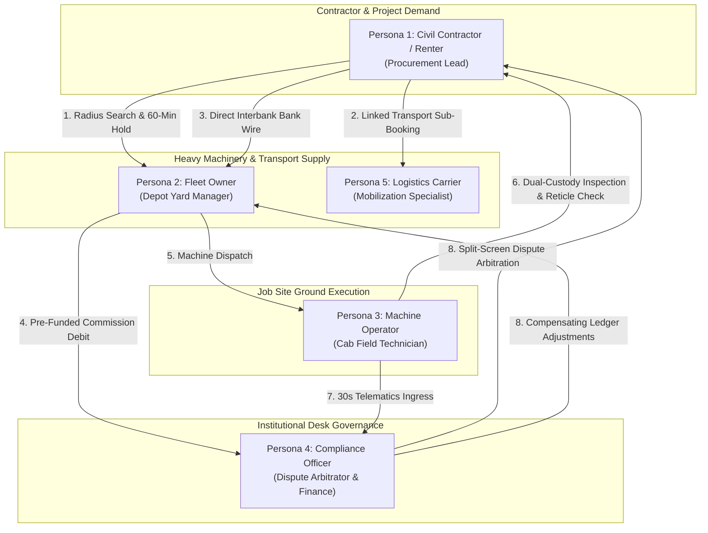

---

## 2. Environmental & Ergonomic Operational Constraints Matrix

The operating conditions of the platform span from corporate finance offices in Addis Ababa to dust-choked quarries outside Mojo where ambient temperatures exceed $38^\circ\text{C}$ and daylight illuminance surpasses $90,000\text{ lux}$.

```text
+----------------------------------------------------------------------------------------------------+
|                         ENVIRONMENTAL & ERGONOMIC CONSTRAINTS MATRIX                               |
+-------------------+--------------------+--------------------+--------------------+-----------------+
| Dimension         | Field Operator     | Fleet Owner        | Civil Contractor   | Desk Arbitrator |
+-------------------+--------------------+--------------------+--------------------+-----------------+
| Physical Context  | Equipment Cab /    | Depot Yard Office /| Job Site Trailer / | Corporate Head- |
|                   | Active Trench      | Pickup Truck       | Regional HQ        | quarters Office |
| Ambient Lighting  | > 80,000 lux       | 2,000–40,000 lux   | 500–50,000 lux     | 300–500 lux     |
|                   | (Direct Sunlight)  | (Partial Shade)    | (Variable Glare)   | (Diffused Fluorescent)|
| Noise Floor       | 95–110 dB          | 70–85 dB           | 60–80 dB           | < 50 dB         |
|                   | (Diesel Engine Cab)| (Truck Traffic)    | (Generators/Comms) | (Quiet Desktop) |
| Tactile Profile   | Heavy Leather      | Bare Hand / Dirty  | Bare Hand / Stylus | Standard Mouse  |
|                   | Work Gloves        | Fingers            |                    | and Keyboard    |
| Screen Condition  | Heavy Dust / Basalt| Light Dust Film /  | Clean Screen /     | Clean Multi-    |
|                   | Grit / Micro-Cracks| Finger Smudges     | Tempered Glass     | Monitor Displays|
| Network Gradient  | Edge Offline / 2G  | Intermittent 3G /  | Variable 3G/4G LTE | High-Speed Fiber|
|                   | (Zero Connectivity)| Local Safaricom LTE| Peering Connection | (100 Mbps EthIO)|
| Stress Profile    | High Kinetic Risk /| High Asset Loss /  | Project Delay /    | Regulatory /    |
|                   | Mechanical Hazard  | Default Anxiety    | Liquidated Damages | Audit Liability |
+-------------------+--------------------+--------------------+--------------------+-----------------+
```

---

## 3. Persona 1: Civil Engineering Contractor / Renter (The Procurement Lead)

### 3.1 Dossier & Demographic Profile

* **Representative Identity:** *Dawit Haile-Mariam* (Addis Ababa / Mojo Expressway Corridor) | *Patrick Kariuki* (Nairobi / Athi River Bypass).
* **Demographics:** Male, 42 years old; BSc in Civil Engineering (Addis Ababa University / University of Nairobi); 18 years in general infrastructure contracting.
* **Organizational Role:** Managing Director / Lead Project Engineer at a mid-tier civil contracting firm ($20\text{M}–150\text{M ETB}$ annual project turnover).
* **Languages Spoken:** Amharic (Native), English (Professional Working), Afaan Oromoo (Conversational).
* **Primary Device:** Samsung Galaxy A54 (Android 14) / Apple iPhone 13; 4G LTE connection with frequent drops when traveling along highway grading sections.

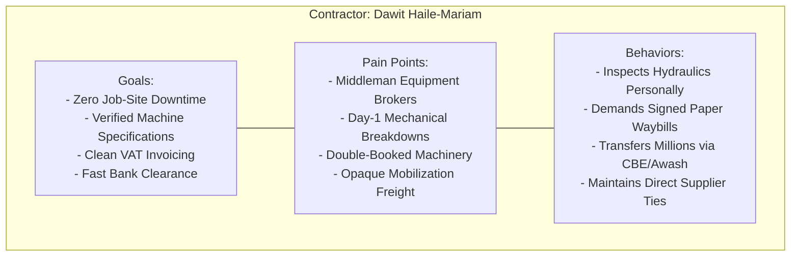

### 3.2 Operational Environment & Technical Context

Dawit operates between a construction site office trailer and the active alignment of an infrastructure project. His screen is frequently smudged with dry red clay dust. He uses mobile banking applications daily (Commercial Bank of Ethiopia CBE Mobile, Awash Birr, Telebirr) and transfers high-value progress payments via direct interbank RTGS/ACH. He understands construction terminology thoroughly but has zero patience for software bugs, ambiguous pricing breakdowns, or broken search filters.

### 3.3 Mental Model, Behavioral Patterns & Primary Goals

* **Primary Goal:** Source a mechanically certified, high-tonnage crawler excavator (e.g., CAT 320D, operating weight $\ge 21,000\text{ kg}$) located within $30\text{ km}$ of his project site, lock the reservation immediately, and confirm the mobilization trailer in a single transaction.
* **Mental Model:** "Equipment brokers are rent-seeking middlemen who promise machines they do not own. If I cannot verify the physical location, the hour meter, and the owner's bank account within 10 minutes, I will call my phone network instead."
* **Fiscal Horizon:** Evaluates daily dry/wet rates strictly in integer minor units inclusive of 15% Ethiopian VAT or 16% Kenyan VAT. Requires immediate formal PDF commercial invoices to clear project accounting audits.

### 3.4 Core Pain Points & Friction Analysis

1. **Broker Phantom Listings:** Traditional equipment brokers advertise machinery that is already leased, undergoing major hydraulic overhauls, or situated $500\text{ km}$ away.
2. **Double-Booking Collisions:** Arriving at a machinery staging yard with a transport truck only to find the owner leased the excavator to another contractor for a cash premium.
3. **Logistics Deadlocks:** Securing a 30-ton excavator but spending 48 hours trying to locate an available multi-axle lowboy trailer with matching road transport permits.
4. **Deposit Loss Anxiety:** Resistance to wiring millions of Birr into a digital escrow wallet managed by an unlicensed software company.

### 3.5 Key User Journeys & Critical Paths

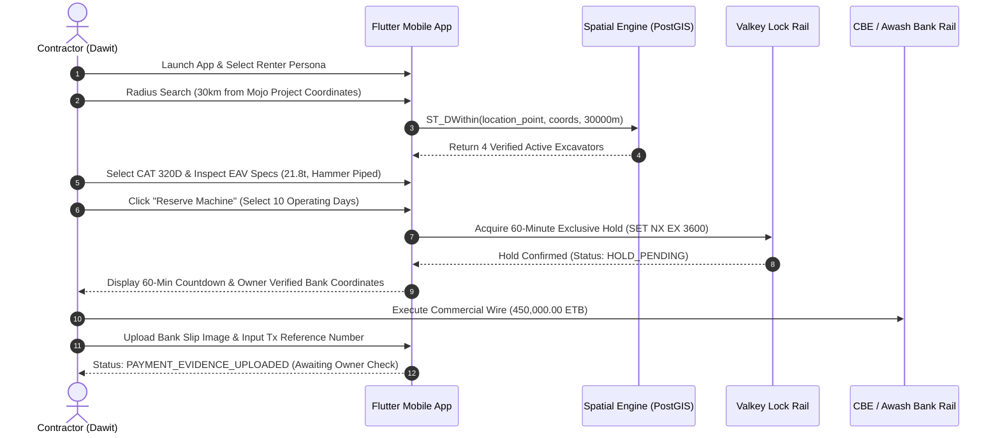

### 3.6 UI/UX Adaptations & Screen Requirements

* **PostGIS Spheroidal Map & Keyset Search:** A map interface centered on his active GPS coordinates with a draggable radius slider ($5\text{–}100\text{ km}$) and instant machine pins colored by equipment category.
* **Specification Comparator:** A dynamic side-by-side technical comparison sheet rendering category-specific mechanical properties (Operating Weight, Gross Engine Horsepower, Max Digging Depth, Hydraulic Flow).
* **Prominent 60-Minute Countdown Clock:** A floating status banner (`components.countdown`) displaying remaining hold time with explicit warnings before releasing the asset to the public queue.
* **Dual-Calendar Date Picker:** Clean toggle switching seamlessly between the **Ethiopian Calendar** (*Tikimt 2019*) and **Gregorian Calendar** (*October 2026*).

---

## 4. Persona 2: Fleet Owner & Depot Yard Manager (The Asset Custodian)

### 4.1 Dossier & Demographic Profile

* **Representative Identity:** *W/ro Almaz Tesfaye* (Kality Transport & Machinery Yard, Addis Ababa) | *Kamau Ndegwa* (Mombasa Road Industrial Yard, Nairobi).
* **Demographics:** Female, 48 years old; Diploma in Accounting & Business Administration; 22 years managing family-owned earthmoving and transport fleets.
* **Organizational Role:** General Manager & Majority Fleet Owner; oversees 14 heavy excavators, 4 motor graders, 6 articulated dump trucks, and 3 lowboy trailers.
* **Languages Spoken:** Amharic (Native), English (Functional Business).
* **Primary Device:** Tecno Camon 20 Pro / Samsung Galaxy A34; operates from a depot desk or the front seat of a Toyota Hilux pickup.

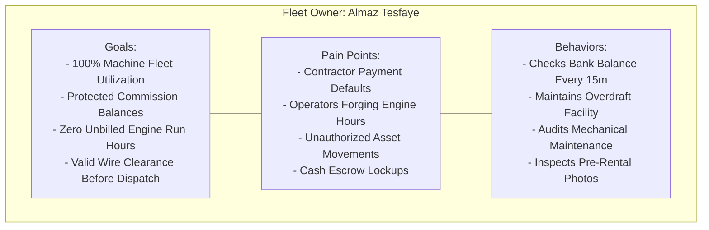

### 4.2 Operational Environment & Technical Context

Almaz works in a metal yard office adjacent to diesel maintenance bays. Heavy trucks idle outside, creating continuous acoustic noise ($75\text{–}85\text{ dB}$). Her hands are often dusty from handling vehicle documents and spare parts. She is financially astute, tracks depreciation meticulously, and checks her commercial bank statements multiple times per day. She refuses to mobilize a 15-million-Birr machine until she sees the full rental prepayment cleared in her verified bank account.

### 4.3 Mental Model, Behavioral Patterns & Primary Goals

* **Primary Goal:** Maximize fleet utilization, ensure every operating hour is captured on the meter, verify contractor bank payments directly on her mobile bank app, and maintain a positive `OwnerWallet` commission balance to avoid listing deactivations.
* **Mental Model:** "My machinery represents my family's life savings. If an excavator works 10 hours, I must be paid for 10 hours. I do not trust digital platforms to hold my money—contractors must wire directly to my Commercial Bank of Ethiopia account."
* **Settlement Invariant:** Relies entirely on `MANUAL_TRANSFER` peer-to-peer verification. Maintains an active overdraft credit buffer (`credit_limit_minor`) on her platform wallet to prevent dispatch delays.

### 4.4 Core Pain Points & Friction Analysis

1. **Renter Payment Defaults:** Contractors promising "check on site delivery," then stalling payment while the machine works active project shifts.
2. **Forged Bank Slips:** Fraudulent contractors editing mobile banking screenshots or reusing transaction reference numbers from previous projects.
3. **Engine Meter Tampering:** Unscrupulous operators or contractors rolling back analog/digital hour meters or running equipment through the night without logging overtime.
4. **Sudden Wallet Deactivations:** Frustration when a platform blocks listings due to zero wallet balances without providing grace periods or transparent debit logs.

### 4.5 Key User Journeys & Critical Paths

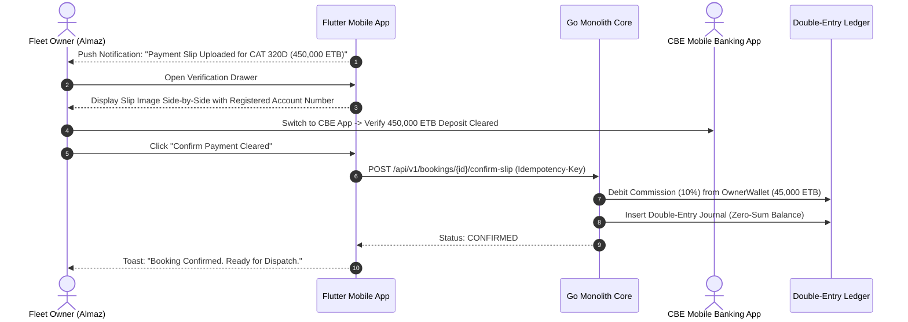

### 4.6 UI/UX Adaptations & Screen Requirements

* **Slip Verification Drawer:** Side-by-side view displaying the uploaded deposit slip against her verified bank account number, expected amount, and payer details.
* **Wallet Balance & Overdraft Indicator:** Prominent visual display of current wallet balance, active credit limit (`credit_limit_minor`), and pending commission debits with one-tap bank top-up instructions.
* **Fleet Availability Calendar:** High-density month/week calendar grid indicating reserved, active, and maintenance blocks across all listed machines.

---

## 5. Persona 3: Certified Equipment Field Operator (The Cab Technician)

### 5.1 Dossier & Demographic Profile

* **Representative Identity:** *Mulugeta Tadesse* (Awash River Bridge Trenching Site) | *Juma Omwamba* (Salgaa Escarpment Earthworks).
* **Demographics:** Male, 31 years old; Heavy Machinery Technical Certification (Akaki Technical College / Kenya Institute of Highways & Building Technology); 9 years in heavy earthmoving operations.
* **Organizational Role:** Lead Excavator & Crane Operator; deployed to project sites for 30-to-90-day tours.
* **Languages Spoken:** Amharic (Native), Afaan Oromoo (Fluent), Basic English.
* **Primary Device:** Transsion Itel A70 / Tecno Pop 7 (Android 13 Go Edition, 2GB RAM, cracked protective film); cellular data connection frequently cuts out in deep trenching cuts.

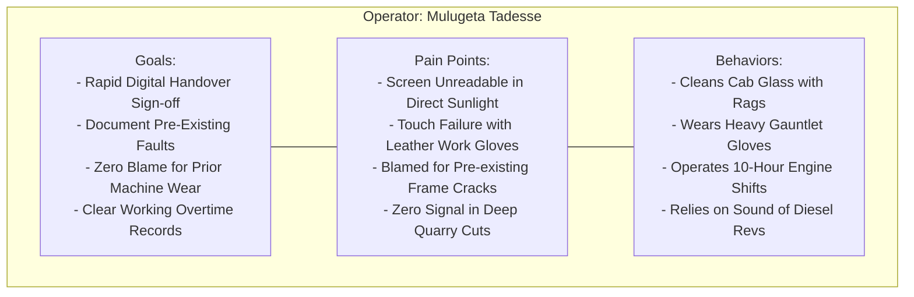

### 5.2 Operational Environment & Physical Constraints

Mulugeta operates inside the cabin of a 22-ton excavator. The diesel engine runs at $102\text{ dB}$, producing constant low-frequency mechanical vibration. His hands are covered in heavy split-leather gauntlet work gloves coated in grease and hydraulic fluid. Outside, ambient sunlight reaches $85,000\text{–}95,000\text{ lux}$. He cannot read low-contrast text, manipulate small dropdown menus, or select tiny icons.

### 5.3 Mental Model, Behavioral Patterns & Primary Goals

* **Primary Goal:** Complete the pre-rental check-in and post-rental check-out inspections in under 3 minutes, accurately record the engine hour meter and fuel gauge, document every scratch and hydraulic leak, and obtain the contractor supervisor’s digital glass signature.
* **Mental Model:** "If I don't photograph this cracked boom cylinder weld before I dig, the owner will deduct the repair cost from my monthly wages. The app must let me snap the damage, sign, and start digging immediately."
* **Ergonomic Invariant:** Must never take off work gloves to interact with the device. Touch targets must be large, physical, and accompanied by tactile and audible feedback.

### 5.4 Core Pain Points & Friction Analysis

1. **Sunlight Glare Blindness:** Modern mobile interfaces with subtle gray borders and light text become completely invisible under midday open-sky conditions.
2. **Glove Touch Mis-taps:** Small buttons ($40\text{–}48\text{ dp}$) lead to accidental cancellations, wrong data entries, and frustration.
3. **Connectivity Blackouts:** Deep road cuts and remote river basins lack cellular signal; apps that freeze or require internet during an inspection halt mobilization.
4. **Hour Meter Disputes:** Renters disputing engine operating hours and accusing operators of fabricating overtime logs.

### 5.5 Key User Journeys & Critical Paths

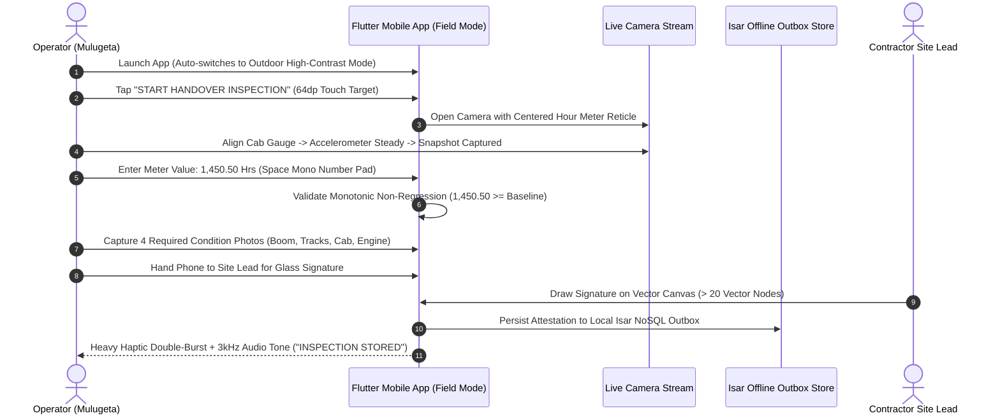

### 5.6 UI/UX Adaptations & Screen Requirements

* **Outdoor High-Contrast Monochrome Mode:** Automated switch via ambient light sensor ($> 25,000\text{ lux}$) to pure black (`#000000`) and high-luminance amber/white (`#FBBF24` / `#FFFFFF`), yielding a **$18:1$** contrast ratio (WCAG 2.2 AAA).
* **$56 \times 56\text{ dp}$ Minimum Hit Target Rule:** All tap areas expanded for heavy leather gloves. Primary actions render at $64\text{dp}$ height.
* **Camera-Only Alignment Reticle:** Direct camera capture with a bright amber bounding box ($320 \times 120\text{ dp}$) locking onto the physical meter. Gallery uploads are disabled.
* **Offline-First Outbox Feedback:** Visual badge confirming inspection records are securely stored locally in Isar NoSQL and queued for background synchronization when connectivity returns.

---

## 6. Persona 4: Back-Office Compliance Officer & Dispute Arbitrator (The Institutional Gatekeeper)

### 6.1 Dossier & Professional Profile

* **Representative Identity:** *Yohannes Bekele* (Dink Machinery Operations HQ, Bole, Addis Ababa) | *Faith Chebet* (Regional Support Centre, Upper Hill, Nairobi).
* **Demographics:** Male, 34 years old; LLB in Law & Postgraduate Diploma in Commercial Arbitration; 7 years experience in corporate logistics contract compliance.
* **Organizational Role:** Senior Operations & Legal Compliance Specialist; exercises binding administrative authority over dispute settlements and wallet overrides.
* **Languages Spoken:** Amharic (Native), English (Fluent / Legal Drafting).
* **Primary Device:** Dual $27\text{''}$ Dell UltraSharp $4\text{K}$ Monitors driven by an M-series Mac Mini or ThinkPad Workstation running Next.js 16 Admin on Chrome/Firefox.

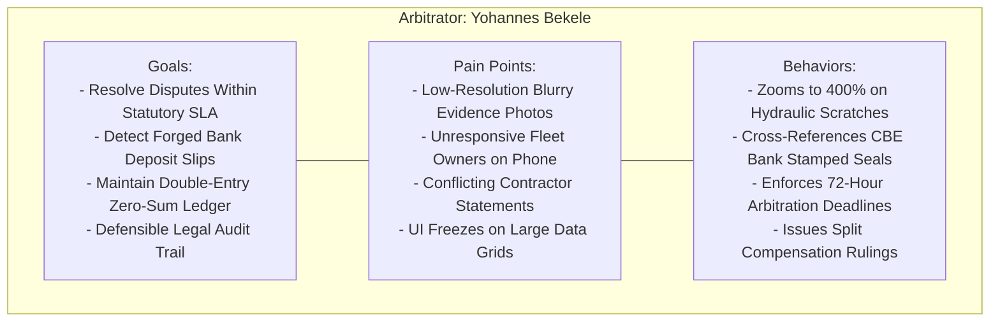

### 6.2 Operational Environment & Technical Context

Yohannes works in a quiet office environment on high-speed internet ($100\text{ Mbps}$ dedicated fiber). He navigates dense tabular datasets, cross-checks interbank wire records, inspects high-resolution damage photographs, and issues legally binding administrative arbitration rulings. He requires dense, keyboard-navigable web software that handles thousands of records without interface lag.

### 6.3 Mental Model, Responsibilities & Primary Goals

* **Primary Goal:** Review disputed bookings, compare pre-rental check-in conditions against post-rental return attestations, audit bank transfer receipts, enforce the statutory dispute SLA (72 hours in Ethiopia, 48 hours in Kenya), and issue balanced financial adjustments.
* **Mental Model:** "Every dispute ruling must be defensible in an Ethiopian court of law or before the Ministry of Revenues. The evidence must be indisputable, and the financial compensating entries must balance to zero minor units."
* **Security & Regulatory Invariant:** Subject to mandatory hardware TOTP multi-factor authentication (`AUTH-04-WEB`) and complete administrative audit logging (`admin_audit_logs`).

### 6.4 Core Pain Points & Friction Analysis

1. **Inconclusive Photo Evidence:** Receiving uncalibrated, blurry, or dark photos that make it impossible to determine if a cracked excavator track plate occurred during the rental period.
2. **SLA Deadlines:** Missing the 72-hour statutory arbitration window due to fragmented communication across WhatsApp, phone calls, and paper notes.
3. **Slow Back-Office Software:** Enterprise web consoles that take 5 seconds to load data tables or crash when opening multiple tabs for dispute analysis.

### 6.5 Key User Journeys & Critical Paths

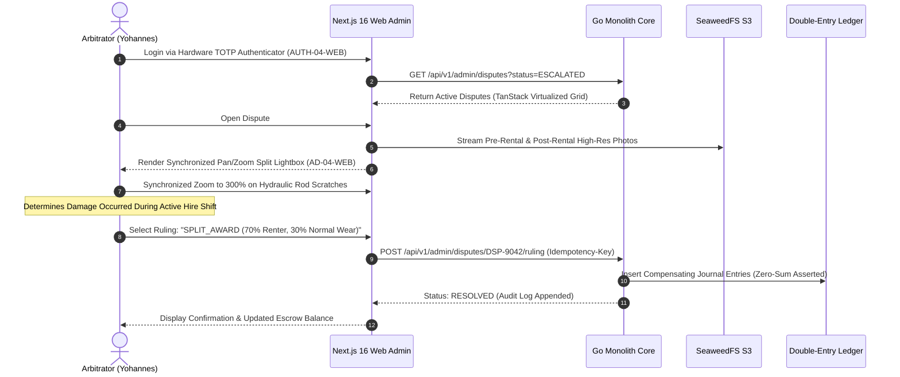

### 6.6 UI/UX Adaptations & Screen Requirements

* **Synchronized Pan/Zoom Dual Lightbox (`AD-04-WEB`):** Side-by-side viewport simultaneously locking cursor pan and zoom coordinates across pre-rental and return photos to inspect hairline fractures and mechanical wear.
* **High-Density Virtualized Data Tables:** TanStack Table v8 rendering thousands of booking rows with instant multi-column filtering, fixed header rails, and inline status tags.
* **SLA Escalation Timers:** Color-coded countdown badges highlighting arbitration cases approaching statutory resolution deadlines ($< 12\text{ hours}$ turns Crimson).

---

## 7. Persona 5: Heavy Transport & Logistics Carrier (The Mobilization Specialist)

### 7.1 Dossier & Commercial Profile

* **Representative Identity:** *Getachew Alemu* (Mojo Dry Port / Modjo–Hawassa Road Corridor).
* **Demographics:** Male, 45 years old; Professional Heavy Vehicle Driving License (Special Grade / Articulated Multi-Axle); 20 years transporting heavy machinery.
* **Organizational Role:** Independent Owner-Operator / Logistics Dispatcher of a 60-ton multi-axle lowboy trailer and prime mover.
* **Languages Spoken:** Amharic (Native), Afaan Oromoo (Fluent).
* **Primary Device:** Transsion Infinix Hot 30 (Android 13); mounted on the dashboard of a SinoTruk prime mover.

### 7.2 Operational Environment & Route Realities

Getachew transports heavy excavators, bulldozers, and drill rigs from regional depot yards to project jobsites. He navigates strict highway weight limits, road clearance permits, bridge load ratings, and tire puncture hazards on unpaved access tracks. He coordinates with crane loading crews and pilot vehicle escorts.

### 7.3 Mental Model & User Journey

* **Mental Model:** "A 30-ton excavator cannot move without my lowboy. If the machine rental cancels, my mobilization trip is wasted unless my freight fee is protected by a cancellation guarantee."
* **Logistics Cascade Invariant:** Relies on the platform's linked sub-booking architecture (`parent_booking_id`), guaranteeing that if a primary equipment booking is cancelled, logistics cancellation terms automatically trigger (`LOG-06`).

### 7.4 UI/UX Adaptations & Sub-Booking Ergonomics

* **Linked Sub-Booking Banner:** Mobile view linking machine dispatch coordinates directly with the lowboy transport reservation.
* **Turn-by-Turn Route Constraints:** Clear display of low-clearance bridges, unpaved terrain warnings, and site GPS drop-off pins.

---

## 8. Cross-Persona Interaction Workflows & Handshake Touchpoints

The primary business value of Dink Machinery emerges at the interface boundaries where different personas must coordinate to move equipment, verify funds, and attest to physical condition.

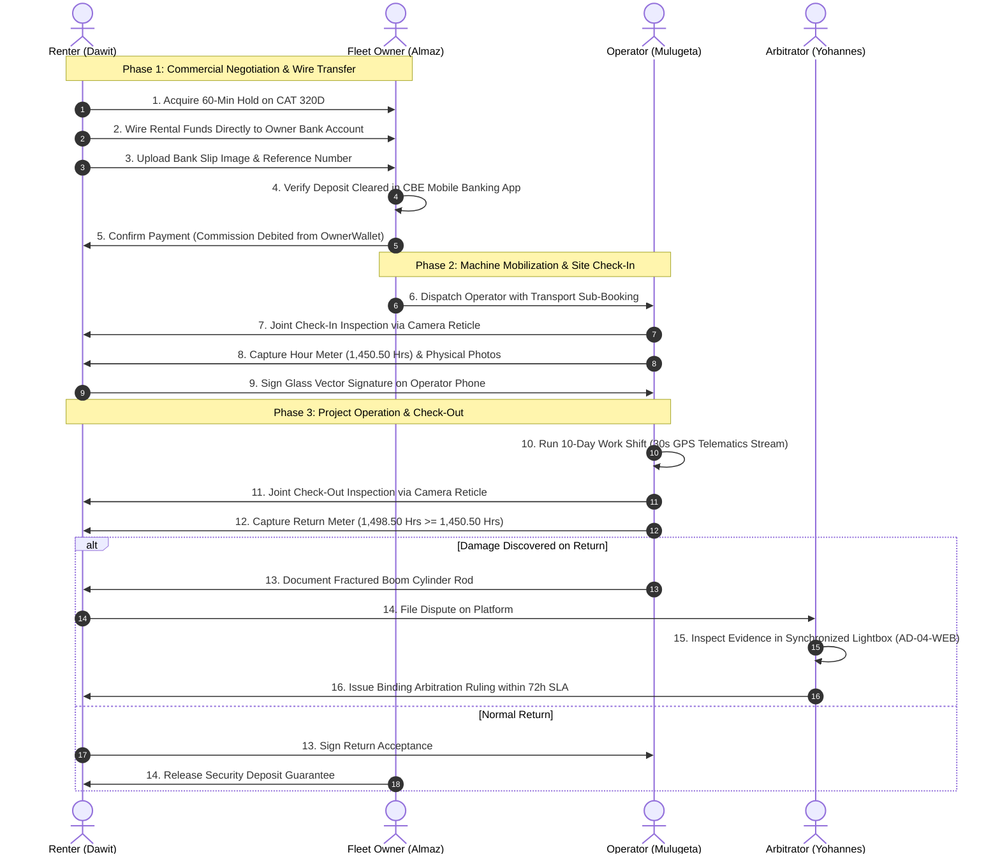

### 8.1 The 20-State Lifecycle Handshake Sequence

The 20-state booking machine coordinates transitions across personas:
1. `DRAFT` $\rightarrow$ `HOLD_PENDING`: **Renter** initiates 60-minute mutual exclusion hold.
2. `HOLD_PENDING` $\rightarrow$ `PAYMENT_EVIDENCE_UPLOADED`: **Renter** uploads bank wire transfer receipt.
3. `PAYMENT_EVIDENCE_UPLOADED` $\rightarrow$ `CONFIRMED`: **Owner** confirms wire receipt; platform debits commission from `OwnerWallet`.
4. `CONFIRMED` $\rightarrow$ `IN_TRANSIT` $\rightarrow$ `CHECKED_IN`: **Operator** and **Renter** complete check-in inspection.
5. `CHECKED_IN` $\rightarrow$ `RETURN_INSPECTION_PENDING` $\rightarrow$ `COMPLETED` / `DISPUTED`: Handover sign-off or escalation to **Arbitrator**.

### 8.2 Direct Interbank Payment & Commission Verification Handshake

Because the platform does not hold rental escrow under NBE directives, financial trust relies on a clean verification handshake:
* Renter sees only the Fleet Owner's verified bank coordinates.
* Renter executes the wire transfer through their own commercial bank channel.
* Owner receives a real-time push alert with the uploaded slip image, verifies the funds in their personal banking app, and taps **Confirm Payment Cleared**.
* The platform atomically debits commission basis points from the owner's pre-funded `OwnerWallet` within an append-only double-entry transaction.

### 8.3 Dual-Custody Physical Handover & Glass Vector Signature

Physical handovers require dual custody:
* The Operator's mobile device acts as the single recording tool at the job site.
* The camera reticle enforces live optical inspection of the machine hour meter and four orthogonal condition perspectives.
* The Contractor's site lead reviews the captured data on the operator's device and draws a vector signature directly on the screen.
* The device validates that the signature contains at least **20 distinct vector path nodes**, records timestamp and GPS coordinates, and saves the attestation to local storage.

---

## 9. Mental Models, Cognitive Load & Behavioral Friction Points

### 9.1 Frontier Trust Deficits & The Peer-to-Peer Transfer Hurdle

In emerging African commercial markets, contractors have significant skepticism toward digital intermediaries holding their funds. 

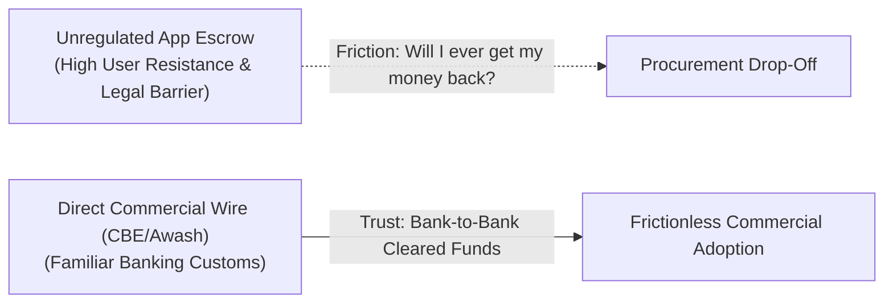

* **Cognitive Barrier:** "If I send money to an app, the company might vanish or freeze my funds."
* **UX Solution:** The interface does not request customer escrow deposits. Instead, it displays the verified commercial bank account name, account number, and branch of the equipment owner. This matches existing enterprise procurement workflows while providing the speed of an automated marketplace.

### 9.2 Fear of Asset Expropriation & Telematics Anxiety

Fleet owners in East Africa operate with genuine concern regarding machinery theft, unauthorized cross-border movement, and illegal night shifts.

* **Cognitive Barrier:** "If an operator takes my 15-million-Birr machine into an active conflict zone or remote quarry, I could lose my asset entirely."
* **UX Solution:** The Owner Dashboard provides real-time breadcrumb mapping updated every 30 seconds, automated boundary breach alerts, and engine run-time totals linked to billable rental hours.

### 9.3 Literacy, Multi-Script Cognitive Load & Optical Stress

Operators and yard staff often possess varying technical literacy, requiring interfaces that communicate state clearly through color, typography, and layout.

* **Typographic Adaptations:** Amharic and Tigrinya text strings require an expanded **$1.38\times$ line-height multiplier** to prevent glyph clipping.
* **Color & Audio Redundancy:** State changes are never communicated by color alone. Every visual indicator combines a distinct icon, high-contrast label, and distinctive audio/haptic tone.

---

## 10. Device Profiles, Connectivity Gradients & UI/UX Adaptations

The design system dynamically adapts to the capabilities of the host device and current network conditions:

```text
+----------------------------------------------------------------------------------------------------+
|                         DEVICE PROFILES & ADAPTATION SPECIFICATIONS                                |
+-----------------------+--------------------+--------------------+----------------------------------+
| Attribute             | Low-End Field Unit | Standard Mobile    | Administrative Workstation       |
+-----------------------+--------------------+--------------------+----------------------------------+
| Reference Hardware    | Itel A70 / Pop 7   | Samsung Galaxy A54 | Desktop PC / Dual 4K Displays    |
| SoC / Memory Profile  | Unisoc T603 / 2GB  | Exynos 1380 / 8GB  | Apple M-Series / Intel Core i7   |
| Viewport Baseline     | 360 x 800 dp       | 390 x 844 dp       | 1920 x 1080 dp (Minimum)         |
| Target Frame Rate     | 30–60 fps          | 60–120 fps         | 60 fps (Virtualized Grids)       |
| Primary Input         | Leather Work Glove | Bare Fingers       | Ergonomic Mouse & Keyboard       |
| Offline Capability    | 100% Outbox Sync   | Standard Caching   | Server-Side Hydration (RSC)      |
| Contrast Profile      | Outdoor High (AAA) | Standard Dynamic   | Standard High-Density Light/Dark |
| Graphic Adaptations   | Zero Box Shadows / | Subtle Elevation / | High-Density Borders /           |
|                       | Solid 2dp Borders  | Smooth Sheets      | Split-Screen Pan/Zoom Lightboxes |
+-----------------------+--------------------+--------------------+----------------------------------+
```

---

## 11. Design Verification Matrix & Usability Testing Protocols

To guarantee that UI implementations perform reliably under real-world conditions, software releases must pass four empirical usability verification gates:

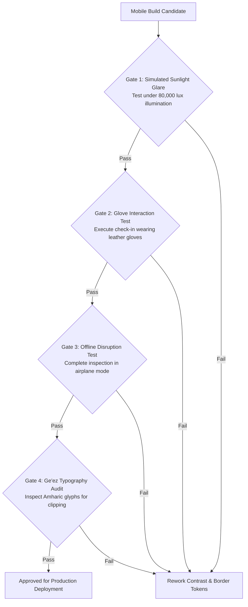

1. **Simulated Solar Glare Test:** The mobile app is placed under a $80,000\text{ lux}$ high-intensity daylight lamp. Testers must be able to read hour meter labels, confirm buttons, and review payment coordinates from an arm's-length distance ($60\text{ cm}$) without squinting.
2. **Glove Touch Accuracy Audit:** Testers wearing standard split-leather construction work gloves execute the complete 7-step inspection sequence. The pass threshold requires zero missed taps and zero accidental cancellations across 20 consecutive trial runs.
3. **Airplane Mode Offline Resilience:** The device is placed in Airplane Mode. A field operator completes a full check-in inspection with 4 photos and a vector signature. The application must save the attestation to local Isar NoSQL storage, present an offline confirmation toast, and automatically sync to the server when network access is restored.
4. **Multi-Script Glyph Integrity Audit:** Quality engineers review every screen in Amharic (`am`) and Afaan Oromoo (`om`), verifying that character ascenders, descenders, and vowel diacritics maintain clear visual separation without horizontal clipping or vertical truncation.

---

*This document defines the canonical user persona models and human factors architecture for Dink Machinery Version 7.0. All downstream Flutter mobile screens, Next.js administrative components, and design assets must strictly adhere to these specifications.*