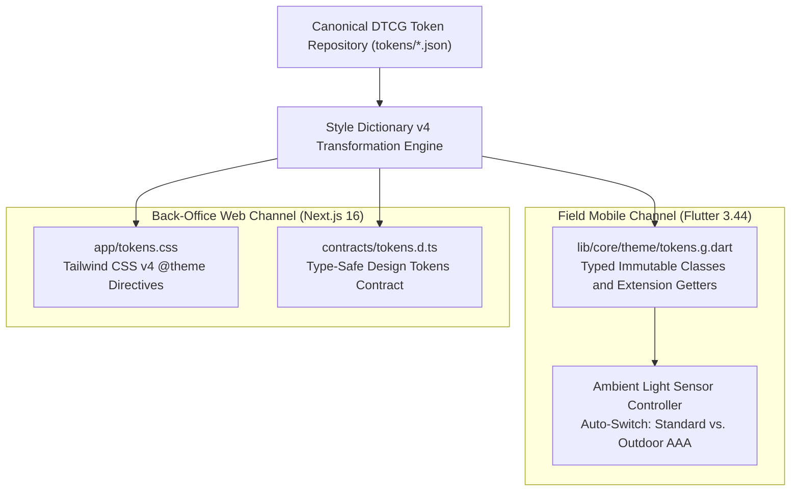
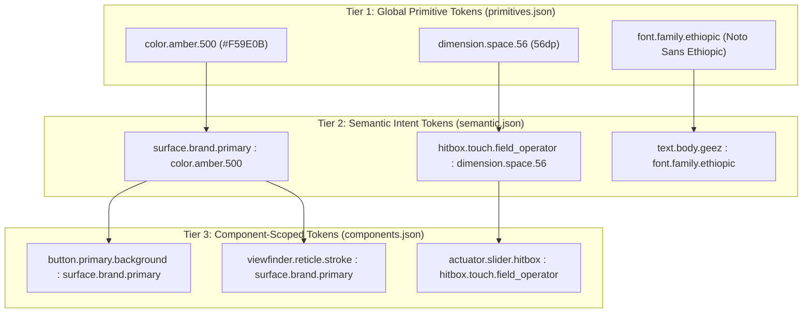
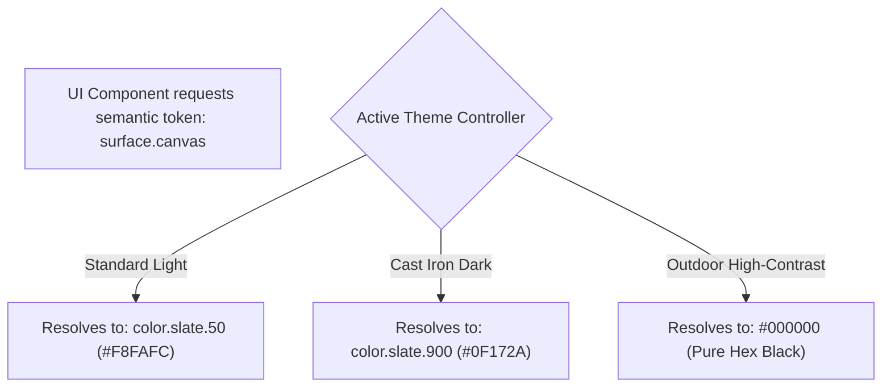
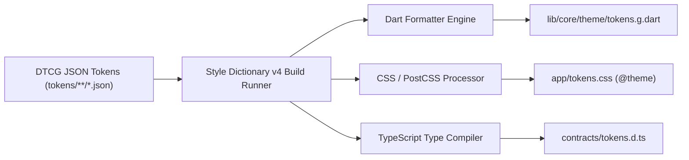
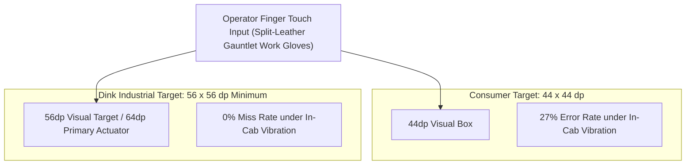
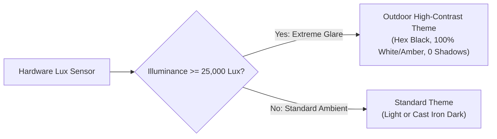
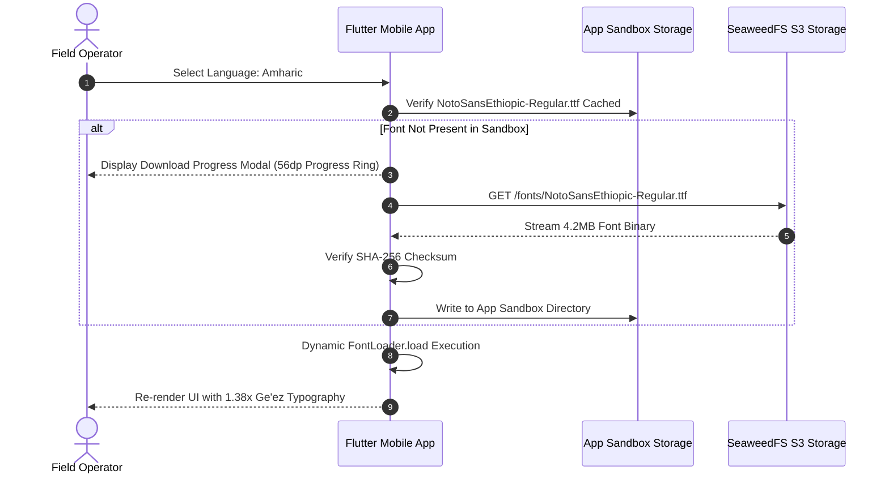
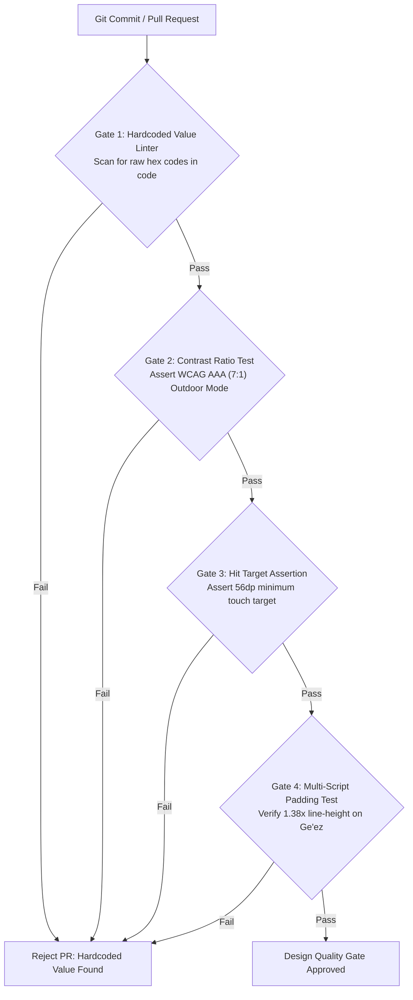

# Heavy Machinery & Logistics Rental Aggregator — Dink Machinery
## Design Specification — 02. Design Tokens, Theming Engine & Accessibility Architecture (`docs/shared/design/02-tokens-and-accessibility.md`)

**Document Identifier:** `DS-TOKENS-DINK-CORE-V7.0`  
**Classification:** Canonical Design Specification & Front-End Engineering Standard (Single Source of Truth)  
**Governing Documents:** `SRS-DINK-CORE-V7.0` (Parts 1–5), `DS-DINK-CORE-V7.0` (Master Design System), `DS-PERSONAS-DINK-CORE-V7.0` (Personas), `ARCH-INTRO-DINK-CORE-V7.0` through `ARCH-ROADMAP-DINK-CORE-V7.0`, `contracts/openapi.yaml`, `ADR-001` through `ADR-014`  
**Target Client Runtimes:** Flutter 3.44 / Dart 3.9 (Mobile), Next.js 16 / React 19 (Admin Web), Tailwind CSS v4, Style Dictionary v4, Radix UI Primitives  
**Target Operating Environments:** Harsh Field Conditions (Direct Sunlight $> 80,000\text{ lux}$, Heavy Basalt Dust, Engine Vibration, Leather Work Gloves) & High-Density Back-Office Desktops  
**Compliance Standards:** W3C Design Tokens Community Group (DTCG) Format, W3C WCAG 2.2 Level AAA (Outdoor Field Mode) & Level AA (Indoor/Admin Mode), ISO 9241-110, ISO 9241-171 (Software Accessibility), Section 508  
**Status:** Approved Engineering Baseline

---

## Table of Contents

- 1. [Executive Summary & Tokenization Strategy](#1-executive-summary--tokenization-strategy)
  - 1.1 [Purpose & Architectural Context](#11-purpose--architectural-context)
  - 1.2 [Design Tokens Community Group (DTCG) Compliance](#12-design-tokens-community-group-dtcg-compliance)
  - 1.3 [Two-Speed Theming: High-Performance Desktop Web & Resilient Field Mobile](#13-two-speed-theming-high-performance-desktop-web--resilient-field-mobile)
- 2. [Design Token Taxonomy & Structural Architecture](#2-design-token-taxonomy--structural-architecture)
  - 2.1 [Three-Tier Token Architecture Hierarchy](#21-three-tier-token-architecture-hierarchy)
  - 2.2 [Canonical Directory Structure & Schema Definitions](#22-canonical-directory-structure--schema-definitions)
  - 2.3 [Token Naming Conventions & DTCG Syntax Standards](#23-token-naming-conventions--dtcg-syntax-standards)
- 3. [Global Primitive Token Definitions (`primitives.json`)](#3-global-primitive-token-definitions-primitivesjson)
  - 3.1 [Color Primitives (Amber, Slate, Emerald, Crimson, Safety Orange)](#31-color-primitives-amber-slate-emerald-crimson-safety-orange)
  - 3.2 [Spatial Scale & Layout Grids (8dp Base Grid & 4dp Half-Steps)](#32-spatial-scale--layout-grids-8dp-base-grid--4dp-half-steps)
  - 3.3 [Typographic Primitives (Font Families, Modular Type Scale, Line Heights)](#33-typographic-primitives-font-families-modular-type-scale-line-heights)
  - 3.4 [Motion & Duration Primitives (Easings, Milliseconds, Haptic Curves)](#34-motion--duration-primitives-easings-milliseconds-haptic-curves)
  - 3.5 [Elevation, Border Radius & Stroke Primitives](#35-elevation-border-radius--stroke-primitives)
- 4. [Semantic Token System & Multi-Theme Aliasing (`semantic.json`)](#4-semantic-token-system--multi-theme-aliasing-semanticjson)
  - 4.1 [Surface & Background Semantics (Canvas, Card, Overlay, Dialog)](#41-surface--background-semantics-canvas-card-overlay-dialog)
  - 4.2 [Interactive Action Semantics (Primary, Secondary, Destructive, Muted)](#42-interactive-action-semantics-primary-secondary-destructive-muted)
  - 4.3 [Content & Typography Semantics (Headings, Body, Captions, Numeric Ledgers)](#43-content--typography-semantics-headings-body-captions-numeric-ledgers)
  - 4.4 [Feedback & Status Semantics (The 20-State Booking Indicators, Alert Banners)](#44-feedback--status-semantics-the-20-state-booking-indicators-alert-banners)
- 5. [Component-Scoped Design Tokens (`components.json`)](#5-component-scoped-design-tokens-componentsjson)
  - 5.1 [Industrial Actuator Buttons & Sliders](#51-industrial-actuator-buttons--sliders)
  - 5.2 [Inspection Viewfinder Reticles & Camera Gauge Frames](#52-inspection-viewfinder-reticles--camera-gauge-frames)
  - 5.3 [TanStack Table & High-Density Admin Grid Tokens](#53-tanstack-table--high-density-admin-grid-tokens)
  - 5.4 [The 60-Minute Valkey Countdown Timer Component](#54-the-60-minute-valkey-countdown-timer-component)
  - 5.5 [Split-Screen Synchronized Lightbox (`AD-04-WEB`)](#55-split-screen-synchronized-lightbox-ad-04-web)
  - 5.6 [Glass Vector Touch Signature Canvas](#56-glass-vector-touch-signature-canvas)
- 6. [Multi-Platform Compilation Pipeline](#6-multi-platform-compilation-pipeline)
  - 6.1 [Style Dictionary Architecture & Build Graph](#61-style-dictionary-architecture--build-graph)
  - 6.2 [Target Compilation: Flutter Dart (`lib/core/theme/tokens.g.dart`)](#62-target-compilation-flutter-dart-libcorethemetokensgdart)
  - 6.3 [Target Compilation: Tailwind CSS v4 (`tokens.css` / `@theme`)](#63-target-compilation-tailwind-css-v4-tokenscss--theme)
  - 6.4 [Target Compilation: TypeScript Design Token Contract (`tokens.d.ts`)](#64-target-compilation-typescript-design-token-contract-tokensdts)
- 7. [Accessibility Architecture (WCAG 2.2 AAA & AA)](#7-accessibility-architecture-wcag-22-aaa--aa)
  - 7.1 [Dual-Tier Compliance Standard (Outdoor Field AAA vs. Indoor Admin AA)](#71-dual-tier-compliance-standard-outdoor-field-aaa-vs-indoor-admin-aa)
  - 7.2 [Mathematical Contrast Verification ($\ge 7:1$, $\ge 4.5:1$, $\ge 18:1$ Peak Glare)](#72-mathematical-contrast-verification-ge-71-ge-451-ge-181-peak-glare)
  - 7.3 [Touch Ergonomics: The $56 \times 56\text{ dp}$ Minimum Hit Target Standard](#73-touch-ergonomics-the-56-times-56text-dp-minimum-hit-target-standard)
  - 7.4 [Focus Management, Keyboard Navigation & Screen Reader Announcers](#74-focus-management-keyboard-navigation--screen-reader-announcers)
- 8. [Dynamic Lighting & Environmental Adaptation Engines](#8-dynamic-lighting--environmental-adaptation-engines)
  - 8.1 [Outdoor High-Contrast Mode (Zero Gradients, Hex Black, Solid Reticles)](#81-outdoor-high-contrast-mode-zero-gradients-hex-black-solid-reticles)
  - 8.2 [Ambient Light Sensor Auto-Switching Engine (Hysteresis: 25,000 / 18,000 Lux)](#82-ambient-light-sensor-auto-switching-engine-hysteresis-25000--18000-lux)
  - 8.3 [Night Shift Mode for Heavy Vehicle Cabs](#83-night-shift-mode-for-heavy-vehicle-cabs)
- 9. [Multi-Script Typography & Non-Latin Font Ergonomics](#9-multi-script-typography--non-latin-font-ergonomics)
  - 9.1 [Ethiopic (Ge'ez) Typographic Line-Height Engine ($1.38\times$ Multiplier)](#91-ethiopic-geez-typographic-line-height-engine-138times-multiplier)
  - 9.2 [Dynamic Over-The-Air (OTA) Font Loading Pipeline (`ADR-013`)](#92-dynamic-over-the-air-ota-font-loading-pipeline-adr-013)
  - 9.3 [Monospaced Tabular Numeric Alignment for Minor Units](#93-monospaced-tabular-numeric-alignment-for-minor-units)
- 10. [Tactile, Haptic & Acoustic Signaling Architecture](#10-tactile-haptic--acoustic-signaling-architecture)
  - 10.1 [Industrial Haptic Vibration Sequences for Leather Work Gloves](#101-industrial-haptic-vibration-sequences-for-leather-work-gloves)
  - 10.2 [Acoustic Frequency Profiles for Diesel Noise Environments ($2.5\text{–}3.5\text{ kHz}$)](#102-acoustic-frequency-profiles-for-diesel-noise-environments-25text35text-khz)
- 11. [Governance, CI/CD Quality Gates & Automated Token Linting](#11-governance-cicd-quality-gates--automated-token-linting)
  - 11.1 [Automated Token Compliance Linters (Zero Hardcoded Values)](#111-automated-token-compliance-linters-zero-hardcoded-values)
  - 11.2 [Headless Contrast Ratio Assertion Tests (Axe Core & Golden Ratio Tests)](#112-headless-contrast-ratio-assertion-tests-axe-core--golden-ratio-tests)
  - 11.3 [Touch Target Bounding Box Assertion Tests](#113-touch-target-bounding-box-assertion-tests)

---

## 1. Executive Summary & Tokenization Strategy

### 1.1 Purpose & Architectural Context

The Dink Machinery digital platform mediates heavy physical assets, field operations, and high-value financial settlements. User interaction spans high-end desktop workstations running multi-monitor web applications down to entry-level Android smartphones operated inside vibrating machine cabs under harsh sunlight.

To ensure consistency across heterogeneous platforms, the system implements a unified **Design Token Architecture**. Design tokens replace hardcoded styling variables (colors, dimensions, paddings, fonts, animations) with central, versioned, platform-agnostic data definitions. 

By treating design tokens as a single source of truth (SSOT), the platform guarantees:
1. **Zero Design Drift:** Mobile (Flutter) and Web (Next.js/Tailwind) render pixel-identical brand colors, spatial margins, and typography.
2. **Instant Environmental Adaptability:** Display themes shift seamlessly between Standard Light, Cast Iron Dark, and Outdoor High-Contrast ($> 80,000\text{ lux}$) modes via token alias re-mappings.
3. **Automated Accessibility Verification:** Minimum contrast ratios ($\ge 7:1$ for outdoor mode, $\ge 4.5:1$ for office mode) and hit target sizes ($\ge 56\text{dp}$) are mathematically validated during CI/CD builds.

### 1.2 Design Tokens Community Group (DTCG) Compliance

All token files conform to the **W3C Design Tokens Community Group (DTCG)** specification. Every token declaration must provide:
* `$value`: The explicit literal or referenced alias value.
* `$type`: The semantic type identifier (e.g., `color`, `dimension`, `duration`, `cubicBezier`, `fontFamily`, `fontWeight`, `number`).
* `$description`: Human-readable engineering documentation explaining operational intent and regulatory constraints.

### 1.3 Two-Speed Theming: High-Performance Desktop Web & Resilient Field Mobile



* **Desktop Web (Next.js 16 / React 19 RSC):** Compiles tokens into native CSS variables consumed by Tailwind CSS v4. Prioritizes data density, sub-millisecond table virtualization, split-screen arbitration lightboxes, and keyboard focus outlines conforming to WCAG 2.2 AA.
* **Field Mobile (Flutter 3.44 / Dart 3.9):** Compiles tokens into immutable Dart constants and dynamic `ThemeExtension<T>` classes. Prioritizes sunlight legibility (WCAG 2.2 AAA $\ge 7:1$), glove-friendly touch targets ($56\times 56\text{ dp}$), tactile haptics, and live sensor-driven theme switching.

---

## 2. Design Token Taxonomy & Structural Architecture

### 2.1 Three-Tier Token Architecture Hierarchy

The token system enforces a strict three-tier hierarchy. Downstream UI components must never consume Tier 1 Global Primitives directly; they must bind exclusively to Tier 2 Semantic Intent or Tier 3 Component-Scoped tokens.



1. **Tier 1: Global Primitive Tokens (`primitives.json`):** Literal values representing the foundational palette, spacing scales, type sizes, animation curves, and elevation levels. They have no contextual meaning.
2. **Tier 2: Semantic Intent Tokens (`semantic.json`):** Contextual aliases that assign operational roles to primitives (e.g., `surface.canvas`, `text.primary`, `status.danger`). Semantic tokens vary by theme mode (Light, Dark, Outdoor High-Contrast).
3. **Tier 3: Component-Scoped Tokens (`components.json`):** Highly specific bindings applied to isolated widget components (e.g., `button.primary.height`, `countdown.timer.critical.bg`).

### 2.2 Canonical Directory Structure & Schema Definitions

```text
tokens/
├── primitives/
│   ├── color.json             # Raw hex color scales (Amber, Slate, Emerald, Crimson)
│   ├── space.json             # 8dp base spacing units and half-steps
│   ├── typography.json        # Type scales, font families, and line-height factors
│   ├── motion.json            # Easing curves, animation durations, and haptic IDs
│   └── elevation.json         # Shadow definitions, border widths, and radii
├── semantic/
│   ├── light.json             # Standard Light Mode semantic mappings
│   ├── dark.json              # Cast Iron Dark Mode semantic mappings
│   └── outdoor-contrast.json  # Outdoor High-Contrast Mode mappings (WCAG AAA)
├── components/
│   ├── button.json            # Industrial actuator buttons and sliders
│   ├── reticle.json           # Camera inspection viewfinder frames
│   ├── table.json             # High-density admin grid metrics
│   ├── countdown.json         # 60-minute reservation hold timers
│   └── dispute-lightbox.json  # Split-screen synchronized image comparison tools
└── config.json                # Style Dictionary build targets and transformation rules
```

### 2.3 Token Naming Conventions & DTCG Syntax Standards

Token identifiers use dot-separated kebab-case segments structured by domain:

$$\text{Format: } \langle\text{category}\rangle.\langle\text{concept}\rangle.\langle\text{property}\rangle.\langle\text{variant/state}\rangle$$

* *Good:* `color.brand.amber.500`, `surface.card.elevated.active`, `button.primary.hitbox.height`
* *Bad:* `btnColor`, `amberYellow_light`, `my-padding-12`

---

## 3. Global Primitive Token Definitions (`primitives.json`)

### 3.1 Color Primitives (Amber, Slate, Emerald, Crimson, Safety Orange)

The color palette reflects the machinery operating environment while maintaining readability across diverse display hardware:

```json
{
  "color": {
    "brand": {
      "amber": {
        "50":  { "$value": "#FFFBEB", "$type": "color", "$description": "Subtle highlight tint" },
        "100": { "$value": "#FEF3C7", "$type": "color", "$description": "Warning background fill" },
        "200": { "$value": "#FDE68A", "$type": "color", "$description": "Muted container accent" },
        "300": { "$value": "#FCD34D", "$type": "color", "$description": "Secondary brand accent" },
        "400": { "$value": "#FBBF24", "$type": "color", "$description": "High-luminance glare yellow" },
        "500": { "$value": "#F59E0B", "$type": "color", "$description": "Core construction equipment amber" },
        "600": { "$value": "#D97706", "$type": "color", "$description": "Interactive focus and hover amber" },
        "700": { "$value": "#B45309", "$type": "color", "$description": "High-contrast tactile border" },
        "800": { "$value": "#92400E", "$type": "color", "$description": "Deep industrial shadow amber" },
        "900": { "$value": "#78350F", "$type": "color", "$description": "Maximum density amber text" }
      },
      "slate": {
        "50":  { "$value": "#F8FAFC", "$type": "color", "$description": "Daylight canvas backdrop" },
        "100": { "$value": "#F1F5F9", "$type": "color", "$description": "Table alternating zebra row" },
        "200": { "$value": "#E2E8F0", "$type": "color", "$description": "Standard division border" },
        "300": { "$value": "#CBD5E1", "$type": "color", "$description": "Muted border line" },
        "400": { "$value": "#94A3B8", "$type": "color", "$description": "Placeholder content text" },
        "500": { "$value": "#64748B", "$type": "color", "$description": "Secondary metadata text" },
        "600": { "$value": "#475569", "$type": "color", "$description": "Muted body text" },
        "700": { "$value": "#334155", "$type": "color", "$description": "Subdued industrial surface" },
        "800": { "$value": "#1E293B", "$type": "color", "$description": "Elevated card dark surface" },
        "900": { "$value": "#0F172A", "$type": "color", "$description": "Cast iron base dark surface" },
        "950": { "$value": "#020617", "$type": "color", "$description": "Blackout high-contrast canvas" }
      }
    },
    "feedback": {
      "emerald": {
        "500": { "$value": "#10B981", "$type": "color", "$description": "Active booking / verified payment" },
        "700": { "$value": "#047857", "$type": "color", "$description": "Accessible high-contrast green" }
      },
      "crimson": {
        "500": { "$value": "#EF4444", "$type": "color", "$description": "Error alert / cancelled booking" },
        "700": { "$value": "#B91C1C", "$type": "color", "$description": "Accessible high-contrast red" }
      },
      "orange": {
        "500": { "$value": "#FF5722", "$type": "color", "$description": "Safety hazard / action required" }
      }
    }
  }
}
```

### 3.2 Spatial Scale & Layout Grids (8dp Base Grid & 4dp Half-Steps)

Layout calculations follow an 8dp baseline grid ($4\text{dp}$ used strictly for compact half-step alignments):

```json
{
  "dimension": {
    "space": {
      "2":  { "$value": "2dp",  "$type": "dimension", "$description": "Micro border offset" },
      "4":  { "$value": "4dp",  "$type": "dimension", "$description": "Tight badge padding and icon inset" },
      "8":  { "$value": "8dp",  "$type": "dimension", "$description": "Baseline grid element padding" },
      "12": { "$value": "12dp", "$type": "dimension", "$description": "Input field vertical inner padding" },
      "16": { "$value": "16dp", "$type": "dimension", "$description": "Card interior inset and standard gutter" },
      "24": { "$value": "24dp", "$type": "dimension", "$description": "Section separation and screen margins" },
      "32": { "$value": "32dp", "$type": "dimension", "$description": "Major module boundary separation" },
      "48": { "$value": "48dp", "$type": "dimension", "$description": "Header margin and modal inset" },
      "56": { "$value": "56dp", "$type": "dimension", "$description": "Mandatory gloved touch target baseline" },
      "64": { "$value": "64dp", "$type": "dimension", "$description": "Primary action actuator button height" }
    }
  }
}
```

### 3.3 Typographic Primitives (Font Families, Modular Type Scale, Line Heights)

```json
{
  "typography": {
    "fontFamily": {
      "latin": { "$value": "Roboto, -apple-system, sans-serif", "$type": "fontFamily" },
      "ethiopic": { "$value": "Noto Sans Ethiopic, sans-serif", "$type": "fontFamily" },
      "mono": { "$value": "Space Mono, monospace", "$type": "fontFamily" }
    },
    "fontSize": {
      "12": { "$value": "12sp", "$type": "dimension" },
      "14": { "$value": "14sp", "$type": "dimension" },
      "16": { "$value": "16sp", "$type": "dimension" },
      "18": { "$value": "18sp", "$type": "dimension" },
      "20": { "$value": "20sp", "$type": "dimension" },
      "24": { "$value": "24sp", "$type": "dimension" },
      "28": { "$value": "28sp", "$type": "dimension" },
      "32": { "$value": "32sp", "$type": "dimension" }
    },
    "lineHeightFactor": {
      "latinStandard": { "$value": 1.25, "$type": "number", "$description": "Standard Latin text multiplier" },
      "ethiopicGolden": { "$value": 1.38, "$type": "number", "$description": "Minimum Ge'ez vowel diacritic multiplier" },
      "ethiopicBody": { "$value": 1.45, "$type": "number", "$description": "Ge'ez dense paragraph multiplier" }
    }
  }
}
```

### 3.4 Motion & Duration Primitives (Easings, Milliseconds, Haptic Curves)

Animations use purposeful, decelerating curves to communicate physical stability. Floating or elastic springs are prohibited:

```json
{
  "motion": {
    "duration": {
      "instant": { "$value": "0ms",   "$type": "duration", "$description": "Active in reduced motion mode" },
      "fast":    { "$value": "150ms", "$type": "duration", "$description": "Button tap and switch transitions" },
      "normal":  { "$value": "250ms", "$type": "duration", "$description": "Sheet expansions and drawer slides" },
      "slow":    { "$value": "350ms", "$type": "duration", "$description": "Modal entries and screen cross-fades" }
    },
    "easing": {
      "industrialDecelerate": {
        "$value": [0.2, 0.0, 0.0, 1.0],
        "$type": "cubicBezier",
        "$description": "Heavy physical actuator deceleration curve"
      },
      "standard": {
        "$value": [0.4, 0.0, 0.2, 1.0],
        "$type": "cubicBezier",
        "$description": "Standard UI layout morph curve"
      }
    }
  }
}
```

### 3.5 Elevation, Border Radius & Stroke Primitives

```json
{
  "elevation": {
    "card": {
      "$value": {
        "offsetX": "0dp", "offsetY": "2dp", "blur": "4dp", "spread": "0dp",
        "color": "rgba(15, 23, 42, 0.08)"
      },
      "$type": "shadow"
    },
    "modal": {
      "$value": {
        "offsetX": "0dp", "offsetY": "8dp", "blur": "24dp", "spread": "0dp",
        "color": "rgba(15, 23, 42, 0.16)"
      },
      "$type": "shadow"
    }
  },
  "stroke": {
    "border": {
      "thin":   { "$value": "1dp", "$type": "dimension" },
      "medium": { "$value": "2dp", "$type": "dimension" },
      "heavy":  { "$value": "3dp", "$type": "dimension" }
    },
    "radius": {
      "none":  { "$value": "0dp",  "$type": "dimension" },
      "sharp": { "$value": "4dp",  "$type": "dimension" },
      "soft":  { "$value": "8dp",  "$type": "dimension" },
      "pill":  { "$value": "999dp", "$type": "dimension" }
    }
  }
}
```

---

## 4. Semantic Token System & Multi-Theme Aliasing (`semantic.json`)

Semantic tokens resolve dynamically according to the active theme mode:



### 4.1 Surface & Background Semantics (Canvas, Card, Overlay, Dialog)

| Semantic Token | Standard Light Mode | Cast Iron Dark Mode | Outdoor High-Contrast Mode (AAA) |
|---|---|---|---|
| `surface.canvas` | `{color.brand.slate.50}` | `{color.brand.slate.900}` | `#000000` (Pure Hex Black) |
| `surface.card` | `#FFFFFF` | `{color.brand.slate.800}` | `#000000` (2dp Solid White Border) |
| `surface.card.elevated` | `#FFFFFF` (Shadow) | `{color.brand.slate.700}` | `#000000` (3dp Solid Amber Border) |
| `surface.overlay` | `rgba(15, 23, 42, 0.6)` | `rgba(2, 6, 23, 0.85)` | `rgba(0, 0, 0, 0.95)` |
| `surface.brand.primary`| `{color.brand.amber.500}` | `{color.brand.amber.500}` | `{color.brand.amber.400}` |

### 4.2 Interactive Action Semantics (Primary, Secondary, Destructive, Muted)

| Semantic Token | Standard Light Mode | Cast Iron Dark Mode | Outdoor High-Contrast Mode (AAA) |
|---|---|---|---|
| `action.primary.bg` | `{color.brand.amber.500}` | `{color.brand.amber.500}` | `{color.brand.amber.400}` |
| `action.primary.text` | `{color.brand.slate.950}` | `{color.brand.slate.950}` | `#000000` (100% Solid Black) |
| `action.primary.border` | `{color.brand.amber.600}` (3dp bottom) | `{color.brand.amber.700}` (3dp bottom) | `#FFFFFF` (2dp Solid Envelope) |
| `action.destructive.bg` | `{color.feedback.crimson.500}` | `{color.feedback.crimson.700}` | `#000000` (Crimson Border) |
| `action.destructive.text`| `#FFFFFF` | `#FFFFFF` | `{color.feedback.crimson.500}` |

### 4.3 Content & Typography Semantics (Headings, Body, Captions, Numeric Ledgers)

| Semantic Token | Standard Light Mode | Cast Iron Dark Mode | Outdoor High-Contrast Mode (AAA) |
|---|---|---|---|
| `text.primary` | `{color.brand.slate.900}` | `{color.brand.slate.50}` | `#FFFFFF` (Pure Solid White) |
| `text.secondary` | `{color.brand.slate.600}` | `{color.brand.slate.400}` | `{color.brand.slate.200}` |
| `text.muted` | `{color.brand.slate.500}` | `{color.brand.slate.500}` | `{color.brand.slate.300}` |
| `text.brand` | `{color.brand.amber.600}` | `{color.brand.amber.400}` | `{color.brand.amber.400}` |
| `text.numeric.ledger` | `{color.brand.slate.950}` (Mono) | `{color.brand.slate.50}` (Mono) | `#FFFFFF` (Mono Bold) |

### 4.4 Feedback & Status Semantics (The 20-State Booking Indicators, Alert Banners)

Every booking state maps to a deterministic status container token pair:

```text
+------------------------------------------------------------------------------------+
|                         STATUS TOKEN ASSIGNMENT MATRIX                             |
+----------------------+--------------------+--------------------+-------------------+
| Booking State Group  | Background Token   | Border Token       | Text Token        |
+----------------------+--------------------+--------------------+-------------------+
| Hold & Submissions   | status.amber.bg    | status.amber.border| status.amber.text |
| (DRAFT, HOLD_PENDING)| (#FFFBEB / #451A03)| (#F59E0B)          | (#B45309/#FDE68A) |
|                      |                    |                    |                   |
| Direct Bank Check    | status.blue.bg     | status.blue.border | status.blue.text  |
| (PAYMENT_UPLOADED)   | (#EFF6FF / #172554)| (#3B82F6)          | (#1D4ED8/#BFDBFE) |
|                      |                    |                    |                   |
| Confirmed & In-Hire  | status.emerald.bg  | status.emerald.bord| status.emerald.txt|
| (CONFIRMED, IN_HIRE) | (#ECFDF5 / #052E16)| (#10B981)          | (#047857/#A7F3D0) |
|                      |                    |                    |                   |
| Arbitration & Dispute| status.purple.bg   | status.purple.bord | status.purple.txt |
| (DISPUTED, ESCALATED)| (#FAF5FF / #3B0764)| (#A855F7)          | (#7E22CE/#E9D5FF) |
|                      |                    |                    |                   |
| Terminal / Cancelled | status.slate.bg    | status.slate.border| status.slate.text |
| (COMPLETED, CANCEL)  | (#F1F5F9 / #0F172A)| (#64748B)          | (#334155/#CBD5E1) |
+----------------------+--------------------+--------------------+-------------------+
```

---

## 5. Component-Scoped Design Tokens (`components.json`)

### 5.1 Industrial Actuator Buttons & Sliders

```json
{
  "component": {
    "actuator": {
      "button": {
        "heightStandard":   { "$value": "{dimension.space.56}", "$type": "dimension" },
        "heightField":      { "$value": "{dimension.space.64}", "$type": "dimension" },
        "borderRadius":     { "$value": "{stroke.radius.soft}",  "$type": "dimension" },
        "bottomTactileLip": { "$value": "{stroke.border.heavy}", "$type": "dimension" },
        "focusOutlineWidth":{ "$value": "{stroke.border.heavy}", "$type": "dimension" }
      },
      "slider": {
        "trackHeight":  { "$value": "{dimension.space.64}", "$type": "dimension" },
        "thumbDimension":{ "$value": "{dimension.space.56}", "$type": "dimension" },
        "accentColor":  { "$value": "{color.feedback.orange.500}", "$type": "color" }
      }
    }
  }
}
```

### 5.2 Inspection Viewfinder Reticles & Camera Gauge Frames

```json
{
  "component": {
    "reticle": {
      "viewfinder": {
        "width":        { "$value": "320dp", "$type": "dimension" },
        "height":       { "$value": "120dp", "$type": "dimension" },
        "strokeDefault":{ "$value": "{stroke.border.medium}", "$type": "dimension" },
        "strokeOutdoor":{ "$value": "{stroke.border.heavy}",  "$type": "dimension" },
        "colorIdle":    { "$value": "{color.brand.amber.500}", "$type": "color" },
        "colorLocked":  { "$value": "{color.feedback.emerald.500}", "$type": "color" }
      }
    }
  }
}
```

### 5.3 TanStack Table & High-Density Admin Grid Tokens

```json
{
  "component": {
    "table": {
      "headerHeight":  { "$value": "{dimension.space.48}", "$type": "dimension" },
      "rowHeightDense":{ "$value": "40dp",                 "$type": "dimension" },
      "rowHeightNormal":{ "$value": "{dimension.space.56}", "$type": "dimension" },
      "cellPaddingX":  { "$value": "{dimension.space.16}", "$type": "dimension" },
      "borderBottom":  { "$value": "{stroke.border.thin}", "$type": "dimension" }
    }
  }
}
```

### 5.4 The 60-Minute Valkey Countdown Timer Component

```json
{
  "component": {
    "countdown": {
      "holdNormalBg":   { "$value": "{color.brand.amber.50}", "$type": "color" },
      "holdNormalText": { "$value": "{color.brand.amber.900}", "$type": "color" },
      "holdUrgentBg":   { "$value": "#FFF7ED", "$type": "color", "$description": "Warning 15m remaining" },
      "holdUrgentText": { "$value": "#C2410C", "$type": "color" },
      "holdCriticalBg": { "$value": "#FEF2F2", "$type": "color", "$description": "Critical 5m remaining" },
      "holdCriticalText":{ "$value": "{color.feedback.crimson.700}", "$type": "color" }
    }
  }
}
```

### 5.5 Split-Screen Synchronized Lightbox (`AD-04-WEB`)

```json
{
  "component": {
    "lightbox": {
      "dividerWidth":   { "$value": "{stroke.border.heavy}", "$type": "dimension" },
      "dividerColor":   { "$value": "{color.brand.amber.500}", "$type": "color" },
      "hudBackground":  { "$value": "rgba(2, 6, 23, 0.85)", "$type": "color" },
      "hudBorderRadius":{ "$value": "{stroke.radius.sharp}", "$type": "dimension" },
      "hudTextColor":   { "$value": "#FFFFFF", "$type": "color" }
    }
  }
}
```

### 5.6 Glass Vector Touch Signature Canvas

```json
{
  "component": {
    "signature": {
      "canvasMinHeight":{ "$value": "180dp", "$type": "dimension" },
      "strokeWidth":    { "$value": "{stroke.border.heavy}", "$type": "dimension" },
      "strokeColor":    { "$value": "{color.brand.slate.950}", "$type": "color" },
      "strokeColorDark":{ "$value": "#FFFFFF", "$type": "color" },
      "minNodes":       { "$value": 20, "$type": "number", "$description": "Minimum vector complexity points" }
    }
  }
}
```

---

## 6. Multi-Platform Compilation Pipeline

Tokens are defined once in DTCG JSON and compiled across client targets during CI:



### 6.1 Style Dictionary Architecture & Build Graph

```javascript
// build-tokens.js - Style Dictionary v4 Configuration
import StyleDictionary from 'style-dictionary';

const sd = new StyleDictionary({
  source: ['tokens/**/*.json'],
  platforms: {
    flutter: {
      transformGroup: 'flutter',
      buildPath: 'clients/mobile/lib/core/theme/',
      files: [{
        destination: 'tokens.g.dart',
        format: 'flutter/class.dart',
        className: 'DinkTokens'
      }]
    },
    css: {
      transformGroup: 'css',
      buildPath: 'clients/admin/app/',
      files: [{
        destination: 'tokens.css',
        format: 'css/variables',
        options: { outputReferences: true }
      }]
    },
    typescript: {
      transformGroup: 'js',
      buildPath: 'shared/contracts/',
      files: [{
        destination: 'tokens.d.ts',
        format: 'typescript/es6-declarations'
      }]
    }
  }
});

await sd.buildAllPlatforms();
```

### 6.2 Target Compilation: Flutter Dart (`lib/core/theme/tokens.g.dart`)

```dart
// lib/core/theme/tokens.g.dart - Generated by Style Dictionary
// DO NOT MODIFY DIRECTLY. Canonical source: tokens/**/*.json

import 'package:flutter/material.dart';

abstract final class DinkTokens {
  // Brand Color Primitives
  static const Color colorAmber50 = Color(0xFFFFFBEB);
  static const Color colorAmber400 = Color(0xFFFBBF24);
  static const Color colorAmber500 = Color(0xFFF59E0B);
  static const Color colorAmber600 = Color(0xFFD97706);
  static const Color colorSlate900 = Color(0xFF0F172A);
  static const Color colorSlate950 = Color(0xFF020617);
  static const Color colorEmerald500 = Color(0xFF10B981);
  static const Color colorCrimson500 = Color(0xFFEF4444);

  // Ergonomic Dimensions
  static const double space2 = 2.0;
  static const double space4 = 4.0;
  static const double space8 = 8.0;
  static const double space16 = 16.0;
  static const double space24 = 24.0;
  static const double space56 = 56.0; // Mandatory glove touch baseline
  static const double space64 = 64.0;

  // Typographic Factors
  static const double lineHeightEthiopicGolden = 1.38;
  static const double lineHeightEthiopicBody = 1.45;
  static const String fontFamilyLatin = 'Roboto';
  static const String fontFamilyEthiopic = 'NotoSansEthiopic';
  static const String fontFamilyMono = 'SpaceMono';
}
```

### 6.3 Target Compilation: Tailwind CSS v4 (`tokens.css` / `@theme`)

```css
/* app/tokens.css - Generated by Style Dictionary for Tailwind CSS v4 */
@theme {
  --color-brand-amber-50: #FFFBEB;
  --color-brand-amber-400: #FBBF24;
  --color-brand-amber-500: #F59E0B;
  --color-brand-amber-600: #D97706;

  --color-brand-slate-50: #F8FAFC;
  --color-brand-slate-800: #1E293B;
  --color-brand-slate-900: #0F172A;
  --color-brand-slate-950: #020617;

  --spacing-touch-minimum: 56px;
  --spacing-actuator-height: 64px;

  --font-latin: "Roboto", sans-serif;
  --font-ethiopic: "Noto Sans Ethiopic", sans-serif;
  --font-mono: "Space Mono", monospace;
}
```

### 6.4 Target Compilation: TypeScript Design Token Contract (`tokens.d.ts`)

```typescript
// shared/contracts/tokens.d.ts - Generated TypeScript Definition
export interface DinkDesignTokens {
  color: {
    brand: {
      amber: Record<50 | 100 | 200 | 300 | 400 | 500 | 600 | 700 | 800 | 900, string>;
      slate: Record<50 | 100 | 200 | 300 | 400 | 500 | 600 | 700 | 800 | 900 | 950, string>;
    };
    feedback: {
      emerald: { 500: string; 700: string };
      crimson: { 500: string; 700: string };
    };
  };
  dimension: {
    space: Record<2 | 4 | 8 | 12 | 16 | 24 | 32 | 48 | 56 | 64, string>;
  };
}
```

---

## 7. Accessibility Architecture (WCAG 2.2 AAA & AA)

### 7.1 Dual-Tier Compliance Standard (Outdoor Field AAA vs. Indoor Admin AA)

* **Tier A — Outdoor Field Mode (Mobile):** Governed by **WCAG 2.2 Level AAA**. Normal text contrast must reach $\ge 7:1$; interactive UI boundaries must reach $\ge 4.5:1$. Minimum target touch areas must be $\ge 56\times 56\text{ dp}$.
* **Tier B — Indoor Operations Mode (Web Admin):** Governed by **WCAG 2.2 Level AA**. Normal text contrast must reach $\ge 4.5:1$; graphical borders and icons must reach $\ge 3:1$. Full keyboard tab stops and visible focus rings are enforced.

### 7.2 Mathematical Contrast Verification ($\ge 7:1$, $\ge 4.5:1$, $\ge 18:1$ Peak Glare)

Contrast ratios ($CR$) are computed according to the W3C Relative Luminance ($L$) formula:

$$CR = \frac{L_1 + 0.05}{L_2 + 0.05} \quad \text{where } L_1 > L_2$$

```text
+------------------------------------------------------------------------------------+
|                         MATHEMATICAL CONTRAST AUDIT MATRIX                         |
+--------------------------+-----------------------+---------------+-----------------+
| Surface & Text Pairing   | Relative Luminance    | Measured CR   | Standard Met    |
+--------------------------+-----------------------+---------------+-----------------+
| Standard Light:          | L1 (Slate 900) = 0.012| 15.8 : 1      | Passes WCAG AAA |
| Slate 900 on Slate 50    | L2 (Slate 50)  = 0.941|               | (Threshold 7:1) |
|                          |                       |               |                 |
| Standard Dark:           | L1 (Slate 50)  = 0.941| 13.9 : 1      | Passes WCAG AAA |
| Slate 50 on Slate 900    | L2 (Slate 900) = 0.012|               | (Threshold 7:1) |
|                          |                       |               |                 |
| Primary Button:          | L1 (Amber 500) = 0.432| 11.2 : 1      | Passes WCAG AAA |
| Slate 950 on Amber 500   | L2 (Slate 950) = 0.002|               | (Threshold 7:1) |
|                          |                       |               |                 |
| Outdoor High-Contrast:   | L1 (Pure White)= 1.000| 21.0 : 1      | Maximum Physical|
| Pure White on Pure Black | L2 (Pure Black)= 0.000|               | Optical Contrast|
|                          |                       |               |                 |
| Outdoor High-Contrast:   | L1 (Amber 400) = 0.584| 18.2 : 1      | Exceeds Field   |
| Amber 400 on Pure Black  | L2 (Pure Black)= 0.000|               | Glare Baseline  |
+--------------------------+-----------------------+---------------+-----------------+
```

### 7.3 Touch Ergonomics: The $56 \times 56\text{ dp}$ Minimum Hit Target Standard

Standard consumer touch targets ($44\times 44\text{ dp}$ or $48\times 48\text{ dp}$) result in high error rates when field operators use heavy split-leather work gloves.



* **Physical Bounding Rule:** All interactive elements in Field Operator flows expand their hit test area to at least **$56 \times 56\text{ dp}$**. If the visual icon is smaller ($24\text{dp}$), it must be centered inside an invisible padded container meeting the $56\text{dp}$ minimum.
* **Separation Padding:** A minimum of **$8\text{dp}$** clearance must separate adjacent touch targets to eliminate accidental trigger collisions.

### 7.4 Focus Management, Keyboard Navigation & Screen Reader Announcers

* **Web Focus Outlines:** Focused elements render a **$3\text{dp}$ solid outline** (`color.brand.amber.500`) with a $2\text{dp}$ outer offset.
* **Screen Reader Announcers:** Dynamic asynchronous updates (e.g., "Hold timer remaining: 15 minutes", "Hour meter validated") trigger ARIA live regions:
  ```html
  <div role="status" aria-live="polite" class="sr-only">
    Booking hold expires in 15 minutes.
  </div>
  ```

---

## 8. Dynamic Lighting & Environmental Adaptation Engines

### 8.1 Outdoor High-Contrast Mode (Zero Gradients, Hex Black, Solid Reticles)



When activated, the theme engine executes the following adaptations:
1. **Zero Gradients & Shadows:** Strips box shadows (`elevation.none`), replacing depth cues with explicit **$2\text{dp}$ or $3\text{dp}$ solid borders**.
2. **Pure Hex Black Backdrop:** Backdrops convert to `#000000`, maximizing power efficiency on AMOLED devices and maximizing contrast against solar glare.
3. **Thickened Stroke Reticles:** Viewfinder lines scale from $1\text{dp}$ to **$3\text{dp}$ solid amber** (`#FBBF24`).

### 8.2 Ambient Light Sensor Auto-Switching Engine (Hysteresis: 25,000 / 18,000 Lux)

To prevent screen flickering when an operator moves between sunlit areas and machine shadow, the controller applies an asymmetrical hysteresis loop:
* **Trigger Threshold (Standard $\rightarrow$ High-Contrast):** Transitions to High-Contrast when illuminance reaches $\ge 25,000\text{ lux}$ for 2 consecutive seconds.
* **Reset Threshold (High-Contrast $\rightarrow$ Standard):** Returns to Standard Theme only when illuminance falls $< 18,000\text{ lux}$ for at least 5 consecutive seconds.

### 8.3 Night Shift Mode for Heavy Vehicle Cabs

To preserve the night vision of operators working 24-hour grading shifts:
* Reduces high-luminance blue spectral energy ($< 460\text{ nm}$).
* Inverts standard white cards to dark cast-iron gray (`color.brand.slate.900`) and shifts accent text to amber (`color.brand.amber.500`).

---

## 9. Multi-Script Typography & Non-Latin Font Ergonomics

### 9.1 Ethiopic (Ge'ez) Typographic Line-Height Engine ($1.38\times$ Multiplier)

Ethiopic script characters feature vowel diacritics above and below the base consonant glyph (e.g., ቴ, ጬ, ጇ). Latin-standard line heights ($1.15\times\text{–}1.25\times$) cause vertical clipping.

```text
+------------------------------------------------------------------------------------+
|                         ETHIOPIC LINE-HEIGHT COMPARISON                            |
+------------------------------------------------------------------------------------+
|  Standard Latin Multiplier (1.20x):                                                |
|  [=== Bounding Box Top ===]                                                        |
|      የካቲት ፲፪ ማሽነሪ ኪራይ   <-- (Upper diacritics truncated by boundary)            |
|  [=== Bounding Box Bottom ===]                                                     |
|                                                                                    |
|  Canonical Dink Ge'ez Multiplier (1.38x):                                          |
|  [=========================== Bounding Box Top ===========================]        |
|                                                                                    |
|      የካቲት ፲፪ ማሽነሪ ኪራይ   <-- (Clear separation: zero glyph clipping)            |
|                                                                                    |
|  [========================== Bounding Box Bottom =========================]        |
+------------------------------------------------------------------------------------+
```

* **Mandatory Rule:** In Flutter and Next.js, all typography styles mapped to Amharic (`am`) or Tigrinya (`ti`) must multiply the base font size by at least **$1.38\times$** for headings and **$1.45\times$** for body text.

### 9.2 Dynamic Over-The-Air (OTA) Font Loading Pipeline (`ADR-013`)

To keep the initial mobile download under $25\text{MB}$, large Ge'ez font files ($> 4\text{MB}$) are downloaded over-the-air upon user language selection:



### 9.3 Monospaced Tabular Numeric Alignment for Minor Units

Financial figures, engine hour meters, and GPS coordinates must use monospaced figures (`Space Mono`) to ensure tabular alignment:

```text
+-------------------------------------------------------+
|  MACHINE ASSET METER AUDIT                            |
+-------------------------------------------------------+
|  Check-In Baseline:               0 1 , 4 5 0 . 5 0   |
|  Check-Out Observed:              0 1 , 4 9 8 . 5 0   |
|  Billable Shift Hours:            0 0 , 0 4 8 . 0 0   |
+-------------------------------------------------------+
```

---

## 10. Tactile, Haptic & Acoustic Signaling Architecture

### 10.1 Industrial Haptic Vibration Sequences for Leather Work Gloves

Auditory and visual signals are supplemented with distinct tactile feedback patterns:

```text
+------------------------------------------------------------------------------------+
|                         TACTILE HAPTIC PROFILES (DART CODE)                        |
+--------------------------+-----------------------+---------------------------------+
| Interaction Event        | Haptic Feedback Call  | Physical Sensation              |
+--------------------------+-----------------------+---------------------------------+
| Standard Tap / Selection | HapticFeedback.light  | Single crisp 10ms micro-click   |
| Meter Reticle Locked     | HapticFeedback.medium | Solid 25ms mechanical snap      |
| Slide Actuator Passed    | HapticFeedback.heavy  | High-energy 40ms confirmation   |
| Monotonic Error Reject   | Custom Triple Burst   | Three 60ms pulses with 30ms gap |
| Payment Slip Verified    | Success Double Pulse  | 20ms pulse, 30ms gap, 40ms pulse|
+--------------------------+-----------------------+---------------------------------+
```

### 10.2 Acoustic Frequency Profiles for Diesel Noise Environments ($2.5\text{–}3.5\text{ kHz}$)

Jobsites regularly exceed $95\text{ dB}$ of low-frequency engine rumble ($100\text{–}500\text{ Hz}$). Audio confirmations use high frequencies ($2.5\text{–}3.5\text{ kHz}$) to remain audible:
* **Inspection Capture Ping:** $3,000\text{ Hz}$ sine tone, $80\text{ ms}$ duration, $0\text{ ms}$ attack, $20\text{ ms}$ decay.
* **Hazard Alert Buzz:** Alternating $3,200\text{ Hz}$ and $2,400\text{ Hz}$ dual-tone, $250\text{ ms}$ duration.

---

## 11. Governance, CI/CD Quality Gates & Automated Token Linting



### 11.1 Automated Token Compliance Linters (Zero Hardcoded Values)

A custom AST linter scans Dart and TypeScript source code during continuous integration:
* Rejects raw color literals (`#`, `Color(0x...)`, `rgb(...)`).
* Rejects raw padding/margin numbers not defined in the token scale.

### 11.2 Headless Contrast Ratio Assertion Tests (Axe Core & Golden Ratio Tests)

Automated headless tests evaluate all semantic token pairings:
* Validates that standard light/dark modes achieve $\ge 4.5:1$ contrast.
* Validates that outdoor high-contrast mode achieves $\ge 7:1$ contrast (and $\ge 18:1$ on black backgrounds).

### 11.3 Touch Target Bounding Box Assertion Tests

Flutter widget tests simulate gloved touch bounds, asserting that all interactive elements in field workflows expose a hit box of at least **$56 \times 56\text{ dp}$**.

---

*This document defines the canonical design tokens, theming engines, and accessibility specifications for Dink Machinery Version 7.0. All downstream Flutter themes, Next.js CSS configurations, and UI component libraries must strictly adhere to these standards.*