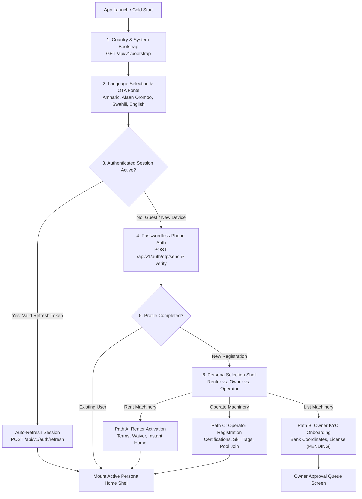
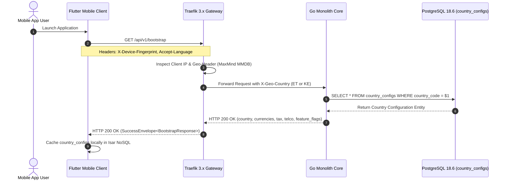
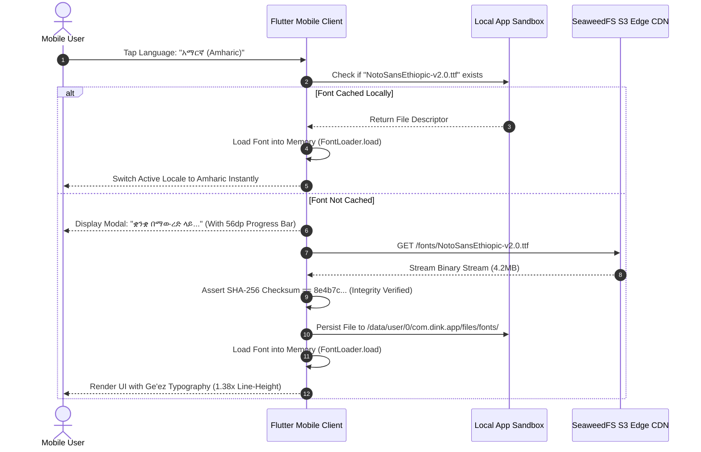
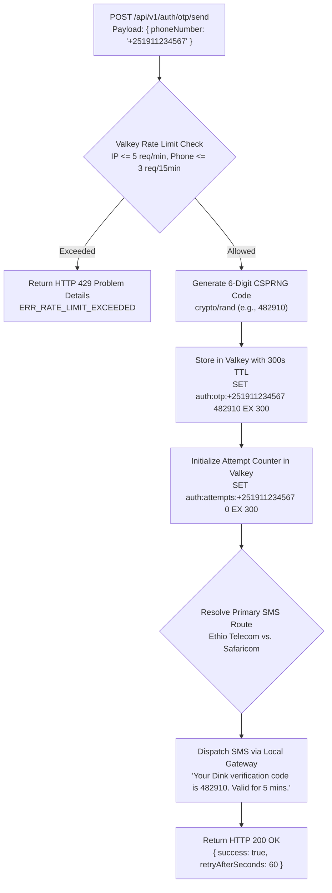
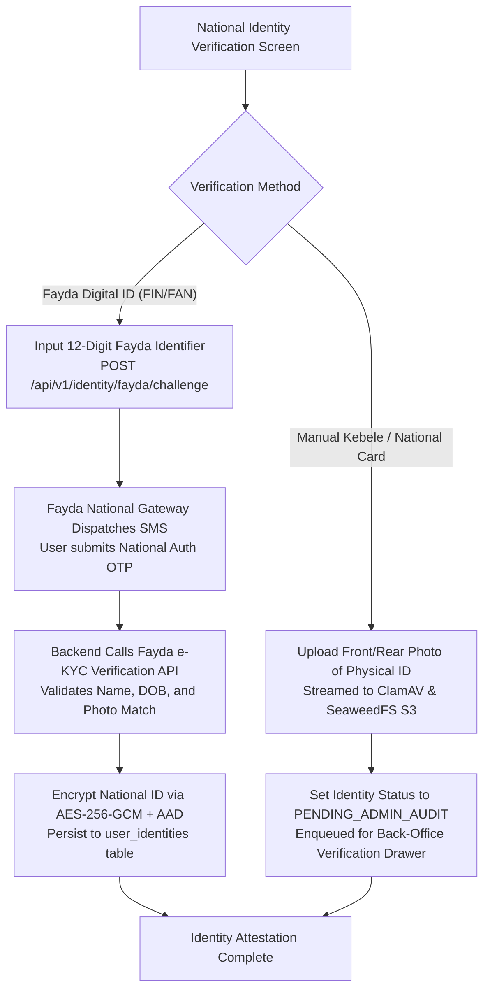
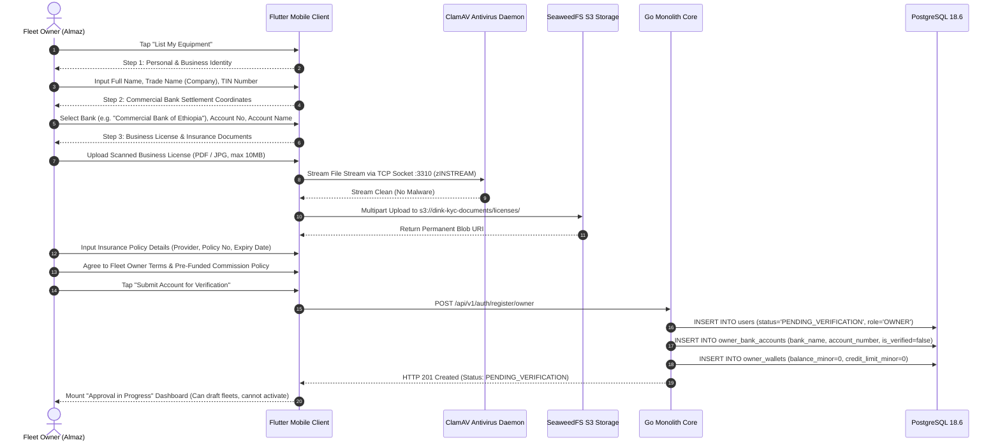
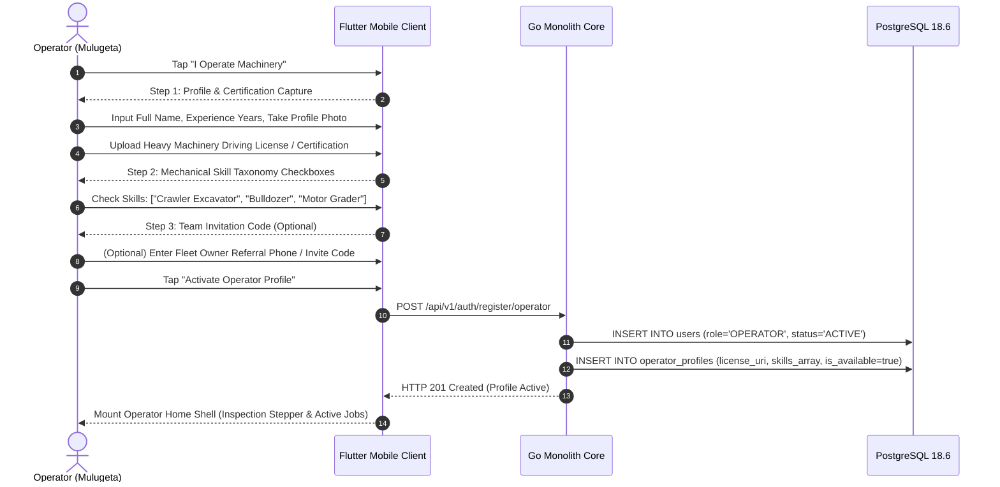
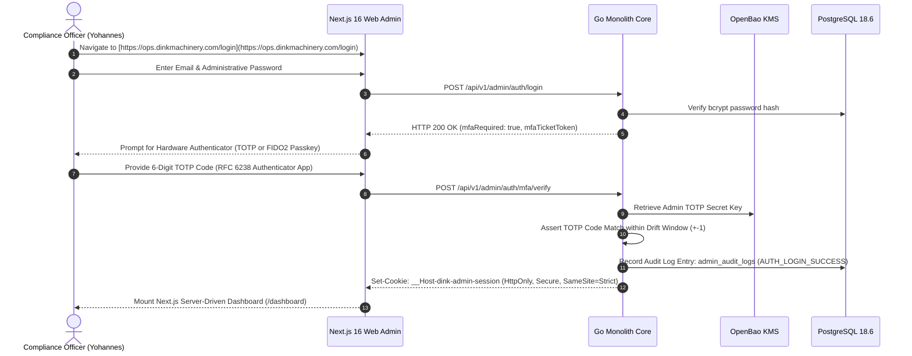
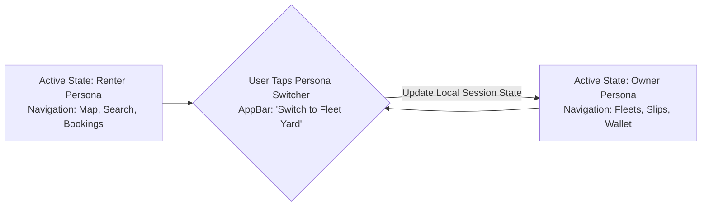
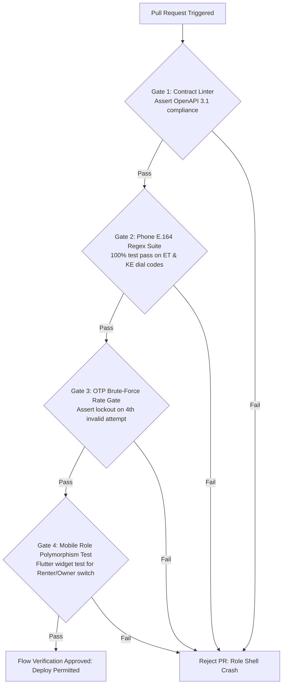

# Heavy Machinery & Logistics Rental Aggregator — Dink Machinery
## Interaction Flow Specification — 01. Platform Entry & Persona Role Selection (`docs/shared/flows/01-platform-entry-role-selection.md`)

**Document Identifier:** `FLOW-ENTRY-DINK-CORE-V7.0`  
**Classification:** Canonical User Interaction Flow & System Behavior Specification (Single Source of Truth)  
**Governing Documents:** `SRS-DINK-CORE-V7.0` (Parts 1–5), `ARCH-INTRO-DINK-CORE-V7.0` through `ARCH-ROADMAP-DINK-CORE-V7.0`, `DS-DINK-CORE-V7.0` (Design System), `DS-PERSONAS-DINK-CORE-V7.0` (Personas), `DS-TOKENS-DINK-CORE-V7.0` (Tokens), `contracts/openapi.yaml`, `ADR-001` through `ADR-014`  
**Target Client Runtimes:** Flutter 3.47.8 / Dart 3.9 (Cross-Platform Mobile), Next.js 16.x (latest CVE security patch) / React 19 (Desktop Admin Web Console), Android API 26+, iOS 15+  
**Target Personas:** Individual Renter (Civil Contractor), Fleet Owner (Yard Manager), Certified Field Operator, Platform Staff (Admin / Compliance)  
**Target Markets:** Ethiopia (`ET`) & Kenya (`KE`) — Dynamic Multi-Country Parameterization (`LOC-01-BE`)  
**Compliance Standards:** OWASP ASVS 4.0.3 Level 3, RFC 9457 (Problem Details), RFC 6238 (TOTP), ISO 9241-110, W3C WCAG 2.2 Level AAA (Field Mode), Ethiopian Personal Data Protection Proclamation No. 1321/2024, NBE Directives  
**Status:** Approved Engineering Baseline

---

## Table of Contents

- 1. [Executive Summary & Flow Topology](#1-executive-summary--flow-topology)
  - 1.1 [Purpose & Scope](#11-purpose--scope)
  - 1.2 [Universal Entry & Dynamic Persona Polymorphism](#12-universal-entry--dynamic-persona-polymorphism)
- 2. [Multi-Country Bootstrap & Regulatory Resolution (`LOC-01-BE`)](#2-multi-country-bootstrap--regulatory-resolution-loc-01-be)
  - 2.1 [Cold Start Discovery & Geo-IP Resolution](#21-cold-start-discovery--geo-ip-resolution)
  - 2.2 [Dynamic `country_configs` Ingestion & Feature Flagging](#22-dynamic-country_configs-ingestion--feature-flagging)
- 3. [Language Selection & Dynamic Typography Hydration](#3-language-selection--dynamic-typography-hydration)
  - 3.1 [Locale Matrix & Script Support (`am`, `om`, `sw`, `en`)](#31-locale-matrix--script-support-am-om-sw-en)
  - 3.2 [Over-The-Air (OTA) Font Downloader Flow (`ADR-013`)](#32-over-the-air-ota-font-downloader-flow-adr-013)
- 4. [Passwordless Authentication & Identity Verification Core](#4-passwordless-authentication--identity-verification-core)
  - 4.1 [Phone Number E.164 Ingestion & National Dialing Validation](#41-phone-number-e164-ingestion--national-dialing-validation)
  - 4.2 [Cryptographic OTP Generation, Rate Limiting & Telco Dispatch](#42-cryptographic-otp-generation-rate-limiting--telco-dispatch)
  - 4.3 [OTP Verification, Session Token Minting (ES256) & Device Fingerprinting](#43-otp-verification-session-token-minting-es256--device-fingerprinting)
  - 4.4 [Pluggable National ID Flow (Ethiopian Fayda Adapter `REG-IDP-01-BE`)](#44-pluggable-national-id-flow-ethiopian-fayda-adapter-reg-idp-01-be)
- 5. [Role Selection & Persona Onboarding Pipelines](#5-role-selection--persona-onboarding-pipelines)
  - 5.1 [Role Triad Selection Architecture (Renter, Owner, Operator)](#51-role-triad-selection-architecture-renter-owner-operator)
  - 5.2 [Path A: Individual Renter Onboarding & Instant Activation](#52-path-a-individual-renter-onboarding--instant-activation)
  - 5.3 [Path B: Fleet Owner KYC, Commercial Bank Coordinates & Business License](#53-path-b-fleet-owner-kyc-commercial-bank-coordinates--business-license)
  - 5.4 [Path C: Certified Operator Certification, Skills Taxonomy & Yard Team Join](#54-path-c-certified-operator-certification-skills-taxonomy--yard-team-join)
  - 5.5 [Back-Office Staff Gateway: Administrative MFA & FIDO2 WebAuthn (`AUTH-04-WEB`)](#55-back-office-staff-gateway-administrative-mfa--fido2-webauthn-auth-04-web)
- 6. [Multi-Role Switching & Active Session Persona Context](#6-multi-role-switching--active-session-persona-context)
  - 6.1 [Unified Identity Model & Role Grants Matrix](#61-unified-identity-model--role-grants-matrix)
  - 6.2 [In-App Persona Switching Mechanics & Navigation Remounting](#62-in-app-persona-switching-mechanics--navigation-remounting)
- 7. [Security Controls, Rate Limiting & Anti-Abuse Defenses](#7-security-controls-rate-limiting--anti-abuse-defenses)
  - 7.1 [Valkey Sliding Window Token Bucket Limits](#71-valkey-sliding-window-token-bucket-limits)
  - 7.2 [Brute-Force Lockouts, Delay Ladders & Telco Failover](#72-brute-force-lockouts-delay-ladders--telco-failover)
- 8. [Frontier Market Edge Cases & Recovery Protocols](#8-frontier-market-edge-cases--recovery-protocols)
  - 8.1 [Intermittent SMS Gateway Delivery & Deep Trench Latency](#81-intermittent-sms-gateway-delivery--deep-trench-latency)
  - 8.2 [SIM Swap Detection, Device Re-Registration & Stale Session Revocation](#82-sim-swap-detection-device-re-registration--stale-session-revocation)
- 9. [Wire Contracts & RFC 9457 Error Schemas](#9-wire-contracts--rfc-9457-error-schemas)
- 10. [Verification Gates & Automated Flow Testing Suite](#10-verification-gates--automated-flow-testing-suite)

---

## 1. Executive Summary & Flow Topology

### 1.1 Purpose & Scope

The **Platform Entry & Role Selection Flow** (`01-platform-entry-role-selection.md`) defines the primary sequence through which any human actor accesses the Dink Machinery ecosystem. It governs the transition from cold-start application launch through regulatory country resolution, dynamic font hydration, passwordless telephone authentication, pluggable national identity attestation, and operational persona activation.

This specification unifies the mobile journey across three commercial personas—**Renter**, **Fleet Owner**, and **Field Operator**—and specifies the administrative boundary for **Platform Staff** across Ethiopia (`ET`) and Kenya (`KE`).



### 1.2 Universal Entry & Dynamic Persona Polymorphism

In strict alignment with `ARCH-FLUTTER-DINK-CORE-V7.0`, Dink Machinery rejects separate applications for contractors, equipment owners, and operators. A single, compiled cross-platform binary serves all operational personas.

* **Unified Root Identity:** An individual user possesses a single database `users` record tied to an immutable cryptographic UUIDv4 and verified E.164 phone number.
* **Dynamic Persona Shell Mounting:** Upon session establishment, the mobile runtime interrogates the active JWT claims. If the user possesses multiple role grants (e.g., a contractor who also leases idle excavators), the application shell mounts the appropriate navigation tree dynamically, preserving role-specific state machine contexts.

---

## 2. Multi-Country Bootstrap & Regulatory Resolution (`LOC-01-BE`)

### 2.1 Cold Start Discovery & Geo-IP Resolution

On cold start, before rendering interactive inputs, the mobile client calls the backend bootstrap endpoint to determine the applicable legal jurisdiction, fiscal parameters, and localized telco configurations.



### 2.2 Dynamic `country_configs` Ingestion & Feature Flagging

The client extracts jurisdiction parameters and stores them in memory:

```json
{
  "success": true,
  "data": {
    "countryCode": "ET",
    "countryName": "Ethiopia",
    "defaultLocale": "am_ET",
    "supportedLocales": ["am_ET", "om_ET", "en_ET"],
    "currencyCode": "ETB",
    "currencyMinorUnits": 100,
    "vatRateBasisPoints": 1500,
    "phoneDialingCode": "+251",
    "nationalIdProvider": "FAYDA",
    "settlementRails": ["MANUAL_TRANSFER"],
    "disputeSlaHours": 72,
    "featureFlags": {
      "faydaIntegrationEnabled": true,
      "logisticsSubBookingsEnabled": true,
      "telematicsLiveStreamingEnabled": true
    }
  },
  "timestamp": "2026-10-27T08:00:00Z"
}
```

If the client is offline or the bootstrap request fails, the application falls back to the cached `country_configs` record stored in the local Isar database. If no cache exists (initial launch in an offline dead-zone), it defaults to the Ethiopian (`ET`) baseline.

---

## 3. Language Selection & Dynamic Typography Hydration

### 3.1 Locale Matrix & Script Support (`am`, `om`, `sw`, `en`)

In compliance with `DS-DINK-CORE-V7.0`, the platform supports four foundational languages across East Africa:

| Language Identifier | Native Display Label | Script Family | Golden Line-Height Multiplier | Initial Bundle Status |
|---|---|---|---|---|
| `am_ET` | **አማርኛ** | Ge'ez (Ethiopic) | **$1.38\times$** (Headings) / **$1.45\times$** (Body) | Downloaded On-Demand (OTA) |
| `om_ET` | **Afaan Oromoo** | Latin (Qubee) | $1.25\times$ (Standard Latin) | Bundled in Base APK |
| `sw_KE` | **Kiswahili** | Latin | $1.25\times$ (Standard Latin) | Bundled in Base APK |
| `en_US` | **English** | Latin | $1.25\times$ (Standard Latin) | Bundled in Base APK (Fallback) |

### 3.2 Over-The-Air (OTA) Font Downloader Flow (`ADR-013`)

To satisfy the **$< 25\text{MB}$ download ceiling** on cellular connections, complete Ethiopic font binaries (`Noto Sans Ethiopic`, $\approx 4.2\text{MB}$) are excluded from the initial application package and downloaded over-the-air.



---

## 4. Passwordless Authentication & Identity Verification Core

### 4.1 Phone Number E.164 Ingestion & National Dialing Validation

The authentication entry screen presents an industrial-grade telephone input matching `DS-TOKENS-DINK-CORE-V7.0`:
* Minimum touch target: **$56 \times 56\text{ dp}$**.
* Country prefix selector prepopulated based on the active `country_configs` (`+251` for Ethiopia, `+254` for Kenya).
* Client-side regex assertion:
  - Ethiopia: `^\+251(7|9)\d{8}$` (Ethio Telecom and Safaricom Ethiopia).
  - Kenya: `^\+254(1|7)\d{8}$` (Safaricom, Airtel, Telkom).

```text
+-------------------------------------------------------------------+
|  [DINK MACHINERY INDUSTRIAL LOGO]                                 |
|  HEAVY EQUIPMENT & LOGISTICS PLATFORM                             |
+-------------------------------------------------------------------+
|  Enter your mobile phone number to continue.                      |
|                                                                   |
|  +--------------------+---------------------------------------+   |
|  | [ET FLAG]  +251 v  |   9 1 1 2 3 4 5 6 7                   |   |
|  +--------------------+---------------------------------------+   |
|  (i) We will send a 6-digit confirmation code via SMS.            |
|                                                                   |
|  +-------------------------------------------------------------+  |
|  |                 SEND VERIFICATION CODE                      |  |
|  |                 (Height: 56dp, Amber 500)                   |  |
|  +-------------------------------------------------------------+  |
+-------------------------------------------------------------------+
```

### 4.2 Cryptographic OTP Generation, Rate Limiting & Telco Dispatch

Upon tapping **Send Verification Code**, the Go backend executes the following pipeline:



### 4.3 OTP Verification, Session Token Minting (ES256) & Device Fingerprinting

When the user enters the 6-digit code on the verification screen:
1. The client sends `POST /api/v1/auth/otp/verify` with the phone number, OTP code, and device metadata (`X-Device-Fingerprint`).
2. The backend fetches the code from Valkey and increments the attempt counter:
   - If attempts exceed 3, the key is evicted, and a 60-second cooldown is enforced.
   - If the code matches, the OTP key is immediately deleted from Valkey to prevent replay attacks.
3. The database is queried for an existing `users` record matching the verified phone number:
   - **Existing User:** The server mints an **ES256 Access Token** ($15\text{ minutes}$) and an opaque **Refresh Token** ($30\text{ days}$) stored in the `user_sessions` table, returning the user profile and active role grants.
   - **New User:** A temporary registration ticket token (`reg_ticket_token`, valid for 30 minutes) is returned, directing the mobile application to the **Role Selection & Registration Flow**.

```mermaid
sequenceDiagram
    autonumber
    actor User as Mobile User
    participant App as Flutter Mobile Client
    participant AuthMod as Go Auth Module
    participant VK as Valkey Cluster
    participant DB as PostgreSQL 18.6

    User->>App: Enter 6-Digit Code (e.g. 482910)
    App->>AuthMod: POST /api/v1/auth/otp/verify
    Note over App,AuthMod: Payload: { phoneNumber, code, deviceFingerprint }
    AuthMod->>VK: GET auth:otp:+251911234567
    VK-->>AuthMod: 482910 (Matches)
    AuthMod->>VK: DEL auth:otp:+251911234567
    AuthMod->>DB: SELECT * FROM users WHERE phone_number = $1
    alt User Found (Existing Contractor/Owner/Operator)
        DB-->>AuthMod: User Record (id, status, roles)
        AuthMod->>DB: INSERT INTO user_sessions (user_id, refresh_token_hash, device_info)
        AuthMod-->>App: HTTP 200 OK (accessToken, refreshToken, profile, roles)
        App->>App: SecureStore tokens; Mount Active Persona Home Shell
    else User Not Found (New Registration)
        AuthMod-->>App: HTTP 200 OK (registrationTicketToken, isNewUser: true)
        App-->>User: Navigate to Role Selection Shell
    end
```

### 4.4 Pluggable National ID Flow (Ethiopian Fayda Adapter `REG-IDP-01-BE`)

If the country configuration mandates national identity attestation (`faydaIntegrationEnabled: true`), the user is prompted to link their national identity before committing financial transactions:



---

## 5. Role Selection & Persona Onboarding Pipelines

### 5.1 Role Triad Selection Architecture (Renter, Owner, Operator)

For new users, the application renders the **Role Selection Shell**. The interface presents three distinct cards with clear descriptions and visual accents conforming to `DS-DINK-CORE-V7.0`:

```text
+-------------------------------------------------------------------+
|  SELECT YOUR PRIMARY ROLE                                         |
|  How do you plan to use Dink Machinery?                           |
+-------------------------------------------------------------------+
|  +-------------------------------------------------------------+  |
|  | [EXCAVATOR ICON]  RENT MACHINERY                            |  |
|  | I am a civil contractor, builder, or project lead looking   |  |
|  | to hire heavy equipment and transport logistics.            |  |
|  +-------------------------------------------------------------+  |
|                                                                   |
|  +-------------------------------------------------------------+  |
|  | [DEPOT YARD ICON]  LIST MY EQUIPMENT                         |  |
|  | I own machinery, transport lowboys, or equipment fleets    |  |
|  | and want to maximize utilization and earn rental income.   |  |
|  +-------------------------------------------------------------+  |
|                                                                   |
|  +-------------------------------------------------------------+  |
|  | [OPERATOR HARDHAT]  I OPERATE MACHINERY                     |  |
|  | I am a certified crane, excavator, or plant operator       |  |
|  | seeking assignment with fleet owners and contractors.       |  |
|  +-------------------------------------------------------------+  |
|                                                                   |
|  (i) You can easily add other roles later from your profile.      |
+-------------------------------------------------------------------+
```

### 5.2 Path A: Individual Renter Onboarding & Instant Activation

Renters require zero administrative waiting queues; their identity is verified, and they can search equipment immediately.

```mermaid
sequenceDiagram
    autonumber
    actor Renter as Renter (Dawit)
    participant App as Flutter Mobile Client
    participant Monolith as Go Monolith Core
    participant DB as PostgreSQL 18.6

    Renter->>App: Tap "Rent Machinery"
    App-->>Renter: Render Simple Registration Form
    Renter->>App: Input Full Name, Optional Company Name, Email
    Renter->>App: Check Mandatory Checkbox: "Agree to Terms & Liability Waiver"
    Renter->>App: Tap "Complete Registration" (56dp Button)
    App->>Monolith: POST /api/v1/auth/register/renter
    Note over App,Monolith: Headers: Authorization: Bearer <registrationTicketToken>
    Monolith->>DB: INSERT INTO users (name, phone, role='RENTER', status='ACTIVE')
    Monolith->>DB: INSERT INTO user_profiles (company_name, country_code='ET')
    Monolith-->>App: HTTP 201 Created (accessToken, refreshToken, userProfile)
    App->>App: Store Session; Initialize PostGIS Search Engine
    App-->>Renter: Mount Renter Discovery Home Shell (Active Map View)
```

### 5.3 Path B: Fleet Owner KYC, Commercial Bank Coordinates & Business License

Because fleet owners receive direct commercial bank wire transfers from contractors, they must provide their verified bank coordinates and official business documentation before their listings can be approved.



### 5.4 Path C: Certified Operator Certification, Skills Taxonomy & Yard Team Join

Field operators join the talent pool immediately so fleet owners can assign them to machines.



### 5.5 Back-Office Staff Gateway: Administrative MFA & FIDO2 WebAuthn (`AUTH-04-WEB`)

Platform staff (Compliance Officers, Dispute Arbitrators, Finance Controllers) access the platform exclusively via the Next.js 16 Web Admin Console. They cannot log in with phone OTP alone.



---

## 6. Multi-Role Switching & Active Session Persona Context

### 6.1 Unified Identity Model & Role Grants Matrix

A user can possess multiple operational permissions simultaneously. For example, a civil engineering contractor may own surplus road rollers and lease them out, while also renting heavy hydraulic excavators.

```text
+------------------------------------------------------------------------------------+
|                         UNIFIED IDENTITY ROLE GRANTS MATRIX                        |
+---------------------+-------------------+-------------------+----------------------+
| Identity Role Grant | Allowed Ingress   | Target Navigation | Verification Status  |
+---------------------+-------------------+-------------------+----------------------+
| ROLE_RENTER         | Mobile App        | Discovery Map,    | Instant Active upon  |
|                     |                   | My Hires, Escrow  | Phone OTP Completion |
|                     |                   |                   |                      |
| ROLE_OWNER          | Mobile App        | Yard Fleets, Slip | Requires KYC, Bank   |
|                     |                   | Reviews, Wallet   | & License Approval   |
|                     |                   |                   |                      |
| ROLE_OPERATOR       | Mobile App        | Live Inspections, | Instant Active; Linked|
|                     |                   | Camera Reticles   | to Fleets via Owner  |
|                     |                   |                   |                      |
| ROLE_ADMIN          | Web Console Only  | TanStack Grids,   | Enforced Hardware    |
|                     | (Desktop Edge)    | Dispute Lightbox  | TOTP MFA Verification|
+---------------------+-------------------+-------------------+----------------------+
```

### 6.2 In-App Persona Switching Mechanics & Navigation Remounting

When a user possesses both `ROLE_RENTER` and `ROLE_OWNER`, the mobile application's top navigation bar renders a **Persona Switcher** toggle:



* **Zero Re-Authentication Required:** Switching between granted roles does not require re-entering an OTP code.
* **Context Isolation:** The Flutter runtime swaps the root `BlocProvider` scope and remounts the navigation tree, guaranteeing that search caches, draft fleet entries, and active camera reticle streams remain completely isolated.

---

## 7. Security Controls, Rate Limiting & Anti-Abuse Defenses

### 7.1 Valkey Sliding Window Token Bucket Limits

To mitigate SMS toll fraud and distributed brute-force attacks, the authentication endpoints enforce strict sliding-window rate limits via Valkey sorted sets:

| Target Endpoint | Rate Window | Limit Threshold | Scope Dimension | Action on Breach |
|---|---|---|---|---|
| `POST /api/v1/auth/otp/send` | $60\text{ seconds}$ | $1\text{ request}$ | Single Phone Number | Block with `retryAfterSeconds` |
| `POST /api/v1/auth/otp/send` | $15\text{ minutes}$ | $3\text{ requests}$ | Single Phone Number | Temporary 15-minute phone lockout |
| `POST /api/v1/auth/otp/send` | $1\text{ hour}$ | $10\text{ requests}$ | Source Client IP | Block IP via Traefik Fail2ban |
| `POST /api/v1/auth/otp/verify`| $5\text{ minutes}$ | $3\text{ attempts}$ | Target Phone Number | Evict OTP; force 60-second delay |

### 7.2 Brute-Force Lockouts, Delay Ladders & Telco Failover

If an attacker repeatedly submits incorrect 6-digit OTP codes:
1. **Attempt 1 & 2:** Standard rejection returning RFC 9457 HTTP 400 (`ERR_INVALID_OTP_CODE`) with remaining attempt count.
2. **Attempt 3:** The OTP is evicted from Valkey. The account is placed on a **Delay Ladder**:
   - First violation: 1-minute lockout.
   - Second violation: 15-minute lockout.
   - Third violation: 24-hour lockout requiring manual administrative unlocking.
3. **SMS Telco Failover Engine:** If the primary SMS gateway (Ethio Telecom) does not acknowledge message dispatch within $15\text{ seconds}$, the Go backend automatically reroutes the SMS payload through the secondary gateway (Safaricom Ethiopia or Infobip backup).

---

## 8. Frontier Market Edge Cases & Recovery Protocols

### 8.1 Intermittent SMS Gateway Delivery & Deep Trench Latency

In remote infrastructure cuts or deep quarries, SMS delivery can experience delays of $2\text{–}5\text{ minutes}$, causing codes to arrive near their expiration window.

* **5-Minute Validity Window:** The platform maintains a **300-second (5-minute)** OTP lifespan in Valkey, longer than standard consumer apps ($60\text{s}$), accommodating carrier delivery lags.
* **Resend Cooldown:** The **Resend Code** actuator button illuminates after $60\text{ seconds}$ with a visual countdown timer to prevent users from flooding the SMS gateway while waiting for carrier transit.

### 8.2 SIM Swap Detection, Device Re-Registration & Stale Session Revocation

When a contractor logs in from a new smartphone:
1. The backend detects an unknown `X-Device-Fingerprint`.
2. Upon successful OTP verification, the backend generates a new cryptographic refresh token family.
3. Existing active sessions in `user_sessions` for that user are placed in an **Immediate Revocation List** in Valkey (`SET session:revoked:{sessionId} 1 EX 86400`).
4. An automated security SMS alert is dispatched to the registered phone number:
   *"Dink Security Alert: Your account was accessed from a new device (Samsung Galaxy A54). If this was not you, contact +251-11-XXXXXXX immediately."*

---

## 9. Wire Contracts & RFC 9457 Error Schemas

### 9.1 Request: `POST /api/v1/auth/otp/send`

```json
{
  "phoneNumber": "+251911234567",
  "countryCode": "ET",
  "clientTimestamp": "2026-10-27T08:14:22Z"
}
```

### 9.2 Response: `HTTP 200 OK` (OTP Dispatched)

```json
{
  "success": true,
  "data": {
    "phoneNumber": "+25191****567",
    "expiresInSeconds": 300,
    "resendCooldownSeconds": 60,
    "gatewayRoute": "ETHIO_TELECOM_PRIMARY"
  },
  "timestamp": "2026-10-27T08:14:23Z"
}
```

### 9.3 Error Response: `HTTP 429 Too Many Requests` (RFC 9457)

```json
{
  "type": "[https://api.dinkmachinery.com/errors/rate-limit-exceeded](https://api.dinkmachinery.com/errors/rate-limit-exceeded)",
  "title": "Rate Limit Exceeded",
  "status": 429,
  "detail": "Too many verification requests sent to this phone number. Please wait 48 seconds before retrying.",
  "instance": "/api/v1/auth/otp/send",
  "code": "AUTH_OTP_RATE_LIMITED",
  "invalidParams": [
    {
      "name": "phoneNumber",
      "reason": "Retry cooldown active. Wait 48 seconds."
    }
  ]
}
```

### 9.4 Response: `POST /api/v1/auth/otp/verify` (Existing User)

```json
{
  "success": true,
  "data": {
    "isNewUser": false,
    "accessToken": "eyJhbGciOiJFUzI1NiIs...",
    "refreshToken": "7f8b9a2c-4d5e-6f7a-8b9c-0d1e2f3a4b5c",
    "expiresInSeconds": 900,
    "user": {
      "id": "018f6a9e-876b-7341-a189-bc849901d892",
      "phoneNumber": "+251911234567",
      "fullName": "Dawit Haile-Mariam",
      "primaryRole": "RENTER",
      "grantedRoles": ["RENTER", "OWNER"],
      "status": "ACTIVE",
      "countryCode": "ET",
      "avatarUri": "[https://s3.dinkmachinery.com/avatars/018f6a9e.webp](https://s3.dinkmachinery.com/avatars/018f6a9e.webp)"
    }
  },
  "timestamp": "2026-10-27T08:15:02Z"
}
```

---

## 10. Verification Gates & Automated Flow Testing Suite

To ensure regressions never compromise user authentication or onboarding, the CI/CD pipeline enforces four mandatory test gates:



1. **Contract Schema Drift Gate (`kin-openapi`):** Validates that all authentication and onboarding payload schemas strictly match `contracts/openapi.yaml`.
2. **E.164 Telco Validation Suite:** Unit tests evaluate 200+ telephone numbers across Ethio Telecom, Safaricom Ethiopia, and Kenyan networks, verifying that valid numbers parse cleanly and invalid formats are rejected before network transmission.
3. **Valkey Rate Limit & Cooldown Integration Test:** Integration test spins up a Dockerized Valkey testcontainer and simulates rapid OTP generation requests, proving that the 4th attempt is blocked with HTTP 429.
4. **Flutter Persona Polymorphism Widget Test:** An end-to-end integration test mounts the universal app shell with a multi-role user profile, simulates tapping the persona toggle, and verifies that the navigation bar remounts in $< 100\text{ ms}$ with zero state leaks.

---

*This document defines the canonical interaction flow, system behavior, and wire protocols for Platform Entry & Role Selection in Dink Machinery Version 7.0. All downstream Flutter screens, Go HTTP controllers, and administrative web gateways must strictly adhere to this specification.*