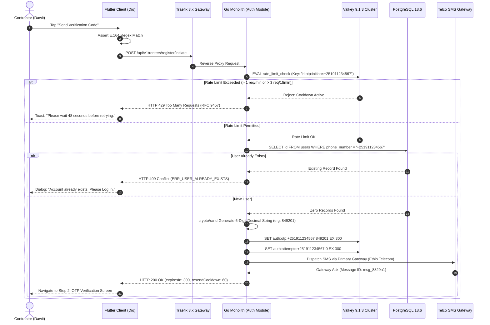
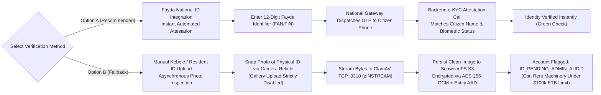
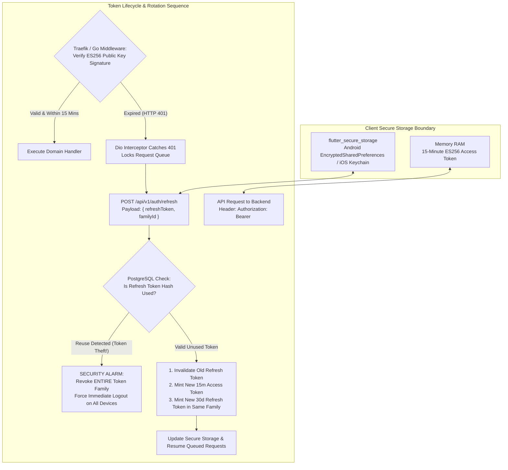
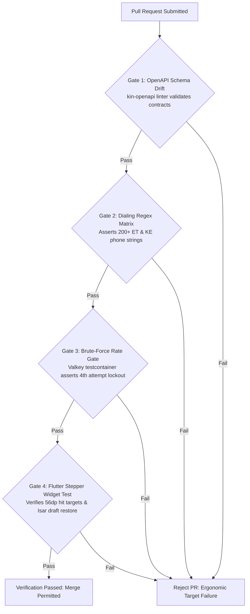

# Heavy Machinery & Logistics Rental Aggregator — Dink Machinery
## Interaction Flow Specification — 02. Renter Registration, Identity Verification & Authentication (`docs/shared/flows/02-renter-registration-authentication.md`)

**Document Identifier:** `FLOW-RENTER-AUTH-DINK-CORE-V7.0`  
**Classification:** Canonical User Interaction Flow & Wire Protocol Specification (Single Source of Truth)  
**Governing Documents:** `SRS-DINK-CORE-V7.0` (§5.1.1, §5.5), `FLOW-ENTRY-DINK-CORE-V7.0`, `ARCH-BACKEND-GO-DINK-CORE-V7.0`, `ARCH-FLUTTER-DINK-CORE-V7.0`, `ARCH-SEC-DINK-CORE-V7.0`, `DS-DINK-CORE-V7.0`, `DS-PERSONAS-DINK-CORE-V7.0`, `DS-TOKENS-DINK-CORE-V7.0`, `contracts/openapi.yaml`, `ADR-001`, `ADR-006`  
**Target Client Runtimes:** Flutter 3.47.9 / Dart 3.9 (Android API 26+, iOS 15+), BLoC State Management, Isar NoSQL Local Cache, Dio Network Interceptors  
**Target Persona:** Civil Engineering Contractor / Commercial Renter (*Dawit Haile-Mariam* / *Patrick Kariuki*)  
**Target Operating Markets:** Ethiopia (`ET`) & Kenya (`KE`) — Dynamic Multi-Country Parameterization (`LOC-01-BE`)  
**Compliance Standards:** OWASP ASVS 4.0.3 Level 3 (Authentication & Session Verification), RFC 9457 (Problem Details), RFC 7519 (JWT ES256), ISO 9241-110, W3C WCAG 2.2 Level AAA (Outdoor High-Contrast), Ethiopian Personal Data Protection Proclamation No. 1321/2024, NBE Directives  
**Status:** Approved Engineering Baseline

---

## Table of Contents

- 1. [Executive Summary & Architectural Scope](#1-executive-summary--architectural-scope)
  - 1.1 [Purpose & Engineering Tenets](#11-purpose--engineering-tenets)
  - 1.2 [Persona Invariants: The Civil Contractor Mental Model](#12-persona-invariants-the-civil-contractor-mental-model)
- 2. [End-to-End Registration & Verification Flowchart](#2-end-to-end-registration--verification-flowchart)
- 3. [Detailed Step-by-Step State Machine & User Journey](#3-detailed-step-by-step-state-machine--user-journey)
  - 3.1 [Step 1: Role Declaration & Registration Entry Shell](#31-step-1-role-declaration--registration-entry-shell)
  - 3.2 [Step 2: Profile Metadata Ingestion & E.164 Telephony Binding](#32-step-2-profile-metadata-ingestion--e164-telephony-binding)
  - 3.3 [Step 3: CSPRNG OTP Generation, Multi-Telco Dispatch & Rate Limiting](#33-step-3-csprng-otp-generation-multi-telco-dispatch--rate-limiting)
  - 3.4 [Step 4: OTP Verification, Session Minting & Device Binding](#34-step-4-otp-verification-session-minting--device-binding)
  - 3.5 [Step 5: Pluggable National Identity Attestation (Fayda e-KYC vs. Manual National ID)](#35-step-5-pluggable-national-identity-attestation-fayda-e-kyc-vs-manual-national-id)
  - 3.6 [Step 6: Terms of Service, Commercial Liability Waiver & Instant Activation](#36-step-6-terms-of-service-commercial-liability-waiver--instant-activation)
- 4. [Subsequent Authentication & Session Lifecycle (Login & Token Rotation)](#4-subsequent-authentication--session-lifecycle-login--token-rotation)
  - 4.1 [Returning Contractor One-Tap Passwordless Login](#41-returning-contractor-one-tap-passwordless-login)
  - 4.2 [Asymmetric ES256 Access Token & Rotating Refresh Token Family Lifecycle](#42-asymmetric-es256-access-token--rotating-refresh-token-family-lifecycle)
  - 4.3 [SIM Swap Detection, Device Fingerprinting & Forced Logout Cascade](#43-sim-swap-detection-device-fingerprinting--forced-logout-cascade)
- 5. [Frontier Market Edge Cases & Fault Recovery Protocols](#5-frontier-market-edge-cases--fault-recovery-protocols)
  - 5.1 [SMS Gateway Transit Delays & Deep Trench Offline Recovery](#51-sms-gateway-transit-delays--deep-trench-offline-recovery)
  - 5.2 [Duplicate Registration Interception & Account Re-Link Protocol](#52-duplicate-registration-interception--account-re-link-protocol)
  - 5.3 [Mid-Session App Destruction & Draft Persistence](#53-mid-session-app-destruction--draft-persistence)
- 6. [Client UI/UX Ergonomic Specifications & Design Tokens](#6-client-uiux-ergonomic-specifications--design-tokens)
  - 6.1 [Glove-Friendly Touch Targets ($56 \times 56\text{ dp}$ Minimum)](#61-glove-friendly-touch-targets-56-times-56text-dp-minimum)
  - 6.2 [Outdoor High-Contrast Adaptations (Sunlight Glare $> 80,000\text{ lux}$)](#62-outdoor-high-contrast-adaptations-sunlight-glare--80000text-lux)
  - 6.3 [Ge'ez Typography & Amharic Vowel Diacritic Spacing ($1.38\times$ Multiplier)](#63-geez-typography--amharic-vowel-diacritic-spacing-138times-multiplier)
- 7. [Wire Protocol Contracts & RFC 9457 Error Schemas](#7-wire-protocol-contracts--rfc-9457-error-schemas)
  - 7.1 [`POST /api/v1/renters/register/initiate`](#71-post-apiv1rentersregisterinitiate)
  - 7.2 [`POST /api/v1/renters/register/verify-otp`](#72-post-apiv1rentersregisterverify-otp)
  - 7.3 [`POST /api/v1/renters/identity/fayda`](#73-post-apiv1rentersidentityfayda)
  - 7.4 [`POST /api/v1/renters/register/complete`](#74-post-apiv1rentersregistercomplete)
  - 7.5 [RFC 9457 Universal Problem Details Payloads](#75-rfc-9457-universal-problem-details-payloads)
- 8. [Automated Testing Suite & Verification Gates](#8-automated-testing-suite--verification-gates)

---

## 1. Executive Summary & Architectural Scope

### 1.1 Purpose & Engineering Tenets

The **Renter Registration, Identity Verification & Authentication Specification** establishes the deterministic entry flow for civil engineering contractors, site supervisors, and procurement leads seeking to discover and hire heavy capital equipment across East Africa.

In strict compliance with `SRS-DINK-CORE-V7.0` (§5.1.1), the renter onboarding journey minimizes administrative friction. Unlike Fleet Owners—who require exhaustive business license reviews, physical yard inspections, and commercial bank coordinate verifications prior to listing equipment—**Renters are instantly activated upon successful telephone ownership verification and legal liability acceptance.**

This specification enforces four fundamental engineering tenets:
1. **Passwordless Telephony Supremacy:** Passwords are mathematically eliminated. Authentic identity is bound to a verified E.164 mobile telephone number via cryptographically secure, rate-limited Time-Based One-Time Passwords (CSPRNG OTP).
2. **Pluggable National ID Attestation (`REG-IDP-01-BE`):** Supports instant verification via the Ethiopian National ID (Fayda) biometric/demographic e-KYC gateway, falling back to manual photo upload verification of Kebele cards or Kenyan National IDs.
3. **Deterministic Session Boundary (OWASP ASVS L3):** Authentication issues short-lived ($15\text{ minutes}$) asymmetric **ECDSA P-256 (ES256)** JSON Web Tokens paired with cryptographically random rotating refresh token families persisted across hardened storage boundaries.
4. **Resilience to Frontier Connectivity:** Tolerates deep-trench signal dropouts, SMS transit latencies ($> 120\text{ seconds}$), and sudden process termination through local transactional outbox persistence in Isar NoSQL.

### 1.2 Persona Invariants: The Civil Contractor Mental Model

The user experience is engineered around the cognitive and physical realities of **Persona 1: Civil Engineering Contractor** (*Dawit Haile-Mariam* / *Patrick Kariuki*), as codified in `DS-PERSONAS-DINK-CORE-V7.0`:
* **Zero Patience for Administrative Delay:** Contractors source machines under active project liquidated damages. Any onboarding flow requiring more than $3\text{ minutes}$ to reach the equipment discovery map results in immediate platform abandonment.
* **Severe Daylight Glare:** Registration frequently occurs inside job site trailers or along graded road corridors under direct equatorial sunlight exceeding $80,000\text{ lux}$, requiring strict WCAG 2.2 AAA optical contrast.
* **Dust & Soil Smudges:** Screen touch input occurs via bare fingers smudged with red basalt clay, requiring explicit touch targets of at least **$56 \times 56\text{ dp}$**.

---

## 2. End-to-End Registration & Verification Flowchart

The following diagram captures the complete architectural lifecycle:

```mermaid
flowchart TD
    Start(["Launch Dink Client"]) --> RoleSelect["Role Selection: 'Rent Machinery'<br/>(Default Selection)"]
    RoleSelect --> InputForm["Step 1: Input Profile Metadata<br/>Full Name, Phone (E.164), Optional Email"]
    InputForm --> TelcoRegex{"Client-Side Dialing Regex Validation<br/>ET: ^\\+251(7|9)\\d{8}$ | KE: ^\\+254(1|7)\\d{8}$"}
    
    TelcoRegex -->|"Invalid Syntax"| InlineErr["Display Inline Error Toast<br/>'Enter valid Ethiopian or Kenyan mobile number'"]
    InlineErr --> InputForm
    
    TelcoRegex -->|"Valid Syntax"| SendOTPReq["POST /api/v1/renters/register/initiate<br/>Payload: { fullName, phoneNumber, countryCode }"]
    
    SendOTPReq --> ValkeyRateLimit{"Valkey Rate Limit Check<br/>1 req/min per phone, 3 req/15min per phone"}
    ValkeyRateLimit -->|"Exceeded"| Err429["Return HTTP 429 Problem Details<br/>AUTH_OTP_RATE_LIMITED (retryAfterSeconds)"]
    
    ValkeyRateLimit -->|"Allowed"| ExistingUserCheck{"PostgreSQL Query:<br/>SELECT id FROM users WHERE phone = $1"}
    ExistingUserCheck -->|"User Exists"| ReturnLoginNotice["Return HTTP 409 Conflict<br/>ERR_USER_ALREADY_EXISTS (Redirect to Login)"]
    
    ExistingUserCheck -->|"New User"| GenOTP["Generate 6-Digit CSPRNG Code<br/>crypto/rand -> 5-Minute TTL in Valkey"]
    GenOTP --> TelcoDispatch["Dispatch SMS via Local Gateway<br/>Primary: Ethio Telecom | Fallback: Safaricom"]
    
    TelcoDispatch --> OTPScreen["Step 2: Enter 6-Digit Verification Code<br/>5-Minute Countdown Timer & 60s Resend Lock"]
    
    OTPScreen --> SubmitOTP["POST /api/v1/renters/register/verify-otp<br/>Payload: { phoneNumber, code, deviceFingerprint }"]
    
    SubmitOTP --> VerifyValkey{"Valkey Code Validation<br/>Match code & Attempt <= 3"}
    VerifyValkey -->|"Wrong Code / Attempt < 3"| IncrementAttempt["Increment Valkey Counter<br/>Return HTTP 400 (Attempts Remaining)"]
    IncrementAttempt --> OTPScreen
    
    VerifyValkey -->|"Attempt >= 3"| Lockout["Lock Account for 60s<br/>Evict OTP from Valkey (HTTP 423)"]
    
    VerifyValkey -->|"Code Valid"| DelOTP["DEL auth:otp:{phone} in Valkey<br/>Mint Temp registrationTicketToken (30m TTL)"]
    
    DelOTP --> NatIDBranch{"Country Config:<br/>faydaIntegrationEnabled == true?"}
    
    NatIDBranch -->|"Yes (ET Market)"| FaydaPrompt["Step 3: National Identity Attestation<br/>Option A: Fayda FIN/FAN | Option B: Manual Kebele"]
    NatIDBranch -->|"No (KE Market)"| LegalTerms["Step 4: Terms of Service & Liability Waiver"]
    
    FaydaPrompt -->|"Fayda FIN"| FaydaCall["POST /api/v1/renters/identity/fayda<br/>Challenge -> National SMS OTP -> Verify"]
    FaydaPrompt -->|"Manual ID"| ClamAVUpload["Upload ID Photo -> Stream to ClamAV :3310<br/>Store in SeaweedFS S3 (Encrypted AAD)"]
    
    FaydaCall --> LegalTerms
    ClamAVUpload --> LegalTerms
    
    LegalTerms --> MandatoryCheckbox{"Mandatory Checkbox:<br/>Accept Terms & Commercial Waiver"}
    MandatoryCheckbox -->|"Unchecked"| DisableSubmit["Submit Button Disabled"]
    
    MandatoryCheckbox -->|"Checked"| FinalizeRegistration["POST /api/v1/renters/register/complete<br/>Payload: { registrationTicketToken, acceptedTerms: true }"]
    
    FinalizeRegistration --> DBCommit["PostgreSQL ACID Transaction:<br/>1. INSERT INTO users (role='RENTER', status='ACTIVE')<br/>2. INSERT INTO user_profiles<br/>3. INSERT INTO user_sessions (ES256 Token Pair)"]
    
    DBCommit --> MountRenterShell["Mount Renter Discovery Home Shell<br/>PostGIS Spheroidal Search Ready"]
```



---

## 3. Detailed Step-by-Step State Machine & User Journey

### 3.1 Step 1: Role Declaration & Registration Entry Shell

Upon first opening the Dink Machinery application, the client evaluates whether a valid, non-revoked session exists in `flutter_secure_storage`. If no session exists, the application presents the **Universal Entry Shell** (`FLOW-ENTRY-DINK-CORE-V7.0`).

1. The user taps **"Get Started"**.
2. The role selector renders three cards:
   * **Rent Machinery** (Default active selection, highlighted with a $3\text{dp}$ bottom tactile border in `color.brand.amber.500`).
   * **List My Machinery** (Routes to Fleet Owner KYC flow).
   * **I Operate Machinery** (Routes to Field Operator Certification flow).
3. Selecting **"Rent Machinery"** immediately mounts the Renter Registration Stepper.

### 3.2 Step 2: Profile Metadata Ingestion & E.164 Telephony Binding

The registration screen captures the contractor's identity and operational telephone number. In compliance with `DS-DINK-CORE-V7.0`, input fields feature an overall hit height of **$56\text{dp}$** with high-contrast text conforming to WCAG 2.2 AAA.

```text
+-------------------------------------------------------------------+
|  [<- BACK]               STEP 1 OF 3                 LANGUAGE [v] |
+-------------------------------------------------------------------+
|  CREATE YOUR CONTRACTOR ACCOUNT                                   |
|  Hire heavy machinery and logistics across East Africa.           |
|                                                                   |
|  FULL NAME *                                                      |
|  +-------------------------------------------------------------+  |
|  | Dawit Haile-Mariam                                          |  |
|  +-------------------------------------------------------------+  |
|                                                                   |
|  MOBILE PHONE NUMBER *                                            |
|  +--------------------+---------------------------------------+   |
|  | [ET FLAG]  +251 v  |   9 1 1 2 3 4 5 6 7                   |   |
|  +--------------------+---------------------------------------+   |
|  (i) Verification code will be dispatched via SMS.                |
|                                                                   |
|  EMAIL ADDRESS (OPTIONAL - FOR TAX INVOICES)                      |
|  +-------------------------------------------------------------+  |
|  | dawit@hailemariam-contracting.et                            |  |
|  +-------------------------------------------------------------+  |
|                                                                   |
|  +-------------------------------------------------------------+  |
|  |                 SEND VERIFICATION CODE                      |  |
|  |                 (Height: 56dp, Amber 500)                   |  |
|  +-------------------------------------------------------------+  |
|                                                                   |
|  Already have an account? Log In                                  |
+-------------------------------------------------------------------+
```

#### Field Specifications & Validation Rules
* **Full Name (`fullName`):** Mandatory. String, minimum 3 characters, maximum 100 characters. Rejects numeric and special characters (permits Latin alphabetic characters and Ge'ez Unicode syllabics `\u1200-\u137F`).
* **Country Dialing Prefix (`countryCode`):** Automatically resolved from the cold-start bootstrap (`LOC-01-BE`), prepopulating `+251` (Ethiopia) or `+254` (Kenya).
* **Phone Number (`phoneNumber`):** Mandatory. Normalized to strict international **E.164 format**:
  - Ethiopia: Transformed to `+2519XXXXXXXX` or `+2517XXXXXXXX` ($9\text{ digits}$ following prefix).
  - Kenya: Transformed to `+2547XXXXXXXX` or `+2541XXXXXXXX` ($9\text{ digits}$ following prefix).
* **Email Address (`email`):** Optional. If supplied, must satisfy RFC 5322 format. Used exclusively for commercial VAT withholding tax invoices.

### 3.3 Step 3: CSPRNG OTP Generation, Multi-Telco Dispatch & Rate Limiting

When the user taps **"Send Verification Code"**, the Flutter client executes `POST /api/v1/renters/register/initiate`.



### 3.4 Step 4: OTP Verification, Session Minting & Device Binding

The contractor enters the 6-digit code received via SMS. The screen provides six individual monospaced digit cells (`Space Mono`, $20\text{sp}$), automatically focusing the next cell upon input.

```text
+-------------------------------------------------------------------+
|  [<- BACK]               STEP 2 OF 3                              |
+-------------------------------------------------------------------+
|  VERIFY PHONE NUMBER                                              |
|  Enter the 6-digit code sent to +251 91 123 4567                  |
|                                                                   |
|      +-----+  +-----+  +-----+    +-----+  +-----+  +-----+       |
|      |  8  |  |  4  |  |  9  |    |  2  |  |  0  |  |  1  |       |
|      +-----+  +-----+  +-----+    +-----+  +-----+  +-----+       |
|                                                                   |
|  Code expires in: 04:38                                           |
|                                                                   |
|  Didn't receive the code?                                         |
|  [ RESEND CODE (LOCKED: 42s) ]                                    |
|                                                                   |
|  +-------------------------------------------------------------+  |
|  |                 VERIFY & CONTINUE                           |  |
|  |                 (Height: 56dp, Amber 500)                   |  |
|  +-------------------------------------------------------------+  |
+-------------------------------------------------------------------+
```

#### Verification Pipeline & Attempt Counter Rules
1. The client executes `POST /api/v1/renters/register/verify-otp`.
2. The Go backend retrieves the attempt counter from Valkey:
   ```go
   attempts, err := valkeyClient.Incr(ctx, "auth:attempts:"+phone).Result()
   if attempts > 3 {
       valkeyClient.Del(ctx, "auth:otp:"+phone)
       return RenderProblemDetails(w, http.StatusLocked, "AUTH_MAX_ATTEMPTS_EXCEEDED", "Too many incorrect attempts. Code invalidated.")
   }
   ```
3. If the code matches, Valkey immediately deletes both `auth:otp:{phone}` and `auth:attempts:{phone}` to prevent replay attacks.
4. The server mints an ephemeral **Registration Ticket Token** (`registrationTicketToken`):
   - Signed using internal ES256 HMAC.
   - Lifetime: Exactly $30\text{ minutes}$.
   - Scope: `urn:dink:registration:renter`.
   - Payload: Encrypted telephone number and full name.

### 3.5 Step 5: Pluggable National Identity Attestation (Fayda e-KYC vs. Manual National ID)

In compliance with the Ethiopian Personal Data Protection Proclamation No. 1321/2024 and platform risk standards, renters operating in Ethiopia must link their legal identity. The system provides two parallel rails:



#### Fayda e-KYC Integration Mechanics (`REG-IDP-01-BE`)
* When the contractor submits their Fayda Identification Number (FIN), the platform communicates with the National ID Gateway over a private government peering tunnel.
* A secondary OTP challenge is dispatched by the government gateway to the citizen's Fayda-registered SIM.
* Upon successful verification, the Fayda system returns a cryptographic verification token containing the full legal name and date of birth.
* **Zero Plaintext Storage:** The platform never stores the raw Fayda ID number in plaintext. The number is hashed using HMAC-SHA256 for duplicate detection, and the raw payload is encrypted in PostgreSQL using **AES-256-GCM** with the user's primary key bound as Additional Authenticated Data (AAD).

### 3.6 Step 6: Terms of Service, Commercial Liability Waiver & Instant Activation

The final registration screen presents the legal agreements. In frontier construction environments, equipment damage disputes and personal injury liabilities represent significant operational risks.

```text
+-------------------------------------------------------------------+
|  [<- BACK]               STEP 3 OF 3                              |
+-------------------------------------------------------------------+
|  LEGAL AGREEMENTS & LIABILITY WAIVER                              |
|  Review and accept terms to complete your contractor account.     |
|                                                                   |
|  +-------------------------------------------------------------+  |
|  | DINK MACHINERY STANDARD RENTAL MASTER AGREEMENT             |  |
|  | 1. Direct Payment Custody: The Renter acknowledges that     |  |
|  | all hire fees are settled via direct commercial bank wire   |  |
|  | transfer to the verified account of the Fleet Owner...      |  |
|  |                                                             |  |
|  | 2. Monotonic Engine Hour Meter: The Renter agrees that      |  |
|  | billable shifts are calculated from physical engine meter   |  |
|  | readings captured via the digital inspection reticle...     |  |
|  |                                                             |  |
|  | 3. Commercial Liability: The Renter assumes operational     |  |
|  | custody of the machinery upon check-in sign-off...          |  |
|  +-------------------------------------------------------------+  |
|                                                                   |
|  [X] I have read and agree to the Master Rental Terms and         |
|      Civil Contractor Liability Waiver. (Mandatory)               |
|                                                                   |
|  +-------------------------------------------------------------+  |
|  |                 COMPLETE REGISTRATION                       |  |
|  |                 (Height: 56dp, Amber 500)                   |  |
|  +-------------------------------------------------------------+  |
+-------------------------------------------------------------------+
```

#### The Atomic Completion Transaction
When the contractor checks the mandatory agreement and taps **"Complete Registration"**, the client dispatches `POST /api/v1/renters/register/complete`.

The Go backend executes an atomic PostgreSQL transaction:
```sql
-- 1. Create Core User Record
INSERT INTO users (
    id, phone_number, full_name, primary_role, status, country_code, created_at, updated_at
) VALUES (
    $1, $2, $3, 'RENTER', 'ACTIVE', $4, NOW(), NOW()
);

-- 2. Create Renter Profile Entity
INSERT INTO user_profiles (
    id, user_id, company_name, email, terms_accepted_at, waiver_accepted_at
) VALUES (
    gen_random_uuid(), $1, $5, $6, NOW(), NOW()
);

-- 3. Mint Initial Session Token Record
INSERT INTO user_sessions (
    id, user_id, refresh_token_hash, device_fingerprint, user_agent, client_ip, expires_at
) VALUES (
    $7, $1, $8, $9, $10, $11, NOW() + INTERVAL '30 days'
);
```

Upon transaction commit, the backend responds with HTTP 201 Created containing the active session tokens. The Flutter client initializes its PostGIS map controller and transitions immediately to the **Renter Discovery Home Shell**.

---

## 4. Subsequent Authentication & Session Lifecycle (Login & Token Rotation)

### 4.1 Returning Contractor One-Tap Passwordless Login

When a registered contractor opens the application on a new device or logs back in after session expiration:
1. The user enters their registered phone number.
2. The system verifies that `users.phone_number` exists and status is `ACTIVE`.
3. A 6-digit OTP is dispatched via local SMS.
4. Upon submitting the correct code, the server mints a new token pair and returns the full contractor profile, active booking counts, and role grants.
5. The client mounts the discovery map immediately—**no secondary onboarding forms or role selections are ever displayed again.**

### 4.2 Asymmetric ES256 Access Token & Rotating Refresh Token Family Lifecycle

Session management satisfies **OWASP ASVS 4.0.3 Level 3**:



### 4.3 SIM Swap Detection, Device Fingerprinting & Forced Logout Cascade

To protect contractors against unauthorized machine rentals resulting from local SIM swaps:
1. Every authentication and token refresh payload transmits an SHA-256 device fingerprint (`X-Device-Fingerprint`) derived from hardware attributes (SoC serial, build identifier, screen geometry).
2. If an authentication attempt occurs with a device fingerprint differing from the historical session profile:
   * The new session is granted, but all prior active refresh tokens in `user_sessions` are revoked.
   * An immediate security SMS is dispatched to the physical phone:
     *"Dink Machinery Security Alert: Your account was accessed from a new device. If this was not you, call support immediately."*
   * High-value actions (initiating reservations $> 500,000\text{ ETB}$) enforce a 2-hour cooldown window on newly registered devices.

---

## 5. Frontier Market Edge Cases & Fault Recovery Protocols

### 5.1 SMS Gateway Transit Delays & Deep Trench Latency

In remote infrastructure corridors (e.g., deep road cuts along the Mojo–Hawassa expressway or river bridge footings), cellular SMS delivery can take $2\text{–}4\text{ minutes}$.

* **5-Minute Server-Side TTL:** OTP codes remain valid in Valkey for **300 seconds (5 minutes)**. Consumer-grade $60\text{s}$ timeouts are explicitly prohibited.
* **Dynamic Resend Actuator:** The "Resend Code" button displays a 60-second active countdown timer. Tapping resend triggers a secondary telco route (e.g., Ethio Telecom primary $\rightarrow$ Safaricom backup) without changing the active OTP value in Valkey.

### 5.2 Duplicate Registration Interception & Account Re-Link Protocol

If a contractor forgets they previously created an account and attempts to complete the registration flow using their existing telephone number:
1. The backend detects the collision at Step 1 (`POST /api/v1/renters/register/initiate`).
2. The response returns RFC 9457 HTTP 409 Conflict (`ERR_USER_ALREADY_EXISTS`).
3. The mobile client intercepts this code and presents a frictionless transition dialog:
   ```text
   +-------------------------------------------------------+
   |  ACCOUNT ALREADY EXISTS                               |
   |  +251 91 123 4567 is already registered as a Renter.  |
   |                                                       |
   |  Would you like to verify your number and log in?     |
   |                                                       |
   |  [ CANCEL ]                       [ LOG IN NOW (OTP) ]|
   +-------------------------------------------------------+
   ```
4. Tapping **"Log In Now"** transitions the user directly to the OTP verification screen, preserving the entered phone number and eliminating duplicate profile errors.

### 5.3 Mid-Session App Destruction & Draft Persistence

If the mobile operating system terminates the Flutter app during Step 2 or Step 3 due to low RAM (common on entry-level Android devices with 2GB RAM):
* Registration drafts (`fullName`, `phoneNumber`, `email`) are persisted to a transient Isar NoSQL collection (`renter_registration_draft`).
* Upon app relaunch, the application detects the incomplete draft, restores the input state, and displays an informative snackbar: *"Restored your registration progress."*

---

## 6. Client UI/UX Ergonomic Specifications & Design Tokens

### 6.1 Glove-Friendly Touch Targets ($56 \times 56\text{ dp}$ Minimum)

Field contractors often operate in dusty conditions wearing leather utility gloves. Every interactive component in the registration flow satisfies the following physical constraints:
* Primary buttons render with a minimum physical height of **$56\text{dp}$** (Field Mode scales to **$64\text{dp}$**).
* Radio buttons, checkboxes, and back arrows maintain an unobstructed hit box bounding box of at least **$56 \times 56\text{ dp}$**, using `EdgeInsets.all(8.0)` transparent hit padding where visual glyphs are smaller.
* Spacing between adjacent interactive controls is enforced at $\ge 12\text{dp}$ to prevent accidental multi-touch triggers.

### 6.2 Outdoor High-Contrast Adaptations (Sunlight Glare $> 80,000\text{ lux}$)

When ambient illuminance exceeds $25,000\text{ lux}$, the client automatically activates **Outdoor High-Contrast Mode** (`DS-TOKENS-DINK-CORE-V7.0`):

```text
+------------------------------------------------------------------------------------+
|                         OUTDOOR HIGH-CONTRAST TOKEN TRANSFORMS                     |
+----------------------+--------------------+--------------------+-------------------+
| Component Attribute  | Standard Theme     | Outdoor Contrast   | Measured Contrast |
+----------------------+--------------------+--------------------+-------------------+
| Screen Canvas        | slate.50 (#F8FAFC) | Pure Black #000000 | Baseline Canvas   |
| Input Container Fill | #FFFFFF            | Pure Black #000000 | High-Luminance    |
| Input Active Border  | slate.200 (1dp)    | Solid White (2dp)  | 21:1 (WCAG AAA)   |
| Primary Button Fill  | amber.500 (#F59E0B)| amber.400 (#FBBF24)| 18.2:1 (Peak Glare|
| Primary Button Text  | slate.950 (#020617)| Pure Black #000000 | Maximum Optical   |
| Form Label Text      | slate.700 (#334155)| Pure White #FFFFFF | 21:1 Sharp Text   |
+----------------------+--------------------+--------------------+-------------------+
```

### 6.3 Ge'ez Typography & Amharic Vowel Diacritic Spacing ($1.38\times$ Multiplier)

When rendering registration interfaces in Amharic (`am_ET`):
* All text styles apply the **$1.38\times$ line-height multiplier** (`typography.lineHeightFactor.ethiopicGolden`) to eliminate upper and lower vowel marker truncation (e.g., in labels like **"ሙሉ ስም"** or **"የማረጋገጫ ኮድ"**).
* Form error messages include $4\text{dp}$ vertical padding buffers to ensure multi-line error strings never overlap input bounding boxes.

---

## 7. Wire Protocol Contracts & RFC 9457 Error Schemas

### 7.1 `POST /api/v1/renters/register/initiate`

Initiates the registration flow, asserting that the phone number is not currently registered and dispatching a 6-digit OTP.

#### Request Headers
```http
POST /api/v1/renters/register/initiate HTTP/1.1
Host: api.dinkmachinery.com
Content-Type: application/json
X-Device-Fingerprint: e3b0c44298fc1c149afbf4c8996fb92427ae41e4649b934ca495991b7852b855
X-Country-Code: ET
```

#### Request Payload
```json
{
  "fullName": "Dawit Haile-Mariam",
  "phoneNumber": "+251911234567",
  "email": "dawit@hailemariam-contracting.et",
  "countryCode": "ET"
}
```

#### Response: `HTTP 200 OK`
```json
{
  "success": true,
  "data": {
    "phoneNumber": "+25191****567",
    "expiresInSeconds": 300,
    "resendCooldownSeconds": 60,
    "gatewayRoute": "ETHIO_TELECOM_PRIMARY"
  },
  "timestamp": "2026-10-27T11:45:10Z"
}
```

---

### 7.2 `POST /api/v1/renters/register/verify-otp`

Validates the submitted 6-digit code against Valkey.

#### Request Payload
```json
{
  "phoneNumber": "+251911234567",
  "code": "849201",
  "deviceFingerprint": "e3b0c44298fc1c149afbf4c8996fb92427ae41e4649b934ca495991b7852b855"
}
```

#### Response: `HTTP 200 OK`
```json
{
  "success": true,
  "data": {
    "registrationTicketToken": "eyJhbGciOiJFUzI1NiIsInR5cCI6IkpXVCJ9.eyJzdWIiOiIrMjUxOTExMjM0NTY3Iiwicm9sZSI6IlJFTlRFUiIsImV4cCI6MTc2MTU2NzkxMCwiaXNzIjoiZGlua21hY2hpbmVyeS5jb20ifQ.MEQCIBf_r...",
    "expiresInSeconds": 1800,
    "faydaRequired": true
  },
  "timestamp": "2026-10-27T11:46:02Z"
}
```

---

### 7.3 `POST /api/v1/renters/identity/fayda`

Submits the Fayda Identification Number to initiate biometric/demographic e-KYC attestation.

#### Request Headers
```http
Authorization: Bearer <registrationTicketToken>
```

#### Request Payload
```json
{
  "faydaNumber": "1234-5678-9012",
  "consentGiven": true
}
```

#### Response: `HTTP 200 OK`
```json
{
  "success": true,
  "data": {
    "attestationStatus": "VERIFIED",
    "nationalIdHash": "8f4a9b2c3d4e5f6a7b8c9d0e1f2a3b4c5d6e7f8a9b0c1d2e3f4a5b6c7d8e9f0a",
    "verifiedFullName": "Dawit Haile-Mariam"
  },
  "timestamp": "2026-10-27T11:47:15Z"
}
```

---

### 7.4 `POST /api/v1/renters/register/complete`

Executes the atomic creation of the user account and mints production session tokens.

#### Request Headers
```http
Authorization: Bearer <registrationTicketToken>
```

#### Request Payload
```json
{
  "companyName": "Haile-Mariam General Construction PLC",
  "acceptedTerms": true,
  "acceptedWaiver": true,
  "preferredLocale": "am_ET"
}
```

#### Response: `HTTP 201 Created`
```json
{
  "success": true,
  "data": {
    "accessToken": "eyJhbGciOiJFUzI1NiIsInR5cCI6IkpXVCJ9...",
    "refreshToken": "4a7c8b9d-1e2f-3a4b-5c6d-7e8f9a0b1c2d",
    "expiresInSeconds": 900,
    "user": {
      "id": "0192e4b8-6721-7132-8419-f5429188a109",
      "phoneNumber": "+251911234567",
      "fullName": "Dawit Haile-Mariam",
      "companyName": "Haile-Mariam General Construction PLC",
      "primaryRole": "RENTER",
      "grantedRoles": ["RENTER"],
      "status": "ACTIVE",
      "countryCode": "ET",
      "identityVerified": true
    }
  },
  "timestamp": "2026-10-27T11:48:30Z"
}
```

---

### 7.5 RFC 9457 Universal Problem Details Payloads

All error conditions return structured `application/problem+json` bodies.

#### Example: Rate Limit Exceeded (`HTTP 429`)
```json
{
  "type": "[https://api.dinkmachinery.com/errors/rate-limit-exceeded](https://api.dinkmachinery.com/errors/rate-limit-exceeded)",
  "title": "Rate Limit Exceeded",
  "status": 429,
  "detail": "Too many verification requests sent to this phone number. Please wait 48 seconds before retrying.",
  "instance": "/api/v1/renters/register/initiate",
  "code": "AUTH_OTP_RATE_LIMITED",
  "invalidParams": [
    {
      "name": "phoneNumber",
      "reason": "Cooldown active. Retry permitted in 48 seconds."
    }
  ]
}
```

#### Example: Invalid OTP Attempt (`HTTP 400`)
```json
{
  "type": "[https://api.dinkmachinery.com/errors/invalid-otp](https://api.dinkmachinery.com/errors/invalid-otp)",
  "title": "Invalid Verification Code",
  "status": 400,
  "detail": "The 6-digit code entered does not match our records. You have 2 attempts remaining.",
  "instance": "/api/v1/renters/register/verify-otp",
  "code": "AUTH_INVALID_OTP_CODE",
  "invalidParams": [
    {
      "name": "code",
      "reason": "Verification mismatch. 2 attempts remaining."
    }
  ]
}
```

#### Example: Phone Number Already Registered (`HTTP 409`)
```json
{
  "type": "[https://api.dinkmachinery.com/errors/user-already-exists](https://api.dinkmachinery.com/errors/user-already-exists)",
  "title": "Account Already Exists",
  "status": 409,
  "detail": "A contractor account with the phone number +251911234567 is already registered. Please log in instead.",
  "instance": "/api/v1/renters/register/initiate",
  "code": "ERR_USER_ALREADY_EXISTS"
}
```

---

## 8. Automated Testing Suite & Verification Gates

The continuous integration pipeline enforces four mandatory test suites to prevent behavioral or security regressions:



1. **OpenAPI Schema Contract Gate (`kin-openapi`):** Every API endpoint, request body, and response envelope is automatically linted against `contracts/openapi.yaml`. Any missing property or type mismatch fails the build.
2. **E.164 Dialing Validation Suite:** Unit tests execute against a comprehensive suite of Ethiopian (Ethio Telecom, Safaricom Ethiopia) and Kenyan numbers, verifying correct E.164 normalization, prefix handling, and rejection of malformed inputs.
3. **Valkey Concurrency & Rate Limit Test:** An integration test spins up a Valkey testcontainer and issues 10 parallel requests within $500\text{ ms}$ for the same phone number, asserting that exactly one succeeds and nine receive HTTP 429.
4. **Flutter Ergonomic Widget Test:** Headless Flutter widget tests verify that all button bounding boxes satisfy the **$56 \times 56\text{ dp}$** requirement and that the Stepper state machine cleanly restores from Isar NoSQL following an artificial widget tree teardown.

---

*This document defines the canonical interaction flow, system behavior, and wire protocols for Renter Registration, Identity Verification & Authentication in Dink Machinery Version 7.0. All downstream Flutter mobile screens, Go HTTP controllers, and persistence schemas must strictly adhere to this specification.*