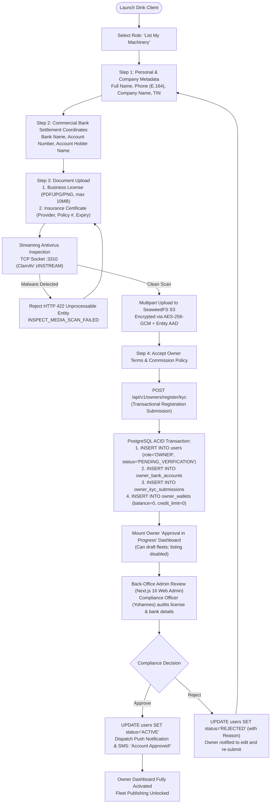
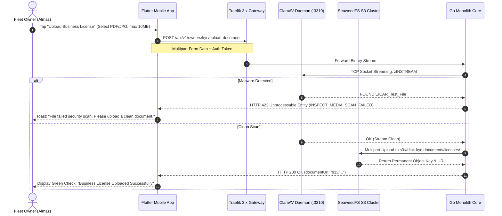
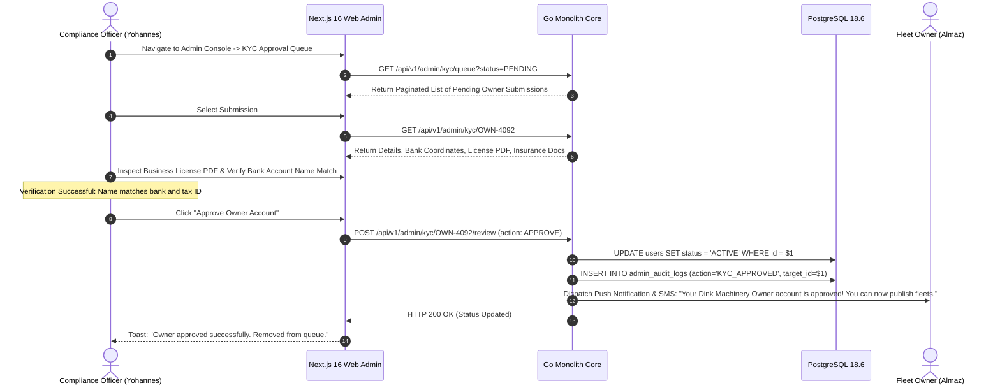
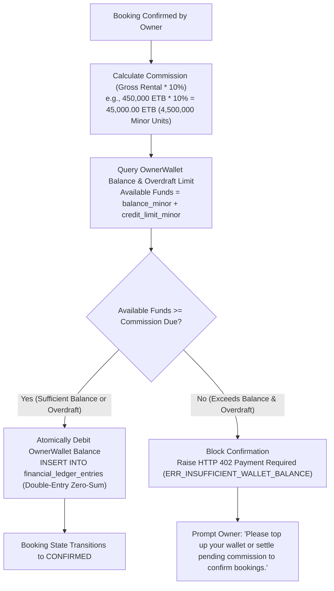
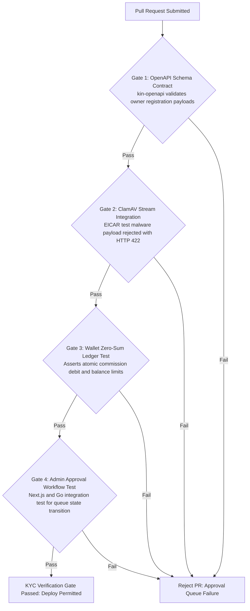

# Heavy Machinery & Logistics Rental Aggregator — Dink Machinery
## Interaction Flow Specification — 03. Fleet Owner Registration, Business KYC & Approval Queue Workflow (`docs/shared/flows/03-owner-registration-kyc-approval.md`)

**Document Identifier:** `FLOW-OWNER-KYC-DINK-CORE-V7.0`  
**Classification:** Canonical Interaction Flow & Wire Protocol Specification (Single Source of Truth)  
**Governing Documents:** `SRS-DINK-CORE-V7.0` (§5.1.2, §5.2.7), `FLOW-ENTRY-DINK-CORE-V7.0`, `FLOW-RENTER-AUTH-DINK-CORE-V7.0`, `ARCH-BACKEND-GO-DINK-CORE-V7.0`, `ARCH-FLUTTER-DINK-CORE-V7.0`, `ARCH-SEC-DINK-CORE-V7.0`, `DS-DINK-CORE-V7.0`, `DS-PERSONAS-DINK-CORE-V7.0`, `contracts/openapi.yaml`, `ADR-001`, `ADR-002`, `ADR-010`  
**Target Client Runtimes:** Flutter 3.47.8 / Dart 3.9 (Mobile Client), Next.js 16.x (latest CVE security patch) / React 19 (Admin Web Console), ClamAV Daemon, SeaweedFS S3, OpenBao KMS  
**Target Personas:** Fleet Owner & Depot Yard Manager (*W/ro Almaz Tesfaye* / *Kamau Ndegwa*), Back-Office Compliance Officer (*Yohannes Bekele*)  
**Target Operating Markets:** Ethiopia (`ET`) & Kenya (`KE`) — Dynamic Multi-Country Parameterization (`LOC-01-BE`)  
**Compliance Standards:** OWASP ASVS 4.0.3 Level 3 (Identity Validation & Secure File Ingestion), RFC 9457 (Problem Details), ISO 9241-110, W3C WCAG 2.2 Level AAA (Field Mode) & Level AA (Admin Mode), Ethiopian Business Registration and Licensing Proclamation, National Bank of Ethiopia (NBE) Directives  
**Status:** Approved Engineering Baseline

---

## Table of Contents

- 1. [Executive Summary & Architectural Scope](#1-executive-summary--architectural-scope)
  - 1.1 [Purpose & Governance Mandate](#11-purpose--governance-mandate)
  - 1.2 [The Asset Custodian Mental Model](#12-the-asset-custodian-mental-model)
- 2. [End-to-End Owner Registration & KYC Approval Flowchart](#2-end-to-end-owner-registration--kyc-approval-flowchart)
- 3. [Detailed Step-by-Step State Machine & User Journey](#3-detailed-step-by-step-state-machine--user-journey)
  - 3.1 [Step 1: Role Selection & Business Identity Ingestion](#31-step-1-role-selection--business-identity-ingestion)
  - 3.2 [Step 2: Commercial Bank Settlement Coordinates Configuration](#32-step-2-commercial-bank-settlement-coordinates-configuration)
  - 3.3 [Step 3: Secure Document Ingestion (Business License & Insurance) with ClamAV Scanning](#33-step-3-secure-document-ingestion-business-license--insurance-with-clamav-scanning)
  - 3.4 [Step 4: Owner Terms Acceptance & Pending State Hydration](#34-step-4-owner-terms-acceptance--pending-state-hydration)
  - 3.5 [Step 5: Back-Office Admin Review & Approval Queue Workflow (`AD-06-WEB`)](#35-step-5-back-office-admin-review--approval-queue-workflow-ad-06-web)
- 4. [Pre-Funded Commission Wallet Initialization (`OwnerWallet`)](#4-pre-funded-commission-wallet-initialization-ownerwallet)
  - 4.1 [The Commission Model & Overdraft Buffer (`credit_limit_minor`)](#41-the-commission-model--overdraft-buffer-credit_limit_minor)
  - 4.2 [Automatic Listing Deactivation on Commission Deficit](#42-automatic-listing-deactivation-on-commission-deficit)
- 5. [Frontier Market Edge Cases & Fault Recovery Protocols](#5-frontier-market-edge-cases--fault-recovery-protocols)
  - 5.1 [Rejected KYC Re-Submission & Diff Auditing](#51-rejected-kyc-re-submission--diff-auditing)
  - 5.2 [Bank Account Discrepancies & Name Matching Failures](#52-bank-account-discrepancies--name-matching-failures)
- 6. [Wire Protocol Contracts & RFC 9457 Error Schemas](#6-wire-protocol-contracts--rfc-9457-error-schemas)
  - 6.1 [`POST /api/v1/owners/register/kyc`](#61-post-apiv1ownersregisterkyc)
  - 6.2 [`GET /api/v1/admin/kyc/queue`](#62-get-apiv1adminkycqueue)
  - 6.3 [`POST /api/v1/admin/kyc/{id}/review`](#63-post-apiv1adminkycidreview)
- 7. [Automated Testing Suite & Verification Gates](#7-automated-testing-suite--verification-gates)

---

## 1. Executive Summary & Architectural Scope

### 1.1 Purpose & Governance Mandate

The **Fleet Owner Registration, Business KYC & Approval Queue Workflow** governs the onboarding of equipment owners, transport operators, and depot yard managers across Ethiopia and Kenya. 

Unlike individual renters who achieve instant digital activation via telephone verification (`FLOW-RENTER-AUTH-DINK-CORE-V7.0`), Fleet Owners list high-value capital assets ($50,000\text{–}15,000,000+\text{ ETB}$) and receive direct commercial wire transfers from contractors. Consequently, they are subject to rigorous **Business Know-Your-Customer (KYC)** compliance, commercial bank validation, business license inspection, and mandatory insurance certificate verification.

This specification enforces three core system guarantees:
1. **Zero Unverified Listings:** No machinery or transport fleet can enter the public spatial discovery index (`POST /api/v1/fleets`) until the owner's legal entity has been reviewed and approved by platform compliance staff in the administrative approval queue.
2. **In-Flight Antivirus Defense (`ARCH-SEC-DINK-CORE-V7.0`):** All uploaded business licenses, trade registrations, and insurance policies are synchronously inspected for malware via a TCP stream to a ClamAV daemon (`zINSTREAM` on port `3310`) before storage commit.
3. **Pre-Funded Commission Infrastructure (`OwnerWallet`):** Successful registration initializes an immutable ledger owner wallet paired with an overdraft credit buffer, ensuring automated commission collection on direct peer-to-peer settlements.

### 1.2 The Asset Custodian Mental Model

The experience is engineered around **Persona 2: Fleet Owner** (*W/ro Almaz Tesfaye*), whose psychological and operational traits are codified in `DS-PERSONAS-DINK-CORE-V7.0`:
* **Skepticism of Digital Intermediaries:** Owners fear platform lockups of their working capital. The onboarding flow clearly displays their registered bank account coordinates, assuring them that rental wire payments route directly to their bank.
* **Depot Yard Operational Tempo:** Owners register fleets from active depot yards amid heavy truck noise ($80\text{ dB}$) and bright daylight, requiring large form inputs, clear step indicators, and robust offline caching via Isar NoSQL.

---

## 2. End-to-End Owner Registration & KYC Approval Flowchart



---

## 3. Detailed Step-by-Step State Machine & User Journey

### 3.1 Step 1: Role Selection & Business Identity Ingestion

1. The user taps **"List My Machinery"** on the Universal Entry Shell.
2. The registration stepper mounts, presenting the personal and business identity form.
3. The owner inputs their full legal name, optional registered company name (e.g., *Tesfaye Heavy Transport PLC*), and mandatory Tax Identification Number (**TIN**).
4. Client-side validators assert TIN format compliance (e.g., 10-digit Ethiopian Ministry of Revenues format).

### 3.2 Step 2: Commercial Bank Settlement Coordinates Configuration

Because Dink Machinery operates under a non-custodial direct wire model (`MANUAL_TRANSFER`), the owner must input the exact bank account where contractors will wire hire funds.

```text
+-------------------------------------------------------------------+
|  [<- BACK]              STEP 2 OF 4              KYC VERIFICATION |
+-------------------------------------------------------------------+
|  SETTLEMENT BANK COORDINATES                                      |
|  Contractors will wire rental prepayments directly to this bank.  |
|                                                                   |
|  SELECT COMMERCIAL BANK *                                         |
|  +-------------------------------------------------------------+  |
|  | Commercial Bank of Ethiopia (CBE)                       [v] |  |
|  +-------------------------------------------------------------+  |
|                                                                   |
|  BANK ACCOUNT NUMBER *                                            |
|  +-------------------------------------------------------------+  |
|  | 1 0 0 0 4 8 2 9 1 0 2 3 4                                   |  |
|  +-------------------------------------------------------------+  |
|                                                                   |
|  ACCOUNT HOLDER NAME * (Must match Business License)             |
|  +-------------------------------------------------------------+  |
|  | Tesfaye Heavy Transport PLC                                 |  |
|  +-------------------------------------------------------------+  |
|                                                                   |
|  (i) Account name must match legal business registration.         |
|                                                                   |
|  +-------------------------------------------------------------+  |
|  |                 CONTINUE TO DOCUMENTS                       |  |
|  |                 (Height: 56dp, Amber 500)                   |  |
|  +-------------------------------------------------------------+  |
+-------------------------------------------------------------------+
```

#### Bank Validation Rules
* **Bank Name:** Selected from a dynamic dropdown fetched from `country_configs` (supports Commercial Bank of Ethiopia, Awash Bank, Dashen Bank, Bank of Abyssinia, Cooperative Bank of Oromia, KCB Kenya, Equity Bank Kenya).
* **Account Number:** Validated using modular arithmetic check algorithms specific to the selected financial institution.
* **Account Holder Name:** Enforced via string comparison against the business license name during admin review. Mismatches trigger automated compliance flags.

### 3.3 Step 3: Secure Document Ingestion (Business License & Insurance) with ClamAV Scanning

Owners must upload their official Business License and at least one active machinery insurance policy certificate.



#### Insurance Certificate Form Fields
* **Insurance Provider Name:** Text input (e.g., *Awash Insurance S.C.* / *ICEA LION Insurance*).
* **Policy Number:** Mandatory alphanumeric string.
* **Coverage Type:** Dropdown selection (`Third Party Fire & Theft` vs. `Comprehensive Plant All-Risks`).
* **Expiry Date:** Calendar date picker. The backend validates that `expiry_date > CURRENT_TIMESTAMP + 30 days`. Expired insurance automatically suspends fleet listings.

### 3.4 Step 4: Owner Terms Acceptance & Pending State Hydration

1. The owner reviews the **Fleet Owner Terms & Conditions**, which outline pre-funded commission deduction rules, platform dispute SLAs, and telematics compliance.
2. Tapping **"Submit Account for Verification"** dispatches `POST /api/v1/owners/register/kyc`.
3. The Go backend executes an ACID transaction creating the user record in `PENDING_VERIFICATION` status, storing bank coordinates, persisting encrypted document URIs, and initializing a zero-balance `OwnerWallet`.
4. The client mounts the **Approval in Progress Dashboard**. The owner can explore the app and draft equipment specifications, but the **Publish Fleet** actuator remains locked until administrative approval is granted.

### 3.5 Step 5: Back-Office Admin Review & Approval Queue Workflow (`AD-06-WEB`)

The approval queue is managed by compliance officers (such as *Yohannes Bekele*) using the Next.js 16 Admin Web Console (`ARCH-ADMIN-NEXT-DINK-CORE-V7.0`).



#### Admin Review Actions & Rejection Workflows
* **Approve:** Instantly updates `users.status` to `ACTIVE`. Triggers automated SMS and push notifications to the owner. Unlocks fleet publishing capabilities.
* **Reject:** Requires the compliance officer to select a structured rejection reason code (`ERR_INVALID_BUSINESS_LICENSE`, `ERR_BANK_NAME_MISMATCH`, `ERR_EXPIRED_INSURANCE`) and input an explanatory note. The owner receives a notification detailing the correction required and is redirected to edit their submission without re-entering all data from scratch.

---

## 4. Pre-Funded Commission Wallet Initialization (`OwnerWallet`)

### 4.1 The Commission Model & Overdraft Credit Buffer (`credit_limit_minor`)

Because Dink Machinery does not hold customer escrow balances under National Bank of Ethiopia directives, platform commission (e.g., 10% of gross rental value) cannot be deducted from escrow at payout. Instead, commission is debited automatically from the owner's pre-funded platform wallet (`owner_wallets`) at the moment a booking is confirmed (`BK-17-BE`).



### 4.2 Automatic Listing Deactivation on Commission Deficit

If an owner's wallet balance falls below zero and exceeds their approved `credit_limit_minor` (e.g., due to offline adjustments or manual billing errors):
1. The background reconciliation cron worker automatically triggers `owner_deactivation_trigger`.
2. All active fleet listings for that owner transition from `ACTIVE` to `INACTIVE`.
3. The owner's mobile application displays a persistent warning banner: *"Your commission wallet has a negative balance. Fleet listings are temporarily paused until your account balance is restored."*
4. Once the owner submits a bank top-up request and platform finance verifies the wire deposit, the wallet balance updates and listings automatically revert to `ACTIVE`.

---

## 5. Frontier Market Edge Cases & Fault Recovery Protocols

### 5.1 Rejected KYC Re-Submission & Diff Auditing

When an owner's KYC submission is rejected by compliance:
* The mobile application preserves all previously entered text fields (TIN, Bank Account, Company Name).
* Only the specific rejected document (e.g., expired insurance certificate) is flagged for re-upload.
* The backend maintains an immutable audit trail in `owner_kyc_history`, recording version numbers, rejection timestamps, and compliance officer notes.

### 5.2 Bank Account Discrepancies & Name Matching Failures

If the account holder name on the bank settlement account does not match the registered business name or personal name:
* Automated string similarity checks (`Levenshtein distance`) flag the discrepancy during submission.
* The system routes the application to the manual compliance review queue with an `ATTENTION: Name Mismatch` badge, requiring Yohannes to verify supporting legal documents (such as a sole proprietorship trade name certificate) before approval.

---

## 6. Wire Protocol Contracts & RFC 9457 Error Schemas

### 6.1 `POST /api/v1/owners/register/kyc`

Submits the complete owner KYC profile, bank coordinates, and document S3 URIs.

#### Request Headers
```http
POST /api/v1/owners/register/kyc HTTP/1.1
Host: api.dinkmachinery.com
Content-Type: application/json
Authorization: Bearer <registrationTicketToken>
X-Country-Code: ET
```

#### Request Payload
```json
{
  "fullName": "W/ro Almaz Tesfaye",
  "companyName": "Tesfaye Heavy Transport PLC",
  "taxIdentificationNumber": "0048291023",
  "bankDetails": {
    "bankName": "Commercial Bank of Ethiopia",
    "accountNumber": "1000482910234",
    "accountHolderName": "Tesfaye Heavy Transport PLC"
  },
  "documents": {
    "businessLicenseUri": "s3://dink-kyc-documents/licenses/biz_lic_992a81.pdf",
    "insuranceCertificates": [
      {
        "providerName": "Awash Insurance S.C.",
        "policyNumber": "AW-PLV-2026-8841",
        "coverageType": "COMPREHENSIVE_PLANT",
        "expiryDate": "2027-10-27T00:00:00Z",
        "documentUri": "s3://dink-kyc-documents/insurance/ins_cert_119f.pdf"
      }
    ]
  },
  "acceptedTerms": true
}
```

#### Response: `HTTP 201 Created`
```json
{
  "success": true,
  "data": {
    "ownerId": "018f6a9e-876b-7341-a189-bc849901d892",
    "accountStatus": "PENDING_VERIFICATION",
    "walletInitialized": true,
    "submittedAt": "2026-10-27T12:30:00Z"
  },
  "timestamp": "2026-10-27T12:30:01Z"
}
```

---

### 6.2 `GET /api/v1/admin/kyc/queue`

Retrieves paginated pending owner KYC submissions for back-office compliance review.

#### Request Headers
```http
GET /api/v1/admin/kyc/queue?status=PENDING&page=1&limit=20 HTTP/1.1
Host: api.dinkmachinery.com
Authorization: Bearer <adminSessionCookie>
```

#### Response: `HTTP 200 OK`
```json
{
  "success": true,
  "data": {
    "totalCount": 14,
    "page": 1,
    "limit": 20,
    "submissions": [
      {
        "submissionId": "sub_992a81",
        "ownerId": "018f6a9e-876b-7341-a189-bc849901d892",
        "fullName": "W/ro Almaz Tesfaye",
        "companyName": "Tesfaye Heavy Transport PLC",
        "submittedAt": "2026-10-27T12:30:00Z",
        "status": "PENDING"
      }
    ]
  },
  "timestamp": "2026-10-27T12:35:10Z"
}
```

---

### 6.3 `POST /api/v1/admin/kyc/{id}/review`

Admin endpoint to approve or reject a pending owner KYC submission.

#### Request Payload (Approval)
```json
{
  "action": "APPROVE",
  "reviewNotes": "Business license verified against Ministry of Trade registry. Bank account name matches company registration."
}
```

#### Response: `HTTP 200 OK`
```json
{
  "success": true,
  "data": {
    "ownerId": "018f6a9e-876b-7341-a189-bc849901d892",
    "newStatus": "ACTIVE",
    "reviewedBy": "Yohannes Bekele",
    "reviewedAt": "2026-10-27T12:40:15Z"
  },
  "timestamp": "2026-10-27T12:40:15Z"
}
```

---

## 7. Automated Testing Suite & Verification Gates



1. **OpenAPI Schema Contract Gate (`kin-openapi`):** Lints all owner KYC request envelopes against `contracts/openapi.yaml`.
2. **ClamAV Streaming Antivirus Integration Test:** Automated test uploads a test malware signature (EICAR standard string), asserting that the file upload pipeline intercepts the stream and returns HTTP 422 `INSPECT_MEDIA_SCAN_FAILED`.
3. **OwnerWallet Zero-Sum Ledger Integration Test:** Spin up a PostgreSQL testcontainer and simulate booking confirmation commission debits, asserting that the double-entry invariant holds and that insufficient balances successfully block confirmations.
4. **Admin Queue State Transition Test:** End-to-end integration test verifying that approving an owner in the Next.js admin console instantly lifts listing restrictions on the mobile client.

---

*This document defines the canonical interaction flow, system behavior, and wire protocols for Fleet Owner Registration, Business KYC & Approval Workflow in Dink Machinery Version 7.0. All downstream Flutter mobile screens, Go HTTP controllers, and administrative web gateways must strictly adhere to this specification.*
````