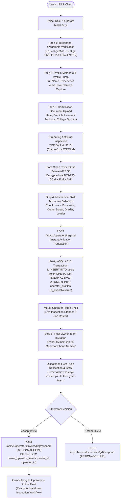
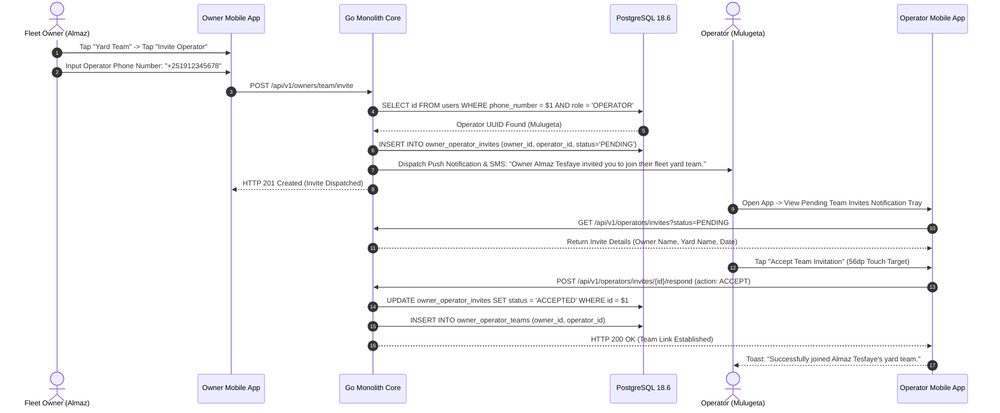
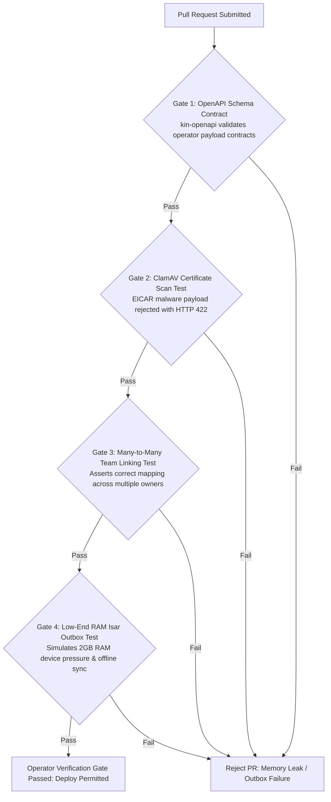

# Heavy Machinery & Logistics Rental Aggregator — Dink Machinery
## Interaction Flow Specification — 04. Certified Equipment Operator Registration, Skills Taxonomy & Fleet Yard Team Linking (`docs/shared/flows/04-operator-registration-linking.md`)

**Document Identifier:** `FLOW-OPERATOR-LINK-DINK-CORE-V7.0`  
**Classification:** Canonical Interaction Flow & Wire Protocol Specification (Single Source of Truth)  
**Governing Documents:** `SRS-DINK-CORE-V7.0` (§5.1.3, §5.2.8), `FLOW-ENTRY-DINK-CORE-V7.0`, `FLOW-RENTER-AUTH-DINK-CORE-V7.0`, `FLOW-OWNER-KYC-DINK-CORE-V7.0`, `ARCH-BACKEND-GO-DINK-CORE-V7.0`, `ARCH-FLUTTER-DINK-CORE-V7.0`, `ARCH-SEC-DINK-CORE-V7.0`, `DS-DINK-CORE-V7.0`, `DS-PERSONAS-DINK-CORE-V7.0`, `contracts/openapi.yaml`, `ADR-001`, `ADR-006`  
**Target Client Runtimes:** Flutter 3.47.8 / Dart 3.9 (Cross-Platform Mobile Client), Isar NoSQL Local Cache, ClamAV Daemon, SeaweedFS S3  
**Target Personas:** Certified Equipment Field Operator (*Mulugeta Tadesse* / *Juma Omwamba*), Fleet Owner & Depot Yard Manager (*W/ro Almaz Tesfaye*)  
**Target Operating Markets:** Ethiopia (`ET`) & Kenya (`KE`) — Dynamic Multi-Country Parameterization (`LOC-01-BE`)  
**Compliance Standards:** OWASP ASVS 4.0.3 Level 3, RFC 9457 (Problem Details), ISO 9241-110, W3C WCAG 2.2 Level AAA (Field Operator Mode), Ethiopian Personal Data Protection Proclamation No. 1321/2024  
**Status:** Approved Engineering Baseline

---

## Table of Contents

- 1. [Executive Summary & Architectural Scope](#1-executive-summary--architectural-scope)
  - 1.1 [Purpose & Operational Mandate](#11-purpose--operational-mandate)
  - 1.2 [The Cab Technician Mental Model](#12-the-cab-technician-mental-model)
- 2. [End-to-End Operator Registration & Fleet Linking Flowchart](#2-end-to-end-operator-registration--fleet-linking-flowchart)
- 3. [Detailed Step-by-Step State Machine & User Journey](#3-detailed-step-by-step-state-machine--user-journey)
  - 3.1 [Step 1: Role Selection & Telephony Verification](#31-step-1-role-selection--telephony-verification)
  - 3.2 [Step 2: Profile Metadata Ingestion & Certification Upload](#32-step-2-profile-metadata-ingestion--certification-upload)
  - 3.3 [Step 3: Mechanical Skill Taxonomy Selection (Dynamic Checkboxes)](#33-step-3-mechanical-skill-taxonomy-selection-dynamic-checkboxes)
  - 3.4 [Step 4: Instant Activation & Operator Pool Onboarding](#34-step-4-instant-activation--operator-pool-onboarding)
  - 3.5 [Step 5: Many-to-Many Fleet Yard Team Invitation & Acceptance Flow](#35-step-5-many-to-many-fleet-yard-team-invitation--acceptance-flow)
  - 3.6 [Step 6: Fleet Assignment & Operational Handover Dispatch](#36-step-6-fleet-assignment--operational-handover-dispatch)
- 4. [Frontier Market Edge Cases & Fault Recovery Protocols](#4-frontier-market-edge-cases--fault-recovery-protocols)
  - 4.1 [Low-End Android Device Optimization (Android 13 Go Edition, 2GB RAM)](#41-low-end-android-device-optimization-android-13-go-edition-2gb-ram)
  - 4.2 [Deep Trench Signal Blackouts & Offline Team Acceptance Queues](#42-deep-trench-signal-blackouts--offline-team-acceptance-queues)
  - 4.3 [Dual-Owner Invitation Conflicts & Primary Yard Binding](#43-dual-owner-invitation-conflicts--primary-yard-binding)
- 5. [Wire Protocol Contracts & RFC 9457 Error Schemas](#5-wire-protocol-contracts--rfc-9457-error-schemas)
  - 5.1 [`POST /api/v1/operators/register`](#51-post-apiv1operatorsregister)
  - 5.2 [`POST /api/v1/owners/team/invite`](#52-post-apiv1ownersteaminvite)
  - 5.3 [`POST /api/v1/operators/invites/{id}/respond`](#53-post-apiv1operatorsinvitesidrespond)
- 6. [Automated Testing Suite & Verification Gates](#6-automated-testing-suite--verification-gates)

---

## 1. Executive Summary & Architectural Scope

### 1.1 Purpose & Operational Mandate

The **Certified Equipment Operator Registration, Skills Taxonomy & Fleet Yard Team Linking Flow** governs the onboarding of heavy plant operators (excavator, crane, bulldozer, and grader drivers) and their direct affiliation with equipment fleet owners across Ethiopia and Kenya.

Unlike Fleet Owners who are subjected to rigorous multi-day business KYC audits (`FLOW-OWNER-KYC-DINK-CORE-V7.0`), **Certified Operators achieve instant digital activation** upon telephone verification and certification badge upload. This design priority ensures that machinery owners can source, invite, and assign qualified operators immediately without bureaucratic delays, preventing idle equipment in depot yards or active construction trenches.

This specification enforces three core architectural invariants:
1. **Instant Talent Pool Activation:** Completed operator registrations automatically populate the spatial operator talent pool (`operator_profiles`), making verified skill badges searchable by depot yard managers.
2. **Many-to-Many Fleet Yard Affiliation:** A single certified operator can be invited to and maintain active employment links with multiple fleet owning entities while remaining cleanly isolated across operational rosters.
3. **Glove-Friendly Field Ergonomics:** Interfaces for operators are strictly engineered for rugged low-end mobile hardware operated inside high-noise ($> 100\text{ dB}$), vibrating machine cabs under direct tropical sunlight.

### 1.2 The Cab Technician Mental Model

The experience is engineered around **Persona 3: Certified Equipment Field Operator** (*Mulugeta Tadesse*), whose psychological and physical traits are codified in `DS-PERSONAS-DINK-CORE-V7.0`:
* **Harsh Operating Constraints:** Operates under extreme glare ($> 85,000\text{ lux}$) wearing heavy split-leather gauntlet work gloves coated in grease. Requires minimum touch targets of **$56 \times 56\text{ dp}$** and automatic switching to Outdoor High-Contrast Mode.
* **Transient Connectivity:** Operates in deep road cuts and remote river basins with intermittent 2G/EDGE coverage, requiring robust local outbox queuing via Isar NoSQL.

---

## 2. End-to-End Operator Registration & Fleet Linking Flowchart



---

## 3. Detailed Step-by-Step State Machine & User Journey

### 3.1 Step 1: Role Selection & Telephony Verification

1. The user taps **"I Operate Machinery"** on the Universal Entry Shell.
2. The application executes the passwordless telephony authentication protocol (`FLOW-ENTRY-DINK-CORE-V7.0`), capturing the operator's E.164 mobile number and verifying it via a 6-digit SMS OTP.
3. Upon successful OTP verification, the backend issues an ephemeral registration ticket token (`registrationTicketToken`).

### 3.2 Step 2: Profile Metadata Ingestion & Certification Upload

The operator provides professional background information and uploads heavy machinery operating licenses.

```text
+-------------------------------------------------------------------+
|  [<- BACK]              STEP 2 OF 4             OPERATOR PROFILE  |
+-------------------------------------------------------------------+
|  CREDENTIALS & CERTIFICATION                                      |
|  Upload your government heavy machinery driving license.          |
|                                                                   |
|  YEARS OF HEAVY PLANT EXPERIENCE *                                |
|  +-------------------------------------------------------------+  |
|  | 9 Years                                                 [v] |  |
|  +-------------------------------------------------------------+  |
|  |                                                               |  |
|  | [UPLOAD DRIVING LICENSE / TECHNICAL DIPLOMA]                   |  |
|  | (PDF, JPG, PNG - Max 10MB)                                    |  |
|  +-------------------------------------------------------------+  |
|                                                                   |
|  (i) Verified certificates increase assignment priority.          |
|                                                                   |
|  +-------------------------------------------------------------+  |
|  |                 CONTINUE TO SKILLS                          |  |
|  |                 (Height: 56dp, Amber 500)                   |  |
|  +-------------------------------------------------------------+  |
+-------------------------------------------------------------------+
```

#### Document Upload Security Pipeline
* Files selected from the device storage are streamed through the Traefik edge proxy directly to the backend document controller.
* The Go backend immediately pipes the binary stream to the **ClamAV daemon** over TCP socket `:3310` using the `zINSTREAM` protocol (`ARCH-SEC-DINK-CORE-V7.0`).
* If malware is detected, the upload is rejected with HTTP 422 (`INSPECT_MEDIA_SCAN_FAILED`). If clean, the file is committed to SeaweedFS S3.

### 3.3 Step 3: Mechanical Skill Taxonomy Selection (Dynamic Checkboxes)

Operators configure their machinery competencies so fleet owners can filter candidates by exact equipment classes.

```text
+-------------------------------------------------------------------+
|  [<- BACK]              STEP 3 OF 4             OPERATOR SKILLS   |
+-------------------------------------------------------------------+
|  SELECT MACHINERY COMPETENCIES                                    |
|  Check all machinery types you are certified to operate.          |
|                                                                   |
|  [X] Hydraulic Crawler Excavator (20t - 50t+)                     |
|  [ ] All-Terrain Mobile Crane (30t - 100t+)                       |
|  [X] Tracked Bulldozer (D6 - D9 Class)                            |
|  [ ] Articulated Motor Grader (14M Class)                         |
|  [ ] Wheel Loader & Material Handler                              |
|                                                                   |
|  +-------------------------------------------------------------+  |
|  |                 COMPLETE REGISTRATION                       |  |
|  |                 (Height: 56dp, Amber 500)                   |  |
|  +-------------------------------------------------------------+  |
+-------------------------------------------------------------------+
```

#### Skill Taxonomy Storage
Selected skills are serialized into a PostgreSQL `TEXT[]` array column (`operator_profiles.skills_array`) indexed via a GIN index, enabling high-performance spatial and categorical matching when owners search for available operators.

### 3.4 Step 4: Instant Activation & Operator Pool Onboarding

When the operator taps **"Complete Registration"**, the client dispatches `POST /api/v1/operators/register`.

The Go backend executes an atomic transaction:
```sql
-- 1. Create Core User Record
INSERT INTO users (
    id, phone_number, full_name, primary_role, status, country_code, created_at, updated_at
) VALUES (
    $1, $2, $3, 'OPERATOR', 'ACTIVE', $4, NOW(), NOW()
);

-- 2. Create Operator Profile Entity
INSERT INTO operator_profiles (
    id, user_id, experience_years, license_uri, skills_array, is_available
) VALUES (
    gen_random_uuid(), $1, $5, $6, $7, true
);
```

**Zero Waiting Queue:** Unlike fleet owners, the user status is immediately set to `ACTIVE`. The client stores the ES256 token pair in secure storage and mounts the **Operator Home Shell**, displaying active job assignments and handover inspection modules.

### 3.5 Step 5: Many-to-Many Fleet Yard Team Invitation & Acceptance Flow

Fleet owners (such as *Almaz Tesfaye*) assemble their operating crews by inviting certified operators directly into their depot yard teams.



### 3.6 Step 6: Fleet Assignment & Operational Handover Dispatch

Once an operator has accepted an owner's team invitation:
1. The owner can select any active machine in their depot inventory and assign Mulugeta as the designated primary operator for an upcoming rental booking.
2. The assignment cascades instantly to Mulugeta's mobile application, displaying the designated machine, project location GPS coordinates, and scheduled check-in window.
3. Mulugeta can initiate the mandatory **Camera-Reticle Handover Inspection** (`FLOW-RENTER-AUTH` / `DS-DINK-CORE-V7.0`), capturing the initial hour meter and condition photos before project mobilization.

---

## 4. Frontier Market Edge Cases & Fault Recovery Protocols

### 4.1 Low-End Android Device Optimization (Android 13 Go Edition, 2GB RAM)

Field operators frequently operate entry-level smartphones (e.g., *Itel A70* or *Tecno Pop 7* running Android Go Edition with 2GB RAM):
* **Aggressive Memory Footprint Control:** The Flutter application limits image cache sizes to 25MB and compresses all inspection photos in background worker isolates (`compute()`) to WebP format at 82% quality prior to upload.
* **Zero Jank UI Thread:** Heavy cryptographic operations and database writes are offloaded entirely from the UI thread to isolate workers, maintaining a stable 60 frames per second during field inspection flows.

### 4.2 Deep Trench Signal Blackouts & Offline Team Acceptance Queues

If an operator is working inside a deep foundation trench or quarry pit with zero cellular connectivity when an owner dispatches a team invite:
* The invite is safely cached in the local **Isar NoSQL** database via background synchronization polling.
* When the operator ascends the trench and re-establishes cellular connectivity, the client automatically synchronizes pending team invites and displays the notification tray without requiring manual page reloads.

### 4.3 Dual-Owner Invitation Conflicts & Primary Yard Binding

Because operators can maintain relationships with multiple equipment owners:
* Accepting an invitation from Owner A does not restrict acceptance of an invitation from Owner B.
* When assigned to simultaneous overlapping bookings, the operator interface clearly flags scheduling conflicts on the calendar view, preventing double-booking of operator hours across distinct project sites.

---

## 5. Wire Protocol Contracts & RFC 9457 Error Schemas

### 5.1 `POST /api/v1/operators/register`

Completes operator registration, storing license URIs and skills taxonomy arrays.

#### Request Headers
```http
POST /api/v1/operators/register HTTP/1.1
Host: api.dinkmachinery.com
Content-Type: application/json
Authorization: Bearer <registrationTicketToken>
X-Country-Code: ET
```

#### Request Payload
```json
{
  "fullName": "Mulugeta Tadesse",
  "experienceYears": 9,
  "licenseUri": "s3://dink-kyc-documents/operator_licenses/lic_8829a1.pdf",
  "skillsArray": [
    "HYDRAULIC_CRAWLER_EXCAVATOR",
    "TRACKED_BULLDOZER"
  ]
}
```

#### Response: `HTTP 201 Created`
```json
{
  "success": true,
  "data": {
    "operatorId": "018f6a9e-876b-7341-a189-bc849901d892",
    "status": "ACTIVE",
    "profileActive": true,
    "registeredAt": "2026-10-27T13:00:00Z"
  },
  "timestamp": "2026-10-27T13:00:01Z"
}
```

---

### 5.2 `POST /api/v1/owners/team/invite`

Allows a verified fleet owner to invite a certified operator to their depot yard team by phone number.

#### Request Headers
```http
POST /api/v1/owners/team/invite HTTP/1.1
Host: api.dinkmachinery.com
Content-Type: application/json
Authorization: Bearer <ownerAccessToken>
```

#### Request Payload
```json
{
  "operatorPhoneNumber": "+251912345678",
  "yardLocationName": "Kality Machinery Depot Yard"
}
```

#### Response: `HTTP 201 Created`
```json
{
  "success": true,
  "data": {
    "inviteId": "inv_4429b1",
    "ownerId": "018f6a9e-876b-7341-a189-bc849901d892",
    "operatorId": "018f6a9e-876b-7341-a189-c1998274f890",
    "status": "PENDING",
    "dispatchedAt": "2026-10-27T13:15:00Z"
  },
  "timestamp": "2026-10-27T13:15:01Z"
}
```

---

### 5.3 `POST /api/v1/operators/invites/{id}/respond`

Allows an operator to accept or decline a fleet owner's team invitation.

#### Request Headers
```http
POST /api/v1/operators/invites/inv_4429b1/respond HTTP/1.1
Host: api.dinkmachinery.com
Content-Type: application/json
Authorization: Bearer <operatorAccessToken>
```

#### Request Payload
```json
{
  "action": "ACCEPT"
}
```

#### Response: `HTTP 200 OK`
```json
{
  "success": true,
  "data": {
    "inviteId": "inv_4429b1",
    "newStatus": "ACCEPTED",
    "teamLinkId": "team_link_019a",
    "respondedAt": "2026-10-27T13:20:00Z"
  },
  "timestamp": "2026-10-27T13:20:00Z"
}
```

---

## 6. Automated Testing Suite & Verification Gates



1. **OpenAPI Schema Contract Gate (`kin-openapi`):** Validates all operator registration and team invitation endpoints against `contracts/openapi.yaml`.
2. **ClamAV Certificate Ingestion Test:** Automated test uploading a malicious PDF payload disguised as an operating license, asserting interception and HTTP 422 `INSPECT_MEDIA_SCAN_FAILED`.
3. **Many-to-Many Team Link Integration Test:** Integration test verifying that an operator can accept invitations from two distinct fleet owners simultaneously without database integrity violations.
4. **Low-End RAM & Isar Outbox Test:** Headless widget test simulating low memory conditions and offline network toggles, verifying that inspection capture and team invite responses queue locally in Isar NoSQL and sync successfully upon reconnection.

---

*This document defines the canonical interaction flow, system behavior, and wire protocols for Certified Equipment Operator Registration, Skills Taxonomy & Fleet Yard Team Linking in Dink Machinery Version 7.0. All downstream Flutter mobile screens, Go HTTP controllers, and database schemas must strictly adhere to this specification.*