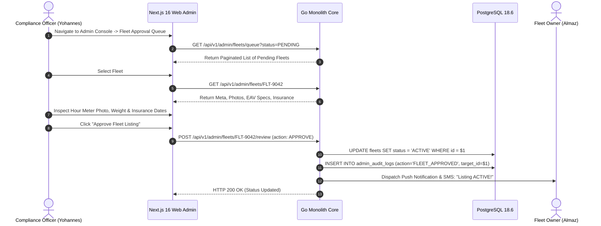
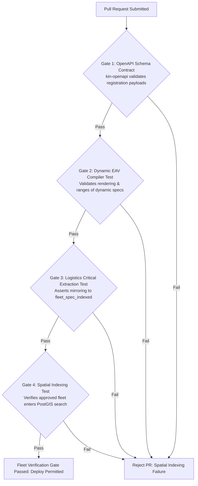

# Heavy Machinery & Logistics Rental Aggregator — Dink Machinery
## Interaction Flow Specification — 05. Fleet Registration, Dynamic EAV Specs, Pricing & Admin Approval Pipeline (`docs/shared/flows/05-fleet-registration-full-flow.md`)

**Document Identifier:** `FLOW-FLEET-REG-DINK-CORE-V7.0`  
**Classification:** Canonical Interaction Flow & Wire Protocol Specification (Single Source of Truth)  
**Governing Documents:** `SRS-DINK-CORE-V7.0` (§5.2), `FLOW-ENTRY-DINK-CORE-V7.0`, `FLOW-OWNER-KYC-DINK-CORE-V7.0`, `ARCH-BACKEND-GO-DINK-CORE-V7.0`, `ARCH-FLUTTER-DINK-CORE-V7.0`, `ARCH-SEC-DINK-CORE-V7.0`, `DS-DINK-CORE-V7.0`, `DS-PERSONAS-DINK-CORE-V7.0`, `contracts/openapi.yaml`, `ADR-001`, `ADR-003`, `ADR-007`  
**Target Client Runtimes:** Flutter 3.47.9 / Dart 3.9 (Cross-Platform Mobile), Next.js 16.x (latest CVE security patch) / React 19 (Admin Web Console), PostgreSQL 18.6 + PostGIS 3.6.4, SeaweedFS S3, ClamAV Daemon  
**Target Personas:** Fleet Owner & Depot Yard Manager (*W/ro Almaz Tesfaye*), Back-Office Compliance Officer (*Yohannes Bekele*)  
**Target Operating Markets:** Ethiopia (`ET`) & Kenya (`KE`) — Dynamic Multi-Country Parameterization (`LOC-01-BE`)  
**Compliance Standards:** OWASP ASVS 4.0.3 Level 3, RFC 9457 (Problem Details), ISO 9241-110, W3C WCAG 2.2 Level AAA (Field Mode) & Level AA (Admin Mode), National Bank of Ethiopia (NBE) Directives  
**Status:** Approved Engineering Baseline

---

## Table of Contents

- 1. [Executive Summary & Architectural Scope](#1-executive-summary--architectural-scope)
  - 1.1 [Purpose & Architectural Rationale](#11-purpose--architectural-rationale)
  - 1.2 [The Fleet Onboarding Ecosystem](#12-the-fleet-onboarding-ecosystem)
- 2. [End-to-End Fleet Registration & Approval Flowchart](#2-end-to-end-fleet-registration--approval-flowchart)
- 3. [Detailed Step-by-Step State Machine & User Journey](#3-detailed-step-by-step-state-machine--user-journey)
  - 3.1 [Step 1: Category Selection & Two-Level Cascading Dynamic Schema Loading](#31-step-1-category-selection--two-level-cascading-dynamic-schema-loading)
  - 3.2 [Step 2: Basic Metadata, Hour Meter Baseline & Mandatory Photo Bundles](#32-step-2-basic-metadata-hour-meter-baseline--mandatory-photo-bundles)
  - 3.3 [Step 3: Dynamic Entity-Attribute-Value (EAV) Specification Compiler Form](#33-step-3-dynamic-entity-attribute-value-eav-specification-compiler-form)
  - 3.4 [Step 4: Pricing Structures, Booking Rules & Prepayment Terms](#34-step-4-pricing-structures-booking-rules--prepayment-terms)
  - 3.5 [Step 5: Operator Assignment, Logistics Configuration & Attachment Bundling](#35-step-5-operator-assignment-logistics-configuration--attachment-bundling)
  - 3.6 [Step 6: Availability Calendar Setup & Submission to Admin Queue (`PENDING`)](#36-step-6-availability-calendar-setup--submission-to-admin-queue-pending)
  - 3.7 [Step 7: Back-Office Admin Review & Approval Queue Pipeline (`AD-06-WEB`)](#37-step-7-back-office-admin-review--approval-queue-pipeline-ad-06-web)
- 4. [Frontier Market Edge Cases & Fault Recovery Protocols](#4-frontier-market-edge-cases--fault-recovery-protocols)
  - 4.1 [Offline Draft Caching & Isar NoSQL Outbox Sync (`ADR-010`)](#41-offline-draft-caching--isar-nosql-outbox-sync-adr-010)
  - 4.2 [Dynamic Schema Version Mismatches & Client Serialization Faults](#42-dynamic-schema-version-mismatches--client-serialization-faults)
  - 4.3 [Duplicate Registration Interception & Plate Collision Checks](#43-duplicate-registration-interception--plate-collision-checks)
- 5. [Wire Protocol Contracts & RFC 9457 Error Schemas](#5-wire-protocol-contracts--rfc-9457-error-schemas)
  - 5.1 [`GET /api/v1/categories/{id}/spec-fields`](#51-get-apiv1categoriesidspec-fields)
  - 5.2 [`POST /api/v1/fleets`](#52-post-apiv1fleets)
  - 5.3 [`GET /api/v1/admin/fleets/queue`](#53-get-apiv1adminfleetsqueue)
  - 5.4 [`POST /api/v1/admin/fleets/{id}/review`](#54-post-apiv1adminfleetsidreview)
- 6. [Automated Testing Suite & Verification Gates](#6-automated-testing-suite--verification-gates)

---

## 1. Executive Summary & Architectural Scope

### 1.1 Purpose & Architectural Rationale

The **Fleet Registration, Dynamic EAV Specs, Pricing & Admin Approval Pipeline** represents the foundational inventory onboarding module for Dink Machinery. It governs the structured ingestion of heavy capital equipment—ranging from hydraulic crawler excavators and mobile cranes to lowboy transport trailers and bulldozers.

Because technical parameters vary drastically across equipment categories (e.g., bucket breakout force for excavators versus boom reach for cranes), Dink Machinery rejects rigid database columns. Instead, the platform implements a **Dynamic Entity-Attribute-Value (EAV) Specification Engine** (`ARCH-BACKEND-GO-DINK-CORE-V7.0`, `SRS-DINK-CORE-V7.0 §5.2.2`). When an owner selects a subcategory, the backend dynamically serves specification field definitions, compiling structured mobile forms at runtime.

This specification enforces four architectural invariants:
1. **Dynamic Schema-Driven Form Generation:** The Flutter mobile client compiles forms dynamically using server metadata (`SpecFieldDefinition`), organizing parameters into collapsible accordion groups (`Weights`, `Engine`, `Working Ranges`, `Physical Dimensions`, `Hydraulic System`).
2. **Logistics-Critical Index Duplication:** Fields designated as `isLogisticsCritical = true` (operating weight, transport dimensions) are automatically mirrored into the `fleet_spec_indexed` table, enabling sub-millisecond PostGIS spatial queries and automated lowboy transport matching (`FL-14`).
3. **Mandatory Hour Meter Baseline Attestation:** Every machinery listing requires a verified photo of the hour meter display and a baseline numeric reading, creating an immutable starting point for handover inspections (`FL-04`).
4. **Strict Administrative Gatekeeping:** Newly registered fleets enter a `PENDING` approval state. No machine enters public spatial search results (`SR-01` to `SR-03`) until approved by platform compliance staff (`FL-37`).

### 1.2 The Fleet Onboarding Ecosystem

The workflow accommodates **Persona 2: Fleet Owner** (*W/ro Almaz Tesfaye*), operating in depot yard conditions amid bright sunlight and high noise:
* **Structured Data Entry:** Over 30 technical attributes are segmented across collapsible sections with real-time completion indicators.
* **Depot Yard Durability:** Large form touch targets ($56\text{ dp}$ minimum) and automatic offline draft saving via Isar NoSQL protect against network drops during registration.

---

## 2. End-to-End Fleet Registration & Approval Flowchart

```mermaid
flowchart TD
    Start(["Owner Launches Mobile App"]) --> TapAdd["Tap 'Add New Fleet'"]
    TapAdd --> SelectCat["Step 1: Two-Level Category Selection<br/>e.g., Excavation > Mini Excavator"]
    SelectCat --> FetchSchema["GET /api/v1/categories/{id}/spec-fields<br/>Backend returns SpecFieldDefinitions"]
    
    FetchSchema --> RenderForm["Flutter Engine Compiles Dynamic EAV Form<br/>Accordions: Weights, Engine, Ranges, Dimensions"]
    RenderForm --> InputMetadata["Step 2: Basic Metadata & Meter Baseline<br/>Make, Model, Year, Plate, Reticle Photo"]
    
    InputMetadata --> UploadPhotos["Step 3: Mandatory Fleet Photo Bundle<br/>6 Photos: Front, Rear, Left, Right, Cabin, Meter"]
    UploadPhotos --> ClamAVScan["Streaming Antivirus Inspection<br/>ClamAV TCP Socket :3310 (zINSTREAM)"]
    ClamAVScan --> S3Store["Store Clean Media in SeaweedFS S3"]

    S3Store --> InputPricing["Step 4: Pricing Structures & Prepayment Rules<br/>Daily/Weekly Rates, Min Period, Timeout, Prepayment %"]
    InputPricing --> ConfigLogistics["Step 5: Operator Assignment & Logistics<br/>Operator Included toggle, Self-Move flag, Transport Type"]
    ConfigLogistics --> SetCalendar["Step 6: Availability Calendar & Submission<br/>Block dates, Review, Tap 'Submit for Approval'"]
    
    SetCalendar --> SubmitPayload["POST /api/v1/fleets<br/>Transactional DB Commit: status = PENDING"]
    SubmitPayload --> DBCommit["PostgreSQL ACID Transaction:<br/>1. INSERT INTO fleets (status='PENDING')<br/>2. INSERT INTO fleet_spec_values (EAV)<br/>3. INSERT INTO fleet_spec_indexed (Logistics Duplication)<br/>4. INSERT INTO fleet_pricing & fleet_availability"]
    
    DBCommit --> MountPending["Mount Fleet Dashboard with 'PENDING' Badge"]
    MountPending --> AdminReview["Back-Office Admin Review (Next.js 16 Web Admin)<br/>Compliance Officer audits photos, specs & insurance"]
    
    AdminReview --> AdminDecision{"Compliance Decision"}
    AdminDecision -->|Approve| StatusActive["UPDATE fleets SET status='ACTIVE'<br/>Fleet enters public PostGIS spatial search index"]
    AdminDecision -->|Reject| StatusRejected["UPDATE fleets SET status='REJECTED' with reason<br/>Owner edits specs and resubmits"]
    
    StatusActive --> PublicSearch["Fleet Appears in Search Results<br/>Available for 60-Minute Holds"]
    StatusRejected --> RenderForm
```



---

## 3. Detailed Step-by-Step State Machine & User Journey

### 3.1 Step 1: Category Selection & Two-Level Cascading Dynamic Schema Loading

1. The verified Fleet Owner taps **"Add New Fleet"** on the mobile management shell.
2. The client renders the **Two-Level Cascading Category Selector** (`FL-01`):
   - Level 1: Primary industrial categories (*Excavation*, *Lifting & Cranes*, *Transport & Lowboys*, *Earthmoving*).
   - Level 2: Specific machinery subcategories (*Crawler Excavator*, *Wheeled Excavator*, *Mini Excavator*).
3. Upon subcategory selection, the client invokes `GET /api/v1/categories/{id}/spec-fields`.
4. The Go backend returns specification metadata grouped by functional section.

### 3.2 Step 2: Basic Metadata, Hour Meter Baseline & Mandatory Photo Bundles

The owner records core identification details and captures verified physical evidence (`FL-02` to `FL-06`).

```text
+-------------------------------------------------------------------+
|  [<- BACK]              STEP 2 OF 6             BASIC METADATA    |
+-------------------------------------------------------------------+
|  MACHINE IDENTIFICATION & BASELINE METER                          |
|                                                                   |
|  MANUFACTURER & MODEL *                                           |
|  +-------------------------------------------------------------+  |
|  | Caterpillar 320D Hydraulic Excavator                        |  |
|  +-------------------------------------------------------------+  |
|                                                                   |
|  MANUFACTURE YEAR *            | FUEL TYPE *                      |
|  +--------------------------+  |  +--------------------------+    |
|  | 2024                 [v] |  |  | Diesel               [v] |    |
|  +--------------------------+  |  +--------------------------+    |
|                                                                   |
|  CURRENT HOUR METER READING *  | REGISTRATION PLATE               |
|  +--------------------------+  |  +--------------------------+    |
|  | 1,450.50 Hrs             |  |  | ET-3-99421               |    |
|  +--------------------------+  |  +--------------------------+    |
|                                                                   |
|  HOUR METER DISPLAY PHOTO * (Mandatory baseline verification)      |
|  +-------------------------------------------------------------+  |
|  | [RETICLE VIEWFINDER - CAPTURE HOUR METER DISPLAY]           |  |
|  +-------------------------------------------------------------+  |
+-------------------------------------------------------------------+
```

#### Mandatory Photo Bundle Requirements (`FL-05`)
Owners must capture 6 mandatory photos before proceeding:
1. Front View
2. Rear View
3. Left Profile
4. Right Profile
5. Cabin / Operator Console
6. Close-Up of Hour Meter Display (captured via the live camera reticle with steady-state accelerometer check)

### 3.3 Step 3: Dynamic Entity-Attribute-Value (EAV) Specification Compiler Form

The mobile client parses the server's specification schema, dynamically generating form fields within collapsible accordions (`FL-07` to `FL-15`).

```text
+-------------------------------------------------------------------+
|  [<- BACK]              STEP 3 OF 6             DYNAMIC SPECS     |
+-------------------------------------------------------------------+
|  TECHNICAL SPECIFICATIONS (MINI EXCAVATOR)                        |
|                                                                   |
|  > WEIGHTS & GROUND PRESSURE (3/3 Required)                   [v] |
|    - Operating Weight (kg) *: [ 21800 ]                           |
|    - Shipping Weight (kg)  : [ 20500 ]                           |
|    - Ground Pressure (kPa) : [ 35.2  ]                            |
|                                                                   |
|  v ENGINE SPECIFICATIONS (6/6 Required)                       [^] |
|    - Manufacturer *        : [ Caterpillar                 ]      |
|    - Gross Power (hp) *    : [ 148                         ]      |
|    - Displacement (L) *    : [ 6.4                         ]      |
|    - Emissions Tier *      : [ Tier 3                      ] [v]  |
|                                                                   |
|  > WORKING RANGES (4/4 Required)                              [v] |
|  > PHYSICAL DIMENSIONS (5/5 Required)                         [v] |
|                                                                   |
|  +-------------------------------------------------------------+  |
|  |                 CONTINUE TO PRICING & RULES                 |  |
|  |                 (Height: 56dp, Amber 500)                   |  |
|  +-------------------------------------------------------------+  |
+-------------------------------------------------------------------+
```

* **EAV Persistence:** Specification attributes are saved into `fleet_spec_values`.
* **Logistics Indexing:** Attributes with `isLogisticsCritical = true` are extracted and copied to `fleet_spec_indexed` columns for volumetric search optimization (`FL-14`).

### 3.4 Step 4: Pricing Structures, Booking Rules & Prepayment Terms

Commercial parameters and validation limits are defined by the owner (`FL-16` to `FL-24`):
* **Daily Rate:** Standard 8-hour shift rate in minor currency units (e.g., $45,000.00\text{ ETB}$).
* **Weekly / Monthly Rates:** Discounted long-term hire blocks.
* **Excess Hour Rate:** Hourly surcharge applied when check-out meter readings exceed standard contract shift hours ($8\text{ hrs/day}$).
* **Prepayment Policy:** Minimum prepayment percentage (e.g., 50%) required to confirm a reservation.
* **Payment Timeout Window:** The time window (typically $24\text{ hours}$) granted to a renter to upload commercial wire transfer slips before a reservation hold expires.

### 3.5 Step 5: Operator Assignment, Logistics Configuration & Attachment Bundling

Owners configure crew and transport mobilization settings (`FL-25` to `FL-34`):
1. **Operator Inclusion:** Toggle specifying whether a certified operator is supplied with the asset. If enabled, the owner assigns certified operators from their approved yard team roster.
2. **Self-Move Capability:** Designates whether the equipment can travel over public roadways. If disabled, platform booking workflows enforce a linked lowboy transport sub-booking.
3. **Attachment Bundling:** Allows the owner to bundle specialized attachments (such as hydraulic breakers or trenching buckets) at specified daily add-on rates.

### 3.6 Step 6: Availability Calendar Setup & Submission to Admin Queue (`PENDING`)

1. The owner interacts with the **Availability Calendar Grid** (`FL-35`), tapping date cells to block out pre-scheduled maintenance or offline bookings.
2. Tapping **"Submit Fleet for Compliance Approval"** dispatches `POST /api/v1/fleets`.
3. The backend executes an ACID transaction writing records across `fleets`, `fleet_spec_values`, `fleet_spec_indexed`, `fleet_pricing`, and `fleet_availability` tables in `PENDING` status.
4. The mobile dashboard displays the fleet with an amber `STATUS: PENDING APPROVAL` badge.

### 3.7 Step 7: Back-Office Admin Review & Approval Queue Pipeline (`AD-06-WEB`)



* **Approve:** Updates status to `ACTIVE` and registers asset coordinates into PostGIS, enabling public discovery.
* **Reject:** Requires selecting a rejection reason code (`ERR_INVALID_SPECIFICATIONS`, `ERR_BLURRY_METER_PHOTO`) and submitting notes. The owner is notified to correct the specific parameters.

---

## 4. Frontier Market Edge Cases & Fault Recovery Protocols

### 4.1 Offline Draft Caching & Isar NoSQL Outbox Sync (`ADR-010`)

Given the extensive volume of technical data and photos:
* Step inputs and local media paths are saved locally to **Isar NoSQL** (`fleet_registration_draft`) at each interaction.
* If connectivity drops during entry, the user can continue inputting specifications offline.
* When connectivity returns, the client outbox background service executes multipart uploads to SeaweedFS S3 and submits the final payload.

### 4.2 Dynamic Schema Version Mismatches & Client Serialization Faults

If an equipment specification schema is modified by administrators while an owner is actively drafting a listing:
* Drafts store the active schema version hash.
* Upon submission, if the submitted schema hash differs from the current active schema, the server responds with HTTP 409 Conflict (`ERR_SCHEMA_VERSION_MISMATCH`).
* The client refreshes the field definitions, displaying newly mandatory fields while preserving all previously entered data.

### 4.3 Duplicate Registration Interception & Plate Collision Checks

* The system enforces unique registration plate numbers (`fleets.plate_number`) per jurisdiction for all active and pending fleets.
* Detecting an existing plate during Step 2 triggers an immediate inline warning, preventing redundant asset listings.

---

## 5. Wire Protocol Contracts & RFC 9457 Error Schemas

### 5.1 `GET /api/v1/categories/{id}/spec-fields`

#### Request Headers
```http
GET /api/v1/categories/cat_excavator_mini/spec-fields HTTP/1.1
Host: api.dinkmachinery.com
Authorization: Bearer <ownerAccessToken>
```

#### Response: `HTTP 200 OK`
```json
{
  "success": true,
  "data": {
    "categoryId": "cat_excavator_mini",
    "categoryName": "Mini Excavator",
    "sections": [
      {
        "sectionKey": "WEIGHTS",
        "sectionTitle": "Weights & Ground Pressure",
        "displayOrder": 1,
        "fields": [
          {
            "fieldId": "spec_operating_weight",
            "fieldName": "Operating Weight",
            "fieldType": "DECIMAL",
            "isRequired": true,
            "isLogisticsCritical": true,
            "isComparable": true,
            "unit": "kg",
            "minValue": 1000.0,
            "maxValue": 10000.0
          }
        ]
      }
    ]
  },
  "timestamp": "2026-10-27T14:00:00Z"
}
```

---

### 5.2 `POST /api/v1/fleets`

#### Request Headers
```http
POST /api/v1/fleets HTTP/1.1
Host: api.dinkmachinery.com
Content-Type: application/json
Authorization: Bearer <ownerAccessToken>
X-Country-Code: ET
```

#### Request Payload
```json
{
  "subcategoryId": "cat_excavator_mini",
  "manufacturer": "Caterpillar",
  "model": "320D",
  "manufactureYear": 2024,
  "fuelType": "DIESEL",
  "registrationPlate": "ET-3-99421",
  "baselineHourMeter": 1450.50,
  "hourMeterPhotoUri": "s3://dink-fleet-media/meters/meter_99421.webp",
  "fleetPhotos": [
    "s3://dink-fleet-media/photos/front_99421.webp",
    "s3://dink-fleet-media/photos/rear_99421.webp",
    "s3://dink-fleet-media/photos/left_99421.webp",
    "s3://dink-fleet-media/photos/right_99421.webp",
    "s3://dink-fleet-media/photos/cabin_99421.webp"
  ],
  "specValues": {
    "spec_operating_weight": 21800.0
  },
  "pricing": {
    "dailyRateMinor": 4500000,
    "weeklyRateMinor": 28000000,
    "monthlyRateMinor": 110000000,
    "excessHourRateMinor": 650000,
    "minRentalPeriod": "3_DAYS",
    "paymentTimeoutHours": 24,
    "prepaymentType": "PERCENTAGE",
    "prepaymentValue": 50
  },
  "logistics": {
    "operatorIncluded": true,
    "assignedOperatorIds": ["018f6a9e-876b-7341-a189-bc849901d892"],
    "selfMoveCapable": false,
    "suggestedTransportType": "LOWBOY_25T"
  }
}
```

#### Response: `HTTP 201 Created`
```json
{
  "success": true,
  "data": {
    "fleetId": "flt_019f8a2c",
    "status": "PENDING",
    "submittedAt": "2026-10-27T14:15:00Z",
    "message": "Fleet registered successfully and submitted to compliance queue."
  },
  "timestamp": "2026-10-27T14:15:01Z"
}
```

---

### 5.3 `GET /api/v1/admin/fleets/queue`

#### Request Headers
```http
GET /api/v1/admin/fleets/queue?status=PENDING&page=1&limit=20 HTTP/1.1
Host: api.dinkmachinery.com
Authorization: Bearer <adminSessionCookie>
```

#### Response: `HTTP 200 OK`
```json
{
  "success": true,
  "data": {
    "totalCount": 8,
    "page": 1,
    "limit": 20,
    "fleets": [
      {
        "fleetId": "flt_019f8a2c",
        "ownerId": "018f6a9e-876b-7341-a189-bc849901d892",
        "ownerCompanyName": "Tesfaye Heavy Transport PLC",
        "categoryName": "Mini Excavator",
        "model": "Caterpillar 320D",
        "submittedAt": "2026-10-27T14:15:00Z",
        "status": "PENDING"
      }
    ]
  },
  "timestamp": "2026-10-27T14:20:10Z"
}
```

---

### 5.4 `POST /api/v1/admin/fleets/{id}/review`

#### Request Payload
```json
{
  "action": "APPROVE",
  "reviewNotes": "All specifications verified. Hour meter photo and insurance certificates are compliant."
}
```

#### Response: `HTTP 200 OK`
```json
{
  "success": true,
  "data": {
    "fleetId": "flt_019f8a2c",
    "newStatus": "ACTIVE",
    "reviewedBy": "Yohannes Bekele",
    "reviewedAt": "2026-10-27T14:25:00Z"
  },
  "timestamp": "2026-10-27T14:25:00Z"
}
```

---

## 6. Automated Testing Suite & Verification Gates



1. **OpenAPI Contract Gate (`kin-openapi`):** Validates all fleet registration and review endpoints against `contracts/openapi.yaml`.
2. **Dynamic EAV Compiler Test:** Asserts that subcategory definitions generate expected form fields and apply min/max constraints accurately.
3. **Logistics-Critical Extraction Test:** Validates that logistics-critical fields (`Operating Weight`, `Dimensions`) mirror correctly into `fleet_spec_indexed` upon commit.
4. **Spatial Indexing Test:** Verifies that transitioning a fleet to `ACTIVE` indexes its location in PostGIS and makes it discoverable via bounding box queries.

---

*This document defines the canonical interaction flow, system behavior, and wire protocols for Fleet Registration, Dynamic EAV Specs, Pricing & Admin Approval Pipeline in Dink Machinery Version 7.0. All downstream Flutter mobile screens, Go HTTP controllers, and PostgreSQL database schemas must strictly adhere to this specification.*