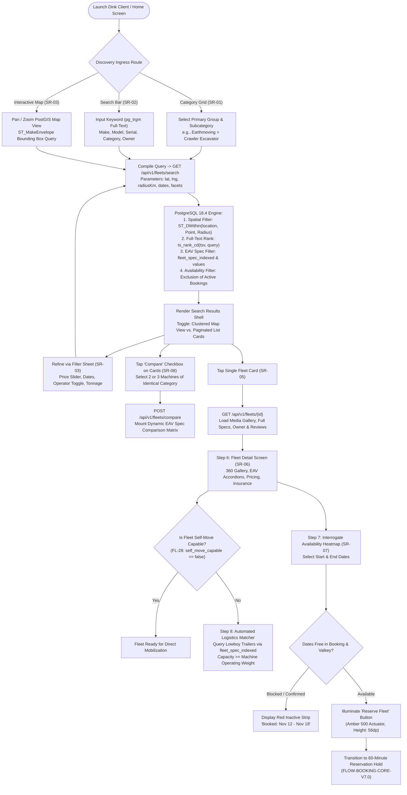
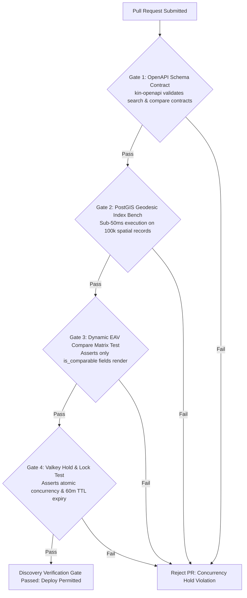

# Heavy Machinery & Logistics Rental Aggregator — Dink Machinery
## Interaction Flow Specification — 06. Machinery Discovery, Spatial Search, Dynamic EAV Comparison & Logistics Pairing (`docs/shared/flows/06-fleet-discovery-search-comparison.md`)

**Document Identifier:** `FLOW-DISCOVERY-DINK-CORE-V7.0`  
**Classification:** Canonical Interaction Flow & Wire Protocol Specification (Single Source of Truth)  
**Governing Documents:** `SRS-DINK-CORE-V7.0` (§5.4 SR-01 to SR-08, §5.2.2 FL-14/FL-15, §5.2.5 FL-28 to FL-31), `FLOW-ENTRY-DINK-CORE-V7.0`, `FLOW-RENTER-AUTH-DINK-CORE-V7.0`, `FLOW-FLEET-REG-DINK-CORE-V7.0`, `ARCH-BACKEND-GO-DINK-CORE-V7.0`, `ARCH-FLUTTER-DINK-CORE-V7.0`, `ARCH-SEC-DINK-CORE-V7.0`, `DS-DINK-CORE-V7.0`, `DS-PERSONAS-DINK-CORE-V7.0`, `DS-TOKENS-DINK-CORE-V7.0`, `contracts/openapi.yaml`, `ADR-001`, `ADR-004`, `ADR-007`, `ADR-010`  
**Target Client Runtimes:** Flutter 3.44 / Dart 3.9 (Cross-Platform Mobile), Next.js 16 / React 19 (Desktop Web), PostgreSQL 18.4 + PostGIS 3.4, Valkey 8.0, Isar NoSQL  
**Target Personas:** Civil Engineering Contractor / Commercial Renter (*Dawit Haile-Mariam* / *Patrick Kariuki*), Fleet Owner (*W/ro Almaz Tesfaye*)  
**Target Operating Markets:** Ethiopia (`ET`) & Kenya (`KE`) — Dynamic Multi-Country Parameterization (`LOC-01-BE`)  
**Compliance Standards:** OWASP ASVS 4.0.3 Level 3, RFC 9457 (Problem Details), ISO 9241-110, W3C WCAG 2.2 Level AAA (Field Mode) & Level AA (Web Console), Ethiopian Personal Data Protection Proclamation No. 1321/2024  
**Status:** Approved Engineering Baseline

---

## Table of Contents

- 1. [Executive Summary & Architectural Scope](#1-executive-summary--architectural-scope)
  - 1.1 [Purpose & Discovery Rationale](#11-purpose--discovery-rationale)
  - 1.2 [The Contractor Mental Model under Liquidated Damages](#12-the-contractor-mental-model-under-liquidated-damages)
- 2. [End-to-End Discovery, Search & Comparison Flowchart](#2-end-to-end-discovery-search--comparison-flowchart)
- 3. [Detailed Step-by-Step State Machine & User Journey](#3-detailed-step-by-step-state-machine--user-journey)
  - 3.1 [Step 1: Category Browsing & Two-Level Hierarchical Ingress (`SR-01`)](#31-step-1-category-browsing--two-level-hierarchical-ingress-sr-01)
  - 3.2 [Step 2: Predictive Full-Text Search & Trigram Matching (`SR-02`)](#32-step-2-predictive-full-text-search--trigram-matching-sr-02)
  - 3.3 [Step 3: PostGIS Geodesic Spatial Filtering & Clustered Map View (`SR-03`, `ADR-004`)](#33-step-3-postgis-geodesic-spatial-filtering--clustered-map-view-sr-03-adr-004)
  - 3.4 [Step 4: Multi-Facet Filter Matrix & Dynamic Chip Evaluation (`SR-03`)](#34-step-4-multi-facet-filter-matrix--dynamic-chip-evaluation-sr-03)
  - 3.5 [Step 5: Multi-Criteria Ranking & Sorting Algorithm (`SR-04`, `SR-05`)](#35-step-5-multi-criteria-ranking--sorting-algorithm-sr-04-sr-05)
  - 3.6 [Step 6: Fleet Detail View, 360 Media Gallery & EAV Spec Hierarchy (`SR-06`)](#36-step-6-fleet-detail-view-360-media-gallery--eav-spec-hierarchy-sr-06)
  - 3.7 [Step 7: Dynamic EAV Spec Comparison Engine (`SR-08`, `FL-15`)](#37-step-7-dynamic-eav-spec-comparison-engine-sr-08-fl-15)
  - 3.8 [Step 8: Automated Logistics Trailer Pairing & Route Distance Estimation (`FL-28` to `FL-31`)](#38-step-8-automated-logistics-trailer-pairing--route-distance-estimation-fl-28-to-fl-31)
- 4. [Availability Interrogation & Real-Time Conflict Resolution (`SR-07`, `BK-01`)](#4-availability-interrogation--real-time-conflict-resolution-sr-07-bk-01)
  - 4.1 [Temporal Calendar Heatmap & Active Booking Overlaps](#41-temporal-calendar-heatmap--active-booking-overlaps)
  - 4.2 [The 60-Minute Valkey Distributed Reservation Hold Invariant](#42-the-60-minute-valkey-distributed-reservation-hold-invariant)
- 5. [Frontier Market Edge Cases & Fault Recovery Protocols](#5-frontier-market-edge-cases--fault-recovery-protocols)
  - 5.1 [Map Tile Vector Decimation for 2G/3G Cellular Networks](#51-map-tile-vector-decimation-for-2g3g-cellular-networks)
  - 5.2 [Offline Search Caching & Spatial Bounding Box Prefetching (`ADR-010`)](#52-offline-search-caching--spatial-bounding-box-prefetching-adr-010)
  - 5.3 [Concurrent Reservation Collision & Instant Slot Re-Verification](#53-concurrent-reservation-collision--instant-slot-re-verification)
- 6. [Wire Protocol Contracts & RFC 9457 Error Schemas](#6-wire-protocol-contracts--rfc-9457-error-schemas)
  - 6.1 [`GET /api/v1/fleets/search`](#61-get-apiv1fleetssearch)
  - 6.2 [`GET /api/v1/fleets/{id}`](#62-get-apiv1fleetsid)
  - 6.3 [`POST /api/v1/fleets/compare`](#63-post-apiv1fleetscompare)
  - 6.4 [`GET /api/v1/fleets/{id}/availability`](#64-get-apiv1fleetsidavailability)
  - 6.5 [RFC 9457 Problem Details Error Payloads](#65-rfc-9457-problem-details-error-payloads)
- 7. [Automated Testing Suite & Verification Gates](#7-automated-testing-suite--verification-gates)

---

## 1. Executive Summary & Architectural Scope

### 1.1 Purpose & Discovery Rationale

The **Machinery Discovery, Spatial Search, Dynamic EAV Comparison & Logistics Pairing Specification** governs the core customer discovery engine of Dink Machinery. It defines the mechanism by which civil engineering contractors, infrastructure project directors, and site agents locate, evaluate, compare, and verify the physical availability of heavy capital machinery and logistics transport across East Africa.

In conventional marketplaces, discovery is limited to static keyword queries and broad territorial tags. In heavy civil contracting, machinery mobilization requires millimeter-level dimensional verification, gross operating tonnage auditing, certified operator linkage, and precise geographical proximity to minimize lowboy transport costs.

This specification enforces four fundamental architectural invariants:
1. **Sub-50ms PostGIS Spatial Indexing (`ADR-004`):** Spheroidal geodesic queries (`ST_DWithin`, `ST_Distance`) evaluate equipment depot locations against the contractor's project coordinates using an indexed spherical geography type (`geography(Point, 4326)`).
2. **Hybrid Dynamic EAV Filtering:** Full-text trigram queries (`pg_trgm`) and categorical facets operate alongside dynamic Entity-Attribute-Value specifications (`fleet_spec_values`), querying both indexed logistics fields (`fleet_spec_indexed`) and dynamic JSONB attributes without performance degradation.
3. **Canonical Multi-Machine Comparison (`SR-08`, `FL-15`):** Enables side-by-side evaluation of up to three assets simultaneously, dynamically rendering only attributes flagged by domain administrators as `IsComparable = true` to eliminate visual noise.
4. **Automated Logistics Pairing Engine (`FL-28` to `FL-31`):** Assets flagged with `self_move_capable = false` automatically trigger a background spatial match for compatible lowboy transport trailers based on gross operating weight and transport dimensions (`FL-14`).

### 1.2 The Contractor Mental Model under Liquidated Damages

The discovery experience is engineered around **Persona 1: Civil Engineering Contractor** (*Dawit Haile-Mariam* / *Patrick Kariuki*), whose operational context is documented in `DS-PERSONAS-DINK-CORE-V7.0`:
* **Severe Time Pressures:** Sourcing occurs when an active project faces liquidated damages ($10,000\text{–}50,000+\text{ ETB/day}$ penalty for standing idle). Discovery must reach machine specs and availability within three taps.
* **Logistics-First Pragmatism:** An excavator located $400\text{ km}$ away incurs transport fees exceeding the rental rate itself. Distance from the active job site and transport readiness are prioritized above daily hire rates.
* **Extreme Outdoor Glare:** Field searches occur on construction sites under harsh direct sunlight ($> 80,000\text{ lux}$), demanding strict WCAG 2.2 AAA optical contrast and glove-friendly interactive elements ($56 \times 56\text{ dp}$ minimum).

---

## 2. End-to-End Discovery, Search & Comparison Flowchart



---

## 3. Detailed Step-by-Step State Machine & User Journey

### 3.1 Step 1: Category Browsing & Two-Level Hierarchical Ingress (`SR-01`)

The home screen presents an industrial dashboard layout. The primary category grid organizes plant assets into four high-level clusters:
1. **Earthmoving & Excavation:** Crawler Excavators, Wheeled Excavators, Bulldozers, Wheel Loaders, Backhoe Loaders.
2. **Lifting & Height Access:** Rough-Terrain Mobile Cranes, All-Terrain Cranes, Tower Cranes, Boom Lifts, Scissor Lifts.
3. **Compaction & Roadwork:** Motor Graders, Single-Drum Soil Compactors, Tandem Asphalt Rollers, Cold Planers.
4. **Logistics & Heavy Haulage:** Lowboy Heavy Transport Trailers, Step-Deck Trailers, Multi-Axle Dump Trucks, Prime Movers.

Tapping any primary category card expands the subcategory tray via an animated bottom sheet, executing an instant filtered query without requiring full-page navigation.

### 3.2 Step 2: Predictive Full-Text Search & Trigram Matching (`SR-02`)

The search bar features debounced predictive auto-complete ($300\text{ ms}$ threshold).

```text
+-------------------------------------------------------------------+
|  [Q Search equipment, model, owner, location...]     [FILTER (3)] |
+-------------------------------------------------------------------+
|  SUGGESTED EQUIPMENT                                              |
|  * Caterpillar 320D - Crawler Excavator (20t - 24t)                |
|  * Komatsu PC210-10 - Hydraulic Excavator (21t)                   |
|  * SANY SY215C - Medium Crawler Excavator                         |
|                                                                   |
|  CATEGORIES                                                       |
|  * Excavation > Hydraulic Crawler Excavator (142 Available)       |
|                                                                   |
|  VERIFIED FLEET OWNERS                                            |
|  * Tesfaye Heavy Transport PLC (18 Machines in Addis Ababa)       |
+-------------------------------------------------------------------+
```

#### Full-Text Engine Details
The query targets an optimized PostgreSQL generated column:
```sql
ALTER TABLE fleets ADD COLUMN search_vector tsvector 
GENERATED ALWAYS AS (
    setweight(to_tsvector('simple', coalesce(make, '')), 'A') ||
    setweight(to_tsvector('simple', coalesce(model, '')), 'A') ||
    setweight(to_tsvector('simple', coalesce(registration_plate, '')), 'B') ||
    setweight(to_tsvector('simple', coalesce(owner_company_name, '')), 'C')
) STORED;

CREATE INDEX idx_fleets_search_vector ON fleets USING GIN(search_vector);
```
Trigram similarity (`pg_trgm`) matches inputs with common typographical errors (e.g., "Katarpilar" $\rightarrow$ "Caterpillar").

### 3.3 Step 3: PostGIS Geodesic Spatial Filtering & Clustered Map View (`SR-03`, `ADR-004`)

When spatial filtering is activated (via GPS positioning or an explicit pin drop on the project site), the backend executes an spheroidal boundary query:

```sql
SELECT 
    f.id, f.make, f.model, f.daily_rate_minor,
    ST_Distance(f.yard_location, ST_SetSRID(ST_MakePoint($1, $2), 4326)::geography) / 1000.0 AS distance_km
FROM fleets f
WHERE f.status = 'ACTIVE'
  AND ST_DWithin(f.yard_location, ST_SetSRID(ST_MakePoint($1, $2), 4326)::geography, $3 * 1000)
ORDER BY distance_km ASC;
```

```text
+-------------------------------------------------------------------+
|  [<- BACK]              MAP VIEW: ADDIS ABABA & OROMIA  [LIST v]  |
+-------------------------------------------------------------------+
|   \                                                               |
|    \                  ( 14 ) [Kality Depot Hub]                   |
|     \                                                             |
|      * Project Site (Bole Lemi Industrial Zone)                   |
|        \                                                          |
|         \ 18.4 km                                                 |
|          \                                                        |
|           [CAT 320D] - 45,000 ETB/Day                             |
|           Tesfaye Heavy Transport PLC                             |
|                                                                   |
+-------------------------------------------------------------------+
|  [SELECTED ASSET PREVIEW]                                         |
|  Caterpillar 320D Hydraulic Excavator (2024)                      |
|  Distance: 18.4 km | Rate: 45,000.00 ETB / Day | Operator Included |
|  [ COMPARE ]                             [ VIEW DETAILS & BOOK ]  |
+-------------------------------------------------------------------+
```

### 3.4 Step 4: Multi-Facet Filter Matrix & Dynamic Chip Evaluation (`SR-03`)

The filter drawer compiles fixed system filters alongside category-specific dynamic specification limits:

| Filter Attribute | Control Widget Type | Constraint Validation & Range Boundaries |
|---|---|---|
| **Subcategory** | Multi-Select Chips | Single or multi-leaf category UUIDs |
| **Daily Hire Rate** | Dual Thumb Range Slider | $10,000.00\text{ ETB}$ to $250,000.00+\text{ ETB/day}$ ($100\text{ minor units}$) |
| **Proximity Radius** | Segmented Pill Bar | $10\text{ km}$, $25\text{ km}$, $50\text{ km}$, $100\text{ km}$, $250\text{ km}$, Nationwide |
| **Availability Window**| Calendar Date Picker | Start Date $\rightarrow$ End Date (Validates $> \text{Today}$) |
| **Operator Included** | Industrial Toggle Switch| Boolean (`true` = verified operator bundled with machine) |
| **Operating Weight** | Numeric Step Stepper | Extracted from `fleet_spec_indexed.operating_weight_kg` |
| **Boom Reach / Depth**| Slider with Metric Suffix | Extracted from dynamic EAV `fleet_spec_values` |

Active filters are rendered horizontally below the search bar as interactive chips with one-tap removal.

### 3.5 Step 5: Multi-Criteria Ranking & Sorting Algorithm (`SR-04`, `SR-05`)

Search results compute a deterministic ranking score ($S$) balancing proximity, pricing competitiveness, owner verification standing, and historical review metrics:

$$S = 0.35 \cdot \left(1 - \frac{d}{d_{\max}}\right) + 0.25 \cdot \left(1 - \frac{P}{P_{\max}}\right) + 0.25 \cdot \left(\frac{R}{5.0}\right) + 0.15 \cdot V_{\text{owner}}$$

Where:
* $d$: Haversine road-network distance in kilometers.
* $P$: Normalized daily rental rate in minor units.
* $R$: Mean verified contractor review score ($1.0\text{–}5.0$).
* $V_{\text{owner}}$: Binary compliance attestation ($1.0$ if owner possesses verified commercial bank coordinates and clean dispute SLA history).

Contractors can override algorithmic ranking by selecting explicit sort orders:
1. **Recommended (Default):** Multi-criteria formula above.
2. **Distance: Nearest First:** Ascending order by geodesic kilometers.
3. **Price: Low to High:** Ascending order by `daily_rate_minor`.
4. **Price: High to Low:** Descending order by `daily_rate_minor`.
5. **Rating: High to Low:** Descending order by mean contractor review score.

### 3.6 Step 6: Fleet Detail View, 360 Media Gallery & EAV Spec Hierarchy (`SR-06`)

Tapping any card in the results list mounts the full-screen **Fleet Detail View**:

```text
+-------------------------------------------------------------------+
|  [<- BACK]                                          [SHARE] [FAV] |
+-------------------------------------------------------------------+
|  [================ 360 DEGREE MEDIA CAROUSEL =================]   |
|  [ PHOTO 1 OF 8: FRONT THREE-QUARTER VIEW (CAT 320D)          ]   |
|  ( O O o o o o o o ) [TAP TO EXPAND HIGH-RES LIGHTBOX]            |
+-------------------------------------------------------------------+
|  Caterpillar 320D Hydraulic Excavator               4.9 (42 Reviews)
|  Category: Hydraulic Crawler Excavator | Year: 2024 | Diesel      |
|  Registered Yard: Kality Industrial Depot, Addis Ababa (18.4 km)  |
+-------------------------------------------------------------------+
|  DAILY RATE: 45,000.00 ETB / Day    | SHIFT: 8.0 Billable Hours   |
|  Excess Hour Surcharge: 6,500.00 ETB / Hr | Min Rental: 3 Days    |
+-------------------------------------------------------------------+
|  v VERIFIED OWNER CARD                                            |
|  Tesfaye Heavy Transport PLC (Verified Business KYC)              |
|  Member since 2024 | 18 Fleets | 98.4% Dispute-Free Payouts       |
+-------------------------------------------------------------------+
|  v TECHNICAL SPECIFICATIONS (EAV HIERARCHY)                       |
|  > Weights & Ground Pressure                                  [v] |
|    - Operating Weight: 21,800 kg                                  |
|    - Ground Pressure: 35.2 kPa                                    |
|  v Working Ranges                                             [^] |
|    - Max Digging Depth: 6,720 mm                                  |
|    - Max Reach along Ground: 9,860 mm                             |
|    - Bucket Breakout Force: 140.0 kN                              |
|  > Engine & Power Ratings                                     [v] |
|  > Physical Transport Dimensions (For Logistics)              [v] |
+-------------------------------------------------------------------+
|  v INSURANCE & CERTIFICATION                                      |
|  * Awash Insurance S.C. - Comprehensive Plant All-Risks (Active)   |
|  * Baseline Hour Meter Validated: 1,450.50 Hrs (Photo Certified)  |
+-------------------------------------------------------------------+
|  [ TOTAL ESTIMATE: 135,000.00 ETB (3 Days) ]   [ RESERVE FLEET ]  |
+-------------------------------------------------------------------+
```

### 3.7 Step 7: Dynamic EAV Spec Comparison Engine (`SR-08`, `FL-15`)

To support equipment selection, contractors can select up to **three machines** within the same primary category and trigger the **Side-by-Side Dynamic Comparison Matrix**.

* **Filtering by Relevance:** The comparison grid ignores internal or non-comparable attributes, displaying only fields with `is_comparable = true` (`FL-15`).
* **Visual Delta Accents:** The system calculates the best-in-class value for key parameters (e.g., maximum digging depth, lowest daily rate, minimum operating weight) and highlights the corresponding table cell with a subtle brand tint (`color.brand.amber.100`).

```text
+-------------------------------------------------------------------+
|  [<- BACK]              EQUIPMENT COMPARISON MATRIX (3 FLEETS)    |
+--------------------------+-------------------+--------------------+
| SPECIFICATION ATTRIBUTE  | CAT 320D (2024)   | KOMATSU PC210-10   |
+--------------------------+-------------------+--------------------+
| Daily Rate (ETB)         | 45,000.00 ETB     | 42,000.00 ETB [BEST|
| Proximity Distance       | 18.4 km [BEST]    | 46.2 km            |
| Operating Weight (kg)    | 21,800 kg         | 22,200 kg          |
| Max Digging Depth (mm)   | 6,720 mm [BEST]   | 6,550 mm           |
| Engine Power (hp)        | 148 hp            | 165 hp [BEST]      |
| Operator Included?       | Yes (Certified)   | Yes (Certified)    |
| Self-Move Capable?       | No (Lowboy Req.)  | No (Lowboy Req.)   |
| Insurance Provider       | Awash Insurance   | Nyala Insurance    |
+--------------------------+-------------------+--------------------+
| ACTION                   | [SELECT CAT 320D] | [SELECT PC210]     |
+--------------------------+-------------------+--------------------+
```

### 3.8 Step 8: Automated Logistics Trailer Pairing & Route Distance Estimation (`FL-28` to `FL-31`)

When a selected equipment asset has `self_move_capable = false` (e.g., a 22-ton steel crawler excavator that cannot drive on public paved asphalt without damaging road infrastructure):
1. The client intercepts the reservation flow and queries the backend logistics pairing engine.
2. The engine reads the machine's indexed dimensions from `fleet_spec_indexed`:
   - `operating_weight_kg = 21800`
   - `transport_length_mm = 9530`
   - `transport_width_mm = 2980`
   - `transport_height_mm = 3150`
3. The platform executes a PostGIS spatial query finding active **Logistics Transport Fleets** (Category: `Transport & Lowboys`) within an expanded radius of the equipment depot yard whose verified bed capacity satisfies:
   $$\text{trailer\_payload\_capacity\_kg} \ge \text{machine\_operating\_weight\_kg}$$
4. The contractor is prompted to bundle a matched lowboy transport trailer directly into the primary booking, creating an atomic parent-child reservation graph (`ParentBookingID`).

---

## 4. Availability Interrogation & Real-Time Conflict Resolution (`SR-07`, `BK-01`)

### 4.1 Temporal Calendar Heatmap & Active Booking Overlaps

The availability calendar reflects physical reservations in real time:

```text
+-------------------------------------------------------------------+
|  SELECT HIRE DURATION                           OCTOBER / NOV 2026|
+-------------------------------------------------------------------+
|   MON     TUE     WED     THU     FRI     SAT     SUN             |
|   26      27      28      29      30      31      01              |
|  [   ]   [   ]   [   ]   [   ]   [   ]   [   ]   [   ]            |
|                                                                   |
|   02      03      04      05      06      07      08              |
|  [FREE]  [FREE]  [FREE]  [FREE]  [FREE]  [FREE]  [FREE]           |
|                                                                   |
|   09      10      11      12      13      14      15              |
|  [FREE]  [FREE]  [==== BLOCKED: ON ACTIVE HIRE ======]            |
|                                                                   |
|   16      17      18      19      20      21      22              |
|  [====== BLOCKED ====]   [FREE]  [FREE]  [FREE]  [FREE]           |
+-------------------------------------------------------------------+
|  LEGEND: [FREE] Available  | [===] Active Booking  | [***] Hold   |
+-------------------------------------------------------------------+
```

A requested date range $[T_{\text{start}}, T_{\text{end}}]$ is evaluated by asserting that zero records overlap in PostgreSQL:
```sql
SELECT count(*) FROM bookings 
WHERE fleet_id = $1 
  AND status IN ('CONFIRMED', 'IN_HIRE', 'PAYMENT_VERIFIED', 'HOLD_PENDING')
  AND daterange(start_date, end_date, '[]') && daterange($2, $3, '[]');
```

### 4.2 The 60-Minute Valkey Distributed Reservation Hold Invariant

To allow the contractor adequate time to generate a purchase requisition and wire deposit without losing the equipment, tapping **"Reserve Fleet"** initiates a distributed hold:
* The backend sets a lock in Valkey:
  `SET booking:hold:{fleetId} {renterId} EX 3600 NX`
* If `NX` (Not Exists) returns `OK`, the lock succeeds. The fleet status switches to `HOLD_PENDING` across all discovery search nodes.
* A client-side countdown timer displays the remaining hold duration ($60\text{ minutes}$).
* If the contractor fails to upload bank transfer confirmation within $3,600\text{ seconds}$, Valkey key eviction fires a keyspace notification, reverting the asset status to `ACTIVE` and notifying other interested contractors.

---

## 5. Frontier Market Edge Cases & Fault Recovery Protocols

### 5.1 Map Tile Vector Decimation for 2G/3G Cellular Networks

In rural project corridors (e.g., Hawassa–Moyale or Lapsset transit routes), low-bandwidth mobile networks struggle with multi-megabyte Mapbox/OSM vector tile downloads:
* **Dynamic Simplification:** The Go tile proxy uses the Douglas-Peucker algorithm (`ST_SimplifyPreserveTopology`) based on device network quality, decimating polygonal road networks by up to $70\%$ when RTT $> 600\text{ ms}$.
* **GeoJSON Clustering:** Nearby depot yards are clustered into aggregate numeric badges at lower zoom levels, transmitting $< 15\text{ KB}$ of payload per map viewport.

### 5.2 Offline Search Caching & Spatial Bounding Box Prefetching (`ADR-010`)

When a contractor enters a construction site with intermittent cellular coverage:
* The Flutter application caches active search results and depot locations within a $50\text{ km}$ bounding box into local **Isar NoSQL** storage.
* If signal drops entirely, contractors can continue browsing cached equipment cards, reviewing technical specifications, and bookmarking machines for reservation.
* When network connectivity is restored, the application reconciles pricing and availability against the central PostgreSQL cluster.

### 5.3 Concurrent Reservation Collision & Instant Slot Re-Verification

If two contractors attempt to place a reservation hold on the same excavator simultaneously:
* The Valkey distributed lock (`SET ... NX`) ensures strictly serial atomic resolution. Exactly one contractor acquires the lock.
* The losing contractor receives RFC 9457 HTTP 409 Conflict (`ERR_RESERVATION_HOLD_ACTIVE`).
* The mobile client displays an inline notification banner: *"Another contractor just placed a temporary 60-minute reservation hold on this machine. We have notified you, and you can join the standby waitlist."*

---

## 6. Wire Protocol Contracts & RFC 9457 Error Schemas

### 6.1 `GET /api/v1/fleets/search`

Executes multi-facet spatial search, returning paginated fleet cards with computed distance and pricing.

#### Request Query Parameters
```http
GET /api/v1/fleets/search?lat=9.0054&lng=38.7636&radiusKm=50&subcategoryId=cat_excavator_crawler&startDate=2026-11-01&endDate=2026-11-10&operatorIncluded=true&sortBy=RECOMMENDED&page=1&limit=20 HTTP/1.1
Host: api.dinkmachinery.com
Authorization: Bearer <renterAccessToken>
X-Country-Code: ET
```

#### Response: `HTTP 200 OK`
```json
{
  "success": true,
  "data": {
    "totalCount": 18,
    "page": 1,
    "limit": 20,
    "results": [
      {
        "id": "flt_019f8a2c",
        "make": "Caterpillar",
        "model": "320D",
        "manufactureYear": 2024,
        "subcategoryId": "cat_excavator_crawler",
        "subcategoryName": "Hydraulic Crawler Excavator",
        "thumbnailUri": "[https://s3.dinkmachinery.com/fleets/cat320d_thumb.webp](https://s3.dinkmachinery.com/fleets/cat320d_thumb.webp)",
        "dailyRateMinor": 4500000,
        "currencyCode": "ETB",
        "distanceKm": 18.4,
        "yardLocation": {
          "latitude": 8.9124,
          "longitude": 38.7491,
          "name": "Kality Industrial Depot, Addis Ababa"
        },
        "operatorIncluded": true,
        "selfMoveCapable": false,
        "owner": {
          "companyName": "Tesfaye Heavy Transport PLC",
          "isKycVerified": true,
          "rating": 4.9,
          "reviewCount": 42
        },
        "indexedSpecs": {
          "operatingWeightKg": 21800,
          "transportLengthMm": 9530,
          "transportWidthMm": 2980,
          "transportHeightMm": 3150
        }
      }
    ]
  },
  "timestamp": "2026-10-27T15:00:00Z"
}
```

---

### 6.2 `GET /api/v1/fleets/{id}`

Fetches comprehensive fleet details, complete dynamic EAV attributes, verified insurance documents, and owner profile.

#### Request Headers
```http
GET /api/v1/fleets/flt_019f8a2c HTTP/1.1
Host: api.dinkmachinery.com
Authorization: Bearer <renterAccessToken>
```

#### Response: `HTTP 200 OK`
```json
{
  "success": true,
  "data": {
    "id": "flt_019f8a2c",
    "make": "Caterpillar",
    "model": "320D",
    "manufactureYear": 2024,
    "fuelType": "DIESEL",
    "registrationPlate": "ET-3-99421",
    "baselineHourMeter": 1450.50,
    "dailyRateMinor": 4500000,
    "weeklyRateMinor": 28000000,
    "monthlyRateMinor": 110000000,
    "excessHourRateMinor": 650000,
    "minRentalPeriod": "3_DAYS",
    "paymentTimeoutHours": 24,
    "prepaymentType": "PERCENTAGE",
    "prepaymentValue": 50,
    "operatorIncluded": true,
    "selfMoveCapable": false,
    "suggestedTransportType": "LOWBOY_25T",
    "media": [
      {
        "type": "IMAGE",
        "uri": "[https://s3.dinkmachinery.com/fleets/cat320d_front.webp](https://s3.dinkmachinery.com/fleets/cat320d_front.webp)",
        "caption": "Front three-quarter view"
      }
    ],
    "dynamicSpecSections": [
      {
        "sectionKey": "WORKING_RANGES",
        "sectionTitle": "Working Ranges & Digging Depth",
        "attributes": [
          {
            "fieldId": "spec_max_digging_depth",
            "name": "Max Digging Depth",
            "value": 6720,
            "unit": "mm",
            "isComparable": true
          }
        ]
      }
    ],
    "insurance": {
      "providerName": "Awash Insurance S.C.",
      "coverageType": "COMPREHENSIVE_PLANT",
      "expiryDate": "2027-10-27T00:00:00Z",
      "isValid": true
    }
  },
  "timestamp": "2026-10-27T15:05:00Z"
}
```

---

### 6.3 `POST /api/v1/fleets/compare`

Compares 2 to 3 equipment assets side-by-side, returning dynamic attributes flagged as comparable.

#### Request Payload
```json
{
  "fleetIds": [
    "flt_019f8a2c",
    "flt_019f8b44"
  ]
}
```

#### Response: `HTTP 200 OK`
```json
{
  "success": true,
  "data": {
    "subcategoryId": "cat_excavator_crawler",
    "fleetHeaders": [
      {
        "id": "flt_019f8a2c",
        "label": "Caterpillar 320D (2024)",
        "dailyRateMinor": 4500000,
        "thumbnailUri": "[https://s3.dinkmachinery.com/fleets/cat320d_thumb.webp](https://s3.dinkmachinery.com/fleets/cat320d_thumb.webp)"
      },
      {
        "id": "flt_019f8b44",
        "label": "Komatsu PC210-10 (2023)",
        "dailyRateMinor": 4200000,
        "thumbnailUri": "[https://s3.dinkmachinery.com/fleets/pc210_thumb.webp](https://s3.dinkmachinery.com/fleets/pc210_thumb.webp)"
      }
    ],
    "comparisonAttributes": [
      {
        "fieldId": "spec_max_digging_depth",
        "name": "Max Digging Depth",
        "unit": "mm",
        "values": {
          "flt_019f8a2c": 6720,
          "flt_019f8b44": 6550
        },
        "bestValueFleetId": "flt_019f8a2c"
      }
    ]
  },
  "timestamp": "2026-10-27T15:10:00Z"
}
```

---

### 6.4 `GET /api/v1/fleets/{id}/availability`

Fetches the 90-day booking calendar heatmap for an asset.

#### Response: `HTTP 200 OK`
```json
{
  "success": true,
  "data": {
    "fleetId": "flt_019f8a2c",
    "blockedDateRanges": [
      {
        "startDate": "2026-11-12",
        "endDate": "2026-11-18",
        "status": "CONFIRMED_BOOKING"
      }
    ],
    "activeHold": {
      "isHoldActive": false,
      "expiresAt": null
    }
  },
  "timestamp": "2026-10-27T15:12:00Z"
}
```

---

### 6.5 RFC 9457 Problem Details Error Payloads

#### Example: Reservation Hold Active (`HTTP 409 Conflict`)
```json
{
  "type": "[https://api.dinkmachinery.com/errors/reservation-hold-conflict](https://api.dinkmachinery.com/errors/reservation-hold-conflict)",
  "title": "Reservation Hold In Progress",
  "status": 409,
  "detail": "Another contractor currently holds a temporary reservation on this fleet. Hold expires in 34 minutes.",
  "instance": "/api/v1/fleets/flt_019f8a2c/hold",
  "code": "ERR_RESERVATION_HOLD_ACTIVE",
  "invalidParams": [
    {
      "name": "fleetId",
      "reason": "Temporary Valkey hold active until 2026-10-27T15:46:12Z"
    }
  ]
}
```

---

## 7. Automated Testing Suite & Verification Gates



1. **OpenAPI Schema Contract Gate (`kin-openapi`):** Validates all discovery, search, comparison, and availability endpoints against `contracts/openapi.yaml`.
2. **PostGIS Geodesic Spatial Benchmark:** Executes an automated spatial stress test over a database seeded with 100,000 synthetic machinery yard locations across Ethiopia and Kenya, asserting that $99\%$ of spatial bounding queries execute in $< 50\text{ ms}$.
3. **Dynamic EAV Compare Matrix Test:** Asserts that when comparing machines, non-comparable internal fields are filtered out and that cell delta highlights correctly identify optimal numerical values.
4. **Valkey Concurrency Hold Test:** Simulates 20 concurrent booking hold requests for the same physical equipment asset, asserting that exactly one request succeeds with HTTP 200 while 19 receive HTTP 409 with accurate expiration timestamps.

---

*This document defines the canonical interaction flow, system behavior, and wire protocols for Machinery Discovery, Spatial Search, Dynamic EAV Comparison & Logistics Pairing in Dink Machinery Version 7.0. All downstream Flutter mobile screens, Go HTTP controllers, and PostgreSQL spatial query engines must strictly adhere to this specification.*