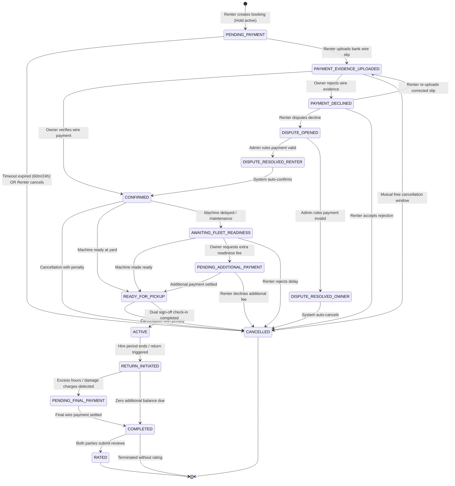
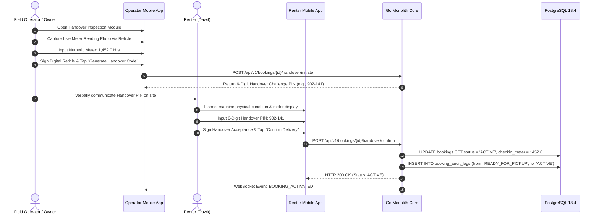
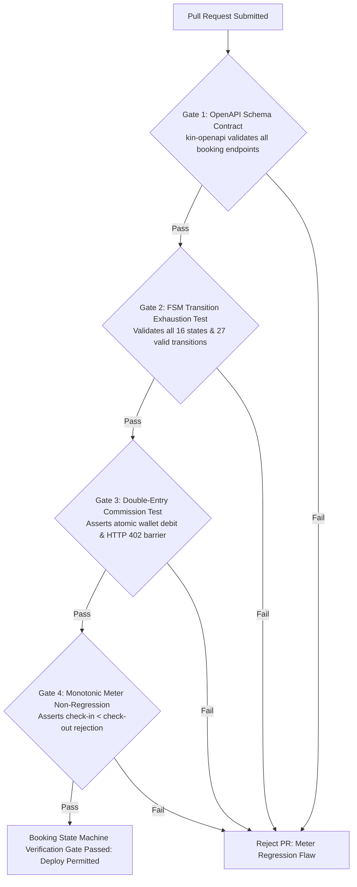

# Heavy Machinery & Logistics Rental Aggregator — Dink Machinery
## Interaction Flow Specification — 07. Booking Lifecycle & Master State Machine Architecture (`docs/shared/flows/07-booking-lifecycle-master-state-machine.md`)

**Document Identifier:** `FLOW-BOOKING-STATE-MACHINE-DINK-CORE-V7.0`  
**Classification:** Canonical State Machine & Interaction Flow Specification (Single Source of Truth)  
**Governing Documents:** `SRS-DINK-CORE-V7.0` (§5.5, §5.6, §5.7, §8.1, §8.2), `FLOW-ENTRY-DINK-CORE-V7.0`, `FLOW-RENTER-AUTH-DINK-CORE-V7.0`, `FLOW-OWNER-KYC-DINK-CORE-V7.0`, `FLOW-FLEET-REG-DINK-CORE-V7.0`, `FLOW-DISCOVERY-DINK-CORE-V7.0`, `ARCH-BACKEND-GO-DINK-CORE-V7.0`, `ARCH-FLUTTER-DINK-CORE-V7.0`, `ARCH-SEC-DINK-CORE-V7.0`, `contracts/openapi.yaml`, `ADR-001`, `ADR-002`, `ADR-005`, `ADR-010`  
**Target Client Runtimes:** Flutter 3.44 / Dart 3.9 (Cross-Platform Mobile), Next.js 16 / React 19 (Desktop Web Admin), Go 1.24 Backend Monolith, PostgreSQL 18.4 + PostGIS 3.4, Valkey 8.0, Isar NoSQL  
**Target Personas:** Civil Contractor (*Dawit Haile-Mariam*), Fleet Owner (*W/ro Almaz Tesfaye*), Field Operator (*Mulugeta Tadesse*), Dispute Arbitrator (*Yohannes Bekele*)  
**Target Operating Markets:** Ethiopia (`ET`) & Kenya (`KE`) — Dynamic Multi-Country Parameterization (`LOC-01-BE`)  
**Compliance Standards:** OWASP ASVS 4.0.3 Level 3, RFC 9457 (Problem Details), ISO 9241-110, W3C WCAG 2.2 Level AAA (Field Mode) & Level AA (Admin Mode), National Bank of Ethiopia (NBE) Directives  
**Status:** Approved Engineering Baseline

---

## Table of Contents

- 1. [Executive Summary & State Machine Topology](#1-executive-summary--state-machine-topology)
  - 1.1 [Purpose & Architectural Invariants](#11-purpose--architectural-invariants)
  - 1.2 [Multi-Actor Orchestration Model](#12-multi-actor-orchestration-model)
- 2. [Complete 16-State Master State Machine Diagram](#2-complete-16-state-master-state-machine-diagram)
- 3. [Canonical Booking States Dictionary (§8.1)](#3-canonical-booking-states-dictionary-81)
- 4. [Deterministic Transition Rules Matrix (§8.2)](#4-deterministic-transition-rules-matrix-82)
- 5. [Financial Rules, Penalties & Pre-Funded Commission Lifecycle](#5-financial-rules-penalties--pre-funded-commission-lifecycle)
  - 5.1 [Peer-to-Peer Commercial Bank Wire Evidence Model](#51-peer-to-peer-commercial-bank-wire-evidence-model)
  - 5.2 [Automated Platform Commission Debit Invariant](#52-automated-platform-commission-debit-invariant)
  - 5.3 [Cancellation Penalty Window Matrix](#53-cancellation-penalty-window-matrix)
- 6. [Handover, Inspection & Monotonic Hour Meter Verification](#6-handover-inspection--monotonic-hour-meter-verification)
  - 6.1 [Dual-Signoff Handover Protocol](#61-dual-signoff-handover-protocol)
  - 6.2 [Excess Hour Meter Settlement Formula](#62-excess-hour-meter-settlement-formula)
- 7. [Dispute Resolution & Admin Arbitrage Engine](#7-dispute-resolution--admin-arbitrage-engine)
- 8. [Frontier Market Edge Cases & Fault Recovery Protocols](#8-frontier-market-edge-cases--fault-recovery-protocols)
  - 8.1 [Valkey Distributed Hold Auto-Expiration Worker](#81-valkey-distributed-hold-auto-expiration-worker)
  - 8.2 [Offline Handover Caching & Reconnection Sync](#82-offline-handover-caching--reconnection-sync)
- 9. [Wire Protocol Contracts & RFC 9457 Error Schemas](#9-wire-protocol-contracts--rfc-9457-error-schemas)
  - 9.1 [`POST /api/v1/bookings`](#91-post-apiv1bookings)
  - 9.2 [`POST /api/v1/bookings/{id}/payment-evidence`](#92-post-apiv1bookingsidpayment-evidence)
  - 9.3 [`POST /api/v1/bookings/{id}/verify-payment`](#93-post-apiv1bookingsidverify-payment)
  - 9.4 [`POST /api/v1/bookings/{id}/handover`](#94-post-apiv1bookingsidhandover)
  - 9.5 [`POST /api/v1/bookings/{id}/transition`](#95-post-apiv1bookingsidtransition)
  - 9.6 [RFC 9457 Problem Details Payloads](#96-rfc-9457-problem-details-payloads)
- 10. [Automated Testing Suite & Verification Gates](#10-automated-testing-suite--verification-gates)

---

## 1. Executive Summary & State Machine Topology

### 1.1 Purpose & Architectural Invariants

The **Booking Lifecycle & Master State Machine Architecture** governs the contractual and operational lifecycle of equipment rentals within Dink Machinery. Because heavy machinery hires involve high-value capital assets, complex logistics mobilization, off-platform bank wire settlements, and physical on-site inspections, booking state transitions must be strictly deterministic and audit-logged.

The booking state machine enforces four core engineering invariants:
1. **Strict Finite State Machine (FSM) Enforcement:** Every state change must follow the transition rules defined in `SRS-DINK-CORE-V7.0 §8.2`. Invalid transitions are rejected at the database level using PostgreSQL trigger functions and in Go domain service validators.
2. **Double-Entry Financial Commission Invariant (`BK-17-BE`):** Transitioning to `CONFIRMED` requires an atomic platform commission deduction from the Fleet Owner's pre-funded wallet (`owner_wallets`). If the wallet balance plus approved credit buffer is insufficient, the confirmation is blocked with HTTP 402.
3. **Monotonic Hour Meter Non-Regression (`FL-04` / `BK-22`):** Machine hours captured during pre-rental check-in and post-rental return must satisfy:
   $$\text{Baseline Meter} \le \text{Check-in Meter} \le \text{Check-out Meter}$$
4. **Immutable Audit Trail:** All state changes are written to the append-only `booking_audit_logs` table, recording the timestamp, transitioning actor UUID, previous state, new state, client IP, and cryptographic verification hashes.

### 1.2 Multi-Actor Orchestration Model

The booking state machine orchestrates interactions across four distinct personas:
* **Renter (Civil Contractor):** Initiates bookings, uploads payment evidence, inspects machines on-site, opens disputes, and rates rentals.
* **Fleet Owner (Yard Manager):** Verifies incoming bank wire transfers, requests readiness adjustments, conducts check-out inspections, and levies excess hour charges.
* **Field Operator:** Performs physical equipment handover inspections, captures live camera reticle meter readings, and logs operational shifts.
* **Platform Staff (Admin Arbitrator):** Resolves payment and condition disputes, enforcing binding administrative rulings.

---

## 2. Complete 16-State Master State Machine Diagram



---

## 3. Canonical Booking States Dictionary (§8.1)

| # | Status Identifier | Category | Description | Asset Availability Impact |
|---|---|---|---|---|
| 1 | `PENDING_PAYMENT` | Initial | Booking created; temporary hold active awaiting renter bank transfer evidence. | `HOLD_PENDING` (Blocked from search) |
| 2 | `PAYMENT_EVIDENCE_UPLOADED` | Financial | Renter uploaded bank wire receipt slip; awaiting owner account audit. | `HOLD_PENDING` (Blocked from search) |
| 3 | `PAYMENT_DECLINED` | Exception | Owner checked bank statement and rejected evidence (funds not received). | `HOLD_PENDING` (Grace period active) |
| 4 | `DISPUTE_OPENED` | Arbitrage | Renter escalated declined payment to platform administrative compliance. | `LOCKED_DISPUTE` (Blocked from search) |
| 5 | `DISPUTE_RESOLVED_RENTER` | Arbitrage | Admin confirmed legitimate funds receipt; transitional state to confirmed. | `CONFIRMED_RESERVED` |
| 6 | `DISPUTE_RESOLVED_OWNER` | Arbitrage | Admin upheld owner rejection; transitional state to cancellation. | `REVERTED_ACTIVE` |
| 7 | `CONFIRMED` | Operational | Prepayment verified; contract binding; penalty zone active; commission debited. | `BOOKED_UNAVAILABLE` |
| 8 | `AWAITING_FLEET_READINESS`| Operational | Machine delayed at prior site or undergoing unscheduled servicing; ETA posted. | `BOOKED_UNAVAILABLE` |
| 9 | `PENDING_ADDITIONAL_PAYMENT`| Financial| Owner requested readiness compensation (e.g., unexpected heavy mobilization). | `BOOKED_UNAVAILABLE` |
| 10 | `READY_FOR_PICKUP` | Operational | Machine inspected and positioned at yard/site; ready for physical handover. | `BOOKED_UNAVAILABLE` |
| 11 | `ACTIVE` | Execution | Check-in inspection signed by both parties; engine hour meter running. | `ON_HIRE` (Active tracking) |
| 12 | `RETURN_INITIATED` | Closing | Hire period ended; equipment returned to yard; check-out inspection initiated. | `INSPECTION_PENDING` |
| 13 | `PENDING_FINAL_PAYMENT` | Financial | Post-rental audit identified excess shift hours or damage liabilities. | `AVAILABLE_POST_INSPECTION` |
| 14 | `COMPLETED` | Terminal | All rental fees, fuel adjustments, and excess hour surcharges fully settled. | `ACTIVE` (Returned to search index) |
| 15 | `RATED` | Terminal | Both parties submitted mutual performance ratings; immutable terminal state. | `ACTIVE` |
| 16 | `CANCELLED` | Terminal | Booking terminated via timeout, mutual agreement, or penalty cancellation. | `ACTIVE` (Immediately unblocked) |

---

## 4. Deterministic Transition Rules Matrix (§8.2)

| # | Current State (`From`) | Target State (`To`) | Permitted Actors | Trigger Conditions & Business Rules |
|---|---|---|---|---|
| T01 | `(Start)` | `PENDING_PAYMENT` | Renter | Asset free for requested dates; creates 60-min hold or owner timeout. |
| T02 | `PENDING_PAYMENT` | `CANCELLED` | Renter, System | System timeout expired OR renter manually aborts request. |
| T03 | `PENDING_PAYMENT` | `PAYMENT_EVIDENCE_UPLOADED` | Renter | Legitimate image file uploaded and verified clean by ClamAV daemon. |
| T04 | `PAYMENT_EVIDENCE_UPLOADED` | `CONFIRMED` | Owner | Owner confirms funds reflected in commercial bank account. |
| T05 | `PAYMENT_EVIDENCE_UPLOADED` | `PAYMENT_DECLINED` | Owner | Owner inputs rejection reason code (e.g., `FUNDS_NOT_RECEIVED`). |
| T06 | `PAYMENT_EVIDENCE_UPLOADED` | `CANCELLED` | Renter, Owner | Free cancellation executed within allowed grace window. |
| T07 | `PAYMENT_DECLINED` | `CANCELLED` | Renter | Renter accepts decline; reservation released without penalty. |
| T08 | `PAYMENT_DECLINED` | `PAYMENT_EVIDENCE_UPLOADED` | Renter | Renter uploads alternate bank slip (max 2 retries allowed). |
| T09 | `PAYMENT_DECLINED` | `DISPUTE_OPENED` | Renter | Renter asserts transfer was debited; submits bank statement. |
| T10 | `DISPUTE_OPENED` | `DISPUTE_RESOLVED_RENTER` | Admin | Compliance validates bank transaction reference with issuing bank. |
| T11 | `DISPUTE_OPENED` | `DISPUTE_RESOLVED_OWNER` | Admin | Compliance confirms slip was falsified or funds unreceived. |
| T12 | `DISPUTE_RESOLVED_RENTER` | `CONFIRMED` | System | Automated transition upon administrative ruling commit. |
| T13 | `DISPUTE_RESOLVED_OWNER` | `CANCELLED` | System | Automated transition; user flagged for compliance auditing. |
| T14 | `CONFIRMED` | `CANCELLED` | Renter, Owner | Contractual cancellation; penalty matrix enforced against guilty party. |
| T15 | `CONFIRMED` | `READY_FOR_PICKUP` | Owner | Machine serviced, cleaned, and positioned for handover. |
| T16 | `CONFIRMED` | `AWAITING_FLEET_READINESS`| Owner | Owner reports delay with mandatory revised availability timestamp. |
| T17 | `AWAITING_FLEET_READINESS` | `READY_FOR_PICKUP` | Owner | Equipment mobilized to dispatch staging area. |
| T18 | `AWAITING_FLEET_READINESS` | `PENDING_ADDITIONAL_PAYMENT`| Owner | Mobilization costs exceed budget; requires renter agreement. |
| T19 | `PENDING_ADDITIONAL_PAYMENT`| `READY_FOR_PICKUP` | Owner | Renter settled additional transfer evidence. |
| T20 | `PENDING_ADDITIONAL_PAYMENT`| `CANCELLED` | Renter | Renter declines surcharge; full prepayment refund mandated. |
| T21 | `READY_FOR_PICKUP` | `CANCELLED` | Renter, Owner | Cancellation in staging zone; maximum penalty rules apply. |
| T22 | `READY_FOR_PICKUP` | `ACTIVE` | Both (Dual) | Dual digital sign-off completed; check-in inspection photo logged. |
| T23 | `ACTIVE` | `RETURN_INITIATED` | System, Owner | Scheduled rental end timestamp reached OR owner initiates return. |
| T24 | `RETURN_INITIATED` | `PENDING_FINAL_PAYMENT` | Owner | Check-out meter shows excess hours OR damage claim documented. |
| T25 | `RETURN_INITIATED` | `COMPLETED` | Owner | Check-out inspection clean; zero excess hours; fuel balanced. |
| T26 | `PENDING_FINAL_PAYMENT` | `COMPLETED` | Owner | Final wire transfer confirmed received by owner. |
| T27 | `COMPLETED` | `RATED` | System | Both parties submit ratings OR 14-day auto-close rating window ends. |

---

## 5. Financial Rules, Penalties & Pre-Funded Commission Lifecycle

### 5.1 Peer-to-Peer Commercial Bank Wire Evidence Model

Under National Bank of Ethiopia directives, Dink Machinery operates on a non-custodial direct settlement rail (`MANUAL_TRANSFER`):
1. Renter transfers the required prepayment amount directly to the Fleet Owner's verified commercial bank account (e.g., Commercial Bank of Ethiopia, Awash Bank).
2. The renter photographs or screenshots the mobile banking transaction receipt or paper deposit slip.
3. The image is uploaded via `POST /api/v1/bookings/{id}/payment-evidence`, scanned in-flight via ClamAV over TCP socket `:3310`, and stored in SeaweedFS S3.
4. The booking transitions from `PENDING_PAYMENT` to `PAYMENT_EVIDENCE_UPLOADED`.

### 5.2 Automated Platform Commission Debit Invariant

At the instant an owner transitions a booking to `CONFIRMED`:
* The platform calculates the commission due based on the gross rental value:
  $$\text{Commission Due} = \text{Gross Rental Value} \times \text{Commission Rate (e.g., 10\%)}$$
* The Go backend executes an atomic PostgreSQL transaction against `owner_wallets`:
  ```sql
  UPDATE owner_wallets 
  SET balance_minor = balance_minor - $1,
      updated_at = NOW()
  WHERE owner_id = $2 
    AND (balance_minor + credit_limit_minor) >= $1;
  ```
* If the owner's wallet balance plus credit buffer is insufficient, the query updates 0 rows, and the API aborts with HTTP 402 Payment Required (`ERR_INSUFFICIENT_WALLET_BALANCE`). The booking remains in `PAYMENT_EVIDENCE_UPLOADED`.

### 5.3 Cancellation Penalty Window Matrix

When a booking in `CONFIRMED` or `READY_FOR_PICKUP` is cancelled, the platform assesses penalties based on the cancellation lead time:

| Time Prior to Rental Start | Renter Cancels Penalty | Owner Cancels Penalty | Platform Action |
|---|---|---|---|
| **$> 72\text{ Hours}$** | $0\%$ (Full Prepayment Refund) | $0\%$ (Full Prepayment Refund) | Free cancellation window; commission refunded to owner wallet. |
| **$24\text{ to }72\text{ Hours}$** | $25\%$ Prepayment Forfeited | $10\%$ Fixed Penalty charged to Owner | Owner keeps 25% of prepayment; platform commission retained. |
| **$< 24\text{ Hours}$** | $50\%$ Prepayment Forfeited | $25\%$ Fixed Penalty charged to Owner | Owner keeps 50% of prepayment; platform commission retained. |
| **After `READY_FOR_PICKUP`** | $100\%$ Prepayment Forfeited | $50\%$ Surcharge credited to Renter | Renter forfeits full deposit; owner debited compensation. |

---

## 6. Handover, Inspection & Monotonic Hour Meter Verification

### 6.1 Dual-Signoff Handover Protocol

Transitioning from `READY_FOR_PICKUP` to `ACTIVE` requires a synchronized physical check-in:



### 6.2 Excess Hour Meter Settlement Formula

When the equipment returns to the yard (`RETURN_INITIATED`), the check-out inspection records the ending meter reading:

$$\Delta H = H_{\text{checkout}} - H_{\text{checkin}}$$

$$\text{Contracted Allowed Hours} = \text{Rental Days} \times 8.0\text{ Hours/Day}$$

$$\text{Excess Hours} = \max(0, \Delta H - \text{Contracted Allowed Hours})$$

$$\text{Excess Surcharge} = \text{Excess Hours} \times \text{Excess Hour Rate}$$

* If $\text{Excess Surcharge} > 0$, the booking automatically transitions to `PENDING_FINAL_PAYMENT`.
* If $\text{Excess Surcharge} == 0$ and no physical damage is flagged, the booking transitions directly to `COMPLETED`.

---

## 7. Dispute Resolution & Admin Arbitrage Engine

If an owner falsely rejects a legitimate wire payment (`PAYMENT_DECLINED`), the renter can trigger `DISPUTE_OPENED`:
1. The renter uploads bank debit confirmation and statement proof.
2. The booking state freezes in `DISPUTE_OPENED`; the machine remains blocked from public discovery to prevent double-booking.
3. The dispute surfaces in the Next.js Web Admin Console under the **Compliance Arbitration Queue** (`AD-06-WEB`).
4. Compliance officer (*Yohannes Bekele*) audits the transaction with bank liaison channels:
   - **Ruling for Renter (`DISPUTE_RESOLVED_RENTER`):** System forces the booking into `CONFIRMED`, debits the owner's commission wallet, and logs a compliance infraction against the owner.
   - **Ruling for Owner (`DISPUTE_RESOLVED_OWNER`):** System forces the booking into `CANCELLED`, releases the equipment back to search, and adds a strike to the renter's verification profile.

---

## 8. Frontier Market Edge Cases & Fault Recovery Protocols

### 8.1 Valkey Distributed Hold Auto-Expiration Worker

To prevent deadlocks where a renter initiates a booking but never uploads payment evidence:
* When a booking is created in `PENDING_PAYMENT`, a Valkey key is initialized:
  `SET booking:timeout:{bookingId} ACTIVE EX {timeoutSeconds}`
* A background Go cron worker listens for Valkey keyspace expiration events (`__keyevent@0__:expired`).
* Upon expiration, the worker executes an atomic SQL transition:
  ```sql
  UPDATE bookings 
  SET status = 'CANCELLED', 
      cancellation_reason = 'AUTO_TIMEOUT_PAYMENT_PENDING',
      updated_at = NOW()
  WHERE id = $1 AND status = 'PENDING_PAYMENT';
  ```

### 8.2 Offline Handover Caching & Reconnection Sync

On remote construction job sites (such as river diversions or road cuts) with zero cellular coverage during handover:
* The mobile app stores inspection photos, meter readings, and cryptographic signatures in local **Isar NoSQL** storage.
* Both parties' apps generate an offline verification QR code containing an HMAC-SHA256 signature of the handover parameters signed with the booking session secret.
* Once either device reconnects to a cellular or Wi-Fi network, the Isar outbox sync service transmits the signed payload to `/api/v1/bookings/{id}/handover/sync`, activating the booking retroactively with the exact offline timestamp.

---

## 9. Wire Protocol Contracts & RFC 9457 Error Schemas

### 9.1 `POST /api/v1/bookings`

Creates a new booking reservation in `PENDING_PAYMENT` status.

#### Request Payload
```json
{
  "fleetId": "flt_019f8a2c",
  "startDate": "2026-11-05",
  "endDate": "2026-11-12",
  "deliveryLocation": {
    "latitude": 8.9806,
    "longitude": 38.7578,
    "address": "Bole Lemi Industrial Zone, Site B"
  },
  "includeOperator": true,
  "clientNotes": "Project requires trenching for stormwater culvert."
}
```

#### Response: `HTTP 201 Created`
```json
{
  "success": true,
  "data": {
    "bookingId": "bk_8829a10f",
    "status": "PENDING_PAYMENT",
    "totalAmountMinor": 31500000,
    "prepaymentRequiredMinor": 15750000,
    "currencyCode": "ETB",
    "paymentTimeoutExpiresAt": "2026-10-28T15:00:00Z",
    "ownerBankDetails": {
      "bankName": "Commercial Bank of Ethiopia",
      "accountNumber": "1000482910234",
      "accountHolderName": "Tesfaye Heavy Transport PLC"
    }
  },
  "timestamp": "2026-10-27T15:00:01Z"
}
```

---

### 9.2 `POST /api/v1/bookings/{id}/payment-evidence`

Submits bank transfer receipt evidence.

#### Request Headers
```http
POST /api/v1/bookings/bk_8829a10f/payment-evidence HTTP/1.1
Host: api.dinkmachinery.com
Content-Type: multipart/form-data
Authorization: Bearer <renterAccessToken>
```

#### Response: `HTTP 200 OK`
```json
{
  "success": true,
  "data": {
    "bookingId": "bk_8829a10f",
    "newStatus": "PAYMENT_EVIDENCE_UPLOADED",
    "evidenceUri": "s3://dink-payment-evidence/slips/slip_8829a10f.webp",
    "uploadedAt": "2026-10-27T15:30:00Z"
  },
  "timestamp": "2026-10-27T15:30:01Z"
}
```

---

### 9.3 `POST /api/v1/bookings/{id}/verify-payment`

Fleet Owner confirms funds receipt, atomically debiting commission and moving state to `CONFIRMED`.

#### Request Payload
```json
{
  "action": "CONFIRM",
  "bankTransactionReference": "CBE-FT-99482103"
}
```

#### Response: `HTTP 200 OK`
```json
{
  "success": true,
  "data": {
    "bookingId": "bk_8829a10f",
    "newStatus": "CONFIRMED",
    "commissionDebitedMinor": 3150000,
    "walletRemainingBalanceMinor": 48200000,
    "confirmedAt": "2026-10-27T15:45:00Z"
  },
  "timestamp": "2026-10-27T15:45:01Z"
}
```

---

### 9.4 `POST /api/v1/bookings/{id}/handover`

Executes the physical handover check-in signoff.

#### Request Payload
```json
{
  "handoverPin": "902141",
  "hourMeterReading": 1452.0,
  "meterPhotoUri": "s3://dink-fleet-media/inspections/in_8829a.webp",
  "conditionPhotos": [
    "s3://dink-fleet-media/inspections/cond_01.webp",
    "s3://dink-fleet-media/inspections/cond_02.webp"
  ],
  "fuelLevelFraction": 1.0,
  "digitalSignature": "data:image/png;base64,iVBORw0KGgoAAAANSUhEUgAA..."
}
```

#### Response: `HTTP 200 OK`
```json
{
  "success": true,
  "data": {
    "bookingId": "bk_8829a10f",
    "newStatus": "ACTIVE",
    "checkinTimestamp": "2026-11-05T08:30:00Z",
    "startingMeterReading": 1452.0
  },
  "timestamp": "2026-11-05T08:30:01Z"
}
```

---

### 9.5 `POST /api/v1/bookings/{id}/transition`

Universal administrative and automated state transition endpoint.

#### Request Payload
```json
{
  "targetState": "RETURN_INITIATED",
  "reason": "SCHEDULED_HIRE_PERIOD_ELAPSED",
  "metadata": {
    "reportedBy": "SYSTEM_CRON"
  }
}
```

#### Response: `HTTP 200 OK`
```json
{
  "success": true,
  "data": {
    "bookingId": "bk_8829a10f",
    "previousState": "ACTIVE",
    "currentState": "RETURN_INITIATED",
    "transitionTimestamp": "2026-11-12T18:00:00Z"
  },
  "timestamp": "2026-11-12T18:00:00Z"
}
```

---

### 9.6 RFC 9457 Problem Details Payloads

#### Example: Insufficient Wallet Balance for Commission (`HTTP 402`)
```json
{
  "type": "[https://api.dinkmachinery.com/errors/insufficient-wallet-balance](https://api.dinkmachinery.com/errors/insufficient-wallet-balance)",
  "title": "Insufficient Pre-Funded Commission Balance",
  "status": 402,
  "detail": "Cannot confirm booking. Your wallet balance (12,000.00 ETB) is less than the platform commission due (31,500.00 ETB). Please top up your wallet.",
  "instance": "/api/v1/bookings/bk_8829a10f/verify-payment",
  "code": "ERR_INSUFFICIENT_WALLET_BALANCE",
  "invalidParams": [
    {
      "name": "walletBalance",
      "reason": "Shortfall of 19,500.00 ETB required to confirm booking."
    }
  ]
}
```

#### Example: Invalid State Transition (`HTTP 409`)
```json
{
  "type": "[https://api.dinkmachinery.com/errors/invalid-state-transition](https://api.dinkmachinery.com/errors/invalid-state-transition)",
  "title": "Invalid Booking Transition",
  "status": 409,
  "detail": "Transition from state 'PENDING_PAYMENT' to 'ACTIVE' is prohibited by state machine rules.",
  "instance": "/api/v1/bookings/bk_8829a10f/transition",
  "code": "ERR_ILLEGAL_STATE_TRANSITION",
  "invalidParams": [
    {
      "name": "targetState",
      "reason": "Allowed target states from PENDING_PAYMENT: [PAYMENT_EVIDENCE_UPLOADED, CANCELLED]"
    }
  ]
}
```

---

## 10. Automated Testing Suite & Verification Gates



1. **OpenAPI Schema Contract Gate (`kin-openapi`):** Validates all request and response structures against `contracts/openapi.yaml`.
2. **FSM Transition Exhaustion Matrix Test:** An automated matrix test generates all $16 \times 16 = 256$ state transition permutations, asserting that exactly the 27 legal transitions succeed while all 229 illegal transitions fail with HTTP 409.
3. **Double-Entry Commission Ledger Integration Test:** Spin up a PostgreSQL testcontainer, simulate an owner confirmation with zero wallet balance, and assert that the transaction rolls back cleanly with HTTP 402 without state corruption.
4. **Monotonic Meter Non-Regression Test:** Unit tests verify that any check-out meter reading lower than the baseline check-in reading is rejected with HTTP 422 `ERR_METER_READING_REGRESSION`.

---

*This document defines the canonical state machine, business logic, financial ledger invariants, and wire protocols for Booking Lifecycle Management in Dink Machinery Version 7.0. All downstream Flutter mobile modules, Go state machine handlers, and administrative web consoles must strictly adhere to this specification.*