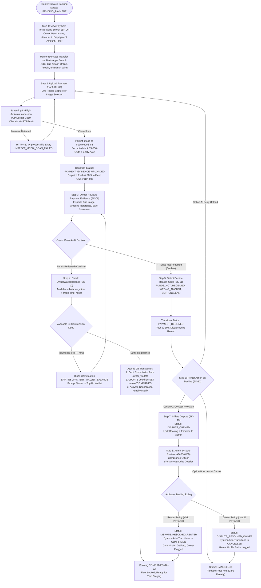
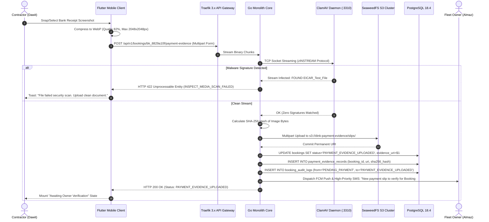
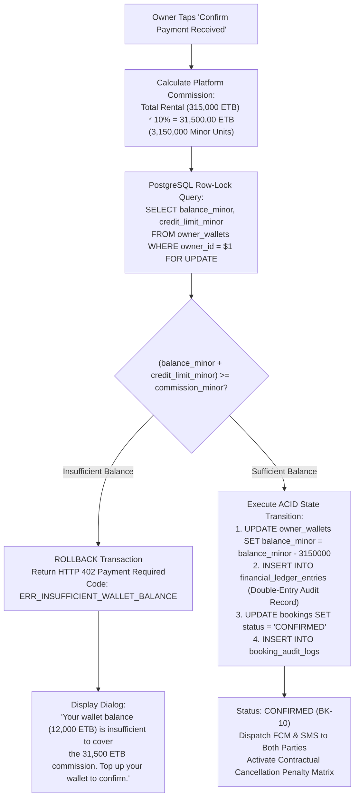
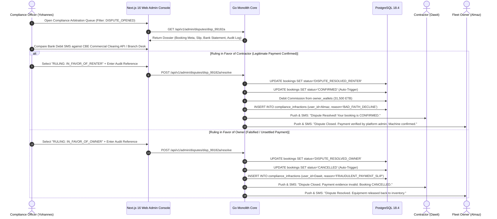
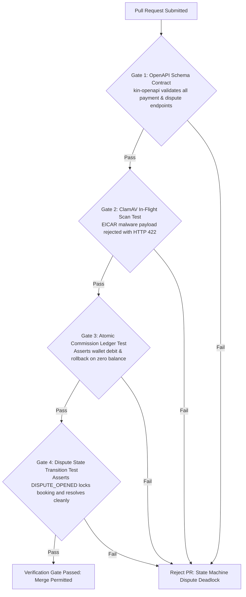

# Heavy Machinery & Logistics Rental Aggregator — Dink Machinery
## Interaction Flow Specification — 08. Peer-to-Peer Payment Evidence, Verification, Commission Invariants & Dispute Arbitration (`docs/shared/flows/08-payment-evidence-verification-dispute.md`)

**Document Identifier:** `FLOW-PAYMENT-DISPUTE-DINK-CORE-V7.0`  
**Classification:** Canonical User Interaction Flow & Wire Protocol Specification (Single Source of Truth)  
**Governing Documents:** `SRS-DINK-CORE-V7.0` (§5.5.2 BK-06 to BK-13, §5.9 CW-01 to CW-04, §8.1, §8.2), `FLOW-ENTRY-DINK-CORE-V7.0`, `FLOW-RENTER-AUTH-DINK-CORE-V7.0`, `FLOW-OWNER-KYC-DINK-CORE-V7.0`, `FLOW-FLEET-REG-DINK-CORE-V7.0`, `FLOW-DISCOVERY-DINK-CORE-V7.0`, `FLOW-BOOKING-STATE-MACHINE-DINK-CORE-V7.0`, `ARCH-BACKEND-GO-DINK-CORE-V7.0`, `ARCH-FLUTTER-DINK-CORE-V7.0`, `ARCH-SEC-DINK-CORE-V7.0`, `DS-DINK-CORE-V7.0`, `DS-PERSONAS-DINK-CORE-V7.0`, `contracts/openapi.yaml`, `ADR-001`, `ADR-002`, `ADR-005`, `ADR-010`  
**Target Client Runtimes:** Flutter 3.44 / Dart 3.9 (Cross-Platform Mobile), Next.js 16 / React 19 (Admin Web Console), Go 1.24 Backend Monolith, PostgreSQL 18.4, Valkey 8.0, ClamAV Daemon (:3310), SeaweedFS S3 Cluster  
**Target Personas:** Civil Engineering Contractor / Commercial Renter (*Dawit Haile-Mariam* / *Patrick Kariuki*), Fleet Owner & Depot Yard Manager (*W/ro Almaz Tesfaye* / *Kamau Ndegwa*), Back-Office Compliance Officer & Dispute Arbitrator (*Yohannes Bekele*)  
**Target Operating Markets:** Ethiopia (`ET`) & Kenya (`KE`) — Dynamic Multi-Country Parameterization (`LOC-01-BE`)  
**Compliance Standards:** OWASP ASVS 4.0.3 Level 3 (Secure Document Ingestion & Integrity), RFC 9457 (Problem Details), ISO 9241-110, W3C WCAG 2.2 Level AAA (Field Mode) & Level AA (Admin Mode), National Bank of Ethiopia (NBE) Directives on Non-Custodial Marketplace Settlements, Ethiopian Personal Data Protection Proclamation No. 1321/2024  
**Status:** Approved Engineering Baseline

---

## Table of Contents

- 1. [Executive Summary & Regulatory Architecture](#1-executive-summary--regulatory-architecture)
  - 1.1 [Purpose & Non-Custodial Marketplace Rationale (NBE Directives)](#11-purpose--non-custodial-marketplace-rationale-nbe-directives)
  - 1.2 [The Off-Platform Payment Mental Model (Dawit vs. Almaz vs. Yohannes)](#12-the-off-platform-payment-mental-model-dawit-vs-almaz-vs-yohannes)
- 2. [End-to-End Payment Evidence, Verification & Dispute Flowchart](#2-end-to-end-payment-evidence-verification--dispute-flowchart)
- 3. [Detailed Step-by-Step State Machine & User Journey](#3-detailed-step-by-step-state-machine--user-journey)
  - 3.1 [Step 1: Prepayment Obligation Hydration & Payment Instructions Screen (`BK-06`)](#31-step-1-prepayment-obligation-hydration--payment-instructions-screen-bk-06)
  - 3.2 [Step 2: Payment Evidence Upload, Reticle Capture & ClamAV In-Flight Malware Scanning (`BK-07`)](#32-step-2-payment-evidence-upload-reticle-capture--clamav-in-flight-malware-scanning-bk-07)
  - 3.3 [Step 3: Owner Verification Workflow, Commercial Bank Statement Audit & Confirmation (`BK-08`, `BK-09`, `BK-10`)](#33-step-3-owner-verification-workflow-commercial-bank-statement-audit--confirmation-bk-08-bk-09-bk-10)
  - 3.4 [Step 4: Pre-Funded Platform Commission Ledger Debit Invariant (`BK-10`, `CW-01`, `OwnerWallet`)](#34-step-4-pre-funded-platform-commission-ledger-debit-invariant-bk-10-cw-01-ownerwallet)
  - 3.5 [Step 5: Owner Payment Rejection & Structured Decline Reasons (`BK-11`)](#35-step-5-owner-payment-rejection--structured-decline-reasons-bk-11)
  - 3.6 [Step 6: Renter Triage on Decline: Retry, Cancel, or Dispute (`BK-12`)](#36-step-6-renter-triage-on-decline-retry-cancel-or-dispute-bk-12)
  - 3.7 [Step 7: Administrative Dispute Escalation & Evidence Dossier Assembly (`BK-13`)](#37-step-7-administrative-dispute-escalation--evidence-dossier-assembly-bk-13)
  - 3.8 [Step 8: Compliance Officer Arbitration & Binding Resolution Ruling (`BK-13`, `AD-06-WEB`)](#38-step-8-compliance-officer-arbitration--binding-resolution-ruling-bk-13-ad-06-web)
- 4. [Financial Ledger Architecture & Commission Settlement](#4-financial-ledger-architecture--commission-settlement)
  - 4.1 [Non-Escrow P2P Direct Settlement Invariant](#41-non-escrow-p2p-direct-settlement-invariant)
  - 4.2 [Double-Entry Ledger Transactions on Payment Confirmation](#42-double-entry-ledger-transactions-on-payment-confirmation)
  - 4.3 [Manual Commission Debt Accumulation & Owner Wallet Replenishment (`CW-02`, `CW-03`, `CW-04`)](#43-manual-commission-debt-accumulation--owner-wallet-replenishment-cw-02-cw-03-cw-04)
- 5. [Frontier Market Edge Cases & Fault Recovery Protocols](#5-frontier-market-edge-cases--fault-recovery-protocols)
  - 5.1 [Telecommunication SMS & Notification Transit Latencies during Verification](#51-telecommunication-sms--notification-transit-latencies-during-verification)
  - 5.2 [Forged or Reused Bank Transfer Receipt Interception (SHA-256 Perceptual Hashing)](#52-forged-or-reused-bank-transfer-receipt-interception-sha-256-perceptual-hashing)
  - 5.3 [Payment Timeout Auto-Cancellation Worker & Race Condition Mitigation](#53-payment-timeout-auto-cancellation-worker--race-condition-mitigation)
  - 5.4 [Low-Bandwidth Slip Compression & Progressive Upload via Isar NoSQL](#54-low-bandwidth-slip-compression--progressive-upload-via-isar-nosql)
- 6. [Client UI/UX Ergonomic Specifications & Design Tokens](#6-client-uiux-ergonomic-specifications--design-tokens)
  - 6.1 [Slip Upload & Camera Reticle Viewfinder ($56 \times 56\text{ dp}$ Touch Targets)](#61-slip-upload--camera-reticle-viewfinder-56-times-56text-dp-touch-targets)
  - 6.2 [Owner Verification Modal & Zoom/Pan Slip Lightbox](#62-owner-verification-modal--zoompan-slip-lightbox)
  - 6.3 [Dispute Evidence Comparison View in Next.js Admin Console](#63-dispute-evidence-comparison-view-in-nextjs-admin-console)
- 7. [Wire Protocol Contracts & RFC 9457 Error Schemas](#7-wire-protocol-contracts--rfc-9457-error-schemas)
  - 7.1 [`POST /api/v1/bookings/{id}/payment-evidence`](#71-post-apiv1bookingsidpayment-evidence)
  - 7.2 [`POST /api/v1/bookings/{id}/verify-payment`](#72-post-apiv1bookingsidverify-payment)
  - 7.3 [`POST /api/v1/bookings/{id}/decline-payment`](#73-post-apiv1bookingsiddecline-payment)
  - 7.4 [`POST /api/v1/bookings/{id}/disputes`](#74-post-apiv1bookingsiddisputes)
  - 7.5 [`POST /api/v1/admin/disputes/{id}/resolve`](#75-post-apiv1admindisputesidresolve)
  - 7.6 [RFC 9457 Universal Problem Details Payloads](#76-rfc-9457-universal-problem-details-payloads)
- 8. [Automated Testing Suite & Verification Gates](#8-automated-testing-suite--verification-gates)

---

## 1. Executive Summary & Regulatory Architecture

### 1.1 Purpose & Non-Custodial Marketplace Rationale (NBE Directives)

The **Payment Evidence, Verification, Commission Invariants & Dispute Arbitration Flow** governs the settlement verification rail of Dink Machinery. 

Under current National Bank of Ethiopia (NBE) regulatory frameworks and commercial banking directives governing electronic commerce aggregators, non-banking digital platforms are strictly prohibited from holding client escrow funds or functioning as unlicensed payment intermediaries. Dink Machinery operates under a **Non-Custodial Direct Peer-to-Peer (P2P) Settlement Model (`MANUAL_TRANSFER`)**:
1. Contractors pay machine rental prepayments directly into the Fleet Owner's verified commercial bank account (e.g., Commercial Bank of Ethiopia, Awash Bank, Dashen Bank, Bank of Abyssinia, Safaricom M-PESA Till/Paybill).
2. The platform never intermediates or holds customer hire funds.
3. Transactional validity is established through digital submission of payment evidence (e.g., bank mobile app transfer screenshot, ATM wire slip, branch cash deposit receipt).
4. Platform commission is collected from the Fleet Owner through an immutable, pre-funded double-entry ledger balance (`owner_wallets`).

This specification enforces four foundational architectural guarantees:
* **Zero Escrow Risk:** Eliminates regulatory banking exposure and currency holding liabilities.
* **Stream-Inspected Evidence Ingestion:** All uploaded receipt artifacts are validated for MIME integrity, stripped of malicious metadata, and scanned in-flight via a dedicated ClamAV daemon (`TCP :3310`) prior to S3 persistence.
* **Atomic Commission Deduction:** Transitioning a booking to `CONFIRMED` atomically debits the platform's revenue share from the owner's pre-funded wallet, enforcing an automatic block if the wallet balance plus approved overdraft credit buffer is insufficient (`BK-17-BE`).
* **Deterministic Dispute Arbitration:** Structured protocols resolve conflicting claims between renters asserting payment transmission and owners denying funds receipt, backed by audited bank reference verification.

### 1.2 The Off-Platform Payment Mental Model (Dawit vs. Almaz vs. Yohannes)

The interaction flow balances the distinct operational imperatives of three primary personas (`DS-PERSONAS-DINK-CORE-V7.0`):
* **Dawit Haile-Mariam (Civil Contractor):** Operates under tight construction deadlines. Once he executes a $150,000\text{ ETB}$ mobile bank transfer from his project account, he requires immediate proof of receipt submission, clear visual status tracking, and contractual protection against arbitrary owner rejection.
* **W/ro Almaz Tesfaye (Fleet Owner):** Refuses to mobilize a multi-million Birr crawler excavator based solely on an unverified digital receipt image. She requires an auditable transaction reference, sufficient time to cross-reference her corporate bank account statement, and a frictionless mechanism to decline invalid or fraudulent slips.
* **Yohannes Bekele (Compliance Officer & Arbitrator):** Needs high-resolution access to the original uncompressed payment evidence, historical transaction logs, verified bank coordinates, and direct communications channels to adjudicate payment disputes within strict SLA windows.

---

## 2. End-to-End Payment Evidence, Verification & Dispute Flowchart



---

## 3. Detailed Step-by-Step State Machine & User Journey

### 3.1 Step 1: Prepayment Obligation Hydration & Payment Instructions Screen (`BK-06`)

Upon tapping **"Request to Book"** on the fleet specification detail view (`FLOW-DISCOVERY-DINK-CORE-V7.0`), the system creates a `Booking` row in `PENDING_PAYMENT` status with an idempotency key and initiates the configured payment timeout countdown (typically $24\text{ hours}$, or $60\text{ minutes}$ for immediate same-day holds).

The Flutter client mounts the **Payment Instructions Screen**, presenting clear settlement coordinates:

```text
+-------------------------------------------------------------------+
|  [<- BACK]            BOOKING #BK-8829A10F       PAYMENT PENDING  |
+-------------------------------------------------------------------+
|  COMPLETE DIRECT BANK PREPAYMENT                                  |
|  Transfer required prepayment directly to the fleet owner's bank. |
|                                                                   |
|  PREPAYMENT DUE NOW (50%)         | TOTAL RENTAL CONTRACT         |
|  157,500.00 ETB                   | 315,000.00 ETB (7 Days)       |
|                                                                   |
|  TIME REMAINING TO UPLOAD SLIP: 23:44:12                          |
|  (i) Reservation will automatically cancel if slip is not uploaded|
|                                                                   |
|  FLEET OWNER SETTLEMENT COORDINATES                               |
|  +-------------------------------------------------------------+  |
|  | Bank Name     : Commercial Bank of Ethiopia (CBE)           |  |
|  | Account Name   : Tesfaye Heavy Transport PLC                 |  |
|  | Account Number : 1000482910234                              |  |
|  | Branch Code    : Kality Industrial Zone Branch               |  |
|  | Reference Text : BK-8829A10F                                |  |
|  +-------------------------------------------------------------+  |
|  [ COPY ACCOUNT NUMBER ]            [ SHARE PAYMENT INSTRUCTIONS ]|
|                                                                   |
|  +-------------------------------------------------------------+  |
|  |                 UPLOAD PAYMENT RECEIPT SLIP                 |  |
|  |                 (Height: 56dp, Amber 500)                   |  |
|  +-------------------------------------------------------------+  |
|                                                                   |
|  [ CANCEL BOOKING REQUEST (FREE CANCELLATION) ]                   |
+-------------------------------------------------------------------+
```

### 3.2 Step 2: Payment Evidence Upload, Reticle Capture & ClamAV In-Flight Malware Scanning (`BK-07`)

The contractor taps **"Upload Payment Receipt Slip"**. In compliance with `DS-DINK-CORE-V7.0`, the application offers two capture mechanisms:
1. **Live Camera Capture Reticle:** Activates the device camera with an on-screen alignment frame optimized for paper deposit slips or ATM printouts.
2. **Device Gallery Selector:** Allows selecting a digital screenshot generated by commercial mobile banking applications (e.g., CBE Mobile Banking, Telebirr SuperApp, Awash Birr).



### 3.3 Step 3: Owner Verification Workflow, Commercial Bank Statement Audit & Confirmation (`BK-08`, `BK-09`, `BK-10`)

Upon receiving the notification, the Fleet Owner opens the booking card in the **Fleet Owner Management Console**. The screen displays the booking summary alongside the uploaded payment evidence:

```text
+-------------------------------------------------------------------+
|  [<- BACK]            BOOKING #BK-8829A10F     VERIFY PREPAYMENT  |
+-------------------------------------------------------------------+
|  PREPAYMENT VERIFICATION REQUIRED                                 |
|  Audit your bank account to confirm receipt of funds.             |
|                                                                   |
|  CLAIMED AMOUNT: 157,500.00 ETB    | BANK: Commercial Bank of Eth.|
|  CONTRACTOR    : Dawit Haile-Mariam (Haile-Mariam Construction)   |
|                                                                   |
|  PAYMENT EVIDENCE SLIP (TAP TO EXPAND & PAN)                      |
|  +-------------------------------------------------------------+  |
|  | [IMAGE PREVIEW: Commercial Bank of Ethiopia Mobile Slip]    |  |
|  | Txn Ref: CBE-FT-99482103 | Date: 2026-10-27 15:22 EAT       |  |
|  | Beneficiary: Tesfaye Heavy Transport PLC (1000482910234)    |  |
|  | Amount: 157,500.00 ETB | Status: SUCCESSFUL                 |  |
|  +-------------------------------------------------------------+  |
|  [ FULL-SCREEN PINCH-TO-ZOOM LIGHTBOX (100% UNCOMPRESSED) ]       |
|                                                                   |
|  +-------------------------------------------------------------+  |
|  |       CONFIRM PAYMENT RECEIVED (COMMISSION: 31,500 ETB)     |  |
|  |                   (Height: 56dp, Emerald 600)               |  |
|  +-------------------------------------------------------------+  |
|                                                                   |
|  +-------------------------------------------------------------+  |
|  |             DECLINE PAYMENT (FUNDS NOT RECEIVED)            |  |
|  |                    (Height: 56dp, Red 600)                  |  |
|  +-------------------------------------------------------------+  |
+-------------------------------------------------------------------+
```

### 3.4 Step 4: Pre-Funded Platform Commission Ledger Debit Invariant (`BK-10`, `CW-01`, `OwnerWallet`)

When the owner taps **"Confirm Payment Received"**, the platform executes an atomic validation of the owner's pre-funded platform commission wallet (`owner_wallets`).



### 3.5 Step 5: Owner Payment Rejection & Structured Decline Reasons (`BK-11`)

If the owner checks their commercial bank records and finds that no funds have settled, they tap **"Decline Payment"**. To prevent arbitrary or ambiguous rejections, the owner must select an explicit reason code:

```text
+-------------------------------------------------------------------+
|  DECLINE PAYMENT EVIDENCE                                         |
|  Select the primary reason why this payment cannot be verified:   |
|                                                                   |
|  ( ) FUNDS_NOT_RECEIVED                                           |
|      No transaction matching this reference appears on statement. |
|                                                                   |
|  ( ) WRONG_AMOUNT                                                 |
|      Transferred amount is less than the required prepayment.     |
|                                                                   |
|  ( ) SLIP_UNCLEAR                                                 |
|      Image is blurry, cut off, or details are illegible.          |
|                                                                   |
|  ( ) INVALID_BENEFICIARY                                          |
|      Funds were transferred to an incorrect account or bank.      |
|                                                                   |
|  ADDITIONAL EXPLANATION FOR CONTRACTOR (MANDATORY):               |
|  +-------------------------------------------------------------+  |
|  | Checked CBE statement at 15:45 EAT. Ref CBE-FT-99482103     |  |
|  | does not exist on our corporate account.                     |  |
|  +-------------------------------------------------------------+  |
|                                                                   |
|  [ BACK ]                                  [ CONFIRM DECLINE ]    |
+-------------------------------------------------------------------+
```

Submitting the decline transitions the booking to `PAYMENT_DECLINED`, evicts any temporary locks, and dispatches an immediate high-priority alert to the contractor.

### 3.6 Step 6: Renter Triage on Decline: Retry, Cancel, or Dispute (`BK-12`)

When a booking transitions to `PAYMENT_DECLINED`, the contractor's mobile interface transitions to an active triage state, offering three deterministic paths:

```text
+-------------------------------------------------------------------+
|  [<- BACK]            BOOKING #BK-8829A10F       PAYMENT DECLINED |
+-------------------------------------------------------------------+
|  PAYMENT COULD NOT BE VERIFIED BY OWNER                           |
|  Reason: FUNDS_NOT_RECEIVED                                       |
|  Note  : Checked CBE statement at 15:45 EAT. Ref does not exist.   |
|                                                                   |
|  CHOOSE AN ACTION TO RESOLVE:                                     |
|                                                                   |
|  1. RETRY UPLOAD (Max 2 Attempts Remaining)                       |
|     Upload a clearer screenshot or alternative deposit slip.      |
|     +-------------------------------------------------------+     |
|     | [ RETRY PAYMENT EVIDENCE UPLOAD ]                     |     |
|     +-------------------------------------------------------+     |
|                                                                   |
|  2. FREE CANCELLATION                                             |
|     Accept rejection and abort booking. Zero platform penalty.    |
|     +-------------------------------------------------------+     |
|     | [ CANCEL BOOKING REQUEST ]                            |     |
|     +-------------------------------------------------------+     |
|                                                                   |
|  3. OPEN OFFICIAL COMPLIANCE DISPUTE                              |
|     Assert funds were deducted; submit bank statement to admin.   |
|     +-------------------------------------------------------+     |
|     | [ CONTEST REJECTION & OPEN DISPUTE ] (Red Outline)   |     |
|     +-------------------------------------------------------+     |
+-------------------------------------------------------------------+
```

### 3.7 Step 7: Administrative Dispute Escalation & Evidence Dossier Assembly (`BK-13`)

If the contractor confirms the funds were debited from their commercial bank account and suspects an erroneous or bad-faith decline by the owner, they tap **"Contest Rejection & Open Dispute"**.

1. The client executes `POST /api/v1/bookings/{id}/disputes`.
2. The contractor must upload supporting evidence:
   - Official bank debit statement (PDF or photo).
   - Bank-issued SMS debit alert showing the transaction timestamp and debit authorization code.
   - Narrative explanation of the transfer execution.
3. The booking state transitions to `DISPUTE_OPENED`.
4. **Platform Asset Lock:** While in `DISPUTE_OPENED`, the equipment remains locked (`LOCKED_DISPUTE`), preventing the owner from re-listing or renting the asset to another party until administrative resolution is achieved.

### 3.8 Step 8: Compliance Officer Arbitration & Binding Resolution Ruling (`BK-13`, `AD-06-WEB`)

Payment disputes are resolved exclusively by platform compliance staff (such as *Yohannes Bekele*) via the **Next.js 16 Web Admin Console** (`ARCH-ADMIN-NEXT-DINK-CORE-V7.0`).



---

## 4. Financial Ledger Architecture & Commission Settlement

### 4.1 Non-Escrow P2P Direct Settlement Invariant

In compliance with Ethiopian banking regulations, Dink Machinery records financial operations without holding third-party funds. The platform maintains a strictly isolated double-entry tracking ledger for internal platform commission and debt settlement.

### 4.2 Double-Entry Ledger Transactions on Payment Confirmation

When a booking transitions to `CONFIRMED`, the Go backend executes an atomic double-entry balance adjustment:

```sql
-- 1. Lock Owner Wallet
SELECT id, balance_minor, credit_limit_minor 
FROM owner_wallets 
WHERE owner_id = $1 
FOR UPDATE;

-- 2. Debit Owner Commission Balance
UPDATE owner_wallets 
SET balance_minor = balance_minor - $2,
    updated_at = NOW() 
WHERE owner_id = $1;

-- 3. Record Double-Entry Ledger Entries
INSERT INTO financial_ledger_entries (
    id, transaction_group_id, account_type, entity_id, debit_minor, credit_minor, description
) VALUES 
(gen_random_uuid(), $3, 'OWNER_WALLET', $1, $2, 0, 'Platform commission debit for Booking #' || $4),
(gen_random_uuid(), $3, 'PLATFORM_REVENUE', 'DINK_HOLDINGS_PLC', 0, $2, 'Recognized commission revenue for Booking #' || $4);
```

### 4.3 Manual Commission Debt Accumulation & Owner Wallet Replenishment (`CW-02`, `CW-03`, `CW-04`)

Fleet owners maintain operational access by pre-funding their commission wallet or operating within their approved credit limit (`credit_limit_minor`).
1. **Commission Tracking (`CW-02`):** The owner management dashboard displays gross earnings, commission debited, and available ledger balance.
2. **Manual Replenishment (`CW-03`):** To restore a depleted wallet, the owner transfers funds to the Dink Machinery corporate bank account and uploads wire transfer evidence via `POST /api/v1/owners/wallet/top-up`.
3. **Admin Verification (`CW-04`):** Platform finance staff audit the top-up wire receipt in the admin console. Approving the top-up atomically credits `owner_wallets.balance_minor`.
4. **Delinquency Lockout:** If an owner's balance remains negative beyond their credit limit for $> 30\text{ days}$, the background cron worker automatically transitions all of that owner's active fleet listings from `ACTIVE` to `INACTIVE`.

---

## 5. Frontier Market Edge Cases & Fault Recovery Protocols

### 5.1 Telecommunication SMS & Notification Transit Latencies during Verification

In regional construction corridors, cellular network congestion can delay SMS notifications to the fleet owner regarding newly uploaded payment evidence.
* **Fallback Polling:** The Flutter owner application executes periodic background synchronization every $120\text{ seconds}$ whenever an active booking is in `PAYMENT_EVIDENCE_UPLOADED`.
* **Escalation SMS Alerting:** If the owner has not opened the payment verification screen within $3\text{ hours}$ of slip upload, a secondary high-priority SMS gateway route dispatches a direct reminder.

### 5.2 Forged or Reused Bank Transfer Receipt Interception (SHA-256 Perceptual Hashing)

To prevent unscrupulous renters from uploading altered or previously utilized bank receipts:
1. Every uploaded receipt image is stripped of EXIF metadata and hashed using **SHA-256**.
2. The hash is matched against all prior records in `payment_evidence_records`.
3. If an exact hash collision is detected across different booking IDs, the upload is rejected with HTTP 409 Conflict (`ERR_DUPLICATE_PAYMENT_EVIDENCE`).
4. In Next.js Web Admin, an automated perceptual hash difference algorithm flags visually similar slips that have altered transaction reference numbers for manual fraud inspection.

### 5.3 Payment Timeout Auto-Cancellation Worker & Race Condition Mitigation

If the renter fails to upload payment proof before `payment_timeout_expires_at` elapses:
* A background Valkey/Go cron worker detects the timeout and initiates an atomic transition from `PENDING_PAYMENT` to `CANCELLED`.
* **Race Condition Guard:** If the renter taps "Submit Slip" at the exact second the timeout worker fires, the database transaction executes with serializable isolation (`ISOLATION LEVEL SERIALIZABLE`). If the upload transaction commits first, the timeout worker aborts cleanly without cancelling the active verification.

### 5.4 Low-Bandwidth Slip Compression & Progressive Upload via Isar NoSQL

Contractors operating in remote areas with 2G/EDGE connectivity often fail to upload large uncompressed smartphone images ($5\text{–}12\text{ MB}$):
* The Flutter client automatically downscales the image using a dedicated background isolate (`compute()`), converting the artifact to **WebP format (Quality 82%, Max Bounding Box $2048 \times 2048\text{ px}$)**, reducing file size to $< 400\text{ KB}$ while maintaining crisp text legibility for bank reference numbers.
* The pending upload task is registered in **Isar NoSQL** (`payment_upload_outbox`). If connection drops mid-upload, the background worker automatically resumes transmission without requiring the user to re-select the image.

---

## 6. Client UI/UX Ergonomic Specifications & Design Tokens

### 6.1 Slip Upload & Camera Reticle Viewfinder ($56 \times 56\text{ dp}$ Touch Targets)

The mobile capture interface is optimized for dusty outdoor conditions under high glare:
* Primary upload and confirmation buttons enforce an absolute minimum physical hit target of **$56 \times 56\text{ dp}$** (scaling to **$64\text{ dp}$** in Field Mode).
* The camera viewfinder renders high-contrast bounding guides (`color.brand.amber.500`, $3\text{ dp}$ stroke) with real-time text prompt overlays informing the user to align the receipt boundaries.

### 6.2 Owner Verification Modal & Zoom/Pan Slip Lightbox

When auditing payment slips on mobile devices:
* The slip image renders inside an interactive matrix viewer (`InteractiveViewer`), allowing owners to execute up to **$5.0\times$ pinch-to-zoom** and two-finger panning to inspect small transaction digits.
* The primary action buttons (**"Confirm Payment"** and **"Decline Payment"**) are separated by at least $16\text{ dp}$ vertical spacing to prevent accidental mis-taps.

### 6.3 Dispute Evidence Comparison View in Next.js Admin Console

The compliance console presents an interactive split-screen verification interface:
* **Left Pane:** The original uncompressed payment evidence slip uploaded by the contractor, with automated metadata extraction overlays.
* **Right Pane:** The fleet owner's registered bank coordinates, transaction history, and supporting bank statement uploads.
* **Center Utility Bar:** A synchronized zoom/pan controller allowing the arbitrator to compare transaction reference numbers and amounts side-by-side.

---

## 7. Wire Protocol Contracts & RFC 9457 Error Schemas

### 7.1 `POST /api/v1/bookings/{id}/payment-evidence`

Submits payment proof image artifacts for a booking in `PENDING_PAYMENT` or `PAYMENT_DECLINED`.

#### Request Headers
```http
POST /api/v1/bookings/bk_8829a10f/payment-evidence HTTP/1.1
Host: api.dinkmachinery.com
Content-Type: multipart/form-data; boundary=----WebKitFormBoundary7MA4YWxkTrZu0gW
Authorization: Bearer <renterAccessToken>
X-Country-Code: ET
```

#### Multipart Form Body
* `paymentReceipt`: Binary image file (JPEG, PNG, WebP — max 10MB).
* `transactionReference`: String (optional, e.g., `"CBE-FT-99482103"`).
* `transferredAmountMinor`: Integer (minor units, e.g., `15750000`).

#### Response: `HTTP 200 OK`
```json
{
  "success": true,
  "data": {
    "bookingId": "bk_8829a10f",
    "status": "PAYMENT_EVIDENCE_UPLOADED",
    "evidenceUri": "s3://dink-payment-evidence/slips/slip_8829a10f.webp",
    "sha256Hash": "e3b0c44298fc1c149afbf4c8996fb92427ae41e4649b934ca495991b7852b855",
    "uploadedAt": "2026-10-27T15:30:00Z",
    "ownerVerificationTimeoutSeconds": 86400
  },
  "timestamp": "2026-10-27T15:30:01Z"
}
```

---

### 7.2 `POST /api/v1/bookings/{id}/verify-payment`

Fleet Owner confirms receipt of funds, atomically debiting platform commission.

#### Request Headers
```http
POST /api/v1/bookings/bk_8829a10f/verify-payment HTTP/1.1
Host: api.dinkmachinery.com
Content-Type: application/json
Authorization: Bearer <ownerAccessToken>
```

#### Request Payload
```json
{
  "bankTransactionReference": "CBE-FT-99482103",
  "confirmedAmountMinor": 15750000
}
```

#### Response: `HTTP 200 OK`
```json
{
  "success": true,
  "data": {
    "bookingId": "bk_8829a10f",
    "newStatus": "CONFIRMED",
    "commissionDebitedMinor": 3150000,
    "walletRemainingBalanceMinor": 48200000,
    "cancellationPenaltyActive": true,
    "confirmedAt": "2026-10-27T15:45:00Z"
  },
  "timestamp": "2026-10-27T15:45:01Z"
}
```

---

### 7.3 `POST /api/v1/bookings/{id}/decline-payment`

Fleet Owner rejects submitted payment evidence.

#### Request Payload
```json
{
  "declineReasonCode": "FUNDS_NOT_RECEIVED",
  "explanationNote": "Checked CBE statement at 15:45 EAT. Ref CBE-FT-99482103 does not exist on our corporate account."
}
```

#### Response: `HTTP 200 OK`
```json
{
  "success": true,
  "data": {
    "bookingId": "bk_8829a10f",
    "newStatus": "PAYMENT_DECLINED",
    "declineReason": "FUNDS_NOT_RECEIVED",
    "retriesRemaining": 2,
    "declinedAt": "2026-10-27T15:50:00Z"
  },
  "timestamp": "2026-10-27T15:50:01Z"
}
```

---

### 7.4 `POST /api/v1/bookings/{id}/disputes`

Contractor escalates a declined payment to platform administrative compliance.

#### Request Payload
```json
{
  "disputeReason": "CONTESTED_PAYMENT_DECLINE",
  "contractorStatement": "Funds were debited from CBE Account #100019284102 on Oct 27 at 15:22 EAT. Branch verified debit.",
  "supportingEvidenceUris": [
    "s3://dink-dispute-evidence/statements/cbe_statement_oct27.pdf",
    "s3://dink-dispute-evidence/sms/debit_sms_screenshot.webp"
  ]
}
```

#### Response: `HTTP 201 Created`
```json
{
  "success": true,
  "data": {
    "disputeId": "disp_99182a",
    "bookingId": "bk_8829a10f",
    "newStatus": "DISPUTE_OPENED",
    "arbitrationSlaHours": 24,
    "disputeOpenedAt": "2026-10-27T16:00:00Z"
  },
  "timestamp": "2026-10-27T16:00:01Z"
}
```

---

### 7.5 `POST /api/v1/admin/disputes/{id}/resolve`

Platform compliance officer issues binding resolution ruling.

#### Request Payload
```json
{
  "ruling": "IN_FAVOR_OF_RENTER",
  "auditReference": "CBE-CLEARING-AUDIT-2026-8819",
  "arbitratorNotes": "Bank liaison confirmed funds cleared to owner account #1000482910234 under clearing sequence 882910. Decline overturned."
}
```

#### Response: `HTTP 200 OK`
```json
{
  "success": true,
  "data": {
    "disputeId": "disp_99182a",
    "bookingId": "bk_8829a10f",
    "ruling": "IN_FAVOR_OF_RENTER",
    "resultingBookingStatus": "CONFIRMED",
    "commissionDebitedMinor": 3150000,
    "resolvedBy": "Yohannes Bekele",
    "resolvedAt": "2026-10-27T16:30:00Z"
  },
  "timestamp": "2026-10-27T16:30:00Z"
}
```

---

### 7.6 RFC 9457 Universal Problem Details Payloads

#### Example: Insufficient Pre-Funded Commission Wallet Balance (`HTTP 402`)
```json
{
  "type": "[https://api.dinkmachinery.com/errors/insufficient-wallet-balance](https://api.dinkmachinery.com/errors/insufficient-wallet-balance)",
  "title": "Insufficient Pre-Funded Commission Balance",
  "status": 402,
  "detail": "Cannot confirm booking. Your wallet balance (12,000.00 ETB) is less than the platform commission due (31,500.00 ETB). Please top up your wallet to proceed.",
  "instance": "/api/v1/bookings/bk_8829a10f/verify-payment",
  "code": "ERR_INSUFFICIENT_WALLET_BALANCE",
  "invalidParams": [
    {
      "name": "walletBalance",
      "reason": "Top-up of at least 19,500.00 ETB required to confirm booking."
    }
  ]
}
```

#### Example: Duplicate Payment Evidence Hash Reused (`HTTP 409`)
```json
{
  "type": "[https://api.dinkmachinery.com/errors/duplicate-payment-evidence](https://api.dinkmachinery.com/errors/duplicate-payment-evidence)",
  "title": "Duplicate Payment Evidence Detected",
  "status": 409,
  "detail": "This receipt slip has already been submitted for Booking #BK-77194012. Reusing payment evidence is prohibited.",
  "instance": "/api/v1/bookings/bk_8829a10f/payment-evidence",
  "code": "ERR_DUPLICATE_PAYMENT_EVIDENCE"
}
```

---

## 8. Automated Testing Suite & Verification Gates



1. **OpenAPI Schema Contract Gate (`kin-openapi`):** Validates all request envelopes, multipart form structures, and RFC 9457 error responses against `contracts/openapi.yaml`.
2. **ClamAV Antivirus Streaming Test:** An automated integration test streams the EICAR test virus signature string via multipart form upload to `POST /api/v1/bookings/{id}/payment-evidence`, asserting that the daemon intercepts the stream and returns HTTP 422 `INSPECT_MEDIA_SCAN_FAILED`.
3. **Atomic Wallet Commission Integration Test:** Spins up a PostgreSQL testcontainer, initializes an owner wallet with $10,000.00\text{ ETB}$, attempts to confirm a booking with a $31,500.00\text{ ETB}$ commission requirement, and asserts that the transaction rolls back cleanly with HTTP 402 without state mutation.
4. **Dispute State Transition Integration Test:** Simulates a complete dispute lifecycle (`PENDING_PAYMENT` $\rightarrow$ `PAYMENT_EVIDENCE_UPLOADED` $\rightarrow$ `PAYMENT_DECLINED` $\rightarrow$ `DISPUTE_OPENED` $\rightarrow$ `DISPUTE_RESOLVED_RENTER` $\rightarrow$ `CONFIRMED`), asserting that all intermediary state transitions and ledger records are created with strict audit integrity.

---

*This document defines the canonical interaction flow, system behavior, financial ledger invariants, and wire protocols for Payment Evidence Ingestion, Verification, Commission Invariants, and Dispute Arbitration in Dink Machinery Version 7.0. All downstream Flutter mobile screens, Go HTTP controllers, and Next.js admin consoles must strictly adhere to this specification.*