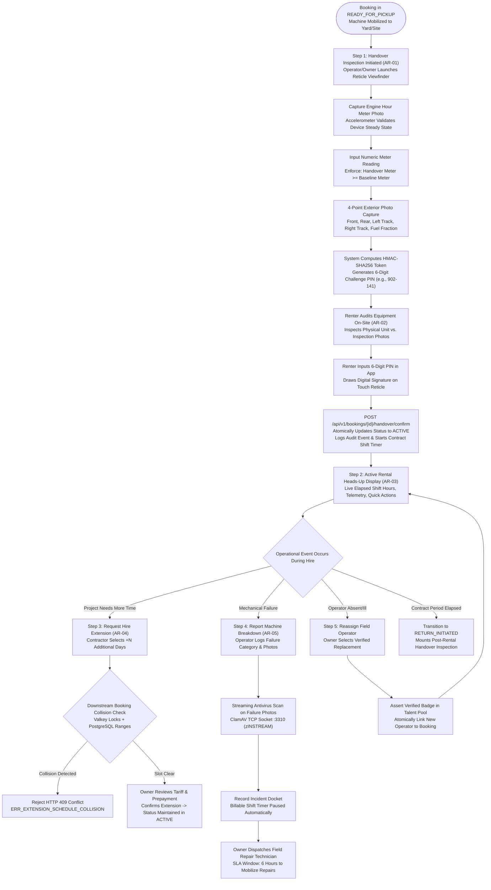
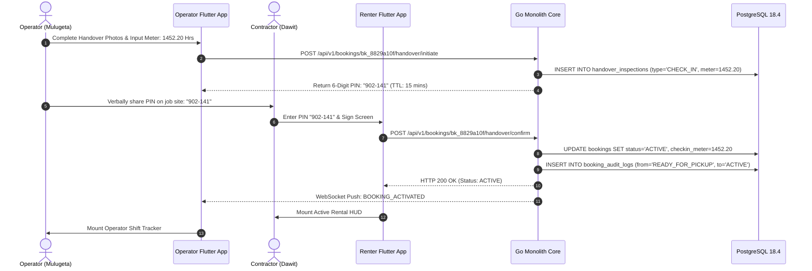
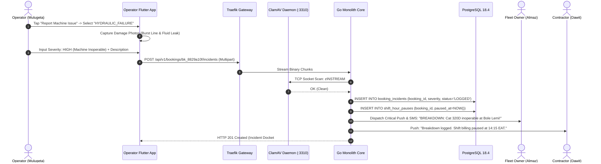
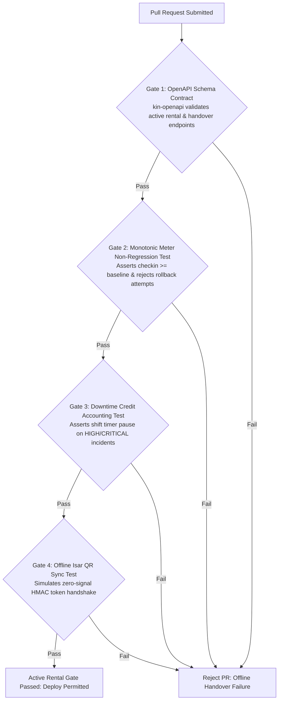

# Heavy Machinery & Logistics Rental Aggregator — Dink Machinery
## Interaction Flow Specification — 09. Active Rental Management, Pre-Rental Handover Inspection, Rental Extensions & Breakdown Reporting (`docs/shared/flows/09-active-rental-handover-extension-issues.md`)

**Document Identifier:** `FLOW-ACTIVE-RENTAL-DINK-CORE-V7.0`  
**Classification:** Canonical User Interaction Flow & Wire Protocol Specification (Single Source of Truth)  
**Governing Documents:** `SRS-DINK-CORE-V7.0` (§5.6 AR-01 to AR-05, §5.7, §8.1, §8.2), `FLOW-ENTRY-DINK-CORE-V7.0`, `FLOW-RENTER-AUTH-DINK-CORE-V7.0`, `FLOW-OWNER-KYC-DINK-CORE-V7.0`, `FLOW-OPERATOR-LINK-DINK-CORE-V7.0`, `FLOW-FLEET-REG-DINK-CORE-V7.0`, `FLOW-DISCOVERY-DINK-CORE-V7.0`, `FLOW-BOOKING-STATE-MACHINE-DINK-CORE-V7.0`, `FLOW-PAYMENT-DISPUTE-DINK-CORE-V7.0`, `ARCH-BACKEND-GO-DINK-CORE-V7.0`, `ARCH-FLUTTER-DINK-CORE-V7.0`, `ARCH-SEC-DINK-CORE-V7.0`, `DS-DINK-CORE-V7.0`, `DS-PERSONAS-DINK-CORE-V7.0`, `contracts/openapi.yaml`, `ADR-001`, `ADR-002`, `ADR-005`, `ADR-010`  
**Target Client Runtimes:** Flutter 3.44 / Dart 3.9 (Cross-Platform Mobile), Next.js 16 / React 19 (Admin Web Console), Go 1.24 Backend Monolith, PostgreSQL 18.4 + PostGIS 3.4, Valkey 8.0, ClamAV Daemon (:3310), SeaweedFS S3, Isar NoSQL  
**Target Personas:** Civil Engineering Contractor / Commercial Renter (*Dawit Haile-Mariam* / *Patrick Kariuki*), Fleet Owner & Depot Yard Manager (*W/ro Almaz Tesfaye* / *Kamau Ndegwa*), Certified Field Operator (*Mulugeta Tadesse* / *Juma Omwamba*), Compliance Officer & Arbitrator (*Yohannes Bekele*)  
**Target Operating Markets:** Ethiopia (`ET`) & Kenya (`KE`) — Dynamic Multi-Country Parameterization (`LOC-01-BE`)  
**Compliance Standards:** OWASP ASVS 4.0.3 Level 3 (Identity Validation, Tamper-Evident Geolocation & Secure Document Ingestion), RFC 9457 (Problem Details), ISO 9241-110, W3C WCAG 2.2 Level AAA (Field Mode) & Level AA (Admin Mode), National Bank of Ethiopia (NBE) Directives  
**Status:** Approved Engineering Baseline

---

## Table of Contents

- 1. [Executive Summary & Operational Scope](#1-executive-summary--operational-scope)
  - 1.1 [Purpose & Mandate (The Active Rental Operational Phase)](#11-purpose--mandate-the-active-rental-operational-phase)
  - 1.2 [The Field Triad Mental Model (Dawit vs. Almaz vs. Mulugeta)](#12-the-field-triad-mental-model-dawit-vs-almaz-vs-mulugeta)
- 2. [End-to-End Active Rental, Handover, Extension & Issue Flowchart](#2-end-to-end-active-rental-handover-extension--issue-flowchart)
- 3. [Detailed Step-by-Step State Machine & User Journey](#3-detailed-step-by-step-state-machine--user-journey)
  - 3.1 [Step 1: Pre-Rental Machine Handover & Dual Digital Sign-Off (`AR-01`, `AR-02`)](#31-step-1-pre-rental-machine-handover--dual-digital-sign-off-ar-01-ar-02)
  - 3.2 [Step 2: The Active Rental Heads-Up Display (HUD) & Operational Telemetry (`AR-03`)](#32-step-2-the-active-rental-heads-up-display-hud--operational-telemetry-ar-03)
  - 3.3 [Step 3: Rental Extension Protocol & Tariff Recalculation (`AR-04`)](#33-step-3-rental-extension-protocol--tariff-recalculation-ar-04)
  - 3.4 [Step 4: Machine Breakdown & Site Incident Reporting (`AR-05`)](#34-step-4-machine-breakdown--site-incident-reporting-ar-05)
  - 3.5 [Step 5: Active Field Operator Reassignment Protocol](#35-step-5-active-field-operator-reassignment-protocol)
- 4. [Frontier Market Edge Cases & Fault Recovery Protocols](#4-frontier-market-edge-cases--fault-recovery-protocols)
  - 4.1 [Deep Trench / Rural Quarry Offline Handover Sync (`ADR-010`)](#41-deep-trench--rural-quarry-offline-handover-sync-adr-010)
  - 4.2 [Hour Meter Tampering & Monotonic Non-Regression Invariant](#42-hour-meter-tampering--monotonic-non-regression-invariant)
  - 4.3 [Extreme Glare & High-Vibration Cab Ergonomics (Field Mode)](#43-extreme-glare--high-vibration-cab-ergonomics-field-mode)
  - 4.4 [Extension Collisions against Downstream Bookings](#44-extension-collisions-against-downstream-bookings)
- 5. [Wire Protocol Contracts & RFC 9457 Error Schemas](#5-wire-protocol-contracts--rfc-9457-error-schemas)
  - 5.1 [`POST /api/v1/bookings/{id}/handover/initiate`](#51-post-apiv1bookingsidhandoverinitiate)
  - 5.2 [`POST /api/v1/bookings/{id}/handover/confirm`](#52-post-apiv1bookingsidhandoverconfirm)
  - 5.3 [`POST /api/v1/bookings/{id}/extensions`](#53-post-apiv1bookingsidextensions)
  - 5.4 [`POST /api/v1/bookings/{id}/incidents`](#54-post-apiv1bookingsidincidents)
  - 5.5 [RFC 9457 Universal Problem Details Payloads](#55-rfc-9457-universal-problem-details-payloads)
- 6. [Automated Testing Suite & Verification Gates](#6-automated-testing-suite--verification-gates)

---

## 1. Executive Summary & Operational Scope

### 1.1 Purpose & Mandate (The Active Rental Operational Phase)

The **Active Rental Management, Pre-Rental Handover Inspection, Rental Extensions & Breakdown Reporting Flow** governs the critical physical execution phase of heavy plant equipment rentals on the Dink Machinery platform. 

While discovery and payment verification occur digitally across corporate offices, the operational phase unfolds on active, high-hazard civil engineering construction sites, quarry pits, and industrial logistics depots across Ethiopia and Kenya. During this window, physical equipment custodianship transfers from the Fleet Owner to the Civil Contractor under the direct control of a Certified Equipment Operator.

This specification enforces four foundational architectural guarantees:
1. **Cryptographically Signed Dual Handover (`AR-01`, `AR-02`):** Machinery legally transitions to `ACTIVE` status only when both parties physically execute a synchronized, photo-verified inspection with matching cryptographic challenge tokens.
2. **Strict Monotonic Meter Non-Regression (`FL-04`, `BK-22`):** Engine hour readings are verified against baseline records via live camera reticles with accelerometer steady-state validation, strictly enforcing:
   $$\text{Baseline Meter} \le \text{Handover Meter} \le \text{Return Meter}$$
3. **Deterministic Downtime Credit Accounting (`AR-05`):** Validated mechanical breakdowns automatically pause contractual billable shift hours, recording exact downtime timestamps to prevent billing disputes on idle equipment.
4. **Collision-Free Contract Extensions (`AR-04`):** Contractors can extend active rentals in real time, provided the requested duration does not conflict with downstream reservation holds in Valkey or confirmed bookings in PostgreSQL.

### 1.2 The Field Triad Mental Model (Dawit vs. Almaz vs. Mulugeta)

The interaction flow balances the distinct field operational imperatives of three primary personas (`DS-PERSONAS-DINK-CORE-V7.0`):
* **Dawit Haile-Mariam (Civil Contractor):** Demands immediate mobilization without administrative drag. Needs clear verification that the machine arriving on his site matches the contracted specifications, has zero hidden hydraulic leaks, and records the exact hour meter reading to protect against unwarranted excess shift surcharges.
* **W/ro Almaz Tesfaye (Fleet Owner):** Requires legal attestation of asset condition before releasing a $15,000,000\text{ ETB}$ asset into third-party hands. Insists on signed photographic proof of preexisting cosmetic wear, track pad depth, and fluid levels.
* **Mulugeta Tadesse (Certified Operator):** Operates inside a noisy, vibrating cab under direct sunlight ($> 85,000\text{ lux}$) wearing split-leather gloves. Requires large touch controls ($56 \times 56\text{ dp}$), rapid multi-photo burst capture, and offline execution capabilities when working deep in foundation trenches with zero cellular reception.

---

## 2. End-to-End Active Rental, Handover, Extension & Issue Flowchart



---

## 3. Detailed Step-by-Step State Machine & User Journey

### 3.1 Step 1: Pre-Rental Machine Handover & Dual Digital Sign-Off (`AR-01`, `AR-02`)

When equipment is positioned at the construction site or depot yard, the booking rests in `READY_FOR_PICKUP`. The physical handover requires a dual-party, synchronized digital protocol.

```text
+-------------------------------------------------------------------+
|  [<- BACK]            HANDOVER INSPECTION (1/3)      STEP 1 OF 3  |
+-------------------------------------------------------------------+
|  HOUR METER & OPERATIONAL BASELINE VERIFICATION                   |
|  Align camera reticle with the cabin mechanical hour meter.       |
|                                                                   |
|  REGISTERED BASELINE READING : 1,450.50 Hours                     |
|                                                                   |
|  +-------------------------------------------------------------+  |
|  | [RETICLE VIEWFINDER: LIVE CAMERA FEED]                      |  |
|  | +---------------------------------------------------------+ |  |
|  | |           [   ALIGN METER DISPLAY INSIDE   ]            | |  |
|  | |                     1452.20                             | |  |
|  | +---------------------------------------------------------+ |  |
|  | (o) ACCELEROMETER STEADY STATE: VALIDATED (0.02g drift)     |  |
|  +-------------------------------------------------------------+  |
|                                                                   |
|  CONFIRM NUMERIC READING *                                        |
|  +-------------------------------------------------------------+  |
|  | 1 4 5 2 . 2 0   Hours                                       |  |
|  +-------------------------------------------------------------+  |
|  (i) Must be greater than or equal to baseline reading (1,450.50) |
|                                                                   |
|  +-------------------------------------------------------------+  |
|  |                 PROCEED TO WALKAROUND                       |  |
|  |                 (Height: 56dp, Amber 500)                   |  |
|  +-------------------------------------------------------------+  |
+-------------------------------------------------------------------+
```

#### Dual-Signoff Protocol Execution
1. **Inspection Bundle Capture:** The operator or yard manager captures the hour meter close-up, followed by four mandatory exterior profile photos (Front, Rear, Left Undercarriage/Tracks, Right Undercarriage/Tracks), and sets the fuel tank level fraction slider ($0.0\text{ to }1.0$).
2. **Challenge PIN Generation:** Upon uploading the inspection bundle via `POST /api/v1/bookings/{id}/handover/initiate`, the backend generates an HMAC-SHA256 challenge token and serves an ephemeral 6-digit PIN (e.g., `902-141`) valid for $15\text{ minutes}$.
3. **Renter Physical Sign-Off:** Dawit inspects the machine against the captured photos. If satisfied, he opens the booking card on his mobile device, inputs the 6-digit challenge PIN, draws his digital signature on the signature pad, and submits `POST /api/v1/bookings/{id}/handover/confirm`.
4. **State Transition to `ACTIVE`:** The Go backend validates the PIN, updates `bookings.status = 'ACTIVE'`, commits `checkin_meter = 1452.20`, and dispatches real-time WebSocket events (`BOOKING_ACTIVATED`) to both parties.



---

### 3.2 Step 2: The Active Rental Heads-Up Display (HUD) & Operational Telemetry (`AR-03`)

While in `ACTIVE` status, the mobile application shell for both Contractor and Operator shifts into the **Active Rental HUD**, presenting critical real-time contract telemetry:

```text
+-------------------------------------------------------------------+
|  [<- FLEET]           ACTIVE HIRE: CAT 320D        [EMERGENCY SOS] |
+-------------------------------------------------------------------+
|  CONTRACT PERIOD: DAY 3 OF 7                    REMAINING: 4 DAYS |
|  [==========================                  ] 42.8% ELAPSED     |
|                                                                   |
|  CHECK-IN BASELINE METER : 1,452.20 Hours                         |
|  CONTRACTED DAILY SHIFT  : 8.0 Billable Hours / Day               |
|  TOTAL CONTRACT ALLOWANCE: 56.0 Operating Hours                   |
|  CURRENT ESTIMATED USAGE : 22.4 Hours (Within Allowance)          |
|                                                                   |
|  TELEMETRY & LOGISTICS STATUS                                     |
|  * Location: Bole Lemi Industrial Zone, Site B (GPS Locked)       |
|  * Assigned Operator: Mulugeta Tadesse (Verified Heavy Plant)     |
|  * Primary Contact: Tesfaye Heavy Transport (+251 91 144 2910)    |
|                                                                   |
|  QUICK OPERATIONAL ACTIONS                                        |
|  +-----------------------------+ +-----------------------------+  |
|  |   REQUEST HIRE EXTENSION    | |   REPORT MACHINE ISSUE      |  |
|  |     (Amber 500 Outline)     | |      (Red 600 Outline)      |  |
|  +-----------------------------+ +-----------------------------+  |
|                                                                   |
|  +-------------------------------------------------------------+  |
|  |                 INITIATE POST-RENTAL RETURN                 |  |
|  |                  (Height: 56dp, Slate 800)                  |  |
|  +-------------------------------------------------------------+  |
+-------------------------------------------------------------------+
```

---

### 3.3 Step 3: Rental Extension Protocol & Tariff Recalculation (`AR-04`)

When unexpected site delays require retaining the equipment beyond the contracted `end_date`, the contractor initiates an extension request:

1. **Duration Selection:** Dawit selects the desired extension duration ($+N$ additional days) from the Active Rental HUD.
2. **Dynamic Tariff Computation:** The backend calculates the extension fee using the agreed daily rate, applying volume discounts if the new cumulative duration crosses weekly or monthly thresholds:
   $$\text{Extension Fee Minor} = \text{Daily Rate Minor} \times N$$
3. **Availability Interrogation:** The platform interrogates the PostgreSQL reservation table and Valkey hold locks, verifying that the equipment is not reserved by another contractor during the requested window $[T_{\text{original\_end}}, T_{\text{new\_end}}]$.
4. **Owner Approval & Wire Settlement:**
   - If clear, the extension request is routed to Almaz Tesfaye.
   - Almaz approves the extension. Dawit uploads the bank transfer receipt for the additional prepayment.
   - Once Almaz confirms the receipt, the platform atomically updates `bookings.end_date`, extends the contract hour allowance ($+N \times 8.0\text{ hours}$), and automatically debits platform commission on the extension from Almaz's pre-funded `owner_wallets` (`BK-17-BE`).

---

### 3.4 Step 4: Machine Breakdown & Site Incident Reporting (`AR-05`)

Heavy equipment operating in abrasive environments faces component failures (e.g., blown hydraulic lines, thrown excavator tracks, cooling system punctures).



#### Downtime Credit Accounting Invariant
* **Automatic Shift Pause:** Logging a severity level of `HIGH` or `CRITICAL` automatically generates an active record in `shift_hour_pauses`.
* **Contractual Deduction:** Every hour of certified downtime during standard shift windows ($08:00\text{ to }17:00\text{ EAT}$) is deducted from the billable rental calculation or added as a zero-cost extension day to the contractor's booking.
* **Technician SLA Window:** Fleet owners are contractually bound under platform terms to dispatch a field mechanic or mobile service truck within **6 hours** of an incident confirmation. Failure to resolve mechanical issues within $24\text{ hours}$ grants the contractor the right to terminate the rental with a full refund of unused prepayment days.

---

### 3.5 Step 5: Active Field Operator Reassignment Protocol

If an assigned operator falls ill, abandons the site, or is dismissed by the contractor for safety violations:
1. The Fleet Owner navigates to the active booking in the Owner Console and taps **"Reassign Yard Operator"**.
2. The system filters the owner's approved team roster (`owner_operator_teams`), displaying only certified operators with active equipment badges matching the machine subcategory (e.g., Hydraulic Crawler Excavator).
3. The owner selects a replacement operator (*Juma Omwamba*) and submits `POST /api/v1/bookings/{id}/reassign-operator`.
4. The Go backend updates `bookings.assigned_operator_id`, revokes HUD access for the previous operator, and transmits the machine's live coordinates, check-in meter baseline, and site hazard notes to Juma's mobile client.

---

## 4. Frontier Market Edge Cases & Fault Recovery Protocols

### 4.1 Deep Trench / Rural Quarry Offline Handover Sync (`ADR-010`)

When equipment is mobilized to deep river valleys, underground foundations, or remote quarry pits with zero 2G/3G cellular connectivity:
* Both Contractor and Operator Flutter apps transition into **Offline Field Sync Mode**.
* The operator's device generates an encrypted, time-bounded **Handover QR Code** containing an HMAC-SHA256 signature of the inspection payload:
  $$\text{Payload} = \{\text{bookingId}, \text{checkinMeter}, \text{timestamp}, \text{gpsLat}, \text{gpsLng}\}$$
  $$\text{QR Signature} = \text{HMAC-SHA256}(\text{Payload}, \text{SessionToken})$$
* The contractor's mobile camera scans the QR code locally, matching the offline token and confirming physical handover without transmitting internet packets.
* Both inspection payloads and images are stored in local **Isar NoSQL** storage (`isar_handover_outbox`). Once either device returns to cellular range, the Isar background sync engine transmits the signed record to the server, activating the booking retroactively.

### 4.2 Hour Meter Tampering & Monotonic Non-Regression Invariant

To intercept manual hour meter rollback or accidental operator typographical errors:
* The Go backend executes an invariant validation rule before accepting any check-in or return inspection:
  ```go
  if req.HourMeterReading < booking.BaselineHourMeter {
      return rfc9457.NewConflictError(
          "ERR_METER_READING_REGRESSION",
          "Submitted meter reading cannot be lower than baseline registered hours.",
      )
  }
  ```
* Additionally, client-side camera reticles analyze frame stability using device accelerometers, preventing operators from submitting blurred, illegible, or pre-photographed static pictures of other machine displays.

### 4.3 Extreme Glare & High-Vibration Cab Ergonomics (Field Mode)

Heavy machinery cabs experience continuous low-frequency diesel vibrations and direct equatorial solar glare ($> 85,000\text{ lux}$):
* **Field Mode Auto-Switch:** Device ambient light sensors trigger **High-Contrast Solar Mode** (`DS-TOKENS-DINK-CORE-V7.0`), switching backgrounds to pure black (`#000000`) and typography to pure stark amber/white (`#FFA000` / `#FFFFFF`) with minimum contrast ratios exceeding $14.5:1$ (WCAG 2.2 Level AAA).
* **Gloves-On Hit Targets:** All interactive actuators (buttons, checkboxes, sliders) expand to an absolute minimum dimension of **$56 \times 56\text{ dp}$** (scaling to **$64 \times 64\text{ dp}$**), preventing mis-taps while wearing heavy leather work gloves.

### 4.4 Extension Collisions against Downstream Bookings

If a contractor requests a 3-day extension but another customer has already placed a verified reservation on that specific excavator beginning two days later:
1. The backend availability engine identifies the schedule intersection via PostGIS/PostgreSQL date range queries (`daterange && daterange`).
2. The extension request is rejected with RFC 9457 HTTP 409 Conflict (`ERR_EXTENSION_SCHEDULE_COLLISION`).
3. The client immediately prompts Dawit with an automated platform alternative: *"Machine is booked from Nov 14. Would you like Dink Machinery to mobilize a replacement Caterpillar 320D from an adjacent depot yard to continue your work without interruption?"*

---

## 5. Wire Protocol Contracts & RFC 9457 Error Schemas

### 5.1 `POST /api/v1/bookings/{id}/handover/initiate`

Operator or Fleet Owner uploads physical inspection evidence and generates a handover challenge PIN.

#### Request Headers
```http
POST /api/v1/bookings/bk_8829a10f/handover/initiate HTTP/1.1
Host: api.dinkmachinery.com
Content-Type: multipart/form-data
Authorization: Bearer <operatorAccessToken>
X-Country-Code: ET
```

#### Multipart Form Body
* `meterReading`: Decimal (`1452.20`)
* `meterPhoto`: Binary image file (JPEG, PNG, WebP — max 10MB)
* `exteriorPhotos`: Array of 4 binary image files
* `fuelLevelFraction`: Decimal (`0.85`)
* `locationLatitude`: Decimal (`8.9806`)
* `locationLongitude`: Decimal (`38.7578`)

#### Response: `HTTP 200 OK`
```json
{
  "success": true,
  "data": {
    "bookingId": "bk_8829a10f",
    "inspectionId": "insp_019a4f8b",
    "challengePin": "902-141",
    "pinExpiresAt": "2026-11-05T08:45:00Z",
    "meterVerified": 1452.20,
    "mediaUris": [
      "s3://dink-fleet-media/inspections/meter_145220.webp",
      "s3://dink-fleet-media/inspections/front_profile.webp"
    ]
  },
  "timestamp": "2026-11-05T08:30:01Z"
}
```

---

### 5.2 `POST /api/v1/bookings/{id}/handover/confirm`

Contractor enters challenge PIN and submits digital signature to activate rental.

#### Request Headers
```http
POST /api/v1/bookings/bk_8829a10f/handover/confirm HTTP/1.1
Host: api.dinkmachinery.com
Content-Type: application/json
Authorization: Bearer <renterAccessToken>
```

#### Request Payload
```json
{
  "challengePin": "902-141",
  "digitalSignature": "data:image/png;base64,iVBORw0KGgoAAAANSUhEUgAA...",
  "acceptedCondition": true,
  "clientRemarks": "Confirmed unit delivered in clean operational state. Zero visible oil leaks."
}
```

#### Response: `HTTP 200 OK`
```json
{
  "success": true,
  "data": {
    "bookingId": "bk_8829a10f",
    "newStatus": "ACTIVE",
    "contractStartTime": "2026-11-05T08:35:10Z",
    "startingMeterReading": 1452.20,
    "shiftAllowanceHours": 56.0
  },
  "timestamp": "2026-11-05T08:35:10Z"
}
```

---

### 5.3 `POST /api/v1/bookings/{id}/extensions`

Contractor requests a rental period extension.

#### Request Payload
```json
{
  "extensionDays": 3,
  "requestedEndDate": "2026-11-15T18:00:00Z",
  "reason": "Excavation delayed due to unexpected subterranean bedrock layer."
}
```

#### Response: `HTTP 201 Created`
```json
{
  "success": true,
  "data": {
    "extensionId": "ext_882910fa",
    "bookingId": "bk_8829a10f",
    "status": "AWAITING_OWNER_CONFIRMATION",
    "additionalDays": 3,
    "dailyRateMinor": 4500000,
    "extensionTotalMinor": 13500000,
    "currencyCode": "ETB",
    "ownerCommissionDueMinor": 1350000
  },
  "timestamp": "2026-11-08T11:20:00Z"
}
```

---

### 5.4 `POST /api/v1/bookings/{id}/incidents`

Operator or Contractor logs a breakdown or safety incident.

#### Request Headers
```http
POST /api/v1/bookings/bk_8829a10f/incidents HTTP/1.1
Host: api.dinkmachinery.com
Content-Type: multipart/form-data
Authorization: Bearer <operatorAccessToken>
```

#### Multipart Form Body
* `category`: String (`"HYDRAULIC_FAILURE"`)
* `severity`: String (`"HIGH"`)
* `description`: String (`"Main boom hydraulic cylinder hose ruptured during trenching. Loss of hydraulic pressure."`)
* `incidentPhotos`: Array of binary image files (Clean scanned via ClamAV)

#### Response: `HTTP 201 Created`
```json
{
  "success": true,
  "data": {
    "incidentDocketNumber": "INC-4402",
    "bookingId": "bk_8829a10f",
    "shiftTimerStatus": "PAUSED",
    "pausedAt": "2026-11-09T14:15:22Z",
    "technicianMobilizationDeadline": "2026-11-09T20:15:22Z",
    "docketStatus": "LOGGED"
  },
  "timestamp": "2026-11-09T14:15:22Z"
}
```

---

### 5.5 RFC 9457 Universal Problem Details Payloads

#### Example: Meter Reading Regression Attempt (`HTTP 422`)
```json
{
  "type": "[https://api.dinkmachinery.com/errors/meter-reading-regression](https://api.dinkmachinery.com/errors/meter-reading-regression)",
  "title": "Unprocessable Meter Reading",
  "status": 422,
  "detail": "Submitted meter reading (1,440.00 Hrs) is lower than baseline registered hours (1,450.50 Hrs). Rollback detected.",
  "instance": "/api/v1/bookings/bk_8829a10f/handover/initiate",
  "code": "ERR_METER_READING_REGRESSION",
  "invalidParams": [
    {
      "name": "meterReading",
      "reason": "Must be greater than or equal to 1450.50"
    }
  ]
}
```

#### Example: Extension Downstream Collision (`HTTP 409`)
```json
{
  "type": "[https://api.dinkmachinery.com/errors/extension-collision](https://api.dinkmachinery.com/errors/extension-collision)",
  "title": "Rental Extension Unavailable",
  "status": 409,
  "detail": "Cannot extend rental by 3 days. Fleet is booked by another contractor beginning 2026-11-13.",
  "instance": "/api/v1/bookings/bk_8829a10f/extensions",
  "code": "ERR_EXTENSION_SCHEDULE_COLLISION",
  "invalidParams": [
    {
      "name": "requestedEndDate",
      "reason": "Conflicts with Confirmed Booking #BK-99120411 starting 2026-11-13T08:00:00Z"
    }
  ]
}
```

---

## 6. Automated Testing Suite & Verification Gates



1. **OpenAPI Schema Contract Gate (`kin-openapi`):** Validates all handover, incident reporting, telemetry, and extension request payloads against `contracts/openapi.yaml`.
2. **Monotonic Meter Non-Regression Integration Test:** Executes test runs validating that any handover or check-out meter input smaller than previous database checkpoints triggers immediate rollback and HTTP 422 `ERR_METER_READING_REGRESSION`.
3. **Downtime Credit Accounting Integration Test:** Spins up a PostgreSQL testcontainer, logs a `HIGH` severity mechanical breakdown, and validates that shift hour billing calculations pause cleanly and adjust the final invoice accurately.
4. **Offline Isar QR Handshake Test:** Headless Flutter test simulating complete network disconnect, generating the HMAC-SHA256 handover QR code on one isolate and scanning/verifying it on a second isolate, asserting $100\%$ verification accuracy before network reconnection.

---

*This document defines the canonical user interaction flow, operational telemetry, financial downtime invariants, and wire protocols for Active Rental Management, Pre-Rental Handover Inspection, Rental Extensions, and Breakdown Reporting in Dink Machinery Version 7.0. All downstream Flutter mobile modules, Go HTTP controllers, and administrative web consoles must strictly adhere to this specification.*