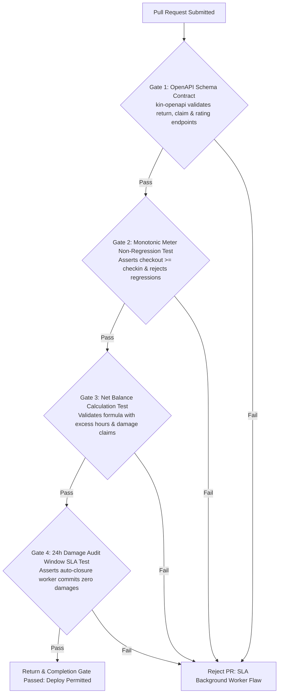

# Heavy Machinery & Logistics Rental Aggregator — Dink Machinery
## Interaction Flow Specification — 10. Rental Completion, Post-Rental Handover Inspection, Damage Assessment & Final Settlement (`docs/shared/flows/10-return-damage-assessment-completion.md`)

**Document Identifier:** `FLOW-RETURN-DAMAGE-DINK-CORE-V7.0`  
**Classification:** Canonical User Interaction Flow & Wire Protocol Specification (Single Source of Truth)  
**Governing Documents:** `SRS-DINK-CORE-V7.0` (§5.7 RC-01 to RC-07, §5.9 CW-01 to CW-04, §8.1, §8.2), `FLOW-ENTRY-DINK-CORE-V7.0`, `FLOW-RENTER-AUTH-DINK-CORE-V7.0`, `FLOW-OWNER-KYC-DINK-CORE-V7.0`, `FLOW-OPERATOR-LINK-DINK-CORE-V7.0`, `FLOW-FLEET-REG-DINK-CORE-V7.0`, `FLOW-DISCOVERY-DINK-CORE-V7.0`, `FLOW-BOOKING-STATE-MACHINE-DINK-CORE-V7.0`, `FLOW-PAYMENT-DISPUTE-DINK-CORE-V7.0`, `FLOW-ACTIVE-RENTAL-DINK-CORE-V7.0`, `ARCH-BACKEND-GO-DINK-CORE-V7.0`, `ARCH-FLUTTER-DINK-CORE-V7.0`, `ARCH-SEC-DINK-CORE-V7.0`, `DS-DINK-CORE-V7.0`, `DS-PERSONAS-DINK-CORE-V7.0`, `contracts/openapi.yaml`, `ADR-001`, `ADR-002`, `ADR-005`, `ADR-010`  
**Target Client Runtimes:** Flutter 3.44 / Dart 3.9 (Cross-Platform Mobile), Next.js 16 / React 19 (Admin Web Console), Go 1.24 Backend Monolith, PostgreSQL 18.4 + PostGIS 3.4, Valkey 8.0, ClamAV Daemon (:3310), SeaweedFS S3, Isar NoSQL  
**Target Personas:** Civil Engineering Contractor / Commercial Renter (*Dawit Haile-Mariam* / *Patrick Kariuki*), Fleet Owner & Depot Yard Manager (*W/ro Almaz Tesfaye* / *Kamau Ndegwa*), Certified Field Operator (*Mulugeta Tadesse* / *Juma Omwamba*), Compliance Officer & Arbitrator (*Yohannes Bekele*)  
**Target Operating Markets:** Ethiopia (`ET`) & Kenya (`KE`) — Dynamic Multi-Country Parameterization (`LOC-01-BE`)  
**Compliance Standards:** OWASP ASVS 4.0.3 Level 3 (Identity Validation, Tamper-Evident Geolocation & Secure Document Ingestion), RFC 9457 (Problem Details), ISO 9241-110, W3C WCAG 2.2 Level AAA (Field Mode) & Level AA (Admin Mode), National Bank of Ethiopia (NBE) Directives  
**Status:** Approved Engineering Baseline

---

## Table of Contents

- 1. [Executive Summary & Regulatory Architecture](#1-executive-summary--regulatory-architecture)
  - 1.1 [Purpose & Closing Lifecycle Mandate](#11-purpose--closing-lifecycle-mandate)
  - 1.2 [The Post-Rental Audit Mental Model (Dawit vs. Almaz vs. Yohannes)](#12-the-post-rental-audit-mental-model-dawit-vs-almaz-vs-yohannes)
- 2. [End-to-End Return, Damage Assessment & Completion Flowchart](#2-end-to-end-return-damage-assessment--completion-flowchart)
- 3. [Detailed Step-by-Step State Machine & User Journey](#3-detailed-step-by-step-state-machine--user-journey)
  - 3.1 [Step 1: Return Initiation & Demobilization Staging (`RC-01`)](#31-step-1-return-initiation--demobilization-staging-rc-01)
  - 3.2 [Step 2: Post-Rental Return Inspection & Monotonic Hour Meter Verification (`RC-02`)](#32-step-2-post-rental-return-inspection--monotonic-hour-meter-verification-rc-02)
  - 3.3 [Step 3: Shift Hour Allowance & Excess Operating Surcharge Computation (`RC-03`)](#33-step-3-shift-hour-allowance--excess-operating-surcharge-computation-rc-03)
  - 3.4 [Step 4: Damage Assessment, Photographic Evidence & Claim Submission (`RC-04`)](#34-step-4-damage-assessment-photographic-evidence--claim-submission-rc-04)
  - 3.5 [Step 5: Damage Triage by Contractor: Accept, Negotiate, or Dispute (`RC-04`)](#35-step-5-damage-triage-by-contractor-accept-negotiate-or-dispute-rc-04)
  - 3.6 [Step 6: Final Financial Balance Reconciliation (`RC-05`)](#36-step-6-final-financial-balance-reconciliation-rc-05)
  - 3.7 [Step 7: Final Peer-to-Peer Settlement & Owner Confirmation (`RC-06`)](#37-step-7-final-peer-to-peer-settlement--owner-confirmation-rc-06)
  - 3.8 [Step 8: Rental Completion, Bilateral 5-Star Reviews & Asset Re-Activation (`RC-07`)](#38-step-8-rental-completion-bilateral-5-star-reviews--asset-re-activation-rc-07)
- 4. [Financial Reconciliation & Ledger Accounting](#4-financial-reconciliation--ledger-accounting)
  - 4.1 [The Final Balance Reconciliation Formula](#41-the-final-balance-reconciliation-formula)
  - 4.2 [Excess Shift Hours Commission Debit Invariant](#42-excess-shift-hours-commission-debit-invariant)
  - 4.3 [Dispute Escrow & Damage Claims Legal Parameters](#43-dispute-escrow--damage-claims-legal-parameters)
- 5. [Frontier Market Edge Cases & Fault Recovery Protocols](#5-frontier-market-edge-cases--fault-recovery-protocols)
  - 5.1 [Deep Trench / Rural Quarry Offline Check-Out Verification (`ADR-010`)](#51-deep-trench--rural-quarry-offline-check-out-verification-adr-010)
  - 5.2 [Disputed Wear-and-Tear vs. Impact Damage Arbitrage](#52-disputed-wear-and-tear-vs-impact-damage-arbitrage)
  - 5.3 [Unilateral Abandonment & Default Auto-Closure SLA Workers](#53-unilateral-abandonment--default-auto-closure-sla-workers)
  - 5.4 [Rating Manipulation & Reciprocal Retaliation Guards](#54-rating-manipulation--reciprocal-retaliation-guards)
- 6. [Client UI/UX Ergonomic Specifications & Design Tokens](#6-client-uiux-ergonomic-specifications--design-tokens)
  - 6.1 [Check-Out Inspection Reticle & Meter Diff HUD ($56 \times 56\text{ dp}$)](#61-check-out-inspection-reticle--meter-diff-hud-56-times-56text-dp)
  - 6.2 [Owner Damage Claim Submission Drawer & Annotation Tool](#62-owner-damage-claim-submission-drawer--annotation-tool)
  - 6.3 [Bilateral Review & Rating Sheet with Industrial Quality Attributes](#63-bilateral-review--rating-sheet-with-industrial-quality-attributes)
- 7. [Wire Protocol Contracts & RFC 9457 Error Schemas](#7-wire-protocol-contracts--rfc-9457-error-schemas)
  - 7.1 [`POST /api/v1/bookings/{id}/return/initiate`](#71-post-apiv1bookingsidreturninitiate)
  - 7.2 [`POST /api/v1/bookings/{id}/return/inspection`](#72-post-apiv1bookingsidreturninspection)
  - 7.3 [`POST /api/v1/bookings/{id}/damage-claims`](#73-post-apiv1bookingsiddamage-claims)
  - 7.4 [`POST /api/v1/bookings/{id}/damage-claims/{claimId}/respond`](#74-post-apiv1bookingsiddamage-claimsclaimidrespond)
  - 7.5 [`POST /api/v1/bookings/{id}/final-settlement`](#75-post-apiv1bookingsidfinal-settlement)
  - 7.6 [`POST /api/v1/bookings/{id}/ratings`](#76-post-apiv1bookingsidratings)
  - 7.7 [RFC 9457 Universal Problem Details Payloads](#77-rfc-9457-universal-problem-details-payloads)
- 8. [Automated Testing Suite & Verification Gates](#8-automated-testing-suite--verification-gates)

---

## 1. Executive Summary & Regulatory Architecture

### 1.1 Purpose & Closing Lifecycle Mandate

The **Rental Completion, Post-Rental Handover Inspection, Damage Assessment & Final Settlement Flow** governs the closing phase of heavy plant equipment rentals on the Dink Machinery platform. It formalizes the return of physical custodianship from the Civil Contractor back to the Fleet Owner, validates machinery mechanical condition, reconciles actual operating hours against contractual allowances, assesses liabilities for physical damage, settles final balances, and captures bilateral reputation ratings.

Because heavy machinery undergoes extreme operational stresses (high-impact quarry rock excavation, abrasive earthwork, structural hydraulic strain), post-rental reconciliation is the most dispute-prone phase of the equipment rental lifecycle. Dink Machinery replaces informal, verbal handoffs with a **Deterministic Post-Rental Audit Engine**:
1. **Mathematical Hour Reconciliation:** Reconciles check-in vs. check-out hour meter readings against daily shift allowances ($8.0\text{ billable hours/day}$), auto-calculating excess hour surcharges.
2. **Itemized Damage Docketing:** Demands structured, photo-evidenced damage claims within strict time-bounded inspection windows ($24\text{ hours}$ post-return), distinguishing ordinary wear-and-tear from compensable mechanical neglect or physical impact.
3. **P2P Final Balance Settlement:** Reconciles gross contract costs, additional shift hours, accepted damage liabilities, and previously settled prepayments into a single transparent net figure, settled directly between parties via commercial bank transfer under National Bank of Ethiopia (NBE) non-custodial directives.
4. **Instant Inventory Restoration:** Automatically returns the physical asset to the PostGIS spatial discovery index (`status = 'ACTIVE'`) the moment final financial obligations are confirmed.

### 1.2 The Post-Rental Audit Mental Model (Dawit vs. Almaz vs. Yohannes)

The return protocol reconciles three competing commercial perspectives (`DS-PERSONAS-DINK-CORE-V7.0`):
* **Dawit Haile-Mariam (Civil Contractor):** Demands immediate demobilization sign-off to halt ongoing rental charges. Seeks protection against inflated damage claims for preexisting scratches or routine track wear, and insists on a clear mathematical breakdown of any excess hour surcharges before authorizing final bank wire transfers.
* **W/ro Almaz Tesfaye (Fleet Owner):** Focused on preserving high-value capital assets. Demands thorough exterior inspections before releasing the contractor from liability, immediate financial reimbursement for broken hydraulic teeth or cracked windshields, and automatic collection of excess engine hours before the asset leaves the return staging area.
* **Yohannes Bekele (Compliance Officer & Arbitrator):** Needs objective, side-by-side photographic evidence comparing pre-rental check-in reticle photos (`AR-01`) against post-rental return photos (`RC-02`) to resolve contested damage claims without subjective field bias.

---

## 2. End-to-End Return, Damage Assessment & Completion Flowchart

```mermaid
flowchart TD
    ActiveState(["Booking in ACTIVE Status<br/>Scheduled End Date Reached or Early Return"]) --> ReturnTrigger["Step 1: Return Initiated (RC-01)<br/>Auto-triggered by Cron OR Manually Initiated"]
    
    ReturnTrigger --> TransitReturn["UPDATE bookings SET status='RETURN_INITIATED'<br/>Contract Shift Timer Halted"]
    
    TransitReturn --> ReturnInspection["Step 2: Return Handover Inspection (RC-02)<br/>Operator/Owner Captures Meter Close-Up & 4-Point Photos"]
    
    ReturnInspection --> ClamAVScan["Streaming Antivirus Inspection<br/>ClamAV TCP Socket :3310 (zINSTREAM)"]
    ClamAVScan --> S3Store["Persist Media to SeaweedFS S3 Cluster"]
    
    S3Store --> MeterCheck{"Assert: Check-Out Meter >= Check-In Meter?"}
    MeterCheck -->|"Regression (Check-Out < Check-In)"| RejectInspection["HTTP 422 Unprocessable Entity<br/>ERR_METER_READING_REGRESSION"]
    RejectInspection --> ReturnInspection
    
    MeterCheck -->|"Valid Meter Reading"| CalcHours["Step 3: Compute Operating Hours (RC-03)<br/>Delta Hours = Check-Out Meter - Check-In Meter<br/>Excess Hours = max(0, Delta Hours - Contract Hours)"]
    
    CalcHours --> DamageCheck{"Step 4: Does Owner File Damage Claim? (RC-04)<br/>Window: 24 Hours from Return"}
    
    DamageCheck -->|"Yes: Damage Detected"| SubmitClaim["Owner Inputs Description, Photos & Claimed ETB<br/>Booking Status Enters DAMAGE_PENDING_REVIEW"]
    DamageCheck -->|"No Damage Flagged"| SkipDamage["Damage Claim ETB = 0.00"]
    
    SubmitClaim --> RenterTriage{"Step 5: Contractor Damage Response"}
    RenterTriage -->|"Accept Claim"| AddDamageToTotal["Accepted Damage Added to Final Balance"]
    RenterTriage -->|"Dispute Claim"| EscalateAdmin["Escalate to Admin Compliance (Yohannes)<br/>Side-by-Side Photo Audit (AD-06-WEB)"]
    
    EscalateAdmin --> AdminRuling{"Arbitrator Ruling"}
    AdminRuling -->|"Uphold Owner Claim"| AddDamageToTotal
    AdminRuling -->|"Dismiss Owner Claim"| SkipDamage
    
    AddDamageToTotal --> BalanceCalc["Step 6: Final Balance Reconciliation (RC-05)<br/>Final Balance = (Base + Excess + Damage) - Prepayment"]
    SkipDamage --> BalanceCalc
    
    BalanceCalc --> BalanceEval{"Is Final Balance > 0?"}
    
    BalanceEval -->|"Final Balance > 0"| TransitPendingFinal["Transition: PENDING_FINAL_PAYMENT (RC-06)<br/>Renter Transfers Remaining Balance via Bank App"]
    TransitPendingFinal --> UploadFinalSlip["Renter Uploads Final Wire Slip Proof"]
    UploadFinalSlip --> OwnerConfirmsFinal["Owner Confirms Wire Settlement in Bank Account"]
    OwnerConfirmsFinal --> TransitCompleted["Transition: COMPLETED (RC-07)"]
    
    BalanceEval -->|"Final Balance == 0 (or Prepayment Excess)"| TransitCompleted
    
    TransitCompleted --> RestoreFleet["Fleet Status Updated to ACTIVE<br/>Re-enters PostGIS Search Index"]
    RestoreFleet --> RatingPrompt["Step 8: Prompt Bilateral 5-Star Reviews (RC-07)"]
    RatingPrompt --> BothRated{"Have Both Parties Submitted Ratings?"}
    BothRated -->|"Yes"| TransitRated["Transition: RATED (Terminal State)"]
    BothRated -->|"14 Days Elapsed"| AutoCloseRated["System Auto-Closes to RATED"]
    TransitRated --> Terminate(["Booking Lifecycle Terminated"])
    AutoCloseRated --> Terminate
```



---

## 3. Detailed Step-by-Step State Machine & User Journey

### 3.1 Step 1: Return Initiation & Demobilization Staging (`RC-01`)

The transition from operational execution to return reconciliation occurs via two mechanisms:
1. **Automated Scheduled Transition:** When the active booking's contractual `end_date` timestamp is reached, a backend Valkey/Go cron worker automatically shifts the status from `ACTIVE` to `RETURN_INITIATED`.
2. **Manual Early Demobilization:** If site excavation finishes ahead of schedule, Dawit taps **"Initiate Post-Rental Return"** from the Active Rental HUD (`FLOW-ACTIVE-RENTAL-DINK-CORE-V7.0 §3.2`), prompting the system to transition the booking immediately.

```text
+-------------------------------------------------------------------+
|  [<- BACK]            BOOKING #BK-8829A10F       RETURN INITIATED |
+-------------------------------------------------------------------+
|  EQUIPMENT DEMOBILIZATION & RETURN INSPECTION                     |
|  Position the machinery at the agreed staging area or depot yard. |
|                                                                   |
|  CONTRACTOR    : Dawit Haile-Mariam (Haile-Mariam Construction)   |
|  FLEET ASSET   : Caterpillar 320D Hydraulic Excavator             |
|  RETURN STAGING: Kality Industrial Depot Yard, Addis Ababa        |
|                                                                   |
|  SHIFT TIMER STATUS: HALTED (Oct 27, 2026 - 16:30 EAT)            |
|                                                                   |
|  NEXT REQUIRED ACTIONS:                                           |
|  1. Complete physical walkaround inspection.                      |
|  2. Photograph cabin mechanical hour meter.                       |
|  3. Attest fuel level and document fluid leaks or track damage.   |
|                                                                   |
|  +-------------------------------------------------------------+  |
|  |                 LAUNCH RETURN INSPECTION                    |  |
|  |                 (Height: 56dp, Amber 500)                   |  |
|  +-------------------------------------------------------------+  |
+-------------------------------------------------------------------+
```

---

### 3.2 Step 2: Post-Rental Return Inspection & Monotonic Hour Meter Verification (`RC-02`)

The check-out inspection mirrors the pre-rental reticle process (`AR-01`), establishing an immutable record of ending equipment condition:

```text
+-------------------------------------------------------------------+
|  [<- BACK]            RETURN INSPECTION (1/3)        STEP 1 OF 3  |
+-------------------------------------------------------------------+
|  FINAL HOUR METER VERIFICATION                                    |
|  Align camera reticle with the cabin mechanical hour meter.       |
|                                                                   |
|  CHECK-IN BASELINE READING : 1,452.20 Hours (Verified Nov 5)      |
|                                                                   |
|  +-------------------------------------------------------------+  |
|  | [RETICLE VIEWFINDER: LIVE CAMERA FEED]                      |  |
|  | +---------------------------------------------------------+ |  |
|  | |           [   ALIGN METER DISPLAY INSIDE   ]            | |  |
|  | |                     1514.70                             | |  |
|  | +---------------------------------------------------------+ |  |
|  | (o) ACCELEROMETER STEADY STATE: VALIDATED (0.01g drift)     |  |
|  +-------------------------------------------------------------+  |
|                                                                   |
|  FINAL NUMERIC READING *                                          |
|  +-------------------------------------------------------------+  |
|  | 1 5 1 4 . 7 0   Hours                                       |  |
|  +-------------------------------------------------------------+  |
|  (i) Computed Net Operational Usage: 62.50 Engine Hours           |
|                                                                   |
|  +-------------------------------------------------------------+  |
|  |                 PROCEED TO EXTERIOR PHOTOS                  |  |
|  |                 (Height: 56dp, Amber 500)                   |  |
|  +-------------------------------------------------------------+  |
+-------------------------------------------------------------------+
```

#### Inspection Requirements & Upload Hygiene
1. **Engine Hour Meter Photo:** High-resolution close-up captured via the live camera reticle with accelerometer steady-state validation ($< 0.05g\text{ drift}$).
2. **4-Point Walkaround Photos:** Front profile, Rear engine compartment, Left crawler tracks/undercarriage, and Right crawler tracks/undercarriage.
3. **Fluid Level & Cabin Console:** Hydraulic reservoir sight glass photo and cabin interior console photo.
4. **Security Scan:** Streamed over TCP socket `:3310` to ClamAV via `zINSTREAM` protocol before committing to SeaweedFS S3 (`s3://dink-fleet-media/inspections/checkout_*.webp`).

---

### 3.3 Step 3: Shift Hour Allowance & Excess Operating Surcharge Computation (`RC-03`)

The Go backend calculates whether the contractor operated the machine beyond the standard contractual shift quota:

$$\Delta H = H_{\text{checkout}} - H_{\text{checkin}} = 1,514.70 - 1,452.20 = 62.50\text{ Hours}$$

$$\text{Contracted Allowance} = \text{Contract Days} \times 8.0\text{ Hours/Day} = 7 \times 8.0 = 56.00\text{ Hours}$$

$$\text{Excess Hours} = \max(0, \Delta H - \text{Contracted Allowance}) = \max(0, 62.50 - 56.00) = 6.50\text{ Hours}$$

$$\text{Excess Hour Surcharge} = 6.50\text{ Hours} \times 6,500.00\text{ ETB/Hour} = 42,250.00\text{ ETB}$$

The resulting figures are committed to `booking_hour_settlements` and displayed immediately on the contractor's reconciliation screen.

---

### 3.4 Step 4: Damage Assessment, Photographic Evidence & Claim Submission (`RC-04`)

Upon receiving the check-out inspection bundle, the Fleet Owner has an immutable **24-Hour Damage Audit Window** to inspect the equipment and lodge any claims for physical damage:

```text
+-------------------------------------------------------------------+
|  [<- BACK]            BOOKING #BK-8829A10F         DAMAGE CLAIM   |
+-------------------------------------------------------------------+
|  EQUIPMENT DAMAGE CLAIM SUBMISSION                                |
|  Document non-routine physical impact, structural tears, or theft.|
|                                                                   |
|  DAMAGE CATEGORY *                                                |
|  +-------------------------------------------------------------+  |
|  | GET_TOOTH_BREAKAGE - Ground Engaging Tool / Bucket Teeth [v] |  |
|  +-------------------------------------------------------------+  |
|                                                                   |
|  ESTIMATED REPAIR / REPLACEMENT COST (ETB) *                      |
|  +-------------------------------------------------------------+  |
|  | 18,000.00 ETB                                               |  |
|  +-------------------------------------------------------------+  |
|                                                                   |
|  EVIDENCE PHOTOGRAPHS (MANDATORY - MINIMUM 2 PHOTOS)             |
|  +-------------------------------------------------------------+  |
|  | [PHOTO 1: Fractured outer right bucket shank and missing tooth]|  |
|  | [PHOTO 2: Close-up of fresh shear plane showing impact crack]  |  |
|  +-------------------------------------------------------------+  |
|  [ + ATTACH SUPPLIER REPLACEMENT QUOTATION (PDF/JPG) ]            |
|                                                                   |
|  EXPLANATORY REPORT (MANDATORY):                                  |
|  +-------------------------------------------------------------+  |
|  | Heavy bucket tooth #4 snapped off at shank base. Pre-rental   |  |
|  | inspection photo 3 shows tooth was intact at 85% wear depth.   |  |
|  +-------------------------------------------------------------+  |
|                                                                   |
|  +-------------------------------------------------------------+  |
|  |                 SUBMIT DAMAGE CLAIM TO RENTER               |  |
|  |                    (Height: 56dp, Red 600)                  |  |
|  +-------------------------------------------------------------+  |
+-------------------------------------------------------------------+
```

---

### 3.5 Step 5: Damage Triage by Contractor: Accept, Negotiate, or Dispute (`RC-04`)

When Almaz submits the claim, Dawit receives an instant push notification and SMS alert. The mobile interface mounts the **Damage Assessment Review Screen**:

```text
+-------------------------------------------------------------------+
|  [<- BACK]            BOOKING #BK-8829A10F         DAMAGE REVIEW  |
+-------------------------------------------------------------------+
|  OWNER FILED A DAMAGE CLAIM                                       |
|  Review evidence and decide whether to accept or contest liability.|
|                                                                   |
|  CLAIMED AMOUNT : 18,000.00 ETB                                   |
|  CLAIM CATEGORY : Broken Bucket Tooth Shank                       |
|  OWNER NOTE     : Snapped at shank base during basalt excavation.  |
|                                                                   |
|  INSPECTION EVIDENCE COMPARISON:                                  |
|  +-------------------------------+ +----------------------------+ |
|  | PRE-RENTAL CHECK-IN (NOV 5)   | | POST-RENTAL RETURN (NOV 12)  | |
|  | [Photo: Tooth Intact, Normal] | | [Photo: Broken Shank Base]   | |
|  +-------------------------------+ +----------------------------+ |
|  [ EXPAND HIGH-RES SIDE-BY-SIDE LIGHTBOX ]                        |
|                                                                   |
|  CHOOSE ACTION:                                                   |
|                                                                   |
|  +-------------------------------------------------------------+  |
|  |       ACCEPT DAMAGE CLAIM (ADD 18,000 ETB TO SETTLEMENT)    |  |
|  |                   (Height: 56dp, Slate 800)                 |  |
|  +-------------------------------------------------------------+  |
|                                                                   |
|  +-------------------------------------------------------------+  |
|  |         CONTEST CLAIM & OPEN ADMINISTRATIVE DISPUTE         |  |
|  |                    (Height: 56dp, Red 600)                  |  |
|  +-------------------------------------------------------------+  |
+-------------------------------------------------------------------+
```

#### Dispute Escalation Protocol
If Dawit taps **"Contest Claim & Open Dispute"**, the claim escalates to platform compliance officer *Yohannes Bekele* via `POST /api/v1/bookings/{id}/damage-claims/{claimId}/respond` with `action: DISPUTE`. 
* The booking status shifts to `DISPUTE_OPENED`.
* Yohannes evaluates the pre-rental vs. post-rental photographic dockets on the **Next.js Web Admin Console** (`AD-06-WEB`).
* If the damage constitutes normal wear-and-tear (e.g., normal surface abrasion of bucket side-cutters), Yohannes dismisses the claim. If physical negligence or abnormal impact is verified, Yohannes upholds the claim, establishing a binding administrative resolution.

---

### 3.6 Step 6: Final Financial Balance Reconciliation (`RC-05`)

Once all operational hours and damage liabilities are finalized, the Go backend executes the canonical settlement ledger calculation:

$$\text{Gross Contract Rental Fee} = 7\text{ Days} \times 45,000.00\text{ ETB} = 315,000.00\text{ ETB}$$

$$\text{Excess Operating Hours Surcharge} = 6.50\text{ Hours} \times 6,500.00\text{ ETB} = 42,250.00\text{ ETB}$$

$$\text{Accepted Damage Liability} = 18,000.00\text{ ETB}$$

$$\text{Total Gross Obligations} = 315,000.00 + 42,250.00 + 18,000.00 = 375,250.00\text{ ETB}$$

$$\text{Less Prepayment Previously Settled (50\%)} = -157,500.00\text{ ETB}$$

$$\mathbf{Net\ Final\ Balance\ Due\ to\ Owner} = 375,250.00 - 157,500.00 = \mathbf{217,750.00\ ETB}$$

```text
+-------------------------------------------------------------------+
|  [<- BACK]            FINAL SETTLEMENT SUMMARY    BOOKING CLOSURE |
+-------------------------------------------------------------------+
|  FINANCIAL RECONCILIATION STATEMENT                               |
|                                                                   |
|  Base Hire Charge (7 Days @ 45,000 ETB/Day)       : 315,000.00 ETB|
|  Excess Shift Hours (6.50 Hrs @ 6,500 ETB/Hr)     :  42,250.00 ETB|
|  Accepted Damage Settlement (Bucket Shank)        :  18,000.00 ETB|
|  -----------------------------------------------------------------|
|  TOTAL GROSS VALUE                                : 375,250.00 ETB|
|  LESS PREPAYMENT TRANSFERRED (CBE-FT-99482103)    :-157,500.00 ETB|
|  =================================================================|
|  NET FINAL BALANCE PAYABLE TO OWNER               : 217,750.00 ETB|
|                                                                   |
|  PAYMENT INSTRUCTIONS:                                            |
|  Transfer 217,750.00 ETB directly to Almaz Tesfaye:               |
|  Bank: Commercial Bank of Ethiopia | Acct: 1000482910234          |
|                                                                   |
|  +-------------------------------------------------------------+  |
|  |                 UPLOAD FINAL PAYMENT SLIP                   |  |
|  |                 (Height: 56dp, Amber 500)                   |  |
|  +-------------------------------------------------------------+  |
+-------------------------------------------------------------------+
```

---

### 3.7 Step 7: Final Peer-to-Peer Settlement & Owner Confirmation (`RC-06`)

1. **State Transition to `PENDING_FINAL_PAYMENT`:** Because the net balance ($217,750.00\text{ ETB}$) is greater than zero, the booking transitions to `PENDING_FINAL_PAYMENT`.
2. **Wire Transfer & Slip Upload:** Dawit transfers $217,750.00\text{ ETB}$ via his commercial banking app and uploads the screenshot via `POST /api/v1/bookings/{id}/final-settlement`.
3. **Owner Bank Audit & Sign-Off:** Almaz audits her corporate bank account. Tapping **"Confirm Final Settlement Received"** triggers `POST /api/v1/bookings/{id}/final-settlement/confirm`.
4. **Transition to `COMPLETED`:** The Go backend:
   - Updates `bookings.status = 'COMPLETED'`.
   - Debits platform commission on the excess hours from Almaz's pre-funded `owner_wallets` ($42,250.00 \times 10\% = 4,225.00\text{ ETB}$).
   - Restores the Caterpillar 320D to `status = 'ACTIVE'` in the public PostGIS search index.

---

### 3.8 Step 8: Rental Completion, Bilateral 5-Star Reviews & Asset Re-Activation (`RC-07`)

Upon reaching `COMPLETED`, both Dawit and Almaz are prompted to submit mutual performance ratings across industrial evaluation dimensions:

```text
+-------------------------------------------------------------------+
|  RENTAL COMPLETED!            RATE YOUR EXPERIENCE                |
+-------------------------------------------------------------------+
|  RATE FLEET OWNER: W/RO ALMAZ TESFAYE                             |
|  (Tesfaye Heavy Transport PLC - Caterpillar 320D)                 |
|                                                                   |
|  OVERALL RATING                                                   |
|  [ * ]   [ * ]   [ * ]   [ * ]   [ * ]    5.0 Stars               |
|                                                                   |
|  DETAILED PERFORMANCE CRITERIA:                                   |
|  * Machine Mechanical Reliability : [ 5 / 5 ]                     |
|  * Dispatch & Handover Punctuality: [ 5 / 5 ]                     |
|  * Communication & Problem Solving: [ 4 / 5 ]                     |
|                                                                   |
|  WRITTEN REVIEW (OPTIONAL):                                       |
|  +-------------------------------------------------------------+  |
|  | Machine performed flawlessly during deep culvert trenching.  |  |
|  | Operator Mulugeta is highly skilled. Smooth handover.       |  |
|  +-------------------------------------------------------------+  |
|                                                                   |
|  +-------------------------------------------------------------+  |
|  |                    SUBMIT FINAL REVIEW                      |  |
|  |                 (Height: 56dp, Amber 500)                   |  |
|  +-------------------------------------------------------------+  |
+-------------------------------------------------------------------+
```

* **Blind Review Invariant:** To prevent retaliatory reviews, ratings remain hidden until both parties have submitted their ratings or the **14-day auto-close rating window** elapses.
* **Transition to `RATED`:** Once both reviews are committed, the booking transitions to its immutable terminal state: `RATED`.

---

## 4. Financial Reconciliation & Ledger Accounting

### 4.1 The Final Balance Reconciliation Formula

The net settlement balance $B_{\text{final}}$ payable by the contractor to the fleet owner is governed by:

$$B_{\text{final}} = (C_{\text{base}} + C_{\text{excess\_hours}} + C_{\text{damage\_accepted}}) - P_{\text{prepayment\_paid}}$$

Where:
* $C_{\text{base}}$: Base contracted rental charge for $D$ days.
* $C_{\text{excess\_hours}}$: $\max(0, \Delta H - 8.0 \cdot D) \cdot R_{\text{excess}}$.
* $C_{\text{damage\_accepted}}$: Sum of accepted or admin-upheld damage claim totals.
* $P_{\text{prepayment\_paid}}$: Verified prepayment transferred at booking confirmation (`BK-10`).

If $B_{\text{final}} = 0$, the system bypasses `PENDING_FINAL_PAYMENT` and transitions directly to `COMPLETED`.

### 4.2 Excess Shift Hours Commission Debit Invariant

Platform commission applies to all operational machinery revenues, including excess operating hours:

$$\text{Additional Commission Due} = C_{\text{excess\_hours}} \times \text{Commission Rate (10\%)}$$

When Almaz confirms the final settlement slip:
```sql
UPDATE owner_wallets 
SET balance_minor = balance_minor - $1,
    updated_at = NOW()
WHERE owner_id = $2;

INSERT INTO financial_ledger_entries (
    id, account_type, entity_id, debit_minor, credit_minor, description
) VALUES (
    gen_random_uuid(), 'OWNER_WALLET', $2, $1, 0, 
    'Commission debit for excess shift hours on Booking #' || $3
);
```

### 4.3 Dispute Escrow & Damage Claims Legal Parameters

Under Dink Machinery platform terms:
1. **Wear-and-Tear Exclusion:** Owners cannot claim reimbursement for routine operational wear (e.g., normal tire tread reduction, paint chipping, standard wire rope lubrication wear).
2. **Cap on Damage Claims:** The maximum compensable claim cannot exceed the comprehensive plant insurance deductible registered in `fleet_insurances.deductible_amount_minor`. Catastrophic structural damages exceeding the deductible must be processed directly through the underwriter (*Awash Insurance S.C.*).

---

## 5. Frontier Market Edge Cases & Fault Recovery Protocols

### 5.1 Deep Trench / Rural Quarry Offline Check-Out Verification (`ADR-010`)

When equipment is returned at remote job sites with zero cellular reception:
* The mobile application records all check-out inspection data, meter photos, and digital signatures locally in **Isar NoSQL** (`isar_checkout_outbox`).
* The devices exchange an offline cryptographic verification token via QR code.
* The system preserves the exact local timestamp ($T_{\text{offline}}$) signed by the device hardware keystore, ensuring that shift hour calculations do not penalize the contractor for transit delays while returning to cellular coverage zones.

### 5.2 Disputed Wear-and-Tear vs. Impact Damage Arbitrage

To adjudicate ambiguous claims (e.g., dented hydraulic fuel tanks or cracked access ladders):
* The Next.js Admin Console compiles an automated **Side-by-Side Visual Diff Lightbox**:
  - Pre-rental check-in reticle photos (`AR-01`) on the left.
  - Post-rental return inspection photos (`RC-02`) on the right.
* If the defect existed in the check-in photo metadata, the compliance arbitrator dismisses the claim with zero liability to the contractor.

### 5.3 Unilateral Abandonment & Default Auto-Closure SLA Workers

If either party fails to act during the return window:
* **Owner Inaction (Fails to Audit Return):** If the owner does not file a damage claim within **24 hours** of inspection upload, the backend cron worker automatically commits zero damages ($C_{\text{damage}} = 0$) and advances the booking to financial reconciliation.
* **Contractor Inaction (Fails to Settle Final Balance):** If the contractor fails to upload final payment evidence within **72 hours** of invoice issuance, the contractor's profile is suspended, their security standing drops to zero, and the platform issues a legal debt recovery notice to their registered business address.

### 5.4 Rating Manipulation & Reciprocal Retaliation Guards

To ensure review authenticity:
* **Double-Blind Holding Period:** Neither party can see the other's submitted review until both have completed the rating form.
* **Strict Transaction Coupling:** Only verified contractors and owners who have completed an active booking lifecycle can submit reviews; third-party or speculative ratings are strictly blocked at the database level.

---

## 6. Client UI/UX Ergonomic Specifications & Design Tokens

### 6.1 Check-Out Inspection Reticle & Meter Diff HUD ($56 \times 56\text{ dp}$)

* **Reticle Bounding Box:** Renders high-contrast bounding guides (`color.brand.amber.500`, $3\text{ dp}$ stroke) with real-time numeric diff callouts:
  $$\text{Check-In: } 1,452.20\text{ Hrs} \longrightarrow \text{Current: } 1,514.70\text{ Hrs (+62.50 Hrs)}$$
* **Glove-Friendly Touch Actuators:** All buttons strictly enforce **$56 \times 56\text{ dp}$** minimum hit targets (scaling to **$64 \times 64\text{ dp}$** in Field Mode).

### 6.2 Owner Damage Claim Submission Drawer & Annotation Tool

* **Photo Annotation Overlay:** Enables owners to draw freehand circular red callouts around specific cracks or broken components directly on the touchscreen.
* **Real-Time Currency Formatter:** Automatically formats inputs in Ethiopian Birr (`ETB`) with comma separators and minor currency validation.

### 6.3 Bilateral Review & Rating Sheet with Industrial Quality Attributes

* **Star Rating Component:** Five large, distinct star touch targets ($48 \times 48\text{ dp}$ each) with haptic feedback upon selection.
* **Industrial Criteria Chips:** Contextual chips allow rapid tagging of positive or negative operational attributes (e.g., `Punctual Handover`, `Clean Hydraulic System`, `Skilled Operator`, `Rough Usage`, `Late Payment`).

---

## 7. Wire Protocol Contracts & RFC 9457 Error Schemas

### 7.1 `POST /api/v1/bookings/{id}/return/initiate`

Initiates the return demobilization process.

#### Request Headers
```http
POST /api/v1/bookings/bk_8829a10f/return/initiate HTTP/1.1
Host: api.dinkmachinery.com
Content-Type: application/json
Authorization: Bearer <renterOrOwnerAccessToken>
```

#### Request Payload
```json
{
  "reason": "SCHEDULED_END_DATE_REACHED",
  "stagingLocation": {
    "latitude": 8.9124,
    "longitude": 38.7491,
    "name": "Kality Industrial Depot Yard, Addis Ababa"
  }
}
```

#### Response: `HTTP 200 OK`
```json
{
  "success": true,
  "data": {
    "bookingId": "bk_8829a10f",
    "status": "RETURN_INITIATED",
    "initiatedAt": "2026-11-12T16:30:00Z",
    "damageAuditDeadline": "2026-11-13T16:30:00Z"
  },
  "timestamp": "2026-11-12T16:30:01Z"
}
```

---

### 7.2 `POST /api/v1/bookings/{id}/return/inspection`

Submits post-rental return inspection evidence and ending hour meter reading.

#### Request Headers
```http
POST /api/v1/bookings/bk_8829a10f/return/inspection HTTP/1.1
Host: api.dinkmachinery.com
Content-Type: multipart/form-data
Authorization: Bearer <operatorOrOwnerAccessToken>
X-Country-Code: ET
```

#### Multipart Form Body
* `meterReading`: Decimal (`1514.70`)
* `meterPhoto`: Binary image file (JPEG, PNG, WebP — max 10MB)
* `exteriorPhotos`: Array of 4 binary image files
* `fuelLevelFraction`: Decimal (`0.75`)

#### Response: `HTTP 200 OK`
```json
{
  "success": true,
  "data": {
    "inspectionId": "insp_checkout_9921",
    "bookingId": "bk_8829a10f",
    "checkinMeter": 1452.20,
    "checkoutMeter": 1514.70,
    "deltaOperatingHours": 62.50,
    "contractAllowanceHours": 56.00,
    "excessHours": 6.50,
    "excessHourSurchargeMinor": 4225000,
    "currencyCode": "ETB"
  },
  "timestamp": "2026-11-12T17:00:00Z"
}
```

---

### 7.3 `POST /api/v1/bookings/{id}/damage-claims`

Fleet Owner lodges an itemized damage claim within the 24-hour audit window.

#### Request Headers
```http
POST /api/v1/bookings/bk_8829a10f/damage-claims HTTP/1.1
Host: api.dinkmachinery.com
Content-Type: multipart/form-data
Authorization: Bearer <ownerAccessToken>
```

#### Multipart Form Body
* `category`: String (`"GET_TOOTH_BREAKAGE"`)
* `claimedAmountMinor`: Integer (`1800000`)
* `description`: String (`"Heavy bucket tooth #4 snapped off at shank base."`)
* `evidencePhotos`: Array of binary image files

#### Response: `HTTP 201 Created`
```json
{
  "success": true,
  "data": {
    "claimId": "clm_882910fa",
    "bookingId": "bk_8829a10f",
    "status": "DAMAGE_PENDING_REVIEW",
    "claimedAmountMinor": 1800000,
    "renterResponseDeadline": "2026-11-14T17:15:00Z"
  },
  "timestamp": "2026-11-12T17:15:00Z"
}
```

---

### 7.4 `POST /api/v1/bookings/{id}/damage-claims/{claimId}/respond`

Contractor accepts or disputes the damage claim.

#### Request Payload
```json
{
  "action": "ACCEPT",
  "clientNotes": "Accepting bucket shank replacement cost per agreed quotation."
}
```

#### Response: `HTTP 200 OK`
```json
{
  "success": true,
  "data": {
    "claimId": "clm_882910fa",
    "bookingId": "bk_8829a10f",
    "status": "CLAIM_ACCEPTED",
    "acceptedAmountMinor": 1800000,
    "finalBalanceMinor": 21775000
  },
  "timestamp": "2026-11-12T17:45:00Z"
}
```

---

### 7.5 `POST /api/v1/bookings/{id}/final-settlement`

Contractor submits payment evidence for the remaining balance.

#### Request Headers
```http
POST /api/v1/bookings/bk_8829a10f/final-settlement HTTP/1.1
Host: api.dinkmachinery.com
Content-Type: multipart/form-data
Authorization: Bearer <renterAccessToken>
```

#### Multipart Form Body
* `settlementReceipt`: Binary image file (JPEG, PNG, WebP)
* `transferredAmountMinor`: Integer (`21775000`)
* `bankTransactionReference`: String (`"CBE-FT-99518290"`)

#### Response: `HTTP 200 OK`
```json
{
  "success": true,
  "data": {
    "bookingId": "bk_8829a10f",
    "status": "FINAL_PAYMENT_UPLOADED",
    "evidenceUri": "s3://dink-payment-evidence/final/slip_bk8829_final.webp",
    "submittedAt": "2026-11-12T18:15:00Z"
  },
  "timestamp": "2026-11-12T18:15:01Z"
}
```

---

### 7.6 `POST /api/v1/bookings/{id}/ratings`

Submits bilateral 5-star evaluation ratings and reviews.

#### Request Payload
```json
{
  "overallRating": 5,
  "reliabilityRating": 5,
  "punctualityRating": 5,
  "communicationRating": 4,
  "reviewText": "Machine performed flawlessly during deep culvert trenching. Operator Mulugeta is highly skilled.",
  "qualityChips": ["PUNCTUAL_HANDOVER", "CLEAN_HYDRAULIC_SYSTEM", "SKILLED_OPERATOR"]
}
```

#### Response: `HTTP 201 Created`
```json
{
  "success": true,
  "data": {
    "ratingId": "rate_99182a",
    "bookingId": "bk_8829a10f",
    "status": "RATED",
    "averageRating": 4.8,
    "committedAt": "2026-11-12T19:00:00Z"
  },
  "timestamp": "2026-11-12T19:00:00Z"
}
```

---

### 7.7 RFC 9457 Universal Problem Details Payloads

#### Example: Meter Regression Attempt (`HTTP 422`)
```json
{
  "type": "[https://api.dinkmachinery.com/errors/meter-reading-regression](https://api.dinkmachinery.com/errors/meter-reading-regression)",
  "title": "Unprocessable Check-Out Meter Reading",
  "status": 422,
  "detail": "Submitted check-out meter reading (1,440.00 Hrs) is lower than check-in reading (1,452.20 Hrs).",
  "instance": "/api/v1/bookings/bk_8829a10f/return/inspection",
  "code": "ERR_METER_READING_REGRESSION",
  "invalidParams": [
    {
      "name": "meterReading",
      "reason": "Must be greater than or equal to 1452.20"
    }
  ]
}
```

#### Example: Expired Damage Claim Audit Window (`HTTP 409`)
```json
{
  "type": "[https://api.dinkmachinery.com/errors/damage-window-expired](https://api.dinkmachinery.com/errors/damage-window-expired)",
  "title": "Damage Claim Window Expired",
  "status": 409,
  "detail": "The 24-hour post-return damage audit window elapsed on 2026-11-13T16:30:00Z. Claims can no longer be lodged.",
  "instance": "/api/v1/bookings/bk_8829a10f/damage-claims",
  "code": "ERR_DAMAGE_AUDIT_WINDOW_EXPIRED"
}
```

---

## 8. Automated Testing Suite & Verification Gates



1. **OpenAPI Schema Contract Gate (`kin-openapi`):** Validates all check-out inspection, damage claim, final settlement, and rating request/response contracts against `contracts/openapi.yaml`.
2. **Monotonic Meter Non-Regression Integration Test:** Asserts that check-out meter readings below check-in baseline abort with HTTP 422 `ERR_METER_READING_REGRESSION`.
3. **Net Balance Financial Reconciliation Test:** Executes unit and integration tests across 50 permutations of rental durations, excess hours, damage additions, and prepayments, asserting zero-penny ledger balance parity.
4. **24-Hour Damage Audit SLA Worker Test:** Simulates owner inaction past 24 hours, asserting that the Go background cron worker automatically transitions the booking to financial reconciliation with zero damage penalties.

---

*This document defines the canonical user interaction flow, mathematical hour reconciliation, damage claim protocols, financial ledger invariants, and wire protocols for Rental Completion, Post-Rental Handover Inspection, Damage Assessment, and Final Settlement in Dink Machinery Version 7.0. All downstream Flutter mobile screens, Go HTTP controllers, and Next.js admin consoles must strictly adhere to this specification.*