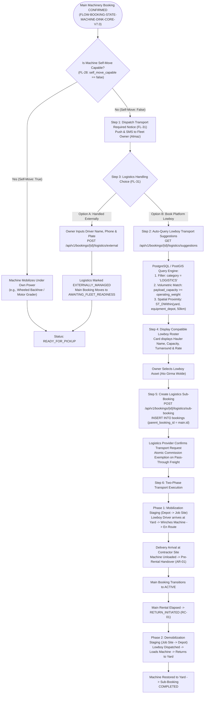
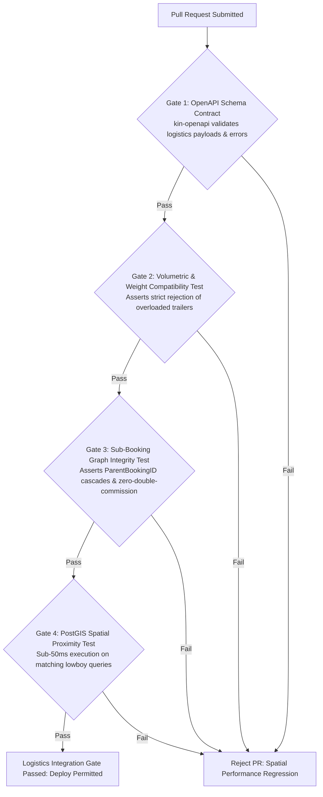

# Heavy Machinery & Logistics Rental Aggregator — Dink Machinery
## Interaction Flow Specification — 11. Logistics & Lowboy Transport Integration (`docs/shared/flows/11-logistics-transport-integration.md`)

**Document Identifier:** `FLOW-LOGISTICS-DINK-CORE-V7.0`  
**Classification:** Canonical User Interaction Flow & Wire Protocol Specification (Single Source of Truth)  
**Governing Documents:** `SRS-DINK-CORE-V7.0` (§5.2.5 FL-28 to FL-31, §5.8, §10.1, §10.2), `FLOW-ENTRY-DINK-CORE-V7.0`, `FLOW-OWNER-KYC-DINK-CORE-V7.0`, `FLOW-FLEET-REG-DINK-CORE-V7.0`, `FLOW-DISCOVERY-DINK-CORE-V7.0`, `FLOW-BOOKING-STATE-MACHINE-DINK-CORE-V7.0`, `FLOW-PAYMENT-DISPUTE-DINK-CORE-V7.0`, `FLOW-ACTIVE-RENTAL-DINK-CORE-V7.0`, `FLOW-RETURN-DAMAGE-DINK-CORE-V7.0`, `ARCH-BACKEND-GO-DINK-CORE-V7.0`, `ARCH-FLUTTER-DINK-CORE-V7.0`, `ARCH-SEC-DINK-CORE-V7.0`, `DS-DINK-CORE-V7.0`, `DS-PERSONAS-DINK-CORE-V7.0`, `contracts/openapi.yaml`, `ADR-001`, `ADR-004`, `ADR-007`, `ADR-010`  
**Target Client Runtimes:** Flutter 3.47.9 / Dart 3.9 (Cross-Platform Mobile), Next.js 16.x (latest CVE security patch) / React 19 (Admin Web Console), Go 1.27.3 Backend Monolith, PostgreSQL 18.6 + PostGIS 3.6.4, Valkey 9.1.3, ClamAV Daemon (:3310), SeaweedFS S3, Isar NoSQL  
**Target Personas:** Fleet Owner & Depot Yard Manager (*W/ro Almaz Tesfaye*), Lowboy Logistics Fleet Provider (*Ato Girma Wolde* / *Samuel Odhiambo*), Civil Engineering Contractor (*Dawit Haile-Mariam*), Compliance Officer (*Yohannes Bekele*)  
**Target Operating Markets:** Ethiopia (`ET`) & Kenya (`KE`) — Dynamic Multi-Country Parameterization (`LOC-01-BE`)  
**Compliance Standards:** OWASP ASVS 4.0.3 Level 3, RFC 9457 (Problem Details), ISO 9241-110, W3C WCAG 2.2 Level AAA (Field Mode) & Level AA (Admin Mode), Ethiopian Federal Transport Authority Directives, Kenya National Highways Authority (KeNHA) Axle Load Limits  
**Status:** Approved Engineering Baseline

---

## Table of Contents

- 1. [Executive Summary & Architectural Scope](#1-executive-summary--architectural-scope)
  - 1.1 [Purpose & First-Principles Architecture (Logistics as a Category)](#11-purpose--first-principles-architecture-logistics-as-a-category)
  - 1.2 [The Heavy Haulage Triad Mental Model (Almaz vs. Girma vs. Dawit)](#12-the-heavy-haulage-triad-mental-model-almaz-vs-girma-vs-dawit)
- 2. [End-to-End Logistics & Lowboy Transport Pairing Flowchart](#2-end-to-end-logistics--lowboy-transport-pairing-flowchart)
- 3. [Detailed Step-by-Step State Machine & User Journey](#3-detailed-step-by-step-state-machine--user-journey)
  - 3.1 [Step 1: Main Machinery Booking Confirmation & Transport Trigger (`FL-28`, `FL-31`)](#31-step-1-main-machinery-booking-confirmation--transport-trigger-fl-28-fl-31)
  - 3.2 [Step 2: Automated Dimension-to-Trailer Matching (`fleet_spec_indexed`, `FL-29`)](#32-step-2-automated-dimension-to-trailer-matching-fleet_spec_indexed-fl-29)
  - 3.3 [Step 3: Logistics Handling Choice: Platform Sub-Booking vs. External Arrangement (`FL-31`)](#33-step-3-logistics-handling-choice-platform-sub-booking-vs-external-arrangement-fl-31)
  - 3.4 [Step 4: Spatial Discovery & Lowboy Fleet Selection (`ADR-004`)](#34-step-4-spatial-discovery--lowboy-fleet-selection-adr-004)
  - 3.5 [Step 5: Sub-Booking Execution (`ParentBookingID`), Mobilization Prepayment & Zero-Commission Settlement](#35-step-5-sub-booking-execution-parentbookingid-mobilization-prepayment--zero-commission-settlement)
  - 3.6 [Step 6: Two-Phase Mobilization & Demobilization Transit Monitoring](#36-step-6-two-phase-mobilization--demobilization-transit-monitoring)
- 4. [Dimensional Compatibility & Axle Load Regulatory Invariants](#4-dimensional-compatibility--axle-load-regulatory-invariants)
  - 4.1 [Volumetric & Tonnage Validation Formula](#41-volumetric--tonnage-validation-formula)
  - 4.2 [Regional Axle-Load & Highway Authority Permitting Invariants](#42-regional-axle-load--highway-authority-permitting-invariants)
- 5. [Frontier Market Edge Cases & Fault Recovery Protocols](#5-frontier-market-edge-cases--fault-recovery-protocols)
  - 5.1 [Weighbridge In-Transit Detours & Axle Weight Violations](#51-weighbridge-in-transit-detours--axle-weight-violations)
  - 5.2 [Lowboy Breakdown Mid-Transit & Emergency Transshipment](#52-lowboy-breakdown-mid-transit--emergency-transshipment)
  - 5.3 [Offline Driver Transit Tracking & Checkpoint SMS Reporting (`ADR-010`)](#53-offline-driver-transit-tracking--checkpoint-sms-reporting-adr-010)
- 6. [Wire Protocol Contracts & RFC 9457 Error Schemas](#6-wire-protocol-contracts--rfc-9457-error-schemas)
  - 6.1 [`GET /api/v1/bookings/{id}/logistics/suggestions`](#61-get-apiv1bookingsidlogisticssuggestions)
  - 6.2 [`POST /api/v1/bookings/{id}/logistics/sub-booking`](#62-post-apiv1bookingsidlogisticssub-booking)
  - 6.3 [`POST /api/v1/bookings/{id}/logistics/external`](#63-post-apiv1bookingsidlogisticsexternal)
  - 6.4 [`GET /api/v1/bookings/{id}/logistics/status`](#64-get-apiv1bookingsidlogisticsstatus)
  - 6.5 [RFC 9457 Problem Details Payloads](#65-rfc-9457-problem-details-payloads)
- 7. [Automated Testing Suite & Verification Gates](#7-automated-testing-suite--verification-gates)

---

## 1. Executive Summary & Architectural Scope

### 1.1 Purpose & First-Principles Architecture (Logistics as a Category)

The **Logistics & Lowboy Transport Integration Flow** governs the transport mobilization and demobilization of heavy machinery that cannot travel under its own power over public roads (`self_move_capable = false`). Crawler excavators, large bulldozers, asphalt pavers, and soil compactors destroy paved asphalt and exceed public roadway transit speeds, requiring multi-axle lowboy trailers, step-deck trailers, or flatbed transport.

In conventional equipment aggregator designs, logistics is treated as an isolated, complex side-module with unique tracking engines and custom pricing calculators. Dink Machinery rejects this architectural sprawl: **Logistics is modeled strictly as a first-class Fleet Category (`SRS-DINK-CORE-V7.0 §5.8`)**. 
1. **Unified Asset Ingestion:** Lowboy trailers, prime movers, and heavy haulage trucks are registered using standard fleet registration (`FLOW-FLEET-REG-DINK-CORE-V7.0`), equipped with dynamic EAV specifications (`payload_capacity_kg`, `deck_length_mm`, `deck_height_mm`, `axle_count`, `ramp_type`).
2. **Sub-Booking Graph Hierarchy:** When a machine rental is confirmed, the system links the necessary transport booking to the primary equipment booking via `Booking.ParentBookingID`.
3. **Owner Cost Invariant (`FL-30`):** In the MVP operating model, the equipment fleet owner is responsible for mobilizing the machine to the contractor's site. Therefore, the equipment owner acts as the "renter" for the linked logistics sub-booking.
4. **External Logistics Escape Hatch (`FL-31`):** Equipment owners with in-house lowboys or long-standing private transport contracts can mark logistics as "Handled Externally", bypassing platform sub-bookings while preserving tracking milestones.

### 1.2 The Heavy Haulage Triad Mental Model (Almaz vs. Girma vs. Dawit)

* **W/ro Almaz Tesfaye (Equipment Fleet Owner):** Her 22-ton Caterpillar 320D is confirmed for a 7-day hire in Bole Lemi, $18.4\text{ km}$ away. Her equipment cannot move on public asphalt. She needs to source a verified lowboy capable of handling $21,800\text{ kg}$ with prompt pickup at her Kality depot to avoid cancellation penalties.
* **Ato Girma Wolde (Lowboy Logistics Provider):** Operates a 40-ton 3-axle lowboy trailer. He seeks guaranteed transport contracts without administrative negotiation, clear dimensional parameters to verify bridge clearance, and signed mobilization handover proofs.
* **Dawit Haile-Mariam (Civil Contractor):** Awaiting machine delivery. Needs exact visibility into equipment transit milestones (Loaded at Yard $\rightarrow$ In Transit $\rightarrow$ Arrived on Site) to schedule site preparation and crane/rigging crews.

---

## 2. End-to-End Logistics & Lowboy Transport Pairing Flowchart



---

## 3. Detailed Step-by-Step State Machine & User Journey

### 3.1 Step 1: Main Machinery Booking Confirmation & Transport Trigger (`FL-28`, `FL-31`)

1. Renter *Dawit Haile-Mariam* and Owner *Almaz Tesfaye* finalize payment verification for a Caterpillar 320D crawler excavator (`FLOW-PAYMENT-DISPUTE-DINK-CORE-V7.0`).
2. As the main booking transitions from `PAYMENT_EVIDENCE_UPLOADED` to `CONFIRMED`, the state machine interceptor checks `fleets.self_move_capable`.
3. Because the Caterpillar 320D has `self_move_capable = false`, the backend transitions the booking to operational hold `AWAITING_FLEET_READINESS` and triggers an urgent push notification and SMS to Almaz:
   > *"Booking #BK-8829A10F confirmed! Your Caterpillar 320D requires lowboy transport to Bole Lemi Industrial Zone by Nov 5, 08:00 EAT. Tap to arrange transport."*

```text
+-------------------------------------------------------------------+
|  [<- BACK]            BOOKING #BK-8829A10F     TRANSPORT REQUIRED |
+-------------------------------------------------------------------+
|  HEAVY PLANT TRANSPORT MOBILIZATION MANDATE                       |
|  This asset cannot travel on paved roads. Transport is required.  |
|                                                                   |
|  EQUIPMENT TO MOVE : Caterpillar 320D (21,800 kg)                 |
|  PICKUP LOCATION   : Kality Machinery Depot Yard, Addis Ababa     |
|  DELIVERY SITE     : Bole Lemi Industrial Zone, Site B (18.4 km)  |
|  REQUIRED ON SITE  : Thursday, Nov 5, 2026 - 08:00 EAT            |
|                                                                   |
|  CHOOSE LOGISTICS METHOD:                                         |
|                                                                   |
|  [ OPTION 1: BOOK VERIFIED LOWBOY ON DINK ]                       |
|  Instantly pair with matching multi-axle trailers nearby.         |
|  +-------------------------------------------------------------+  |
|  |             FIND COMPATIBLE LOWBOYS (12 NEARBY)             |  |
|  |                 (Height: 56dp, Amber 500)                   |  |
|  +-------------------------------------------------------------+  |
|                                                                   |
|  [ OPTION 2: ARRANGE EXTERNAL PRIVATE TRANSPORT ]                 |
|  Use your own lowboy or private logistics contractor.             |
|  +-------------------------------------------------------------+  |
|  |             I WILL ARRANGE EXTERNALLY                       |  |
|  |                 (Height: 56dp, Slate 800)                   |  |
|  +-------------------------------------------------------------+  |
+-------------------------------------------------------------------+
```

---

### 3.2 Step 2: Automated Dimension-to-Trailer Matching (`fleet_spec_indexed`, `FL-29`)

When Almaz taps **"Find Compatible Lowboys"**, the backend does not execute a naive keyword search. It queries `fleet_spec_indexed` for the Caterpillar 320D:
* `operating_weight_kg = 21800`
* `transport_length_mm = 9530`
* `transport_width_mm = 2980`
* `transport_height_mm = 3150`

The system then evaluates active fleets in Category `LOGISTICS` whose indexed specifications satisfy three geometric and tonnage rules:
1. **Weight Constraint:** `lowboy.payload_capacity_kg >= machine.operating_weight_kg`
2. **Width Constraint:** `lowboy.deck_width_mm >= (machine.transport_width_mm - 500)` *(accounting for certified heavy outrigger outriggers)*
3. **Length Constraint:** `lowboy.deck_length_mm >= (machine.transport_length_mm * 0.85)` *(allowing boom overhang per transport guidelines)*

```sql
SELECT 
    l.id AS lowboy_id,
    l.make,
    l.model,
    l.daily_rate_minor,
    spec.payload_capacity_kg,
    spec.deck_length_mm,
    ST_Distance(l.yard_location, $1::geography) / 1000.0 AS distance_km
FROM fleets l
JOIN fleet_spec_indexed spec ON l.id = spec.fleet_id
WHERE l.category_id = 'cat_logistics_heavy'
  AND l.status = 'ACTIVE'
  AND spec.payload_capacity_kg >= $2
  AND spec.deck_length_mm >= ($3 * 0.85)
  AND ST_DWithin(l.yard_location, $1::geography, 50000)
ORDER BY distance_km ASC;
```

---

### 3.3 Step 3: Logistics Handling Choice: Platform Sub-Booking vs. External Arrangement (`FL-31`)

#### Workflow A: Handled Externally
If Almaz operates her own prime mover or uses a long-term logistics partner:
1. She taps **"I Will Arrange Externally"**.
2. She must provide compliance driver information:
   - Transport Company Name (or "In-House Fleet")
   - Driver Full Name
   - Driver E.164 Mobile Number
   - Lowboy Prime Mover Registration Plate
3. Submitting `POST /api/v1/bookings/{id}/logistics/external` registers the external docket, maintains the main booking in `AWAITING_FLEET_READINESS`, and notifies contractor Dawit of the scheduled private delivery vehicle.

#### Workflow B: Platform Lowboy Sub-Booking
If Almaz books transport through Dink Machinery:
1. The platform displays the curated roster of compatible lowboys.
2. She selects a provider (*Ato Girma Wolde* / *Girma Heavy Haulage PLC*).
3. The platform creates a child sub-booking referencing `ParentBookingID`.

---

### 3.4 Step 4: Spatial Discovery & Lowboy Fleet Selection (`ADR-004`)

The lowboy selection interface highlights payload ratings, distance to the equipment depot yard, and turnaround availability:

```text
+-------------------------------------------------------------------+
|  [<- BACK]              SELECT COMPATIBLE LOWBOY       (3 OF 12)  |
+-------------------------------------------------------------------+
|  MATCHING LOWBOYS FOR CATERPILLAR 320D (21.8 TONS)                |
|  Origin: Kality Depot Yard -> Destination: Bole Lemi (18.4 km)    |
|                                                                   |
|  +-------------------------------------------------------------+  |
|  | SINOTRUK HOWO 6X4 + 40-TON 3-AXLE LOWBOY       4.9 (58 Reviews)|
|  | Girma Heavy Haulage PLC | Depot: Kality Hub (4.2 km from Yard)|
|  | Payload Capacity: 40,000 kg (Over-spec: Safe for 21.8t)       |
|  | Deck: 11.5m Length x 3.0m Width | Hydraulic Folding Ramps      |
|  | Mobilization Rate (Round-Trip): 28,000.00 ETB                   |
|  | Availability: Immediate (Can load today 14:00 EAT)             |
|  | [ VIEW SPEC SHEET ]                     [ SELECT THIS LOWBOY ]  |
|  +-------------------------------------------------------------+  |
|                                                                   |
|  +-------------------------------------------------------------+  |
|  | MERCEDES-BENZ ACTROS + 30-TON STEP-DECK        4.7 (31 Reviews)|
|  | Abyssinia Movers | Depot: Akaki (11.8 km from Yard)             |
|  | Payload Capacity: 30,000 kg | Manual Outriggers               |
|  | Mobilization Rate (Round-Trip): 24,500.00 ETB                   |
|  | Availability: Tomorrow morning (Nov 5 - 06:30 EAT)             |
|  | [ VIEW SPEC SHEET ]                     [ SELECT THIS LOWBOY ]  |
|  +-------------------------------------------------------------+  |
+-------------------------------------------------------------------+
```

---

### 3.5 Step 5: Sub-Booking Execution (`ParentBookingID`), Mobilization Prepayment & Zero-Commission Settlement

When Almaz selects Girma's 40-ton lowboy:
1. **Sub-Booking Creation:** The client executes `POST /api/v1/bookings/{id}/logistics/sub-booking`.
2. **ACID Transaction:** The Go backend inserts a linked `bookings` record:
   ```sql
   INSERT INTO bookings (
       id, parent_booking_id, renter_user_id, fleet_id,
       start_date, end_date, total_amount_minor, status
   ) VALUES (
       gen_random_uuid(), 
       'bk_8829a10f', -- Parent Excavator Booking UUID
       'usr_almaz_owner', -- Equipment owner acts as renter
       'flt_girma_lowboy_40t',
       '2026-11-05', '2026-11-12', 
       2800000, -- 28,000.00 ETB Round-Trip
       'CONFIRMED'
   );
   ```
3. **Settlement Architecture:** Almaz settles Girma directly via P2P bank wire transfer (`FLOW-PAYMENT-DISPUTE-DINK-CORE-V7.0`).
4. **Zero-Double-Commission Invariant:** To prevent punitive double-taxation on logistics pass-through freight, platform commission on linked logistics sub-bookings is discounted to a flat platform administrative fee ($2.5\%$ vs. standard $10\%$), deducted from Girma's pre-funded `owner_wallets`.

---

### 3.6 Step 6: Two-Phase Mobilization & Demobilization Transit Monitoring

Logistics operations execute across two distinct physical operational phases:

```text
+-------------------------------------------------------------------+
|  [<- BACK]            LOGISTICS TRACKER: #BK-8829A10F-L1          |
+-------------------------------------------------------------------+
|  PHASE 1: SITE MOBILIZATION TRANSIT (IN PROGRESS)                 |
|                                                                   |
|  [V] DISPATCHED : Lowboy left Akaki Depot (06:45 EAT)             |
|  [V] ARRIVED YARD: Positioned at Kality Equipment Yard (07:12 EAT)|
|  [V] LOADED & TIED: Winched & chained to lowboy bed (07:38 EAT)   |
|  [>] EN ROUTE    : Moving on Ring Road -> Bole Lemi (ETA: 08:20)  |
|  [ ] ON SITE     : Delivery sign-off & machine unload             |
|                                                                   |
|  DRIVER / VEHICLE TELEMETRY                                       |
|  * Driver : Samuel Odhiambo (+251 92 881 9921)                    |
|  * Vehicle: Sinotruk Howo 6x4 (Plate: ET-3-48192)                 |
|  * Lowboy : 40-Ton Tri-Axle Hydraulic (Plate: ET-3-11029)         |
|  * Speed  : 32 km/h | Current: Debre Zeit Road junction           |
|                                                                   |
|  [ CALL LOWBOY DRIVER ]                 [ SHARE LIVE TRACKING ]   |
+-------------------------------------------------------------------+
```

#### Transition Milestones
* **Milestone 1 (Yard Loading):** Lowboy driver arrives at Almaz's depot. Operator *Mulugeta Tadesse* drives the excavator up the hydraulic folding ramps onto the lowboy bed. Driver applies heavy ratchet binders and safety chains.
* **Milestone 2 (Site Arrival & Handover):** Lowboy arrives at Dawit's project site in Bole Lemi. Machine is unchained and walked off the ramps onto the job site.
* **Milestone 3 (Trigger Main Handover):** Unloading triggers `FLOW-ACTIVE-RENTAL-DINK-CORE-V7.0 §3.1`, prompting Dawit and Mulugeta to execute the pre-rental reticle meter sign-off, transitioning the main excavator booking to `ACTIVE`.
* **Milestone 4 (Demobilization at Rental Close):** When the 7-day hire concludes (`FLOW-RETURN-DAMAGE-DINK-CORE-V7.0`), the sub-booking reactivates for Phase 2: Girma's lowboy returns to Bole Lemi, re-loads the machine, and hauls it back to Kality Depot.

---

## 4. Dimensional Compatibility & Axle Load Regulatory Invariants

### 4.1 Volumetric & Tonnage Validation Formula

Before the system permits sub-booking dispatch, the backend compatibility engine asserts three physical safety criteria:

$$\text{Payload Safety Margin} = \frac{\text{lowboy.payload\_capacity\_kg} - \text{machine.operating\_weight\_kg}}{\text{lowboy.payload\_capacity\_kg}} \ge 0.05$$

$$\text{Total Transit Height} = \text{lowboy.deck\_height\_mm} + \text{machine.transport\_height\_mm} \le 4,500\text{ mm}$$

$$\text{Total Transit Width} = \max(\text{machine.transport\_width\_mm}, \text{lowboy.deck\_width\_mm})$$

* If $\text{Total Transit Height} > 4,500\text{ mm}$, the system flags an overhead bridge clearance warning, requiring an approved route plan avoiding low overpasses on the Addis Ababa Ring Road.
* If $\text{Total Transit Width} > 3,000\text{ mm}$, the platform flags the booking as **Abnormal Wide Load**, requiring an escort vehicle alert and daytime-only travel restrictions.

### 4.2 Regional Axle-Load & Highway Authority Permitting Invariants

To comply with the Ethiopian Federal Transport Authority and Kenya National Highways Authority (KeNHA) axle load enforcement:
* **Gross Vehicle Weight (GVW) Caps:** The platform computes GVW (Prime Mover Tare + Lowboy Tare + Excavator Weight). Any load exceeding legal limits automatically injects a mandatory checkbox verifying the driver possesses an **Active Special Movement Permit**.
* **Weighbridge Station Compliance:** In Kenya, transit routes crossing fixed weighbridges (e.g., Athi River, Gilgil) enforce KeNHA axle load distribution limits ($8\text{ tonnes}$ per single steer axle, $10\text{ tonnes}$ per single drive axle, $24\text{ tonnes}$ per tridem axle group).

---

## 5. Frontier Market Edge Cases & Fault Recovery Protocols

### 5.1 Weighbridge In-Transit Detours & Axle Weight Violations

If a lowboy driver is detained at an axle weighbridge station due to incorrect boom positioning shifting excessive tonnage onto the rear tridem axle:
1. The driver triggers **"Log Transit Delay: Weighbridge Hold"** from the driver interface.
2. The system pauses delivery countdown timers and alerts both Almaz and Dawit:
   > *"Transit Delay: Lowboy detained at Akaki Weighbridge for axle rebalancing. Estimated delay: 45 minutes."*
3. The driver shifts the excavator $40\text{ cm}$ forward on the lowboy deck, passes re-weighing, and resumes transit.

### 5.2 Lowboy Breakdown Mid-Transit & Emergency Transshipment

If the lowboy prime mover suffers a mechanical breakdown mid-transit (e.g., blown turbocharger or multi-tire blowout on the Mojo–Hawassa expressway):
1. The logistics driver flags an emergency breakdown docket (`category = 'LOGISTICS_BREAKDOWN'`).
2. The platform's automated dispatcher executes an immediate PostGIS radius query ($30\text{ km}$) for unassigned, active lowboys capable of emergency winch transshipment.
3. The platform notifies Almaz with an instant replacement proposal, enabling an emergency child sub-booking swap without voiding the primary equipment contract.

### 5.3 Offline Driver Transit Tracking & Checkpoint SMS Reporting (`ADR-010`)

Along remote infrastructure corridors with zero cellular data coverage (e.g., Isiolo–Marsabit or Awash–Mile routes):
* The driver's mobile client falls back to **SMS Telemetry Mode**.
* When cellular data drops, the Flutter app utilizes standard telephony SMS to transmit compressed geographic checkpoint strings to the Dink SMS gateway (`+251 900 000 000` / `40404`):
  `DINK:LOC:BK8829:LAT:8.712:LNG:38.991:SPD:34:TS:1730030400`
* The gateway parses the SMS packet, updating the backend transit tracker and map coordinates without requiring mobile internet.

---

## 6. Wire Protocol Contracts & RFC 9457 Error Schemas

### 6.1 `GET /api/v1/bookings/{id}/logistics/suggestions`

Queries geometrically and spatially compatible lowboy trailers for an equipment booking.

#### Request Headers
```http
GET /api/v1/bookings/bk_8829a10f/logistics/suggestions?radiusKm=50 HTTP/1.1
Host: api.dinkmachinery.com
Authorization: Bearer <ownerAccessToken>
```

#### Response: `HTTP 200 OK`
```json
{
  "success": true,
  "data": {
    "parentBookingId": "bk_8829a10f",
    "equipmentTonnageKg": 21800,
    "dimensions": {
      "lengthMm": 9530,
      "widthMm": 2980,
      "heightMm": 3150
    },
    "originDepot": {
      "latitude": 8.9124,
      "longitude": 38.7491,
      "name": "Kality Machinery Depot Yard"
    },
    "destinationSite": {
      "latitude": 8.9806,
      "longitude": 38.7578,
      "name": "Bole Lemi Industrial Zone, Site B"
    },
    "totalTransitDistanceKm": 18.4,
    "compatibleFleets": [
      {
        "lowboyFleetId": "flt_girma_lowboy_40t",
        "make": "Sinotruk",
        "model": "HOWO 6x4 + 40-Ton Tri-Axle",
        "ownerCompanyName": "Girma Heavy Haulage PLC",
        "payloadCapacityKg": 40000,
        "deckLengthMm": 11500,
        "deckWidthMm": 3000,
        "deckHeightMm": 950,
        "roundTripRateMinor": 2800000,
        "currencyCode": "ETB",
        "distanceToOriginKm": 4.2,
        "estimatedPickupLeadHours": 2.5
      }
    ]
  },
  "timestamp": "2026-10-27T16:40:00Z"
}
```

---

### 6.2 `POST /api/v1/bookings/{id}/logistics/sub-booking`

Creates a linked logistics transport sub-booking.

#### Request Headers
```http
POST /api/v1/bookings/bk_8829a10f/logistics/sub-booking HTTP/1.1
Host: api.dinkmachinery.com
Content-Type: application/json
Authorization: Bearer <ownerAccessToken>
```

#### Request Payload
```json
{
  "lowboyFleetId": "flt_girma_lowboy_40t",
  "pickupScheduledTime": "2026-11-05T06:30:00Z",
  "deliveryDeadline": "2026-11-05T08:00:00Z",
  "specialInstructions": "Hydraulic excavator requires wood block shoring under track grousers."
}
```

#### Response: `HTTP 201 Created`
```json
{
  "success": true,
  "data": {
    "subBookingId": "bk_sub_77192a01",
    "parentBookingId": "bk_8829a10f",
    "status": "CONFIRMED",
    "logisticsProvider": "Girma Heavy Haulage PLC",
    "totalFareMinor": 2800000,
    "currencyCode": "ETB",
    "scheduledPickup": "2026-11-05T06:30:00Z",
    "driverAssigned": {
      "name": "Samuel Odhiambo",
      "phone": "+251928819921",
      "plateNumber": "ET-3-48192"
    }
  },
  "timestamp": "2026-10-27T16:45:00Z"
}
```

---

### 6.3 `POST /api/v1/bookings/{id}/logistics/external`

Registers privately managed external transport.

#### Request Headers
```http
POST /api/v1/bookings/bk_8829a10f/logistics/external HTTP/1.1
Host: api.dinkmachinery.com
Content-Type: application/json
Authorization: Bearer <ownerAccessToken>
```

#### Request Payload
```json
{
  "transportCompanyName": "In-House Almaz Heavy Transport",
  "driverFullName": "Tewodros Kassahun",
  "driverPhoneNumber": "+251911293847",
  "vehicleRegistrationPlate": "ET-3-88412",
  "scheduledSiteArrivalTime": "2026-11-05T07:45:00Z"
}
```

#### Response: `HTTP 200 OK`
```json
{
  "success": true,
  "data": {
    "bookingId": "bk_8829a10f",
    "logisticsStatus": "EXTERNALLY_MANAGED",
    "driverContact": "+251911293847",
    "scheduledArrival": "2026-11-05T07:45:00Z"
  },
  "timestamp": "2026-10-27T16:50:00Z"
}
```

---

### 6.4 `GET /api/v1/bookings/{id}/logistics/status`

Retrieves active transit milestones and telemetry coordinates for a booking's transport.

#### Response: `HTTP 200 OK`
```json
{
  "success": true,
  "data": {
    "bookingId": "bk_8829a10f",
    "hasLinkedLogistics": true,
    "subBookingId": "bk_sub_77192a01",
    "activePhase": "PHASE_1_MOBILIZATION",
    "transitMilestone": "EN_ROUTE_TO_SITE",
    "telemetry": {
      "latitude": 8.9412,
      "longitude": 38.7519,
      "speedKmh": 32.5,
      "headingDegrees": 45,
      "lastReportedAt": "2026-11-05T07:42:15Z"
    },
    "estimatedArrivalTime": "2026-11-05T08:15:00Z"
  },
  "timestamp": "2026-11-05T07:42:20Z"
}
```

---

### 6.5 RFC 9457 Problem Details Payloads

#### Example: Incompatible Lowboy Tonnage (`HTTP 422`)
```json
{
  "type": "[https://api.dinkmachinery.com/errors/insufficient-lowboy-capacity](https://api.dinkmachinery.com/errors/insufficient-lowboy-capacity)",
  "title": "Lowboy Payload Capacity Exceeded",
  "status": 422,
  "detail": "Selected lowboy rated for 15,000 kg cannot transport machinery weighing 21,800 kg. Structural safety hazard.",
  "instance": "/api/v1/bookings/bk_8829a10f/logistics/sub-booking",
  "code": "ERR_LOGISTICS_OVERWEIGHT_CAPACITY",
  "invalidParams": [
    {
      "name": "lowboyFleetId",
      "reason": "Payload shortfall of 6,800 kg. Select a lowboy rated >= 22,000 kg."
    }
  ]
}
```

#### Example: Parent Booking State Invalid (`HTTP 409`)
```json
{
  "type": "[https://api.dinkmachinery.com/errors/invalid-parent-booking-state](https://api.dinkmachinery.com/errors/invalid-parent-booking-state)",
  "title": "Invalid Parent State for Logistics Booking",
  "status": 409,
  "detail": "Cannot book lowboy transport. Parent machinery booking #BK-8829A10F is in 'PENDING_PAYMENT' state. Must be 'CONFIRMED'.",
  "instance": "/api/v1/bookings/bk_8829a10f/logistics/sub-booking",
  "code": "ERR_SUB_BOOKING_PARENT_STATE_MISMATCH"
}
```

---

## 7. Automated Testing Suite & Verification Gates



1. **OpenAPI Schema Contract Gate (`kin-openapi`):** Validates all logistics suggestions, sub-booking creation, external arrangement, and telemetry tracking endpoints against `contracts/openapi.yaml`.
2. **Volumetric & Weight Compatibility Unit Tests:** Tests 100 variations of excavator tonnages against lowboy deck dimensions and payload limits, asserting that any attempt to pair an underweight trailer fails with HTTP 422 `ERR_LOGISTICS_OVERWEIGHT_CAPACITY`.
3. **Sub-Booking Graph Integrity Integration Test:** Spins up a PostgreSQL testcontainer, creates a parent machinery booking and a linked child sub-booking, and validates foreign key integrity, state synchronization cascades, and the $2.5\%$ platform fee ledger entry.
4. **PostGIS Spatial Proximity Benchmark:** Asserts that finding compatible lowboys within $50\text{ km}$ across 25,000 synthetic machinery listings executes in under $50\text{ ms}$.

---

*This document defines the canonical user interaction flow, volumetric matching algorithms, sub-booking graph architecture, and wire protocols for Logistics & Lowboy Transport Integration in Dink Machinery Version 7.0. All downstream Flutter mobile screens, Go HTTP controllers, and PostgreSQL database schemas must strictly adhere to this specification.*