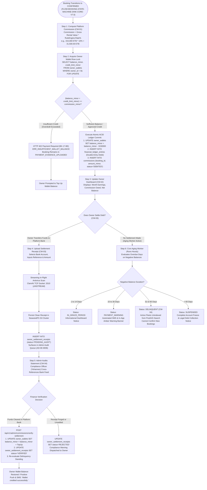
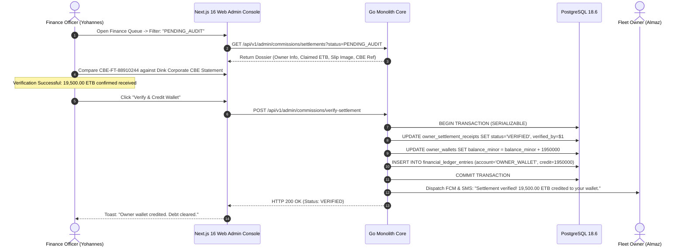
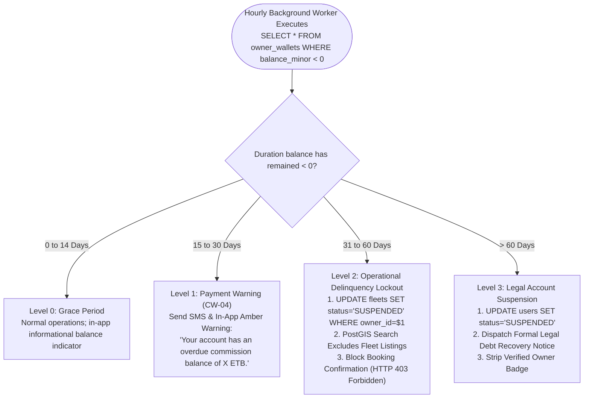
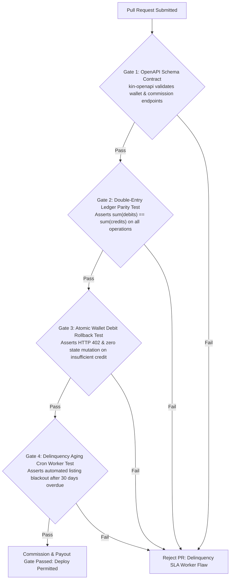

# Heavy Machinery & Logistics Rental Aggregator — Dink Machinery
## Interaction Flow Specification — 12. Commission Tracking, Owner Debt Ledger, Manual Bank Settlement & Admin Payout Auditing (`docs/shared/flows/12-commission-tracking-payout.md`)

**Document Identifier:** `FLOW-COMMISSION-PAYOUT-DINK-CORE-V7.0`  
**Classification:** Canonical User Interaction Flow & Wire Protocol Specification (Single Source of Truth)  
**Governing Documents:** `SRS-DINK-CORE-V7.0` (§5.9 CW-01 to CW-04, §5.5, §8.1, §8.2, §10.1, §11), `FLOW-ENTRY-DINK-CORE-V7.0`, `FLOW-OWNER-KYC-DINK-CORE-V7.0`, `FLOW-FLEET-REG-DINK-CORE-V7.0`, `FLOW-BOOKING-STATE-MACHINE-DINK-CORE-V7.0`, `FLOW-PAYMENT-DISPUTE-DINK-CORE-V7.0`, `FLOW-RETURN-DAMAGE-DINK-CORE-V7.0`, `FLOW-LOGISTICS-DINK-CORE-V7.0`, `ARCH-BACKEND-GO-DINK-CORE-V7.0`, `ARCH-FLUTTER-DINK-CORE-V7.0`, `ARCH-SEC-DINK-CORE-V7.0`, `DS-DINK-CORE-V7.0`, `DS-PERSONAS-DINK-CORE-V7.0`, `contracts/openapi.yaml`, `ADR-001`, `ADR-002`, `ADR-005`, `ADR-010`  
**Target Client Runtimes:** Flutter 3.47.8 / Dart 3.9 (Cross-Platform Mobile), Next.js 16.x (latest CVE security patch) / React 19 (Admin Web Console), Go 1.27.3 Backend Monolith, PostgreSQL 18.6, Valkey 9.1.3, ClamAV Daemon (:3310), SeaweedFS S3, Isar NoSQL  
**Target Personas:** Fleet Owner & Depot Yard Manager (*W/ro Almaz Tesfaye* / *Kamau Ndegwa*), Lowboy Logistics Fleet Provider (*Ato Girma Wolde* / *Samuel Odhiambo*), Platform Finance & Compliance Officer (*Yohannes Bekele*)  
**Target Operating Markets:** Ethiopia (`ET`) & Kenya (`KE`) — Dynamic Multi-Country Parameterization (`LOC-01-BE`)  
**Compliance Standards:** OWASP ASVS 4.0.3 Level 3 (Cryptographic Proof Verification, Non-Repudiation & Audit Logs), RFC 9457 (Problem Details), ISO 9241-110, W3C WCAG 2.2 Level AAA (Field Mode) & Level AA (Admin Mode), National Bank of Ethiopia (NBE) Directives on Non-Custodial Marketplace Operations, GAAP / IFRS 15 Revenue from Contracts with Customers  
**Status:** Approved Engineering Baseline

---

## Table of Contents

- 1. [Executive Summary & Regulatory Architecture](#1-executive-summary--regulatory-architecture)
  - 1.1 [Purpose & Non-Custodial Commission Rationale (NBE Directives)](#11-purpose--non-custodial-commission-rationale-nbe-directives)
  - 1.2 [The Revenue Share Mental Model (Almaz vs. Girma vs. Yohannes)](#12-the-revenue-share-mental-model-almaz-vs-girma-vs-yohannes)
- 2. [End-to-End Commission Tracking, Settlement & Audit Flowchart](#2-end-to-end-commission-tracking-settlement--audit-flowchart)
- 3. [Detailed Step-by-Step State Machine & User Journey](#3-detailed-step-by-step-state-machine--user-journey)
  - 3.1 [Step 1: Dynamic Commission Calculation on Booking Confirmation (`CW-01`, `BK-10`)](#31-step-1-dynamic-commission-calculation-on-booking-confirmation-cw-01-bk-10)
  - 3.2 [Step 2: Pre-Funded Wallet Debit & Debt Accumulation Invariant (`CW-01`, `CW-02`)](#32-step-2-pre-funded-wallet-debit--debt-accumulation-invariant-cw-01-cw-02)
  - 3.3 [Step 3: Owner Commission Dashboard & Monthly Statement Audit (`CW-02`)](#33-step-3-owner-commission-dashboard--monthly-statement-audit-cw-02)
  - 3.4 [Step 4: Manual Commission Settlement & Wire Evidence Ingestion (`CW-03`)](#34-step-4-manual-commission-settlement--wire-evidence-ingestion-cw-03)
  - 3.5 [Step 5: Admin Commission Tracking, Proof Audit & Verification Queue (`CW-04`, `AD-06-WEB`)](#35-step-5-admin-commission-tracking-proof-audit--verification-queue-cw-04-ad-06-web)
  - 3.6 [Step 6: Overdue Commission Aging, Delinquency Warnings & Automated Inventory Lockout (`CW-04`)](#36-step-6-overdue-commission-aging-delinquency-warnings--automated-inventory-lockout-cw-04)
- 4. [Double-Entry Accounting Ledger & Mathematical Formulas](#4-double-entry-accounting-ledger--mathematical-formulas)
  - 4.1 [Double-Entry Transaction Schema & Balance Invariants](#41-double-entry-transaction-schema--balance-invariants)
  - 4.2 [Dynamic Commission Rule Engine & Pass-Through Freight Rates](#42-dynamic-commission-rule-engine--pass-through-freight-rates)
  - 4.3 [Commission Recovery from Contract Penalties & Excess Hours](#43-commission-recovery-from-contract-penalties--excess-hours)
- 5. [Frontier Market Edge Cases & Fault Recovery Protocols](#5-frontier-market-edge-cases--fault-recovery-protocols)
  - 5.1 [Multi-Currency Ledger Partitioning (`ETB` vs. `KES`)](#51-multi-currency-ledger-partitioning-etb-vs-kes)
  - 5.2 [Banking Receipt Verification Latency & Telephony Gateway Outages](#52-banking-receipt-verification-latency--telephony-gateway-outages)
  - 5.3 [Partial Settlement & Multi-Slip Reconciliation Protocols](#53-partial-settlement--multi-slip-reconciliation-protocols)
  - 5.4 [Delinquency Lockout vs. In-Flight Active Booking Protection](#54-delinquency-lockout-vs-in-flight-active-booking-protection)
- 6. [Client UI/UX Ergonomic Specifications & Design Tokens](#6-client-uiux-ergonomic-specifications--design-tokens)
  - 6.1 [Owner Mobile Commission Dashboard & Wallet Viewport ($56 \times 56\text{ dp}$)](#61-owner-mobile-commission-dashboard--wallet-viewport-56-times-56text-dp)
  - 6.2 [Top-Up Wire Slip Submission Modal & Camera Reticle Viewfinder](#62-top-up-wire-slip-submission-modal--camera-reticle-viewfinder)
  - 6.3 [Next.js Admin Console: Commission Audit Workbench & Aging Grid](#63-nextjs-admin-console-commission-audit-workbench--aging-grid)
- 7. [Wire Protocol Contracts & RFC 9457 Error Schemas](#7-wire-protocol-contracts--rfc-9457-error-schemas)
  - 7.1 [`GET /api/v1/owners/wallet`](#71-get-apiv1ownerswallet)
  - 7.2 [`POST /api/v1/owners/wallet/top-up`](#72-post-apiv1ownerswallettop-up)
  - 7.3 [`GET /api/v1/admin/commissions`](#73-get-apiv1admincommissions)
  - 7.4 [`POST /api/v1/admin/commissions/verify-settlement`](#74-post-apiv1admincommissionsverify-settlement)
  - 7.5 [`GET /api/v1/owners/commissions/statement`](#75-get-apiv1ownerscommissionsstatement)
  - 7.6 [RFC 9457 Universal Problem Details Payloads](#76-rfc-9457-universal-problem-details-payloads)
- 8. [Automated Testing Suite & Verification Gates](#8-automated-testing-suite--verification-gates)

---

## 1. Executive Summary & Regulatory Architecture

### 1.1 Purpose & Non-Custodial Commission Rationale (NBE Directives)

The **Commission Tracking, Owner Debt Ledger, Manual Bank Settlement & Admin Payout Auditing Flow** governs the financial monetization engine of Dink Machinery.

Under National Bank of Ethiopia (NBE) regulatory frameworks governing electronic commerce platforms and value-added payment facilitators, non-banking digital aggregators are strictly prohibited from holding customer rental funds in custodial escrow accounts. All heavy plant rental fees (e.g., $315,000.00\text{ ETB}$) are transferred directly from the Civil Contractor to the Fleet Owner's commercial bank account (`MANUAL_TRANSFER`). Consequently, Dink Machinery does not collect its platform service fees by withholding a percentage from an inbound disbursement stream.

To collect revenue legally, efficiently, and without financial intermediation liabilities, Dink Machinery implements a **Pre-Funded Wallet & Accumulated Debt Ledger Architecture (`SRS-DINK-CORE-V7.0 §5.9`, `ADR-002`)**:
1. **Zero Escrow Liability:** 100% of the machinery rental fee settles directly between contractor and owner via commercial bank rails.
2. **Double-Entry Commission Invariant (`CW-01`, `BK-17-BE`):** The moment an owner confirms a booking (`CONFIRMED`), the platform calculates the commission due and debits the owner’s pre-funded wallet (`owner_wallets`).
3. **Approved Overdraft Credit Buffers:** High-reputation fleet owners can operate with negative wallet balances up to an approved credit buffer (`credit_limit_minor`), accumulating a recorded commission debt to the platform.
4. **Manual Wire Settlement (`CW-03`):** To clear commission debt or maintain a positive ledger, owners execute a direct wire transfer to Dink Machinery’s corporate bank account and upload digital receipt proof.
5. **Back-Office Reconciliation (`CW-04`):** Platform finance staff audit bank statements against uploaded wire slips, crediting the owner's wallet and lifting any pending operational holds.

### 1.2 The Revenue Share Mental Model (Almaz vs. Girma vs. Yohannes)

* **W/ro Almaz Tesfaye (Equipment Fleet Owner):** Rents out high-value excavators. Once she receives $157,500.00\text{ ETB}$ in direct bank prepayment from a contractor, she understands that confirming the booking obligates her to pay Dink Machinery a 10% platform fee ($31,500.00\text{ ETB}$). She demands clear visibility into her monthly gross earnings, active commission debits, and remaining overdraft buffer.
* **Ato Girma Wolde (Lowboy Logistics Provider):** Operates on narrow freight margins ($24,000.00\text{–}35,000.00\text{ ETB}$ per mobilization run). He relies on Dink Machinery's discounted logistics commission tier ($2.5\%$ pass-through freight vs. $10\%$ standard machinery rate) so that transport facilitation does not become cost-prohibitive.
* **Yohannes Bekele (Platform Finance & Compliance Officer):** Audits corporate bank feeds (CBE, Awash Bank, KCB, M-PESA Paybill) against incoming top-up slips. Enforces strict delinquency aging rules ($> 30\text{ days}$ overdue $\rightarrow$ listing blackout; $> 60\text{ days}$ overdue $\rightarrow$ complete account suspension).

---

## 2. End-to-End Commission Tracking, Settlement & Audit Flowchart



---

## 3. Detailed Step-by-Step State Machine & User Journey

### 3.1 Step 1: Dynamic Commission Calculation on Booking Confirmation (`CW-01`, `BK-10`)

1. Renter *Dawit Haile-Mariam* uploads bank wire proof for booking `#BK-8829A10F`. Fleet Owner *Almaz Tesfaye* verifies the funds in her commercial bank app and taps **"Confirm Payment Received"** (`FLOW-PAYMENT-DISPUTE-DINK-CORE-V7.0 §3.4`).
2. Prior to executing the state change, the Go backend initializes the **Dynamic Commission Rule Engine**:
   - Primary Equipment Rentals: Standard $10.0\%$ rate.
   - Long-Term Commercial Contracts ($> 30\text{ days}$): Discounted $8.0\%$ rate.
   - Linked Logistics Transport Sub-Bookings (`FLOW-LOGISTICS-DINK-CORE-V7.0`): Discounted $2.5\%$ administrative pass-through rate.
3. The platform computes the commission obligation:
   $$\text{Gross Contract Value} = 7\text{ Days} \times 45,000.00\text{ ETB} = 315,000.00\text{ ETB}$$
   $$\text{Platform Commission Due} = 315,000.00\text{ ETB} \times 10.0\% = 31,500.00\text{ ETB}\ (3,150,000\text{ Minor Units})$$

---

### 3.2 Step 2: Pre-Funded Wallet Debit & Debt Accumulation Invariant (`CW-01`, `CW-02`)

The backend acquires a pessimistic row-lock on Almaz's wallet record in PostgreSQL:

```sql
SELECT id, balance_minor, credit_limit_minor, currency_code
FROM owner_wallets
WHERE owner_id = $1
FOR UPDATE;
```

#### The Solvency & Overdraft Validation Rule
The system evaluates available operating liquidity:
$$\text{Available Liquidity} = \text{balance\_minor} + \text{credit\_limit\_minor}$$

* **Case A: Insufficient Liquidity ($\text{Available Liquidity} < 3,150,000\text{ Minor Units}$):**
  The confirmation transaction is aborted. The API returns RFC 9457 HTTP 402 Payment Required (`ERR_INSUFFICIENT_WALLET_BALANCE`). The booking remains in `PAYMENT_EVIDENCE_UPLOADED`, and the mobile app launches the **Wallet Top-Up Workflow**.
* **Case B: Sufficient Liquidity ($\text{Available Liquidity} \ge 3,150,000\text{ Minor Units}$):**
  The transaction executes atomically:
  1. `owner_wallets.balance_minor` is debited by $3,150,000\text{ units}$.
  2. A double-entry transaction is written to `financial_ledger_entries`.
  3. A `commissions` row is inserted with status `DEBITED`.
  4. The booking status transitions to `CONFIRMED`.

---

### 3.3 Step 3: Owner Commission Dashboard & Monthly Statement Audit (`CW-02`)

The Fleet Owner manages their revenue standing through the **Commission & Wallet Dashboard** in the Flutter mobile application:

```text
+-------------------------------------------------------------------+
|  [<- BACK]              COMMISSION & WALLET        [TOP UP WALLET]|
+-------------------------------------------------------------------+
|  FINANCIAL REVENUE & COMMISSION LEDGER                            |
|  Jurisdiction: Ethiopia (ETB) | Tier: Platinum Fleet Partner      |
|                                                                   |
|  CURRENT WALLET BALANCE            | APPROVED CREDIT OVERDRAFT    |
|  -19,500.00 ETB (In Overdraft)     | 50,000.00 ETB Available      |
|  [==================              ] 39.0% Overdraft Utilized      |
|                                                                   |
|  MONTH-TO-DATE EARNINGS SUMMARY (OCTOBER 2026)                    |
|  * Gross Rental Volume Booked     : 645,000.00 ETB (3 Bookings)   |
|  * Platform Commission Incurred   :  64,500.00 ETB                |
|  * Commission Debt Paid to Date   :  45,000.00 ETB                |
|  * Outstanding Commission Owed    :  19,500.00 ETB                |
|                                                                   |
|  OVERDUE AGING STATUS: HEALTHY (7 Days in Overdraft - Max 30 Days)|
|                                                                   |
|  RECENT COMMISSION DEBIT TRANSACTIONS                             |
|  +-------------------------------------------------------------+  |
|  | Oct 27 - Cat 320D (Booking #BK-8829A10F)         -31,500 ETB|  |
|  | Gross: 315,000 ETB | Rate: 10.0% | Status: DEBITED           |  |
|  +-------------------------------------------------------------+  |
|  | Oct 14 - Komatsu PC210 (Booking #BK-771402)       -28,000 ETB|  |
|  | Gross: 280,000 ETB | Rate: 10.0% | Status: DEBITED           |  |
|  +-------------------------------------------------------------+  |
|                                                                   |
|  +-------------------------------------------------------------+  |
|  |                 SETTLE COMMISSION DEBT                      |  |
|  |                 (Height: 56dp, Emerald 600)                 |  |
|  +-------------------------------------------------------------+  |
+-------------------------------------------------------------------+
```

---

### 3.4 Step 4: Manual Commission Settlement & Wire Evidence Ingestion (`CW-03`)

To restore a negative wallet balance or pre-fund future bookings, the Fleet Owner initiates a manual settlement:
1. Almaz transfers $19,500.00\text{ ETB}$ from her corporate bank account to Dink Machinery's designated operating account.
2. In the app, she taps **"Settle Commission Debt"** and fills out the **Top-Up Wire Form**:
   - Dink Corporate Bank Account Selected (e.g., Commercial Bank of Ethiopia)
   - Transferred Amount in ETB ($19,500.00$)
   - Bank Transaction Reference Code (e.g., `CBE-FT-88910244`)
   - Photograph/Screenshot of the wire deposit slip or mobile banking receipt
3. The image is scanned in-flight via ClamAV over TCP socket `:3310` and committed to SeaweedFS S3 (`s3://dink-commission-evidence/topups/*.webp`).
4. The system registers a record in `owner_settlement_receipts` with status `PENDING_AUDIT`.

```text
+-------------------------------------------------------------------+
|  [<- BACK]              SETTLE COMMISSION DEBT        STEP 1 OF 1 |
+-------------------------------------------------------------------+
|  TRANSFER COMMISSION TO DINK MACHINERY PLC                       |
|  Direct deposit to our corporate collection account.              |
|                                                                   |
|  DINK CORPORATE BANKING COORDINATES                               |
|  +-------------------------------------------------------------+  |
|  | Bank Name     : Commercial Bank of Ethiopia (CBE)           |  |
|  | Account Name   : Dink Machinery Technologies PLC             |  |
|  | Account Number : 1000994810293                              |  |
|  | Branch         : Commercial Centenary Branch, Addis Ababa    |  |
|  +-------------------------------------------------------------+  |
|  [ COPY ACCOUNT NUMBER ]                                          |
|                                                                   |
|  AMOUNT TRANSFERRED (ETB) *                                       |
|  +-------------------------------------------------------------+  |
|  | 19,500.00 ETB                                               |  |
|  +-------------------------------------------------------------+  |
|                                                                   |
|  BANK TRANSACTION REFERENCE CODE *                                |
|  +-------------------------------------------------------------+  |
|  | CBE-FT-88910244                                             |  |
|  +-------------------------------------------------------------+  |
|                                                                   |
|  UPLOAD WIRE RECEIPT / MOBILE SLIP *                              |
|  +-------------------------------------------------------------+  |
|  | [RETICLE VIEWFINDER: CAPTURE OR ATTACH BANK RECEIPT]        |  |
|  +-------------------------------------------------------------+  |
|                                                                   |
|  +-------------------------------------------------------------+  |
|  |                 SUBMIT SETTLEMENT RECEIPT                   |  |
|  |                 (Height: 56dp, Emerald 600)                 |  |
|  +-------------------------------------------------------------+  |
+-------------------------------------------------------------------+
```

---

### 3.5 Step 5: Admin Commission Tracking, Proof Audit & Verification Queue (`CW-04`, `AD-06-WEB`)

Settlement slips surface immediately in the **Next.js 16 Web Admin Console** under the **Finance & Commission Verification Queue**:



---

### 3.6 Step 6: Overdue Commission Aging, Delinquency Warnings & Automated Inventory Lockout (`CW-04`)

To prevent non-compliant fleet owners from exploiting the platform's overdraft buffers, a Go background cron worker executes an automated **Debt Aging Audit** on an hourly cycle:



#### The Active Booking Exemption Invariant
Delinquency lockouts restrict **new listing discovery and booking creations only**. If an owner is transitioned to `DELINQUENT` while an asset is deployed on an `ACTIVE` rental, the active booking lifecycle remains fully operational to protect the innocent contractor's project continuity.

---

## 4. Double-Entry Accounting Ledger & Mathematical Formulas

### 4.1 Double-Entry Transaction Schema & Balance Invariants

Every financial movement is recorded in the append-only `financial_ledger_entries` table, ensuring GAAP/IFRS compliance and zero-penny divergence:

$$\sum \text{Debit Minor} = \sum \text{Credit Minor}$$

```sql
CREATE TABLE financial_ledger_entries (
    id UUID PRIMARY KEY DEFAULT gen_random_uuid(),
    transaction_group_id UUID NOT NULL,
    booking_id UUID REFERENCES bookings(id),
    account_type VARCHAR(64) NOT NULL, -- 'OWNER_WALLET', 'PLATFORM_REVENUE', 'CORPORATE_BANK'
    entity_id VARCHAR(128) NOT NULL,    -- Owner User UUID or 'DINK_HOLDINGS_PLC'
    currency_code VARCHAR(3) NOT NULL,  -- 'ETB' or 'KES'
    debit_minor BIGINT NOT NULL DEFAULT 0,
    credit_minor BIGINT NOT NULL DEFAULT 0,
    description TEXT NOT NULL,
    created_at TIMESTAMPTZ NOT NULL DEFAULT NOW()
);

CREATE INDEX idx_ledger_entity ON financial_ledger_entries(entity_id, created_at);
CREATE INDEX idx_ledger_group ON financial_ledger_entries(transaction_group_id);
```

#### Canonical Double-Entry Journal Events

##### Event 1: Booking Confirmation Commission Debit (`BK-10`)
* **Debit:** `OWNER_WALLET` ($31,500.00\text{ ETB}$) $\rightarrow$ Increases owner's debt to platform.
* **Credit:** `PLATFORM_REVENUE` ($31,500.00\text{ ETB}$) $\rightarrow$ Recognizes earned platform service revenue.

##### Event 2: Owner Manual Wire Settlement Verified (`CW-04`)
* **Debit:** `CORPORATE_BANK` ($19,500.00\text{ ETB}$) $\rightarrow$ Reflects cash received in platform corporate bank account.
* **Credit:** `OWNER_WALLET` ($19,500.00\text{ ETB}$) $\rightarrow$ Decreases owner's debt balance.

---

### 4.2 Dynamic Commission Rule Engine & Pass-Through Freight Rates

Commission rates are resolved dynamically via the `CommissionRule` table based on asset category, rental volume, and logistics classification:

$$\text{Commission Rate}\ (R) = f(\text{Category}, \text{Duration}, \text{IsSubBooking})$$

| Asset Class / Condition | Standard Rate | Qualifying Criteria | Rationale |
|---|---|---|---|
| **Heavy Plant Earthmoving** | $10.0\%$ | Crawler Excavators, Bulldozers, Wheel Loaders | Standard platform marketplace monetization rate. |
| **Long-Term Hires ($> 30\text{ Days}$)** | $8.0\%$ | Cumulative continuous hire period exceeding 30 calendar days | Volume incentive preventing off-platform disintermediation. |
| **Lowboy Logistics Sub-Booking** | $2.5\%$ | `ParentBookingID IS NOT NULL` (Pass-through mobilization freight) | Prevents punitive double-taxation on mandatory transport. |
| **Promotional Tier (New Owners)** | $5.0\%$ | First 3 confirmed bookings upon completing Owner KYC | Onboarding incentive to build initial marketplace liquidity. |

---

### 4.3 Commission Recovery from Contract Penalties & Excess Hours

Platform revenue rules govern operational adjustments:
1. **Excess Operating Hours:** Additional shift hours billed at checkout (`FLOW-RETURN-DAMAGE-DINK-CORE-V7.0 §4.2`) incur the standard $10.0\%$ commission, debited from the owner's wallet upon final settlement confirmation:
   $$\text{Excess Commission Due} = \text{Excess Hour Charge} \times 10.0\%$$
2. **Cancellation Penalties:** If a contractor cancels within the penalty window ($< 72\text{ hours}$ prior to start) and forfeits $25\%\text{–}50\%$ of their prepayment, the platform retains its full original commission share, deducting it from the retained prepayment balance before crediting the remainder to the owner.

---

## 5. Frontier Market Edge Cases & Fault Recovery Protocols

### 5.1 Multi-Currency Ledger Partitioning (`ETB` vs. `KES`)

Dink Machinery operates across Ethiopia and Kenya with strictly segregated sovereign currency ledgers (`LOC-01-BE`):
* Owners operating in Ethiopia maintain an `ETB` wallet ledger tied to Ethiopian Commercial Banks and Telebirr rails.
* Owners operating in Kenya maintain a `KES` wallet ledger tied to Safaricom M-PESA Paybill and KCB accounts.
* Cross-currency transactions are prohibited. Wallets enforce a strict database constraint:
  `CHECK (currency_code IN ('ETB', 'KES'))`

### 5.2 Banking Receipt Verification Latency & Telephony Gateway Outages

In regional depot clusters, SMS debit confirmations from commercial banks may face delivery latencies of up to $4\text{ hours}$:
* Owners can upload their top-up receipt immediately; the client displays status `PENDING_AUDIT`.
* If an owner’s balance is negative and preventing an urgent booking confirmation, the system allows an authorized platform finance officer to grant an **Emergency 24-Hour Overdraft Expansion** ($+20,000.00\text{ ETB}$ temporary credit) directly from the admin console, enabling the confirmation while the wire clears.

### 5.3 Partial Settlement & Multi-Slip Reconciliation Protocols

If an owner owes $60,000.00\text{ ETB}$ in commission debt and transfers funds across two separate bank transactions (e.g., $30,000.00\text{ ETB}$ via CBE Mobile and $30,000.00\text{ ETB}$ via Awash Bank):
* The mobile interface supports multi-slip submission under a single settlement docket.
* Each slip is audited independently by platform finance staff and credited incrementally to `owner_wallets.balance_minor`.
* Delinquency status is lifted the instant cumulative verified credits bring the wallet balance above the delinquency threshold.

### 5.4 Delinquency Lockout vs. In-Flight Active Booking Protection

If an owner is placed on `DELINQUENT` status due to an overdue debt:
* The system executes:
  ```sql
  UPDATE fleets SET status = 'DELINQUENT_INACTIVE' 
  WHERE owner_id = $1 AND status = 'ACTIVE';
  ```
* PostGIS spatial search filters ignore fleets with status `DELINQUENT_INACTIVE`.
* Machines currently deployed on active construction sites remain in `ACTIVE` or `RETURN_INITIATED` status. Handover sign-offs, breakdown reports, and damage inspections continue uninterrupted to prevent contractual disruption for the active contractor.

---

## 6. Client UI/UX Ergonomic Specifications & Design Tokens

### 6.1 Owner Mobile Commission Dashboard & Wallet Viewport ($56 \times 56\text{ dp}$)

* **High-Contrast Financial Readouts:** Large numerical balances ($28\text{ sp}$ typography, Bold 700) using color tokens from `DS-TOKENS-DINK-CORE-V7.0`:
  - Positive Balance: Emerald Green (`#059669`)
  - Negative Balance / Overdraft: Brand Amber (`#D97706`)
  - Critical Delinquency: High-Alert Crimson (`#DC2626`)
* **Large Touch Targets:** Primary actuators (**"Settle Commission Debt"**, **"Download Monthly Statement"**) enforce minimum hit targets of **$56 \times 56\text{ dp}$** (scaling to **$64 \times 64\text{ dp}$** in Field Mode).

### 6.2 Top-Up Wire Slip Submission Modal & Camera Reticle Viewfinder

* **Alignment Guides:** Viewfinder overlays render a dashed boundary line (`#F59E0B`, $2\text{ dp}$ stroke) with real-time text prompting: *"Align paper bank slip or phone screenshot inside frame."*
* **Steady-State Accelerometer Integration:** Camera captures only trigger when physical device movement registers $< 0.05g$ variance, ensuring bank reference digits remain sharp and legible for audit review.

### 6.3 Next.js Admin Console: Commission Audit Workbench & Aging Grid

* **Audit Workbench Layout:**
  - **Left Pane:** High-resolution zoomable viewer for the uploaded deposit slip (supports $5.0\times$ pinch-to-zoom and contrast enhancement).
  - **Right Pane:** Live API data from the platform ledger showing owner account details, claimed transaction reference, historical delinquency score, and matching bank reconciliation rules.
  - **One-Click Actions:** `[ Approve & Credit Wallet ]` (Emerald), `[ Reject Evidence ]` (Crimson), and `[ Request Clarification ]` (Slate).

---

## 7. Wire Protocol Contracts & RFC 9457 Error Schemas

### 7.1 `GET /api/v1/owners/wallet`

Retrieves the current ledger balance, approved credit limit, and commission summary for the authenticated fleet owner.

#### Request Headers
```http
GET /api/v1/owners/wallet HTTP/1.1
Host: api.dinkmachinery.com
Authorization: Bearer <ownerAccessToken>
```

#### Response: `HTTP 200 OK`
```json
{
  "success": true,
  "data": {
    "ownerId": "usr_018f6a9e876b",
    "currencyCode": "ETB",
    "balanceMinor": -1950000,
    "balanceFormatted": "-19,500.00 ETB",
    "creditLimitMinor": 5000000,
    "creditLimitFormatted": "50,000.00 ETB",
    "availableOperatingLiquidityMinor": 3050000,
    "agingStatus": "HEALTHY",
    "daysInNegativeBalance": 7,
    "monthToDateEarnings": {
      "grossVolumeMinor": 64500000,
      "commissionIncurredMinor": 6450000,
      "commissionSettledMinor": 4500000,
      "completedBookingsCount": 3
    }
  },
  "timestamp": "2026-10-27T17:00:00Z"
}
```

---

### 7.2 `POST /api/v1/owners/wallet/top-up`

Submits manual bank wire evidence to replenish wallet balance or settle debt.

#### Request Headers
```http
POST /api/v1/owners/wallet/top-up HTTP/1.1
Host: api.dinkmachinery.com
Content-Type: multipart/form-data
Authorization: Bearer <ownerAccessToken>
X-Country-Code: ET
```

#### Multipart Form Body
* `platformBankAccountId`: String (`"bank_cbe_corporate_01"`)
* `transferredAmountMinor`: Integer (`1950000`)
* `bankTransactionReference`: String (`"CBE-FT-88910244"`)
* `receiptSlip`: Binary image file (JPEG, PNG, WebP — max 10MB)

#### Response: `HTTP 201 Created`
```json
{
  "success": true,
  "data": {
    "settlementReceiptId": "st_882910fa",
    "status": "PENDING_AUDIT",
    "claimedAmountMinor": 1950000,
    "currencyCode": "ETB",
    "evidenceUri": "s3://dink-commission-evidence/topups/slip_882910fa.webp",
    "submittedAt": "2026-10-27T17:15:00Z",
    "auditSlaHours": 12
  },
  "timestamp": "2026-10-27T17:15:01Z"
}
```

---

### 7.3 `GET /api/v1/admin/commissions`

Admin endpoint to list all platform commissions, filterable by aging status, owner, or date.

#### Request Query Parameters
```http
GET /api/v1/admin/commissions?status=OVERDUE&minDaysOverdue=15&page=1&limit=20 HTTP/1.1
Host: api.dinkmachinery.com
Authorization: Bearer <adminSessionCookie>
```

#### Response: `HTTP 200 OK`
```json
{
  "success": true,
  "data": {
    "totalCount": 4,
    "page": 1,
    "limit": 20,
    "delinquentOwners": [
      {
        "ownerId": "usr_99182a01",
        "companyName": "Abyssinia Earthmovers PLC",
        "contactPhone": "+251911409281",
        "currencyCode": "ETB",
        "balanceMinor": -4200000,
        "overdraftLimitMinor": 3000000,
        "daysOverdue": 34,
        "agingTier": "DELINQUENT_LOCKOUT",
        "activeFleetsSuspended": 5
      }
    ]
  },
  "timestamp": "2026-10-27T17:20:00Z"
}
```

---

### 7.4 `POST /api/v1/admin/commissions/verify-settlement`

Finance officer approves a top-up receipt, atomically crediting the owner wallet.

#### Request Headers
```http
POST /api/v1/admin/commissions/verify-settlement HTTP/1.1
Host: api.dinkmachinery.com
Content-Type: application/json
Authorization: Bearer <adminSessionCookie>
```

#### Request Payload
```json
{
  "settlementReceiptId": "st_882910fa",
  "action": "APPROVE",
  "verifiedAmountMinor": 1950000,
  "bankStatementAuditReference": "CBE-STATEMENT-LINE-992140",
  "financeNotes": "Funds confirmed in CBE Corporate Account on Oct 27 at 17:05 EAT."
}
```

#### Response: `HTTP 200 OK`
```json
{
  "success": true,
  "data": {
    "settlementReceiptId": "st_882910fa",
    "ownerId": "usr_018f6a9e876b",
    "status": "VERIFIED",
    "creditedAmountMinor": 1950000,
    "newWalletBalanceMinor": 0,
    "newWalletBalanceFormatted": "0.00 ETB",
    "agingStatus": "HEALTHY",
    "verifiedBy": "Yohannes Bekele",
    "verifiedAt": "2026-10-27T17:25:00Z"
  },
  "timestamp": "2026-10-27T17:25:00Z"
}
```

---

### 7.5 `GET /api/v1/owners/commissions/statement`

Exports an itemized monthly commission tax statement (PDF/CSV).

#### Request Query Parameters
```http
GET /api/v1/owners/commissions/statement?month=2026-10&format=PDF HTTP/1.1
Host: api.dinkmachinery.com
Authorization: Bearer <ownerAccessToken>
```

#### Response: `HTTP 200 OK`
```json
{
  "success": true,
  "data": {
    "statementId": "stmt_2026_10_almaz",
    "downloadUri": "[https://s3.dinkmachinery.com/statements/stmt_2026_10_almaz.pdf](https://s3.dinkmachinery.com/statements/stmt_2026_10_almaz.pdf)",
    "statementPeriod": "2026-10-01 to 2026-10-31",
    "grossEarningsMinor": 64500000,
    "totalCommissionMinor": 6450000,
    "vatMinor": 967500,
    "netEarningsMinor": 57082500
  },
  "timestamp": "2026-10-27T17:30:00Z"
}
```

---

### 7.6 RFC 9457 Universal Problem Details Payloads

#### Example: Insufficient Pre-Funded Wallet Liquidity (`HTTP 402`)
```json
{
  "type": "[https://api.dinkmachinery.com/errors/insufficient-wallet-balance](https://api.dinkmachinery.com/errors/insufficient-wallet-balance)",
  "title": "Insufficient Operating Balance for Commission",
  "status": 402,
  "detail": "Cannot confirm booking. Your wallet balance (-19,500.00 ETB) and remaining overdraft buffer (10,500.00 ETB) cannot cover the 31,500.00 ETB platform fee.",
  "instance": "/api/v1/bookings/bk_8829a10f/verify-payment",
  "code": "ERR_INSUFFICIENT_WALLET_BALANCE",
  "invalidParams": [
    {
      "name": "walletBalance",
      "reason": "Top-up of at least 21,000.00 ETB required to confirm booking."
    }
  ]
}
```

#### Example: Account Delinquent Lockout (`HTTP 403`)
```json
{
  "type": "[https://api.dinkmachinery.com/errors/owner-wallet-delinquent](https://api.dinkmachinery.com/errors/owner-wallet-delinquent)",
  "title": "Account Delinquent — Operations Locked",
  "status": 403,
  "detail": "Your wallet has remained in an un-cleared negative balance for 34 days (limit: 30 days). New bookings and search listings are suspended.",
  "instance": "/api/v1/fleets/flt_019f8a2c/activate",
  "code": "ERR_OWNER_DELINQUENT_SUSPENDED",
  "invalidParams": [
    {
      "name": "overdueBalance",
      "reason": "Outstanding debt: 42,000.00 ETB. Settle commission immediately to reactivate."
    }
  ]
}
```

---

## 8. Automated Testing Suite & Verification Gates



1. **OpenAPI Schema Contract Gate (`kin-openapi`):** Validates all wallet balance, top-up submission, commission tracking, and verification endpoints against `contracts/openapi.yaml`.
2. **Double-Entry Ledger Parity Integration Test:** Simulates 1,000 concurrent booking confirmations, top-ups, and cancellations across synthetic Ethiopian and Kenyan accounts, asserting mathematical parity ($\sum \text{Debit} = \sum \text{Credit}$) across `financial_ledger_entries`.
3. **Atomic Wallet Debit Rollback Test:** Spins up a PostgreSQL testcontainer, attempts to confirm a booking with an owner whose overdraft buffer is exceeded by $1.00\text{ ETB}$, asserting that the confirmation aborts with HTTP 402 and leaves zero orphaned rows in `commissions`.
4. **Delinquency Aging Cron Worker Test:** Advances mock database clocks past 15, 30, and 60 days on negative wallet balances, validating that warning alerts fire, listings unindex from PostGIS at day 31, and user accounts freeze at day 61 without corrupting active in-flight rentals.

---

*This document defines the canonical user interaction flow, double-entry financial ledger invariants, dynamic commission rule engine, delinquency aging protocols, and wire protocols for Commission Tracking, Owner Debt Ledger, Manual Bank Settlement, and Admin Payout Auditing in Dink Machinery Version 7.0. All downstream Flutter mobile screens, Go HTTP controllers, and Next.js admin consoles must strictly adhere to this specification.*