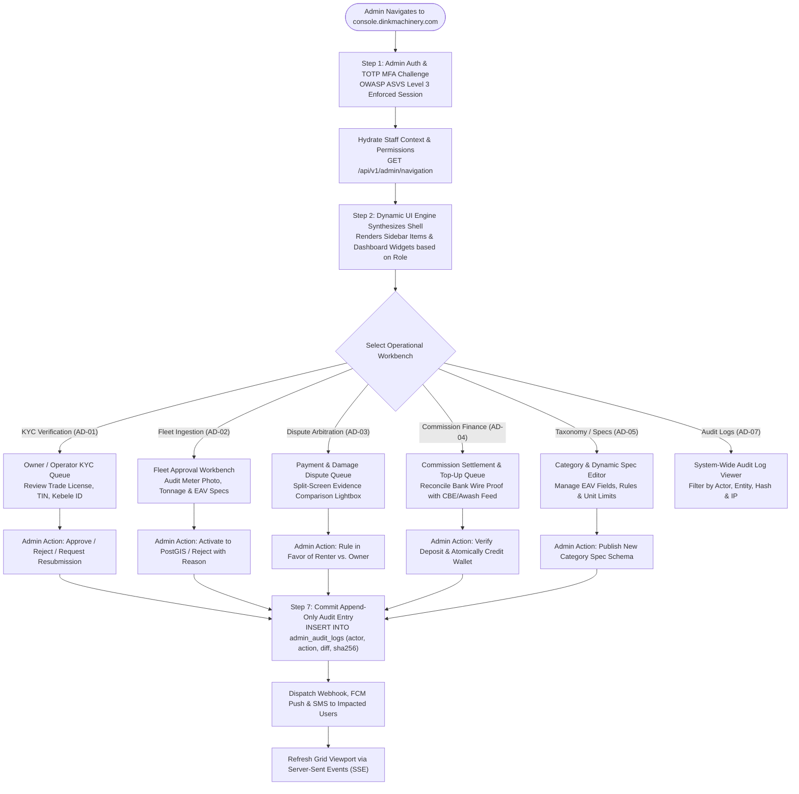
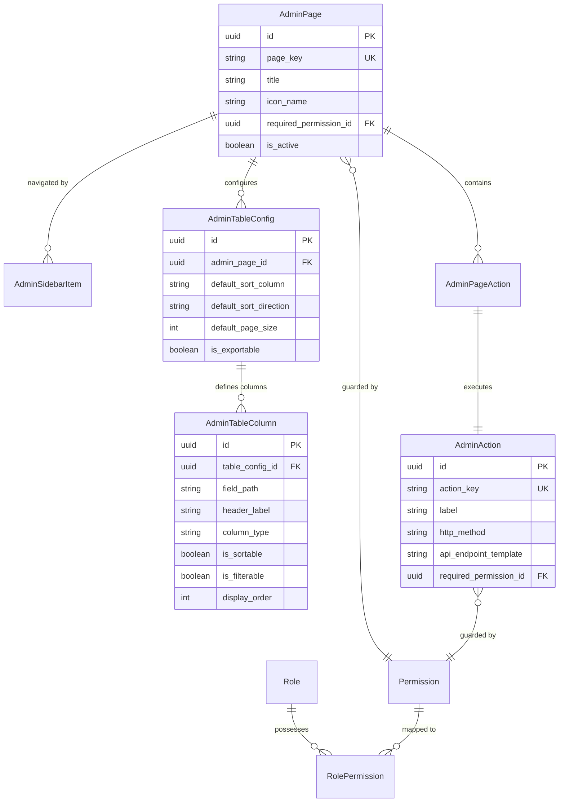
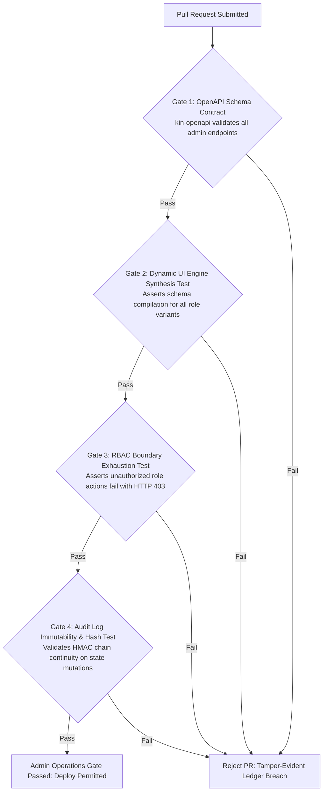

# Heavy Machinery & Logistics Rental Aggregator — Dink Machinery
## Interaction Flow Specification — 13. Back-Office Admin Operations, Dynamic UI Engine, Dispute Arbitration & Financial Auditing Dashboard (`docs/shared/flows/13-admin-operations-dashboard.md`)

**Document Identifier:** `FLOW-ADMIN-OPS-DINK-CORE-V7.0`  
**Classification:** Canonical User Interaction Flow & Wire Protocol Specification (Single Source of Truth)  
**Governing Documents:** `SRS-DINK-CORE-V7.0` (§5.11 AD-01 to AD-08, §4 User Roles & Permissions, §10, §11 Dynamic Configuration Architecture), `FLOW-ENTRY-DINK-CORE-V7.0`, `FLOW-OWNER-KYC-DINK-CORE-V7.0`, `FLOW-FLEET-REG-DINK-CORE-V7.0`, `FLOW-DISCOVERY-DINK-CORE-V7.0`, `FLOW-BOOKING-STATE-MACHINE-DINK-CORE-V7.0`, `FLOW-PAYMENT-DISPUTE-DINK-CORE-V7.0`, `FLOW-ACTIVE-RENTAL-DINK-CORE-V7.0`, `FLOW-RETURN-DAMAGE-DINK-CORE-V7.0`, `FLOW-LOGISTICS-DINK-CORE-V7.0`, `FLOW-COMMISSION-PAYOUT-DINK-CORE-V7.0`, `ARCH-BACKEND-GO-DINK-CORE-V7.0`, `ARCH-ADMIN-NEXT-DINK-CORE-V7.0`, `ARCH-SEC-DINK-CORE-V7.0`, `DS-DINK-CORE-V7.0`, `DS-PERSONAS-DINK-CORE-V7.0`, `contracts/openapi.yaml`, `ADR-001`, `ADR-002`, `ADR-005`, `ADR-010`  
**Target Client Runtimes:** Next.js 16.x (latest CVE security patch) / React 19 (Admin Web Console), Go 1.27.3 Backend Monolith, PostgreSQL 18.6 + PostGIS 3.6.4, Valkey 9.1.3, ClamAV Daemon (:3310), SeaweedFS S3, Isar NoSQL  
**Target Personas:** Back-Office Compliance Officer & Dispute Arbitrator (*Yohannes Bekele*), Super Admin / Operations Director (*Rahel Tadesse*), Platform Finance Auditor (*Solomon Kassa*)  
**Target Operating Markets:** Ethiopia (`ET`) & Kenya (`KE`) — Dynamic Multi-Country Parameterization (`LOC-01-BE`)  
**Compliance Standards:** OWASP ASVS 4.0.3 Level 3 (RBAC, Audit Logging, Session Management), RFC 9457 (Problem Details), ISO 9241-110, W3C WCAG 2.2 Level AA (Admin Console Mode), Ethiopian Personal Data Protection Proclamation No. 1321/2024, National Bank of Ethiopia (NBE) Directives  
**Status:** Approved Engineering Baseline

---

## Table of Contents

- 1. [Executive Summary & Architectural Scope](#1-executive-summary--architectural-scope)
  - 1.1 [Purpose & Metadata-Driven Dynamic UI Engine Rationale](#11-purpose--metadata-driven-dynamic-ui-engine-rationale)
  - 1.2 [The Back-Office Mental Model (Yohannes Bekele vs. Super Admin)](#12-the-back-office-mental-model-yohannes-bekele-vs-super-admin)
- 2. [End-to-End Admin Operations & Workflow Architecture Flowchart](#2-end-to-end-admin-operations--workflow-architecture-flowchart)
- 3. [Detailed Step-by-Step State Machine & User Journey](#3-detailed-step-by-step-state-machine--user-journey)
  - 3.1 [Step 1: Admin Authentication, Multi-Factor Enforcement & RBAC Session Hydration](#31-step-1-admin-authentication-multi-factor-enforcement--rbac-session-hydration)
  - 3.2 [Step 2: Dynamic Navigation & Schema-Driven Viewport Synthesis (`AdminPage`, `AdminSidebarItem`)](#32-step-2-dynamic-navigation--schema-driven-viewport-synthesis-adminpage-adminsidebaritem)
  - 3.3 [Step 3: Owner KYC & Fleet Approval Workbench (`AD-01`, `AD-02`)](#33-step-3-owner-kyc--fleet-approval-workbench-ad-01-ad-02)
  - 3.4 [Step 4: Dispute Arbitration & Split-Screen Evidence Workbench (`AD-03`, `BK-13`)](#34-step-4-dispute-arbitration--split-screen-evidence-workbench-ad-03-bk-13)
  - 3.5 [Step 5: Commission Debt Auditing & Top-Up Settlement Clearance (`AD-04`, `CW-04`)](#35-step-5-commission-debt-auditing--top-up-settlement-clearance-ad-04-cw-04)
  - 3.6 [Step 6: Taxonomy & Dynamic EAV Spec Template Management (`AD-05`, `Category`, `SpecFieldDefinition`)](#36-step-6-taxonomy--dynamic-eav-spec-template-management-ad-05-category-specfielddefinition)
  - 3.7 [Step 7: System-Wide Audit Logs & Tamper-Evident Action Trails (`AD-07`, `booking_audit_logs`)](#37-step-7-system-wide-audit-logs--tamper-evident-action-trails-ad-07-booking_audit_logs)
- 4. [Dynamic Admin Configuration Architecture & Entity Model](#4-dynamic-admin-configuration-architecture--entity-model)
  - 4.1 [The Dynamic UI Engine Schema (`AdminPage`, `AdminTableConfig`, `AdminTableColumn`, `AdminAction`)](#41-the-dynamic-ui-engine-schema-adminpage-admintableconfig-admintablecolumn-adminaction)
  - 4.2 [Role-Based Access Control (RBAC) & Granular Permissions Matrix](#42-role-based-access-control-rbac--granular-permissions-matrix)
- 5. [Frontier Market Edge Cases & Fault Recovery Protocols](#5-frontier-market-edge-cases--fault-recovery-protocols)
  - 5.1 [Dual-Control "Four-Eyes" Authorization for High-Value Overrides](#51-dual-control-four-eyes-authorization-for-high-value-overrides)
  - 5.2 [Concurrent Admin Review Collisions & Advisory Session Locks in Valkey](#52-concurrent-admin-review-collisions--advisory-session-locks-in-valkey)
  - 5.3 [Audit Log Immutability & Append-Only Cryptographic Hashing](#53-audit-log-immutability--append-only-cryptographic-hashing)
- 6. [Client UI/UX Ergonomic Specifications & Design Tokens (Next.js 16.x (latest CVE security patch) / React 19)](#6-client-uiux-ergonomic-specifications--design-tokens-nextjs-16--react-19)
  - 6.1 [Split-Screen Audit Workbench Layout & Image Annotation Viewer](#61-split-screen-audit-workbench-layout--image-annotation-viewer)
  - 6.2 [Dynamic Filter Matrix & Server-Side Paginated Table Grids](#62-dynamic-filter-matrix--server-side-paginated-table-grids)
  - 6.3 [Emergency System Kill-Switch & Delinquency Blacklist Actuators](#63-emergency-system-kill-switch--delinquency-blacklist-actuators)
- 7. [Wire Protocol Contracts & RFC 9457 Error Schemas](#7-wire-protocol-contracts--rfc-9457-error-schemas)
  - 7.1 [`GET /api/v1/admin/navigation`](#71-get-apiv1adminnavigation)
  - 7.2 [`GET /api/v1/admin/pages/{pageKey}`](#72-get-apiv1adminpagespagekey)
  - 7.3 [`POST /api/v1/admin/users/{id}/kyc-decision`](#73-post-apiv1adminusersidkyc-decision)
  - 7.4 [`POST /api/v1/admin/disputes/{id}/ruling`](#74-post-apiv1admindisputesidruling)
  - 7.5 [`POST /api/v1/admin/categories/{id}/spec-fields`](#75-post-apiv1admincategoriesidspec-fields)
  - 7.6 [RFC 9457 Universal Problem Details Payloads](#76-rfc-9457-universal-problem-details-payloads)
- 8. [Automated Testing Suite & Verification Gates](#8-automated-testing-suite--verification-gates)

---

## 1. Executive Summary & Architectural Scope

### 1.1 Purpose & Metadata-Driven Dynamic UI Engine Rationale

The **Back-Office Admin Operations, Dynamic UI Engine, Dispute Arbitration & Financial Auditing Dashboard** represents the central operational and compliance nerve center of Dink Machinery. It enables platform staff to oversee KYC validations, verify fleet specifications, resolve high-stakes payment disputes, audit manual wire commissions, manage category hierarchies, and enforce regulatory policies across Ethiopia and Kenya.

In enterprise marketplaces, hardcoded administrative consoles create severe technical debt: any addition of an equipment specification, change in commission rate, or introduction of a new operational workflow requires redeploying the entire front-end application. To eliminate this bottleneck, Dink Machinery implements a **Metadata-Driven Dynamic Admin UI Engine (`SRS-DINK-CORE-V7.0 §5.11`, §11)**:
1. **Server-Driven Viewport Synthesis:** The Next.js 16 Web Admin Console possesses no hardcoded table columns, form layouts, or navigation sidebars. Instead, the web runtime requests page schemas from the Go backend (`AdminPage`, `AdminSidebarItem`, `AdminTableConfig`, `AdminTableColumn`), rendering responsive UI components dynamically.
2. **Granular Multi-Tier RBAC:** Dynamic viewports enforce strict Role-Based Access Control (`Permission`, `Role`, `RolePermission`, `UserRole`), tailoring navigation and action buttons strictly to the officer's administrative jurisdiction.
3. **High-Stakes Verification Workbenches:** Specialized operational interfaces—such as the Split-Screen Evidence Workbench—enable sub-second comparative auditing of raw inspection photographs against registered baseline attributes.
4. **Append-Only Tamper-Evident Auditing:** Every administrative action (approval, rejection, dispute ruling, credit override) is bound to an immutable log with SHA-256 state hashing and client context capture.

### 1.2 The Back-Office Mental Model (Yohannes Bekele vs. Super Admin)

* **Yohannes Bekele (Compliance Officer & Arbitrator):** Responsible for queue throughput and dispute accuracy. Reviews dozens of contractor wire receipts, machine condition walkarounds, and owner KYC dossiers daily. Needs keyboard-accessible hotkeys, high-resolution pinch-and-pan lightbox viewers, side-by-side photographic diffs, and rapid one-click adjudication actions.
* **Rahel Tadesse (Super Admin & Operations Director):** Focuses on platform governance, category taxonomy, and risk control. Adjusts dynamic EAV specification templates, configures commission rule sets, assigns staff roles, monitors system-wide transaction velocity, and triggers emergency delinquency blacklists.
* **Solomon Kassa (Platform Finance Auditor):** Cross-references manual wire settlements against corporate banking feeds (CBE, Awash Bank, Safaricom M-PESA), clears pending commission top-ups, manages overdraft limits, and reconciles double-entry revenue accounts.

---

## 2. End-to-End Admin Operations & Workflow Architecture Flowchart



---

## 3. Detailed Step-by-Step State Machine & User Journey

### 3.1 Step 1: Admin Authentication, Multi-Factor Enforcement & RBAC Session Hydration

1. Compliance Officer *Yohannes Bekele* accesses the web admin console.
2. The officer enters corporate credentials (E.164 phone/email and master password).
3. **Mandatory TOTP MFA Enforcement:** The login service rejects pure password authentication, requiring an RFC 6238 Time-Based One-Time Password (TOTP) from an authenticator hardware key or mobile app.
4. Upon successful validation, the backend issues a high-entropy, short-lived session token (15-minute sliding TTL) stored in an `HttpOnly`, `Secure`, `SameSite=Strict` cookie alongside an explicit CSRF token header.
5. The Next.js 16 app runtime dispatches `GET /api/v1/admin/navigation`, loading Yohannes’s specific permissions and allowed navigation nodes.

### 3.2 Step 2: Dynamic Navigation & Schema-Driven Viewport Synthesis (`AdminPage`, `AdminSidebarItem`)

The front-end renders the console shell without hardcoded route configurations:

```text
+--------------------------------------------------------------------------------------------------+
| DINK MACHINERY ADMIN CONSOLE | Operator: Yohannes Bekele (Compliance Officer) | Region: ET (Addis) |
+--------------------------------------------------------------------------------------------------+
| NAVIGATION        | OPERATIONAL METRICS (LAST 24 HOURS)                                          |
|-------------------|------------------------------------------------------------------------------|
| [>] Overview      | PENDING OWNER KYC : 14    | ACTIVE FLEET REVIEWS: 22   | DISPUTES OPEN : 3   |
| [ ] KYC Approvals | OVERDUE DEBT (ETB): 184,000| TOP-UP AUDIT QUEUE : 8     | CRITICAL ALERTS: 0  |
| [ ] Fleet Reviews |------------------------------------------------------------------------------|
| [ ] Dispute Queue | COMPLIANCE ARBITRATION QUEUE (DISPUTE_OPENED)                                |
| [ ] Finance & TopUp|------------------------------------------------------------------------------|
| [ ] Categories/EAV| ID        | BOOKING ID  | DISPUTE TYPE         | CLAIMED (ETB) | SLA REMAINING|
| [ ] User Security |-----------|-------------|----------------------|---------------|--------------|
| [ ] Audit Logs    | #DSP-9918 | #BK-8829A10F| CONTESTED_DECLINE    | 157,500.00 ETB| 04h 12m (Urgent)
|                   | #DSP-9924 | #BK-7740192A| UNRESOLVED_BREAKDOWN |  42,000.00 ETB| 18h 45m      |
|                   | #DSP-9931 | #BK-9041221F| DAMAGE_DISAGREEMENT  |  18,000.00 ETB| 21h 10m      |
|                   |------------------------------------------------------------------------------|
|                   | [ ACTION: OPEN SELECTED DISPUTE DOSSIER ]                                    |
+--------------------------------------------------------------------------------------------------+
```

* **Sidebar Ingestion:** `AdminSidebarItem` records define icon keys, sort orders, badges, and target `pageKey` parameters.
* **Component Compilation:** Requesting `GET /api/v1/admin/pages/disputes` returns column metadata, search filter definitions, batch operations, and row action triggers compiled from PostgreSQL.

---

### 3.3 Step 3: Owner KYC & Fleet Approval Workbench (`AD-01`, `AD-02`)

When auditing a new Fleet Owner application (*W/ro Almaz Tesfaye*) or machine listing:
1. Yohannes selects the record from the queue, opening the **Two-Column Verification Workbench**.
2. **Left Column (Document & Reticle Evidence):** Displays the commercial trade license, TIN registration certificate, and baseline equipment hour meter photo.
3. **Right Column (Parsed Machine Attributes):** Displays extracted registration plate, serial numbers, operating weight, and dynamic EAV specs.
4. **Interactive Image Inspection:** Supports seamless zooming up to $5.0\times$ and brightness/contrast adjustments to inspect low-light yard photos.
5. **Decision Execution:**
   - **Approve:** Updates `users.kyc_status = 'VERIFIED'` or `fleets.status = 'ACTIVE'`, immediately indexing the machine into PostGIS spatial search.
   - **Reject:** Enforces selection of a machine-readable rejection code (`ERR_BLURRY_METER_PHOTO`, `ERR_EXPIRED_TRADE_LICENSE`) and a mandatory explanatory note sent directly to the owner via SMS and push notification.

---

### 3.4 Step 4: Dispute Arbitration & Split-Screen Evidence Workbench (`AD-03`, `BK-13`)

For contested payment declines (`FLOW-PAYMENT-DISPUTE-DINK-CORE-V7.0`) or damage claims (`FLOW-RETURN-DAMAGE-DINK-CORE-V7.0`):

```text
+--------------------------------------------------------------------------------------------------+
| ARBITRATION DOSSIER: #DSP-9918 | BOOKING: #BK-8829A10F | DISPUTE: CONTESTED PAYMENT DECLINE      |
+--------------------------------------------------------------------------------------------------+
| RENTER SUBMISSION (Dawit Haile-Mariam)           | OWNER REJECTION REASON (W/ro Almaz Tesfaye)    |
|--------------------------------------------------|-----------------------------------------------|
| Claimed Amount  : 157,500.00 ETB                 | Registered Bank : Commercial Bank of Ethiopia |
| Payment Method  : Commercial Bank Mobile Wire    | Account Number  : 1000482910234               |
| Bank Ref Code   : CBE-FT-99482103                | Owner Note      : "Checked CBE statement at   |
| Renter Statement: "Transferred from project acct |                   15:45 EAT. Ref code does    |
|                   branch verified debit."        |                   not exist on our balance."  |
|                                                  |                                               |
| EVIDENCE ATTACHMENT (MOBILE RECEIPT SCREENSHOT): | EVIDENCE ATTACHMENT (OFFICIAL BANK STATEMENT):|
| +----------------------------------------------+ | +-------------------------------------------+ |
| | [HIGH-RES SLIP VIEWER: ZOOM 2.5X]            | | | [HIGH-RES STATEMENT VIEWER: ZOOM 2.5X]    | |
| | Txn: CBE-FT-99482103 | Oct 27 15:22 EAT      | | | Statement Range: Oct 27 00:00 - 18:00 EAT | |
| | Beneficiary: Tesfaye Heavy Transport PLC     | | | Target Ref: NO MATCH FOUND                | |
| +----------------------------------------------+ | +-------------------------------------------+ |
| [ OPEN FULL LIGHTBOX ]                           | [ OPEN FULL LIGHTBOX ]                        |
|--------------------------------------------------------------------------------------------------|
| BANK LIAISON VERIFICATION TOOLBAR                                                                |
| [x] Query CBE Direct Clearing API Gateway: [ REF: CBE-FT-99482103 -> MATCH CONFIRMED (15:22 EAT)]|
|                                                                                                  |
| ARBITRATOR BINDING RULING:                                                                       |
| [ RULE IN FAVOR OF RENTER (OVERTURN DECLINE) ]    | [ RULE IN FAVOR OF OWNER (CONFIRM FRAUD/FAIL)]|
| (Emerald 600 - Activates Booking & Debits Comm.)  | (Crimson 600 - Cancels Booking & Strikes User)|
+--------------------------------------------------------------------------------------------------+
```

Submitting a ruling dispatches `POST /api/v1/admin/disputes/{id}/ruling`, atomically transitioning the booking state, generating double-entry ledger adjustments, and recording an append-only audit entry.

---

### 3.5 Step 5: Commission Debt Auditing & Top-Up Settlement Clearance (`AD-04`, `CW-04`)

Platform Finance Auditor *Solomon Kassa* oversees the **Commission Clearance Queue**:
1. When an owner uploads a bank wire slip to replenish their pre-funded wallet (`FLOW-COMMISSION-PAYOUT-DINK-CORE-V7.0 §3.4`), the docket enters `PENDING_AUDIT`.
2. Solomon inspects the claimed deposit against Dink Machinery's live corporate banking statements.
3. Upon verifying funds settlement:
   - Solomon inputs the bank clearing transaction ID.
   - Clicks **"Verify & Credit Wallet"**.
   - The Go backend executes an atomic ACID transaction crediting `owner_wallets.balance_minor` and logging a double-entry debit against `CORPORATE_BANK`.
   - If the owner’s fleet listings were previously suspended due to overdue aging ($> 30\text{ days}$), the system automatically restores their status to `ACTIVE` in PostGIS.

---

### 3.6 Step 6: Taxonomy & Dynamic EAV Spec Template Management (`AD-05`, `Category`, `SpecFieldDefinition`)

Super Admin *Rahel Tadesse* manages the platform's equipment catalog without code modifications:
1. Navigates to **Taxonomy & Specification Manager**.
2. Selects an industrial category (e.g., *Crawler Excavators*) or creates a new subcategory.
3. **Spec Field Definition Editor:**
   - Defines technical parameters (e.g., `Max Digging Depth`, `Operating Weight`, `Boom Length`).
   - Assigns data types: `DECIMAL`, `INTEGER`, `TEXT`, `BOOLEAN`, `ENUM_SELECT`.
   - Sets behavioral flags:
     - `isRequired`: Form compiler enforces validation.
     - `isLogisticsCritical`: Mirrors field to `fleet_spec_indexed` for spatial lowboy matching.
     - `isComparable`: Renders field in the 3-machine side-by-side comparison matrix (`SR-08`).
4. Publishing the schema invalidates the Valkey category cache (`categories:tree`), instantly updating form layouts on all active Flutter mobile clients.

---

### 3.7 Step 7: System-Wide Audit Logs & Tamper-Evident Action Trails (`AD-07`, `booking_audit_logs`)

All operational events and administrative overrides are cataloged in the centralized audit repository:
* Searchable by Actor UUID, Target Entity UUID, Action Type, IP Address, or Date Range.
* Displays a visual JSON diff showing `previous_state` versus `new_state`.
* Validates SHA-256 cryptographic sequence hashes to ensure historical records have not been altered directly in the database.

---

## 4. Dynamic Admin Configuration Architecture & Entity Model

### 4.1 The Dynamic UI Engine Schema (`AdminPage`, `AdminTableConfig`, `AdminTableColumn`, `AdminAction`)



#### Server-Driven Viewport Resolution
When the Next.js console loads `/admin/disputes`, it requests `GET /api/v1/admin/pages/disputes`:
1. The server asserts that the user's active session possesses the required permission.
2. Returns a JSON payload specifying:
   - Table columns (`header_label`, `field_path`, `column_type`).
   - Action buttons (`action_key`, `api_endpoint_template`, `http_method`).
   - Filter controls (Date Range, Status Select, Text Search).
3. The React runtime executes a generic table component (`<DynamicTableEngine config={data} />`), rendering the complete interface without front-end code deployments.

---

### 4.2 Role-Based Access Control (RBAC) & Granular Permissions Matrix

| Granular Permission Code | Support Agent | Compliance Officer (Yohannes) | Finance Officer (Solomon) | Super Admin (Rahel) |
|---|:---:|:---:|:---:|:---:|
| `users.view` | ✅ | ✅ | ✅ | ✅ |
| `users.kyc.review` | ❌ | ✅ | ❌ | ✅ |
| `users.suspend` | ❌ | ❌ | ❌ | ✅ |
| `fleets.view` | ✅ | ✅ | ✅ | ✅ |
| `fleets.review` | ❌ | ✅ | ❌ | ✅ |
| `disputes.arbitrate` | ❌ | ✅ | ❌ | ✅ |
| `finance.wallet.view` | ❌ | ❌ | ✅ | ✅ |
| `finance.settlement.verify` | ❌ | ❌ | ✅ | ✅ |
| `finance.credit_limit.override`| ❌ | ❌ | ❌ | ✅ |
| `taxonomy.specs.edit` | ❌ | ❌ | ❌ | ✅ |
| `rbac.roles.manage` | ❌ | ❌ | ❌ | ✅ |
| `system.audit_logs.view` | ❌ | ✅ | ✅ | ✅ |

---

## 5. Frontier Market Edge Cases & Fault Recovery Protocols

### 5.1 Dual-Control "Four-Eyes" Authorization for High-Value Overrides

To mitigate internal fraud and bribery risks in regional operations:
* Any financial credit limit override exceeding **$100,000.00\text{ ETB}$** or disputed claim resolution exceeding **$250,000.00\text{ ETB}$** requires **Dual-Control ("Four-Eyes") Sign-Off**.
* The initiating compliance officer (*Yohannes Bekele*) submits the proposed ruling, placing it into `PENDING_SECOND_APPROVAL`.
* A second authorized staff member (Super Admin *Rahel Tadesse*) must independently review the evidence and apply a second cryptographic signature before the database commits the state transition.

### 5.2 Concurrent Admin Review Collisions & Advisory Session Locks in Valkey

When multiple compliance officers manage the same pending queue:
* Opening a dispute or KYC dossier acquires a **Distributed Advisory Lock** in Valkey:
  `SET lock:admin:dispute:{id} {adminUserId} EX 300 NX`
* If another officer attempts to open the same dossier, the console displays a non-blocking amber banner:
  *"Officer Yohannes Bekele is currently reviewing this dispute (Lock active for 4m 12s)."*
* The second officer is restricted to read-only observation mode, preventing conflicting simultaneous rulings.

### 5.3 Audit Log Immutability & Append-Only Cryptographic Hashing

To guarantee non-repudiation in legal proceedings:
* Every row written to `admin_audit_logs` computes an HMAC-SHA256 hash chaining back to the previous log entry:
  $$\text{Current Hash} = \text{HMAC-SHA256}(\text{PrevHash} + \text{ActorID} + \text{Action} + \text{Timestamp} + \text{EntityDiff}, \text{SecretKey})$$
* An automated nightly security job asserts cryptographic chain continuity across the entire ledger. Any manual database alteration (`UPDATE` or `DELETE`) immediately breaks the hash chain, triggering high-priority security alerts.

---

## 6. Client UI/UX Ergonomic Specifications & Design Tokens (Next.js 16.x (latest CVE security patch) / React 19)

### 6.1 Split-Screen Audit Workbench Layout & Image Annotation Viewer

* **Layout Structure:** Strict $50/50$ responsive split pane with synchronized panning and zooming.
* **Image Viewer Capabilities:**
  - $1.0\times$ to $10.0\times$ smooth zoom with mouse wheel or trackpad pinch.
  - Image manipulation filters: High-contrast thresholding, color inversion, and edge detection to uncover digitally manipulated bank slips.
  - Freehand SVG annotation tool allowing arbitrators to highlight specific text discrepancies on evidence files.

### 6.2 Dynamic Filter Matrix & Server-Side Paginated Table Grids

* **Server-Side Pagination:** Grids strictly enforce cursor-based pagination or bounded limit/offset queries ($25$, $50$, $100$ items) to prevent browser memory exhaustion on large datasets.
* **Debounced Instant Search:** Search inputs execute debounced queries ($300\text{ ms}$) targeting PostgreSQL full-text search vectors (`tsvector`).
* **Visual Status Indicators:** Enforces standard brand color tokens:
  - `ACTIVE` / `VERIFIED`: Emerald Badge (`#059669`)
  - `PENDING` / `AWAITING`: Amber Badge (`#D97706`)
  - `REJECTED` / `DELINQUENT`: Crimson Badge (`#DC2626`)
  - `COMPLETED`: Slate Badge (`#475569`)

### 6.3 Emergency System Kill-Switch & Delinquency Blacklist Actuators

* **Emergency Fleet Blackout:** A prominent crimson button on user management profiles allows administrators to immediately un-index all fleets belonging to a fraudulent owner from PostGIS within $< 500\text{ ms}$.
* **Confirmation Guard:** Destructive administrative actions require typing the target user's company name or plate number into a modal text field before the confirmation button activates.

---

## 7. Wire Protocol Contracts & RFC 9457 Error Schemas

### 7.1 `GET /api/v1/admin/navigation`

Retrieves dynamic navigation tree and assigned permissions for the authenticated staff session.

#### Request Headers
```http
GET /api/v1/admin/navigation HTTP/1.1
Host: api.dinkmachinery.com
Authorization: Bearer <adminSessionToken>
```

#### Response: `HTTP 200 OK`
```json
{
  "success": true,
  "data": {
    "staffUser": {
      "id": "usr_admin_yohannes",
      "fullName": "Yohannes Bekele",
      "role": "COMPLIANCE_OFFICER",
      "jurisdiction": "ET"
    },
    "permissions": [
      "users.kyc.review",
      "fleets.review",
      "disputes.arbitrate",
      "system.audit_logs.view"
    ],
    "sidebarItems": [
      {
        "pageKey": "dashboard_overview",
        "title": "Overview",
        "icon": "DashboardIcon",
        "badgeCount": 0,
        "displayOrder": 1
      },
      {
        "pageKey": "kyc_approvals",
        "title": "KYC Approvals",
        "icon": "BadgeCheckIcon",
        "badgeCount": 14,
        "displayOrder": 2
      },
      {
        "pageKey": "dispute_resolution",
        "title": "Dispute Queue",
        "icon": "ScaleIcon",
        "badgeCount": 3,
        "displayOrder": 3
      }
    ]
  },
  "timestamp": "2026-10-27T17:35:00Z"
}
```

---

### 7.2 `GET /api/v1/admin/pages/{pageKey}`

Retrieves schema definitions for rendering a dynamic admin table and form view.

#### Request Query Parameters
```http
GET /api/v1/admin/pages/dispute_resolution HTTP/1.1
Host: api.dinkmachinery.com
Authorization: Bearer <adminSessionToken>
```

#### Response: `HTTP 200 OK`
```json
{
  "success": true,
  "data": {
    "pageKey": "dispute_resolution",
    "title": "Compliance Dispute Arbitration Queue",
    "tableConfig": {
      "defaultSortColumn": "createdAt",
      "defaultSortDirection": "ASC",
      "pageSize": 25,
      "columns": [
        {
          "fieldPath": "disputeDocketNumber",
          "headerLabel": "Docket #",
          "columnType": "STRING",
          "isSortable": true
        },
        {
          "fieldPath": "bookingReference",
          "headerLabel": "Booking Ref",
          "columnType": "STRING",
          "isSortable": false
        },
        {
          "fieldPath": "disputeReason",
          "headerLabel": "Reason",
          "columnType": "BADGE",
          "isSortable": true
        },
        {
          "fieldPath": "claimedAmountFormatted",
          "headerLabel": "Disputed Amount",
          "columnType": "CURRENCY",
          "isSortable": true
        },
        {
          "fieldPath": "slaRemainingHours",
          "headerLabel": "SLA Deadline",
          "columnType": "COUNTDOWN",
          "isSortable": true
        }
      ]
    },
    "actions": [
      {
        "actionKey": "OPEN_DOSSIER",
        "label": "Open Dossier",
        "httpMethod": "GET",
        "endpointTemplate": "/api/v1/admin/disputes/{id}"
      }
    ]
  },
  "timestamp": "2026-10-27T17:36:00Z"
}
```

---

### 7.3 `POST /api/v1/admin/users/{id}/kyc-decision`

Submits an administrative KYC decision.

#### Request Headers
```http
POST /api/v1/admin/users/usr_almaz_018f/kyc-decision HTTP/1.1
Host: api.dinkmachinery.com
Content-Type: application/json
Authorization: Bearer <adminSessionToken>
```

#### Request Payload
```json
{
  "decision": "APPROVED",
  "reviewNotes": "Commercial Trade License and TIN certificates verified with Ministry of Trade online portal.",
  "assignedTier": "TIER_2_ESTABLISHED_OWNER",
  "approvedOverdraftLimitMinor": 5000000
}
```

#### Response: `HTTP 200 OK`
```json
{
  "success": true,
  "data": {
    "userId": "usr_almaz_018f",
    "kycStatus": "VERIFIED",
    "reviewedBy": "Yohannes Bekele",
    "reviewedAt": "2026-10-27T17:40:00Z"
  },
  "timestamp": "2026-10-27T17:40:01Z"
}
```

---

### 7.4 `POST /api/v1/admin/disputes/{id}/ruling`

Submits a binding dispute resolution ruling.

#### Request Payload
```json
{
  "ruling": "IN_FAVOR_OF_RENTER",
  "bankAuditReference": "CBE-CLEARING-DIRECT-API-MATCH",
  "arbitrationNotes": "CBE clearing sequence verified funds deposited to owner account #1000482910234. Owner decline overturned.",
  "imposeOwnerInfraction": true,
  "infractionReasonCode": "BAD_FAITH_PAYMENT_DECLINE"
}
```

#### Response: `HTTP 200 OK`
```json
{
  "success": true,
  "data": {
    "disputeId": "dsp_99182a01",
    "bookingId": "bk_8829a10f",
    "status": "DISPUTE_RESOLVED_RENTER",
    "resultingBookingStatus": "CONFIRMED",
    "commissionDebitedMinor": 3150000,
    "auditEntryId": "aud_019a4b82",
    "ruledBy": "Yohannes Bekele",
    "ruledAt": "2026-10-27T17:45:00Z"
  },
  "timestamp": "2026-10-27T17:45:00Z"
}
```

---

### 7.5 `POST /api/v1/admin/categories/{id}/spec-fields`

Super Admin endpoint to append or modify dynamic EAV specification attributes.

#### Request Payload
```json
{
  "sectionKey": "WORKING_RANGES",
  "fieldKey": "spec_bucket_breakout_force",
  "fieldName": "Bucket Breakout Force",
  "fieldType": "DECIMAL",
  "unit": "kN",
  "isRequired": true,
  "isLogisticsCritical": false,
  "isComparable": true,
  "minValue": 10.0,
  "maxValue": 500.0,
  "displayOrder": 4
}
```

#### Response: `HTTP 201 Created`
```json
{
  "success": true,
  "data": {
    "categoryId": "cat_excavator_crawler",
    "fieldId": "fld_breakout_force_01",
    "schemaVersion": 4,
    "cachePurged": true,
    "createdAt": "2026-10-27T17:50:00Z"
  },
  "timestamp": "2026-10-27T17:50:01Z"
}
```

---

### 7.6 RFC 9457 Universal Problem Details Payloads

#### Example: Advisory Lock Collision (`HTTP 409 Conflict`)
```json
{
  "type": "[https://api.dinkmachinery.com/errors/admin-dossier-locked](https://api.dinkmachinery.com/errors/admin-dossier-locked)",
  "title": "Dossier Currently Locked by Another Officer",
  "status": 409,
  "detail": "This dispute is actively being reviewed by Officer Solomon Kassa. Advisory lock expires in 2 minutes 45 seconds.",
  "instance": "/api/v1/admin/disputes/dsp_99182a01",
  "code": "ERR_ADMIN_CONCURRENT_LOCK",
  "invalidParams": [
    {
      "name": "lockedBy",
      "reason": "Solomon Kassa (usr_admin_solomon)"
    }
  ]
}
```

#### Example: Four-Eyes Approval Required (`HTTP 403 Forbidden`)
```json
{
  "type": "[https://api.dinkmachinery.com/errors/four-eyes-authorization-required](https://api.dinkmachinery.com/errors/four-eyes-authorization-required)",
  "title": "Dual-Control Sign-Off Required",
  "status": 403,
  "detail": "Claim amount (350,000.00 ETB) exceeds single-officer limit (250,000.00 ETB). Action submitted to Super Admin queue for second sign-off.",
  "instance": "/api/v1/admin/disputes/dsp_99182a01/ruling",
  "code": "ERR_FOUR_EYES_APPROVAL_MANDATED"
}
```

---

## 8. Automated Testing Suite & Verification Gates



1. **OpenAPI Schema Contract Gate (`kin-openapi`):** Validates all admin navigation, page schema, KYC review, dispute ruling, and taxonomy endpoints against `contracts/openapi.yaml`.
2. **Dynamic UI Engine Synthesis Test:** Unit tests verify that every registered `AdminPage` record generates valid JSON schemas and that Next.js table components parse all column data types without runtime exceptions.
3. **RBAC Privilege Escalation Matrix Test:** Executes test runs across all staff roles, verifying that lower-privilege roles (e.g., Support Agent) receive HTTP 403 Forbidden when attempting restricted actions (e.g., `finance.settlement.verify`).
4. **Audit Log HMAC Chain Continuity Test:** Simulates 500 administrative actions, asserts that HMAC-SHA256 hashes chain consecutively across records, and verifies that manual database injections fail the chain validation gate.

---

*This document defines the canonical user interaction flow, server-driven dynamic UI engine, RBAC permission matrix, dispute arbitration protocols, and wire protocols for Back-Office Admin Operations, Dispute Arbitration, and Financial Auditing in Dink Machinery Version 7.0. All downstream Next.js 16 web modules, Go HTTP controllers, and PostgreSQL database schemas must strictly adhere to this specification.*