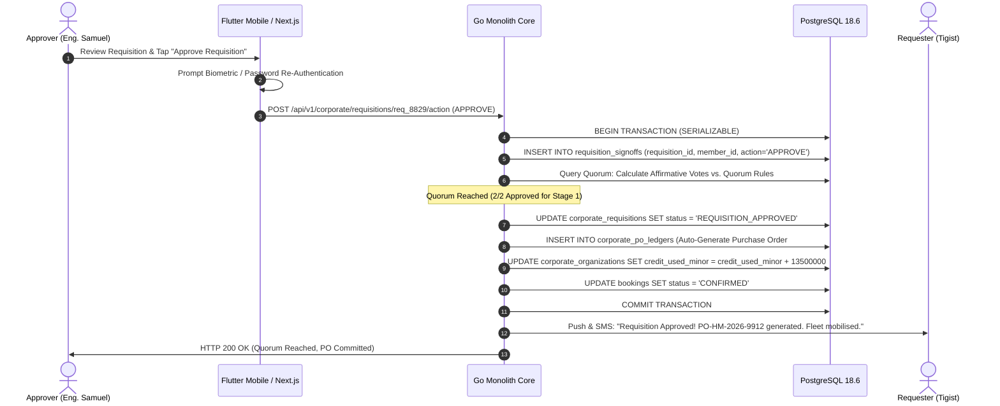
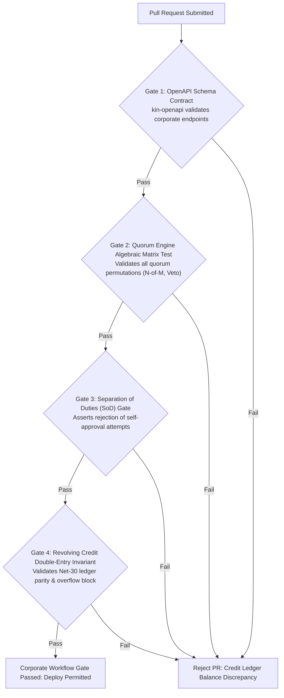

# Heavy Machinery & Logistics Rental Aggregator — Dink Machinery
## Interaction Flow Specification — 14. Corporate Account Hierarchy, Multi-Tier Approval Workflows & Enterprise Credit Line Operations (`docs/shared/flows/14-corporate-account-approval-workflow.md`)

**Document Identifier:** `FLOW-CORP-APPROVAL-DINK-CORE-V7.0`  
**Classification:** Canonical User Interaction Flow & Wire Protocol Specification (Single Source of Truth)  
**Governing Documents:** `SRS-DINK-CORE-V7.0` (§6 Phase 2 Corporate Architecture, §4 User Roles & Permissions, §5.5, §8.1, §8.2, §10, §11), `FLOW-ENTRY-DINK-CORE-V7.0`, `FLOW-RENTER-AUTH-DINK-CORE-V7.0`, `FLOW-OWNER-KYC-DINK-CORE-V7.0`, `FLOW-FLEET-REG-DINK-CORE-V7.0`, `FLOW-DISCOVERY-DINK-CORE-V7.0`, `FLOW-BOOKING-STATE-MACHINE-DINK-CORE-V7.0`, `FLOW-PAYMENT-DISPUTE-DINK-CORE-V7.0`, `FLOW-COMMISSION-PAYOUT-DINK-CORE-V7.0`, `ARCH-BACKEND-GO-DINK-CORE-V7.0`, `ARCH-FLUTTER-DINK-CORE-V7.0`, `ARCH-ADMIN-NEXT-DINK-CORE-V7.0`, `ARCH-SEC-DINK-CORE-V7.0`, `DS-DINK-CORE-V7.0`, `DS-PERSONAS-DINK-CORE-V7.0`, `contracts/openapi.yaml`, `ADR-001`, `ADR-002`, `ADR-005`, `ADR-010`  
**Target Client Runtimes:** Next.js 16.x (latest CVE security patch) / React 19 (Corporate Portal & Admin Web Console), Flutter 3.47.9 / Dart 3.9 (Cross-Platform Mobile), Go 1.27.3 Backend Monolith, PostgreSQL 18.6, Valkey 9.1.3, ClamAV Daemon (:3310), SeaweedFS S3  
**Target Personas:** Enterprise Procurement Director & Chief Project Engineer (*Eng. Samuel Getachew*), Site Project Manager / Requester (*Tigist Assefa*), Corporate Finance Controller (*Marta Hailu*), Compliance & Risk Underwriter (*Solomon Kassa*)  
**Target Operating Markets:** Ethiopia (`ET`) & Kenya (`KE`) — Dynamic Multi-Country Parameterization (`LOC-01-BE`)  
**Compliance Standards:** OWASP ASVS 4.0.3 Level 3 (Separation of Duties, Cryptographic Signatures, Non-Repudiation & Audit Logging), RFC 9457 (Problem Details), ISO 9241-110, W3C WCAG 2.2 Level AA (Web Portal) & Level AAA (Field Mobile), National Bank of Ethiopia (NBE) Directives on Corporate B2B Settlements  
**Status:** Approved Engineering Baseline

---

## Table of Contents

- 1. [Executive Summary & Enterprise Architectural Scope](#1-executive-summary--enterprise-architectural-scope)
  - 1.1 [Purpose & Enterprise B2B Governance Rationale (§6 Phase 2)](#11-purpose--enterprise-b2b-governance-rationale-6-phase-2)
  - 1.2 [The Corporate Mental Model (Tigist vs. Samuel vs. Marta)](#12-the-corporate-mental-model-tigist-vs-samuel-vs-marta)
- 2. [End-to-End Corporate Onboarding & Approval Flowchart](#2-end-to-end-corporate-onboarding--approval-flowchart)
- 3. [Detailed Step-by-Step State Machine & User Journey](#3-detailed-step-by-step-state-machine--user-journey)
  - 3.1 [Step 1: Organization Onboarding, TIN/Trade License Ingestion & Credit Underwriting](#31-step-1-organization-onboarding-tintrade-license-ingestion--credit-underwriting)
  - 3.2 [Step 2: Member Hierarchy, Role Assignment & Delegation of Authority](#32-step-2-member-hierarchy-role-assignment--delegation-of-authority)
  - 3.3 [Step 3: Approval Chain Synthesis & Quorum Rule Engine (N-of-M, Weighted, Veto)](#33-step-3-approval-chain-synthesis--quorum-rule-engine-n-of-m-weighted-veto)
  - 3.4 [Step 4: Requisition Initiation, Cost-Center Allocation & Auto-Approval Traversal](#34-step-4-requisition-initiation-cost-center-allocation--auto-approval-traversal)
  - 3.5 [Step 5: Multi-Stage Approval Chain Execution & Digital Sign-Off](#35-step-5-multi-stage-approval-chain-execution--digital-sign-off)
  - 3.6 [Step 6: Purchase Order (PO) Issuance & Corporate Credit Line / Net Terms Drawdown](#36-step-6-purchase-order-po-issuance--corporate-credit-line--net-terms-drawdown)
  - 3.7 [Step 7: Seamless Context Switching (Personal vs. Corporate Account Isolation)](#37-step-7-seamless-context-switching-personal-vs-corporate-account-isolation)
- 4. [Mathematical Quorum Engine, Approval Rules & Credit Line Accounting](#4-mathematical-quorum-engine-approval-rules--credit-line-accounting)
  - 4.1 [Quorum Evaluation & Dynamic Decision Matrix](#41-quorum-evaluation--dynamic-decision-matrix)
  - 4.2 [Tiered Auto-Approval Spending Thresholds](#42-tiered-auto-approval-spending-thresholds)
  - 4.3 [Corporate Net Terms (Net-30/60) & Double-Entry Drawdown Invariant](#43-corporate-net-terms-net-3060--double-entry-drawdown-invariant)
- 5. [Frontier Market Edge Cases & Fault Recovery Protocols](#5-frontier-market-edge-cases--fault-recovery-protocols)
  - 5.1 [Out-of-Office Delegation & Escalation SLA Breaches](#51-out-of-office-delegation--escalation-sla-breaches)
  - 5.2 [Approver Collusion & Separation of Duties (SoD) Invariant](#52-approver-collusion--separation-of-duties-sod-invariant)
  - 5.3 [Offline Requisition Staging & Asynchronous Push Sync (`ADR-010`)](#53-offline-requisition-staging--asynchronous-push-sync-adr-010)
  - 5.4 [Multi-Currency Corporate Segregation (`ETB` vs. `KES`)](#54-multi-currency-corporate-segregation-etb-vs-kes)
- 6. [Client UI/UX Ergonomic Specifications & Design Tokens](#6-client-uiux-ergonomic-specifications--design-tokens)
  - 6.1 [Corporate Account Context Switcher & Organization HUD](#61-corporate-account-context-switcher--organization-hud)
  - 6.2 [Approval Chain Visualizer & Multi-Signatory Review Viewport](#62-approval-chain-visualizer--multi-signatory-review-viewport)
  - 6.3 [Purchase Order (PO) & Net Terms Reconciliation Drawer](#63-purchase-order-po--net-terms-reconciliation-drawer)
- 7. [Wire Protocol Contracts & RFC 9457 Error Schemas](#7-wire-protocol-contracts--rfc-9457-error-schemas)
  - 7.1 [`POST /api/v1/corporate/organizations`](#71-post-apiv1corporateorganizations)
  - 7.2 [`POST /api/v1/corporate/approval-chains`](#72-post-apiv1corporateapproval-chains)
  - 7.3 [`POST /api/v1/corporate/requisitions`](#73-post-apiv1corporaterequisitions)
  - 7.4 [`POST /api/v1/corporate/requisitions/{id}/action`](#74-post-apiv1corporaterequisitionsidaction)
  - 7.5 [`GET /api/v1/corporate/credit-line`](#75-get-apiv1corporatecredit-line)
  - 7.6 [RFC 9457 Universal Problem Details Payloads](#76-rfc-9457-universal-problem-details-payloads)
- 8. [Automated Testing Suite & Verification Gates](#8-automated-testing-suite--verification-gates)

---

## 1. Executive Summary & Enterprise Architectural Scope

### 1.1 Purpose & Enterprise B2B Governance Rationale (§6 Phase 2)

The **Corporate Account Hierarchy, Multi-Tier Approval Workflows & Enterprise Credit Line Operations Flow** specifies the Phase 2 enterprise expansion of Dink Machinery (`SRS-DINK-CORE-V7.0 §6`). 

While individual contractors and small builders interact via single-tier peer-to-peer bookings (`FLOW-BOOKING-STATE-MACHINE-DINK-CORE-V7.0`), large general contractors, tier-1 infrastructure joint ventures, and multinational engineering conglomerates (e.g., Ethiopian Construction Works Corporation, China Civil Engineering Construction Corporation, Dangote Cement Logistics, Sogea-Satom) operate under strict internal financial governance. On-site project engineers cannot unilaterally disburse corporate capital or bind the enterprise to multi-million Birr machinery contracts without structured multi-signatory review.

This specification enforces five fundamental enterprise invariants:
1. **Separation of Duties (SoD):** A single individual cannot simultaneously originate a capital equipment requisition and approve the corporate disbursement or credit release (`OWASP ASVS 4.0.3 §1.1.2`).
2. **Configurable Quorum Engine:** Approvals are governed by algebraic quorum rules bound to specific equipment categories, project cost centers, and monetary thresholds: All-Must-Approve, Any $N$-of-$M$, Percentage Quorums, Weighted Votes, and Executive Vetoes.
3. **Enterprise Credit Line & Net Terms Settlement:** Verified corporate entities operate with approved revolving credit lines (`Net-30` or `Net-60`), eliminating manual per-booking wire transfers in favor of consolidated monthly corporate billing backed by formal Purchase Orders (PO).
4. **Isolated Dual-Context Switching:** A user profile operates in dual mode: acting as an individual consumer/contractor in one context, and switching into an authenticated corporate persona with bound delegation limits in another, maintaining strict database tenant separation.
5. **Cryptographic Sign-Off Chain:** Each approval step records an immutable HMAC-SHA256 signature containing the approver UUID, timestamp, cost center, and requisition hash, preventing post-facto repudiation.

### 1.2 The Corporate Mental Model (Tigist vs. Samuel vs. Marta)

* **Tigist Assefa (Site Project Engineer / Requester):** Stationed at an active road construction culvert in Mojo. Her excavator blew an engine head; project milestones face liquidated damages ($45,000\text{ ETB/day}$). She needs to locate a replacement 25-ton excavator on Dink Machinery, allocate it to Cost Center `#CC-MOJO-HW-04`, and submit an urgent requisition from her mobile phone in three taps.
* **Eng. Samuel Getachew (Procurement Director / Tier-2 Approver):** Stationed at headquarters in Addis Ababa. Manages corporate machinery commitments. Receives an instant push notification on his tablet with full technical specs, cost breakdown, and site justification. Audits the requisition against the project budget and digitally signs off within minutes.
* **Marta Hailu (Corporate Finance Controller & Admin):** Manages enterprise cash flow, revolving credit lines, and company-wide approval policies. Establishes spending limits, issues corporate Purchase Orders, tracks Net-30 drawdowns, and manages member role assignments.

---

## 2. End-to-End Corporate Onboarding & Approval Flowchart

```mermaid
flowchart TD
    CorpStart(["Corporate Entity Onboarding"]) --> OrgRegister["Step 1: Register Organization Entity (Next.js / Flutter)<br/>TIN, Commercial Trade License, Articles of Incorporation"]
    
    OrgRegister --> ClamAVScan["Streaming Document Antivirus Scan<br/>ClamAV TCP Socket :3310 (zINSTREAM)"]
    ClamAVScan --> S3Store["Persist Corporate Documents in SeaweedFS S3"]
    
    S3Store --> AdminUnderwrite["Platform Credit Underwriting (AD-06-WEB)<br/>Solomon Kassa audits audited financials & bank references<br/>Grants Revolving Credit Line (e.g., 5,000,000 ETB Net-30)"]
    
    AdminUnderwrite --> MemberSetup["Step 2: Member Ingestion & Roles (Marta Hailu)<br/>Assign Members: Requester, Approver, Corporate Admin"]
    
    MemberSetup --> DefineChains["Step 3: Approval Chain & Quorum Engine Configuration<br/>Define Tiered Rules: e.g., > 100k ETB requires 2-of-3 Project Approvers<br/>> 500k ETB requires Procurement Director Veto Power"]
    
    DefineChains --> FieldRequisition["Step 4: Site Requisition Origination (Tigist Assefa)<br/>Selects Cat 320D (135,000 ETB, 3 Days) -> Allocates Cost Center"]
    
    FieldRequisition --> CheckLimits{"Threshold Evaluation Engine<br/>Amount <= Requester Auto-Approval Limit?"}
    
    CheckLimits -->|"Yes (Within Auto-Limit)"| AutoApprove["Requisition Auto-Approved<br/>Bypasses Tier 1 Approvers"]
    CheckLimits -->|"No (Exceeds Limit)"| RouteChain["Step 5: Dynamic Chain Traversal<br/>Requisition Status: PENDING_CORPORATE_APPROVAL<br/>Dispatches Urgent Push & SMS to Tier 1 Approvers"]
    
    RouteChain --> Stage1Review{"Stage 1 Quorum Evaluation<br/>e.g., 2-of-3 Project Engineers Approve?"}
    
    Stage1Review -->|"Rejected / Vetoed"| RequisitionRejected["Status: REQUISITION_REJECTED<br/>Notification with Reason dispatched to Tigist"]
    Stage1Review -->|"Stage 1 Quorum Met"| CheckNextStage{"Is Higher Tier Required?<br/>Total Amount > Tier 2 Boundary (500k ETB)?"}
    
    CheckNextStage -->|"Yes"| Stage2Review["Stage 2: Director Level Sign-Off (Eng. Samuel)<br/>Evaluates High-Value Capital Commitment"]
    CheckNextStage -->|"No"| RequisitionApproved["Requisition Formally Approved"]
    
    Stage2Review -->|"Approved"| RequisitionApproved
    Stage2Review -->|"Vetoed"| RequisitionRejected

    AutoApprove --> RequisitionApproved
    
    RequisitionApproved --> CreditCheck{"Step 6: Corporate Credit Verification<br/>(Used Credit + Amount) <= Credit Line?"}
    
    CreditCheck -->|"Credit Limit Exceeded"| RequireWire["Status: PENDING_DIRECT_WIRE<br/>Fallback to Manual Bank Transfer Flow"]
    CreditCheck -->|"Credit Available"| IssuePO["Generate Enterprise Purchase Order (PO)<br/>Drawdown Credit Line on Net-30 Terms"]
    
    IssuePO --> CreateMasterBooking["Atomic Commitment in PostgreSQL:<br/>1. Create Booking (status='CONFIRMED', corporate_id=org.id)<br/>2. INSERT INTO corporate_po_ledgers<br/>3. Activate Fleet Readiness & Transport Mobilization"]
    
    CreateMasterBooking --> ActiveExecution["Booking Enters READY_FOR_PICKUP<br/>Fleet Dispatched to Project Site"]
```



---

## 3. Detailed Step-by-Step State Machine & User Journey

### 3.1 Step 1: Organization Onboarding, TIN/Trade License Ingestion & Credit Underwriting

1. Corporate Administrator *Marta Hailu* navigates to the Dink Machinery Corporate Registration portal.
2. She inputs enterprise registration metadata:
   - Registered Business Legal Name: *Haile-Mariam Construction General Contractors S.C.*
   - Tax Identification Number (TIN): `ET-TIN-00918234`
   - Commercial Registration Number: `AA/B/0019284/2018`
   - Corporate Banking References: Commercial Bank of Ethiopia (CBE) & Awash Bank Corporate Accounts.
3. **Corporate Document Vault:** Marta uploads high-resolution scans of:
   - Principal Commercial Registration Certificate (Ministry of Trade & Industry).
   - Ministry of Urban Development & Construction (MUDCo) Category 1 General Contractor (GC-1) License.
   - Most recent 3 years of audited balance sheets and financial statements.
4. **Streamed Virus Auditing:** Uploads are streamed to ClamAV via `zINSTREAM` protocol over TCP socket `:3310` before commitment to SeaweedFS S3 (`s3://dink-corporate-vault/orgs/{id}/`).
5. **Credit Underwriting:** Platform Risk Underwriter *Solomon Kassa* reviews the application in the Next.js Web Admin Console, executes verification checks against Ministry registries, and configures an approved **Enterprise Revolving Credit Limit** (e.g., $5,000,000.00\text{ ETB}$ on `Net-30` terms).

---

### 3.2 Step 2: Member Hierarchy, Role Assignment & Delegation of Authority

Once the organization is verified, Marta configures the corporate membership directory:

```mermaid
erDiagram
    CorporateOrganization ||--o{ CorporateMember : "employs"
    CorporateOrganization ||--o{ ApprovalChain : "maintains"
    CorporateOrganization ||--o{ CorporateCostCenter : "owns"
    CorporateMember ||--o{ MemberApprovalLimit : "granted"
    ApprovalChain ||--o{ ApprovalStage : "contains"
    ApprovalStage ||--o{ StageParticipant : "designates"
    CorporateRequisition ||--o{ RequisitionSignoff : "audited by"

    CorporateOrganization {
        uuid id PK
        string legal_name
        string tin_number UK
        bigint credit_limit_minor
        bigint credit_used_minor
        string default_payment_terms
        boolean is_active
    }

    CorporateMember {
        uuid id PK
        uuid organization_id FK
        uuid user_id FK
        string member_role -- 'REQUESTER', 'APPROVER', 'BOTH', 'ADMIN'
        string job_title
        string corporate_email
        boolean is_active
    }

    MemberApprovalLimit {
        uuid id PK
        uuid corporate_member_id FK
        uuid category_id FK
        bigint auto_approval_limit_minor
        bigint max_approval_threshold_minor
    }
```

#### Granular Delegation of Authority (DoA) Rules
* **Requester:** Can initiate requisitions, allocate cost centers, inspect machines on-site, and sign physical handover PINs. Cannot approve requisitions.
* **Approver:** Can review, approve, reject, or veto requisitions within designated cost centers and monetary ceilings.
* **Both (Hybrid):** Permitted for senior field executives (e.g., Regional Project Managers) who need to initiate urgent field requisitions while retaining approval authority over subordinate junior engineers. Enforces strict Separation of Duties (`RequesterID != ApproverID`).
* **Corporate Admin:** Manages membership, edits approval chains, monitors credit utilization, and settles monthly consolidated invoices.

---

### 3.3 Step 3: Approval Chain Synthesis & Quorum Rule Engine (N-of-M, Weighted, Veto)

Dink Machinery provides an algebraic approval workflow engine allowing enterprises to build flexible governance matrices:

```text
+-------------------------------------------------------------------+
|  [<- BACK]              APPROVAL CHAIN CONFIGURATION              |
+-------------------------------------------------------------------+
|  CHAIN NAME: Heavy Earthmoving Requisitions (> 100,000 ETB)       |
|  CATEGORY  : Earthmoving & Excavation (Crawler Excavators)        |
|  COST CENTER: All Civil Infrastructure Sites                      |
|                                                                   |
|  STAGE 1: TECHNICAL & SITE VERIFICATION (QUORUM: ANY 2 OF 3)     |
|  * Participant 1: Tigist Assefa (Senior Resident Engineer)        |
|  * Participant 2: Bereket Desta (Plant & Equipment Manager)       |
|  * Participant 3: Kaleb Tadesse (Site Cost Controller)            |
|  * Quorum Rule  : ANY_N_OF_M (N=2, M=3)                           |
|  * SLA Timeout  : 4 Hours (Auto-escalates on breach)              |
|                                                                   |
|  STAGE 2: FINANCIAL & EXECUTIVE COMMITMENT (EXECUTIVE VETO)       |
|  * Participant 1: Eng. Samuel Getachew (Procurement Director)     |
|  * Rule         : MANDATORY_VETO_POWER (Must explicitly approve)  |
|  * Monetary Min : 500,000.00 ETB (Skipped if amount < 500k ETB)   |
|                                                                   |
|  [ + ADD APPROVAL STAGE ]               [ SAVE APPROVAL CHAIN ]   |
+-------------------------------------------------------------------+
```

#### Quorum Archetypes Supported by the Engine
1. **`ALL_MUST_APPROVE` (Unanimous):** Every designated participant in the stage must submit an affirmative cryptographic signature.
2. **`ANY_N_OF_M` (Threshold Quorum):** Any $N$ approvals out of a pool of $M$ authorized members advances the stage.
3. **`PERCENTAGE_QUORUM`:** Cumulative voting weight must meet or exceed a defined percentage (e.g., $\ge 66\%$).
4. **`WEIGHTED_VOTING`:** Members cast votes proportional to their organizational authority weights (e.g., Director = 50 votes, Manager = 25 votes; Threshold = 60 votes).
5. **`EXECUTIVE_VETO`:** Designated executive participants possess absolute veto authority; a single rejection terminates the requisition regardless of other affirmative votes.

---

### 3.4 Step 4: Requisition Initiation, Cost-Center Allocation & Auto-Approval Traversal

When site engineer *Tigist Assefa* locates an available Caterpillar 320D on the mobile client (`FLOW-DISCOVERY-DINK-CORE-V7.0`), she selects **"Corporate Requisition"** instead of personal booking:

```text
+-------------------------------------------------------------------+
|  [<- BACK]          NEW CORPORATE REQUISITION         STEP 1 OF 2 |
+-------------------------------------------------------------------+
|  REQUISITIONING AS: Haile-Mariam Construction General Contractors |
|                                                                   |
|  EQUIPMENT SELECTED: Caterpillar 320D Hydraulic Excavator (2024)  |
|  SUPPLIER / FLEET  : Tesfaye Heavy Transport PLC (Kality Depot)   |
|  RENTAL DURATION   : 3 Days (Nov 5 to Nov 8, 2026)               |
|  TOTAL GROSS VALUE : 135,000.00 ETB                               |
|                                                                   |
|  PROJECT COST CENTER ALLOCATION *                                 |
|  +-------------------------------------------------------------+  |
|  | #CC-MOJO-HW-04 - Mojo-Meki Highway Expansion Site B     [v] |  |
|  +-------------------------------------------------------------+  |
|                                                                   |
|  INTERNAL WORK BREAKDOWN STRUCTURE (WBS) CODE                     |
|  +-------------------------------------------------------------+  |
|  | WBS-EARTHWORK-CULVERT-09                                    |  |
|  +-------------------------------------------------------------+  |
|                                                                   |
|  ENGINEERING JUSTIFICATION (MANDATORY):                           |
|  +-------------------------------------------------------------+  |
|  | Primary site excavator suffered hydraulic pump seizure.      |  |
|  | Machine required immediately to prevent culvert flood damage.|  |
|  +-------------------------------------------------------------+  |
|                                                                   |
|  YOUR MEMBER AUTO-APPROVAL LIMIT: 50,000.00 ETB                   |
|  (i) Requisition (135,000 ETB) exceeds your limit. Routing to     |
|      Approval Chain: 'Heavy Earthmoving Requisitions'             |
|                                                                   |
|  +-------------------------------------------------------------+  |
|  |                 TRANSMIT FOR CORPORATE REVIEW               |  |
|  |                 (Height: 56dp, Amber 500)                   |  |
|  +-------------------------------------------------------------+  |
+-------------------------------------------------------------------+
```

#### Traversal Algorithm
1. The backend evaluates Tigist’s `MemberApprovalLimit`: $135,000.00\text{ ETB} > 50,000.00\text{ ETB}$. Auto-approval is denied.
2. The system queries `corporate_approval_chains` matching `category_id = 'cat_excavator_crawler'` and `cost_center_id = 'cc_mojo_04'`.
3. The requisition is committed with status `PENDING_CORPORATE_APPROVAL`.
4. High-priority push notifications, email alerts, and SMS pings are dispatched to the authorized participants in Stage 1.

---

### 3.5 Step 5: Multi-Stage Approval Chain Execution & Digital Sign-Off

Authorized approvers open the requisition inside the **Mobile Approval Shell** or **Corporate Web Portal**:

```text
+-------------------------------------------------------------------+
|  [<- BACK]            REQUISITION #REQ-8829A10F         IN REVIEW |
+-------------------------------------------------------------------+
|  STAGE 1 OF 1: TECHNICAL & SITE VERIFICATION (QUORUM: 2 OF 3)     |
|  Allocated Budget: 500,000 ETB | Available in Cost Center: 320k ETB|
|                                                                   |
|  REQUEST DETAILS:                                                 |
|  * Requester   : Tigist Assefa (Field Resident Engineer)          |
|  * Cost Center : #CC-MOJO-HW-04 (Mojo-Meki Highway Expansion)     |
|  * Machine     : Caterpillar 320D (21.8t Crawler Excavator)       |
|  * Duration    : 3 Days (24 Shift Hours Allowance)                |
|  * Total Cost  : 135,000.00 ETB (Net-30 Terms)                    |
|                                                                   |
|  SIGN-OFF STATUS (CURRENT QUORUM: 1/2 COMMITTED):                 |
|  [V] Bereket Desta (Plant Manager)  - APPROVED (Today 14:15 EAT)  |
|  [ ] Kaleb Tadesse (Cost Controller) - PENDING REVIEW             |
|  [>] You (Samuel Getachew)          - ACTION REQUIRED             |
|                                                                   |
|  ENGINEERING JUSTIFICATION:                                       |
|  "Primary site excavator suffered hydraulic pump seizure. Machine |
|   required immediately to prevent culvert flood damage."          |
|                                                                   |
|  +-------------------------------------------------------------+  |
|  |       APPROVE REQUISITION (CRYPTOGRAPHIC SIGN-OFF)          |  |
|  |                   (Height: 56dp, Emerald 600)               |  |
|  +-------------------------------------------------------------+  |
|                                                                   |
|  +-------------------------------------------------------------+  |
|  |               REJECT REQUISITION (WITH NOTES)               |  |
|  |                    (Height: 56dp, Red 600)                  |  |
|  +-------------------------------------------------------------+  |
+-------------------------------------------------------------------+
```



---

### 3.6 Step 6: Purchase Order (PO) Issuance & Corporate Credit Line / Net Terms Drawdown

The moment quorum is achieved, the Go backend converts the requisition into an active commercial contract:
1. **Automated PO Generation:** Generates `PO-HM-2026-9912` referencing the corporate entity, project cost center, supplier corporate coordinates, and agreed hire tariff.
2. **Revolving Credit Drawdown:**
   $$\text{Remaining Credit} = \text{Credit Limit} - (\text{Credit Used} + \text{Requisition Gross})$$
   $$\text{Remaining Credit} = 5,000,000.00 - (1,240,000.00 + 135,000.00) = \mathbf{3,625,000.00\ ETB}$$
3. **Automatic Booking Confirmation:** Bypasses manual wire slip uploads (`FLOW-PAYMENT-DISPUTE-DINK-CORE-V7.0`). The booking transitions immediately to `CONFIRMED`.
4. **Platform Commission Ledger:** The standard platform commission ($10\% = 13,500.00\text{ ETB}$) is debited from Fleet Owner *Almaz Tesfaye’s* pre-funded wallet (`owner_wallets`), preserving platform monetization invariants (`BK-17-BE`).

---

### 3.7 Step 7: Seamless Context Switching (Personal vs. Corporate Account Isolation)

To accommodate professionals who operate both personal subcontracting jobs and large corporate site duties:
* The user’s identity token (`JWT`) encodes the active execution scope:
  - `context_type`: `'PERSONAL'` vs. `'CORPORATE'`
  - `active_org_id`: UUID of the selected corporate entity
  - `permissions`: Dynamic permission claims resolved for that specific organization
* **One-Tap Context Toggle:** The profile drawer features an immediate switch actuator. Toggling contexts invalidates localized viewports, swaps Isar NoSQL active cache namespaces, and remounts the home screen with the appropriate dashboard metrics.

```text
+-------------------------------------------------------------------+
|  SELECT ACTIVE ACCOUNT CONTEXT                                    |
+-------------------------------------------------------------------+
|  ( ) PERSONAL ACCOUNT                                             |
|      Tigist Assefa (Individual Contractor)                        |
|      Saved Cards: 0 | Active Bookings: 1                          |
|                                                                   |
|  (*) CORPORATE ACCOUNT: HAILE-MARIAM CONSTRUCTION GC-1            |
|      Role: Senior Field Resident Engineer                         |
|      Cost Center: #CC-MOJO-HW-04 | Spending Limit: 50,000 ETB     |
|      Corporate Credit Line: 5,000,000 ETB (Net-30 Active)         |
|                                                                   |
|  [ CANCEL ]                               [ SWITCH CONTEXT ]      |
+-------------------------------------------------------------------+
```

---

## 4. Mathematical Quorum Engine, Approval Rules & Credit Line Accounting

### 4.1 Quorum Evaluation & Dynamic Decision Matrix

A requisition stage $S$ containing $M$ participants evaluates approval completion via the boolean evaluation function $Q(S)$:

$$Q(S) = \begin{cases} \text{true} & \text{if Rule } = \text{ALL\_MUST\_APPROVE} \land \sum_{i=1}^M a_i = M \\ \text{true} & \text{if Rule } = \text{ANY\_N\_OF\_M} \land \sum_{i=1}^M a_i \ge N \\ \text{true} & \text{if Rule } = \text{PERCENTAGE} \land \frac{\sum_{i=1}^M w_i a_i}{\sum_{i=1}^M w_i} \ge P_{\text{threshold}} \\ \text{false} & \text{if } \exists v \in V \text{ such that } v = \text{REJECTED} \\ \text{false} & \text{otherwise} \end{cases}$$

Where:
* $a_i \in \{0, 1\}$: Binary vote submitted by participant $i$ (1 = Approved, 0 = Pending/Rejected).
* $w_i$: Organizational voting weight assigned to participant $i$.
* $V$: Set of participants endowed with `MANDATORY_VETO_POWER`.

### 4.2 Tiered Auto-Approval Spending Thresholds

Enterprise corporate admins configure tiered spending governance thresholds:

$$\text{Approval Level Required} = \begin{cases} \text{Level 0 (Auto-Approve)} & \text{if } C_{\text{req}} \le T_{\text{member\_limit}} \\ \text{Level 1 (Site Quorum)} & \text{if } T_{\text{member\_limit}} < C_{\text{req}} \le 250,000.00\text{ ETB} \\ \text{Level 2 (Procurement Director)} & \text{if } 250,000.00 < C_{\text{req}} \le 1,000,000.00\text{ ETB} \\ \text{Level 3 (Board / CFO Veto)} & \text{if } C_{\text{req}} > 1,000,000.00\text{ ETB} \end{cases}$$

Where $C_{\text{req}}$ is the gross requisition commitment value in minor currency units.

---

### 4.3 Corporate Net Terms (Net-30/60) & Double-Entry Drawdown Invariant

Corporate credit lines are tracked via strict double-entry balancing accounts in `financial_ledger_entries`:

```sql
-- 1. Assert Revolving Credit Availability
SELECT id, credit_limit_minor, credit_used_minor 
FROM corporate_organizations 
WHERE id = $1 FOR UPDATE;

-- 2. Commit Credit Drawdown upon Requisition Approval
UPDATE corporate_organizations 
SET credit_used_minor = credit_used_minor + $2,
    updated_at = NOW() 
WHERE id = $1 
  AND (credit_used_minor + $2) <= credit_limit_minor;

-- 3. Record Double-Entry Credit Drawdown
INSERT INTO financial_ledger_entries (
    id, transaction_group_id, account_type, entity_id, debit_minor, credit_minor, description
) VALUES 
(gen_random_uuid(), $3, 'CORP_ACCOUNTS_RECEIVABLE', $1, $2, 0, 'PO Drawdown for Requisition #' || $4),
(gen_random_uuid(), $3, 'CORP_RESERVED_LIABILITY', $1, 0, $2, 'Committed equipment hire obligation for PO #' || $5);
```

When the consolidated monthly statement is paid via bank transfer at day 30, the transaction records:
* **Debit:** `CORPORATE_BANK` (Cash received from enterprise).
* **Credit:** `CORP_ACCOUNTS_RECEIVABLE` (Clears revolving credit balance).

---

## 5. Frontier Market Edge Cases & Fault Recovery Protocols

### 5.1 Out-of-Office Delegation & Escalation SLA Breaches

In construction operations, senior approvers frequently travel to remote project corridors without cellular connectivity:
* **Temporary Delegation:** Approvers can register a **Delegation Window** in the portal, assigning their approval authority to a named subordinate proxy with an explicit expiry date.
* **Auto-Escalation SLA Worker:** Each approval stage defines an SLA timeout (e.g., $4\text{ hours}$). If an approver fails to act within the window, a Go cron worker automatically escalates the requisition to the next managerial tier, notifying the original approver of the administrative bypass.

### 5.2 Approver Collusion & Separation of Duties (SoD) Invariant

To intercept kickback schemes or unauthorized equipment mobilization:
* The Go state machine executes an immutable assertion:
  ```go
  if req.RequesterUserID == action.ApproverUserID {
      return rfc9457.NewForbiddenError(
          "ERR_SOD_SELF_APPROVAL_PROHIBITED",
          "Separation of Duties violation: A user cannot approve their own corporate requisition.",
      )
  }
  ```
* Even if a corporate member possesses both `REQUESTER` and `APPROVER` roles, the system disables the approval actuator on any requisition they originated.

### 5.3 Offline Requisition Staging & Asynchronous Push Sync (`ADR-010`)

When a site engineer operates inside an underground foundation, quarry pit, or remote highway cut:
* The mobile application permits drafting the full requisition offline, caching media and technical parameters in **Isar NoSQL** (`isar_requisition_outbox`).
* Cryptographic hashes are generated locally.
* When the mobile device reconnects to a cellular tower, the background sync worker flushes the requisition to `POST /api/v1/corporate/requisitions`, backdating the submission timestamp while preserving chronological queue ordering.

### 5.4 Multi-Currency Corporate Segregation (`ETB` vs. `KES`)

For regional civil contractors operating projects across both Ethiopia and Kenya:
* Organizations maintain distinct currency credit lines (`ETB_CreditLimit` and `KES_CreditLimit`).
* Cross-currency credit drawdowns are prohibited at the database schema level.
* Requisitions originating in Kenya draw exclusively against Kenyan Shilling facilities settled via M-PESA Corporate Paybill or KCB Corporate Wire, satisfying central bank foreign exchange regulations.

---

## 6. Client UI/UX Ergonomic Specifications & Design Tokens

### 6.1 Corporate Account Context Switcher & Organization HUD

* **Visual Status Pill:** Renders a prominent persistent badge in the top navigation bar indicating the active corporate scope:
  `[ GC-1: Haile-Mariam Construction | Mojo Highway Site B ]` (Slate 800 background, Amber 500 text).
* **Quick-Glance Credit Utilization:** The corporate header displays a live progress bar representing active credit line consumption:
  `Revolving Credit: 1.37M / 5.00M ETB (27.4% Utilized)`.

### 6.2 Approval Chain Visualizer & Multi-Signatory Review Viewport

* **Visual Pipeline Node:** Renders a clean chronological stepper showing completed, active, and upcoming stages.
* **Cryptographic Seal Icon:** Affirmative approvals display a gold checkmark icon indicating biometric or password token verification.
* **Large Touch Hit Targets:** The **"Approve Requisition"** actuator enforces **$56 \times 56\text{ dp}$** minimum physical touch boundaries (expanding to **$64 \times 64\text{ dp}$** in Field Mode).

### 6.3 Purchase Order (PO) & Net Terms Reconciliation Drawer

* **Automated PDF Preview:** Renders an instant in-app preview of the generated Purchase Order document with legal enterprise disclaimers, tax breakdown, and WBS allocation codes.
* **One-Click PO Export:** Enables procurement directors to share formal PO documents via WhatsApp, Telegram, or email directly from the mobile shell.

---

## 7. Wire Protocol Contracts & RFC 9457 Error Schemas

### 7.1 `POST /api/v1/corporate/organizations`

Registers a new corporate enterprise account for underwriting review.

#### Request Headers
```http
POST /api/v1/corporate/organizations HTTP/1.1
Host: api.dinkmachinery.com
Content-Type: multipart/form-data
Authorization: Bearer <userAccessToken>
X-Country-Code: ET
```

#### Multipart Form Body
* `legalName`: String (`"Haile-Mariam Construction General Contractors S.C."`)
* `tinNumber`: String (`"ET-TIN-00918234"`)
* `commercialRegistrationNumber`: String (`"AA/B/0019284/2018"`)
* `requestedCreditLimitMinor`: Integer (`500000000`)
* `paymentTerms`: String (`"NET_30"`)
* `licenseDocument`: Binary PDF file (Clean scanned via ClamAV)
* `financialStatements`: Array of binary PDF files

#### Response: `HTTP 201 Created`
```json
{
  "success": true,
  "data": {
    "organizationId": "org_019a8f2c",
    "legalName": "Haile-Mariam Construction General Contractors S.C.",
    "status": "PENDING_UNDERWRITING",
    "submittedAt": "2026-10-27T17:40:00Z",
    "underwritingSlaHours": 48
  },
  "timestamp": "2026-10-27T17:40:01Z"
}
```

---

### 7.2 `POST /api/v1/corporate/approval-chains`

Configures a dynamic approval workflow chain for an organization.

#### Request Headers
```http
POST /api/v1/corporate/approval-chains HTTP/1.1
Host: api.dinkmachinery.com
Content-Type: application/json
Authorization: Bearer <corpAdminAccessToken>
```

#### Request Payload
```json
{
  "chainName": "Heavy Earthmoving Requisitions (> 100k ETB)",
  "categoryId": "cat_excavator_crawler",
  "minAmountMinor": 10000000,
  "stages": [
    {
      "stageOrder": 1,
      "stageName": "Technical & Site Verification",
      "quorumRule": "ANY_N_OF_M",
      "requiredApprovals": 2,
      "slaTimeoutHours": 4,
      "participantMemberIds": [
        "mem_tigist_01",
        "mem_bereket_02",
        "mem_kaleb_03"
      ]
    },
    {
      "stageOrder": 2,
      "stageName": "Procurement Director Commitment",
      "quorumRule": "ALL_MUST_APPROVE",
      "requiredApprovals": 1,
      "slaTimeoutHours": 12,
      "participantMemberIds": [
        "mem_samuel_director"
      ]
    }
  ]
}
```

#### Response: `HTTP 201 Created`
```json
{
  "success": true,
  "data": {
    "approvalChainId": "chn_99182a01",
    "chainName": "Heavy Earthmoving Requisitions (> 100k ETB)",
    "stagesCount": 2,
    "createdAt": "2026-10-27T17:45:00Z"
  },
  "timestamp": "2026-10-27T17:45:00Z"
}
```

---

### 7.3 `POST /api/v1/corporate/requisitions`

Site engineer initiates a corporate equipment requisition.

#### Request Headers
```http
POST /api/v1/corporate/requisitions HTTP/1.1
Host: api.dinkmachinery.com
Content-Type: application/json
Authorization: Bearer <memberAccessToken>
```

#### Request Payload
```json
{
  "fleetId": "flt_019f8a2c",
  "startDate": "2026-11-05",
  "endDate": "2026-11-08",
  "costCenterId": "cc_mojo_hw_04",
  "wbsCode": "WBS-EARTHWORK-CULVERT-09",
  "engineeringJustification": "Primary site excavator suffered hydraulic pump seizure. Machine required immediately to prevent culvert flood damage."
}
```

#### Response: `HTTP 201 Created`
```json
{
  "success": true,
  "data": {
    "requisitionId": "req_8829a10f",
    "organizationId": "org_019a8f2c",
    "status": "PENDING_CORPORATE_APPROVAL",
    "grossAmountMinor": 13500000,
    "currencyCode": "ETB",
    "activeStage": {
      "stageOrder": 1,
      "stageName": "Technical & Site Verification",
      "requiredApprovals": 2,
      "committedApprovals": 0,
      "slaDeadline": "2026-10-27T21:50:00Z"
    }
  },
  "timestamp": "2026-10-27T17:50:00Z"
}
```

---

### 7.4 `POST /api/v1/corporate/requisitions/{id}/action`

Approver submits sign-off, rejection, or veto.

#### Request Headers
```http
POST /api/v1/corporate/requisitions/req_8829a10f/action HTTP/1.1
Host: api.dinkmachinery.com
Content-Type: application/json
Authorization: Bearer <approverAccessToken>
```

#### Request Payload
```json
{
  "action": "APPROVE",
  "notes": "Verified Mojo site culvert flood risk. Machine mobilization authorized under budget.",
  "signatureToken": "sig_hmac_sha256_019a84b2c8901f"
}
```

#### Response: `HTTP 200 OK`
```json
{
  "success": true,
  "data": {
    "requisitionId": "req_8829a10f",
    "action": "APPROVE",
    "newRequisitionStatus": "REQUISITION_APPROVED",
    "quorumReached": true,
    "purchaseOrderNumber": "PO-HM-2026-9912",
    "resultingBookingId": "bk_8829a10f",
    "bookingStatus": "CONFIRMED",
    "creditLineDrawdownMinor": 13500000,
    "approvedAt": "2026-10-27T17:55:00Z"
  },
  "timestamp": "2026-10-27T17:55:01Z"
}
```

---

### 7.5 `GET /api/v1/corporate/credit-line`

Retrieves live credit line utilization, available balance, and aging dockets for an organization.

#### Request Headers
```http
GET /api/v1/corporate/credit-line HTTP/1.1
Host: api.dinkmachinery.com
Authorization: Bearer <memberAccessToken>
```

#### Response: `HTTP 200 OK`
```json
{
  "success": true,
  "data": {
    "organizationId": "org_019a8f2c",
    "currencyCode": "ETB",
    "totalCreditLimitMinor": 500000000,
    "totalCreditLimitFormatted": "5,000,000.00 ETB",
    "usedCreditMinor": 137500000,
    "usedCreditFormatted": "1,375,000.00 ETB",
    "availableCreditMinor": 362500000,
    "availableCreditFormatted": "3,625,000.00 ETB",
    "paymentTerms": "NET_30",
    "statementDueDate": "2026-11-30T00:00:00Z",
    "activePurchaseOrdersCount": 4
  },
  "timestamp": "2026-10-27T18:00:00Z"
}
```

---

### 7.6 RFC 9457 Universal Problem Details Payloads

#### Example: Separation of Duties Self-Approval Violation (`HTTP 403 Forbidden`)
```json
{
  "type": "[https://api.dinkmachinery.com/errors/sod-self-approval-prohibited](https://api.dinkmachinery.com/errors/sod-self-approval-prohibited)",
  "title": "Separation of Duties Violation",
  "status": 403,
  "detail": "Approver User ID matches Requisition Originator ID. Corporate governance strictly prohibits self-approval.",
  "instance": "/api/v1/corporate/requisitions/req_8829a10f/action",
  "code": "ERR_SOD_SELF_APPROVAL_PROHIBITED",
  "invalidParams": [
    {
      "name": "approverUserId",
      "reason": "Must be an independent authorized member."
    }
  ]
}
```

#### Example: Corporate Credit Limit Exhausted (`HTTP 402 Payment Required`)
```json
{
  "type": "[https://api.dinkmachinery.com/errors/corporate-credit-limit-exceeded](https://api.dinkmachinery.com/errors/corporate-credit-limit-exceeded)",
  "title": "Revolving Credit Line Exhausted",
  "status": 402,
  "detail": "Requisition value (135,000.00 ETB) exceeds available revolving credit balance (82,000.00 ETB). Settle outstanding Net-30 statements to restore credit.",
  "instance": "/api/v1/corporate/requisitions/req_8829a10f/action",
  "code": "ERR_CORPORATE_CREDIT_EXHAUSTED",
  "invalidParams": [
    {
      "name": "availableCreditMinor",
      "reason": "Credit shortfall of 53,000.00 ETB. Fallback to manual direct bank transfer required."
    }
  ]
}
```

---

## 8. Automated Testing Suite & Verification Gates



1. **OpenAPI Schema Contract Gate (`kin-openapi`):** Asserts all corporate registration, approval chain creation, requisition actions, and credit ledger query endpoints strictly match `contracts/openapi.yaml`.
2. **Quorum Engine Algebraic Matrix Integration Test:** Generates 250 permutations of organizational hierarchies, voting weights, and veto conditions, asserting that stages complete only when the exact mathematical threshold is satisfied.
3. **Separation of Duties (SoD) Security Test:** Automated security unit tests simulate self-approval exploits by hybrid members, verifying that the Go domain service returns HTTP 403 Forbidden on every attempt.
4. **Revolving Credit Ledger Parity Test:** Spins up a PostgreSQL testcontainer, executes concurrent PO drawdowns and monthly settlements, and validates zero-penny ledger balance parity across `corporate_organizations` and `financial_ledger_entries`.

---

*This document defines the canonical user interaction flow, mathematical quorum engine, Separation of Duties invariants, credit line ledger architecture, and wire protocols for Corporate Account Hierarchy, Multi-Tier Approval Workflows, and Enterprise Credit Line Operations in Dink Machinery Version 7.0. All downstream Flutter mobile modules, Go domain services, and Next.js corporate web consoles must strictly adhere to this specification.*