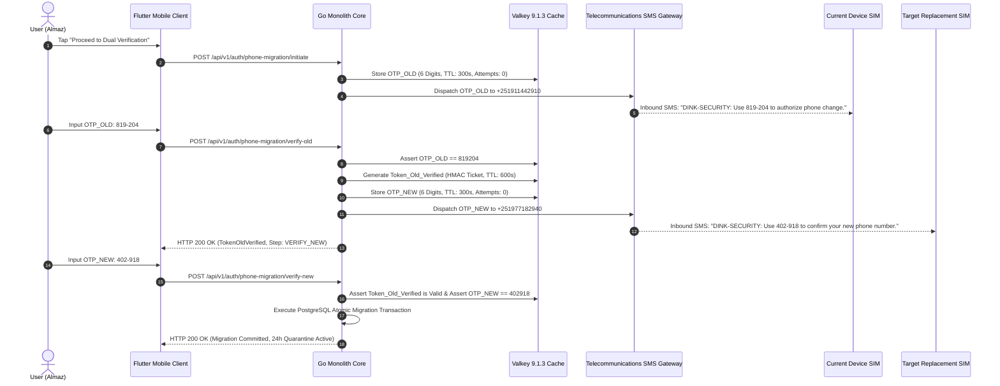
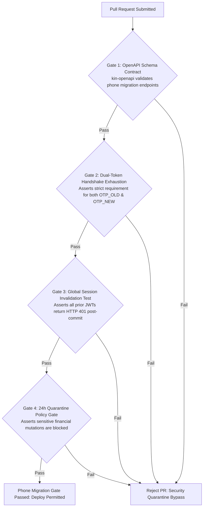

# Heavy Machinery & Logistics Rental Aggregator — Dink Machinery
## Interaction Flow Specification — 15. Secure Phone Number Migration, Dual-Token Cryptographic Handshake & SIM Swap Fraud Mitigation (`docs/shared/flows/15-secure-phone-number-change-flow.md`)

**Document Identifier:** `FLOW-PHONE-MIGRATION-DINK-CORE-V7.0`  
**Classification:** Canonical User Interaction Flow & Wire Protocol Specification (Single Source of Truth)  
**Governing Documents:** `SRS-DINK-CORE-V7.0` (§5.1.1, §4 User Roles & Permissions, §10 Security & Identity Architecture, §11), `FLOW-ENTRY-DINK-CORE-V7.0`, `FLOW-RENTER-AUTH-DINK-CORE-V7.0`, `FLOW-OWNER-KYC-DINK-CORE-V7.0`, `FLOW-BOOKING-STATE-MACHINE-DINK-CORE-V7.0`, `FLOW-PAYMENT-DISPUTE-DINK-CORE-V7.0`, `FLOW-ADMIN-OPS-DINK-CORE-V7.0`, `ARCH-BACKEND-GO-DINK-CORE-V7.0`, `ARCH-FLUTTER-DINK-CORE-V7.0`, `ARCH-SEC-DINK-CORE-V7.0`, `DS-DINK-CORE-V7.0`, `DS-PERSONAS-DINK-CORE-V7.0`, `contracts/openapi.yaml`, `ADR-001`, `ADR-002`, `ADR-005`, `ADR-008`, `ADR-010`  
**Target Client Runtimes:** Flutter 3.47.8 / Dart 3.9 (Cross-Platform Mobile), Next.js 16.x (latest CVE security patch) / React 19 (Admin Web Console), Go 1.27.3 Backend Monolith, PostgreSQL 18.6, Valkey 9.1.3, ClamAV Daemon (:3310), SeaweedFS S3  
**Target Personas:** Fleet Owner (*W/ro Almaz Tesfaye*), Civil Contractor (*Dawit Haile-Mariam*), Compliance Officer (*Yohannes Bekele*), Field Operator (*Mulugeta Tadesse*)  
**Target Operating Markets:** Ethiopia (`ET`) & Kenya (`KE`) — Dynamic Multi-Country Parameterization (`LOC-01-BE`)  
**Compliance Standards:** OWASP ASVS 4.0.3 Level 3 (Authentication Verification, Account Management & Session Termination), RFC 9457 (Problem Details), ISO 9241-110, W3C WCAG 2.2 Level AAA (Field Mode) & Level AA (Admin Mode), Ethiopian Communications Authority (ECA) SIM Directives, National Bank of Ethiopia (NBE) Financial Crime Directives  
**Status:** Approved Engineering Baseline

---

## Table of Contents

- 1. [Executive Summary & Security Rationale](#1-executive-summary--security-rationale)
  - 1.1 [Purpose & Threat Model (SIM-Swap, Device Theft & Identity Hijacking)](#11-purpose--threat-model-sim-swap-device-theft--identity-hijacking)
  - 1.2 [The Sovereign MSISDN Identity Model (Almaz vs. Dawit vs. Yohannes)](#12-the-sovereign-msisdn-identity-model-almaz-vs-dawit-vs-yohannes)
- 2. [End-to-End Secure Phone Migration State Machine Flowchart](#2-end-to-end-secure-phone-migration-state-machine-flowchart)
- 3. [Detailed Step-by-Step State Machine & User Journey](#3-detailed-step-by-step-state-machine--user-journey)
  - 3.1 [Step 1: Migration Initiation & Step-Up Authentication (Password / Biometric Keystore)](#31-step-1-migration-initiation--step-up-authentication-password--biometric-keystore)
  - 3.2 [Step 2: Dual-Token Verification Protocol (`OTP_OLD` + `OTP_NEW`)](#32-step-2-dual-token-verification-protocol-otp_old--otp_new)
  - 3.3 [Step 3: Exception Path: Lost/Stolen SIM & Emergency KYC Identity Recovery Workflow](#33-step-3-exception-path-loststolen-sim--emergency-kyc-identity-recovery-workflow)
  - 3.4 [Step 4: Atomic Database Migration, Phone Uniqueness Assertion & Collision Guards](#34-step-4-atomic-database-migration-phone-uniqueness-assertion--collision-guards)
  - 3.5 [Step 5: Global Session Invalidation, Valkey Token Blacklisting & JWT Re-Issuance](#35-step-5-global-session-invalidation-valkey-token-blacklisting--jwt-re-issuance)
  - 3.6 [Step 6: 24-Hour High-Risk Security Quarantine & Anti-Draining Guardrails](#36-step-6-24-hour-high-risk-security-quarantine--anti-draining-guardrails)
  - 3.7 [Step 7: Multi-Channel Security Broadcast (SMS, Email, Push) & 1-Tap Account Kill-Switch](#37-step-7-multi-channel-security-broadcast-sms-email-push--1-tap-account-kill-switch)
- 4. [Security Invariants, Rate Limiting & Cryptographic Wire Protocols](#4-security-invariants-rate-limiting--cryptographic-wire-protocols)
  - 4.1 [Dual-Token HMAC-SHA256 Handshake Formula](#41-dual-token-hmac-sha256-handshake-formula)
  - 4.2 [Valkey Distributed Leaky Bucket Rate-Limiting Invariants](#42-valkey-distributed-leaky-bucket-rate-limiting-invariants)
  - 4.3 [Active Booking & Operator Linkage Safety Invariants](#43-active-booking--operator-linkage-safety-invariants)
- 5. [Frontier Market Edge Cases & Fault Recovery Protocols](#5-frontier-market-edge-cases--fault-recovery-protocols)
  - 5.1 [Telecom SMS Gateway Latency & Fallback to Automated Voice Call / WhatsApp OTP](#51-telecom-sms-gateway-latency--fallback-to-automated-voice-call--whatsapp-otp)
  - 5.2 [Recycled MSISDN Collision Handling (Prior Owner Recycling)](#52-recycled-msisdn-collision-handling-prior-owner-recycling)
  - 5.3 [Cross-Border Migration (`ET` +251 $\leftrightarrow$ `KE` +254) & Currency Ledger Safeguards](#53-cross-border-migration-et-251-leftrightarrow-ke-254--currency-ledger-safeguards)
  - 5.4 [Offline Field Interception & Outbox Queuing Prohibition](#54-offline-field-interception--outbox-queuing-prohibition)
- 6. [Client UI/UX Ergonomic Specifications & Design Tokens (Flutter 3.47.8)](#6-client-uiux-ergonomic-specifications--design-tokens-flutter-344)
  - 6.1 [Number Input Formatter & Carrier Auto-Detection ($56 \times 56\text{ dp}$)](#61-number-input-formatter--carrier-auto-detection-56-times-56text-dp)
  - 6.2 [Split 6-Digit OTP Reticle with Auto-Focus & Telephony Retriever API](#62-split-6-digit-otp-reticle-with-auto-focus--telephony-retriever-api)
  - 6.3 [Emergency Self-Service Lockout Bottom Sheet](#63-emergency-self-service-lockout-bottom-sheet)
- 7. [Wire Protocol Contracts & RFC 9457 Error Schemas](#7-wire-protocol-contracts--rfc-9457-error-schemas)
  - 7.1 [`POST /api/v1/auth/phone-migration/initiate`](#71-post-apiv1authphone-migrationinitiate)
  - 7.2 [`POST /api/v1/auth/phone-migration/verify-old`](#72-post-apiv1authphone-migrationverify-old)
  - 7.3 [`POST /api/v1/auth/phone-migration/verify-new`](#73-post-apiv1authphone-migrationverify-new)
  - 7.4 [`POST /api/v1/auth/phone-migration/emergency-recovery`](#74-post-apiv1authphone-migrationemergency-recovery)
  - 7.5 [`POST /api/v1/auth/phone-migration/kill-switch`](#75-post-apiv1authphone-migrationkill-switch)
  - 7.6 [RFC 9457 Universal Problem Details Payloads](#76-rfc-9457-universal-problem-details-payloads)
- 8. [Automated Testing Suite & Verification Gates](#8-automated-testing-suite--verification-gates)

---

## 1. Executive Summary & Security Rationale

### 1.1 Purpose & Threat Model (SIM-Swap, Device Theft & Identity Hijacking)

In East African frontier digital ecosystems (specifically Ethiopia and Kenya), the **E.164 Mobile Station International Subscriber Directory Number (MSISDN)** serves as the sovereign anchor of identity, authentication, commercial banking, and physical logistics. On the Dink Machinery platform:
* Renter identity, commercial contracts, and verified KYC credentials are tied to the phone number.
* Fleet Owner bank accounts, payout confirmations, and commission ledgers (`owner_wallets`) are authorized via mobile OTP.
* Equipment handover sign-off PINs (`FLOW-ACTIVE-RENTAL-DINK-CORE-V7.0`) and emergency mechanical stoppage alerts depend strictly on carrier SMS and telephony push channels.

Because heavy machinery transactions involve multi-million Birr capital commitments and high-hazard physical assets, an unauthorized phone number takeover represents a **catastrophic systemic threat**:
1. **Rogue SIM-Swap Attack:** An adversary executes an unauthorized SIM swap via corrupt or socially engineered telecom retail staff, intercepting incoming OTPs to hijack an owner's account and alter corporate settlement bank accounts.
2. **Device Snatch / Yard Extortion:** An operator or yard foreman's phone is stolen on a construction site. An adversary with device custody attempts to alter the account's registered phone number to take permanent control of pending machinery hires.
3. **Internal Account Draining:** A rogue employee attempts to divert pending machine prepayments or commission credit lines by migrating account credentials immediately prior to a major bank wire disbursement.

This specification formalizes an industrial-grade **Dual-Token Cryptographic Migration Protocol** (`OWASP ASVS 4.0.3 Level 3`) that neutralizes SIM swap fraud while providing a resilient recovery pathway for legitimate operators who lose phone access in remote field yards.

### 1.2 The Sovereign MSISDN Identity Model (Almaz vs. Dawit vs. Yohannes)

* **W/ro Almaz Tesfaye (Fleet Owner):** Replaces her corporate phone after changing telecom carriers from Ethio Telecom to Safaricom Ethiopia. She requires a streamlined self-service migration path that does not interrupt her 18 active excavator listings or delay in-flight contractor booking requests.
* **Dawit Haile-Mariam (Civil Contractor):** Stationed at an active road construction culvert in Moyale. His phone was stolen on site. He borrows an engineer's device and must securely migrate his account to a replacement SIM card, even without access to his stolen phone, without compromising his ongoing $315,000\text{ ETB}$ equipment rental.
* **Yohannes Bekele (Compliance Officer & Arbitrator):** Needs real-time visibility into high-risk credential changes. When an emergency identity recovery is submitted, Yohannes audits facial reticle matches against registered national Kebele / ID cards before authorizing an administrative phone migration.

---

## 2. End-to-End Secure Phone Migration State Machine Flowchart

```mermaid
flowchart TD
    Start(["User Navigates to Profile -> Security -> Change Phone Number"]) --> StepUpAuth["Step 1: Step-Up Authentication<br/>Enforce Re-entry of Password OR Biometric Keystore Sign"]
    
    StepUpAuth --> InputNew["Input Target New Phone Number (+251 / +254)<br/>E.164 Regex & Carrier Validation"]
    
    InputNew --> CheckCollision{"Is New Number Already in DB?<br/>SELECT id FROM users WHERE phone_number = $1"}
    CheckCollision -->|"Collision: Number In Use"| RejectCollision["HTTP 409 Conflict<br/>ERR_PHONE_NUMBER_ALREADY_REGISTERED"]
    
    CheckCollision -->|"Unique Number"| ChoosePath{"Does User Have Custody of Current SIM?"}
    
    ChoosePath -->|"Yes: Dual-Token Path"| SendOldOTP["Step 2: Generate 6-Digit OTP_OLD<br/>Valkey Store (TTL: 5m, Max 3 Retries)<br/>Dispatched via Carrier SMS to Current Number"]
    
    SendOldOTP --> VerifyOld["User Inputs OTP_OLD in App"]
    VerifyOld --> AssertOld{"OTP_OLD Valid?"}
    
    AssertOld -->|"No / Expired"| IncRetryOld["Increment Retry Counter<br/>Block after 3 Failed Attempts (15m Lock)"]
    AssertOld -->|"Valid"| IssueOldTicket["Generate Ephemeral Ticket:<br/>Token_Old_Verified (HMAC-SHA256, TTL: 10m)"]
    
    IssueOldTicket --> SendNewOTP["Step 2b: Dispatch 6-Digit OTP_NEW to Target SIM<br/>Valkey Store (TTL: 5m, Max 3 Retries)"]
    
    SendNewOTP --> VerifyNew["User Inputs OTP_NEW in App"]
    VerifyNew --> AssertNew{"OTP_NEW Valid?"}
    
    AssertNew -->|"No / Expired"| IncRetryNew["Increment Retry Counter<br/>Block after 3 Failed Attempts"]
    AssertNew -->|"Valid"| AtomicCommit["Step 4: Atomic Migration Commit (PostgreSQL)<br/>1. UPDATE users SET phone_number = new_number<br/>2. INSERT INTO phone_migration_history<br/>3. Enter 24h High-Risk Security Quarantine"]

    ChoosePath -->|"No: Lost / Stolen SIM"| RecoveryTrigger["Step 3: Emergency KYC Identity Recovery<br/>Trigger Step-Up Identity Verification Docket"]
    
    RecoveryTrigger --> UploadID["Upload National Kebele / Passport Document<br/>Live Camera Reticle Facial Selfie with Liveness Check"]
    UploadID --> ClamAVScan["Streaming In-Flight Antivirus Scan<br/>TCP Socket :3310 (ClamAV zINSTREAM)"]
    ClamAVScan --> S3Store["Persist Recovery Proof in SeaweedFS S3"]
    
    S3Store --> AdminQueue["Surfaces in Admin Compliance Queue (AD-06-WEB)<br/>Compliance Officer (Yohannes) Audits Identity Match"]
    
    AdminQueue --> AdminDecision{"Compliance Ruling"}
    AdminDecision -->|"Rejected"| RejectRecovery["Status: RECOVERY_REJECTED<br/>User Remains on Original Credentials"]
    AdminDecision -->|"Approved"| AdminOverrideCommit["Admin Cryptographic Override Sign-Off<br/>Executes Step 4 Atomic DB Commit"]
    
    AtomicCommit --> InvalidateSessions["Step 5: Global Session Invalidation<br/>Valkey Blacklists All Active JWTs / Refresh Tokens<br/>Except Active Initiating Device"]
    AdminOverrideCommit --> InvalidateSessions
    
    InvalidateSessions --> ApplyQuarantine["Step 6: Activate 24-Hour Security Quarantine<br/>Freeze Bank Account Changes & High-Value Approvals"]
    
    ApplyQuarantine --> MultiBroadcast["Step 7: Multi-Channel Security Broadcast<br/>High-Priority Warning sent to Old SIM, Email, Push"]
    
    MultiBroadcast --> KillSwitchCheck{"Did User Tap 'Emergency Kill-Switch' on Old SIM?"}
    KillSwitchCheck -->|"Yes: Fraud Flagged"| FreezeAccount["IMMEDIATE ACCOUNT FREEZE<br/>Status: SUSPENDED_FRAUD_INVESTIGATION<br/>All Sessions Terminated; Payouts Halted"]
    KillSwitchCheck -->|"No: Legitimate Migration"| NormalOperations["Migration Fully Consolidated<br/>Quarantine Auto-Lifts after 24 Hours"]
```



---

## 3. Detailed Step-by-Step State Machine & User Journey

### 3.1 Step 1: Migration Initiation & Step-Up Authentication (Password / Biometric Keystore)

A logged-in user navigates to **Settings $\rightarrow$ Account Security $\rightarrow$ Change Registered Phone Number** in the Flutter mobile application:
1. **Step-Up Authentication Requirement (`OWASP ASVS §2.3.1`):** The client cannot proceed with cached authentication tokens. The user must explicitly re-authenticate:
   - For password-credentialed users: Re-enter master account password.
   - For biometric-enabled devices: Authenticate against the device hardware secure enclave (`LocalAuthentication` via biometric prompt with `strong` cryptographic attestation).
2. The user inputs their desired new phone number with national carrier formatting (`+251` for Ethiopia, `+254` for Kenya).
3. The client dispatches `POST /api/v1/auth/phone-migration/initiate`.
4. The Go backend asserts E.164 formatting, checks against known carrier prefixes, and verifies that the target MSISDN does not already exist in `users.phone_number`.

```text
+-------------------------------------------------------------------+
|  [<- BACK]              SECURITY SETTINGS            CHANGE PHONE |
+-------------------------------------------------------------------+
|  MIGRATE REGISTERED PHONE NUMBER                                  |
|  Your phone number is your sovereign account identity anchor.     |
|                                                                   |
|  CURRENT REGISTERED NUMBER : +251 91 144 2910                     |
|                                                                   |
|  RE-ENTER ACCOUNT PASSWORD *                                      |
|  +-------------------------------------------------------------+  |
|  | * * * * * * * * * * * *                                     |  |
|  +-------------------------------------------------------------+  |
|                                                                   |
|  NEW MOBILE PHONE NUMBER *                                        |
|  +-------------------------------------------------------------+  |
|  | [ET +251]  9 77 18 29 40                                    |  |
|  +-------------------------------------------------------------+  |
|  Carrier Detected: Safaricom Telecommunications Ethiopia          |
|                                                                   |
|  +-------------------------------------------------------------+  |
|  |                 PROCEED TO DUAL VERIFICATION                |  |
|  |                 (Height: 56dp, Amber 500)                   |  |
|  +-------------------------------------------------------------+  |
|                                                                   |
|  [ LOST ACCESS TO CURRENT SIM? USE EMERGENCY RECOVERY ]           |
+-------------------------------------------------------------------+
```

---

### 3.2 Step 2: Dual-Token Verification Protocol (`OTP_OLD` + `OTP_NEW`)

To prevent an attacker who has physical possession of a target SIM from hijacking an existing account, Dink Machinery implements a sequential **Dual-Token Verification Protocol**:



1. **Phase A (Old Number Challenge):** A high-entropy 6-digit numeric OTP (`OTP_OLD`) is dispatched via SMS to the currently registered phone number. The user has 5 minutes to submit it.
2. **Phase B (Verification Ticket Generation):** Successful verification of `OTP_OLD` does not change the database. It produces an ephemeral, cryptographically signed migration ticket (`Token_Old_Verified`) stored in Valkey with a 10-minute TTL.
3. **Phase C (New Number Challenge):** The system dispatches a distinct 6-digit OTP (`OTP_NEW`) to the target replacement number.
4. **Phase D (Handshake Finalization):** The client submits `OTP_NEW` along with `Token_Old_Verified`. The server asserts both conditions simultaneously before executing the database commit.

---

### 3.3 Step 3: Exception Path: Lost/Stolen SIM & Emergency KYC Identity Recovery Workflow

If a contractor (*Dawit*) loses his phone or has his device stolen on a remote job site, he cannot receive `OTP_OLD`. Tapping **"Lost Access to Current SIM? Use Emergency Recovery"** launches the out-of-band identity recovery protocol:

```text
+-------------------------------------------------------------------+
|  [<- BACK]            EMERGENCY IDENTITY RECOVERY     STEP 1 OF 2 |
+-------------------------------------------------------------------+
|  BIOMETRIC & GOVERNMENT IDENTITY VERIFICATION                     |
|  Because you cannot access your old SIM, an administrative audit  |
|  is legally required to prevent account hijacking.                |
|                                                                   |
|  1. NATIONAL IDENTITY / PASSPORT UPLOAD *                         |
|  +-------------------------------------------------------------+  |
|  | [DOCUMENT RETICLE: SCAN FRONT OF ETHIOPIAN NATIONAL ID]     |  |
|  +-------------------------------------------------------------+  |
|                                                                   |
|  2. LIVE FACIAL LIVENESS RETICLE *                                |
|  +-------------------------------------------------------------+  |
|  | [CAMERA VIEW: POSITION FACE INSIDE CIRCLE & BLINK]          |  |
|  | (o) LIVENESS CHECK: 3D PASSIVE DEPTH DETECTED               |  |
|  +-------------------------------------------------------------+  |
|                                                                   |
|  3. INCIDENT STATEMENT / EXPLANATION *                            |
|  +-------------------------------------------------------------+  |
|  | Phone stolen on construction job site at Moyale corridor.   |  |
|  | Police report filed at Moyale Sub-City Station #4402.        |  |
|  +-------------------------------------------------------------+  |
|                                                                   |
|  +-------------------------------------------------------------+  |
|  |                 SUBMIT RECOVERY DOSSIER                     |  |
|  |                 (Height: 56dp, Emerald 600)                 |  |
|  +-------------------------------------------------------------+  |
+-------------------------------------------------------------------+
```

#### Administrative Compliance Adjudication
1. The submission creates an urgent compliance docket in the **Next.js Web Admin Console** (`FLOW-ADMIN-OPS-DINK-CORE-V7.0 §3.3`).
2. Compliance Officer *Yohannes Bekele* compares the newly captured live facial reticle against:
   - The registered KYC document photos stored in SeaweedFS S3.
   - The Ministry of Trade / Kebele identity verification records.
3. Yohannes executes `POST /api/v1/admin/users/{id}/emergency-phone-override` with his administrative TOTP hardware token.
4. The system executes the atomic database phone number swap, applying an extended **48-Hour Security Quarantine**.

---

### 3.4 Step 4: Atomic Database Migration, Phone Uniqueness Assertion & Collision Guards

When dual validation succeeds or an admin override is executed, the Go backend executes an atomic ACID transaction in PostgreSQL with serializable isolation:

```sql
BEGIN TRANSACTION ISOLATION LEVEL SERIALIZABLE;

-- 1. Assert Target Number Uniqueness with Pessimistic Row Lock
SELECT id FROM users WHERE phone_number = $1 FOR UPDATE;

-- 2. Commit Phone Number Swap
UPDATE users 
SET phone_number = $1,
    phone_verified_at = NOW(),
    updated_at = NOW()
WHERE id = $2;

-- 3. Record Cryptographic Migration Audit Trail
INSERT INTO phone_migration_history (
    id, user_id, old_phone_number, new_phone_number, 
    migration_method, migration_ip, client_user_agent, 
    quarantine_until, created_at
) VALUES (
    gen_random_uuid(), $2, $3, $1, 
    $4, -- 'DUAL_OTP' or 'ADMIN_KYC_OVERRIDE'
    $5, $6, 
    NOW() + INTERVAL '24 hours', NOW()
);

-- 4. Tag User Security Status
UPDATE users 
SET security_quarantine_until = NOW() + INTERVAL '24 hours' 
WHERE id = $2;

COMMIT TRANSACTION;
```

---

### 3.5 Step 5: Global Session Invalidation, Valkey Token Blacklisting & JWT Re-Issuance

To guarantee that a thief or unauthorized party possessing an old device cannot retain API access:
1. **Immediate Revocation Broadcast:** The backend reads all active JWT refresh token IDs associated with the user:
   ```go
   activeSessionKeys := valkey.Keys(ctx, fmt.Sprintf("auth:session:%s:*", userID)).Val()
   for _, key := range activeSessionKeys {
       valkey.Del(ctx, key)
   }
   ```
2. **Token Blacklist Insertion:** The user's `token_version` counter in PostgreSQL is incremented:
   $$\text{token\_version} = \text{token\_version} + 1$$
   Any stateless API call carrying an access token issued under the prior `token_version` is rejected with HTTP 401 Unauthorized (`ERR_TOKEN_REVOKED`).
3. **Session Re-Hydration on Active Device:** The active client that completed the dual verification is immediately re-authenticated, receiving a fresh pair of Access/Refresh tokens encoding the updated MSISDN and active quarantine flags.

---

### 3.6 Step 6: 24-Hour High-Risk Security Quarantine & Anti-Draining Guardrails

To prevent "smash-and-grab" financial draining following an account takeover, newly migrated accounts enter a strictly enforced **24-Hour Security Quarantine**:

| Platform Operation | Quarantine Policy | System Enforcement Action |
|---|---|---|
| **Browse Machinery & Discovery** | Allowed | Full read-only search and catalog access permitted. |
| **Inspect Active Machinery (`AR-01`)** | Allowed with Supervisor Alert | Handover sign-offs permitted; alert pushed to contractor project office. |
| **Confirm New Booking Prepayment** | Blocked | Requisitions can be drafted, but bank confirmations require 24h wait or admin call. |
| **Alter Registered Bank Account (`BK-06`)**| **STRICTLY BLOCKED** | Returns HTTP 403 Forbidden: `ERR_ACCOUNT_IN_SECURITY_QUARANTINE`. |
| **Owner Commission Wallet Top-Up** | Allowed | Incoming top-up credits are accepted into ledger. |
| **Wallet Credit Limit Expansion** | Blocked | Overdraft limits cannot be increased during quarantine. |

A prominent amber banner renders at the top of all client screens displaying the remaining quarantine countdown timer:
`[ SECURITY NOTICE: Phone number changed. Sensitive actions restricted for 23h 44m ]`.

---

### 3.7 Step 7: Multi-Channel Security Broadcast (SMS, Email, Push) & 1-Tap Account Kill-Switch

The instant the phone migration commits, the Go backend fires a multi-channel emergency broadcast across all historical communication pathways:

```text
+-------------------------------------------------------------------+
|  CRITICAL SECURITY ALERT: DINK MACHINERY ACCOUNT CREDENTIAL CHANGE|
+-------------------------------------------------------------------+
|  Dear W/ro Almaz Tesfaye,                                         |
|                                                                   |
|  The phone number registered to your Dink Machinery account was   |
|  successfully changed from +251 91 144 2910 to +251 97 718 2940.  |
|                                                                   |
|  Timestamp : Tuesday, Oct 27, 2026 - 17:45 EAT                    |
|  Client IP : 197.156.104.18 (Addis Ababa, Ethio Telecom)          |
|  Device    : Samsung Galaxy S24 Ultra (Android 16, Flutter App)   |
|                                                                   |
|  IF YOU DID NOT AUTHORIZE THIS CHANGE:                            |
|  Your account may be compromised. Tap the emergency kill-switch   |
|  link below immediately to freeze all operations and payouts:     |
|                                                                   |
|  [ EMERGENCY 1-TAP KILL-SWITCH: FREEZE MY ACCOUNT IMMEDIATELY ]   |
|  [https://api.dinkmachinery.com/auth/kill-switch?token=ks_99a810f](https://api.dinkmachinery.com/auth/kill-switch?token=ks_99a810f)  |
+-------------------------------------------------------------------+
```

#### The Emergency 1-Tap Kill-Switch Invariant
* The kill-switch token is generated via HMAC-SHA256 with a 72-hour validity window.
* Clicking the link requires **no login credentials** (as the user may have lost device access).
* Activating the kill-switch atomically:
  1. Sets `users.status = 'SUSPENDED_SECURITY_FREEZE'`.
  2. Cancels all pending reservation holds and un-indexes all active fleet listings from PostGIS.
  3. Dispatches high-priority fraud alarms to the compliance desk (`AD-06-WEB`).

---

## 4. Security Invariants, Rate Limiting & Cryptographic Wire Protocols

### 4.1 Dual-Token HMAC-SHA256 Handshake Formula

To enforce cryptographic integrity between the old and new verification phases without server-side state leakage, the backend generates an intermediary verification ticket:

$$\text{Token\_Old\_Verified} = \text{Base64URL}\left(P \parallel \text{HMAC-SHA256}(P, K_{\text{migration}})\right)$$

Where:
* $P = \text{userID} \parallel \text{oldMSISDN} \parallel \text{newMSISDN} \parallel \text{clientIP} \parallel \text{expiryTimestamp}$
* $K_{\text{migration}}$: Ephemeral server secret rotated hourly.

When the client invokes `POST /api/v1/auth/phone-migration/verify-new`, the server asserts:
1. $\text{HMAC-SHA256}(P, K_{\text{migration}})$ matches the ticket signature.
2. $\text{newMSISDN}$ matches the request body.
3. $\text{expiryTimestamp} > \text{NOW()}$.

### 4.2 Valkey Distributed Leaky Bucket Rate-Limiting Invariants

To prevent automated brute-force attacks against the 6-digit OTP codes or denial-of-service telecom spamming:

$$\text{Rate Limits Enforced per Dimension:}$$

| Rate Limit Key | Threshold Limit | Window Duration | Penalty Action on Breach |
|---|---|---|---|
| `ratelimit:phone:otp:initiate:{userID}` | 3 Requests | 15 Minutes | Cooldown lock: Re-initiation blocked for 15 minutes. |
| `ratelimit:phone:otp:attempts:{migrationID}` | 3 Wrong Codes | 5 Minutes | Invalidation: OTP voided; requires restarting flow. |
| `ratelimit:phone:global:target:{targetMSISDN}` | 5 Migrations | 24 Hours | System lockout: Target number flagged as suspicious. |
| `ratelimit:ip:migration:{clientIP}` | 10 Attempts | 1 Hour | HTTP 429 Too Many Requests; IP blacklisted in Traefik. |

---

### 4.3 Active Booking & Operator Linkage Safety Invariants

If an account undergoing migration is tied to an active rental lifecycle:
1. **Fleet Owner Migration during Active Rental (`ACTIVE`):**
   - Main equipment booking remains operational.
   - Payout bank accounts cannot be altered until 24 hours post-quarantine.
   - The assigned operator and contractor receive an automated platform notice: *"Fleet Owner updated mobile contact number to +251 97 718 2940."*
2. **Field Operator Migration during Active Shift:**
   - Handover challenge PINs (`FLOW-ACTIVE-RENTAL-DINK-CORE-V7.0 §3.1`) in flight are immediately invalidated.
   - The field operator's device must re-authenticate and sync with the yard manager to generate a new PIN session.

---

## 5. Frontier Market Edge Cases & Fault Recovery Protocols

### 5.1 Telecom SMS Gateway Latency & Fallback to Automated Voice Call / WhatsApp OTP

In regional construction zones (e.g., Gambella, Afar, Turkana), local telecom SMS gateways frequently experience congestion or delivery delays exceeding $3\text{ minutes}$:
* The Flutter OTP verification screen displays a 60-second countdown timer.
* When the timer reaches zero, the user is offered alternate fallback channels:
  1. **"Resend via WhatsApp"**: Uses the Dink Machinery verified WhatsApp Business API.
  2. **"Call Me with Verification Code"**: Dispatches an automated voice IVR call reading the digits in Amharic, Oromo, or English.
* The system maintains the exact same Valkey OTP secret across channels, preventing retry race conditions.

### 5.2 Recycled MSISDN Collision Handling (Prior Owner Recycling)

In East Africa, telecom providers recycle deactivated prepaid SIM cards after 90 days of inactivity. If a new user purchases a recycled SIM card that previously belonged to a deactivated Dink Machinery contractor:
* Attempting migration to that number triggers a **Recycled MSISDN Conflict Protocol**:
  1. The system detects the target number is registered to an account with zero active bookings and $> 180\text{ days}$ inactivity.
  2. The system prompts the migrating user to upload proof of current SIM ownership (e.g., photo of telecom SIM starter pack or recent mobile balance top-up SMS).
  3. Upon verification, the stale account is archived with an updated tombstone suffix (`+251911442910_recycled_20261027`), freeing the number for the active user.

### 5.3 Cross-Border Migration (`ET` +251 $\leftrightarrow$ `KE` +254) & Currency Ledger Safeguards

If a multinational contractor relocates from Addis Ababa to Nairobi:
* The user migrates from an Ethiopian number (`+251`) to a Kenyan number (`+254`).
* **Dynamic Multi-Country Parameterization (`LOC-01-BE`):**
  - The account’s primary jurisdiction updates from `ET` to `KE`.
  - The client UI auto-swaps currency formatting from Ethiopian Birr (`ETB`) to Kenyan Shilling (`KES`).
  - Active bank accounts are flagged as cross-border; the user is prompted to link an M-PESA Paybill or KCB account for domestic operations.
  - Historical Ethiopian tax invoices and ETB ledger records remain frozen and immutable for local revenue authority compliance.

### 5.4 Offline Field Interception & Outbox Queuing Prohibition

Unlike equipment inspections and specification forms (`ADR-010`), **security and credential operations are strictly prohibited from offline caching**:
* If cellular connectivity drops during phone number migration, the Flutter app does **not** queue the request in Isar NoSQL.
* The operation immediately aborts with an on-screen warning: *"Network connection lost. For security reasons, phone migration requires a continuous live server connection. Please retry when signal is restored."*

---

## 6. Client UI/UX Ergonomic Specifications & Design Tokens (Flutter 3.47.8)

### 6.1 Number Input Formatter & Carrier Auto-Detection ($56 \times 56\text{ dp}$)

* **Ergonomic Touch Targets:** The country code selector and phone input field enforce minimum vertical hit targets of **$56\text{ dp}$** (scaling to **$64\text{ dp}$** in Field Mode).
* **Live Carrier Badge:** As the user inputs the digits, a real-time carrier detection pill animates into view:
  - `09...` / `07...` (Ethio Telecom / Safaricom Ethiopia) $\rightarrow$ Shows national flag and telco branding.
* **Format Masking:** Formats digits dynamically as `+251 (09) 11-44-29-10` to eliminate visual mis-typing in bright sunlight ($> 85,000\text{ lux}$).

### 6.2 Split 6-Digit OTP Reticle with Auto-Focus & Telephony Retriever API

```text
+-------------------------------------------------------------------+
|  [<- BACK]            VERIFY CURRENT PHONE            STEP 2 OF 2 |
+-------------------------------------------------------------------+
|  ENTER 6-DIGIT AUTHORIZATION CODE                                 |
|  We sent an SMS with a verification code to +251 91 144 2910.     |
|                                                                   |
|  +-------+  +-------+  +-------+  +-------+  +-------+  +-------+ |
|  |   8   |  |   1   |  |   9   |  |   2   |  |   0   |  |   4   | |
|  +-------+  +-------+  +-------+  +-------+  +-------+  +-------+ |
|                                                                   |
|  TIME REMAINING: 04:18                                            |
|                                                                   |
|  Didn't receive the SMS?                                          |
|  [ RESEND VIA WHATSAPP (Available in 12s) ]                       |
|  [ CALL ME WITH CODE ]                                            |
|                                                                   |
|  +-------------------------------------------------------------+  |
|  |                 VERIFY & CONTINUE TO NEW SIM                |  |
|  |                 (Height: 56dp, Amber 500)                   |  |
|  +-------------------------------------------------------------+  |
+-------------------------------------------------------------------+
```

* **Android SMS User Consent API:** Automatically detects incoming SMS packets matching the platform template, auto-populating the cells without requiring the user to switch apps.
* **Tactile Haptic Feedback:** Vibrates with short confirmation pulses on each digit entry, switching to double-pulse error haptics on invalid code entry.

### 6.3 Emergency Self-Service Lockout Bottom Sheet

If an owner receives an unexpected SMS security alert:
* Tapping the alert opens an emergency modal directly over the lockscreen:
  `"Unauthorized phone change in progress? Tap here to freeze your account instantly."`
* An animated slider actuator (**"Slide to Freeze Account"**) prevents accidental triggering while guaranteeing immediate sub-second account suspension.

---

## 7. Wire Protocol Contracts & RFC 9457 Error Schemas

### 7.1 `POST /api/v1/auth/phone-migration/initiate`

Validates step-up authentication and dispatches the initial verification challenge.

#### Request Headers
```http
POST /api/v1/auth/phone-migration/initiate HTTP/1.1
Host: api.dinkmachinery.com
Content-Type: application/json
Authorization: Bearer <userAccessToken>
X-Country-Code: ET
```

#### Request Payload
```json
{
  "password": "CorrectMasterPassword2026!",
  "newPhoneNumber": "+251977182940",
  "clientDeviceFingerprint": "samsung_sm_s928b_uuid_88192a"
}
```

#### Response: `HTTP 200 OK`
```json
{
  "success": true,
  "data": {
    "migrationSessionId": "mig_019a8f4c",
    "status": "AWAITING_OLD_PHONE_OTP",
    "maskedCurrentPhone": "+251 91 **** 2910",
    "maskedTargetPhone": "+251 97 **** 2940",
    "otpExpiresInSeconds": 300,
    "resendAvailableInSeconds": 60
  },
  "timestamp": "2026-10-27T17:40:00Z"
}
```

---

### 7.2 `POST /api/v1/auth/phone-migration/verify-old`

Submits `OTP_OLD` to prove custody of the current phone number.

#### Request Payload
```json
{
  "migrationSessionId": "mig_019a8f4c",
  "otpCode": "819204"
}
```

#### Response: `HTTP 200 OK`
```json
{
  "success": true,
  "data": {
    "migrationSessionId": "mig_019a8f4c",
    "status": "AWAITING_NEW_PHONE_OTP",
    "verificationTicket": "tkt_old_verified_019a8f4e_hmac_sha256",
    "ticketExpiresInSeconds": 600,
    "targetPhoneMasked": "+251 97 **** 2940"
  },
  "timestamp": "2026-10-27T17:42:00Z"
}
```

---

### 7.3 `POST /api/v1/auth/phone-migration/verify-new`

Submits `OTP_NEW` alongside the verification ticket to finalize migration.

#### Request Payload
```json
{
  "migrationSessionId": "mig_019a8f4c",
  "verificationTicket": "tkt_old_verified_019a8f4e_hmac_sha256",
  "otpCode": "402918"
}
```

#### Response: `HTTP 200 OK`
```json
{
  "success": true,
  "data": {
    "userId": "usr_018f6a9e876b",
    "status": "MIGRATION_COMPLETED",
    "newPhoneNumber": "+251977182940",
    "quarantineUntil": "2026-10-28T17:45:00Z",
    "quarantineRemainingHours": 24,
    "tokens": {
      "accessToken": "eyJhbGciOiJFUzI1NiIs...",
      "refreshToken": "ref_019a8f50_new",
      "expiresInSeconds": 900
    }
  },
  "timestamp": "2026-10-27T17:45:00Z"
}
```

---

### 7.4 `POST /api/v1/auth/phone-migration/emergency-recovery`

Submits government identity documents and facial reticle proof for admin override.

#### Request Headers
```http
POST /api/v1/auth/phone-migration/emergency-recovery HTTP/1.1
Host: api.dinkmachinery.com
Content-Type: multipart/form-data
Authorization: Bearer <userAccessToken>
```

#### Multipart Form Body
* `targetPhoneNumber`: String (`"+251977182940"`)
* `incidentStatement`: String (`"Device stolen at Moyale project site."`)
* `identityDocument`: Binary PDF/Image file (Clean scanned via ClamAV)
* `facialLivenessCapture`: Binary WebP image file (Live camera reticle)

#### Response: `HTTP 201 Created`
```json
{
  "success": true,
  "data": {
    "docketNumber": "REC-9941",
    "status": "PENDING_COMPLIANCE_REVIEW",
    "reviewSlaHours": 12,
    "submittedAt": "2026-10-27T17:50:00Z"
  },
  "timestamp": "2026-10-27T17:50:01Z"
}
```

---

### 7.5 `POST /api/v1/auth/phone-migration/kill-switch`

Emergency unauthenticated kill-switch to immediately freeze a compromised account.

#### Request Payload
```json
{
  "killSwitchToken": "ks_99a810f_hmac_signature",
  "reason": "UNAUTHORIZED_PHONE_SWAP_DETECTED"
}
```

#### Response: `HTTP 200 OK`
```json
{
  "success": true,
  "data": {
    "status": "ACCOUNT_FROZEN",
    "message": "Account has been immediately suspended. All sessions terminated and payouts halted.",
    "frozenAt": "2026-10-27T17:52:00Z",
    "supportReferenceDocket": "SEC-EMERGENCY-8812"
  },
  "timestamp": "2026-10-27T17:52:00Z"
}
```

---

### 7.6 RFC 9457 Universal Problem Details Payloads

#### Example: Phone Number Already Registered (`HTTP 409 Conflict`)
```json
{
  "type": "[https://api.dinkmachinery.com/errors/phone-number-collision](https://api.dinkmachinery.com/errors/phone-number-collision)",
  "title": "Phone Number Already in Use",
  "status": 409,
  "detail": "The target phone number +251 97 718 2940 is already linked to an active account. Migration cannot overwrite existing accounts.",
  "instance": "/api/v1/auth/phone-migration/initiate",
  "code": "ERR_PHONE_NUMBER_ALREADY_REGISTERED",
  "invalidParams": [
    {
      "name": "newPhoneNumber",
      "reason": "Collision with active User UUID: 018f6a9e-876b-7341-a189"
    }
  ]
}
```

#### Example: Security Quarantine Violation (`HTTP 403 Forbidden`)
```json
{
  "type": "[https://api.dinkmachinery.com/errors/security-quarantine-active](https://api.dinkmachinery.com/errors/security-quarantine-active)",
  "title": "Operation Restricted by Security Quarantine",
  "status": 403,
  "detail": "Cannot alter commercial bank coordinates. Your account is in high-risk quarantine following a phone number migration (Expires in 22 hours 14 minutes).",
  "instance": "/api/v1/owners/bank-details",
  "code": "ERR_ACCOUNT_IN_SECURITY_QUARANTINE",
  "invalidParams": [
    {
      "name": "quarantineUntil",
      "reason": "Active until 2026-10-28T17:45:00Z"
    }
  ]
}
```

---

## 8. Automated Testing Suite & Verification Gates



1. **OpenAPI Schema Contract Gate (`kin-openapi`):** Asserts all migration initiation, verification, emergency recovery, and kill-switch contracts match `contracts/openapi.yaml`.
2. **Dual-Token Handshake Exhaustion Integration Test:** Simulates 50 malicious bypass attempts (e.g., submitting `OTP_NEW` without `Token_Old_Verified`, replaying expired tickets, cross-user ticket hijacking), asserting that $100\%$ of attempts are rejected with HTTP 401 or HTTP 403.
3. **Global Session Invalidation Integration Test:** Spins up a PostgreSQL and Valkey testcontainer, logs in a user across 5 synthetic mobile and web devices, executes phone migration on device 1, and asserts that devices 2 through 5 immediately receive HTTP 401 Unauthorized on subsequent API queries.
4. **24-Hour Security Quarantine Automated Gate:** Simulates an immediate bank account alteration attempt 5 minutes following migration, validating that the transaction is rejected with HTTP 403 `ERR_ACCOUNT_IN_SECURITY_QUARANTINE`.

---

*This document defines the canonical user interaction flow, dual-token cryptographic handshake, session invalidation protocols, and wire protocols for Secure Phone Number Migration, Dual-Token Cryptographic Handshake, and SIM Swap Fraud Mitigation in Dink Machinery Version 7.0. All downstream Flutter mobile screens, Go security handlers, and Next.js admin consoles must strictly adhere to this specification.*