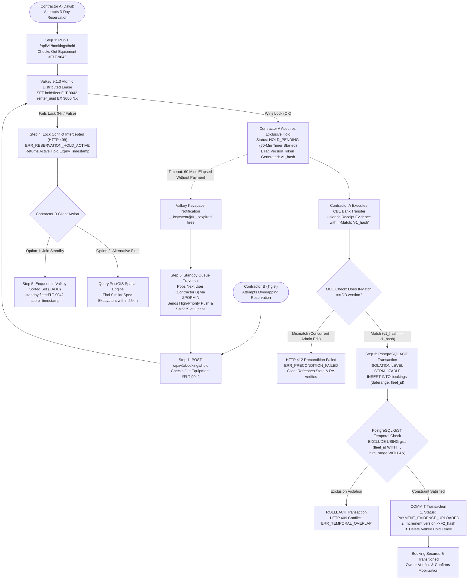
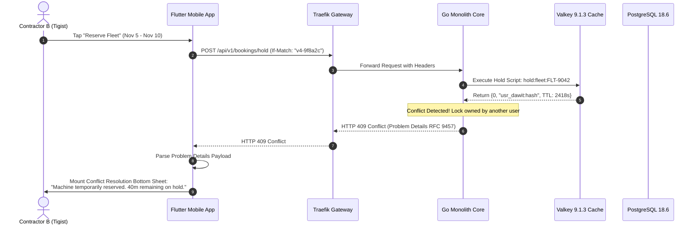
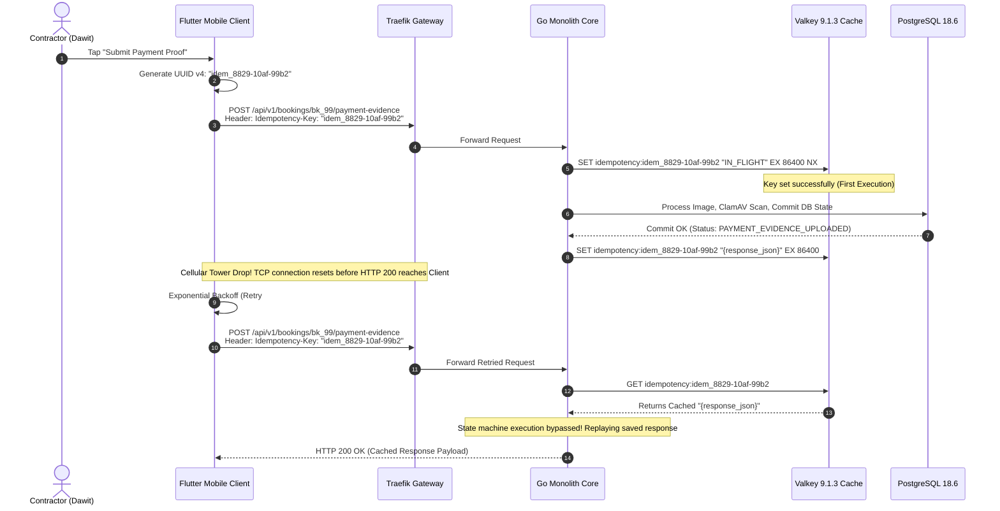
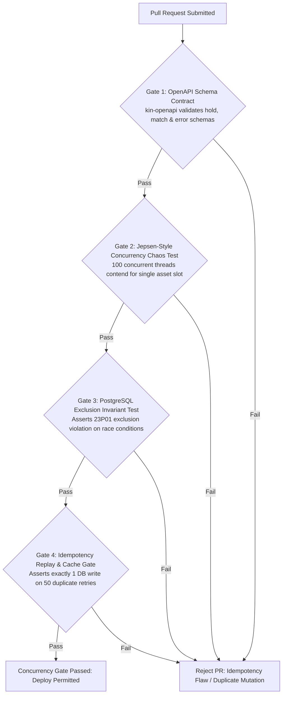

# Heavy Machinery & Logistics Rental Aggregator — Dink Machinery
## Interaction Flow Specification — 16. Optimistic Locking, Concurrent Reservation Resolution & Distributed State Reconciliation (`docs/shared/flows/16-optimistic-locking-concurrency-resolution-flow.md`)

**Document Identifier:** `FLOW-CONCURRENCY-LOCKING-DINK-CORE-V7.0`  
**Classification:** Canonical Technical Architecture & Wire Protocol Specification (Single Source of Truth)  
**Governing Documents:** `SRS-DINK-CORE-V7.0` (§5.4 SR-07, §5.5, §8.1, §8.2, §10, §11), `FLOW-ENTRY-DINK-CORE-V7.0`, `FLOW-FLEET-REG-DINK-CORE-V7.0`, `FLOW-DISCOVERY-DINK-CORE-V7.0`, `FLOW-BOOKING-STATE-MACHINE-DINK-CORE-V7.0`, `FLOW-PAYMENT-DISPUTE-DINK-CORE-V7.0`, `FLOW-ACTIVE-RENTAL-DINK-CORE-V7.0`, `FLOW-CORP-APPROVAL-DINK-CORE-V7.0`, `FLOW-PHONE-MIGRATION-DINK-CORE-V7.0`, `ARCH-BACKEND-GO-DINK-CORE-V7.0`, `ARCH-FLUTTER-DINK-CORE-V7.0`, `ARCH-ADMIN-NEXT-DINK-CORE-V7.0`, `ARCH-SEC-DINK-CORE-V7.0`, `DS-DINK-CORE-V7.0`, `DS-PERSONAS-DINK-CORE-V7.0`, `contracts/openapi.yaml`, `ADR-001`, `ADR-002`, `ADR-004`, `ADR-005`, `ADR-008`, `ADR-010`  
**Target Client Runtimes:** Go 1.27.3 Backend Monolith, Flutter 3.47.8 / Dart 3.9 (Cross-Platform Mobile), Next.js 16.x (latest CVE security patch) / React 19 (Admin & Corporate Web Console), PostgreSQL 18.6 + PostGIS 3.6.4, Valkey 9.1.3, Isar NoSQL  
**Target Personas:** Civil Engineering Contractor (*Dawit Haile-Mariam*), Fleet Owner & Depot Yard Manager (*W/ro Almaz Tesfaye*), Lowboy Logistics Fleet Provider (*Ato Girma Wolde*), Enterprise Site Engineer (*Tigist Assefa*), Back-Office Compliance Officer (*Yohannes Bekele*)  
**Target Operating Markets:** Ethiopia (`ET`) & Kenya (`KE`) — Dynamic Multi-Country Parameterization (`LOC-01-BE`)  
**Compliance Standards:** OWASP ASVS 4.0.3 Level 3 (Race Condition Resilience, Concurrency Control & State Integrity), RFC 9457 (Problem Details), RFC 7232 / RFC 9110 (HTTP Conditional Requests — ETags / If-Match), ISO 9241-110, W3C WCAG 2.2 Level AAA (Field Mode) & Level AA (Admin Mode)  
**Status:** Approved Engineering Baseline

---

## Table of Contents

- 1. [Executive Summary & Concurrency Engineering Invariants](#1-executive-summary--concurrency-engineering-invariants)
  - 1.1 [Purpose & Frontier Concurrency Reality](#11-purpose--frontier-concurrency-reality)
  - 1.2 [Architectural Invariants & Non-Negotiables](#12-architectural-invariants--non-negotiables)
- 2. [Multi-Actor Concurrency & Conflict Resolution Flowchart](#2-multi-actor-concurrency--conflict-resolution-flowchart)
- 3. [Detailed Step-by-Step State Machine & User Journey](#3-detailed-step-by-step-state-machine--user-journey)
  - 3.1 [Step 1: Pre-Reservation Read & ETag / Version Vector Generation](#31-step-1-pre-reservation-read--etag--version-vector-generation)
  - 3.2 [Step 2: Distributed Hold Acquisition in Valkey (60-Minute Distributed Lease)](#32-step-2-distributed-hold-acquisition-in-valkey-60-minute-distributed-lease)
  - 3.3 [Step 3: PostgreSQL Temporal Range Exclusion Constraints & ACID Serialization](#33-step-3-postgresql-temporal-range-exclusion-constraints--acid-serialization)
  - 3.4 [Step 4: Optimistic Concurrency Control (OCC) Collision Interception & HTTP 412 / 409](#34-step-4-optimistic-concurrency-control-occ-collision-interception--http-412--409)
  - 3.5 [Step 5: High-Contention Dispute Resolution & Automated Standby Queue Traversal](#35-step-5-high-contention-dispute-resolution--automated-standby-queue-traversal)
  - 3.6 [Step 6: Idempotent Mutation Enforcement & Network Retry Deduplication](#36-step-6-idempotent-mutation-enforcement--network-retry-deduplication)
- 4. [Distributed Locking & Mathematical Concurrency Models](#4-distributed-locking--mathematical-concurrency-models)
  - 4.1 [Two-Tier Concurrency Control Hierarchy (Valkey Lease vs. PostgreSQL Exclusion)](#41-two-tier-concurrency-control-hierarchy-valkey-lease-vs-postgresql-exclusion)
  - 4.2 [GiST `daterange` Temporal Overlap Exclusion Formula](#42-gist-daterange-temporal-overlap-exclusion-formula)
  - 4.3 [Optimistic Locking Version Token State Evolution](#43-optimistic-locking-version-token-state-evolution)
- 5. [Frontier Market Edge Cases & Fault Recovery Protocols](#5-frontier-market-edge-cases--fault-recovery-protocols)
  - 5.1 [Flaky 2G/3G Connectivity & Asynchronous Split-Brain Prevention](#51-flaky-2g3g-connectivity--asynchronous-split-brain-prevention)
  - 5.2 [Mobile Network Timeout Retries & Idempotency Header Cache](#52-mobile-network-timeout-retries--idempotency-header-cache)
  - 5.3 [Valkey Lease Expiration vs. Slow Bank Wire Race Condition](#53-valkey-lease-expiration-vs-slow-bank-wire-race-condition)
  - 5.4 [Distributed Clock Drift & Monotonic NTP Synchronization](#54-distributed-clock-drift--monotonic-ntp-synchronization)
- 6. [Client UI/UX Ergonomic Specifications & Conflict Resolution Dialogs](#6-client-uiux-ergonomic-specifications--conflict-resolution-dialogs)
  - 6.1 [Immediate Conflict Toast & Real-Time Standby Queue Drawer](#61-immediate-conflict-toast--real-time-standby-queue-drawer)
  - 6.2 [Dynamic Slot Stepper & Alternative Fleet Carousel](#62-dynamic-slot-stepper--alternative-fleet-carousel)
  - 6.3 [Field Mode Low-Latency Feedback ($56 \times 56\text{ dp}$)](#63-field-mode-low-latency-feedback-56-times-56text-dp)
- 7. [Wire Protocol Contracts & RFC 9457 Error Schemas](#7-wire-protocol-contracts--rfc-9457-error-schemas)
  - 7.1 [`POST /api/v1/bookings/hold`](#71-post-apiv1bookingshold)
  - 7.2 [`PATCH /api/v1/bookings/{id}` (Conditional Mutation with `If-Match`)](#72-patch-apiv1bookingsid-conditional-mutation-with-if-match)
  - 7.3 [`POST /api/v1/fleets/{id}/standby`](#73-post-apiv1fleetsidstandby)
  - 7.4 [`POST /api/v1/bookings/retry-idempotent`](#74-post-apiv1bookingsretry-idempotent)
  - 7.5 [RFC 9457 Universal Problem Details Payloads](#75-rfc-9457-universal-problem-details-payloads)
- 8. [Automated Testing Suite & Verification Gates](#8-automated-testing-suite--verification-gates)

---

## 1. Executive Summary & Concurrency Engineering Invariants

### 1.1 Purpose & Frontier Concurrency Reality

In the heavy machinery rental industry across East Africa (Ethiopia and Kenya), capital equipment is scarce, geographically clustered, and subject to intense demand spikes. When a major infrastructure project (e.g., the LAPSSET corridor, Addis Ababa River Revitalization, or Awash expressway) breaks ground, dozens of general contractors and site project managers compete simultaneously for the exact same high-tonnage assets (e.g., 30-ton crawler excavators or 50-ton rough-terrain cranes).

Compounding this high contention are the realities of frontier network infrastructure:
* Mobile cellular connections frequently switch between 4G, 3G, and GPRS, causing multi-second round-trip packet latencies ($> 1,200\text{ ms}$).
* Packet loss causes aggressive mobile client retries that trigger duplicate transactional requests.
* Because payments settle via off-platform commercial bank wire transfers (`FLOW-PAYMENT-DISPUTE-DINK-CORE-V7.0`), reservations cannot settle in milliseconds via synchronous credit card authorization. They require temporary holds that coexist with concurrent multi-actor queries.

Without a rigorous, multi-tiered concurrency architecture, these factors inevitably lead to **double-booking catastrophes**: two contractors dispatching lowboys to mobilize the exact same excavator from a yard in Kality, leading to severe liquidated damages, stranded transport costs, and legal disputes.

This specification formalizes the **Two-Tier Concurrency Control & Optimistic Locking Architecture** that protects Dink Machinery Version 7.0 against race conditions, lost updates, and phantom bookings.

### 1.2 Architectural Invariants & Non-Negotiables

1. **Zero Double-Booking Guarantee:** Under no circumstances can two overlapping bookings (`daterange && daterange`) for the same physical equipment asset reach an active, confirmed, or payment-verified state.
2. **Two-Tier Concurrency Control:**
   - *Tier 1 (Transient Hold):* A distributed lease managed in Valkey (`SET ... NX EX 3600`) grants a single contractor a 60-minute exclusive window to execute off-platform commercial bank transfers.
   - *Tier 2 (Canonical Persistence):* PostgreSQL GiST temporal exclusion constraints (`EXCLUDE USING gist`) and Serializable transaction isolation levels enforce zero overlapping ranges at the storage layer.
3. **Optimistic Concurrency Control (OCC) for State Transitions:** All mutable records (`fleets`, `bookings`, `corporate_requisitions`) expose an opaque, cryptographically derived `version` token and HTTP `ETag`. State-modifying requests (`PATCH`, `PUT`, state transitions) must supply `If-Match: "<version>"`. Stale updates fail immediately with RFC 9457 HTTP 412 Precondition Failed.
4. **Strict Idempotency Invariant (`Idempotency-Key`):** Every mutation endpoint mandates a client-supplied RFC 7396 UUID v4 idempotency key. Duplicate requests within a 24-hour window return the cached response without re-executing state machine transitions or ledger debits.

---

## 2. Multi-Actor Concurrency & Conflict Resolution Flowchart



---

## 3. Detailed Step-by-Step State Machine & User Journey

### 3.1 Step 1: Pre-Reservation Read & ETag / Version Vector Generation

When a contractor (*Dawit Haile-Mariam*) views an excavator detail view (`FLOW-DISCOVERY-DINK-CORE-V7.0 §3.6`), the client fetches the asset representation via `GET /api/v1/fleets/{id}`.

#### Server Header Construction
The Go backend constructs a cryptographic entity tag (`ETag`) summarizing the mutable state of the asset:

$$\text{ETag} = \text{MD5}\left(\text{fleet.ID} \parallel \text{fleet.Status} \parallel \text{fleet.Version} \parallel \text{fleet.UpdatedAt.UnixNano()}\right)$$

```http
HTTP/1.1 200 OK
Content-Type: application/json
ETag: W/"v4-9f8a2c1b88e104a"
Cache-Control: private, no-cache
```

The Flutter mobile client caches this `ETag` token in its local state store. Any downstream booking request or modification must present this token in the `If-Match` request header.

---

### 3.2 Step 2: Distributed Hold Acquisition in Valkey (60-Minute Distributed Lease)

When Dawit taps **"Reserve Fleet"**, the platform cannot synchronously debit a credit card because payments in East Africa operate via manual bank wire transfers. It must grant a **Temporary Protected Lease**:

```text
+-------------------------------------------------------------------+
|  [<- BACK]            CONFIRM RESERVATION HOLD       60-MIN LEASE |
+-------------------------------------------------------------------+
|  TEMPORARY ASSET HOLD GUARANTEE                                   |
|  Locking this equipment grants you an exclusive 60-minute window   |
|  to transfer prepayment without competing contractor interference.|
|                                                                   |
|  EQUIPMENT      : Caterpillar 320D (21.8t Crawler Excavator)      |
|  HIRE DATES     : Nov 5, 2026 -> Nov 12, 2026 (7 Days)            |
|  PREPAYMENT DUE : 157,500.00 ETB (50% Contract Value)             |
|                                                                   |
|  +-------------------------------------------------------------+  |
|  |                 ACQUIRE 60-MINUTE EXCLUSIVE HOLD            |  |
|  |                 (Height: 56dp, Amber 500)                   |  |
|  +-------------------------------------------------------------+  |
+-------------------------------------------------------------------+
```

1. The client dispatches `POST /api/v1/bookings/hold` with `fleetId`, `hireRange`, and `If-Match: W/"v4-9f8a2c1b88e104a"`.
2. The Go backend executes an atomic Redis/Valkey command string using a Lua script:
   ```lua
   -- KEYS[1]: hold:fleet:{fleet_id}
   -- ARGV[1]: renter_uuid, ARGV[2]: lease_duration_seconds (3600), ARGV[3]: date_range_hash
   if redis.call("EXISTS", KEYS[1]) == 1 then
       return {0, redis.call("GET", KEYS[1]), redis.call("TTL", KEYS[1])}
   else
       redis.call("SET", KEYS[1], ARGV[1] .. ":" .. ARGV[3], "EX", ARGV[2])
       return {1, ARGV[1], ARGV[2]}
   end
   ```
3. If the lease returns `{1, ...}`, Dawit acquires exclusive hold rights. The fleet status switches to `HOLD_PENDING` across the public PostGIS search cluster.

---

### 3.3 Step 3: PostgreSQL Temporal Range Exclusion Constraints & ACID Serialization

While Valkey handles sub-millisecond in-memory holds, PostgreSQL 18.6 serves as the canonical source of truth. Dink Machinery rejects manual, error-prone application-layer date range checking (e.g., `SELECT COUNT(*) WHERE start <= new_end AND end >= new_start`), which is vulnerable to race conditions under concurrent transactions.

Instead, the database enforces physical storage-layer invariants via **GiST Temporal Range Exclusion Constraints**:

```sql
-- 1. Enable btree_gist extension for mixed UUID and daterange indexing
CREATE EXTENSION IF NOT EXISTS btree_gist;

-- 2. Define the Booking table with immutable temporal exclusion
CREATE TABLE bookings (
    id UUID PRIMARY KEY DEFAULT gen_random_uuid(),
    fleet_id UUID NOT NULL REFERENCES fleets(id) ON DELETE RESTRICT,
    renter_user_id UUID NOT NULL REFERENCES users(id),
    hire_period DATERANGE NOT NULL,
    status VARCHAR(32) NOT NULL,
    version INT NOT NULL DEFAULT 1,
    created_at TIMESTAMPTZ NOT NULL DEFAULT NOW(),
    updated_at TIMESTAMPTZ NOT NULL DEFAULT NOW(),
    
    -- Canonical Invariant: Zero Overlapping Bookings for Active/Hold States
    CONSTRAINT no_overlapping_fleet_bookings EXCLUDE USING gist (
        fleet_id WITH =,
        hire_period WITH &&
    ) WHERE (status IN ('HOLD_PENDING', 'PAYMENT_EVIDENCE_UPLOADED', 'CONFIRMED', 'ACTIVE', 'RETURN_INITIATED'))
);

CREATE INDEX idx_bookings_temporal_gist ON bookings USING gist (fleet_id, hire_period);
```

When a booking transaction commits:
* If another session successfully committed an overlapping `hire_period` milliseconds prior, PostgreSQL automatically aborts the second transaction with error code `23P01` (`exclusion_violation`).
* The Go backend intercepts `23P01`, rolls back the transaction cleanly, and converts it into an RFC 9457 HTTP 409 Conflict.

---

### 3.4 Step 4: Optimistic Concurrency Control (OCC) Collision Interception & HTTP 412 / 409

If Contractor B (*Tigist Assefa*) attempts to book the same Caterpillar 320D while Dawit holds the lease, or if Fleet Owner (*Almaz Tesfaye*) edits the equipment tariff while a booking request is in flight:



#### Collision Types & Protocol Codes
* **HTTP 409 Conflict (`ERR_RESERVATION_HOLD_ACTIVE`):** Another contractor holds the active Valkey lease. Returns the exact seconds remaining on the hold.
* **HTTP 412 Precondition Failed (`ERR_PRECONDITION_FAILED`):** The fleet's pricing, specifications, or minimum rental duration were mutated since the client last fetched the asset representation. The client is forced to re-fetch and prompt the user to accept the updated terms.

---

### 3.5 Step 5: High-Contention Dispute Resolution & Automated Standby Queue Traversal

When Contractor B receives an HTTP 409 conflict, the platform does not simply abandon the user. It presents two automated resolution pathways:

```text
+-------------------------------------------------------------------+
|  [!] ASSET TEMPORARILY RESERVED BY ANOTHER CONTRACTOR             |
+-------------------------------------------------------------------+
|  Caterpillar 320D is currently held by another contractor.        |
|  Hold expires in: 40 minutes, 18 seconds                          |
|                                                                   |
|  HOW WOULD YOU LIKE TO PROCEED?                                   |
|                                                                   |
|  1. JOIN AUTOMATED STANDBY QUEUE (Position: #1)                   |
|     If the current hold expires without verified bank payment,     |
|     the reservation immediately transfers to you for 30 minutes.  |
|     +-------------------------------------------------------+     |
|     | [ JOIN STANDBY QUEUE ] (Height: 56dp, Amber 500)      |     |
|     +-------------------------------------------------------+     |
|                                                                   |
|  2. INSTANT ALTERNATIVE MATCHES (3 Nearby Fleets Available)        |
|     Switch your reservation to an identical 20t-24t excavator    |
|     available within 25 km of your job site.                      |
|     +-------------------------------------------------------+     |
|     | [ VIEW MATCHING ALTERNATIVES ] (Height: 56dp, Slate)  |     |
|     +-------------------------------------------------------+     |
+-------------------------------------------------------------------+
```

#### Standby Queue Implementation
1. Tapping **"Join Standby Queue"** executes `POST /api/v1/fleets/{id}/standby`.
2. The user is registered in a Valkey Sorted Set (`ZADD standby:fleet:{fleet_id} {timestamp} {user_id}`).
3. If Contractor A fails to upload bank proof within the 60-minute window, a Valkey keyspace expiration trigger fires a Go background worker.
4. The worker pops the next user via `ZPOPMIN`, atomically transfers the lease, and dispatches a high-priority push notification and SMS:
   > *"DINK ALERT: Caterpillar 320D hold released! You have 30 minutes to confirm your reservation."*

---

### 3.6 Step 6: Idempotent Mutation Enforcement & Network Retry Deduplication

To protect against flaky mobile network connectivity where a client submits a booking request, experiences a carrier TCP timeout, and retries automatically:



---

## 4. Distributed Locking & Mathematical Concurrency Models

### 4.1 Two-Tier Concurrency Control Hierarchy (Valkey Lease vs. PostgreSQL Exclusion)

The Dink Machinery concurrency model partitions responsibilities across memory and storage tiers:

| Attribute | Tier 1: Valkey 9.1.3 In-Memory Lease | Tier 2: PostgreSQL 18.6 GiST Storage |
|---|---|---|
| **Latency Profile** | Sub-millisecond ($< 2\text{ ms}$) | Low-latency disk commit ($15\text{–}45\text{ ms}$) |
| **Scope of Lock** | Ephemeral, time-bounded exclusive lease ($3,600\text{ s}$) | Immutable, permanent historical reservation ranges |
| **Storage Structure** | Key-Value string with Redis TTL | Relational table with GiST `daterange` index |
| **Failure Recovery** | Automatic eviction via keyspace timer | Manual/admin rollback via audit transaction |
| **Purpose** | Fast user feedback; absorbs high-concurrency contention | Canonical legal enforcement; guarantees ACID persistence |

---

### 4.2 GiST `daterange` Temporal Overlap Exclusion Formula

Two discrete rental periods $R_A = [s_A, e_A)$ and $R_B = [s_B, e_B)$ overlap if and only if:

$$\text{Overlap}(R_A, R_B) \iff (s_A < e_B) \land (s_B < e_A)$$

In PostgreSQL's GiST implementation over `daterange`:
* The overlap operator `&&` returns `true` if any day intersects.
* The exclusion constraint asserts:

$$\forall A, B \in \text{Bookings}: (A.\text{fleet\_id} = B.\text{fleet\_id}) \land (A.\text{hire\_period} \ \&\&\  B.\text{hire\_period}) \implies A.\text{id} = B.\text{id}$$

This assertion is checked directly inside the GiST B-tree page during row insertion, making race conditions mathematically impossible under concurrent transaction commits.

---

### 4.3 Optimistic Locking Version Token State Evolution

Every mutable aggregate root entity (`Fleet`, `Booking`, `CorporateRequisition`) maintains a monotonically increasing integer column `version`.

$$\text{NextVersion} = \text{CurrentVersion} + 1$$

$$\text{ETag} = \text{SHA256}(\text{EntityUUID} \parallel \text{NextVersion} \parallel \text{LastModifiedTimestamp})$$

When an update mutation executes:
```sql
UPDATE fleets 
SET daily_rate_minor = $1,
    version = version + 1,
    updated_at = NOW()
WHERE id = $2 
  AND version = $3; -- Injected from If-Match token
```

If the row count returned equals `0`:
* The record was modified by another session between the client's read and write.
* The transaction is rolled back immediately.
* The application layer returns RFC 9457 HTTP 412 Precondition Failed.

---

## 5. Frontier Market Edge Cases & Fault Recovery Protocols

### 5.1 Flaky 2G/3G Connectivity & Asynchronous Split-Brain Prevention

In rural construction corridors, a contractor's device may experience an asymmetric network partition: the client dispatches a hold request, the backend commits the Valkey lease, but the cellular acknowledgment packet is dropped.
* **Client Recovery:** Upon timeout, the Flutter client queries `GET /api/v1/bookings/my-active-holds`.
* The server responds with the active lease details if the client holds it, reconciling local UI state without forcing the user to restart the booking flow.

### 5.2 Mobile Network Timeout Retries & Idempotency Header Cache

* **Valkey Response Caching:** The response payload for every mutating request is cached under `idempotency:{key}` for 86,400 seconds (24 hours).
* **In-Flight Lock Protection:** If a second identical request arrives while the first execution is still computing, the second thread polls Valkey for up to 5,000 ms waiting for the `"IN_FLIGHT"` sentinel to be replaced with the final response.

### 5.3 Valkey Lease Expiration vs. Slow Bank Wire Race Condition

A common frontier market challenge: Contractor A initiates a hold, visits a bank branch, transfers funds, but uploads the bank slip at minute 61—one minute after the Valkey lease expired and the asset was claimed by Contractor B.
* **The Grace Period Buffer:** The backend grants an automatic **15-minute administrative grace period** before releasing an expired lease, provided the user's mobile client maintains an active heartbeat.
* **Conflict Arbitration:** If Contractor B claims the asset before Contractor A uploads proof, Contractor A's upload is rejected with HTTP 409 Conflict (`ERR_LEASE_TRANSFERRED_TO_STANDBY`).
* Contractor A is presented with an instant priority routing screen:
  1. Transfer the verified prepayment to an identical matched machine nearby (`FLOW-DISCOVERY-DINK-CORE-V7.0`).
  2. Request an immediate full refund from the fleet owner via platform administrative compliance.

### 5.4 Distributed Clock Drift & Monotonic NTP Synchronization

Distributed systems spanning cloud servers, Valkey clusters, and client smartphones experience physical clock skew:
* **TrueTime Exclusion:** All temporal assertions rely exclusively on the database server timestamp (`NOW()` / `transaction_timestamp()`).
* **Monotonic Sequence Clocks:** Database sequences and monotonic integers (`version`) govern state precedence; client device timestamps are treated strictly as untrusted metadata.

---

## 6. Client UI/UX Ergonomic Specifications & Conflict Resolution Dialogs

### 6.1 Immediate Conflict Toast & Real-Time Standby Queue Drawer

* **Visual Contrast:** Renders conflict alerts using high-visibility safety tokens from `DS-TOKENS-DINK-CORE-V7.0`: Brand Amber (`#D97706`) background with high-contrast Slate typography (`#0F172A`).
* **Live Countdown Reticle:** When displaying hold durations or queue timers, the client renders an animated radial circular countdown timer ($48 \times 48\text{ dp}$).

### 6.2 Dynamic Slot Stepper & Alternative Fleet Carousel

When a selected date range collides with an existing booking:
* The interactive calendar highlights the colliding days with a bold diagonal red hatch pattern (`#DC2626`).
* A **Date Suggestion Stepper** automatically calculates the nearest contiguous free window (e.g., *"Shift start date forward by 3 days: Nov 8 -> Nov 15"*).

### 6.3 Field Mode Low-Latency Feedback ($56 \times 56\text{ dp}$)

* **Touch Targets:** All conflict resolution actuators (**"Join Standby Queue"**, **"View Alternative Excavators"**) strictly enforce minimum touch targets of **$56 \times 56\text{ dp}$** (scaling to **$64 \times 64\text{ dp}$** in Field Mode).
* **Haptic Warning:** Emits a distinct double-pulse haptic vibration pattern (`HapticFeedback.heavyImpact()`) upon receiving an HTTP 409 or HTTP 412 collision.

---

## 7. Wire Protocol Contracts & RFC 9457 Error Schemas

### 7.1 `POST /api/v1/bookings/hold`

Acquires a 60-minute exclusive distributed lease in Valkey.

#### Request Headers
```http
POST /api/v1/bookings/hold HTTP/1.1
Host: api.dinkmachinery.com
Content-Type: application/json
If-Match: W/"v4-9f8a2c1b88e104a"
Idempotency-Key: 7b9a4c10-8812-4f9a-bc21-00918234a10f
Authorization: Bearer <renterAccessToken>
X-Country-Code: ET
```

#### Request Payload
```json
{
  "fleetId": "flt_019f8a2c",
  "startDate": "2026-11-05",
  "endDate": "2026-11-12",
  "leaseDurationSeconds": 3600
}
```

#### Response: `HTTP 201 Created`
```json
{
  "success": true,
  "data": {
    "holdId": "hld_019a8f4c",
    "fleetId": "flt_019f8a2c",
    "status": "HOLD_PENDING",
    "leaseExpiresAt": "2026-10-27T18:43:00Z",
    "leaseDurationSeconds": 3600,
    "version": 5,
    "eTag": "W/\"v5-88102fa9bc412\""
  },
  "timestamp": "2026-10-27T17:43:00Z"
}
```

---

### 7.2 `PATCH /api/v1/bookings/{id}` (Conditional Mutation with `If-Match`)

Updates an existing booking conditionally.

#### Request Headers
```http
PATCH /api/v1/bookings/bk_8829a10f HTTP/1.1
Host: api.dinkmachinery.com
Content-Type: application/json
If-Match: "v5-88102fa9bc412"
Idempotency-Key: 8812a10f-4b9a-4122-bc91-77a810fbc21a
Authorization: Bearer <renterAccessToken>
```

#### Request Payload
```json
{
  "action": "UPLOAD_PAYMENT_PROOF",
  "evidenceUri": "s3://dink-payment-evidence/slips/slip_8829a10f.webp",
  "bankReference": "CBE-FT-99482103"
}
```

#### Response: `HTTP 200 OK`
```json
{
  "success": true,
  "data": {
    "bookingId": "bk_8829a10f",
    "status": "PAYMENT_EVIDENCE_UPLOADED",
    "version": 6,
    "eTag": "W/\"v6-11029a88bc419\""
  },
  "timestamp": "2026-10-27T17:45:00Z"
}
```

---

### 7.3 `POST /api/v1/fleets/{id}/standby`

Enqueues a user into the automated standby queue following a hold collision.

#### Request Headers
```http
POST /api/v1/fleets/flt_019f8a2c/standby HTTP/1.1
Host: api.dinkmachinery.com
Content-Type: application/json
Authorization: Bearer <renterAccessToken>
```

#### Request Payload
```json
{
  "requestedStartDate": "2026-11-05",
  "requestedEndDate": "2026-11-12",
  "notificationChannels": ["PUSH", "SMS"]
}
```

#### Response: `HTTP 201 Created`
```json
{
  "success": true,
  "data": {
    "queuePosition": 1,
    "fleetId": "flt_019f8a2c",
    "activeHoldExpiresAt": "2026-10-27T18:43:00Z",
    "standbyLeaseDurationMinutes": 30
  },
  "timestamp": "2026-10-27T17:46:00Z"
}
```

---

### 7.4 `POST /api/v1/bookings/retry-idempotent`

Explicit endpoint for replaying an idempotent operation after a network timeout.

#### Request Headers
```http
POST /api/v1/bookings/retry-idempotent HTTP/1.1
Host: api.dinkmachinery.com
Content-Type: application/json
Idempotency-Key: 7b9a4c10-8812-4f9a-bc21-00918234a10f
Authorization: Bearer <renterAccessToken>
```

#### Response: `HTTP 200 OK`
*(Returns the exact cached response payload generated during the initial successful execution).*

---

### 7.5 RFC 9457 Universal Problem Details Payloads

#### Example: Precondition Failed — Optimistic Locking Collision (`HTTP 412`)
```json
{
  "type": "[https://api.dinkmachinery.com/errors/precondition-failed](https://api.dinkmachinery.com/errors/precondition-failed)",
  "title": "Optimistic Locking Precondition Failed",
  "status": 412,
  "detail": "The asset state has been mutated by another session since your last fetch. Provided ETag W/\"v4-9f8a2c\" is stale.",
  "instance": "/api/v1/bookings/hold",
  "code": "ERR_PRECONDITION_FAILED",
  "invalidParams": [
    {
      "name": "If-Match",
      "reason": "Current server entity tag is W/\"v5-88102fa9bc412\""
    }
  ]
}
```

#### Example: Active Hold Conflict (`HTTP 409`)
```json
{
  "type": "[https://api.dinkmachinery.com/errors/reservation-hold-conflict](https://api.dinkmachinery.com/errors/reservation-hold-conflict)",
  "title": "Temporary Reservation Hold Active",
  "status": 409,
  "detail": "Equipment is currently held by another contractor. Lease expires in 2,418 seconds.",
  "instance": "/api/v1/bookings/hold",
  "code": "ERR_RESERVATION_HOLD_ACTIVE",
  "invalidParams": [
    {
      "name": "fleetId",
      "reason": "Valkey distributed hold active until 2026-10-27T18:43:00Z"
    }
  ]
}
```

#### Example: Storage-Layer Exclusion Violation (`HTTP 409`)
```json
{
  "type": "[https://api.dinkmachinery.com/errors/temporal-range-overlap](https://api.dinkmachinery.com/errors/temporal-range-overlap)",
  "title": "Conflicting Booking Schedule",
  "status": 409,
  "detail": "Requested hire period [2026-11-05, 2026-11-12) conflicts with an existing confirmed booking.",
  "instance": "/api/v1/bookings",
  "code": "ERR_TEMPORAL_OVERLAP",
  "invalidParams": [
    {
      "name": "hirePeriod",
      "reason": "PostgreSQL GiST constraint violation: no_overlapping_fleet_bookings"
    }
  ]
}
```

---

## 8. Automated Testing Suite & Verification Gates



1. **OpenAPI Schema Contract Gate (`kin-openapi`):** Validates all conditional header structures (`If-Match`, `ETag`, `Idempotency-Key`) and RFC 9457 error responses against `contracts/openapi.yaml`.
2. **Jepsen-Style Concurrency Chaos Benchmark:** A test suite spins up 100 concurrent Goroutines contending for the exact same machine slot across identical date ranges. The test asserts:
   - Exactly **1 Goroutine** acquires the hold (HTTP 201).
   - Exactly **99 Goroutines** receive HTTP 409 Conflict with valid TTL payloads.
   - Zero double-bookings exist in PostgreSQL.
3. **GiST Temporal Range Exclusion Test:** Directly bypasses the application layer and executes raw concurrent SQL insertions with overlapping `daterange` values, asserting that PostgreSQL aborts with `23P01` in $100\%$ of test cases.
4. **Idempotency Replay & Network Failure Gate:** Simulates 50 duplicate HTTP POST requests with network disconnection mid-flight, verifying that only 1 record is written to the database and all subsequent calls receive the identical cached response.

---

*This document defines the canonical technical architecture, mathematical concurrency models, optimistic locking invariants, and wire protocols for Optimistic Locking, Concurrent Reservation Resolution & Distributed State Reconciliation in Dink Machinery Version 7.0. All downstream Flutter mobile screens, Go monolith service layers, and Next.js admin consoles must strictly adhere to this specification.*