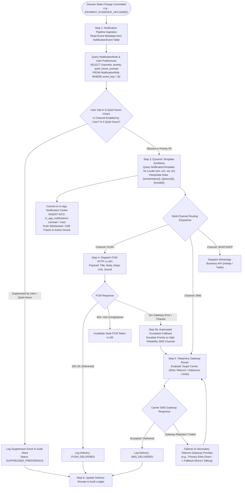
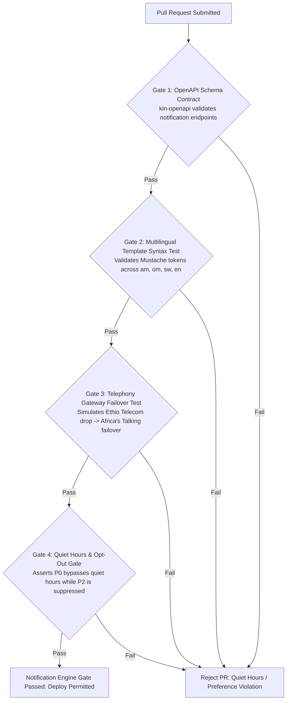

# Heavy Machinery & Logistics Rental Aggregator — Dink Machinery
## Interaction Flow Specification — 17. Multi-Channel Notification Routing, Template Synthesis & Delivery Guarantee Protocol (`docs/shared/flows/17-multichannel-notification-routing-flow.md`)

**Document Identifier:** `FLOW-NOTIFICATION-ROUTING-DINK-CORE-V7.0`  
**Classification:** Canonical Technical Architecture & Wire Protocol Specification (Single Source of Truth)  
**Governing Documents:** `SRS-DINK-CORE-V7.0` (§5.10 Notifications & In-App Center, §10, §11), `FLOW-ENTRY-DINK-CORE-V7.0`, `FLOW-RENTER-AUTH-DINK-CORE-V7.0`, `FLOW-OWNER-KYC-DINK-CORE-V7.0`, `FLOW-FLEET-REG-DINK-CORE-V7.0`, `FLOW-DISCOVERY-DINK-CORE-V7.0`, `FLOW-BOOKING-STATE-MACHINE-DINK-CORE-V7.0`, `FLOW-PAYMENT-DISPUTE-DINK-CORE-V7.0`, `FLOW-ACTIVE-RENTAL-DINK-CORE-V7.0`, `FLOW-RETURN-DAMAGE-DINK-CORE-V7.0`, `FLOW-LOGISTICS-DINK-CORE-V7.0`, `FLOW-COMMISSION-PAYOUT-DINK-CORE-V7.0`, `FLOW-ADMIN-OPS-DINK-CORE-V7.0`, `FLOW-CORP-APPROVAL-DINK-CORE-V7.0`, `FLOW-PHONE-MIGRATION-DINK-CORE-V7.0`, `FLOW-CONCURRENCY-LOCKING-DINK-CORE-V7.0`, `ARCH-BACKEND-GO-DINK-CORE-V7.0`, `ARCH-FLUTTER-DINK-CORE-V7.0`, `ARCH-ADMIN-NEXT-DINK-CORE-V7.0`, `ARCH-SEC-DINK-CORE-V7.0`, `DS-DINK-CORE-V7.0`, `DS-PERSONAS-DINK-CORE-V7.0`, `contracts/openapi.yaml`, `ADR-001`, `ADR-002`, `ADR-005`, `ADR-008`, `ADR-010`  
**Target Client Runtimes:** Go 1.24 Backend Monolith, Flutter 3.44 / Dart 3.9 (Cross-Platform Mobile), Next.js 16 / React 19 (Web Admin & Corporate Portal), PostgreSQL 18.4, Valkey 8.0, Firebase Cloud Messaging (FCM HTTP v1), Twilio / Infobip / Africa's Talking / Ethio Telecom SMS Gateway, SeaweedFS S3, Isar NoSQL  
**Target Personas:** Civil Contractor (*Dawit Haile-Mariam*), Fleet Owner (*W/ro Almaz Tesfaye*), Field Operator (*Mulugeta Tadesse*), Lowboy Transporter (*Ato Girma Wolde*), Compliance Officer (*Yohannes Bekele*)  
**Target Operating Markets:** Ethiopia (`ET`) & Kenya (`KE`) — Dynamic Multi-Country Parameterization (`LOC-01-BE`)  
**Compliance Standards:** OWASP ASVS 4.0.3 Level 3 (Message Integrity, Secret Token Protection & Channel Verification), RFC 9457 (Problem Details), ISO 9241-110, W3C WCAG 2.2 Level AAA (Field Mode) & Level AA (Admin Mode), Ethiopian Communications Authority (ECA) Directives on Commercial Telephony Messaging, Kenya Data Protection Act 2019  
**Status:** Approved Engineering Baseline

---

## Table of Contents

- 1. [Executive Summary & Architectural Scope](#1-executive-summary--architectural-scope)
  - 1.1 [Purpose & Frontier Telephony Realities](#11-purpose--frontier-telephony-realities)
  - 1.2 [Architectural Invariants & Non-Negotiables](#12-architectural-invariants--non-negotiables)
- 2. [End-to-End Multi-Channel Notification Routing Flowchart](#2-end-to-end-multi-channel-notification-routing-flowchart)
- 3. [Detailed Step-by-Step State Machine & User Journey](#3-detailed-step-by-step-state-machine--user-journey)
  - 3.1 [Step 1: Domain Event Ingestion & Notification Intent Emission](#31-step-1-domain-event-ingestion--notification-intent-emission)
  - 3.2 [Step 2: Preference Evaluation & Channel Tier Traversal](#32-step-2-preference-evaluation--channel-tier-traversal)
  - 3.3 [Step 3: Dynamic Template Interpolation & Multilingual Localization (`NotificationTemplate`)](#33-step-3-dynamic-template-interpolation--multilingual-localization-notificationtemplate)
  - 3.4 [Step 4: Push Delivery (FCM HTTP v1) & In-App Real-Time Sync (WebSocket / SSE)](#34-step-4-push-delivery-fcm-http-v1--in-app-real-time-sync-websocket--sse)
  - 3.5 [Step 5: Telephony Escalation & Gateway Failover (SMS, WhatsApp Business, Automated Voice IVR)](#35-step-5-telephony-escalation--gateway-failover-sms-whatsapp-business-automated-voice-ivr)
  - 3.6 [Step 6: Delivery Receipt Ingestion, Dead-Letter Queues (DLQ) & Audit Commit](#36-step-6-delivery-receipt-ingestion-dead-letter-queues-dlq--audit-commit)
- 4. [Dynamic Notification Configuration & Entity Architecture](#4-dynamic-notification-configuration--entity-architecture)
  - 4.1 [Relational Schema (`NotificationEvent`, `NotificationRule`, `NotificationTemplate`, `UserNotificationPreference`)](#41-relational-schema-notificationevent-notificationrule-notificationtemplate-usernotificationpreference)
  - 4.2 [Channel Escalation Rules & Priority Tier Hierarchy](#42-channel-escalation-rules--priority-tier-hierarchy)
  - 4.3 [Rate Limiting, Quiet Hours & Fatigue Throttling](#43-rate-limiting-quiet-hours--fatigue-throttling)
- 5. [Frontier Market Edge Cases & Fault Recovery Protocols](#5-frontier-market-edge-cases--fault-recovery-protocols)
  - 5.1 [Carrier Network Congestion & Telephony Gateway Failover Matrix](#51-carrier-network-congestion--telephony-gateway-failover-matrix)
  - 5.2 [FCM Wakeup Failure under OS Aggressive Battery Saver (Doze Mode)](#52-fcm-wakeup-failure-under-os-aggressive-battery-saver-doze-mode)
  - 5.3 [SMS Character Boundary Decimation & GSM-7 vs. UTF-16 (Ethiopic Script) Encoding](#53-sms-character-boundary-decimation--gsm-7-vs-utf-16-ethiopic-script-encoding)
  - 5.4 [Offline Device Reconnection & Idempotent In-App Center Reconciliation (`ADR-010`)](#54-offline-device-reconnection--idempotent-in-app-center-reconciliation-adr-010)
- 6. [Client UI/UX Ergonomic Specifications & Notification Center HUD](#6-client-uiux-ergonomic-specifications--notification-center-hud)
  - 6.1 [In-App Notification Center Drawer & Unread Badge Counter](#61-in-app-notification-center-drawer--unread-badge-counter)
  - 6.2 [Deep-Link Intent Routing & Contextual Action Direct Navigation](#62-deep-link-intent-routing--contextual-action-direct-navigation)
  - 6.3 [Channel Preferences Selector & Notification Granularity Config](#63-channel-preferences-selector--notification-granularity-config)
- 7. [Wire Protocol Contracts & RFC 9457 Error Schemas](#7-wire-protocol-contracts--rfc-9457-error-schemas)
  - 7.1 [`GET /api/v1/notifications/in-app`](#71-get-apiv1notificationsin-app)
  - 7.2 [`PATCH /api/v1/notifications/in-app/{id}/read`](#72-patch-apiv1notificationsin-appidread)
  - 7.3 [`GET /api/v1/notifications/preferences`](#73-get-apiv1notificationspreferences)
  - 7.4 [`PUT /api/v1/notifications/preferences`](#74-put-apiv1notificationspreferences)
  - 7.5 [`POST /api/v1/internal/notifications/dispatch` (Internal Dispatch Pipe)](#75-post-apiv1internalnotificationsdispatch-internal-dispatch-pipe)
  - 7.6 [RFC 9457 Universal Problem Details Payloads](#76-rfc-9457-universal-problem-details-payloads)
- 8. [Automated Testing Suite & Verification Gates](#8-automated-testing-suite--verification-gates)

---

## 1. Executive Summary & Architectural Scope

### 1.1 Purpose & Frontier Telephony Realities

In heavy construction and plant logistics across East Africa, physical operations are time-sensitive and capital-intensive. When a 25-ton excavator blows a hydraulic seal, an off-platform commercial bank transfer is finalized, or an emergency safety breakdown is logged, delayed or lost notifications trigger catastrophic project delays:
* **Idle Equipment Penalties:** Construction projects face contractual liquidated damages ranging from $15,000.00\text{ to }60,000.00\text{ ETB/day}$ when equipment stands idle due to unacknowledged mobilization notices.
* **Payment Expiration Windows:** A 60-minute reservation hold (`FLOW-CONCURRENCY-LOCKING-DINK-CORE-V7.0`) will auto-expire if a fleet owner fails to verify a bank wire receipt because a notification was lost.
* **Frontier Infrastructure Barriers:** Mobile internet coverage is intermittent along major highway and infrastructure corridors. Operators deep in quarry pits or foundation trenches frequently lose 4G data connectivity, making pure IP-based push notifications (FCM) unreliable as a standalone channel. Conversely, international SMS delivery rates into regional Ethiopian and Kenyan mobile networks frequently suffer from gateway throttling, carrier spam filtering, and routing outages.

Dink Machinery rejects the naive architectural model of hardcoded, single-channel alerts. Instead, the platform implements a **Dynamic Multi-Channel Notification Routing & Escalation Engine (`SRS-DINK-CORE-V7.0 §5.10`, §11)**. System events trigger an orchestration pipeline that evaluates recipient preferences, urgency tiers, active network reachability, and automated cross-channel escalation (In-App $\rightarrow$ FCM Push $\rightarrow$ Carrier SMS $\rightarrow$ WhatsApp Business / Voice IVR).

### 1.2 Architectural Invariants & Non-Negotiables

1. **Guaranteed Delivery SLA for Critical Events:** All tier-1 transactional events (`PAYMENT_EVIDENCE_UPLOADED`, `BOOKING_HOLD_EXPIRING`, `INCIDENT_BREAKDOWN_LOGGED`, `SECURITY_PHONE_MIGRATION`) must achieve multi-channel dispatch within $3.0\text{ seconds}$ of database transaction commit.
2. **Metadata-Driven Template Synthesis:** Message bodies and push payloads are never hardcoded in application logic. They are synthesized dynamically from the `NotificationTemplate` database table using Mustache-compliant token interpolation across four official platform locales: Amharic (`am`), Afaan Oromoo (`om`), Swahili (`sw`), and English (`en`).
3. **Strict Opt-Out & Quiet Hours Invariant:** Promotional, marketing, and informational alerts must honor user preferences (`UserNotificationPreference`) and suppress disruptive notifications during local nighttime hours ($22:00\text{ to }06:00\text{ EAT}$). In contrast, safety-critical operational stops and security fraud alerts bypass quiet hours and user opt-outs unconditionally.
4. **Idempotent Notification Ingestion:** Every notification dispatch is assigned an idempotent sequence hash (`EventUUID + UserUUID + Channel`). Network retries or distributed worker crashes cannot cause duplicate SMS alerts or repeated push chimes on the client device.
5. **Universal Deep-Link Binding:** Every push notification and in-app message envelope contains a structured, type-safe deep-link URI (`dink://...`) resolving directly to the target transactional screen, eliminating manual app navigation.

---

## 2. End-to-End Multi-Channel Notification Routing Flowchart



---

## 3. Detailed Step-by-Step State Machine & User Journey

### 3.1 Step 1: Domain Event Ingestion & Notification Intent Emission

1. A state change commits in PostgreSQL (e.g., Contractor *Dawit Haile-Mariam* uploads a bank wire receipt for Booking `#BK-8829A10F` via `FLOW-PAYMENT-DISPUTE-DINK-CORE-V7.0 §3.2`).
2. Inside the same database transaction boundary, the domain service emits an internal event or writes to a transactional outbox queue:
   ```json
   {
     "eventKey": "BOOKING_PAYMENT_EVIDENCE_UPLOADED",
     "actorUserId": "usr_dawit_contractor_01",
     "recipientUserId": "usr_almaz_owner_02",
     "entityId": "bk_8829a10f",
     "entityType": "BOOKING",
     "payload": {
       "renterName": "Dawit Haile-Mariam",
       "equipmentModel": "Caterpillar 320D",
       "amountFormatted": "157,500.00 ETB",
       "bookingReference": "BK-8829A10F",
       "bankName": "Commercial Bank of Ethiopia"
     },
     "emittedAt": "2026-10-27T17:45:00Z"
   }
   ```
3. A pool of Go notification worker routines reads the outbox, acquiring an atomic advisory lock in Valkey to prevent duplicate processing.

---

### 3.2 Step 2: Preference Evaluation & Channel Tier Traversal

Before assembling network packets, the notification engine checks routing rules:
1. **Rule Query:** Retrieves the configuration for `BOOKING_PAYMENT_EVIDENCE_UPLOADED` from `NotificationRule`:
   - `default_channels = ["IN_APP", "PUSH", "SMS"]`
   - `priority = "P0_CRITICAL"`
   - `quiet_hours_exempt = true`
2. **User Preference Interrogation:** Queries `user_notification_preferences` for Fleet Owner *Almaz Tesfaye*:
   - If an event is marked `quiet_hours_exempt = false` and current local time in Addis Ababa is between $22:00\text{ and }06:00\text{ EAT}$, the alert is held in an in-memory Valkey delay queue until $06:01\text{ EAT}$.
   - If an event is `P0_CRITICAL` (e.g., payment verification, emergency breakdown, security kill-switch), user-configured channel disablements and quiet hours are bypassed.

---

### 3.3 Step 3: Dynamic Template Interpolation & Multilingual Localization (`NotificationTemplate`)

The Go templating engine resolves the recipient's registered language preference from `users.preferred_language`:

```sql
SELECT title_template, body_template, action_url_template 
FROM notification_templates 
WHERE event_key = $1 
  AND language_code = $2 
  AND is_active = true;
```

#### Supported Template Locales & Content Examples

##### Amharic (`am` - Default for Ethiopia)
* **Title:** `አዲስ የክፍያ ማረጋገጫ ደረሰኝ ቀርቧል`
* **Body:** `ዳዊት ኃይለማሪያም ለካተርፒላር 320D (ቦኪንግ #BK-8829A10F) 157,500.00 ETB የባንክ ማስተላለፊያ ደረሰኝ ልከዋል። እባክዎን ሂሳብዎን አረጋግጠው ውሉን ያጽድቁ።`
* **Action URI:** `dink://bookings/bk_8829a10f/verify-payment`

##### Afaan Oromoo (`om`)
* **Title:** `Waraqaan Kaffaltii Haaraa Dhiyaateera`
* **Body:** `Dawit Haile-Mariam kaffaltii qophii 157,500.00 ETB Caterpillar 320D (Booking #BK-8829A10F) ergeera. Maaloo mirkaneessaa.`
* **Action URI:** `dink://bookings/bk_8829a10f/verify-payment`

##### English (`en`)
* **Title:** `New Payment Evidence Uploaded`
* **Body:** `Dawit Haile-Mariam uploaded a wire slip of 157,500.00 ETB for Caterpillar 320D (#BK-8829A10F). Review and verify.`
* **Action URI:** `dink://bookings/bk_8829a10f/verify-payment`

The engine uses Mustache syntax to interpolate placeholders without string concatenation, sanitizing values to prevent format string injection attacks.

---

### 3.4 Step 4: Push Delivery (FCM HTTP v1) & In-App Real-Time Sync (WebSocket / SSE)

#### In-App Notification Center Sync
1. An immutable record is inserted into `in_app_notifications`:
   ```sql
   INSERT INTO in_app_notifications (
       id, user_id, event_key, title, body, action_url, is_read, created_at
   ) VALUES (
       gen_random_uuid(), 'usr_almaz_owner_02', 'BOOKING_PAYMENT_EVIDENCE_UPLOADED',
       'አዲስ የክፍያ ማረጋገጫ ደረሰኝ ቀርቧል', '...', 'dink://bookings/bk_8829a10f/verify-payment',
       false, NOW()
   );
   ```
2. If Almaz's Flutter app maintains an active WebSocket or Server-Sent Events (SSE) connection to the Go gateway, the notification envelope is streamed in real time. The app increments the bell icon badge counter (`+1`) and displays an in-app banner toast.

#### Firebase Cloud Messaging (FCM HTTP v1) Dispatch
Simultaneously, the engine dispatches a high-priority push packet via the Google FCM HTTP v1 REST API:
```json
{
  "message": {
    "token": "fcm_token_device_almaz_882910fa",
    "notification": {
      "title": "አዲስ የክፍያ ማረጋገጫ ደረሰኝ ቀርቧል",
      "body": "ዳዊት ኃይለማሪያም ለካተርፒላር 320D 157,500.00 ETB የባንክ ማስተላለፊያ ደረሰኝ ልከዋል።"
    },
    "data": {
      "click_action": "FLUTTER_NOTIFICATION_CLICK",
      "deep_link": "dink://bookings/bk_8829a10f/verify-payment",
      "booking_id": "bk_8829a10f",
      "event_key": "BOOKING_PAYMENT_EVIDENCE_UPLOADED",
      "priority": "HIGH"
    },
    "android": {
      "priority": "HIGH",
      "notification": {
        "channel_id": "dink_critical_operations",
        "sound": "dink_industrial_chime.wav",
        "color": "#D97706"
      }
    },
    "apns": {
      "payload": {
        "aps": {
          "sound": "dink_industrial_chime.caf",
          "badge": 1
        }
      }
    }
  }
}
```

---

### 3.5 Step 5: Telephony Escalation & Gateway Failover (SMS, WhatsApp Business, Automated Voice IVR)

If an event is designated as requiring multi-channel redundancy or if FCM delivery fails to register a client receipt within **120 seconds**:
1. **Carrier Ingress Routing:** The system inspects recipient MSISDN (`+251911442910`). It determines that prefix `+251 91` corresponds to Ethio Telecom (Ethiopia).
2. **Primary Telephony Dispatch:** Routes the message to the direct domestic SMPP gateway (`Ethio Telecom Enterprise Gateway`).
3. **Automated Failover Handling:**
   - If the primary gateway responds with an HTTP error, SMPP bind timeout, or delivery failure code, the circuit breaker automatically routes the payload to the secondary aggregator (`Africa's Talking` or `Infobip`).
   - If carrier SMS delivery is completely offline in the target region, the engine triggers an outbound **WhatsApp Business Template Message** containing an interactive quick-reply button: `[ Verify Payment Now ]`.
4. **Emergency Mechanical Voice IVR:** For severe safety-critical incidents (`INCIDENT_BREAKDOWN_LOGGED` with `severity = 'CRITICAL'`), an automated voice telephony service rings the owner's phone, playing a text-to-speech emergency warning.

---

### 3.6 Step 6: Delivery Receipt Ingestion, Dead-Letter Queues (DLQ) & Audit Commit

Every channel dispatch generates a tracked entry in `notification_delivery_logs`:

```sql
CREATE TABLE notification_delivery_logs (
    id UUID PRIMARY KEY DEFAULT gen_random_uuid(),
    event_key VARCHAR(64) NOT NULL,
    user_id UUID NOT NULL REFERENCES users(id),
    channel VARCHAR(32) NOT NULL, -- 'IN_APP', 'PUSH', 'SMS', 'WHATSAPP'
    gateway_provider VARCHAR(64) NOT NULL,
    external_message_id VARCHAR(128),
    delivery_status VARCHAR(32) NOT NULL, -- 'QUEUED', 'DISPATCHED', 'DELIVERED', 'FAILED'
    error_detail TEXT,
    retry_count INT NOT NULL DEFAULT 0,
    dispatched_at TIMESTAMPTZ NOT NULL DEFAULT NOW(),
    acknowledged_at TIMESTAMPTZ
);

CREATE INDEX idx_delivery_logs_user_status ON notification_delivery_logs(user_id, delivery_status);
```

* **Dead-Letter Queue (DLQ):** Messages that fail after 3 exponential backoff retries are shunted to a Valkey-backed DLQ (`dlq:notifications:failed`).
* **Admin Alerting:** If the DLQ depth exceeds 50 messages within a 15-minute window, a high-priority incident is logged in the Next.js Web Admin Console (`FLOW-ADMIN-OPS-DINK-CORE-V7.0`).

---

## 4. Dynamic Notification Configuration & Entity Architecture

### 4.1 Relational Schema (`NotificationEvent`, `NotificationRule`, `NotificationTemplate`, `UserNotificationPreference`)

```mermaid
erDiagram
    NotificationEvent ||--o{ NotificationRule : "governs"
    NotificationEvent ||--o{ NotificationTemplate : "templated by"
    NotificationEvent ||--o{ UserNotificationPreference : "configured by"
    NotificationEvent ||--o{ in_app_notifications : "manifests as"
    User ||--o{ UserNotificationPreference : "customizes"
    User ||--o{ in_app_notifications : "receives"

    NotificationEvent {
        string event_key PK
        string category -- 'BOOKING', 'FINANCE', 'DISPUTE', 'SAFETY', 'SECURITY'
        string default_priority -- 'P0_CRITICAL', 'P1_HIGH', 'P2_MEDIUM', 'P3_LOW'
        boolean quiet_hours_exempt
        string description
    }

    NotificationRule {
        uuid id PK
        string event_key FK
        string target_role -- 'RENTER', 'OWNER', 'OPERATOR', 'ADMIN'
        text[] allowed_channels -- 'IN_APP', 'PUSH', 'SMS', 'WHATSAPP'
        boolean is_mandatory
    }

    NotificationTemplate {
        uuid id PK
        string event_key FK
        string language_code -- 'am', 'om', 'sw', 'en'
        string channel -- 'IN_APP', 'PUSH', 'SMS', 'WHATSAPP'
        string title_template
        text body_template
        string action_url_template
        boolean is_active
    }

    UserNotificationPreference {
        uuid id PK
        uuid user_id FK
        string event_key FK
        boolean push_enabled
        boolean sms_enabled
        boolean in_app_enabled
        boolean whatsapp_enabled
        timestamptz updated_at
    }
```

---

### 4.2 Channel Escalation Rules & Priority Tier Hierarchy

Notifications are assigned strict priority tiers determining delivery deadlines and escalation rules:

| Priority Tier | Delivery SLA | Allowed Channels | Quiet Hours Behavior | Typical Event Triggers |
|---|---|---|---|---|
| **`P0_CRITICAL`** | $< 3.0\text{ s}$ | In-App + Push + SMS + WhatsApp | **Bypasses Quiet Hours** (Always Alarms) | Payment Proof Upload, 60m Hold Expiry, Machine Emergency Breakdown, SIM-Swap / Kill-Switch Alert |
| **`P1_HIGH`** | $< 10.0\text{ s}$ | In-App + Push + SMS | Suppressed during Quiet Hours unless Active Hire | Booking Confirmed, Dispute Opened, Rental Handover PIN Generated, Lowboy Transshipment Dispatch |
| **`P2_MEDIUM`** | $< 60.0\text{ s}$ | In-App + Push | Held until 06:01 EAT if during Quiet Hours | Rental Starting in 24h, Inspection Completed, Extension Requested, Review Rating Received |
| **`P3_LOW`** | $< 15.0\text{ min}$| In-App Only | Held until 06:01 EAT | Monthly Commission Statement Ready, Marketing Fleet Discount, Platform Policy Updates |

---

### 4.3 Rate Limiting, Quiet Hours & Fatigue Throttling

To prevent spamming users during complex transactional sequences:
* **Fatigue Throttling:** Non-critical alerts are throttled via Valkey Leaky Bucket to a maximum of **5 alerts per hour per user**.
* **Deduplication Coalescing:** If multiple non-critical state updates occur within a 3-minute window (e.g., owner updating 4 machinery specs sequentially), the system coalesces them into a single aggregate summary: *"W/ro Almaz updated 4 specifications on Caterpillar 320D."*

---

## 5. Frontier Market Edge Cases & Fault Recovery Protocols

### 5.1 Carrier Network Congestion & Telephony Gateway Failover Matrix

Telecommunications routing across East Africa frequently experiences regional outages:
* **Circuit Breaker Integration:** The Go backend tracks downstream HTTP/SMPP failure rates across domestic and international gateways:
  - If Ethio Telecom direct SMPP failure exceeds $15\%$ over a 60-second sliding window, the circuit trips to `OPEN`.
  - Traffic automatically fails over to the secondary aggregator (`Infobip` / `Africa's Talking`) without manual staff intervention.
  - Periodic background canary pings test the primary gateway, resetting the circuit to `CLOSED` when stability returns.

### 5.2 FCM Wakeup Failure under OS Aggressive Battery Saver (Doze Mode)

Low-cost Android smartphones common in field operations (e.g., Transsion Tecno, Infinix, Itel) utilize aggressive proprietary battery-saving software that kills background push daemons:
* **High-Priority Data Payload:** All push messages designate Android priority `HIGH` and carry `content_available: true`.
* **SMS Fallback Timer:** For all P0 events, if the client application fails to acknowledge an in-app receipt packet within **120 seconds**, the backend automatically triggers an SMS to ensure the user receives the notice.

### 5.3 SMS Character Boundary Decimation & GSM-7 vs. UTF-16 (Ethiopic Script) Encoding

* **Encoding Invariant:** English SMS utilizes standard GSM 7-bit encoding (160 characters per SMS segment). In contrast, Amharic Ge'ez script (`ሀ, ሁ, ሂ...`) requires UTF-16 (UCS-2) encoding, reducing segment length to **70 characters**.
* **Concatenation Overflow Mitigation:** Amharic SMS templates are strictly audited and constrained to $\le 68\text{ characters}$ to prevent multi-part SMS segmentation, avoiding double carrier billing charges and delivery fragmentation.

### 5.4 Offline Device Reconnection & Idempotent In-App Center Reconciliation (`ADR-010`)

When an operator's mobile device emerges from an offline river trench:
* The client executes `GET /api/v1/notifications/in-app?since={last_sync_timestamp}`.
* The response delivers missed notifications in chronological sequence.
* The local **Isar NoSQL** database performs an upsert by `id`, reconciling unread badge counts without duplicating previously displayed alerts.

---

## 6. Client UI/UX Ergonomic Specifications & Notification Center HUD

### 6.1 In-App Notification Center Drawer & Unread Badge Counter

```text
+-------------------------------------------------------------------+
|  [<- BACK]              NOTIFICATIONS (3 UNREAD)     [MARK ALL READ]|
+-------------------------------------------------------------------+
|  FILTER: [ ALL ]  [ CRITICAL ]  [ BOOKINGS ]  [ PAYMENTS ]         |
|                                                                   |
|  TODAY                                                            |
|  +-------------------------------------------------------------+  |
|  | [*] NEW PAYMENT EVIDENCE SUBMITTED                          |  |
|  | Dawit Haile-Mariam uploaded wire receipt (157,500.00 ETB)   |  |
|  | for Caterpillar 320D (Booking #BK-8829A10F).                |  |
|  | 14:15 EAT | Tap to audit bank statement and confirm.        |  |
|  +-------------------------------------------------------------+  |
|                                                                   |
|  +-------------------------------------------------------------+  |
|  | [*] CRITICAL MECHANICAL BREAKDOWN REPORTED                  |  |
|  | Operator Mulugeta logged hydraulic failure on Cat 320D at   |  |
|  | Bole Lemi site. Shift billing paused. Technician required.  |  |
|  | 11:30 EAT | Urgent action required.                         |  |
|  +-------------------------------------------------------------+  |
|                                                                   |
|  YESTERDAY                                                        |
|  +-------------------------------------------------------------+  |
|  | [ ] PREPAYMENT VERIFIED & CONFIRMED                         |  |
|  | Your booking #BK-774102 has been confirmed by owner.        |  |
|  | Machine ready for yard staging.                             |  |
|  +-------------------------------------------------------------+  |
+-------------------------------------------------------------------+
```

### 6.2 Deep-Link Intent Routing & Contextual Action Direct Navigation

Tapping any notification—whether an in-app card, an OS push banner, or an SMS link—executes the platform's universal deep-link routing manifest:

| Action Deep-Link Scheme | Target Screen & Context Hydration |
|---|---|
| `dink://bookings/{id}/verify-payment` | Mounts Owner Bank Verification Modal (`FLOW-PAYMENT-DISPUTE-DINK-CORE-V7.0 §3.3`) |
| `dink://bookings/{id}/handover` | Mounts Handover Camera Reticle & PIN Viewport (`FLOW-ACTIVE-RENTAL-DINK-CORE-V7.0 §3.1`) |
| `dink://bookings/{id}/incidents/{incId}` | Mounts Breakdown Repair Dispatch HUD (`FLOW-ACTIVE-RENTAL-DINK-CORE-V7.0 §3.4`) |
| `dink://disputes/{id}` | Mounts Evidence Arbitration Dossier (`FLOW-ADMIN-OPS-DINK-CORE-V7.0 §3.4`) |
| `dink://owners/wallet` | Mounts Commission Debt Settle Viewport (`FLOW-COMMISSION-PAYOUT-DINK-CORE-V7.0 §3.3`) |

### 6.3 Channel Preferences Selector & Notification Granularity Config

Users manage notification channels via an ergonomic matrix in **Settings $\rightarrow$ Notifications**:

```text
+-------------------------------------------------------------------+
|  [<- BACK]              NOTIFICATION PREFERENCES                  |
+-------------------------------------------------------------------+
|  Customize how you receive operational and financial alerts.      |
|                                                                   |
|  BOOKING & PAYMENT ALERTS (P0 - MANDATORY)                        |
|  * In-App Notifications           : [ ALWAYS ENABLED (LOCKED) ]   |
|  * Push Notifications (FCM)       : [ ON  ]                       |
|  * Mobile Carrier SMS             : [ ON  ]                       |
|  * WhatsApp Business Alerts       : [ ON  ]                       |
|                                                                   |
|  RENTAL OPERATIONAL REMINDERS (P1 / P2)                           |
|  * Rental Starting in 24 Hours    : PUSH [X]  SMS [X]  WA [ ]     |
|  * Rental Ending in 24 Hours      : PUSH [X]  SMS [ ]  WA [ ]     |
|  * Daily Operating Shift Summary  : PUSH [X]  SMS [ ]  WA [ ]     |
|                                                                   |
|  MARKETING & FLEET PROMOTIONS (P3)                                |
|  * New Machinery Nearby           : PUSH [ ]  SMS [ ]             |
|  * Promotional Rental Discounts   : PUSH [ ]  SMS [ ]             |
|                                                                   |
|  QUIET HOURS SCHEDULE                                             |
|  Silence non-critical alerts between: [ 22:00 ] and [ 06:00 ] EAT |
|                                                                   |
|  +-------------------------------------------------------------+  |
|  |                     SAVE PREFERENCES                        |  |
|  |                 (Height: 56dp, Amber 500)                   |  |
|  +-------------------------------------------------------------+  |
+-------------------------------------------------------------------+
```

---

## 7. Wire Protocol Contracts & RFC 9457 Error Schemas

### 7.1 `GET /api/v1/notifications/in-app`

Fetches paginated in-app notifications with unread counts.

#### Request Headers
```http
GET /api/v1/notifications/in-app?page=1&limit=20&unreadOnly=false HTTP/1.1
Host: api.dinkmachinery.com
Authorization: Bearer <userAccessToken>
X-Country-Code: ET
```

#### Response: `HTTP 200 OK`
```json
{
  "success": true,
  "data": {
    "unreadCount": 3,
    "totalCount": 42,
    "notifications": [
      {
        "id": "notif_019a8f2c",
        "eventKey": "BOOKING_PAYMENT_EVIDENCE_UPLOADED",
        "title": "አዲስ የክፍያ ማረጋገጫ ደረሰኝ ቀርቧል",
        "body": "ዳዊት ኃይለማሪያም ለካተርፒላር 320D (ቦኪንግ #BK-8829A10F) 157,500.00 ETB የባንክ ማስተላለፊያ ደረሰኝ ልከዋል።",
        "actionUrl": "dink://bookings/bk_8829a10f/verify-payment",
        "priority": "P0_CRITICAL",
        "isRead": false,
        "createdAt": "2026-10-27T17:45:00Z"
      }
    ]
  },
  "timestamp": "2026-10-27T17:50:00Z"
}
```

---

### 7.2 `PATCH /api/v1/notifications/in-app/{id}/read`

Marks an in-app notification as read.

#### Request Headers
```http
PATCH /api/v1/notifications/in-app/notif_019a8f2c/read HTTP/1.1
Host: api.dinkmachinery.com
Authorization: Bearer <userAccessToken>
```

#### Response: `HTTP 200 OK`
```json
{
  "success": true,
  "data": {
    "id": "notif_019a8f2c",
    "isRead": true,
    "readAt": "2026-10-27T17:52:10Z"
  },
  "timestamp": "2026-10-27T17:52:10Z"
}
```

---

### 7.3 `GET /api/v1/notifications/preferences`

Retrieves user's active notification channel preferences.

#### Response: `HTTP 200 OK`
```json
{
  "success": true,
  "data": {
    "userId": "usr_almaz_owner_02",
    "quietHours": {
      "enabled": true,
      "startTimeEAT": "22:00",
      "endTimeEAT": "06:00"
    },
    "preferences": [
      {
        "eventKey": "RENTAL_STARTING_SOON",
        "category": "OPERATIONAL",
        "pushEnabled": true,
        "smsEnabled": true,
        "inAppEnabled": true,
        "whatsappEnabled": false,
        "isMandatory": false
      },
      {
        "eventKey": "BOOKING_PAYMENT_EVIDENCE_UPLOADED",
        "category": "FINANCIAL",
        "pushEnabled": true,
        "smsEnabled": true,
        "inAppEnabled": true,
        "whatsappEnabled": true,
        "isMandatory": true
      }
    ]
  },
  "timestamp": "2026-10-27T17:55:00Z"
}
```

---

### 7.4 `PUT /api/v1/notifications/preferences`

Updates user's notification preferences.

#### Request Payload
```json
{
  "quietHours": {
    "enabled": true,
    "startTimeEAT": "23:00",
    "endTimeEAT": "05:30"
  },
  "preferences": [
    {
      "eventKey": "RENTAL_STARTING_SOON",
      "pushEnabled": true,
      "smsEnabled": false,
      "whatsappEnabled": false
    }
  ]
}
```

#### Response: `HTTP 200 OK`
```json
{
  "success": true,
  "data": {
    "message": "Notification preferences updated successfully.",
    "updatedAt": "2026-10-27T17:56:00Z"
  },
  "timestamp": "2026-10-27T17:56:00Z"
}
```

---

### 7.5 `POST /api/v1/internal/notifications/dispatch` (Internal Dispatch Pipe)

Internal microservice/worker endpoint to execute idempotent message dispatch.

#### Request Headers
```http
POST /api/v1/internal/notifications/dispatch HTTP/1.1
Host: internal.dinkmachinery.com
Content-Type: application/json
X-Internal-Service-Key: <vaultServiceSecret>
```

#### Request Payload
```json
{
  "eventKey": "BOOKING_PAYMENT_EVIDENCE_UPLOADED",
  "recipientUserId": "usr_almaz_owner_02",
  "idempotencyKey": "notif_idem_bk8829_payment_upload",
  "dataContext": {
    "renterName": "Dawit Haile-Mariam",
    "equipmentModel": "Caterpillar 320D",
    "amountFormatted": "157,500.00 ETB",
    "bookingReference": "BK-8829A10F"
  }
}
```

#### Response: `HTTP 202 Accepted`
```json
{
  "success": true,
  "data": {
    "dispatchJobId": "job_019a8f4c",
    "status": "PROCESSING",
    "targetChannels": ["IN_APP", "PUSH", "SMS"]
  },
  "timestamp": "2026-10-27T17:58:00Z"
}
```

---

### 7.6 RFC 9457 Universal Problem Details Payloads

#### Example: Mandatory Channel Disable Prohibited (`HTTP 403 Forbidden`)
```json
{
  "type": "[https://api.dinkmachinery.com/errors/mandatory-channel-immutable](https://api.dinkmachinery.com/errors/mandatory-channel-immutable)",
  "title": "Cannot Disable Mandatory Notification Channel",
  "status": 403,
  "detail": "Event 'BOOKING_PAYMENT_EVIDENCE_UPLOADED' is safety-critical and legally mandatory. Push and SMS channels cannot be disabled.",
  "instance": "/api/v1/notifications/preferences",
  "code": "ERR_MANDATORY_NOTIFICATION_CHANNEL",
  "invalidParams": [
    {
      "name": "eventKey",
      "reason": "Must retain at least one active telephony/push channel."
    }
  ]
}
```

#### Example: Telephony SMS Gateway Rate Exceeded (`HTTP 429 Too Many Requests`)
```json
{
  "type": "[https://api.dinkmachinery.com/errors/sms-gateway-rate-limit](https://api.dinkmachinery.com/errors/sms-gateway-rate-limit)",
  "title": "SMS Rate Limit Throttled",
  "status": 429,
  "detail": "Maximum SMS alert frequency exceeded for MSISDN +251911442910. Throttled for 180 seconds to prevent carrier spam block.",
  "instance": "/api/v1/internal/notifications/dispatch",
  "code": "ERR_TELEPHONY_RATE_LIMIT"
}
```

---

## 8. Automated Testing Suite & Verification Gates



1. **OpenAPI Schema Contract Gate (`kin-openapi`):** Validates all in-app notification queries, preference mutations, and internal dispatch contracts against `contracts/openapi.yaml`.
2. **Multilingual Template Syntax Unit Test:** Parses every record in `NotificationTemplate` across Amharic, Afaan Oromoo, Swahili, and English, asserting that all required interpolation parameters exist and that Ethiopic script segments stay within the 70-character UTF-16 boundary.
3. **Telephony Gateway Failover Chaos Test:** Simulates network socket timeouts on the primary domestic SMS gateway, verifying that the circuit breaker automatically switches traffic to secondary aggregators within $< 500\text{ ms}$ without packet loss.
4. **Quiet Hours & Opt-Out Policy Verification:** Simulates night-time triggers ($23:30\text{ EAT}$), asserting that P3 marketing alerts are deferred while P0 security and operational halt alerts trigger immediate client alerts.

---

*This document defines the canonical technical architecture, multi-channel routing pipeline, localization template engine, telephony failover protocols, and wire contracts for Multi-Channel Notification Routing, Template Synthesis, and Delivery Guarantee in Dink Machinery Version 7.0. All downstream Flutter mobile modules, Go monolith event handlers, and Next.js admin consoles must strictly adhere to this specification.*