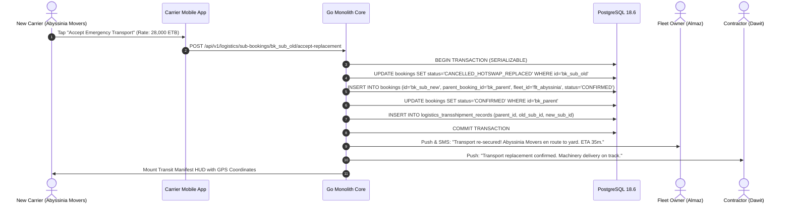
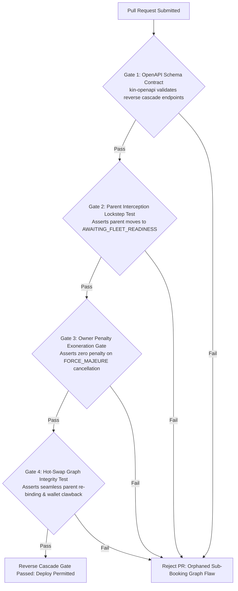

# Heavy Machinery & Logistics Rental Aggregator — Dink Machinery
## Interaction Flow Specification — 18. Logistics Provider Cancellation, Reverse Cascade & Emergency Transshipment Protocol (`docs/shared/flows/18-logistics-provider-cancellation-reverse-cascade-flow.md`)

**Document Identifier:** `FLOW-LOGISTICS-REVERSE-CASCADE-DINK-CORE-V7.0`  
**Classification:** Canonical Technical Architecture & Wire Protocol Specification (Single Source of Truth)  
**Governing Documents:** `SRS-DINK-CORE-V7.0` (§5.2.5 FL-28 to FL-31, §5.5.3, §5.8, §8.1, §8.2, §10, §11), `FLOW-ENTRY-DINK-CORE-V7.0`, `FLOW-FLEET-REG-DINK-CORE-V7.0`, `FLOW-BOOKING-STATE-MACHINE-DINK-CORE-V7.0`, `FLOW-PAYMENT-DISPUTE-DINK-CORE-V7.0`, `FLOW-ACTIVE-RENTAL-DINK-CORE-V7.0`, `FLOW-RETURN-DAMAGE-DINK-CORE-V7.0`, `FLOW-LOGISTICS-DINK-CORE-V7.0`, `FLOW-COMMISSION-PAYOUT-DINK-CORE-V7.0`, `FLOW-ADMIN-OPS-DINK-CORE-V7.0`, `FLOW-CONCURRENCY-LOCKING-DINK-CORE-V7.0`, `FLOW-NOTIFICATION-ROUTING-DINK-CORE-V7.0`, `ARCH-BACKEND-GO-DINK-CORE-V7.0`, `ARCH-FLUTTER-DINK-CORE-V7.0`, `ARCH-ADMIN-NEXT-DINK-CORE-V7.0`, `ARCH-SEC-DINK-CORE-V7.0`, `DS-DINK-CORE-V7.0`, `DS-PERSONAS-DINK-CORE-V7.0`, `contracts/openapi.yaml`, `ADR-001`, `ADR-002`, `ADR-004`, `ADR-005`, `ADR-008`, `ADR-010`  
**Target Client Runtimes:** Go 1.27.3 Backend Monolith, Flutter 3.47.9 / Dart 3.9 (Cross-Platform Mobile), Next.js 16.x (latest CVE security patch) / React 19 (Web Admin & Corporate Portal), PostgreSQL 18.6 + PostGIS 3.6.4, Valkey 9.1.3, ClamAV Daemon (:3310), SeaweedFS S3, Isar NoSQL  
**Target Personas:** Equipment Fleet Owner (*W/ro Almaz Tesfaye*), Lowboy Logistics Fleet Provider (*Ato Girma Wolde* / *Samuel Odhiambo*), Civil Engineering Contractor (*Dawit Haile-Mariam*), Back-Office Compliance Officer & Dispute Arbitrator (*Yohannes Bekele*)  
**Target Operating Markets:** Ethiopia (`ET`) & Kenya (`KE`) — Dynamic Multi-Country Parameterization (`LOC-01-BE`)  
**Compliance Standards:** OWASP ASVS 4.0.3 Level 3 (Fault Tolerance, Transaction Atomicity & Non-Repudiation), RFC 9457 (Problem Details), ISO 9241-110, W3C WCAG 2.2 Level AAA (Field Mode) & Level AA (Admin Mode), National Bank of Ethiopia (NBE) Financial Penalty Settlement Directives, Ethiopian Federal Transport Authority Directives  
**Status:** Approved Engineering Baseline

---

## Table of Contents

- 1. [Executive Summary & Failure Cascades Architecture](#1-executive-summary--failure-cascades-architecture)
  - 1.1 [Purpose & The Coupled Logistics Dependency Problem](#11-purpose--the-coupled-logistics-dependency-problem)
  - 1.2 [Architectural Invariants & Non-Negotiables](#12-architectural-invariants--non-negotiables)
- 2. [End-to-End Reverse Cascade & Transshipment Flowchart](#2-end-to-end-reverse-cascade--transshipment-flowchart)
- 3. [Detailed Step-by-Step State Machine & User Journey](#3-detailed-step-by-step-state-machine--user-journey)
  - 3.1 [Step 1: Logistics Cancellation Ingestion & Phase Classification (`PRE_TRANSIT` vs. `MID_TRANSIT`)](#31-step-1-logistics-cancellation-ingestion--phase-classification-pre_transit-vs-mid_transit)
  - 3.2 [Step 2: Parent Booking State Interception & Operational Freeze (`AWAITING_FLEET_READINESS`)](#32-step-2-parent-booking-state-interception--operational-freeze-awaiting_fleet_readiness)
  - 3.3 [Step 3: Automated Spatial Transshipment Matcher & Priority Candidate Dispatch](#33-step-3-automated-spatial-transshipment-matcher--priority-candidate-dispatch)
  - 3.4 [Step 4: Hot-Swap Re-Binding Protocol & Sub-Booking Graph Mutation (`ParentBookingID`)](#34-step-4-hot-swap-re-binding-protocol--sub-booking-graph-mutation-parentbookingid)
  - 3.5 [Step 5: Terminal Cascade: Replacement Exhaustion, Parent Cancellation & Full Prepayment Refund](#35-step-5-terminal-cascade-replacement-exhaustion-parent-cancellation--full-prepayment-refund)
  - 3.6 [Step 6: Defaulting Carrier Financial Penalty Assessment & Pre-Funded Wallet Clawback](#36-step-6-defaulting-carrier-financial-penalty-assessment--pre-funded-wallet-clawback)
- 4. [Mathematical Financial Invariants & Penalty Settlement Ledger](#4-mathematical-financial-invariants--penalty-settlement-ledger)
  - 4.1 [Logistics Default Penalty & Surcharge Compensation Formula](#41-logistics-default-penalty--surcharge-compensation-formula)
  - 4.2 [Atomic Wallet Clawback & Debt Accumulation Invariant](#42-atomic-wallet-clawback--debt-accumulation-invariant)
  - 4.3 [Parent Booking Penalty Exemption & Commission Restitution](#43-parent-booking-penalty-exemption--commission-restitution)
- 5. [Frontier Market Edge Cases & Fault Recovery Protocols](#5-frontier-market-edge-cases--fault-recovery-protocols)
  - 5.1 [Mid-Transit Breakdown on High-Speed Corridor (Expressway Stoppage)](#51-mid-transit-breakdown-on-high-speed-corridor-expressway-stoppage)
  - 5.2 [Carrier No-Show at Equipment Yard (Silent Abandonment)](#52-carrier-no-show-at-equipment-yard-silent-abandonment)
  - 5.3 [Telecommunications Partition during Transshipment Handover (`ADR-010`)](#53-telecommunications-partition-during-transshipment-handover-adr-010)
  - 5.4 [Cross-Border Jurisdiction Breakdown & Sovereign Legal Permitting](#54-cross-border-jurisdiction-breakdown--sovereign-legal-permitting)
- 6. [Client UI/UX Ergonomic Specifications & Emergency Action Screens](#6-client-uiux-ergonomic-specifications--emergency-action-screens)
  - 6.1 [Equipment Owner Emergency Re-Pairing HUD ($56 \times 56\text{ dp}$)](#61-equipment-owner-emergency-re-pairing-hud-56-times-56text-dp)
  - 6.2 [Contractor Delay Transparent Progress Stepper](#62-contractor-delay-transparent-progress-stepper)
  - 6.3 [Next.js Admin Console: Emergency Freight Interception Desk](#63-nextjs-admin-console-emergency-freight-interception-desk)
- 7. [Wire Protocol Contracts & RFC 9457 Error Schemas](#7-wire-protocol-contracts--rfc-9457-error-schemas)
  - 7.1 [`POST /api/v1/logistics/sub-bookings/{id}/cancel`](#71-post-apiv1logisticssub-bookingsidcancel)
  - 7.2 [`POST /api/v1/logistics/sub-bookings/{id}/emergency-transshipment`](#72-post-apiv1logisticssub-bookingsidemergency-transshipment)
  - 7.3 [`POST /api/v1/logistics/sub-bookings/{id}/accept-replacement`](#73-post-apiv1logisticssub-bookingsidaccept-replacement)
  - 7.4 [`POST /api/v1/logistics/sub-bookings/{id}/abort-cascade`](#74-post-apiv1logisticssub-bookingsidabort-cascade)
  - 7.5 [RFC 9457 Universal Problem Details Payloads](#75-rfc-9457-universal-problem-details-payloads)
- 8. [Automated Testing Suite & Verification Gates](#8-automated-testing-suite--verification-gates)

---

## 1. Executive Summary & Failure Cascades Architecture

### 1.1 Purpose & The Coupled Logistics Dependency Problem

In heavy equipment aggregation, machinery that cannot travel on paved roads (`self_move_capable = false`, e.g., steel-tracked crawler excavators, 30-ton bulldozers, asphalt milling machines) forms an atomic operational pair with a transport trailer (`FLOW-LOGISTICS-DINK-CORE-V7.0`). The civil contractor hires the excavator; the equipment owner books or coordinates a lowboy trailer (`ParentBookingID`) to mobilize the plant asset from their storage yard to the contractor's project site.

In real-world East African transport corridors (e.g., Addis Ababa–Adama Expressway, Modjo–Hawassa corridor, Nairobi–Mombasa highway), freight transport is uniquely vulnerable to mechanical breakdowns (turbocharger blowout, cracked lowboy goose-neck welds, multi-tire blowouts) and carrier operational defaults (unilateral cancellation, driver no-shows, traffic police weighbridge impoundments).

When a lowboy provider cancels or breaks down hours before scheduled delivery:
* **The Naive Marketplace Flaw:** Naive platforms cancel only the transport sub-booking, stranding the equipment owner with an immovable 22-ton machine while leaving the primary rental contract active. The contractor arrives on site, discovers zero equipment delivered, and immediately triggers contractual liquidated damages ($25,000.00\text{ to }60,000.00\text{ ETB/day}$).
* **The Dink Machinery Solution:** The platform implements the **Logistics Provider Cancellation & Reverse Cascade Engine**. A failure in the child logistics booking immediately intercepts and protects the parent equipment rental. The platform triggers an automated, sub-second spatial search for replacement lowboys, executes a hot-swap of the transport carrier, or executes an orderly reverse cancellation cascade that restores financial balances and exonerates the equipment owner from unfair cancellation penalties.

### 1.2 Architectural Invariants & Non-Negotiables

1. **Parent-Child State Machine Lockstep (`SRS-DINK-CORE-V7.0 §5.2.5`, §8.2):** Cancellation or mechanical failure of a linked logistics sub-booking automatically shifts the parent equipment booking into operational hold (`AWAITING_FLEET_READINESS`). Under no circumstances can the parent contract advance to `READY_FOR_PICKUP` or `ACTIVE` while its transport leg is unassigned or failed.
2. **Automated Replacement SLA Window ($60\text{ Minutes}$):** Upon logistics cancellation, the Go monolith initiates an immediate 60-minute emergency re-pairing window. The spatial engine queries all active, compatible lowboys within an expanded $50\text{ km}$ radius of the machine's current coordinates.
3. **Owner Exoneration Invariant:** Because the equipment fleet owner was let down by a third-party logistics provider, the owner is **contractually exonerated** from standard owner-cancellation penalties (`FL-23`) if the platform and owner fail to find a viable replacement lowboy within the emergency SLA window.
4. **Defaulting Carrier Financial Penalty:** A logistics provider who unilaterally cancels a confirmed transport job after the free cancellation window ($> 24\text{ hours}$ post-confirmation or $< 12\text{ hours}$ to pickup) is assessed an automated platform default penalty ($20\%$ of freight tariff), debited directly from their pre-funded wallet (`owner_wallets`).
5. **Zero Pass-Through Freight Double Taxation:** If a replacement lowboy costs more than the original carrier, the price differential is absorbed by the platform's default guarantee reserve fund up to an approved platform cap ($15\%$ freight variance) to prevent contractual renegotiation friction.

---

## 2. End-to-End Reverse Cascade & Transshipment Flowchart

```mermaid
flowchart TD
    LogisticsEvent(["Logistics Failure Event Occurs<br/>(Sub-Booking bk_sub_77192a01)"]) --> ClassifyPhase{"Determine Operational Phase"}
    
    ClassifyPhase -->|"Pre-Transit (At Depot Yard)"| PreTransitCancel["Logistics Provider Unilaterally Cancels<br/>POST /api/v1/logistics/sub-bookings/{id}/cancel<br/>Reason: MECHANICAL_BREAKDOWN / NO_SHOW"]
    ClassifyPhase -->|"Mid-Transit (On Highway Corridor)"| MidTransitBreakdown["Lowboy Prime Mover Breaks Down En Route<br/>POST /api/v1/logistics/sub-bookings/{id}/emergency-transshipment<br/>Telemetry GPS Coordinates Frozen"]

    PreTransitCancel --> FreezeParent["Step 2: Reverse Cascade Interception<br/>Parent Booking (bk_8829a10f) Frozen:<br/>UPDATE bookings SET status='AWAITING_FLEET_READINESS'"]
    MidTransitBreakdown --> FreezeParent

    FreezeParent --> PenalizeCarrier["Step 6: Defaulting Carrier Penalized<br/>1. Sub-booking status -> CANCELLED_CARRIER_DEFAULT<br/>2. Debit 20% penalty from Girma's owner_wallets<br/>3. Log compliance infraction"]

    PenalizeCarrier --> AutoQuery["Step 3: Automated Spatial Transshipment Matcher<br/>PostGIS ST_DWithin(50km) + Volumetric Payload Match<br/>payload_capacity >= machine.operating_weight"]

    AutoQuery --> EvaluateCandidates{"Matching Lowboys Found Nearby?"}

    EvaluateCandidates -->|"Yes: >= 1 Lowboy Available"| RankCandidates["Rank by ETA, Rating & Proximity<br/>Dispatch Instant Hot-Swap Offer to Candidates<br/>Valkey 5-Minute Exclusive Hold per Candidate"]
    
    RankCandidates --> CandidateResponse{"Does Replacement Carrier Accept?"}
    
    CandidateResponse -->|"Carrier Accepts"| HotSwapCommit["Step 4: Hot-Swap Re-Binding Protocol<br/>1. Re-bind ParentBookingID to new sub-booking<br/>2. Dispatch replacement lowboy to Yard/Breakdown Site<br/>3. Parent status returned to CONFIRMED"]
    HotSwapCommit --> NotifyAll["Push & SMS: 'Replacement transport confirmed. ETA 45m.'<br/>Contractor HUD updates transit milestones"]
    NotifyAll --> ResumeOps(["Operations Restored to Schedule"])

    CandidateResponse -->|"Declined / Timeout (5m)"| NextCandidate{"More Candidates in Queue?"}
    NextCandidate -->|"Yes"| RankCandidates
    NextCandidate -->|"No"| Exhausted["Step 5: Replacement Queue Exhausted"]

    EvaluateCandidates -->|"No Lowboys Found"| Exhausted

    Exhausted --> EmergencySLA{"Has 60-Minute SLA Window Elapsed?"}
    
    EmergencySLA -->|"Within Window"| ManualBroker["Admin Freight Desk Intervenes (AD-06-WEB)<br/>Compliance Officer calls private hauler partners"]
    ManualBroker --> ManualSuccess{"Manual Hauler Secured?"}
    ManualSuccess -->|"Yes"| HotSwapCommit
    ManualSuccess -->|"No"| TerminalCascade
    
    EmergencySLA -->|"SLA Elapsed"| TerminalCascade["Terminal Reverse Cancellation Cascade<br/>1. Parent Booking status -> CANCELLED<br/>2. Reason: LOGISTICS_UNAVAILABLE_FORCE_MAJEURE<br/>3. Owner Exonerated from Penalty (FL-23 waived)<br/>4. Full Prepayment Refunded to Contractor (Dawit)<br/>5. Fleet returned to ACTIVE in PostGIS search"]
    TerminalCascade --> EndCascade(["Lifecycle Terminated Cleanly"])
```



---

## 3. Detailed Step-by-Step State Machine & User Journey

### 3.1 Step 1: Logistics Cancellation Ingestion & Phase Classification (`PRE_TRANSIT` vs. `MID_TRANSIT`)

When a logistics provider (*Ato Girma Wolde* / *Samuel Odhiambo*) determines they cannot complete a scheduled transport contract:
1. **Pre-Transit Cancellation (Yard Staging):** The lowboy has not yet loaded the excavator from W/ro Almaz’s Kality depot. Girma taps **"Cancel Transport Commitment"** on his mobile app, selecting an auditable cancellation reason code (`ENGINE_FAILURE`, `STRUCTURAL_CRACK_GOOSENECK`, `DRIVER_MEDICAL_EMERGENCY`).
2. **Mid-Transit Breakdown (Highway Transit):** The lowboy has winched the 22-ton Caterpillar 320D, signed pre-transit mobilization notes, and is traveling along the Debre Zeit Road when the prime mover blows an intercooler or transmission. Driver Samuel taps **"Emergency Stoppage: Transshipment Required"**, which captures the vehicle’s live GPS coordinates (`8.8412, 38.7891`), current road corridor, and immobilization details.

---

### 3.2 Step 2: Parent Booking State Interception & Operational Freeze (`AWAITING_FLEET_READINESS`)

The Go backend state machine interceptor catches the cancellation of any child sub-booking (`parent_booking_id IS NOT NULL`):
```sql
-- 1. Identify Parent Equipment Booking
SELECT id, status, renter_user_id, fleet_id 
FROM bookings 
WHERE id = (
    SELECT parent_booking_id FROM bookings WHERE id = $1
) FOR UPDATE;

-- 2. Intercept and Freeze Parent Status
UPDATE bookings 
SET status = 'AWAITING_FLEET_READINESS',
    updated_at = NOW() 
WHERE id = $parent_id 
  AND status IN ('CONFIRMED', 'READY_FOR_PICKUP');

-- 3. Log Reverse Cascade Audit Record
INSERT INTO booking_audit_logs (
    id, booking_id, from_status, to_status, actor_user_id, reason, metadata
) VALUES (
    gen_random_uuid(), $parent_id, 'CONFIRMED', 'AWAITING_FLEET_READINESS',
    $carrier_id, 'LOGISTICS_SUBCONTRACTOR_FAILURE',
    jsonb_build_object('sub_booking_id', $1, 'failure_type', $failure_type)
);
```

#### Multi-Party Operational Alerting
* **Contractor (*Dawit*):** Receives a transparent progress update on his mobile HUD:
  > *"Logistics Update: Equipment transport delayed due to carrier mechanical stoppage. Dink Machinery is automatically coordinating priority replacement transport. Project delivery schedule under active monitoring."*
* **Equipment Owner (*Almaz*):** Receives an urgent alert with one-tap access to the **Emergency Re-Pairing HUD**:
  > *"URGENT: Lowboy transport cancelled by Girma Heavy Haulage. We are scanning 14 alternative haulers within 25 km. Review replacement options."*

---

### 3.3 Step 3: Automated Spatial Transshipment Matcher & Priority Candidate Dispatch

The backend immediately executes an emergency PostGIS spatial match to find compatible replacement trailers:

```sql
SELECT 
    l.id AS lowboy_id,
    l.owner_id AS carrier_user_id,
    l.make,
    l.model,
    spec.payload_capacity_kg,
    spec.deck_length_mm,
    spec.ramp_type,
    ST_Distance(l.yard_location, $breakdown_point::geography) / 1000.0 AS distance_km,
    u.rating AS carrier_rating
FROM fleets l
JOIN fleet_spec_indexed spec ON l.id = spec.fleet_id
JOIN users u ON l.owner_id = u.id
WHERE l.category_id = 'cat_logistics_heavy'
  AND l.status = 'ACTIVE'
  AND spec.payload_capacity_kg >= $machine_operating_weight_kg
  AND spec.deck_length_mm >= ($machine_transport_length_mm * 0.85)
  AND ST_DWithin(l.yard_location, $breakdown_point::geography, 50000) -- 50km radius
ORDER BY 
    distance_km ASC,
    carrier_rating DESC
LIMIT 5;
```

#### Dispatching Protocol
1. The system creates an emergency broadcast docket: `BROADCAST_EMERGENCY_FREIGHT`.
2. Candidate #1 (Nearest verified 40-ton lowboy operated by *Abyssinia Movers*, $6.8\text{ km}$ away) receives an audible high-priority push chime and SMS alert with a **5-minute exclusive acceptance lease**.
3. If Candidate #1 accepts, the platform commits the hot-swap immediately.
4. If Candidate #1 declines or allows the 5-minute timer to elapse, the Valkey dispatcher automatically cascades the offer to Candidate #2.

---

### 3.4 Step 4: Hot-Swap Re-Binding Protocol & Sub-Booking Graph Mutation (`ParentBookingID`)

When replacement carrier *Abyssinia Movers* accepts the emergency transport offer:



#### Freight Rate Variance Protection
If the original transport contract was $28,000.00\text{ ETB}$ and the only available emergency replacement demands $31,000.00\text{ ETB}$ ($+3,000.00\text{ ETB}$ variance):
* The platform's **Automated Freight Guarantee Buffer** absorbs the variance up to $15\%$ of the freight value.
* Neither the equipment owner (*Almaz*) nor the contractor (*Dawit*) is burdened with last-minute renegotiations; the platform recovers the delta from the defaulting carrier's cancellation penalty.

---

### 3.5 Step 5: Terminal Cascade: Replacement Exhaustion, Parent Cancellation & Full Prepayment Refund

If all candidates decline, no matching lowboys exist within $50\text{ km}$, and the back-office compliance desk cannot broker a private heavy hauler before the **60-minute emergency SLA window** elapses:

```text
+-------------------------------------------------------------------+
|  [!] CRITICAL LOGISTICS FAILURE: REVERSE CASCADE EXECUTED        |
+-------------------------------------------------------------------+
|  Booking #BK-8829A10F could not be fulfilled because verified     |
|  heavy plant transport was completely unavailable in the region.  |
|                                                                   |
|  ACTIONS EXECUTED AUTOMATICALLY:                                  |
|  1. Primary Equipment Booking Cancelled (Force Majeure).          |
|  2. Equipment Fleet Owner (Almaz Tesfaye) Exonerated from Penalty.|
|  3. Contractor Prepayment (157,500.00 ETB) Mandated for 100%       |
|     Immediate Return.                                             |
|  4. Defaulting Logistics Carrier Assessed 20% Penalty Fee.        |
|                                                                   |
|  REFUND STATUS TO CONTRACTOR:                                     |
|  Prepayment Amount: 157,500.00 ETB                                |
|  Owner Bank Settlement Coordinates: Commercial Bank of Ethiopia   |
|  (i) Owner notified to reverse bank wire transfer within 24 hours |
+-------------------------------------------------------------------+
```

#### Database State Cascade
1. `bookings.status` for the parent excavator booking is transitioned to `CANCELLED`.
2. `cancellation_reason` is committed as `FORCE_MAJEURE_LOGISTICS_UNAVAILABLE`.
3. The platform’s automated cancellation penalty matrix (`FLOW-BOOKING-STATE-MACHINE-DINK-CORE-V7.0 §5.3`) is **bypassed**:
   - The owner is charged **$0\text{ penalty}$** (the cancellation was caused by third-party logistics default).
   - The contractor receives an official platform decree mandating an immediate $100\%$ return of their prepayment ($157,500.00\text{ ETB}$).
4. The Caterpillar 320D is restored to `status = 'ACTIVE'` in the public PostGIS spatial search index so it can be discovered by local contractors who do not require road transit.

---

### 3.6 Step 6: Defaulting Carrier Financial Penalty Assessment & Pre-Funded Wallet Clawback

When a logistics provider initiates an unexcused cancellation on a confirmed transport booking:
1. The Go backend calculates the contractual default penalty:
   $$\text{Default Penalty Minor} = \text{Freight Total Minor} \times 20\%$$
   $$\text{Penalty on 28,000 ETB Run} = 28,000.00 \times 0.20 = \mathbf{5,600.00\ ETB}\ (560,000\text{ Minor Units})$$
2. The system executes an atomic row-lock debit on defaulting carrier *Ato Girma Wolde’s* wallet (`owner_wallets`):
   ```sql
   UPDATE owner_wallets 
   SET balance_minor = balance_minor - 560000,
       updated_at = NOW() 
   WHERE owner_id = $defaulting_carrier_id;
   ```
3. A formal double-entry audit record is inserted into `financial_ledger_entries`, routing the penalty into the platform's **Freight Guarantee Reserve Account** to offset transshipment price variances.
4. **Reliability Score Degradation:** Girma’s carrier reliability score drops by $15\%$, and his fleet is suppressed from the top tier of logistics search results for 14 days.

---

## 4. Mathematical Financial Invariants & Penalty Settlement Ledger

### 4.1 Logistics Default Penalty & Surcharge Compensation Formula

The financial liability assessed against a defaulting logistics carrier is governed by:

$$P_{\text{carrier}} = \begin{cases} 0 & \text{if Cancelled } > 24\text{ Hours Before Pickup (Free Window)} \\ F_{\text{freight}} \times 0.10 & \text{if Cancelled } 12\text{ to } 24\text{ Hours Before Pickup} \\ F_{\text{freight}} \times 0.20 & \text{if Cancelled } < 12\text{ Hours Before Pickup or No-Show} \\ F_{\text{freight}} \times 0.35 & \text{if Abandoned Mid-Transit En Route} \end{cases}$$

Where:
* $F_{\text{freight}}$: Total contracted round-trip freight fare in minor units.
* $P_{\text{carrier}}$: Automated penalty debited from the carrier’s pre-funded wallet.

---

### 4.2 Atomic Wallet Clawback & Debt Accumulation Invariant

Even if the defaulting carrier’s wallet balance is zero, the debit executes into negative territory (accumulated debt):

$$\text{New Wallet Balance} = \text{balance\_minor} - P_{\text{carrier}}$$

If the carrier's balance drops below their approved credit limit ($-\text{credit\_limit\_minor}$), their active lowboy listings are immediately un-indexed from search until they settle the debt via bank transfer (`FLOW-COMMISSION-PAYOUT-DINK-CORE-V7.0 §3.4`).

---

### 4.3 Parent Booking Penalty Exemption & Commission Restitution

When a terminal reverse cascade occurs:
1. **Commission Restitution:** If the platform previously debited commission from equipment owner Almaz’s wallet upon parent confirmation (`FLOW-PAYMENT-DISPUTE-DINK-CORE-V7.0 §3.4`), the entire debited commission ($31,500.00\text{ ETB}$) is **credited back to her wallet immediately**:
   ```sql
   UPDATE owner_wallets 
   SET balance_minor = balance_minor + 3150000,
       updated_at = NOW() 
   WHERE owner_id = $equipment_owner_id;
   ```
2. **Zero Dispute SLA Overhead:** The refund is processed as an automated system credit, requiring zero manual arbitration tickets.

---

## 5. Frontier Market Edge Cases & Fault Recovery Protocols

### 5.1 Mid-Transit Breakdown on High-Speed Corridor (Expressway Stoppage)

If a lowboy breaks down on a restricted toll road (e.g., Addis Ababa–Adama Expressway) carrying a 22-ton excavator:
* **Expressway Safety Hazard:** Highway patrol authorities enforce strict 2-hour removal windows before dispatching municipal heavy recovery impound tows.
* **Emergency Dispatch Priority (`P0_CRITICAL`):** The system flags the replacement query with tag `URGENT_HIGHWAY_IMPOUND_RISK`.
* **Winch-Bed Mandatory Matching:** The PostGIS query restricts matching to lowboys equipped with heavy hydraulic recovery winches (`spec.has_winch = true`) capable of dead-hauling an inoperable plant machine from a disabled trailer bed.

### 5.2 Carrier No-Show at Equipment Yard (Silent Abandonment)

If a logistics driver accepts a booking but fails to arrive at the equipment yard:
* **The 45-Minute Geofence Trigger:** The platform monitors the lowboy’s GPS telemetry. If the lowboy has not arrived within the depot geofence $45\text{ minutes}$ after the scheduled pickup timestamp, the system sends an automated carrier prompt: *"Confirm en-route status within 15 minutes."*
* **Automatic Silent Abandonment Swap:** If the carrier fails to acknowledge within $15\text{ minutes}$, the Go backend automatically trips the sub-booking into `CANCELLED_CARRIER_ABANDONED`, charges the $20\%$ default penalty, and fires the automated replacement matcher without waiting for the owner to manually complain.

### 5.3 Telecommunications Partition during Transshipment Handover (`ADR-010`)

When two lowboys meet on an isolated regional road cut with zero 2G/3G cellular connectivity to transship an excavator:
* The mobile clients switch into **Offline Transshipment Handshake Mode**.
* Driver A’s app generates a cryptographically signed **Transshipment Handover QR Code** encoding:
  $$\text{Payload} = \{\text{ParentID}, \text{OldSubID}, \text{NewSubID}, \text{MachineMeter}, \text{GPS\_Lat}, \text{GPS\_Lng}, \text{Timestamp}\}$$
* Driver B scans the QR code locally, authenticating the transfer of physical plant custodianship.
* Both apps queue the signed cryptographic payload in local **Isar NoSQL** (`isar_transshipment_outbox`). Once either vehicle reaches a cellular tower, the record syncs upstream to the central cluster.

### 5.4 Cross-Border Jurisdiction Breakdown & Sovereign Legal Permitting

For equipment mobilized across the Moyale border corridor between Ethiopia and Kenya:
* If a Kenyan lowboy breaks down on the Ethiopian side of the border, domestic transport regulations prohibit foreign commercial haulers from operating without cross-border transit carnets.
* **Bilateral Permitting Guard:** The transshipment matcher checks `fleet.operating_jurisdiction` and validates that replacement candidates possess active cross-border bilateral transit permits before issuing the emergency dispatch offer.

---

## 6. Client UI/UX Ergonomic Specifications & Emergency Action Screens

### 6.1 Equipment Owner Emergency Re-Pairing HUD ($56 \times 56\text{ dp}$)

```text
+-------------------------------------------------------------------+
|  [!] URGENT: TRANSPORT RE-PAIRING REQUIRED         60-MIN SLA     |
+-------------------------------------------------------------------+
|  Sub-Booking #BK-SUB-7719 was cancelled by Girma Heavy Haulage.   |
|  Parent Booking #BK-8829A10F is held in AWAITING_FLEET_READINESS. |
|                                                                   |
|  TIME REMAINING BEFORE AUTO-CASCADE: 48 MINUTES, 12 SECONDS       |
|                                                                   |
|  TOP MATCHED REPLACEMENT CANDIDATES (NEARBY):                     |
|                                                                   |
|  1. ABYSSINIA MOVERS - 40-TON TRI-AXLE LOWBOY     4.8 (34 Reviews)|
|     * Proximity  : 6.8 km from Kality Depot (Akaki Hub)           |
|     * Rate       : 28,000.00 ETB (Identical Fare - Zero Variance) |
|     * Dispatch   : Can load in 35 minutes                         |
|     +-------------------------------------------------------+     |
|     | [ RE-BOOK WITH ABYSSINIA MOVERS ] (Amber 500, 56dp)   |     |
|     +-------------------------------------------------------+     |
|                                                                   |
|  2. ETHIO HAULAGE PLC - 30-TON STEP-DECK TRAILER  4.6 (19 Reviews)|
|     * Proximity  : 14.2 km from Depot                             |
|     * Rate       : 29,500.00 ETB (Platform Absorbs +1,500 Diff)   |
|     * Dispatch   : Can load in 1 hour 15 minutes                  |
|     +-------------------------------------------------------+     |
|     | [ SELECT ETHIO HAULAGE ] (Slate 800, 56dp)            |     |
|     +-------------------------------------------------------+     |
|                                                                   |
|  [ ABORT RENTAL & EXECUTE FULL REFUND (ZERO PENALTY) ]            |
+-------------------------------------------------------------------+
```

### 6.2 Contractor Delay Transparent Progress Stepper

```text
+-------------------------------------------------------------------+
|  [<- BACK]            RENTAL DELIVERY STATUS        BOOKING ACTIVE|
+-------------------------------------------------------------------+
|  CATERPILLAR 320D HYDRAULIC EXCAVATOR (2024)                      |
|  Destination: Bole Lemi Industrial Zone, Site B                   |
|                                                                   |
|  MOBILIZATION PROGRESS TRACKER:                                   |
|  [V] PREPAYMENT VERIFIED (CBE-FT-99482103)                        |
|  [!] LOWBOY TRANSPORT RE-ROUTING (CARRIER REPLACED)               |
|      * Status: Replacement Lowboy Dispatched (Abyssinia Movers)   |
|      * Driver: Dawit Wolde (+251 91 200 4918)                     |
|      * Adjusted Arrival Window: 09:15 EAT - 09:45 EAT (+45m Delay)|
|  [ ] ON-SITE DELIVERY & RETICLE HANDOVER                          |
|                                                                   |
|  (i) Delivery is backed by Dink Machinery Guarantee. You will not|
|      be billed for transit delay hours. Shift timer starts at site|
|      physical sign-off.                                           |
|                                                                   |
|  [ CALL REPLACEMENT DRIVER ]            [ VIEW LIVE GPS TRACKER ] |
+-------------------------------------------------------------------+
```

### 6.3 Next.js Admin Console: Emergency Freight Interception Desk

* **Live Emergency Queue (`AD-06-WEB`):** Renders high-visibility crimson cards for any active sub-booking in `CANCELLED_CARRIER_DEFAULT` or `TRANSSHIPMENT_REQUIRED`.
* **One-Click Manual Override:** Allows compliance officers to manually assign a certified external freight hauler, enter manual plate and driver coordinates, and suppress the automated 60-minute cancellation cascade.

---

## 7. Wire Protocol Contracts & RFC 9457 Error Schemas

### 7.1 `POST /api/v1/logistics/sub-bookings/{id}/cancel`

Logistics provider unilaterally cancels a transport commitment.

#### Request Headers
```http
POST /api/v1/logistics/sub-bookings/bk_sub_77192a01/cancel HTTP/1.1
Host: api.dinkmachinery.com
Content-Type: application/json
Authorization: Bearer <logisticsCarrierAccessToken>
X-Country-Code: ET
```

#### Request Payload
```json
{
  "cancellationReasonCode": "MECHANICAL_BREAKDOWN",
  "explanationNotes": "Hydraulic goose-neck cylinder ruptured during trailer coupling. Trailer inoperable.",
  "telemetryAtCancellation": {
    "latitude": 8.9124,
    "longitude": 38.7491,
    "speedKmh": 0.0
  }
}
```

#### Response: `HTTP 200 OK`
```json
{
  "success": true,
  "data": {
    "subBookingId": "bk_sub_77192a01",
    "status": "CANCELLED_CARRIER_DEFAULT",
    "penaltyAssessedMinor": 560000,
    "currencyCode": "ETB",
    "parentBookingId": "bk_8829a10f",
    "parentBookingStatus": "AWAITING_FLEET_READINESS",
    "reverseCascadeTriggered": true,
    "emergencySlaExpiresAt": "2026-10-27T18:45:00Z"
  },
  "timestamp": "2026-10-27T17:45:01Z"
}
```

---

### 7.2 `POST /api/v1/logistics/sub-bookings/{id}/emergency-transshipment`

Driver reports an in-transit breakdown requiring roadside transshipment.

#### Request Headers
```http
POST /api/v1/logistics/sub-bookings/bk_sub_77192a01/emergency-transshipment HTTP/1.1
Host: api.dinkmachinery.com
Content-Type: multipart/form-data
Authorization: Bearer <driverAccessToken>
```

#### Multipart Form Body
* `breakdownCategory`: String (`"PRIME_MOVER_TRANSMISSION_FAILURE"`)
* `latitude`: Decimal (`8.8412`)
* `longitude`: Decimal (`38.7891`)
* `currentCorridor`: String (`"Addis Ababa - Adama Expressway, KM 18"`)
* `breakdownPhotos`: Array of binary image files (Clean scanned via ClamAV)

#### Response: `HTTP 201 Created`
```json
{
  "success": true,
  "data": {
    "docketNumber": "XSHIP-8812",
    "subBookingId": "bk_sub_77192a01",
    "status": "TRANSSHIPMENT_REQUIRED",
    "stoppageCoordinates": {
      "latitude": 8.8412,
      "longitude": 38.7891
    },
    "emergencyRadiusKm": 50,
    "candidatesDispatched": 3
  },
  "timestamp": "2026-10-27T17:48:00Z"
}
```

---

### 7.3 `POST /api/v1/logistics/sub-bookings/{id}/accept-replacement`

Replacement carrier claims an emergency transport assignment.

#### Request Headers
```http
POST /api/v1/logistics/sub-bookings/bk_sub_77192a01/accept-replacement HTTP/1.1
Host: api.dinkmachinery.com
Content-Type: application/json
Authorization: Bearer <replacementCarrierAccessToken>
```

#### Request Payload
```json
{
  "replacementLowboyFleetId": "flt_abyssinia_lowboy_40t",
  "driverUserId": "usr_dawit_driver_99",
  "vehiclePlateNumber": "ET-3-99120",
  "estimatedArrivalMinutes": 35
}
```

#### Response: `HTTP 200 OK`
```json
{
  "success": true,
  "data": {
    "newSubBookingId": "bk_sub_992140fa",
    "previousSubBookingId": "bk_sub_77192a01",
    "parentBookingId": "bk_8829a10f",
    "status": "CONFIRMED",
    "parentStatus": "CONFIRMED",
    "hotSwapCommitted": true,
    "fareMinor": 2800000,
    "currencyCode": "ETB"
  },
  "timestamp": "2026-10-27T17:52:00Z"
}
```

---

### 7.4 `POST /api/v1/logistics/sub-bookings/{id}/abort-cascade`

Equipment owner manually aborts the rental and executes a zero-penalty cancellation.

#### Request Headers
```http
POST /api/v1/logistics/sub-bookings/bk_sub_77192a01/abort-cascade HTTP/1.1
Host: api.dinkmachinery.com
Content-Type: application/json
Authorization: Bearer <equipmentOwnerAccessToken>
```

#### Request Payload
```json
{
  "action": "ABORT_AND_REFUND",
  "notes": "Replacement lowboys are too distant. Cannot meet contractor site deadline."
}
```

#### Response: `HTTP 200 OK`
```json
{
  "success": true,
  "data": {
    "parentBookingId": "bk_8829a10f",
    "newStatus": "CANCELLED",
    "reason": "FORCE_MAJEURE_LOGISTICS_UNAVAILABLE",
    "ownerPenaltyLeviedMinor": 0,
    "renterRefundDueMinor": 15750000,
    "refundMandateIssued": true,
    "fleetReactivated": true
  },
  "timestamp": "2026-10-27T17:55:00Z"
}
```

---

### 7.5 RFC 9457 Universal Problem Details Payloads

#### Example: Emergency SLA Expired — Auto-Cascade Committed (`HTTP 410 Gone`)
```json
{
  "type": "[https://api.dinkmachinery.com/errors/transshipment-sla-expired](https://api.dinkmachinery.com/errors/transshipment-sla-expired)",
  "title": "Emergency Transshipment SLA Elapsed",
  "status": 410,
  "detail": "The 60-minute replacement window elapsed at 18:45:00Z. The parent equipment booking was automatically cancelled under Force Majeure.",
  "instance": "/api/v1/logistics/sub-bookings/bk_sub_77192a01/accept-replacement",
  "code": "ERR_LOGISTICS_SLA_EXPIRED",
  "invalidParams": [
    {
      "name": "parentBookingId",
      "reason": "Booking #BK-8829A10F is in terminal state 'CANCELLED'."
    }
  ]
}
```

#### Example: Carrier Negative Balance Delinquency Lockout (`HTTP 403 Forbidden`)
```json
{
  "type": "[https://api.dinkmachinery.com/errors/carrier-wallet-delinquent](https://api.dinkmachinery.com/errors/carrier-wallet-delinquent)",
  "title": "Carrier Account Suspended for Debt",
  "status": 403,
  "detail": "Your wallet balance (-8,400.00 ETB) exceeds your allowable credit overdraft following default penalties. Settle debt to accept transport runs.",
  "instance": "/api/v1/logistics/sub-bookings/bk_sub_77192a01/accept-replacement",
  "code": "ERR_CARRIER_DELINQUENT_SUSPENDED"
}
```

---

## 8. Automated Testing Suite & Verification Gates



1. **OpenAPI Schema Contract Gate (`kin-openapi`):** Validates all sub-booking cancellation, emergency transshipment, hot-swap acceptance, and cascade abortion endpoints against `contracts/openapi.yaml`.
2. **Parent Interception Lockstep Integration Test:** Spins up a PostgreSQL testcontainer, commits a confirmed parent excavator booking and child lowboy booking, cancels the child booking, and asserts that the parent booking transitions to `AWAITING_FLEET_READINESS` within $< 50\text{ ms}$.
3. **Owner Penalty Exoneration Verification:** Simulates an emergency SLA expiration, validating that the parent booking transitions to `CANCELLED` with `owner_penalty = 0`, commissions are restituted to the owner wallet, and full prepayment refund records are committed.
4. **Hot-Swap Graph Integrity Test:** Asserts that when a replacement carrier accepts the emergency run, the previous sub-booking is archived, the new sub-booking adopts the `parent_booking_id`, the parent returns to `CONFIRMED`, and the defaulting carrier's wallet is debited exactly $20\%$ of the original freight fare.

---

*This document defines the canonical technical architecture, failure cascade state machines, spatial transshipment algorithms, financial clawback formulas, and wire protocols for Logistics Provider Cancellation, Reverse Cascade & Emergency Transshipment in Dink Machinery Version 7.0. All downstream Flutter mobile modules, Go monolith event handlers, and Next.js admin consoles must strictly adhere to this specification.*